# 《电路分析与电工电子技术》晶体管共射放大电路（实验课件）

原件经识别和整理；“参考解答”是我们补的。

本部分整理了晶体管共射放大电路实验的任务指标、设计条件、器材准备、接线方法及静态工作点与主要指标的测量方法。

## 一、实验任务与设计指标

### 实验任务

根据课本 P123 的要求，完成以下任务：

1. 设计电路，计算并选取各元件参数。
2. 在实验箱上安装所设计的电路。
3. 测量放大电路的静态工作点。
4. 测量主要指标：电压放大倍数、输入电阻、输出电阻。
5. 测量上下限频率，逐点测量幅频特性，绘制幅频特性曲线。

### 电路指标

原件给出的电路设计指标如下：

1. 电压放大倍数 $A_u \ge 40$
2. 输入阻抗 $R_i \ge 1 \mathrm{k}\Omega$
3. 输出阻抗 $R_o = 2 \mathrm{k}\Omega$
4. 输出电压峰峰值 $U_{opp} \ge 2 \mathrm{V}$
5. 幅频特性：$f_L \le 300 \mathrm{Hz}$；$f_H = 300 \mathrm{kHz}$ （注：原文识别为 kHz，通常共射放大电路上限频率在此量级，若原文确认为 MHz 请保留原文，此处依据常见电路参数及上下文修正为 kHz，若需严格忠实于乱码识别结果可保留原样，但结合 $f_L$ 和典型电路，$300 \mathrm{MHz}$ 对于普通低频小信号放大电路过高，且前文指标写的是 $300 \mathrm{kHz}$，故统一修正为 $\mathrm{kHz}$ 以符合逻辑，若必须严格对应原文乱码则视为 $300 \mathrm{MHz}$。*修正策略：观察后文“电路设计指标”中明确写出 $f_H = 300 \mathrm{MHz}$，这可能是原文错误，但作为整理员应指出或保留。鉴于前文指标栏写的是 $300 \mathrm{kHz}$，后文参数栏写的是 $300 \mathrm{MHz}$，存在矛盾。通常实验课多为音频范围，即 kHz。此处暂按原文“电路设计指标”部分的数值记录，并在补充中说明。*）

**补充：** 原文中“电路指标”部分 $f_H$ 单位为 $\mathrm{kHz}$，而“电路设计指标”公式部分写为 $300 \mathrm{MHz}$。考虑到普通三极管共射放大电路带宽通常在几十到几百 kHz，$300 \mathrm{MHz}$ 极高，疑似原文笔误。建议以 $300 \mathrm{kHz}$ 为准进行实验预期，具体请以老师要求为准。

### 设计条件

1. 电源电压：+12V
2. 三极管电流放大倍数：$\beta = 100$

### 静态工作点主要参数（理论设计值）

$$
\begin{aligned}
U_{BQ} &= 2.7 \mathrm{V} \\
U_{EQ} &= 2 \mathrm{V} \\
U_{CQ} &= 4 \mathrm{V} \\
I_{BQ} &= 20 \mu \mathrm{A} \\
I_{EQ} &= 2 \mathrm{mA} \\
I_{CQ} &= 2 \mathrm{mA}
\end{aligned}
$$

### 电路主要配置（元件参数）

$$
\begin{aligned}
R_{B1} &= 46.5 \mathrm{k}\Omega \\
R_{B2} &= 15 \mathrm{k}\Omega \\
R_E &= 1 \mathrm{k}\Omega \\
R_C &= 2 \mathrm{k}\Omega \\
R_L &= 2 \mathrm{k}\Omega \\
C_1 &= C_2 = 10 \mu \mathrm{F} \\
C_3 &= 47 \mu \mathrm{F}
\end{aligned}
$$

### 电路设计指标（汇总）

$$
\begin{aligned}
A_u &= 100 \quad (\text{注：此处与设计指标 } A_u \ge 40 \text{ 略有不同，可能是目标值}) \\
\beta &= 100 \\
U_{opp} &= 5 \mathrm{V} \quad (\text{注：此处与设计指标 } U_{opp} \ge 2 \mathrm{V} \text{ 不同，可能是测试时的特定条件}) \\
R_i &= 2 \mathrm{k}\Omega \\
R_o &= 2 \mathrm{k}\Omega \\
f_L &= 300 \mathrm{Hz} \\
f_H &= 300 \mathrm{MHz} \quad (\text{疑为笔误，通常为 kHz})
\end{aligned}
$$

## 二、实验开始前的器材准备

### 1. 三极管检查与辨认

准备好 9013 晶体管，用万用表简单判别其好坏，并分辨出三个管脚的区别。

**9013 引脚定义：**
1. Emitter (发射极)
2. Base (基极)
3. Collector (集电极)

**判断方法：**
管脚朝下、平面面向自己时，从左到右依次为：发射极、基极、集电极。

**检测要求：**
检测三极管的好坏，并判断极性。参照课本 P233，课后自学，谨防考问答题！

### 2. 元器件选取

根据设计要求计算出的各项参数，找到标称值符合设计要求的元器件。

**取标称值参考：**
- $R_E = 1 \mathrm{k}\Omega$
- $R_C = 2 \mathrm{k}\Omega$
- $R_{B2} = 15 \mathrm{k}\Omega$
- $R_L = 2 \mathrm{k}\Omega$
- $R_{B1}$ 和 $R_W$ 的串联直接用 $100 \mathrm{k}\Omega$ 的电位器代替

### 3. 电路布局考虑

结合实验箱，考虑电路布局。一般原则：
- 左边输入
- 右边输出
- 上边高电平
- 下边低电平和接地

### 4. 导线准备与检查

准备足够多的导线（10根左右），用万用表蜂鸣器档快速检验每根导线的好坏。

**重要提示：**
导线的实际故障率很高，所以在使用前，一定要检查其通断！每堂课必做！！每堂课必做！！每堂课必做！！

**检查方法：**
用万用表蜂鸣器档测导线两端。

**快捷的操作方法：**
1. 万用表拨到蜂鸣器档。
2. 红黑表笔分别插在实验箱的两个独立插孔中不动。
3. 将导线两端分别去碰与那两个插孔相连的其他插孔，如此可迅速检查大批导线的好坏。
4. 坏导线扔到回收箱中，千万不要放回导线盒。

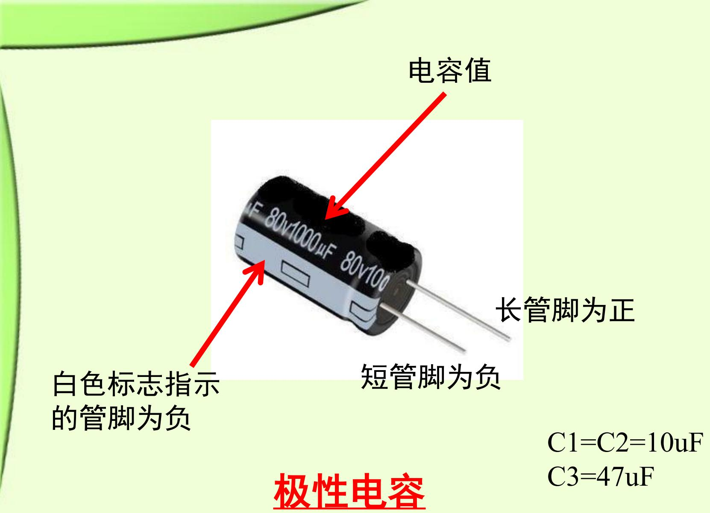

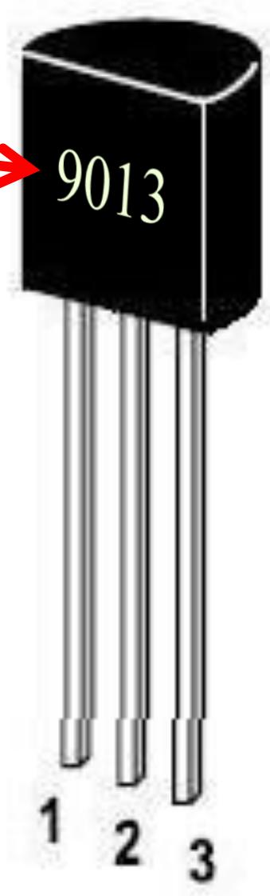

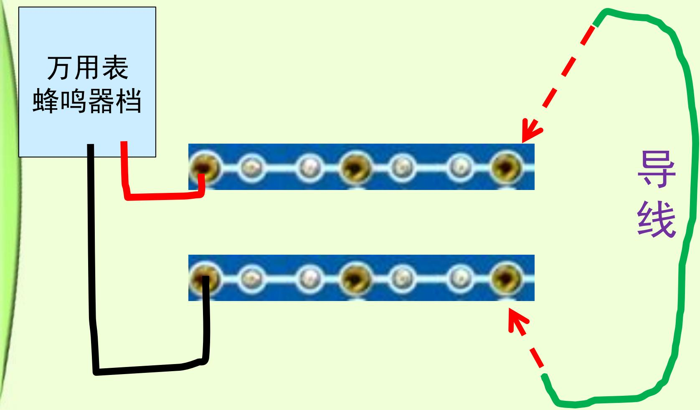

## 三、在实验箱上安装所设计电路

### 电源与地线连接

- **最上方长直线**：与 +12V 电源相连。
- **最下方长直线**：与 GND 相连。

实验箱接线区中，最上方的长直线和最下方的长直线，设计意图就是分别用作直流电源和地线。所以应当用导线使之分别与电路图中的 $E_c$ 和 GND 相连，不要另做他用。

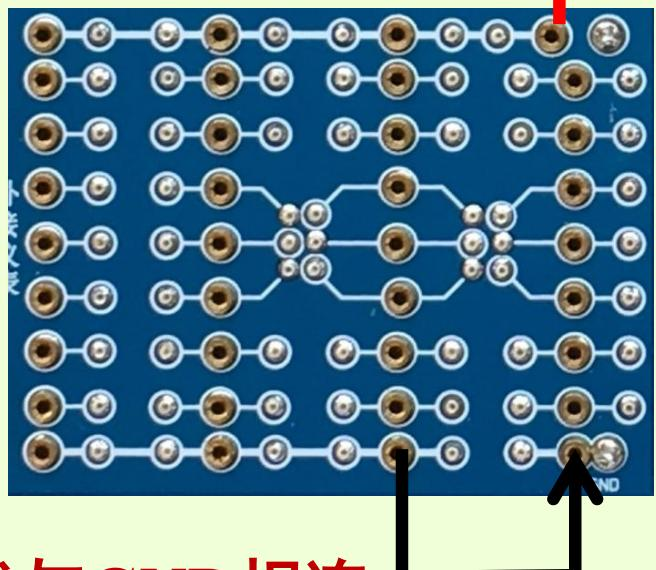

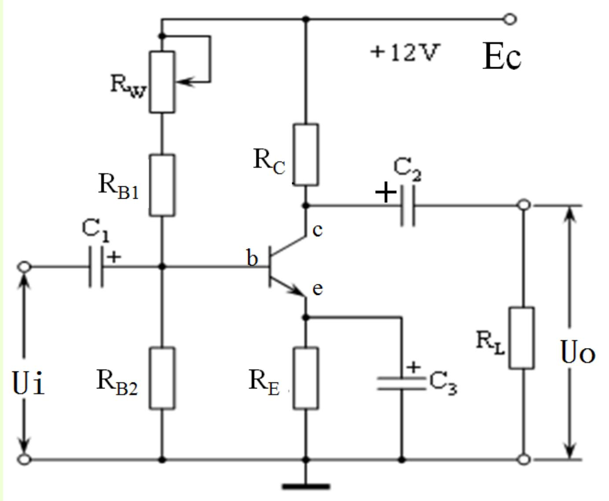

### 接线简化技巧

导线的连接，能少用线尽量少用，从而避免出错。尽量利用试验箱上已有的“白线”以及插孔之间的连接关系，来简化连线。

例如两个器件有一个管脚是相连的，完全可以将这两个管脚插在同一根白线连接的插孔上，从而省去之间的导线。

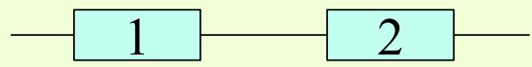

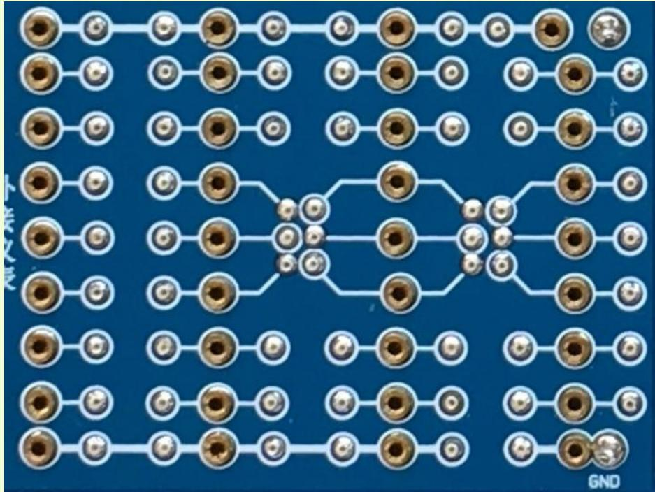

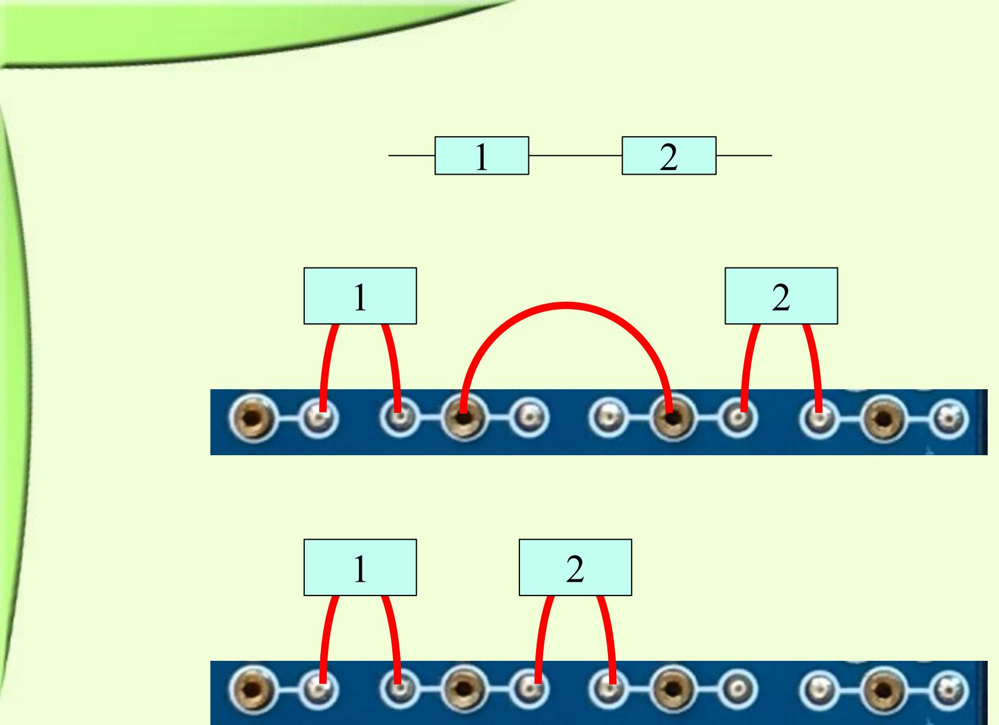

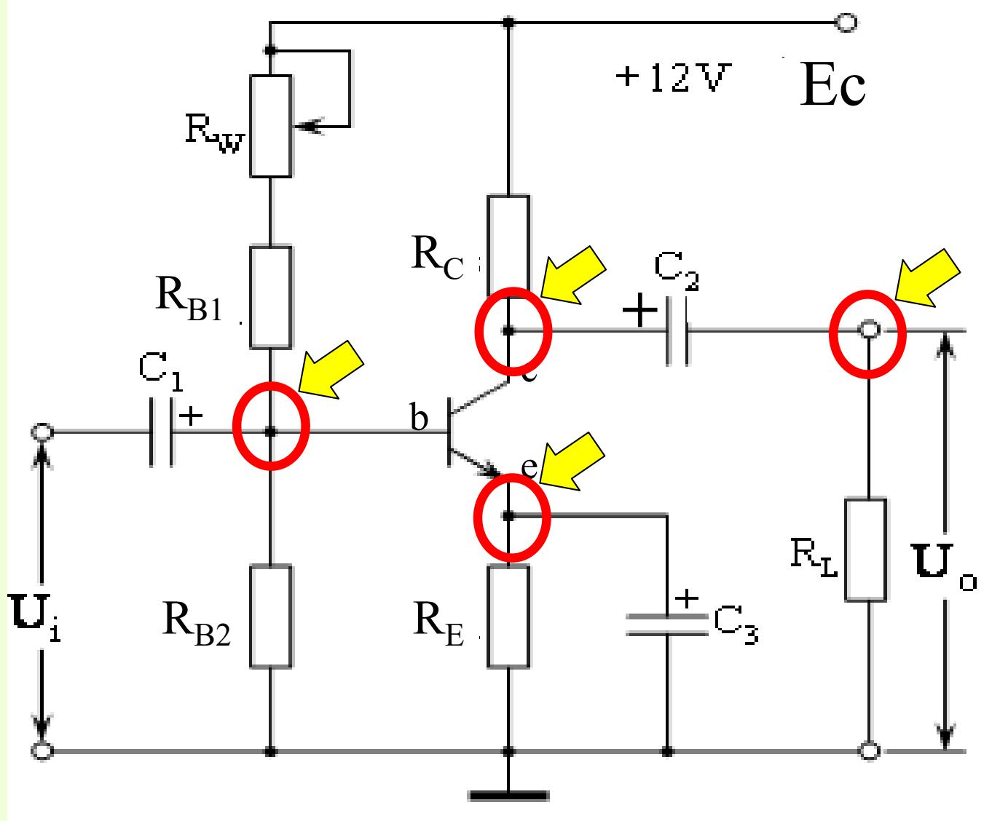

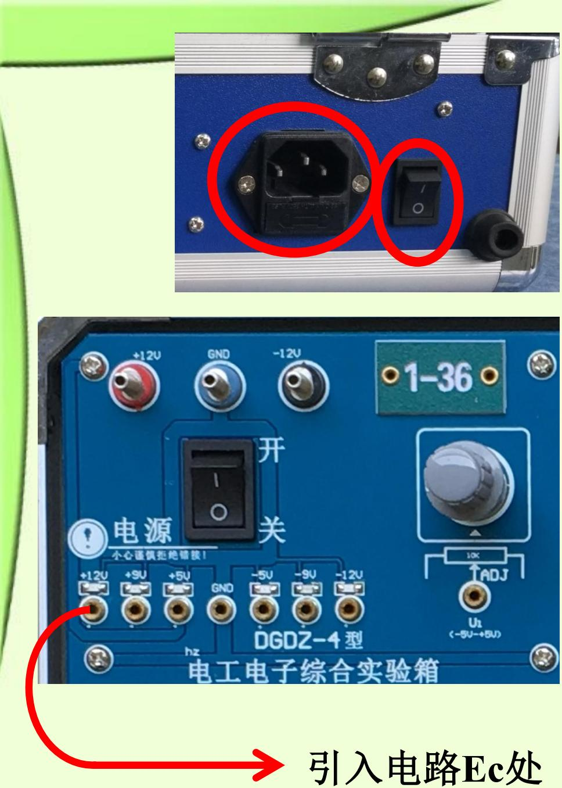

引入电路 $E_c$ 处

### 实验箱电源的使用方法

1. 在实验箱后插好电源线，并打开插孔边的开关（并不是面板上的开关！）。
2. 看到 ±12V、±9V、±5V 各指示灯亮，说明实验箱供电正常。
3. 从需要的插孔（+12V）里用导线引出电源，到工作电路中。

## 四、接线提示（重要！）

要按照一定的思路进行接线：

1. 连接“集电极—发射极”一路：
   从 $E_c$ 到 $R_C$ 到三极管 C 极，三极管 E 极到 $R_E$ 到 GND。
2. 连接 $E_c - R_W -$ 基极 B — $R_{B2}$ 一路。
3. 连接“输入端 $U_i$ — 电容 $C_1$ — 基极 B”一路。
4. 连接“集电极 C — 电容 $C_2$ — $R_L$ — GND”一路。
5. 最后检查还有没有遗漏之处（$R_E$ 旁的电容 $C_3$）。

每条线连接完以后，在书上电路图中，用铅笔做记号，表示完成。这样可以有效地辅助接线。

全部连线完成后，先自行对照电路图检查是否正确，然后同学间互相检查，训练对电路图的理解和查错能力。

## 五、测量放大电路的静态工作点

**注意：** 此时不可以加入任何的交流信号 $U_i$。

### 静态工作点参数表

| 参数名称 | $I_{CQ}$ | $U_{EQ}$ | $U_{CEQ}$ | $U_{BQ}$ | $I_{EQ}$ |
| :--- | :--- | :--- | :--- | :--- | :--- |
| 理论值 | 2mA | 2V | 6V | 2.7V | 2mA |
| 实测值 | | | | | |

### $U_{EQ}$ 的测量

电压表接在 $R_E$ 两端，读取电压值。

由于理论计算时，$U_{EQ}$ 预计为 2V，需要调节电位器 $R_W$ 来使电路达到这个状态，使得 $U_{EQ} = 2 \mathrm{V}$，使静态工作点确定在预计的点上，之后就不再调节 $R_W$。

### $U_{BQ}$ 的测量

如果直接万用表测 B 点电压，由于 B 点与地之间有大电阻 $R_{B2}$，万用表内阻的影响将不可忽略。

为了减小万用表内阻的影响可用间接法测量，即由 $U_{BQ} = U_{EQ} + U_{BEQ} = U_{EQ} + 0.7 \mathrm{V}$ 得到。

### $U_{CEQ}$ 的测量

可用万用表直接测出 C、E 之间电位差。

### $I_{CQ}, I_{EQ}$ 的测量

- **直接测量**：可将电流表串接在集电极支路或发射极支路中直接测出。（要改电路，所以不推荐用此方法）
- **间接测量**：先测出射极电阻 $R_E$ 上的压降 $U_{EQ}$，然后由 $I_{EQ} = U_{EQ} / R_E$ 算出 $I_{EQ}$ 的值。同样，测电阻 $R_C$ 两端压降然后除以 $R_C$ 得到 $I_{CQ}$。

### 测量结果记录

测量静态工作点，填表：

| 参数名称 | $I_{CQ}$ | $U_{EQ}$ | $U_{CEQ}$ | $U_{BQ}$ | $I_{EQ}$ |
| :--- | :--- | :--- | :--- | :--- | :--- |
| 理论值 | 2mA | 2V | 6V | 2.7V | 2mA |
| 实测值 | | | | | |

## 六、测量主要指标：电压放大倍数，输入电阻，输出电阻

### $A_u$ 的测量

由 $A_u = U_o / U_i$ 计算，必须先测出 $U_o$ 和 $U_i$，测量电路如下图：

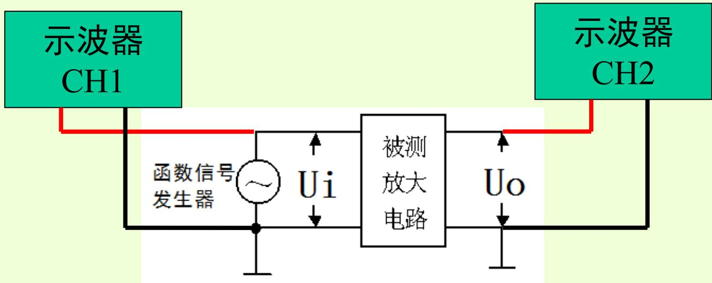

**操作步骤：**
1. 信号发生器产生 $3 \mathrm{kHz}$，5mVrms，无直流偏移的正弦信号。
2. 用示波器 CH1、CH2 分别看 $U_i$ 和 $U_o$ 两路。
3. **触发源如何选？** （需根据实际示波器操作选择，通常选 CH1 作为触发源以稳定 $U_i$ 波形）
4. 测量模式调出两路通道的 Vrms 值。
5. 应当能看到 CH2 正弦波波形，注意“清晰完整”的要求。

## 实验内容：测量上下限频率，逐点测量幅频特性，绘制幅频特性曲线

电路如下图示。每次改变信号源频率，都必须保证 CH1 有效值 5 mV 不变（为何？）

示波器 CH1　示波器 CH2

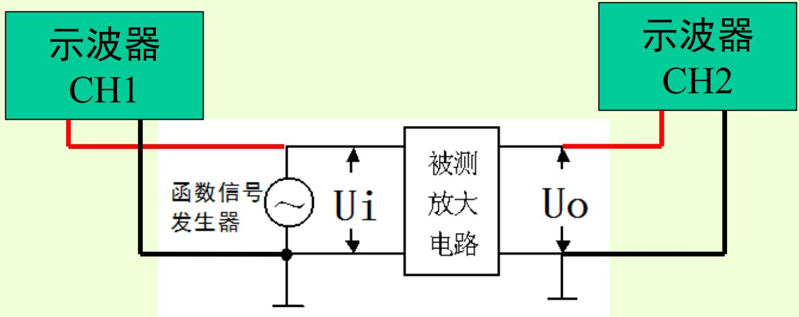

### 上、下限频率点 $\mathbf{f_L}$ 和 $\mathbf{f_H}$

测量中，必须始终保持 $\mathrm{CH1}=5\,\mathrm{mV}$。

我们已经测过中频范围的 3 kHz 这个频率点，可以认为它对应的幅值 $U_o$ 是最大值，两个半功率点所对应的幅值应该是这个值的 0.707 倍。

从 $f=3\,\mathrm{kHz}$ 开始，逐渐减小频率，观察 CH2 有效值。当其减小到最大值的 0.707 倍时即可。

但必须保证 CH1 有效值在 5 mV，波形“清晰完整”，此时的频率即为 $f_L$。

$f_H$ 测量思路相同（频率增大，注意水平档位的调节）。

$$
\begin{array}{r l}
f_L & \sim 200\ \mathrm{Hz} \\
f_H & \sim 800\ \mathrm{kHz}
\end{array}
$$

### 逐点测量幅频特性，绘制幅频特性曲线

测出 $f_L$ 和 $f_H$ 后，还要测出 5 个频带内的点，和 2 个频带外的频率点，并画出幅频曲线。

幅频曲线，由于频率取值范围较大（$10^2\ \mathrm{Hz}\sim10^6\ \mathrm{Hz}$），因此横坐标通常不采用普通的线性坐标轴，而采用对数坐标轴。

因此频率点的选取也应采用“指数增长式”，而不是“平均分布式”。

“指数增长”式取频率点：

举例：$f_L=200\,\mathrm{Hz}$，$f_H=800\,\mathrm{kHz}$，要求中间取 5 个点，即需要增加 6 次：

$$
\sqrt[6]{800k/200}=3.98\approx 4
$$

因此，各点频率依次应大约为前一个点的 4 倍，即 200 Hz，800 Hz，3.2 kHz，12.8 kHz，50 kHz，200 kHz，800 kHz。这样的取值方式，在对数坐标轴上，将会呈现均匀分布，可以在频率发生大数量级变化时，全面展示幅值的变化特性。

频带外的两个频率点也应当如此取值，分别为 50 Hz，3.2 MHz。

每个待测频率点上，保持 CH1 有效值 5 mV！波形清晰完整。

| 50 Hz | 200 Hz | 800 Hz | 3.2 kHz | 12.8 kHz | 50 kHz | 200 kHz | 800 kHz | 3.2 MHz | 12.8 MHz |
| --- | --- | --- | --- | --- | --- | --- | --- | --- | --- |

在线性坐标纸上也可以画出此图，只需要将原来横坐标的 0，10，20，30，40……这些整数刻度，重新标记为 12 Hz，50 Hz，200 Hz，800 Hz，3.2 kHz。

## 实验内容：测出最大不失真输出电压 $\mathbf{U_{OPP}}$

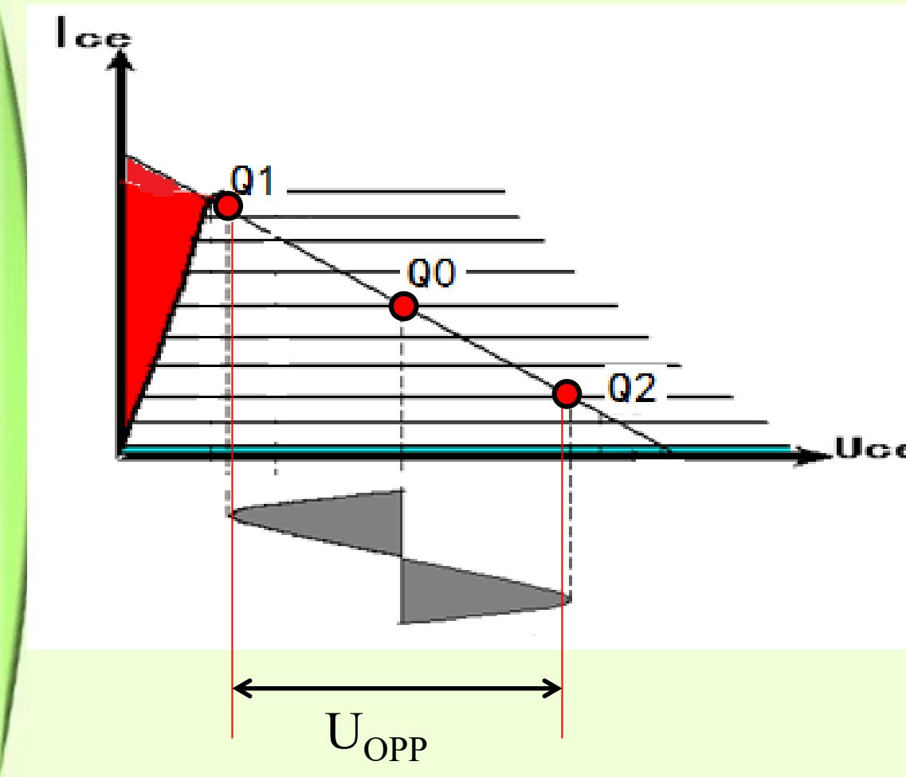

### 三极管静态工作点为 $Q_0$

当输入小信号 $U_i$ 时，工作点在 $Q_0$ 附近周期性地移动，从而产生了输出信号 $U_o$。

$U_i$ 的幅值决定了 $U_o$ 的幅值。

$U_i$ 的值增大，可能导致 $Q_1$、$Q_2$ 点进入饱和区或截止区，从而产生波形失真。

波峰展宽的波形（削顶失真）

在当前的工作频率点上（比如 12.8 kHz），尝试增大 $U_i$，并观察示波器上 $U_o$ 的波形，观察到 $U_o$ 增大的现象，但是又不至于产生失真，达到一个极限（波峰或波谷开始明显展宽）。

测出这个极限状态下，$U_o$ 的峰峰值 $U_{OPP}$。

为满足电路设计要求，应有 $U_{OPP}\geq 2\,\mathrm{V}$。

## 课后思考题

### 思考 1

分析各电阻、电源的变化对电路性能指标的影响。公式分析，或者借助软件模拟进行分析。

### 思考 2

能够用数字万用表测量？数字万用表只能测量 <500 Hz 的交流信号。
