# 《电路分析与电工电子技术》期末复习要点（课件）

原件经识别和整理；“参考解答”是我们补的。

### 第一章 电路分析的基本概念和基本定律

重要知识点：

1. 参考方向的概念
2. 功率的计算
3. KCL 方程、KVL 方程
4. 等效电阻的计算（含受控源）

知识点：[电流、电压的参考方向及关联参考方向](../../../topics/电路与电子技术/参考方向.md)、[元件吸收与产生功率的计算与判断](../../../topics/电路与电子技术/功率计算.md)、[基尔霍夫电流定律（KCL）及其应用](../../../topics/电路与电子技术/KCL.md)

### 第二章 电路的一般分析方法

重要知识点：

1. 戴维南模型
2. 诺顿模型
3. 网孔电流分析法
4. 节点电压分析法
5. 叠加定理

知识点：[基尔霍夫电流定律（KCL）及其应用](../../../topics/电路与电子技术/KCL.md)、[四种受控电源（VCVS、VCCS、CCVS、CCCS）的特性](../../../topics/电路与电子技术/受控电源.md)

### 电路定理 叠加定理

叠加定理：在线性电路中，由多个独立电源共同作用在某一支路中产生的电压（或电流）等于电路中每个独立电源单独作用时在该支路产生的电压（或电流）的代数和。

知识点：[理想电压源与理想电流源的特性](../../../topics/电路与电子技术/独立电源.md)、[基尔霍夫电压定律（KVL）及其应用](../../../topics/电路与电子技术/KVL.md)、[线性时不变电阻的伏安关系（欧姆定律）](../../../topics/电路与电子技术/线性电阻VCR.md)

### 等效电源定理

在电路分析中，若只需求出复杂电路中某一特定支路的电流或电压时，应用等效电源定理计算比较方便。

- 戴维南定理
- 诺顿定理

知识点：[理想电压源与理想电流源的特性](../../../topics/电路与电子技术/独立电源.md)、[线性时不变电阻的伏安关系（欧姆定律）](../../../topics/电路与电子技术/线性电阻VCR.md)、[基尔霍夫电压定律（KVL）及其应用](../../../topics/电路与电子技术/KVL.md)

### (1) 戴维南定理

戴维南定理：任意一个线性有源单口网络，就其对外电路的作用而言，总可以用一个理想电压源和一个电阻串联的支路来等效。

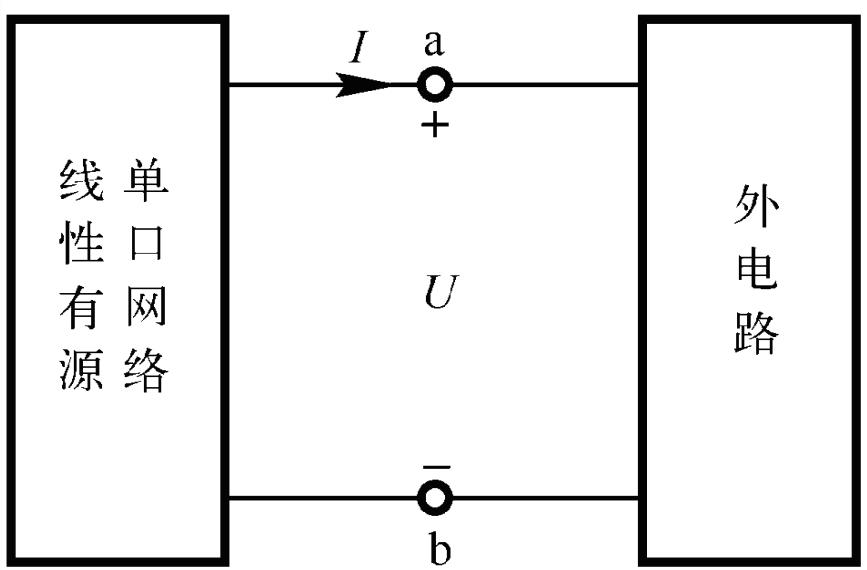

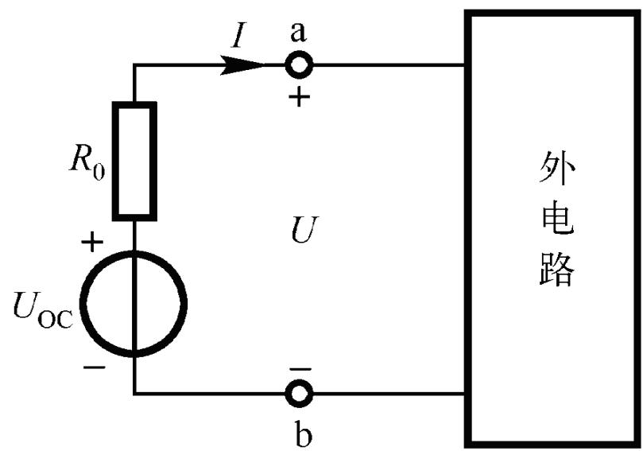

含源线性电阻单口网络的等效电路。只要确定 $u_{oc}$、$i_{sc}$ 或 $R_{o}$ 就能求得两种等效电路。

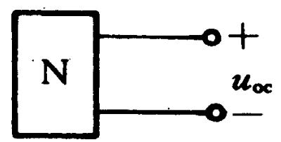

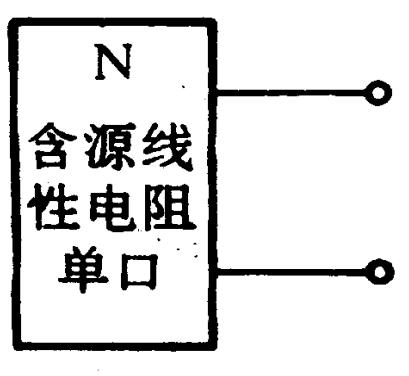

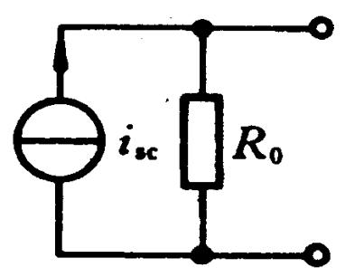

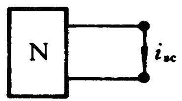

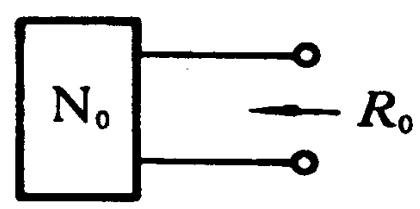

例 求等效电阻 $R_{ab}$。（也称输入电阻）

$$
\begin{array}{c} \text {   R } _ {2} \quad i \quad a + \\ \text {   R } _ {1} \quad u \\ \text {   b } ^ {-} \end{array}
$$

例 求等效电阻 $R_{ab}$。（也称输入电阻）

$$
\begin{array}{c} \text {   R } _ {2} \quad i \quad a + \\ \text {   R } _ {1} \quad u \\ \text {   b } ^ {-} \end{array}
$$

解：端口加电压 $u$，设电流 $i$。

列端口 VCR：$u = R_{2}i + R_{1}(i - 4i)$

$$
R _ {\mathrm{ab}} = \frac {u}{i} = R _ {2} - 3 R _ {1}
$$

知识点：[四种受控电源（VCVS、VCCS、CCVS、CCCS）的特性](../../../topics/电路与电子技术/受控电源.md)、[线性时不变电阻的伏安关系（欧姆定律）](../../../topics/电路与电子技术/线性电阻VCR.md)、[基尔霍夫电压定律（KVL）及其应用](../../../topics/电路与电子技术/KVL.md)

### 第二章 动态电路的暂态分析

重要知识点：

1. 换路定则
2. 零输入响应、零状态响应的概念
3. 全响应的分析

换路定则（或开闭定理）：

1. 若电容中电流不为无穷大，则电容电压不会跳变，即：$u_{\mathrm{C}} (0^{+}) = u_{\mathrm{C}} (0^{-})$；
2. 若电感中电压不为无穷大，则电感电流不会跳变，即：$i_{\mathrm{L}} (0^{+}) = i_{\mathrm{L}} (0^{-})$。

知识点：[基尔霍夫电流定律（KCL）及其应用](../../../topics/电路与电子技术/KCL.md)、[基尔霍夫电压定律（KVL）及其应用](../../../topics/电路与电子技术/KVL.md)

### 一阶电路的全响应

全响应：由储能元件的初始储能和独立电源共同引起的响应。

全响应 = 零输入响应 + 零状态响应

也就是说电路的完全响应等于零输入响应与零状态响应之和。这是线性动态电路的一个基本性质，是响应可以叠加的一种体现。

$$
r (t) = r (\infty) + [ r (0 ^ {+}) - r (\infty) ] \mathrm{e} ^ {- \frac {t}{\tau}}, t > 0
$$

三要素：

- $r(0^{+})$ —— 响应的初始值
- $r(\infty)$ —— 响应的终值（稳态值）
- $\tau$ —— 时间常数，$\tau = RC$，$\tau = L/R$

适用于求全响应、零状态响应、零输入响应。

如图所示电路在 $t = 0$ 时闭合，求 $t > 0$ 时的 $u_{\mathrm{c}}$ 及 $i$。

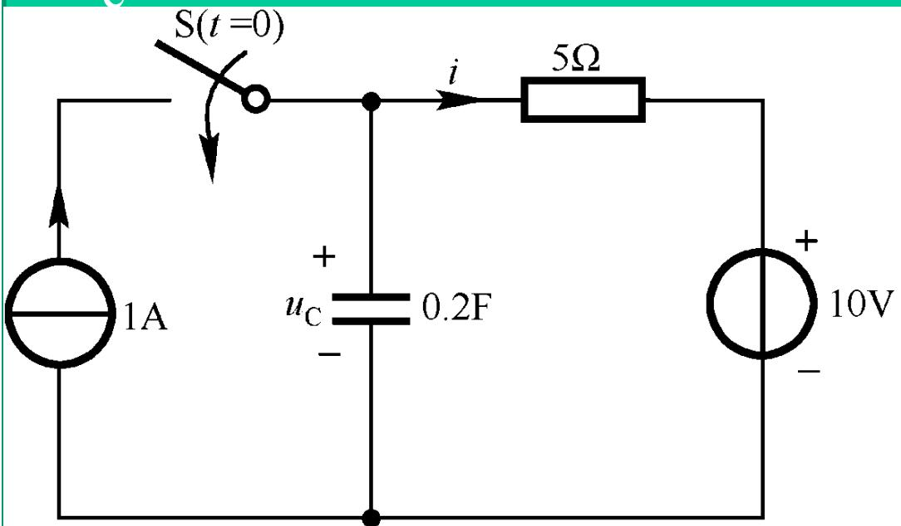

解：初始值

$$
u _ {\mathrm{C}} (0 _ {+}) = u _ {\mathrm{C}} (0 _ {-}) = 1 0 (\mathrm{V})
$$

稳态值

$$
\begin{array}{r l} u _ {\mathrm{c}} (\infty) & = 5 \times 1 + 1 0 \\ & = 1 5 (\mathrm{V}) \end{array}
$$

时间常数 $\tau = 0.2 \times 5 = 1(\mathrm{s})$。利用三要素法公式得

$$
u_{\mathrm{C}}(t) = u_{\mathrm{C}}(\infty) + [u_{\mathrm{C}}(0_{+}) - u_{\mathrm{C}}(\infty)]\mathrm{e}^{-\frac{t}{\tau}} = 15 - 5\mathrm{e}^{-t}(\mathrm{V})
$$

$$
i(t) = \frac{u_{\mathrm{C}} - 10}{5} = 1 - \mathrm{e}^{-t}(\mathrm{A})
$$

知识点：[理想电压源与理想电流源的特性](../../../topics/电路与电子技术/独立电源.md)、[线性时不变电阻的伏安关系（欧姆定律）](../../../topics/电路与电子技术/线性电阻VCR.md)、[元件吸收与产生功率的计算与判断](../../../topics/电路与电子技术/功率计算.md)

### 第四章 动态电路的暂态分析

重要知识点：

1. 相量的表示方式
2. 阻抗的串并联
3. 谐振的条件
4. 正弦稳态电路功率的计算

### 正弦量的相量表示

直角坐标形式：$A = a_{1} + \mathrm{j}a_{2}$

三角形式：$A = a (\cos \varphi + j \sin \varphi)$

指数形式：$A = a \mathrm{e}^{\mathrm{j}\varphi}$

极坐标形式：$A = a \angle \varphi$

$$
a _ {1} = a \cos \varphi \quad a _ {2} = a \sin \varphi
$$

$$
a = \sqrt {a _ {1} ^ {2} + a _ {2} ^ {2}} \quad \varphi = \operatorname{arctg} \frac {a _ {2}}{a _ {1}}
$$

有效值相量

正弦量有效值与振幅值的关系：

$$
F _ {\mathrm{m}} = \sqrt {2} F
$$

正弦量 $f(t)$ 的有效值相量

$$
\dot {F} = F \mathrm{e} ^ {\mathrm{j} \varphi} = F \angle \varphi
$$

$$
f (t) = F _ {\mathrm{m}} \cos (\omega t + \varphi) \longleftrightarrow \dot {F} _ {\mathrm{m}} = F _ {\mathrm{m}} \angle \varphi
$$

$$
f (t) = \sqrt {2} F \cos (\omega t + \varphi) \longleftrightarrow \dot {F} = F \angle \varphi
$$

### 阻抗和导纳的串并联

阻抗串联，分析 RLC 串联电路。

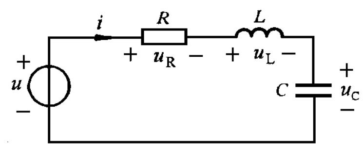

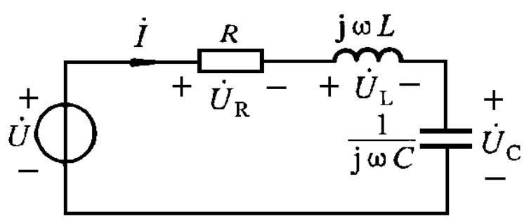

相量模型如图 (b) 所示。等效阻抗

$$
Z = \frac{\dot{U}}{\dot{I}} = R + \mathrm{j}\omega L + \frac{1}{\mathrm{j}\omega C} = R + \mathrm{j}(\omega L - \frac{1}{\omega C}) = R + \mathrm{j}X
$$

其中：$X = (\omega L - \frac{1}{\omega C})$

$$
| Z | = \sqrt {R ^ {2} + X ^ {2}} = \sqrt {R ^ {2} + (X _ {L} - X _ {C}) ^ {2}}
$$

$$
\theta_ {Z} = \operatorname{arctg} \frac {X}{R} = \operatorname{arctg} \frac {X _ {L} - X _ {C}}{R}
$$

当 $X = X_{\mathrm{L}} - X_{\mathrm{C}} > 0$ 时，$\theta_{\mathrm{Z}} > 0$，电压超前于电流，电路呈感性，等效为 $R$ 串联电感；当 $X = X_{\mathrm{L}} - X_{\mathrm{C}} < 0$ 时，$\theta_{\mathrm{Z}} < 0$，电流超前于电压，电路呈容性，等效为 $R$ 串联电容；当 $X = X_{\mathrm{L}} - X_{\mathrm{C}} = 0$ 时，$\theta_{\mathrm{Z}} = 0$，电压与电流同相，电路呈电阻性，等效为 $R$。

$u(t)=10\cos2t\,\mathrm{V}$。试求 $i(t)$，$u_{R}(t)$，$u_{L}(t)$，$u_{C}(t)$。

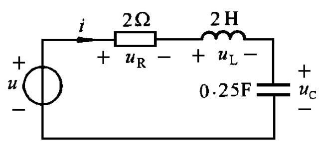

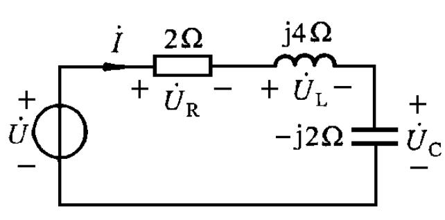

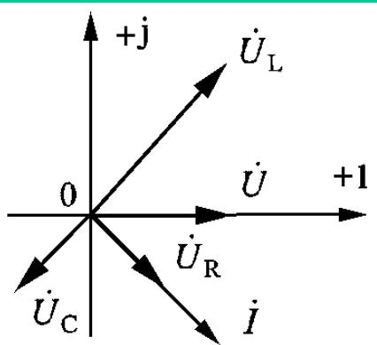

解：相量模型如图 (b) 所示。等效阻抗

$$
Z = Z_{R} + Z_{L} + Z_{C} = 2 + j4 - j2 = 2 + j2 = 2\sqrt{2}\angle 45^{\circ}\,\Omega
$$

相量电流

$$
\dot{I} = \frac{\dot{U}}{Z} = \frac{5\sqrt{2}\angle 0^{\circ}}{2\sqrt{2}\angle 45^{\circ}} = 2.5\angle -45^{\circ}\,\mathrm{A}
$$

# 电路分析与电工电子技术期末复习要点（课件）

本资料整理自《电路分析与电工电子技术》期末复习要点课件第 20–37 页，已修正识别错误并规范格式。

## 正弦稳态电路功率计算

知识点：[线性时不变电阻的伏安关系（欧姆定律）](../../../topics/电路与电子技术/线性电阻VCR.md)、[基尔霍夫电压定律（KVL）及其应用](../../../topics/电路与电子技术/KVL.md)

### 例题：求电压源发出的平均功率

**题干**：电路工作于正弦稳态，已知电压源电压为 $u_{s}(t)=2\sqrt{2}\cos t \text{ V}$。试求该电压源发出的平均功率。

**电路模型**：
- (a) 时域电路
- (b) 相量模型

**解**：
1. **建立相量模型**：电路的相量模型如图 (b) 所示。先求出连接电压源单口网络的等效阻抗 $Z$。
   $$
   Z = 0.5 + \mathrm{j}1.5 + \frac{(-\mathrm{j}1)(\mathrm{j}1 + 1 - \mathrm{j}1)}{1 - \mathrm{j}1} = 0.5 + \mathrm{j}1.5 + 0.5 - \mathrm{j}0.5 = 1 + \mathrm{j}1 \, \Omega
   $$

2. **求电流**：
   用欧姆定律求总电流 $\dot{I}_1$：
   $$
   \dot{I}_1 = \frac{\dot{U}_{\mathrm{s}}}{Z} = \frac{2 \angle 0^{\circ}}{1 + \mathrm{j}1} = \sqrt{2} \angle -45^{\circ} \text{ A}
   $$
   用分流公式求支路电流 $\dot{I}_2$：
   $$
   \dot{I}_2 = \frac{-\mathrm{j}1}{1 - \mathrm{j}1} \times \dot{I}_1 = \frac{-\mathrm{j}1}{\sqrt{2} \angle -45^{\circ}} \times \sqrt{2} \angle -45^{\circ} = -\mathrm{j}1 = 1 \angle -90^{\circ} \text{ A}
   $$

3. **求电源发出的平均功率**：可用以下几种方法验证。
   
   **方法一**：利用电压、电流有效值及阻抗角
   $$
   P_{\text{发出}} = U_{\mathrm{s}} I_1 \cos \theta_z = 2 \times \sqrt{2} \times \cos 45^{\circ} = 2 \text{ W}
   $$
   
   **方法二**：利用复功率
   $$
   \widetilde{S} = \dot{U}_{\mathrm{s}} \dot{I}_1^* = 2 \times \sqrt{2} \angle 45^{\circ} = 2 + \mathrm{j}2 \implies P = \operatorname{Re}(\widetilde{S}) = 2 \text{ W}
   $$
   
   **方法三**：利用电阻消耗功率之和
   $$
   P_{\text{发出}} = I_1^2 R_1 + I_2^2 R_2 = 2 \times 0.5 + 1 \times 1 = 2 \text{ W}
   $$
   
   **方法四**：利用总阻抗实部
   $$
   P_{\text{发出}} = I_1^2 \operatorname{Re}(Z) = I_1^2 \operatorname{Re}(1 + \mathrm{j}1) = 2 \times 1 = 2 \text{ W}
   $$

答案：$2 \text{ W}$。

## RLC串联谐振

知识点：[元件吸收与产生功率的计算与判断](../../../topics/电路与电子技术/功率计算.md)、[线性时不变电阻的伏安关系（欧姆定律）](../../../topics/电路与电子技术/线性电阻VCR.md)

### 第五章 半导体二极管及其基本电路（注：此处原文顺序跳跃，按课件逻辑整理）

#### RLC串联电路谐振条件与特性

**谐振条件**：
当电抗部分为零，即 $\omega L - \frac{1}{\omega C} = 0$ 时，$\theta_Z = 0$，$Z(j\omega) = R$，电压 $u(t)$ 与电流 $i(t)$ 相位相同，电路发生谐振。

**谐振频率**：
$$
\omega L - \frac{1}{\omega C} = 0 \implies \omega = \omega_0 = \frac{1}{\sqrt{LC}}
$$
$\omega_0$ 称为固有谐振角频率，简称谐振角频率。

用频率表示的谐振条件为：
$$
f = f_0 = \frac{1}{2\pi\sqrt{LC}}
$$

**特性阻抗**：
谐振时的感抗或容抗。
$$
\rho = \omega_0 L = \frac{1}{\omega_0 C} = \sqrt{\frac{L}{C}}
$$

**阻抗表达式**：
$$
Z(\mathrm{j}\omega) = \frac{\dot{U}}{\dot{I}} = R + \mathrm{j}\left(\omega L - \frac{1}{\omega C}\right) = R + \mathrm{j}X
$$
$$
= \sqrt{R^2 + X^2} \angle \arctan \frac{X}{R} = |Z(\mathrm{j}\omega)| \angle \theta_z
$$

知识点：[理想电压源与理想电流源的特性](../../../topics/电路与电子技术/独立电源.md)、[线性时不变电阻的伏安关系（欧姆定律）](../../../topics/电路与电子技术/线性电阻VCR.md)、[基尔霍夫电压定律（KVL）及其应用](../../../topics/电路与电子技术/KVL.md)

### 第五章 半导体二极管及其基本电路

- **重要知识点**：
  1. N型半导体、P型半导体概念
  2. 二极管基本模型
  3. 二极管限幅电路工作原理

#### 二极管等效电路模型

由于二极管的非线性特性，当电路加入二极管时，便成为非线性电路。实际应用时可根据二极管的应用条件作合理近似，得到相应的等效电路，化为线性电路。
$$
\text{非线性} \xrightarrow{\text{近似}} \text{线性}
$$

##### 一、理想二极管等效电路模型
- 特点：导通时压降为 0，截止时电流为 0。
- 适用：大信号粗略估算。

##### 二、恒压降等效电路模型
- 特点：导通时视为恒定电压源。
- 硅管：$U_{D(on)} \approx 0.7 \text{ V}$
- 锗管：$U_{D(on)} \approx 0.3 \text{ V}$

##### 三、折线等效电路模型
- 特点：包含一个恒压源和一个动态电阻。
- 硅管：$U_{D(on)} = 0.7 \text{ V}$
- 锗管：$U_{D(on)} = 0.3 \text{ V}$

#### 二极管限幅电路

**判别原则**：
当 $u_i - E \geq U_{D(ON)}$ 时，V 导通；否则截止。

**实例分析**：
设 $E = 2 \text{ V}$，$U_{D(ON)} = 0.7 \text{ V}$。
1. 当 $u_i \geq 2.7 \text{ V}$ 时，V 导通，$u_o = E + 0.7 = 2.7 \text{ V}$。
2. 当 $u_i < 2.7 \text{ V}$ 时，V 截止（开路），$u_o = u_i$。

## 第六章 晶体管及其放大电路

- **重要知识点**：
  1. 放大、截至、饱和工作状态分析
  2. 放大电路失真的分析
  3. 共射放大电路、共集放大电路的分析

知识点：[理想电压源与理想电流源的特性](../../../topics/电路与电子技术/独立电源.md)、[线性时不变电阻的伏安关系（欧姆定律）](../../../topics/电路与电子技术/线性电阻VCR.md)、[基尔霍夫电压定律（KVL）及其应用](../../../topics/电路与电子技术/KVL.md)

### 晶体管工作状态判断例题

**题干**：晶体管电路如下图所示。已知 $\beta=100$，试判断晶体管的工作状态。
- 电路参数：$U_{BB}=5\text{V}, R_B=500\text{k}\Omega, R_E=1\text{k}\Omega, R_C=2\text{k}\Omega, U_{CC}=12\text{V}$（根据计算过程反推）。

**解**：

1. **判断是否截止**：
   $\because U_{BB} > U_{BE(on)}$ (通常取 0.7V)，且 $U_{BB} < U_{CC}$
   $\therefore$ 晶体管不截止。

2. **判断是放大还是饱和状态**：
   列写基极回路方程：
   $$
   U_{BB} - U_{BE(on)} = I_{BQ} R_B + (1 + \beta) I_{BQ} R_E
   $$
   求解基极电流 $I_{BQ}$：
   $$
   I_{BQ} = \frac{U_{BB} - U_{BE(on)}}{R_B + (1 + \beta) R_E} = \frac{5 - 0.7}{500 + 101 \times 1} \text{ mA} \quad (\text{注意单位换算，此处分母应为 } \Omega)
   $$
   *修正计算细节*：若 $R_B$ 单位为 $\text{k}\Omega$，则需统一单位。假设原题数据为 $R_B=500\text{k}\Omega$ 会导致电流极小，结合计算结果 $0.72 \times 10^{-2} \text{mA}$ 推测 $R_B$ 可能为 $500\Omega$ 或计算中单位处理有特定语境。
   
   按课件给出的计算过程：
   $$
   I_{BQ} = \frac{5 - 0.7}{500 + 101} = \frac{4.3}{601} \approx 0.00715 \text{ mA} = 0.72 \times 10^{-2} \text{ mA}
   $$
   *(注：此处课件原计算式分母数值直接相加，暗示 $R_B$ 与 $(1+\beta)R_E$ 同数量级，或者 $R_B$ 实际为 $500\Omega$)*

   计算集电极电流 $I_{CQ}$：
   $$
   I_{CQ} = \beta I_{BQ} = 100 \times 0.72 \times 10^{-2} = 0.72 \text{ mA}
   $$

   计算管压降 $U_{CEQ}$：
   $$
   U_{CEQ} = U_{CC} - I_{CQ} (R_C + R_E) = 12 - 0.72 \times (2 + 1) \approx 12 - 2.16 = 9.84 \text{ V}
   $$
   *(课件中计算结果为 $10\text{V}$，可能是取整或 $R_C+R_E$ 取值略有不同，如 $R_C=2, R_E=1$ 总和为 3k? 课件显示 $0.72 \times 3 \approx 2.16$, $12-2.16 \approx 10$ 是合理的近似)*
   
   最终判定：
   $\because U_{CEQ} > U_{BE(on)}$ (且 $U_{CEQ} > U_{CESat}$)
   $\therefore$ 晶体管处于**放大状态**。

知识点：[基尔霍夫电压定律（KVL）及其应用](../../../topics/电路与电子技术/KVL.md)、[线性时不变电阻的伏安关系（欧姆定律）](../../../topics/电路与电子技术/线性电阻VCR.md)、[理想电压源与理想电流源的特性](../../../topics/电路与电子技术/独立电源.md)

### 晶体管小信号模型

- **适用范围**：
  1. 只适用小信号交流分析
  2. 只针对低频

- **模型构成**：
  - B、E 间可用 $r_{be}$ 等效代替。
  - C、E 间可用受控电流源 $i_c = \beta i_b$ 等效代替。

# 《电路分析与电工电子技术》期末复习要点（课件）

整理自《电路分析与电工电子技术》期末复习要点（课件）第 3 部分（共 4 部分），识别工具读出的内容对应第 38–56 页。

## 一、交流参数指标计算

知识点：[四种受控电源（VCVS、VCCS、CCVS、CCCS）的特性](../../../topics/电路与电子技术/受控电源.md)、[线性时不变电阻的伏安关系（欧姆定律）](../../../topics/电路与电子技术/线性电阻VCR.md)

### 1. 计算电压放大倍数

**第一步：** 首先根据直流通路以及直流大信号等效电路求解出放大器的静态工作点。

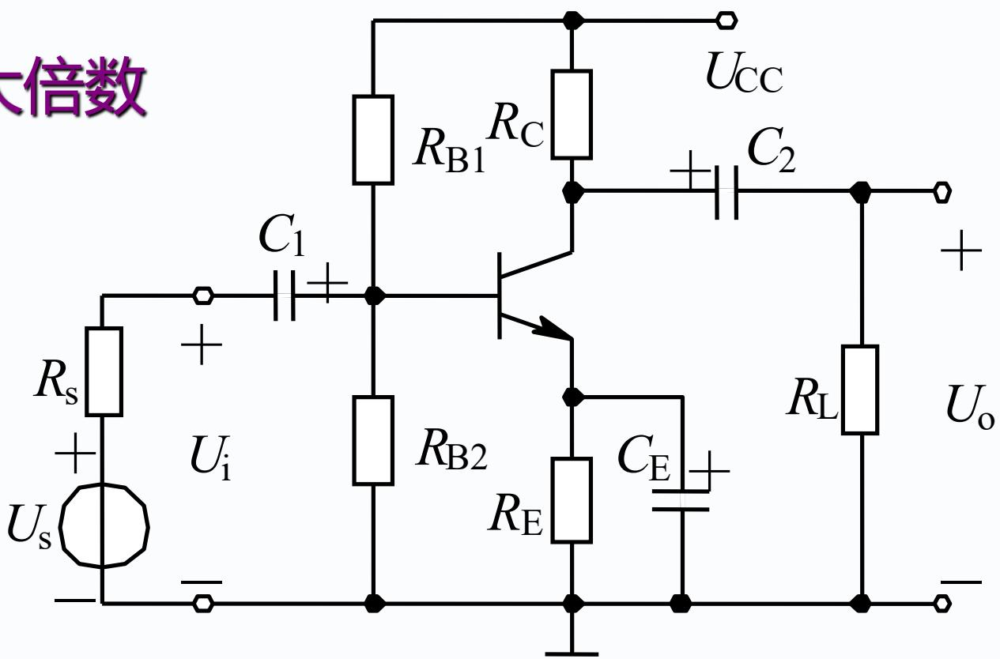

**第二步：** 画放大器的交流通路。然后将通路中的晶体管用等效小信号模型（微变等效电路）代替，再计算交流参数指标。

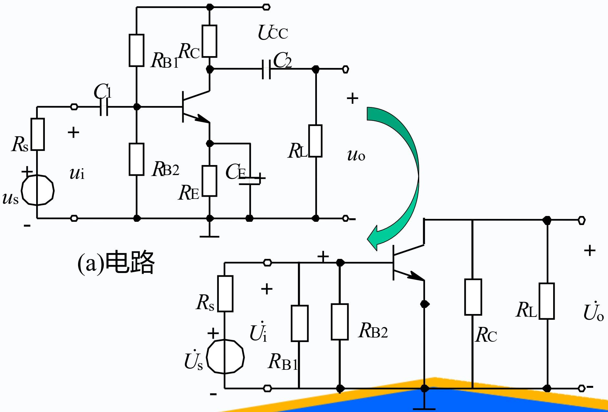

$$
\dot{U}_i = \dot{I}_b r_{be}
$$

$$
A_u = \frac{\dot{U}_o}{\dot{U}_i}
$$

$$
\dot{U}_o \approx -\beta \dot{I}_b (R_C \| R_L)
$$

$$
A_u = \frac{\dot{U}_o}{\dot{U}_i} = -\frac{\beta (R_C \| R_L)}{r_{be}} = -\frac{\beta R_L'}{r_{be}}
$$

输出、输入电压反相。

知识点：[线性时不变电阻的伏安关系（欧姆定律）](../../../topics/电路与电子技术/线性电阻VCR.md)、[基尔霍夫电流定律（KCL）及其应用](../../../topics/电路与电子技术/KCL.md)、[基尔霍夫电压定律（KVL）及其应用](../../../topics/电路与电子技术/KVL.md)

### 2. 输入电阻 $R_i$

即从放大器输入端看进去的电阻： $R_i = \frac{U_i}{I_i}$

$$
R_i = \frac{U_i}{I_i} = R_{B1} \| R_{B2} \| r_{be} \approx r_{be}
$$

$R_i$ 表征放大器从信号源获得信号的能力。

知识点：[理想电压源与理想电流源的特性](../../../topics/电路与电子技术/独立电源.md)、[线性时不变电阻的伏安关系（欧姆定律）](../../../topics/电路与电子技术/线性电阻VCR.md)、[元件吸收与产生功率的计算与判断](../../../topics/电路与电子技术/功率计算.md)

### 3. 输出电阻 $R_o$

即从放大器输出端看进去的电阻： $R_o = \frac{U_o}{I_o}\Bigg|_{U_S = 0 \text{ 或 } I_S = 0}$

$$
R_o = \frac{U_o}{I_o} \Big|_{U_s = 0} = R_C
$$

$R_o$ 是一个表征放大器带负载能力的参数。

知识点：[理想电压源与理想电流源的特性](../../../topics/电路与电子技术/独立电源.md)、[线性时不变电阻的伏安关系（欧姆定律）](../../../topics/电路与电子技术/线性电阻VCR.md)

### 4. 源电压放大倍数 $A_{us}$

$$
A_{us} = \frac{U_o}{U_s} = \frac{U_i}{U_s} \cdot \frac{U_o}{U_i} = \frac{R_i}{R_s + R_i} A_u
$$

$$
\left| A_{us} \right| \leq \left| A_u \right|
$$

若 $R_i \gg R_s$ ，则： $A_{us} \approx A_u$

或者表示为：

$$
A_{us} = \frac{\dot{U}_o}{\dot{U}_s} = \frac{\dot{U}_i}{\dot{U}_s} \cdot \frac{\dot{U}_o}{\dot{U}_i} = \boxed{\frac{R_i}{R_s + R_i} A_u}
$$

$$
\left| A_{us} \right| \leq \left| A_u \right|
$$

若 $R_i \gg R_s$ ，则： $A_{us} \approx A_u$

## 二、基本共集放大电路（射极输出器）

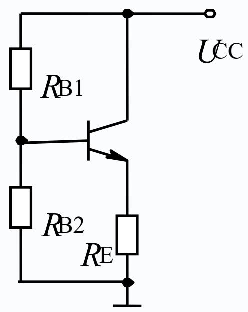

知识点：[基尔霍夫电压定律（KVL）及其应用](../../../topics/电路与电子技术/KVL.md)

### 一、静态分析

$$
U_{BQ} = \frac{R_{B2}}{R_{B1} + R_{B2}} \cdot U_{CC}
$$

$$
I_{EQ} = \frac{U_{BQ} - U_{BE(on)}}{R_E}
$$

$$
I_{CQ} \approx I_{EQ}, \quad I_{BQ} = \frac{I_{EQ}}{1 + \beta}
$$

$$
U_{CEQ} = U_{CC} - I_{CQ} R_E
$$

知识点：[理想电压源与理想电流源的特性](../../../topics/电路与电子技术/独立电源.md)、[线性时不变电阻的伏安关系（欧姆定律）](../../../topics/电路与电子技术/线性电阻VCR.md)、[基尔霍夫电压定律（KVL）及其应用](../../../topics/电路与电子技术/KVL.md)

### 二、动态分析

#### 1. 电压放大倍数 $A_u$

$$
U_o = I_e (R_E \parallel R_L) = (1 + \beta) I_b R_L'
$$

$$
U_i = I_b r_{be} + U_o = I_b r_{be} + (1 + \beta) I_b R_L'
$$

$$
A_u = \frac{U_o}{U_i} = \frac{(1 + \beta) R_L'}{r_{be} + (1 + \beta) R_L'}
$$

式中： $R_L' = R_E \parallel R_L$

$A_u < 1$ ，且接近 1，而且 $U_o$ 与 $U_i$ 同相。所以也称为射极跟随器。

#### 2. 输入电阻 $R_i$

$$
R_i' = r_{be} + (1 + \beta) R_L', \quad R_i = R_{B1} \| R_{B2} \| R_i'
$$

若 $r_{be}=1K\Omega, \beta=100, R_L'=1K\Omega$ 则： $R_i' = 102K\Omega$ 。$R_i$ 显著增大，所以共集电极电路具有高输入电阻的特性。

#### 3. 输出电阻 $R_o$

$$
R_o = \frac{U_o}{I_o} \Big|_{U_s = 0} = R_E \parallel R_o'
$$

$$
R_o' = \frac{U_o}{I_o'} = -\frac{U_o}{I_e} = -\frac{-I_b \times (R_s \| R_B + r_{be})}{(1 + \beta) I_b} = \frac{R_s \| R_B + r_{be}}{1 + \beta}
$$

$$
R_o = \frac{U_o}{I_o} \Big|_{U_s = 0} = R_E \parallel R_o' = R_E \parallel \frac{r_{be} + R_s'}{1 + \beta}
$$

式中：

$$
R_s' = R_s \| R_{B1} \| R_{B2}
$$

$\frac{R_s' + r_{be}}{1 + \beta}$ 是基极支路的电阻折合到射极的等效电阻。

若 $r_{be}=2K\Omega, \beta=100, R_S'=1K\Omega$

则： $R_o \approx 29.7\Omega$ 。输出电阻小。

## 三、第七章 集成运放及其放大电路

重要知识点:

1. 理想运放的特点
2. 反馈类型的判断

# 《电路分析与电工电子技术》期末复习要点（课件）第 4 部分

本部分内容整理自《电路分析与电工电子技术》期末复习要点课件第 57–58 页，主要涵盖理想运算放大器的特性参数及负反馈放大电路的四种组态示意图。

## 一、理想集成运算放大器

由于运放具有开环放大倍数很大，输入电阻高，输出电阻低等特性，在分析时常将其理想化，称为理想运放。

知识点：[基尔霍夫电压定律（KVL）及其应用](../../../topics/电路与电子技术/KVL.md)、[基尔霍夫电流定律（KCL）及其应用](../../../topics/电路与电子技术/KCL.md)、[电流、电压的参考方向及关联参考方向](../../../topics/电路与电子技术/参考方向.md)

### 理想运放的主要参数

| 差模电压增益 | $A_{ud}=\infty$ | 差模输出电阻 | $R_{od}=0$ |
| :--- | :--- | :--- | :--- |
| 差模输入电阻 | $R_{id}=\infty$ | 输入偏置电流 | $I_{IB}=0$ |
| 共模抑制比 | $K_{CMR}=\infty$ | 失调电流 | $I_{IO}=0$ |
| 频带宽度 | $BW_{-3dB}=\infty$ | 失调电压 | $U_{IO}=0$ |
| 转换速率 | $S_{R}=\infty$ | 失调电流温漂 | $dI_{IO}/dT=0$ |
| 噪声电压 | $U_{N}=0$ | 失调电压温漂 | $dU_{IO}/dT=0$ |

## 二、负反馈放大电路的组态

 a.电压并联负反馈

 b.电压串联负反馈

 c.电流串联负反馈

 d.电流并联负反馈

知识点：[四种受控电源（VCVS、VCCS、CCVS、CCCS）的特性](../../../topics/电路与电子技术/受控电源.md)
