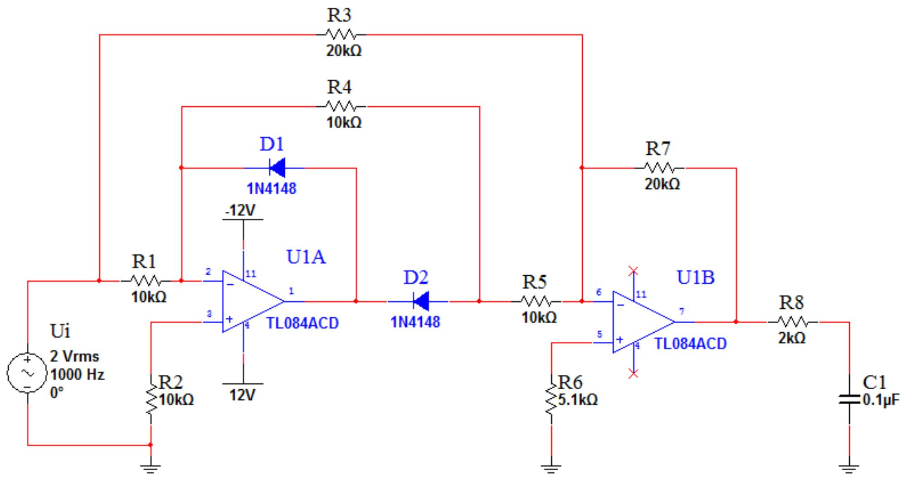
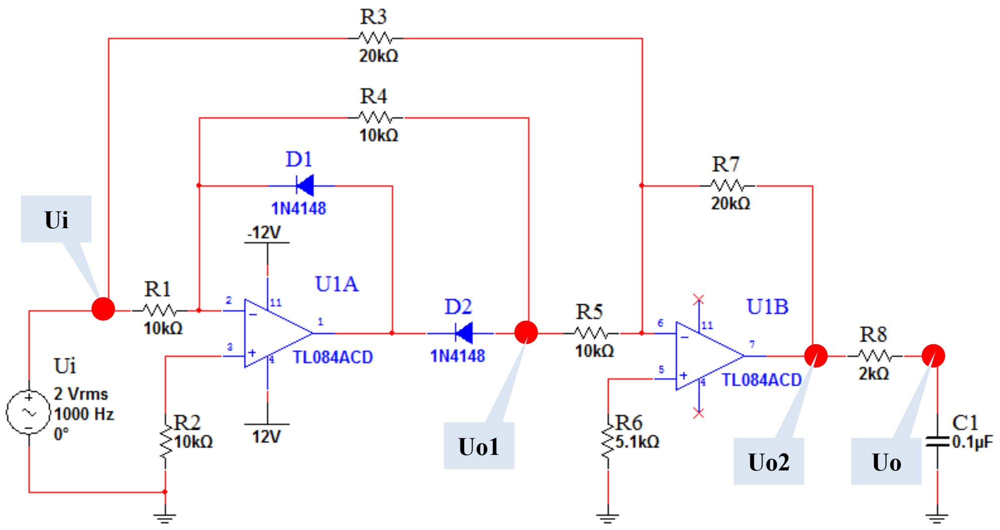
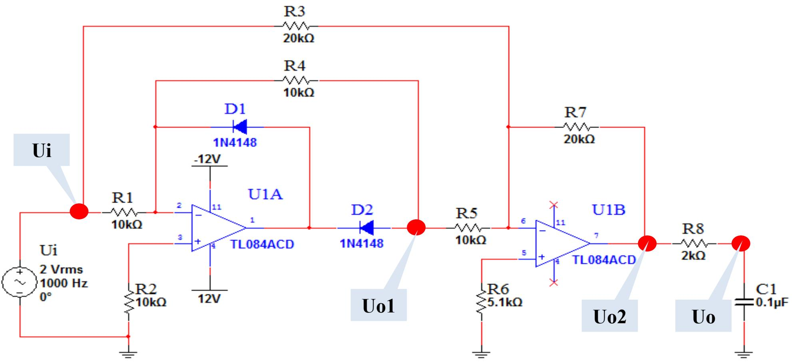
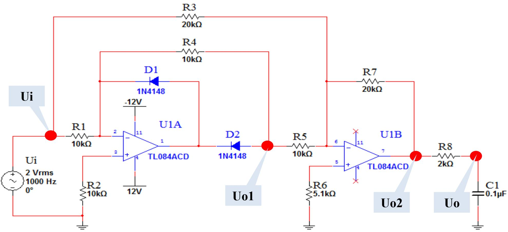
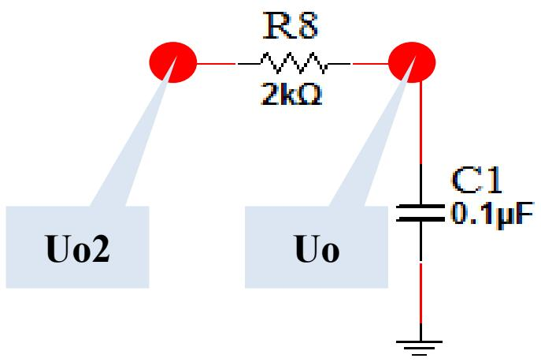
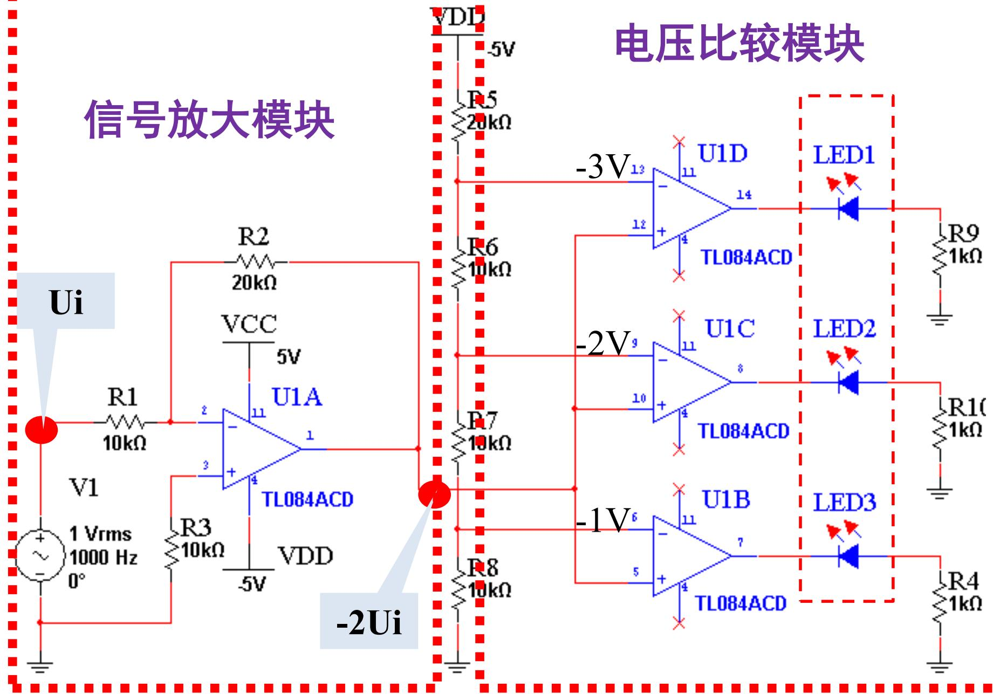

# 《电路分析与电工电子技术》期末考试应试要点与操作题范围（第十课：交流信号幅度判别与全波精密整流）

原件经识别和整理；“参考解答”是我们补的。

---
title: 《电路分析与电工电子技术》期末考试应试要点与操作题范围（第十课：交流信号幅度判别与全波精密整流）
kind: 复习要点
course: 电路分析与电工电子技术
term: 
source: 
---

# 《电路分析与电工电子技术》期末考试应试要点与操作题范围（第十课：交流信号幅度判别与全波精密整流）

本资料整理自课程复习要点，涵盖期末考试的问答题与操作题范围、考试注意事项、故障排查指南以及“全波精密整流”与“交流信号幅度判别”两个核心实验的原理与步骤。

## 一、期末考试应试要点

### 1. 试卷范围概览

| 卷号 | 问答题内容 | 操作题内容 |
| :--- | :--- | :--- |
| 1 | 仪器、模电实验、电分实验 | 串联谐振电路 |
| 2 | 仪器、运放、电分实验 | 晶体管单级放大器 |
| 3 | 仪器、运放、电分实验 | 差动放大器 |
| 4 | 仪器、模电实验、电分实验 | 运放非线性运用(方波发生器) |
| 5 | 仪器、模电实验、电分实验 | 运放非线性运用(文氏桥正弦振荡电路) |
| 6 | 仪器、模电实验、电分实验 | 精密整流电路 |
| 7 | 仪器、模电实验、电分实验 | 运放线性运用 (加法器) |
| 8 | 仪器、模电实验、电分实验 | 运放线性运用 (加法器) |

知识点：[理想电压源与理想电流源的特性](../../../topics/电路与电子技术/独立电源.md)、[四种受控电源（VCVS、VCCS、CCVS、CCCS）的特性](../../../topics/电路与电子技术/受控电源.md)、[线性时不变电阻的伏安关系（欧姆定律）](../../../topics/电路与电子技术/线性电阻VCR.md)

### 2. 考试要点提醒

- 根据试题范围做好复习工作。
- 带好书本、所有实验报告、手写的笔记、计算器。
- **不允许**携带和使用电脑、手机、任何打印/复印资料。
- 提前 15 分钟进入考场，准备好学生证和身份证，将考试无关物品收入书包放到讲台前，手机必须关机或静音，放入书包。
- 开考前可以先检查实验箱、电源、示波器、信号发生器等，如有硬件问题，及时向监考老师提出。
- 尽量自带万用表。检查所有要用的导线（尽量用短导线），运放（如有需要）。
- 考试时间 110 分钟，前 80 分钟用于完成操作题（每人有且仅有一次验收机会），后 30 分钟完成问答题。

### 3. 操作题命题思路与评分标准

操作题命题是在原来课堂做实验的基础上，对参数稍微修改，需要考生进行一些思考和变通。分为四个小题：

**第一小题：设计电路**
- 包含相关的计算和问答。
- 要有设计过程、计算过程，就算做错，也有过程分。
- 画电路图注意画图规范，直尺画图！注意数据单位等。

**第二、三小题：现场搭设与观察**
- 由监考老师根据考生搭设的电路和实验现象当场打分。
- 搭电路要细心，按照思路，完成一条线做一个记号，确保万无一失。
- 看清楚题目要求，明确要观察什么信号，用示波器的哪路通道观察，观察哪一项参数。
- 最终的观测信号一定要清晰、完整、稳定。
- 如果题目不会做，只要实验箱上有一些线路、元件，就会有保底分。

**第四小题：绘制波形图**
- 按照画图的规范，直尺画图，相应的参数要标注，注意数据单位。
- 如果实验现象出不来，如果对理论足够熟悉，也完全可以通过分析计算，画出波形图，得到分数。

### 4. 常见故障排查

**Q: 操作题电路已完成，但是出不了现象，或者现象错误怎么办？**

1. 先仔细检查线路、元件和它们的位置是否有错。
2. 检查示波器：通道、耦合方式、触发源等是否选择错误；检查信号发生器：波形是否选择错误、通道是否正确、参数的单位是否正确、Output 是否打开。
3. 用万用表蜂鸣器档逐一检查导线是否都导通，顺便将所有导线、元件重新插拔一遍，以防是接触不良。元件都尽量插到底，否则容易接触不良。

**Q: 如果以上都仔细检查，还是发现不了问题？**

拆掉所有线路。让自己安静五分钟。改变插线区域，从头开始。操作题时间共 80 分钟，足够将任何一个实验完成两遍以上。

知识点：[基尔霍夫电流定律（KCL）及其应用](../../../topics/电路与电子技术/KCL.md)、[基尔霍夫电压定律（KVL）及其应用](../../../topics/电路与电子技术/KVL.md)、[线性时不变电阻的伏安关系（欧姆定律）](../../../topics/电路与电子技术/线性电阻VCR.md)

### 5. 纪律与成绩评定

- 禁止作弊，禁止携带违禁物品。
- 不及格可以补考，但作弊将计入档案，没有商量的余地！
- 卷面分与平时分综合，得出最终成绩，评定优、良、中、及格、不及格。
- 不及格者下学期开始时有补考。
- 补考不通过者，下一学年重修。

### 6. 考试结束后事项

- 班长组织人员，按照日常要求整理实验桌，打扫教室卫生。
- 所有同学上交所有实验报告，每一个人按照实验顺序整理好所有报告，然后按照学号上交。
- 但最后一次实验报告不放在里面，像平常一样提交，以便批阅。

## 二、全波精密整流电路

知识点：[理想电压源与理想电流源的特性](../../../topics/电路与电子技术/独立电源.md)、[线性时不变电阻的伏安关系（欧姆定律）](../../../topics/电路与电子技术/线性电阻VCR.md)、[元件吸收与产生功率的计算与判断](../../../topics/电路与电子技术/功率计算.md)

### 1. 原理概述

可以对正弦信号进行半波整流，得到只有正相电压的脉动直流信号，再经过低通滤波，将高频谐波分量滤除，得到近似的直流电压输出。

在本电路中，利用了二极管的正向导通特性，和运算放大器的线性特性，来实现全波整流的目的。

对于右边的运放来说，它构成了一个二输入的反向加法器，两个输入端分别为 $U_i$ 和 $U_{o1}$，经过各自的比例系数 $(-R_7/R_3) = -1$ 和 $(-R_7/R_5) = -2$ 再叠加，得到：

$$
U_{o2} = -U_i + (-2)(-U_i) = U_i
$$

*(注：此处原文推导存在逻辑跳跃，通常全波精密整流在 $U_i > 0$ 时，$D_1$ 截止，$D_2$ 导通，$U_{o1}$ 为负值反馈，使得 $U_{o2}$ 跟随 $U_i$ 或呈现特定关系，具体需结合完整电路图确认。此处保留原文文字描述及公式结构)*

当 $U_i < 0$ 时，$U_i$ 经过运放先输出一个正电压，使二极管 D1 导通，将电阻 R4 短路，二极管 D2 也截止，所以 $U_{o1} = 0\text{V}$。

对于右侧运放来说，二输入反向加法器其实变成了单输入的反向放大电路，只有 $U_i$ 一路输入，比例系数为 $(-R_7/R_3) = -1$。

$$
U_{o2} = -U_i
$$

最后是一个 RC 低通滤波电路，将频率较高的分量经过电容 C1 导通到地，最终，$U_o$ 只保留低频分量。

知识点：[基尔霍夫电压定律（KVL）及其应用](../../../topics/电路与电子技术/KVL.md)、[基尔霍夫电流定律（KCL）及其应用](../../../topics/电路与电子技术/KCL.md)

### 2. 实验内容

1. 连接电路，$U_i$ 为 2Vpp，1kHz 的正弦信号。
2. 观察和记录 $U_{o2}$ 和 $U_o$ 的波形，画在同一个坐标图中。注意耦合方式为“直流耦合”。
3. 如果图形不稳定，选择合适的触发源。
4. 测量模式测出 $U_{o2}$ 和 $U_o$ 的频率，最大值，最小值，标注在图中。

## 三、交流信号幅度判别电路

知识点：[理想电压源与理想电流源的特性](../../../topics/电路与电子技术/独立电源.md)、[线性时不变电阻的伏安关系（欧姆定律）](../../../topics/电路与电子技术/线性电阻VCR.md)、[电流、电压的参考方向及关联参考方向](../../../topics/电路与电子技术/参考方向.md)

### 1. 原理概述

对于输入的交流信号，通过运放的电压比较功能，来判定电压的范围，并以指示灯的亮灭来作为指示。

可以作为万用表电压测量的输入端，自动切换电压的测量量程。

知识点：[基尔霍夫电压定律（KVL）及其应用](../../../topics/电路与电子技术/KVL.md)、[基尔霍夫电流定律（KCL）及其应用](../../../topics/电路与电子技术/KCL.md)

### 2. 实验内容

1. 连接电路。
2. 输入信号为 1kHz 正弦信号，有效值 $V_{rms}$ 从 0V 开始每次增加 0.1V 逐渐增大。
3. 观察三个发光二极管从暗到亮的变化过程。
4. 每有一个新的二极管亮起，记下此时 $U_i$ 的幅值，比较这些电压值是否与 0.5V，1.0V，1.5V 的参考电压相符。
5. 实验完成向老师演示验收。

知识点：[理想电压源与理想电流源的特性](../../../topics/电路与电子技术/独立电源.md)、[线性时不变电阻的伏安关系（欧姆定律）](../../../topics/电路与电子技术/线性电阻VCR.md)、[电流、电压的参考方向及关联参考方向](../../../topics/电路与电子技术/参考方向.md)

### 3. 实验准备与检查

- 准备所有的导线。
- 正确连接电源，检查实验箱供电是否正常。
- 正确插入芯片，正确供电。
- 用电压跟随法，检查每一个要用的运放！

知识点：[理想电压源与理想电流源的特性](../../../topics/电路与电子技术/独立电源.md)
