# 《电路分析与电工电子技术》第1章 电路基本概念与定律 作业题

原件经识别和整理；“参考解答”是我们补的。

1-4 在指定的参考方向下，写出如题图1-4所示的各元件伏安关系。

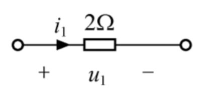

(a)

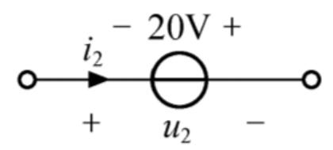

(b)

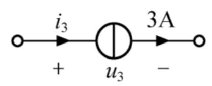

(c)

(a) 关联参考，欧姆定律 $u _ { 1 } = 2 i _ { 1 }$

(b) 电压源电压不会改变，电流由外电路决定 $u _ { 2 } { = } - 2 0 \mathrm { v }$

(c) 电流源电流不会改变，电压由外电路决定 $i _ { 3 } { = } 3 \mathrm { A }$

1-5 各元件的电压或电流数值如题图1-5所示，试问：（1）若元件A吸收功率为-10W，则电压 $u _ { \mathrm { a } }$ 为多少?(2)若元件B产生功率为10W，则电流 $i _ { \mathrm { b } }$ 为多少?(3)若元件C吸收功率为-10W，则电流 $i _ { \mathrm { c } }$ 为多少?(4)元件D吸收功率P为多少?(5)若元件E产生功率为10W，则电流 $i _ { \mathrm { e } }$ 为多少?(6)若元件F产生功率为-10W，则电压 $u _ { \mathrm { f } }$ 为多少？（7）若元件G产生功率为10mW，则电流 $i _ { \mathrm { g } }$ 为多少?(8)元件H产生功率为多少?

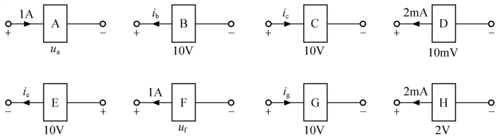

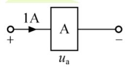

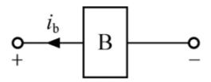

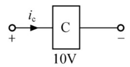

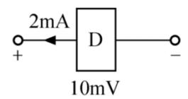

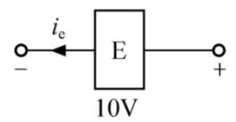

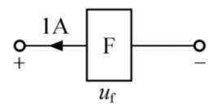

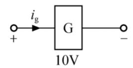

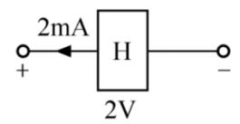

解：1）因为电压、电流为关联参考，且元件吸收功率为-10w

$$
\boldsymbol {p} = - 1 0 = 1 \times \boldsymbol {u} _ {a} \quad \boldsymbol {u} _ {a} = - 1 0 \mathrm{V}
$$

2）因为电压、电流为非关联参考，且元件产生功率为10w，则吸收了-10W

$$
\boldsymbol {p} = - 1 0 = - 1 0 \times \boldsymbol {i} _ {b} \quad \boldsymbol {i} _ {b} = 1 \mathrm{A}
$$

3）因为电压、电流为关联参考，且元件吸收功率为-10w

$$
\pmb {p} = - 1 0 = 1 0 \times \pmb {i} _ {c}
$$

$$
\boldsymbol {i} _ {c} = - 1 \mathrm{A}
$$

4）因为电压、电流为非关联参考

$$
\boldsymbol {p} = - 1 0 \times 1 0 ^ {- 3} \times 2 \times 1 0 ^ {- 3} = - 2 \times 1 0 ^ {- 5} \mathrm{W}
$$

5）因为电压、电流为关联参考，且元件产生功率10W，则吸收功率-10W

$$
\pmb {p} = - 1 0 = 1 0 \times \pmb {i} _ {e} \quad \pmb {i} _ {e} = - 1 \mathrm{A}
$$

6）因为电压、电流为非关联参考，且元件产生-10W，则吸收功率为10w

$$
\boldsymbol {p} = 1 0 = - 1 \times \boldsymbol {u} _ {f} \quad \boldsymbol {u} _ {f} = - 1 0 \mathrm{V}
$$

7）因为电压、电流为关联参考，且元件吸收功率为-10mw

$$
\boldsymbol {p} = - 1 0 \times 1 0 ^ {- 3} = 1 0 \times \boldsymbol {i} _ {\mathrm{g}} \quad \boldsymbol {i} _ {\mathrm{g}} = - 1 \mathrm{mA}
$$

8）因为电压、电流为非关联参考，

$$
p _ {\text {吸收}} = - 2 \times 2 \times 1 0 ^ {- 3} = - 4 \mathrm{mW}
$$

$$
\pmb {p} _ {\text {产生}} = - \pmb {p} _ {\text {吸收}} = 4 \mathrm{mW}
$$

1-6 根据基尔霍夫定律，试求出如题图1-6所示电路中的未知电路变量。

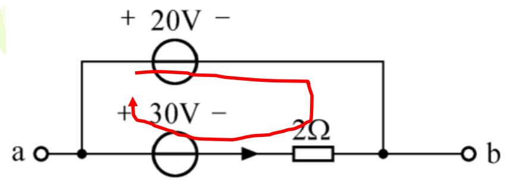

顺时针列些KVL方程

$$
2 0 - 2 I - 3 0 = 0
$$

$$
\mathbf {I} = - 5 \mathrm{A}
$$

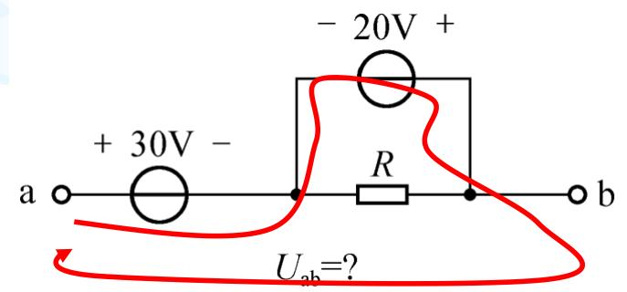

顺时针列些KVL方程

$$
3 0 - 2 0 - \boldsymbol {U} _ {\mathrm{ab}} = 0
$$

$$
U _ {\mathrm{ab}} = 1 0 \mathrm{A}
$$

1-9 电路如题图1-9所示，已知 $u _ { \mathrm { s 1 } } = 6 \mathrm { V }$ $u _ { \mathrm { s } 2 } = 2 \mathrm { V }$ $R _ { 1 } = 3 \Omega$ $R _ { 2 } = 1 \Omega$ $i _ { 3 } = 4 \mathrm { A }$ ，求电流$i _ { 1 } , i _ { 2 } \circ$

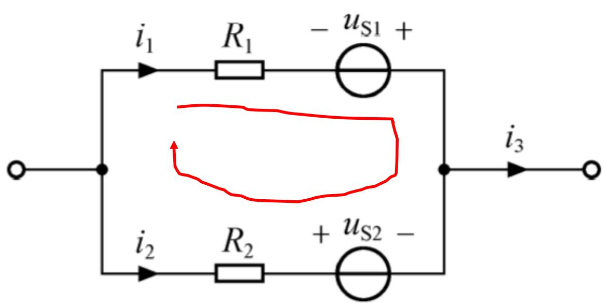

$$
\text { KVL: } \quad i _ {1} R _ {1} - u _ {\text { s1 }} - u _ {\text { s2 }} - i _ {2} R _ {2} = 0
$$

KCL:

$$
\pmb {i} _ {3} - \pmb {i} _ {1} - \pmb {i} _ {2} = 0
$$

$$
\boldsymbol {i} _ {1} = 3 \mathrm{A}, \boldsymbol {i} _ {2} = 1 \mathrm{A}
$$

1-10 试求题图1-10所示各电路中A点、B点的电位。

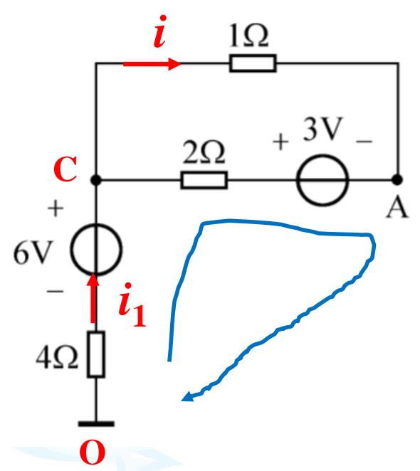

设流过1Ω电流为i，因为串联，则流过2Ω和3V的电压源电流都是i设流过4Ω电流为 $\lvert i _ { 1 }$ 参考方向如图所示

列写KVL

$$
\begin{array}{l} {1 \times i - 3 + 2 i = 0} \\ {i = 1 \mathrm{A}} \end{array}
$$

对C节点列些KCL方程

$$
\pmb {i} - \pmb {i} _ {1} - \pmb {i} = 0
$$

$$
\boldsymbol {i} _ {1} = 0
$$

设接地点为O，则电位为0。对广义回路列些KVL

$$
4 \pmb {i} _ {1} - 6 - 2 \pmb {i} + 3 + \pmb {u} _ {\mathrm{AO}} = 0
$$

$$
\boldsymbol {u} _ {\mathrm{AO}} = 5 \mathrm{V}
$$

$$
\boldsymbol {u} _ {\mathrm{AO}} = \boldsymbol {u} _ {\mathrm{A}} - \boldsymbol {u} _ {\mathrm{O}} = 5 \mathrm{V}, \text {则} \boldsymbol {u} _ {\mathrm{A}} = 5 \mathrm{V}
$$

1-11 试求题图1-11 所示电路中的电流i 及受控源的功率。

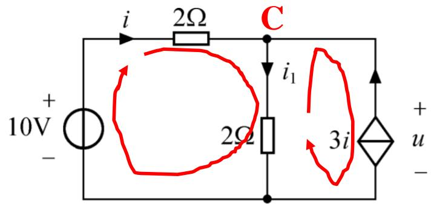

首先判断这是CCCS。控制量是2Ω支路的电流i，u则是受控源两端电压

左边网孔列些KVL方程：

$$
- 1 0 + 2 \boldsymbol {i} + 2 \boldsymbol {i} _ {1} = 0
$$

右边网孔列些KVL方程：

$$
- 2 \pmb {i} _ {1} + \pmb {u} = 0
$$

对C点列写KCL，受控电流源电流为3i： i i i− − =3 0

求解得：

$$
\mathbf {i} = 1 \mathrm{A}
$$

$$
\boldsymbol {i} _ {1} = 4 \mathrm{A}
$$

$$
\mathbf {u} = 8 \mathrm{V}
$$

3i 和u取的是非关联，受控源吸收功率为: $\pmb { p } = - 3 i \times \pmb { u } = - 2 4 \mathbf { W }$

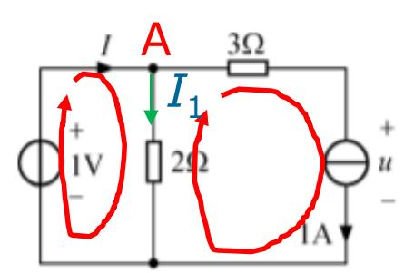

左边网孔KVL

右边网孔KVL

$$
- 1 + 2 \pmb {I} _ {1} = 0
$$

$$
- 2 \pmb {I} _ {1} + 3 \times 1 + \pmb {u} = 0
$$

$$
I _ {1} = 0. 5 \mathrm{A}
$$

$$
\boldsymbol {u} = - 2 \mathrm{V}
$$

$$
I _ {1} = 0. 5 \mathrm{A}
$$

$$
\boldsymbol {u} = - 2 \mathrm{V}
$$

A点KCL：

$$
1 + I _ {1} - I = 0
$$

$$
I = 1. 5 \mathrm{A}
$$

# 1-16 试求题图 1-13 所示电路中各元件的电压、电流，并判断 A、B、C 中哪个元件必定是电源？

本题来源于《电路分析与电工电子技术》第 1 章作业题，根据识别内容整理。

## 计算与判断

### 计算 1

**题干**：试求题图 1-13 所示电路中各元件的电压、电流，并判断 A、B、C 中哪个元件必定是电源？

*注：原图为电路拓扑图，此处保留占位符，实际使用时请替换为本地图片路径。*

**解**：设电路中各元件电压、电流的参考方向如图所示，则由 VCR（电压 - 电流关系）得：

$$
U_1 = 2 \times 7 = 14 \text{ V}
$$

$$
U_2 = 2 \times 5 = 10 \text{ V}
$$

$$
U_3 = 3 \times (-6) = -18 \text{ V}
$$

对闭合回路 BCDB、ACBA 和 ACDA 列 KVL（基尔霍夫电压定律）方程，有：

$$
U_C = U_2 - U_3 = 10 - (-18) = 28 \text{ V}
$$

$$
U_B = U_1 - U_C = 14 - 28 = -14 \text{ V}
$$

$$
U_A = U_1 + U_3 = 14 + (-18) = -4 \text{ V}
$$

对节点 A、B、C 分别列 KCL（基尔霍夫电流定律）方程，有：

$$
I_C = -6 - 7 = -13 \text{ A}
$$

$$
I_B = -8 \text{ A}
$$

$$
I_A = 1 \text{ A}
$$

A、B、C 三元件吸收的功率分别为：

$$
P_A = U_A I_A = -4 \times 1 = -4 \text{ W} < 0
$$

$$
P_B = U_B I_B = -14 \times (-8) = 112 \text{ W} > 0
$$

$$
P_C = U_C I_C = 28 \times (-13) = -364 \text{ W} < 0
$$

> **答案**：元件 A、C 必定是电源。
>
> **解析说明**：在关联参考方向下，若元件吸收功率 $P < 0$，则说明该元件实际上发出功率，即为电源；若 $P > 0$，则为负载。本题中 $P_A$ 和 $P_C$ 均小于 0，故 A、C 为电源。

参考解答：元件 A、C 必定是电源。

**电压计算**

由欧姆定律得：

$$
U_1 = 2 \times 7 = 14 \text{ V}
$$

$$
U_2 = 2 \times 5 = 10 \text{ V}
$$

$$
U_3 = 3 \times (-6) = -18 \text{ V}
$$

由 KVL 得：

$$
U_C = U_2 - U_3 = 10 - (-18) = 28 \text{ V}
$$

$$
U_B = U_1 - U_C = 14 - 28 = -14 \text{ V}
$$

$$
U_A = U_1 + U_3 = 14 + (-18) = -4 \text{ V}
$$

**电流计算**

由 KCL 得：

$$
I_C = -6 - 7 = -13 \text{ A}
$$

$$
I_B = -8 \text{ A}
$$

$$
I_A = 1 \text{ A}
$$

**功率计算**

A、B、C 三元件吸收的功率分别为：

$$
P_A = U_A I_A = -4 \times 1 = -4 \text{ W} < 0
$$

$$
P_B = U_B I_B = -14 \times (-8) = 112 \text{ W} > 0
$$

$$
P_C = U_C I_C = 28 \times (-13) = -364 \text{ W} < 0
$$

在关联参考方向下，$P < 0$ 表示元件实际发出功率，因此元件 A、C 为电源，元件 B 为负载。

知识点：[线性时不变电阻的伏安关系（欧姆定律）](../../../topics/电路与电子技术/线性电阻VCR.md)、[基尔霍夫电压定律（KVL）及其应用](../../../topics/电路与电子技术/KVL.md)、[元件吸收与产生功率的计算与判断](../../../topics/电路与电子技术/功率计算.md)
