# 《电路分析与电工电子技术》第2章作业题解

原件经识别和整理；“参考解答”是我们补的。

# 电路分析与电工电子技术 第2章作业题解

本资料为《电路分析与电工电子技术》第2章习题解答的整理，基于识别工具读取内容修正格式、公式及排版。

## 计算与求解

### 计算 1

题干：求题图 2-1 所示电路的电流 $i$。

解：先进行等效变换：

红色部分：电流源和电阻串联等效为 1A 电流源
蓝色部分：电阻 $4 // 4 + 18 = 20 \Omega$

$$
I = -1 \times \frac{20}{20 + 20} = -0.5 \mathrm{A}
$$

知识点：[理想电压源与理想电流源的特性](../../../topics/电路与电子技术/独立电源.md)、[线性时不变电阻的伏安关系（欧姆定律）](../../../topics/电路与电子技术/线性电阻VCR.md)、[基尔霍夫电流定律（KCL）及其应用](../../../topics/电路与电子技术/KCL.md)

### 计算 2

题干：求等效电阻 $R_{ab}$ (c)。

$$
R_{ab} = 0.5 + 1 // (1 + 2 // 2) // (2 // 2 + 2 // 2) = 1 \Omega
$$

知识点：[线性时不变电阻的伏安关系（欧姆定律）](../../../topics/电路与电子技术/线性电阻VCR.md)、[基尔霍夫电流定律（KCL）及其应用](../../../topics/电路与电子技术/KCL.md)、[基尔霍夫电压定律（KVL）及其应用](../../../topics/电路与电子技术/KVL.md)

### 计算 3

题干：求等效电阻 $R_{ab}$ (d)。

解：由图可得：
$$
R_{ab} = 5 // 20 + 10 // [8 // 8 + 6] = 9 \mathrm{k}\Omega
$$

仅含受控源和电阻的电路最终等效成一个电阻。设端口上的电压为 $u$，电流为 $i$，方向如图所示，取关联参考。

对网孔 1（广义回路）列 KVL 方程：
$$
u = 2 i_1
$$

网孔 2 列 KVL 方程：
$$
-2 i_1 + 4 i_2 + r i_1 = 0
$$
*(注：原文中 $\dot { r } i _ { 1 }$ 疑似为印刷错误，根据上下文通常表示受控源系数 $r$)*

对节点 A 列 KCL 方程：
$$
i_1 + i_2 - i = 0
$$

得：
$$
R_{ab} = \frac{u}{i} = \frac{8}{6 - r}
$$

知识点：[四种受控电源（VCVS、VCCS、CCVS、CCCS）的特性](../../../topics/电路与电子技术/受控电源.md)、[基尔霍夫电压定律（KVL）及其应用](../../../topics/电路与电子技术/KVL.md)、[基尔霍夫电流定律（KCL）及其应用](../../../topics/电路与电子技术/KCL.md)

### 计算 4

题干：电路如题图 2-10 所示，(1) 若 $U_2 = 10 \mathrm{V}$，求电流 $I_1$ 和电源电压 $U_s$；(2) 若 $U_s = 10 \mathrm{V}$，求电压 $U_2$。

*(注：原题描述中混入 "10Ω I 10Ω 10Ω"，结合解答推断电路结构)*

解：
(1)
$$
I_2 = \frac{U_2}{20} = 0.5 \mathrm{A}
$$
$$
U_3 = I_2 (10 + 20) = 15 \mathrm{V}
$$

*(此处原文包含一个未渲染好的表格或电路参数对应关系，依据后续计算推导)*
$$
U_4 = \left(\frac{U_3}{30} + I_2\right) \times 10 + U_3 = 25 \mathrm{V}
$$
$$
\therefore I_1 = \frac{U_4}{25} + \frac{U_3}{30} + I_2 = 2 \mathrm{A}
$$
$$
U_s = I_1 \times 10 + U_4 = 45 \mathrm{V}
$$

(2)
$$
I_1 = \frac{U_s}{10 + 25 // [10 + 30 // (10 + 20)]} = \frac{10}{22.5} \mathrm{A}
$$
$$
\therefore I_2 = \frac{10}{22.5} \times \frac{25}{25 + [10 + 30 // (10 + 20)]} \times \frac{25}{30 + 10 + 20}
$$
简化计算过程：
$$
I_2 = \frac{10}{22.5} \times \frac{1}{2} \times \frac{1}{2} = \frac{1}{9} \mathrm{A}
$$
*(注：原文末尾公式 $\frac { 1 } { 9 } { \frac { \sqrt { 1 0 + 2 0 } } { 2 } }$ 存在明显乱码或根号误识，根据前文比例分配逻辑，$\frac{1}{9}$ 为正确电流值)*
$$
U_2 = I_2 \times 20 = \frac{20}{9} \mathrm{V}
$$

## 电路化简

知识点：[基尔霍夫电流定律（KCL）及其应用](../../../topics/电路与电子技术/KCL.md)、[线性时不变电阻的伏安关系（欧姆定律）](../../../topics/电路与电子技术/线性电阻VCR.md)、[基尔霍夫电压定律（KVL）及其应用](../../../topics/电路与电子技术/KVL.md)

### 计算 5

题干：化简电路 (a)。

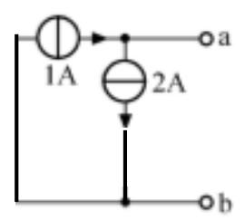

知识点：[理想电压源与理想电流源的特性](../../../topics/电路与电子技术/独立电源.md)、[线性时不变电阻的伏安关系（欧姆定律）](../../../topics/电路与电子技术/线性电阻VCR.md)、[基尔霍夫电流定律（KCL）及其应用](../../../topics/电路与电子技术/KCL.md)

### 计算 6

题干：化简电路 (c)。

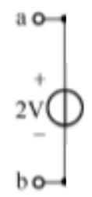

知识点：[理想电压源与理想电流源的特性](../../../topics/电路与电子技术/独立电源.md)、[线性时不变电阻的伏安关系（欧姆定律）](../../../topics/电路与电子技术/线性电阻VCR.md)

### 计算 7

题干：化简电路为戴维南等效电路 (c)。

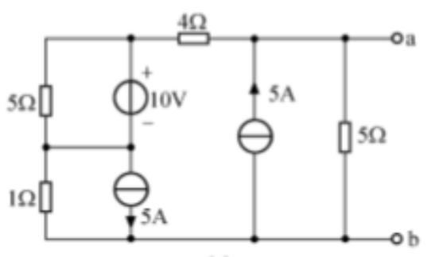

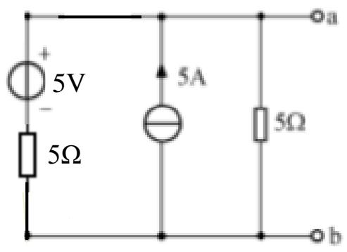
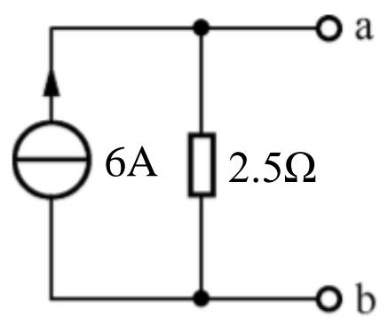
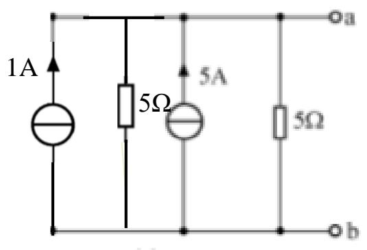

知识点：[线性时不变电阻的伏安关系（欧姆定律）](../../../topics/电路与电子技术/线性电阻VCR.md)、[理想电压源与理想电流源的特性](../../../topics/电路与电子技术/独立电源.md)、[基尔霍夫电压定律（KVL）及其应用](../../../topics/电路与电子技术/KVL.md)

### 计算 8

题干：化简电路 (b)。

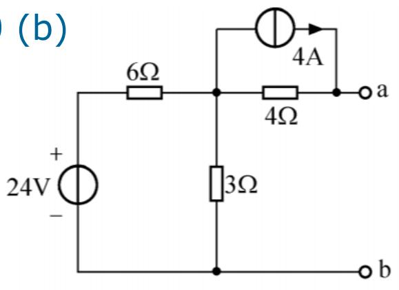
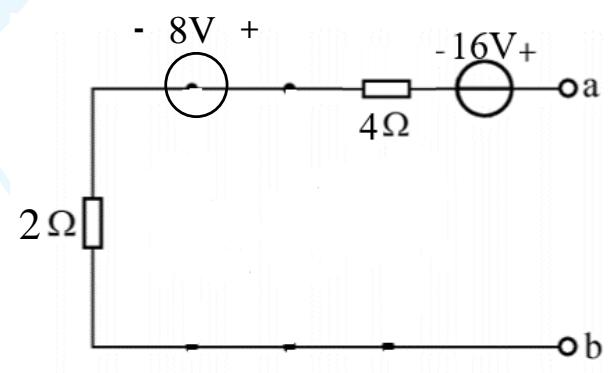

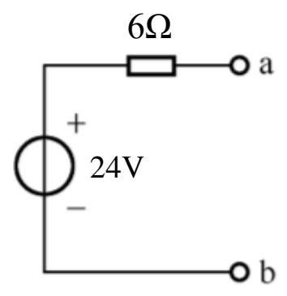
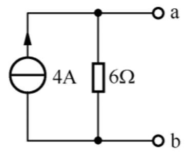

# 2-15 (a) 化简电路为戴维南等效电路

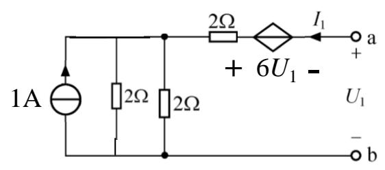

$$
U_1 - 1 - 3I_1 + 6U_1 = 0
$$

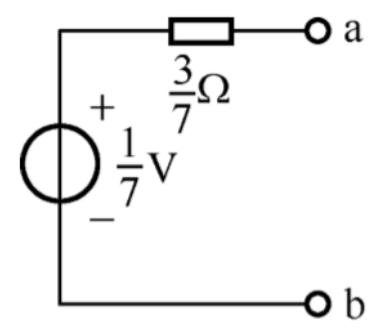

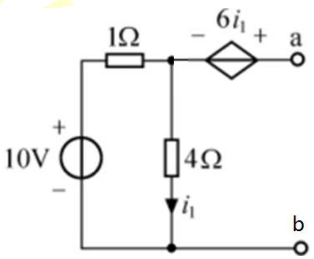

设端口上的电压电流如图所示参考方向：

网孔 I：$u - 4i_1 - 6i_1 = 0$

网孔 II：$4i_1 - 10 - (i - i_1) = 0$

消去 $i_1$，得：
$$
u = 2i + 20
$$

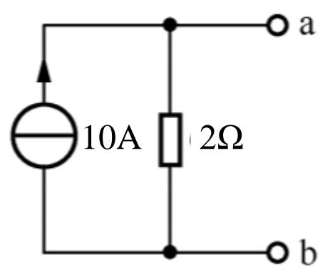

知识点：[四种受控电源（VCVS、VCCS、CCVS、CCCS）的特性](../../../topics/电路与电子技术/受控电源.md)、[基尔霍夫电压定律（KVL）及其应用](../../../topics/电路与电子技术/KVL.md)、[线性时不变电阻的伏安关系（欧姆定律）](../../../topics/电路与电子技术/线性电阻VCR.md)

### 2-16b 化为诺顿等效电路

电路等效为：

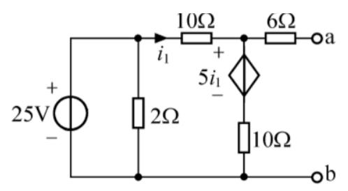

**解法 1：加压求流法**

$$
-25 + 10i_1 + 5i_1 + 10i_2 = 0
$$

$$
u - 10i_2 - 5i_1 - 6i = 0
$$

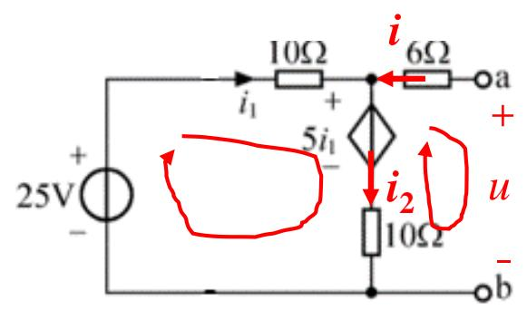

$$
i_2 - i_1 - i = 0
$$

$$
u = 10i + 15
$$

**2-16b 化为诺顿等效电路**

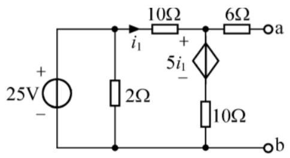

**(b)**

**1. 求 $i_{sc}$**

电路等效为：

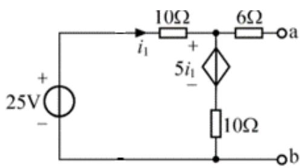

**解法 2：** 第四章诺顿定理：对两网孔列写 KVL 方程

$$
-25 + 10i_1 + 5i_1 + 10i_2 = 0
$$

$$
6i_{sc} - 10i_2 - 5i_1 = 0
$$

对节点列写 KCL：

$$
-i_1 + i_2 + i_{sc} = 0
$$

得：

$$
i_{sc} = 1.5 \mathrm{A}
$$

**2. 求等效电阻 $R_0$，加压求流法**

$$
10i_1 + 5i_1 + 10i_2 = 0
$$

设端口电流为 $i$，电压为 $u$：

$$
-6i + u - 10i_2 - 5i_1 = 0
$$

对两回路列写 KVL，对节点列写 KCL：

$$
-i - i_1 + i_2 = 0
$$

得：

$$
R_0 = 10 \Omega
$$

知识点：[基尔霍夫电压定律（KVL）及其应用](../../../topics/电路与电子技术/KVL.md)、[基尔霍夫电流定律（KCL）及其应用](../../../topics/电路与电子技术/KCL.md)、[理想电压源与理想电流源的特性](../../../topics/电路与电子技术/独立电源.md)
