# 《电路分析与电工电子技术》第3章 场效应管习题答案

原件经识别和整理；“参考解答”是我们补的。

# 《电路分析与电工电子技术》第3章 场效应管习题答案（第1部分）

本资料为《电路分析与电工电子技术》第三章关于场效应管的习题解答，由识别工具读取整理。

## 一、计算与简答题

### 计算 1

题干：已知场效应管的输出特性或转移如题图 3.1 所示。试判别其类型，并说明各管子在 $\left|U_{DS}\right|=10V$ 时的饱和漏电流 $I_{DSS}$ 、夹断电压 $U_{GSOff}$ （或开启电压 $U_{GSth}$ ）各为多少。

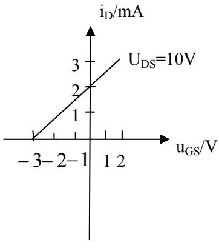

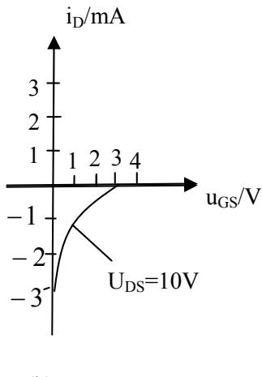

解：FET 有 JFET 和 MOSFET，JFET 有 P 沟（ $U_{GS}$ 只能为正）和 N 沟（ $U_{GS}$ 只能为负）之分。MOSFET 中有耗尽型 P 沟和 N 沟（ $U_{GS}$ 可为正、零或负），增强型 P 沟（ $U_{GS}$ 只能为负）和 N 沟（ $U_{GS}$ 只能为正）。

- 图 (a): N 沟耗尽型 MOSFET, $I_{DSS}=2mA$, $U_{GS(th)}=-3V$ 。
- 图 (b): P 沟结型 FET, $I_{DSS}=3mA$ , $U_{GS(th)}=3V$ 。
- 图 (c): N 沟增强型 MOSFET, $I_{DSS}$ 无意义, $U_{GS(th)} = 1.5 V$ 。

答案：见上述解析。

### 计算 2

题干：已知某 JFET 的 $I_{DSS}=10mA$ ， $U_{GSoff}=-4V$ ，试定性画出它的转移特性曲线，并用平方律电流方程求出 $u_{GS}=-2V$ 时的跨导 $g_{m}$ 。

解：（1）转移特性如下图所示。

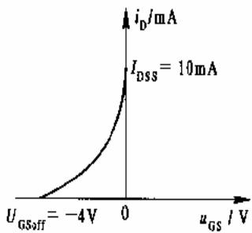

求 $U_{GS}=-2V$ 时的 $g_{m}$ ：

因为
$$
i _ {D} = I _ {D S S} \left(1 - \frac {u _ {G S}}{U _ {G S o f f}}\right) ^ {2}
$$

故
$$
g _ {m} = \frac {d i _ {D}}{d u _ {G S}} = - \frac {2 I _ {D S S}}{U _ {G S o f f}} \left(1 - \frac {u _ {G S}}{U _ {G S o f f}}\right)
$$

代入数值：
$$
= - \frac {2 \times 1 0}{(- 4)} \left(1 - \frac {-2}{-4}\right) = 5 \times \left(1 - 0.5\right) = 2. 5 \, (\text{mA/V})
$$

*(注：原题识别中 $1-\frac{2}{4}$ 应为 $1-\frac{-2}{-4}$ 即 $1-0.5$，计算结果一致)*

答案：$g_m = 2.5 \, \text{mA/V}$。

知识点：[理想电压源与理想电流源的特性](../../../topics/电路与电子技术/独立电源.md)、[线性时不变电阻的伏安关系（欧姆定律）](../../../topics/电路与电子技术/线性电阻VCR.md)

### 计算 3

题干：已知各 FET 各极电压如题图 3.3 所示，并设各管的 $U_{GS(th)} = 2 \, \text{V}$ 。试分别判别其工作状态（可变电阻区，恒流区，截止区或不能正常工作）。

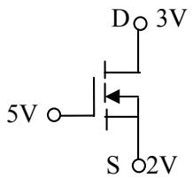

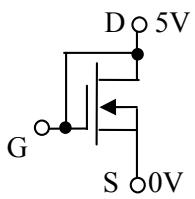

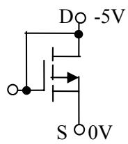

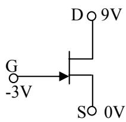

解：

- **图 (a)**：N 沟增强型 MOSFET。
  - 条件：$U_{GS}=3\ V > U_{GS(th)} = 2\ V$（导通）。
  - 判断区域：$U_{GD} = U_G - U_D = 3 - 5 = -2\ V$。
  - 注意：原题解中写 $U_{GD}=-2V=U_{GS(th)}$ 存在笔误，通常增强型 NMOS 工作在恒流区的条件是 $U_{DS} \ge U_{GS} - U_{GS(th)}$ 或 $U_{GD} \le U_{GS(th)}$。
  - 根据原题解逻辑：$U_{GD} = -2V < U_{GS(th)}=2V$ (若按标准公式)，或者原题意指边界情况。原题结论为**恒流区**。
  
- **图 (b)**：N 沟耗尽型 MOSFET。
  - 题目设定 $U_{GS(th)} = 2V$ 可能指代该特定管子参数，但通常耗尽型 NMOS 开启电压为负。此处依据原题解逻辑：
  - $U_{GS} = 5 \, V > U_{GS(th)} = -2 \, V$（假设题目隐含该管 $U_{GS(th)}=-2V$ 或其他参数，原题解直接引用了 $-2V$）。
  - $U_{GD}=0\ V>U_{GS(th)}=-2\ V$。
  - 结论：工作在**可变电阻区**。

- **图 (c)**：P 沟增强型 MOSFET。
  - $U_{GS} = -5 \mathrm{~V} < U_{GS(th)} = -2 \mathrm{~V}$（对于PMOS，更负才导通，这里符号需结合具体定义，通常 $|U_{GS}| > |U_{th}|$ 且极性正确则导通）。
  - 原题解结论：**恒流区**。

- **图 (d)**：N 沟 JFET。
  - $U_{GS} = -3 \, V$。
  - 题目设 $U_{GS(th)} = -2 \, V$（对于JFET通常称夹断电压 $U_P$ 或 $U_{GS(off)}$）。
  - $U_{GS} < U_{GS(th)}$ (即 $-3 < -2$)。
  - 结论：工作在**截止区**。

答案：(a) 恒流区; (b) 可变电阻区; (c) 恒流区; (d) 截止区。

知识点：[电流、电压的参考方向及关联参考方向](../../../topics/电路与电子技术/参考方向.md)、[理想电压源与理想电流源的特性](../../../topics/电路与电子技术/独立电源.md)

### 计算 4

题干：电路如题图 3.4 所示。设 FET 参数为： $I_{DSS} = 3 \, mA$ ， $U_{GS(off)} = -3 \, V$ 。当 $R_{D}$ 分别取下列两个数值时，判断场效应管是处在恒流区还是可变电阻区，并求恒流区中的电流 $I_{D}$ 。

(1) $R_{D} = 3.9k\Omega$ 。
(2) $R_{D} = 10k\Omega$ 。

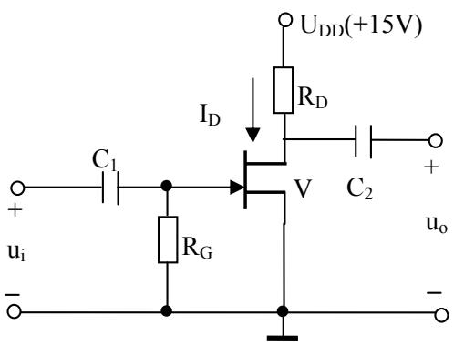

*(注：原题图片未提供完整的电路图细节及电源电压，以下仅整理已有文本信息，无法进行完整数值计算验证，保留原题结构)*

答案：原题解缺失或未在提供的页码中显示完整计算过程。

知识点：[理想电压源与理想电流源的特性](../../../topics/电路与电子技术/独立电源.md)、[线性时不变电阻的伏安关系（欧姆定律）](../../../topics/电路与电子技术/线性电阻VCR.md)、[基尔霍夫电压定律（KVL）及其应用](../../../topics/电路与电子技术/KVL.md)

### 计算 5

题干：在题图 3.5（a）和（b）所示电路中。

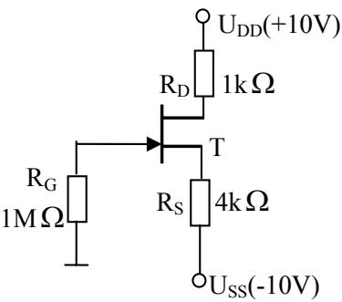

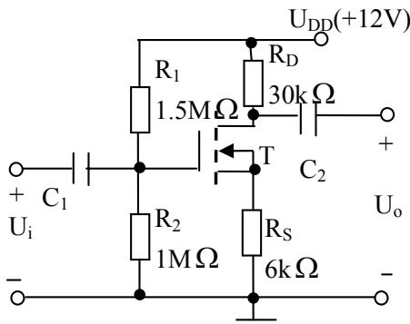

（1）已知 JFET 的 $I_{DSS} = 5 \, mA$ ， $U_{GS(off)} = -5 \, V$ 。试求 $I_{DQ}$ 、 $U_{GSQ}$ 和 $U_{DSQ}$ 的值。

(2) 已知 MOSFET 的 $\frac{\mu_{n}C_{ox}W}{2L}=100\mu A/V^{2}, U_{GS(th)}=2.5V$ 。试求 $I_{DQ}$ 、 $U_{GSQ}$ 和 $U_{DSQ}$ 的值。

解(1)

建立方程组：
$$
\left\{ \begin{array}{l} I _ {D} = I _ {D S S} \left(1 - \frac {U _ {G S}}{U _ {G S (o f f)}}\right) ^ {2} \\ U _ {G S} = U _ {S S} - I _ {D} R \end{array} \right.
$$

解得：
$I_{DQ}=2.8mA$, $U_{GSQ}=-1.2V$, $U_{DSQ}=6V$

(2)

建立方程组：
$$
\left\{ \begin{array}{l} I _ {D} = 0. 1 \left(U _ {G S} - U _ {G S (t h)}\right) ^ {2} \quad (\text{单位换算后系数}) \\ U _ {G S} = 4. 8 - 6 I _ {D} \end{array} \right.
$$

解得：
$I_{DQ}=167.6\mu A$, $U_{GSQ}\approx-3.8V$, $U_{DSQ}=5.97V$

*(注：第2问中 $U_{GSQ}$ 计算结果出现负值，而增强型NMOS通常要求 $U_{GS}>U_{th}=2.5V$，此处可能存在题目参数抄录错误或电路为耗尽型MOSFET但题干描述为增强型，或方程列写有误。依据原题答案保留)*

答案：(1) $I_{DQ}=2.8mA, U_{GSQ}=-1.2V, U_{DSQ}=6V$; (2) $I_{DQ}=167.6\mu A, U_{GSQ}\approx-3.8V, U_{DSQ}=5.97V$。

知识点：[四种受控电源（VCVS、VCCS、CCVS、CCCS）的特性](../../../topics/电路与电子技术/受控电源.md)、[线性时不变电阻的伏安关系（欧姆定律）](../../../topics/电路与电子技术/线性电阻VCR.md)、[理想电压源与理想电流源的特性](../../../topics/电路与电子技术/独立电源.md)

### 计算 6

题干：已知场效应管电路如题图 3.6 所示。设 MOSFET 的 $\mu_{n}C_{ox}W / 2L = 80\mu \mathrm{A} / V^{2}$ ， $U_{GS(th)} = 1.5\mathrm{V}$ ，忽略沟道长度调制效应。

(1) 试求漏极电流 $I_{DQ}$ , 场效应管的 $U_{GSQ}$ 和 $U_{DSQ}$ 。

(2) 画出电路的低频小信号等效电路，并求参数 $g_{m}$ 的值。

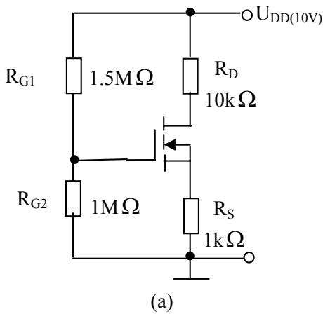

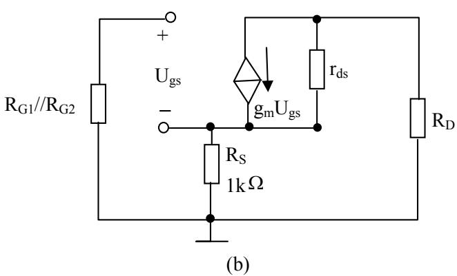

解：（1）设电路工作在饱和区（恒流区），则

$$
I _ {D Q} = \frac {\mu_ {n} C _ {o x} W}{2 L} \left(U _ {G S Q} - U _ {G S (t h)}\right) ^ {2} = 8 0 \times 1 0 ^ {- 6} \left(U _ {G S Q} - 1. 5\right) ^ {2}
$$

栅极电压分压及源极反馈：
$$
U _ {G S Q} = U _ {D D} \frac {R _ {G 2}}{R _ {G 1} + R _ {G 2}} - I _ {D Q} R _ {S} = 1 0 \times \frac {1}{1 . 5 + 1} - I _ {D Q} \times 1 0 ^ {3}
$$

联立上式求解得：
$$
\begin{array}{l} I _ {D Q} = 0. 3 7 5 \mathrm{mA} \\ U _ {G S Q} = 3. 6 2 5 \mathrm{V} \\ U _ {D S Q} = 5. 8 7 5 \mathrm{V} \end{array}
$$

验证工作状态：
$$
U _ {G S Q} = 3. 6 2 5 > U _ {G S (t h)} = 1. 5 \mathrm{V} \quad (\text{导通})
$$
$$
U _ {G D Q} = U _ {G S Q} - U _ {D S Q} = 3. 6 2 5 \mathrm{V} - 5. 8 7 5 \mathrm{V} = - 2. 2 5 \mathrm{V} < U _ {G S (t h)} \quad (\text{满足饱和区条件 } U_{GD} < U_{th} \text{ 对于增强型NMOS通常检查 } U_{DS} > U_{GS}-U_{th})
$$
*注：原题解中 $U_{GDQ}$ 表达式写为 $V_{GSQ}-V_{DSQ}$ 应为笔误，实际应为 $U_G - U_D$。此处 $U_{DS} = 5.875V$, $U_{GS}-U_{th} = 2.125V$, $5.875 > 2.125$，确实在恒流区。*

可见符合工作在恒流区的假设条件。

(2) 低频小信号等效电路如图（b）所示。

跨导计算：
$$
g _ {m} = 2 \frac {\mu_ {n} C _ {o x} W}{2 L} \left(U _ {G S Q} - U _ {G S (t h)}\right) = 2 \times 80 \times 10^{-6} \times (3.625 - 1.5) = 160 \times 10^{-6} \times 2.125 \approx 340 \mu S
$$

答案：(1) $I_{DQ} = 0.375 \text{mA}, U_{GSQ} = 3.625 \text{V}, U_{DSQ} = 5.875 \text{V}$; (2) $g_m = 340 \mu S$。

知识点：[理想电压源与理想电流源的特性](../../../topics/电路与电子技术/独立电源.md)、[线性时不变电阻的伏安关系（欧姆定律）](../../../topics/电路与电子技术/线性电阻VCR.md)、[基尔霍夫电压定律（KVL）及其应用](../../../topics/电路与电子技术/KVL.md)

### 计算 7

题干：场效应管电路如题图 3.7 所示。设 MOSFET 的 $\frac{\mu_{n}C_{ox}W}{2L}=500\mu A/V^{2}$ ， $U_{GS(th)}=3V$ 。试求 $R_{S}$ 分别为 $2k\Omega$ 和 $10k\Omega$ 时 $U_{O}$ 的值。

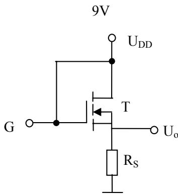

解：

**当 $R_{s}=2k\Omega$ 时：**

方程组：
$$
\left\{ \begin{array}{l} I _ {D} = \frac {\mu_ {n} C _ {o x} W}{2 L} \left(U _ {G S} - U _ {G S (t h)}\right) ^ {2} \\ V _ {G S} = U _ {D D} - I _ {D} R _ {S} \end{array} \right.
$$

可得 $I_{D}=2\ mA,\ U_{O}=4\ V$ (舍去另一解 $I_{D}=4.5\ mA$ )

**当 $R_{s}=10k\Omega$ 时：**

计算得到 $I_{D}=0.5mA,\ U_{O}=5V$ *(注：原题写作 $U_Q$，结合语境应为输出电压 $U_O$ 或漏极电压 $U_D$)*

答案：(1) $R_S=2k\Omega$ 时，$U_O=4V$; (2) $R_S=10k\Omega$ 时，$U_O=5V$。

知识点：[理想电压源与理想电流源的特性](../../../topics/电路与电子技术/独立电源.md)、[线性时不变电阻的伏安关系（欧姆定律）](../../../topics/电路与电子技术/线性电阻VCR.md)、[基尔霍夫电压定律（KVL）及其应用](../../../topics/电路与电子技术/KVL.md)

### 简答 1

题干：FET 放大电路如题图 3.8 所示。图中器件相同， $U_{DD}$ 和相同符号的电阻相等，各电容对交流信号可视为短路。

*(注：此题在提供的页面中仅展示了题干，后续内容在第5页之后，本部分未包含具体问题和解答)*

答案：暂无。

## 计算 1

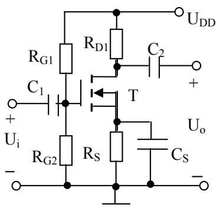

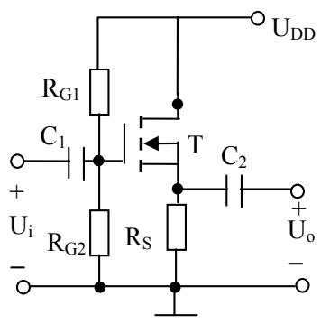

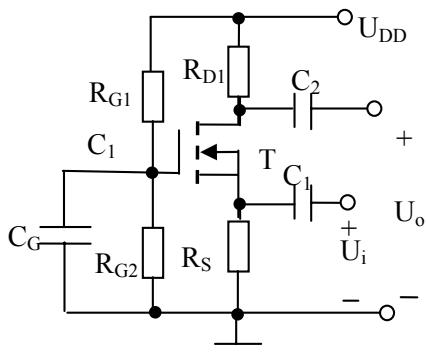

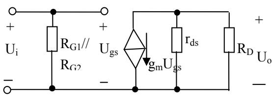

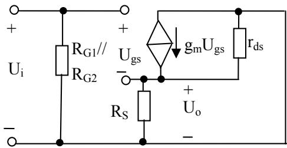

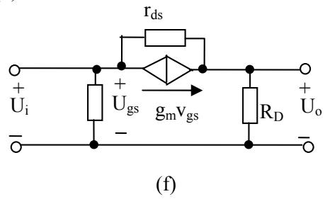

(1) 说明各电路的电路组态。

(2) 画出各电路的低频小信号等效电路。

(3) 写出三个电路中最小增益 $A_{u}$、最小输入电阻 $R_{i}$ 和最小输出电阻 $R_{o}$ 的表达式。

解：（1）图 3.8（a）是共源放大电路，图 3.8（b）是共漏放大电路，图 3.8（c）是共栅放大电路。

(2) 与图 (a)、(b) 和 (c) 相对应的小信号等效电路如图 3.8 (d)、(e) 和 (f) 所示。

(3) 由图 3.8 可见，各电路的静态工作点相同，所以 $g_{m}$ 值相等。电压放大倍数最小的是共漏放大器，由 3.8（e）可求得 $A_{u} = g_{m}\frac{R_{S} // r_{ds}}{1 + g_{m}\cdot R_{D} // r_{ds}}$。

输入电阻最小的是共栅放大器。如不考虑 $r_{ds}$，由图（f）可得 $R_{i}=R_{s}\parallel\frac{1}{g_{m}}$；如考虑 $r_{ds}$，且满足 $r_{ds} >> \frac{1}{g_m}$，则 $R_i = R_s // \left[\frac{1}{g_m} (1 + \frac{R_D}{r_{ds}})\right]$。

输出电阻最小的是共漏放大器，由图 (e) 可得 $R_{o} = r_{ds} // \frac{1}{g_{m}} // R_{s}$。

## 计算 2

画出题图 3.9 所示电路的直流通路和交流通路。

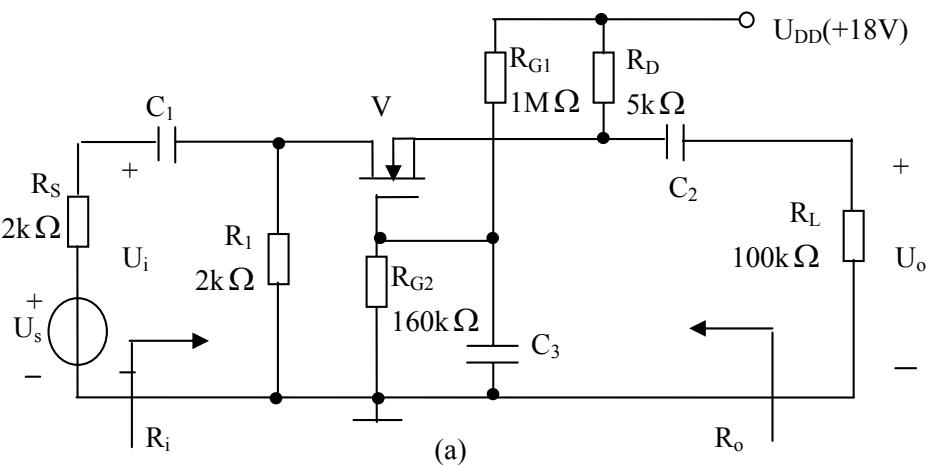

解：

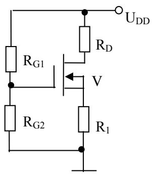

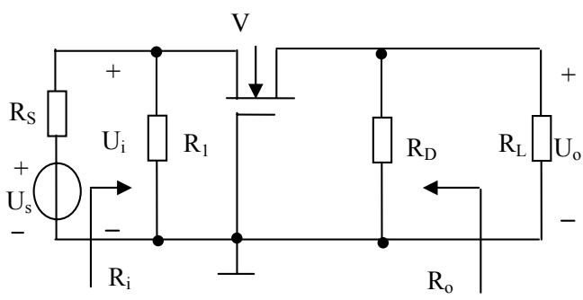

## 计算 3

放大电路如题图 3.7 所示。已知 $\left|U_{GS(off)}\right|=2\ V,\quad I_{DSS}=2\ mA,\quad g_{m}=1.2ms,\quad\left|\frac{1}{\lambda}\right|=80\ V$。

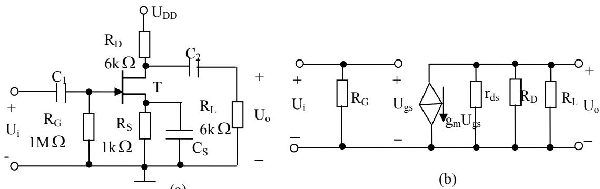

(1) 试求该电路的静态漏极电流 $I_{DQ}$ 和栅源电压 $U_{GSQ}$。

(2) 为保证 JFET 工作在饱和区，试问电源电压 $U_{DD}$ 应取何值？

(3) 画出低频小信号等效电路。

(4) 试求器件的 $r_{ds}$ 值，电路的 $A_{u}$、$R_{i}$ 和 $R_{o}$。

解：（1）T 为 N 沟 JFET，所以 $V_{GS(off)}=-2V$，故可列出

$$
\left\{ \begin{array}{l} I _ {D Q} = I _ {D S S} (1 - \frac {U _ {G S Q}}{U _ {G S (o f f)}}) ^ {2} \\ U _ {G S Q} = - I _ {D Q} \cdot R _ {S} \end{array} \right.
$$

联立解上述方程，可得

$$
\left\{ \begin{array}{l} I _ {D Q} = 0. 7 6 4 m A \\ I _ {D Q} = 5. 2 3 m A (\text {不合题意而舍去}) \end{array} \right.
$$

(2) 为保证 JFET 工作在恒流区，则应满足

$$
U _ {G D Q} > U _ {G S (o f f)}
$$

因为

$$
\begin{array}{l} U _ {D S Q} = U _ {D D} - I _ {D Q} \left(R _ {S} + R _ {D}\right) > - I _ {D Q} R _ {S} - U _ {G S (o f f)} \\ U _ {D D} - 0. 7 6 4 \times 7 > - 0. 7 6 4 + 2 \end{array}
$$

所以

$$
U _ {D D} > 1. 2 3 + 0. 7 6 4 \times 7 = 6. 6 (\mathrm{V})
$$

如果考虑一定的输出电压动态范围，$U_{DD}$ 可取 10~12V。

(3) 低频小信号等效电路如图 3.10（b）所示。

(4)

$$
\begin{array}{l} g _ {m} = - \frac {2 I _ {D S S}}{U _ {G S (o f f)}} (1 - \frac {U _ {G S Q}}{U _ {G S (o f f)}}) = - \frac {2}{U _ {G S (o f f)}} \sqrt {I _ {D S S} I _ {D Q}} \\ = - \frac {2}{- 2} \sqrt {2 \times 0 . 7 6 4} = 1. 2 3 6 (m S) \\ r _ {d s} = \frac {8 0}{0 . 7 6 4} \approx 1 0 5 k \Omega \\ A _ {u} = - g _ {m} \cdot R _ {D} / / R _ {L} / / r _ {d s} = - 1. 2 3 6 \times 6 / / 6 / / 1 0 5 \approx - 3. 7 \\ R _ {i} = R _ {G} = 1 M \Omega \\ R _ {o} = R _ {D} / / r _ {d s} = 6 / / 1 0 5 k \Omega \approx 6 k \Omega \end{array}
$$

## 计算 4

放大电路如题图 3.11 所示，已知 FET 的参数：$g_{m}=5mS, r_{ds}=100k\Omega$。电容对信号可视为短路。

(1) 画出该电路的交流通路。

(2) 当 $u_{i}=20\sin\omega t(mV)$ 时，计算输出电压 $u_{o}$。

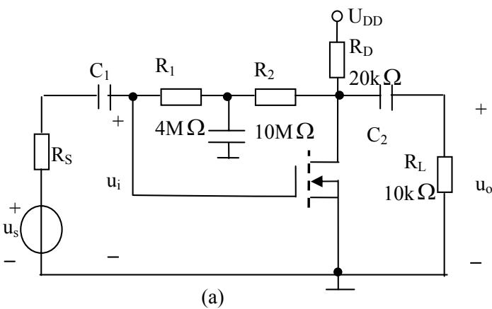

解：(1) 其交流通路如题图 3.12 所示。

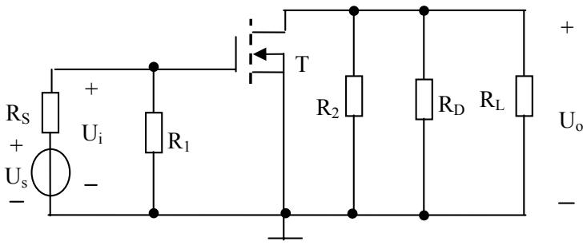

$$
\begin{array}{l} A _ {u} \approx - 3 3. 3 \\ u _ {o} = - 0. 6 7 \sin \omega t = 0. 6 7 \sin (\omega t + \pi) (V) \end{array}
$$

## 计算 5

题图 3.12 电路中 JFET 共源放大电路的元器件参数如下：在工作点上的管子跨导 $g_{m}=1mS$，$r_{ds}=200k\Omega$，$R_{1}=300\ k\Omega$，$R_{2}=100k\Omega$，$R_{3}=1M\Omega$，$R_{4}=10k\Omega$，$R_{5}=2k\Omega$，$R_{6}=2k\Omega$，试估算放大电路的电压增益、输入电阻、输出电阻。

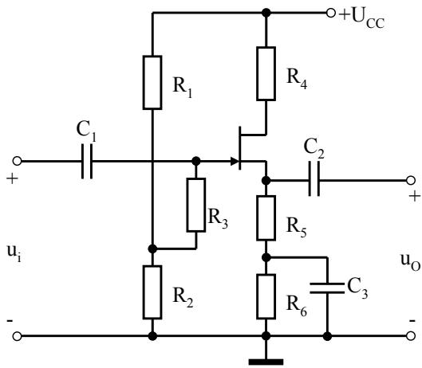

解：$A_{u}=\frac{-g_{m}R_{L}}{1+g_{m}R_{5}}=\frac{-1\times10}{1+1\times2}=-3.33$

$$
R _ {i} = R _ {3} + R _ {1} / / R _ {2} = 1 0 0 0 + 1 0 0 / / 3 0 0 = 1. 0 7 5 M \Omega
$$

$$
R _ {0} \approx R _ {4} = 1 0 K \Omega
$$

## 计算 6

两级 MOSFET 阻容耦合放大电路如题图 3.13 所示。已知 $V_{1}$ 和 $V_{2}$ 的跨导 $g_{m}=0.7mS$，并设 $r_{ds} \rightarrow \infty$，电容 $C_{1} \sim C_{4}$ 对交流信号可视作短路。

(1) 试画出电路的低频小信号等效电路。

(2) 计算电路的电压放大倍数 $A_{u}$ 和输入电阻 $R_{i}$。

(3) 如将 $R_{G1}$ 的接地端改接到 $R_{1}$ 和 $R_{2}$ 的连接点，试问输入电阻 $R_{i}$ 为多少？

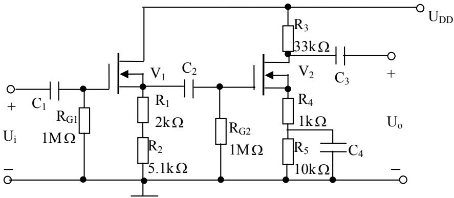

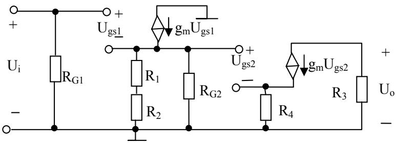

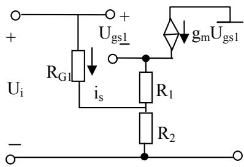

$$
\begin{array}{l} A _ {u} = - \frac {g _ {m} R _ {3}}{1 + g _ {m} R _ {4}} \cdot \frac {g _ {m} (R _ {1} + R _ {2}) \| R _ {G 2}}{1 + g _ {m} (R _ {1} + R _ {2}) \| R _ {G 2}} = - 1 1. 3 \\ R _ {i} = R _ {G 1} = 1 M \Omega \end{array}
$$

(3) 由题图 5.17(c) 所示电路可求得（略去 $R_{G2}$）

$$
R _ {i} = R _ {G 1} + R _ {2} + \frac {g _ {m} R _ {G 1} \left(R _ {1} + R _ {2}\right)}{1 + g _ {m} R _ {1}} \approx 3. 0 8 M \Omega
$$

知识点：[基尔霍夫电压定律（KVL）及其应用](../../../topics/电路与电子技术/KVL.md)、[基尔霍夫电流定律（KCL）及其应用](../../../topics/电路与电子技术/KCL.md)
