# 《电路分析与电工电子技术》第3章 场效应管及其放大电路（课件）

原件的每一页，下面附识别出的文字。

### 第三章 场效应管及其放大电路

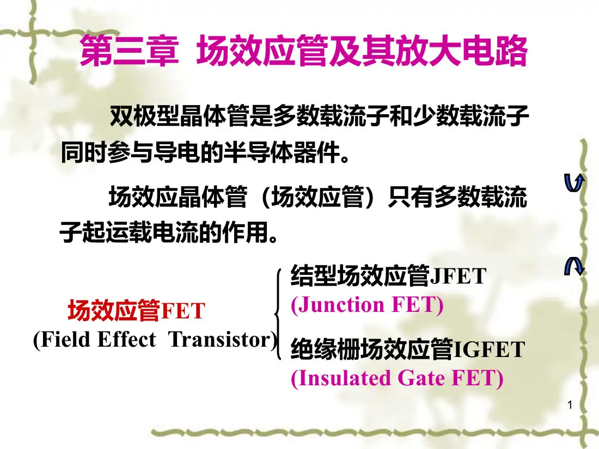

原文：

第三章 场效应管及其放大电路

双极型晶体管是多数载流子和少数载流子同时参与导电的半导体器件。

场效应晶体管（场效应管）只有多数载流子起运载电流的作用。

场效应管FET
(Field Effect Transistor) $\left\{\begin{array}{l}\text { 结型场效应管J FET } \\ \text {(Junction FET)}\end{array}\right.$ $\left\{\begin{array}{l}\text { 绝缘栅场效应管IGFET } \\ \text {(Insulated Gate FET)}\end{array}\right.$

### 3.1 场效应晶体管

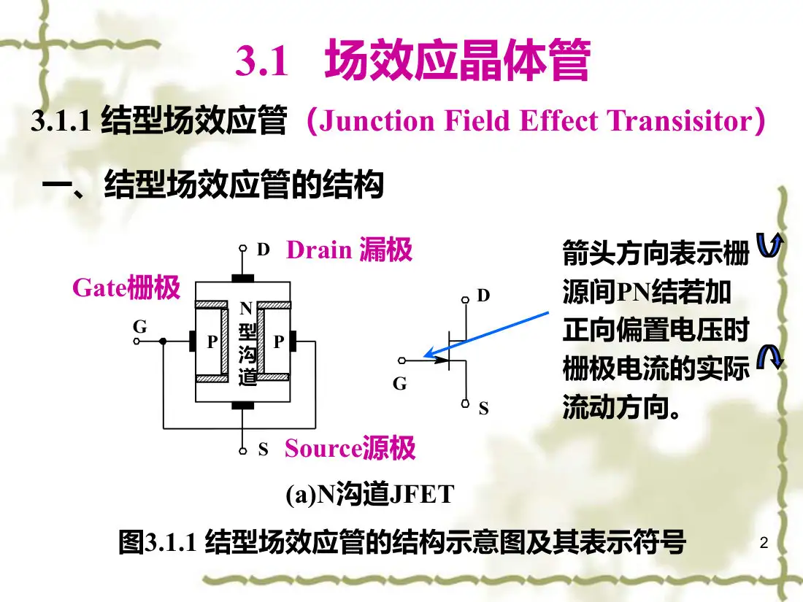

原文：

3.1 场效应晶体管

3.1.1 结型场效应管 (Junction Field Effect Transistor)

一、结型场效应管的结构

箭头方向表示栅源间PN结若加正向偏置电压时栅极电流的实际流动方向。

2

### 第 3 页

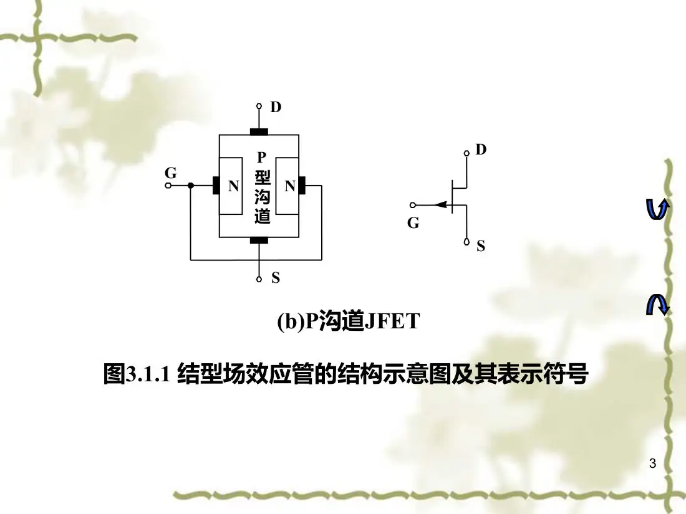

原文：

3

### 二、结型场效应管的工作原理

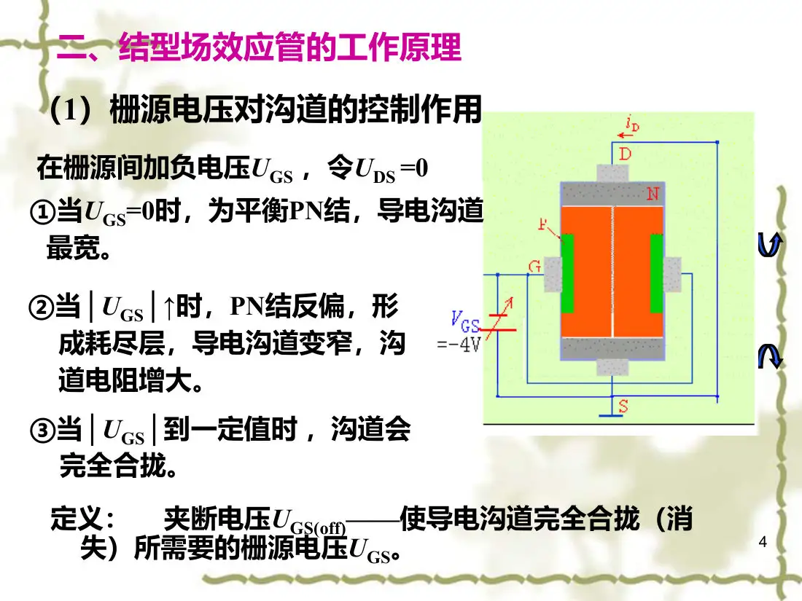

原文：

二、结型场效应管的工作原理

(1) 栅源电压对沟道的控制作用在栅源间加负电压 $U_{GS}$ ，令 $U_{DS}=0$

①当 $U_{GS}=0$ 时，为平衡PN结，导电沟道最宽。

②当 $\left|U_{GS}\right|$ ↑时，PN结反偏，形成耗尽层，导电沟道变窄，沟道电阻增大。

③当 $\left|U_{GS}\right|$ 到一定值时，沟道会完全合拢。

定义: 夹断电压 $U_{GS(off)}$ ——使导电沟道完全合拢（消失）所需要的栅源电压 $U_{GS}$ 。

### (2) 漏源电压对沟道的控制作用

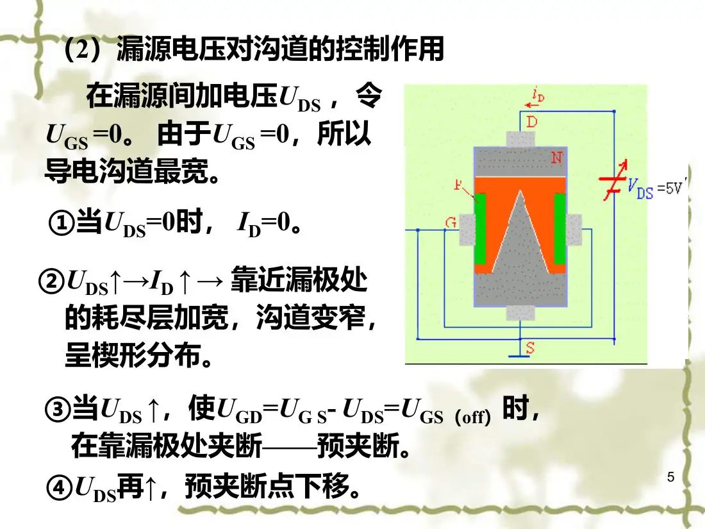

原文：

(2) 漏源电压对沟道的控制作用

在漏源间加电压 $U_{DS}$ ，令 $U_{GS}=0$ 。由于 $U_{GS}=0$ ，所以导电沟道最宽。

①当 $U_{DS}=0$ 时， $I_{D}=0$ 。

② $U_{DS}\uparrow\rightarrow I_{D}\uparrow\rightarrow$ 靠近漏极处的耗尽层加宽，沟道变窄，呈楔形分布。

③当 $U_{DS}$ ↑，使 $U_{GD}=U_{GS}-U_{DS}=U_{GS(off)}$ 时，在靠漏极处夹断——预夹断。

④ $U_{DS}$ 再↑，预夹断点下移。

### 三、结型场效应管的特性曲线

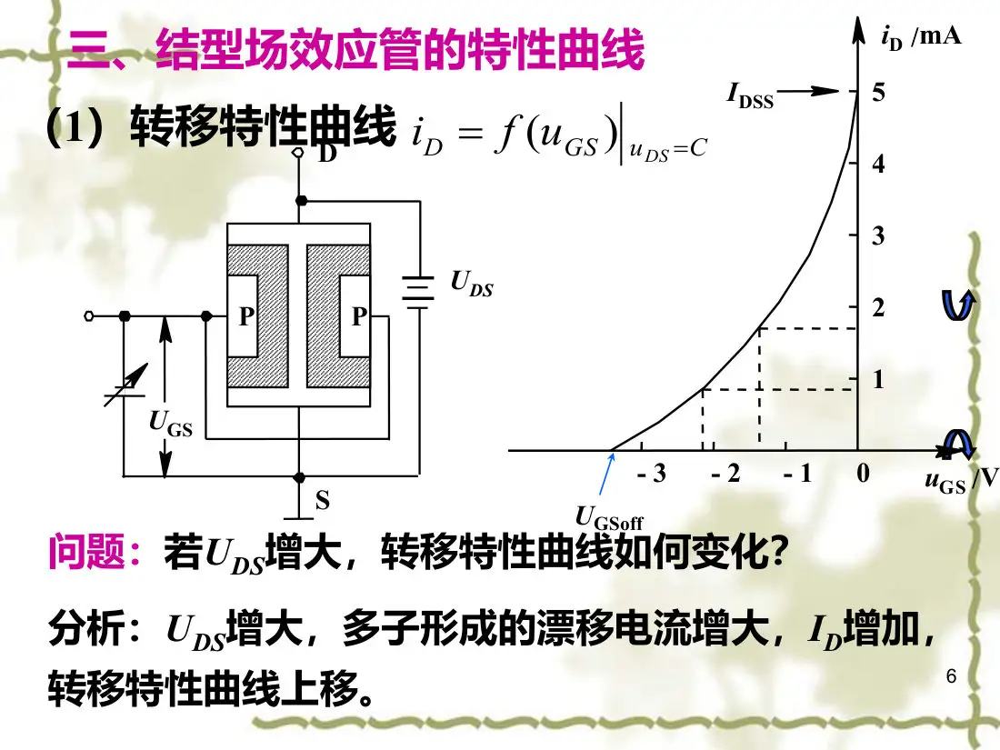

原文：

三、结型场效应管的特性曲线

(1) 转移特性曲线 $i_{D} = f(u_{GS}) \bigg|_{u_{DS}=C}$

问题: 若 $U_{DS}$ 增大, 转移特性曲线如何变化?

分析： $U_{DS}$ 增大，多子形成的漂移电流增大， $I_{D}$ 增加，转移特性曲线上移。

### 第 7 页

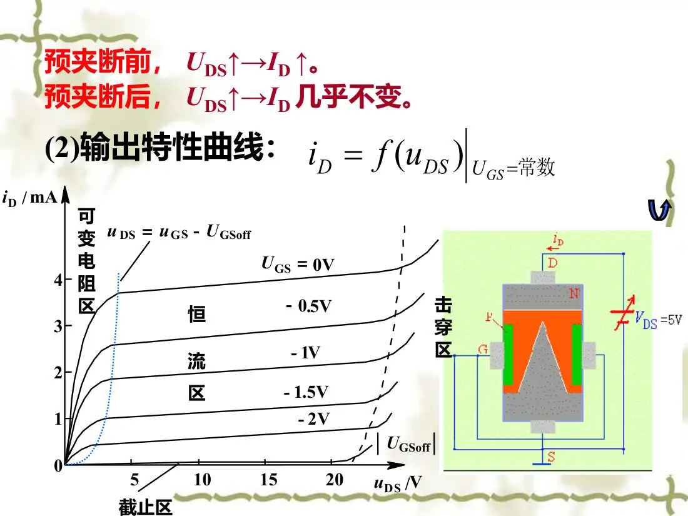

原文：

预夹断前， $U_{DS}\uparrow\rightarrow I_{D}\uparrow$ 。

预夹断后， $U_{DS}\uparrow\rightarrow I_{D}$ 几乎不变。

(2)输出特性曲线： $i_{D}=f(u_{DS})\bigg|_{U_{GS}=常数}$

### 四个区： 截止区

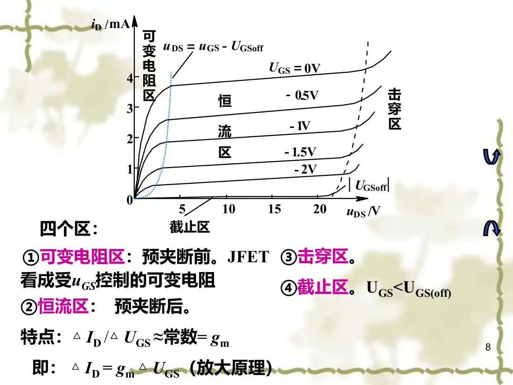

原文：

四个区： 截止区

①可变电阻区：预夹断前。JFET ③击穿区。

看成受 $u_{GS}$ 控制的可变电阻

④截止区。 $U_{GS}<U_{GS(off)}$

②恒流区：预夹断后。

特点： $\triangle I_{\mathrm{D}} / \triangle U_{\mathrm{GS}} \approx$ 常数 $= g_{\mathrm{m}}$

即： $\triangle I_{\mathrm{D}} = g_{\mathrm{m}} \triangle U_{\mathrm{GS}}$ (放大原理)

### 第 9 页

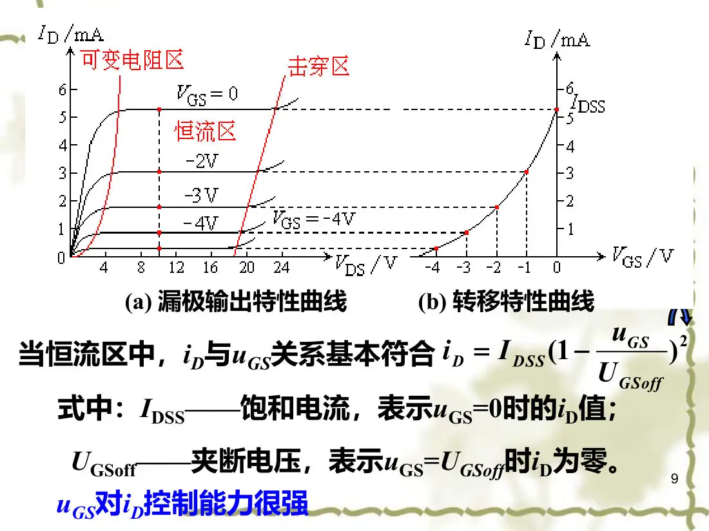

原文：

当恒流区中， $i_D$ 与 $u_{GS}$ 关系基本符合 $i_D = I_{DSS}(1 - \frac{u_{GS}}{U_{GSoff}})^2$ 式中： $I_{\text{DSS}}$ ——饱和电流，表示 $u_{GS}$ =0时的 $i_D$ 值； $U_{\text{GSoff}}$ ——夹断电压，表示 $u_{GS}$ = $U_{GSoff}$ 时 $i_D$ 为零。 $u_{GS}$ 对 $i_D$ 控制能力很强

### 3.1.2 绝缘栅场效应管(IGFET)

原文：

3.1.2 绝缘栅场效应管(IGFET)

IGFET(Insulated Gate FET)是利用半导体表面的电场效应进行工作的，也称为表面场效应器件。IGFET最常用的是金属氧化物半导体MOSFET(Metal Oxide Semiconductor FET)。

10

### 优点:

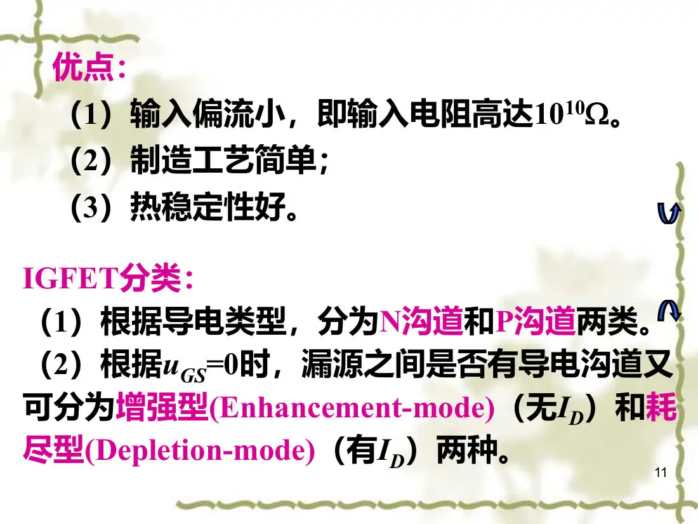

原文：

优点:

(1) 输入偏流小，即输入电阻高达 $10^{10}\Omega$ 。

(2) 制造工艺简单;

(3) 热稳定性好。

IGFET分类:

(1) 根据导电类型, 分为 $\mathrm{N}$ 沟道和 $\mathrm{P}$ 沟道两类。

(2) 根据 $u_{GS}=0$ 时，漏源之间是否有导电沟道又可分为增强型(Enhancement-mode)（无 $I_{D}$ ）和耗尽型(Depletion-mode)（有 $I_{D}$ ）两种。

11

### MOSFET

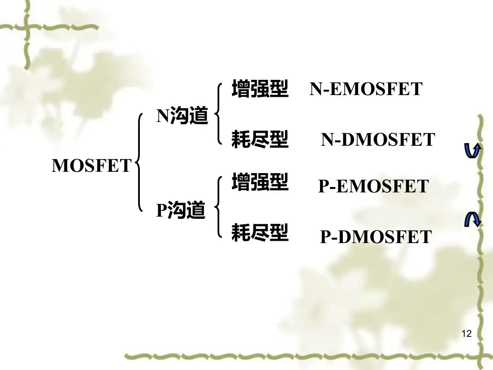

原文：

MOSFET

N沟道

P沟道

增强型

耗尽型

增强型

耗尽型

N-EMOSFET

N-DMOSFET

P-EMOSFET

P-DMOSFET

12

### 一、N沟道增强型MOSFET

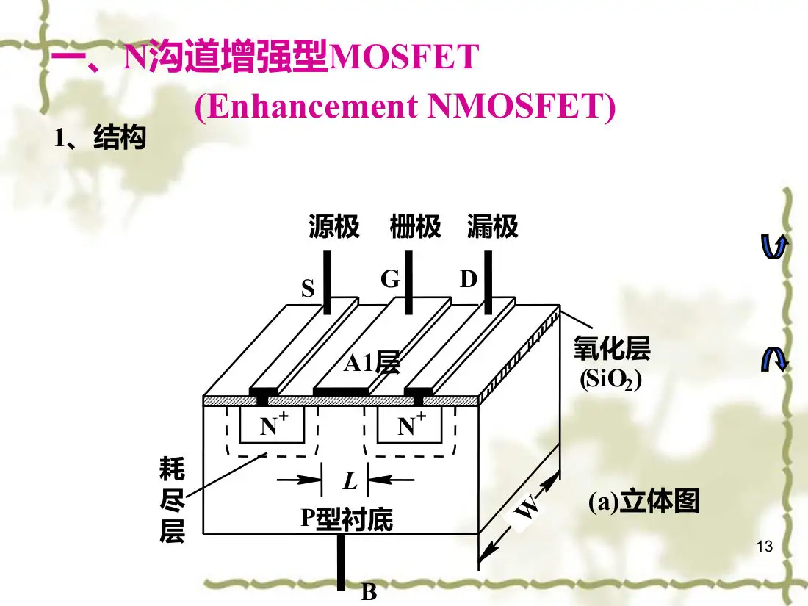

原文：

一、N沟道增强型MOSFET

(Enhancement NMOSFET)

1、结构

13

### 第 14 页

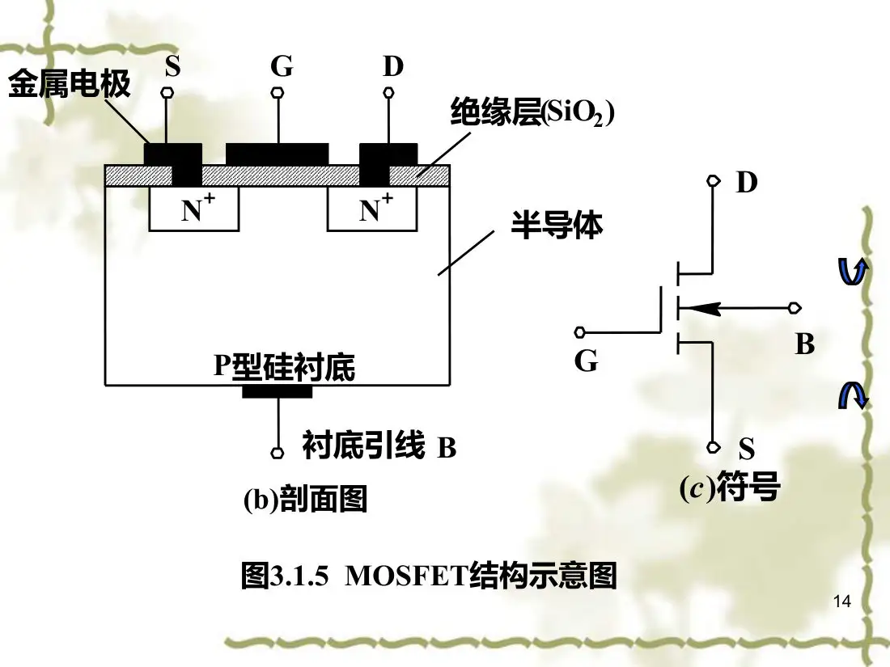

### 2、 $u_{GS}$ 对沟道导电能力的控制(转移特性曲线)

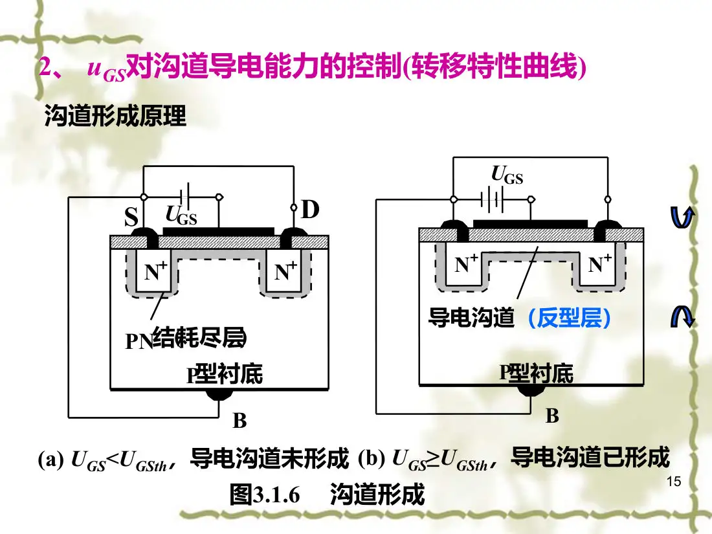

原文：

2、 $u_{GS}$ 对沟道导电能力的控制(转移特性曲线)

沟道形成原理

(a) $U_{GS} < U_{GSth}$ , 导电沟道未形成 (b) $U_{GS} \geq U_{GSth}$ , 导电沟道已形成

图3.1.6 沟道形成

15

### 当 $u_{GS}>0V$ 时→纵向电场

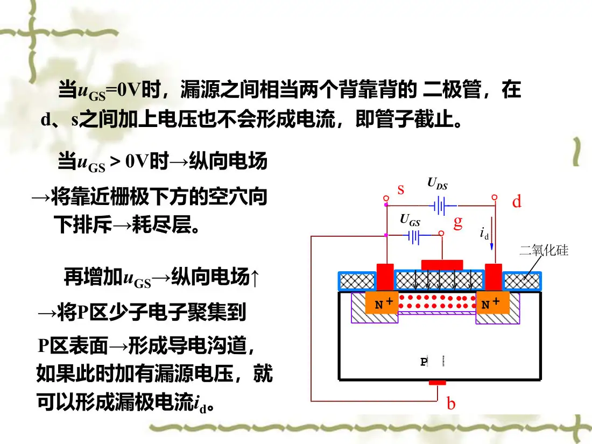

原文：

当 $u_{GS}=0V$ 时，漏源之间相当两个背靠背的二极管，在d、s之间加上电压也不会形成电流，即管子截止。

当 $u_{GS}>0V$ 时→纵向电场

→将靠近栅极下方的空穴向下排斥→耗尽层。

再增加 $u_{GS}\rightarrow$ 纵向电场↑
→将P区少子电子聚集到
P区表面→形成导电沟道，
如果此时加有漏源电压，就可以形成漏极电流 $i_{d}$ 。

### 定义:

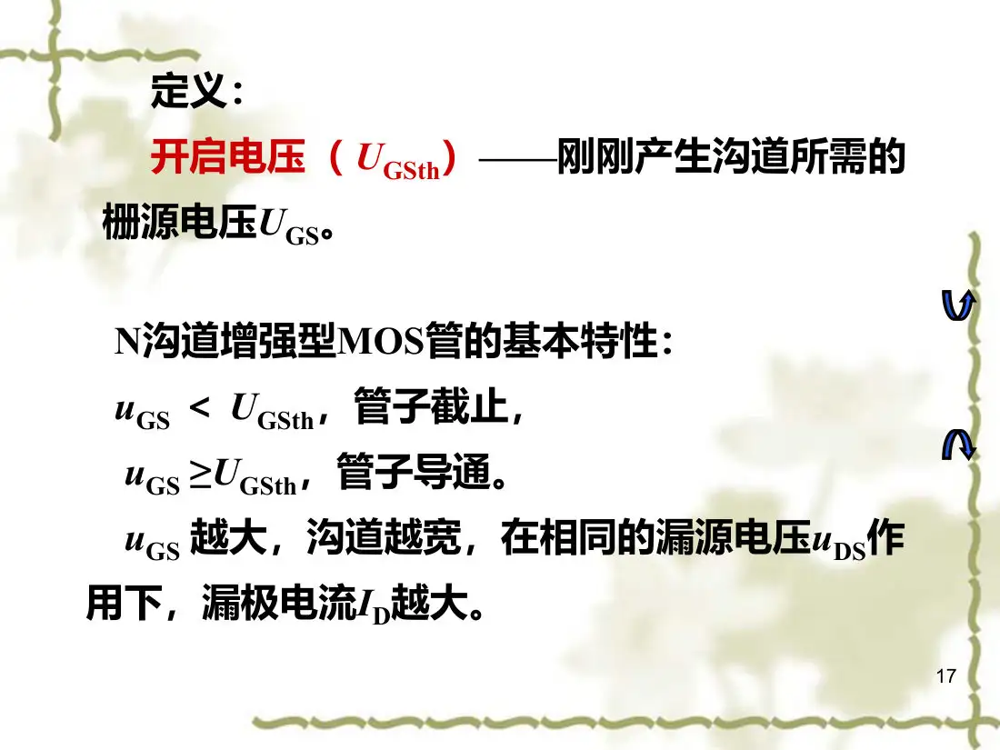

原文：

定义:

开启电压（ $U_{GSth}$ ）——刚刚产生沟道所需的栅源电压 $U_{GS}$ 。

N沟道增强型MOS管的基本特性：

$u_{GS} < U_{GSth}$ ，管子截止， $u_{GS} \geq U_{GSth}$ ，管子导通。

$u_{\mathrm{GS}}$ 越大，沟道越宽，在相同的漏源电压 $u_{\mathrm{DS}}$ 作用下，漏极电流 $I_{\mathrm{D}}$ 越大。

17

### 18

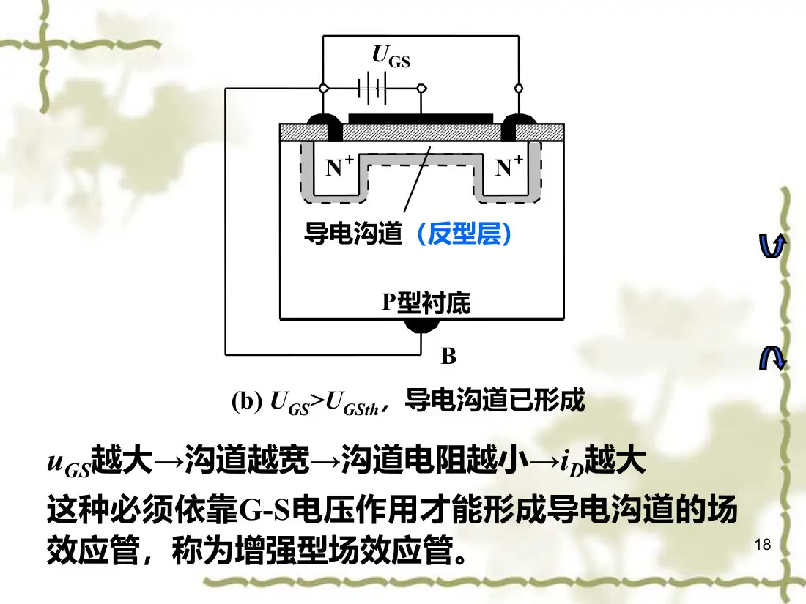

原文：

$u_{GS}$ 越大→沟道越宽→沟道电阻越小→ $i_{D}$ 越大这种必须依靠G-S电压作用才能形成导电沟道的场效应管，称为增强型场效应管。

18

### 转移特性

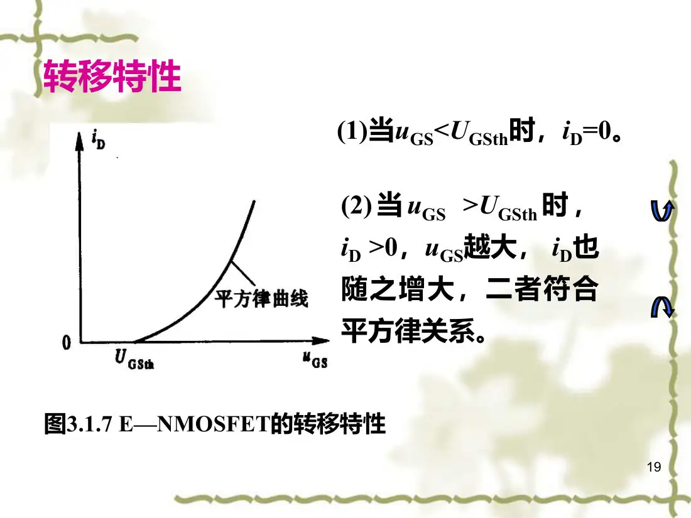

原文：

转移特性

(1)当 $u_{GS}<U_{GSth}$ 时， $i_{D}=0$ 。

(2) 当 $u_{GS} > U_{GSth}$ 时， $i_{D} > 0$ ， $u_{GS}$ 越大， $i_{D}$ 也随之增大，二者符合平方律关系。

19

### 3、 $u_{DS}$ 对沟道导电能力的控制（输出特性）

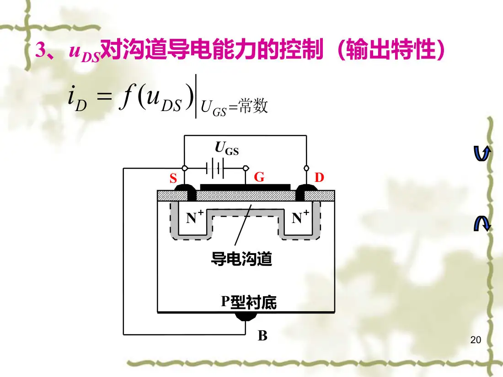

原文：

3、 $u_{DS}$ 对沟道导电能力的控制（输出特性）

$$
i _ {D} = f (u _ {D S}) \Big | _ {U _ {G S} = \text {常数}}
$$

20

### 21

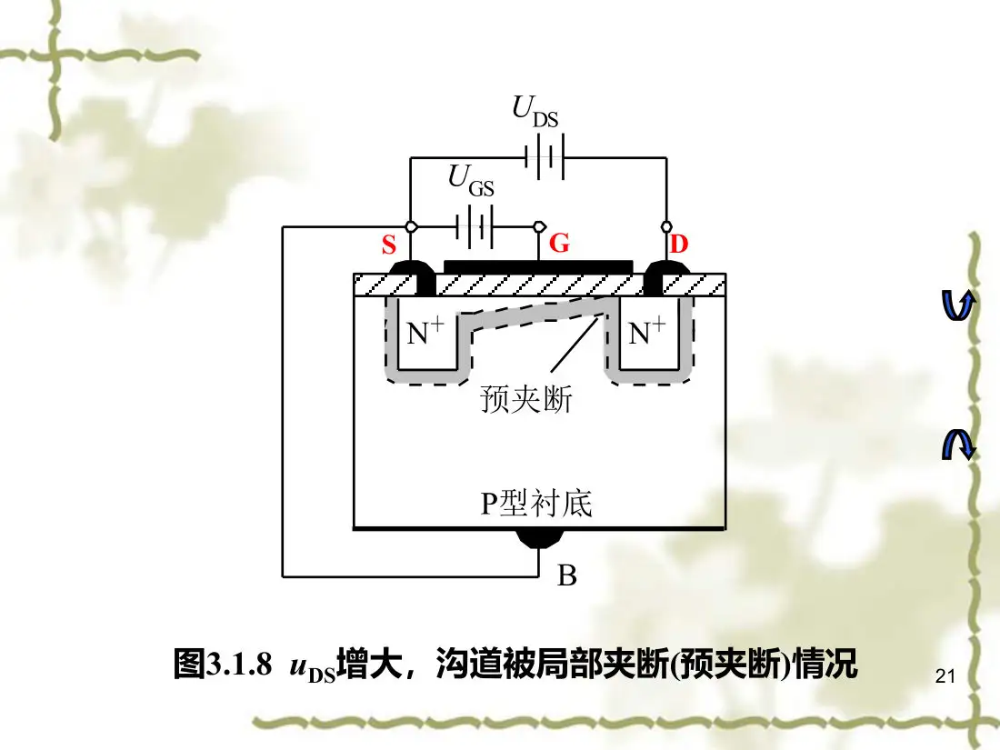

原文：

21

### 22

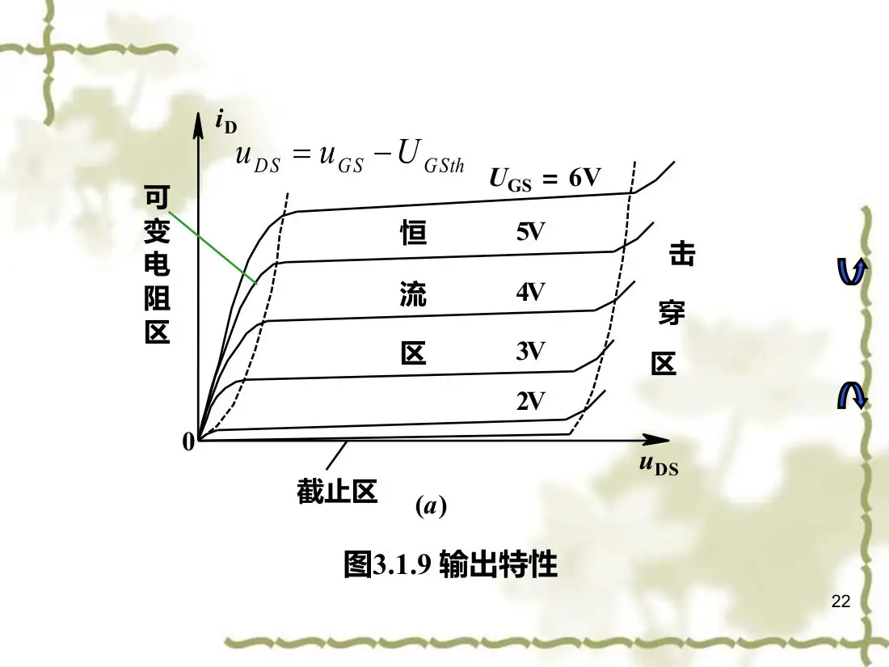

原文：

22

### (2)恒流区

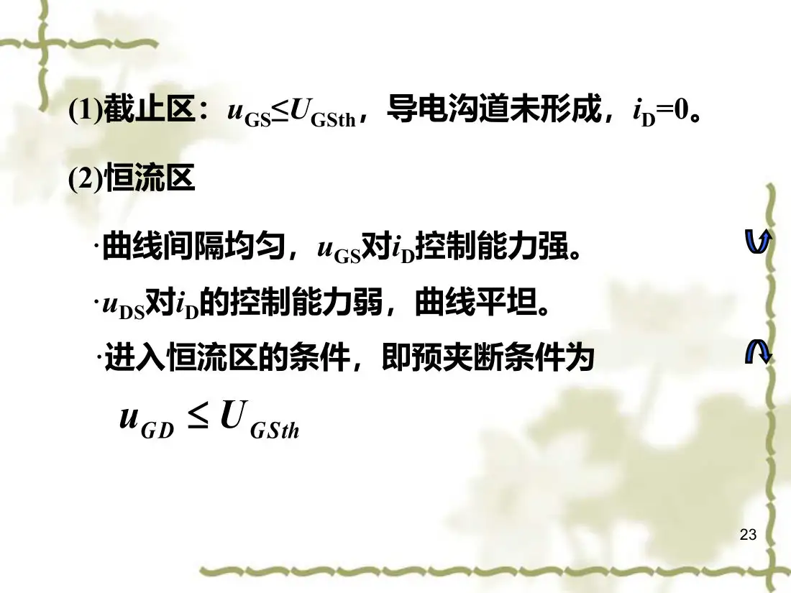

原文：

(1)截止区： $u_{GS} \leq U_{GSth}$ ，导电沟道未形成， $i_{D}=0$ 。

(2)恒流区

·曲线间隔均匀， $u_{GS}$ 对 $i_{D}$ 控制能力强。

· $u_{\mathrm{DS}}$ 对 $i_{\mathrm{D}}$ 的控制能力弱，曲线平坦。

·进入恒流区的条件，即预夹断条件为

$$
\boldsymbol {u} _ {G D} \leq U _ {G S t h}
$$

23

### 24

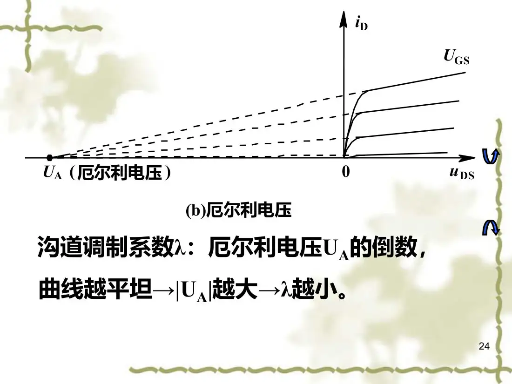

原文：

沟道调制系数λ：厄尔利电压 $U_{A}$ 的倒数，曲线越平坦→ $|U_{A}|$ 越大→ $λ$ 越小。

24

### 考虑 $u_{DS}$ 对 $i_{D}$ 的微弱影响后恒流区的电流方程为:

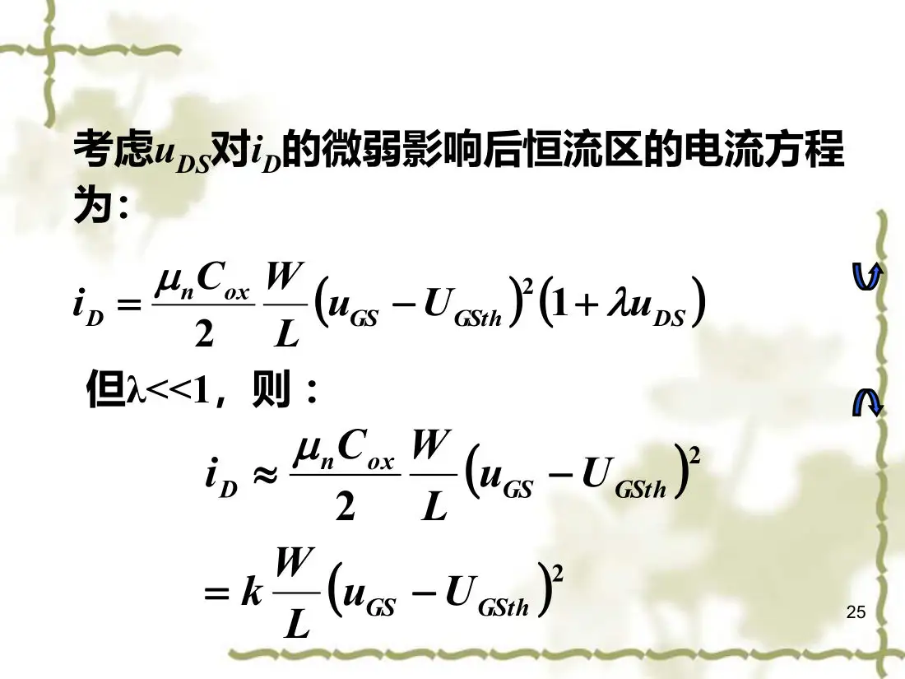

原文：

考虑 $u_{DS}$ 对 $i_{D}$ 的微弱影响后恒流区的电流方程为:

$$
i _ {D} = \frac {\mu_ {n} C _ {o x}}{2} \frac {W}{L} \big (u _ {G S} - U _ {G S t h} \big) ^ {2} \big (1 + \lambda u _ {D S} \big)
$$

但 $\lambda <  < 1$ ，则：

$$
\begin{array}{l} i _ {D} \approx \frac {\mu_ {n} C _ {o x}}{2} \frac {W}{L} (u _ {G S} - U _ {G S t h}) ^ {2} \\ = k \frac {W}{L} (u _ {G S} - U _ {G S t h}) ^ {2} \end{array}
$$

25

### 可变电阻区：

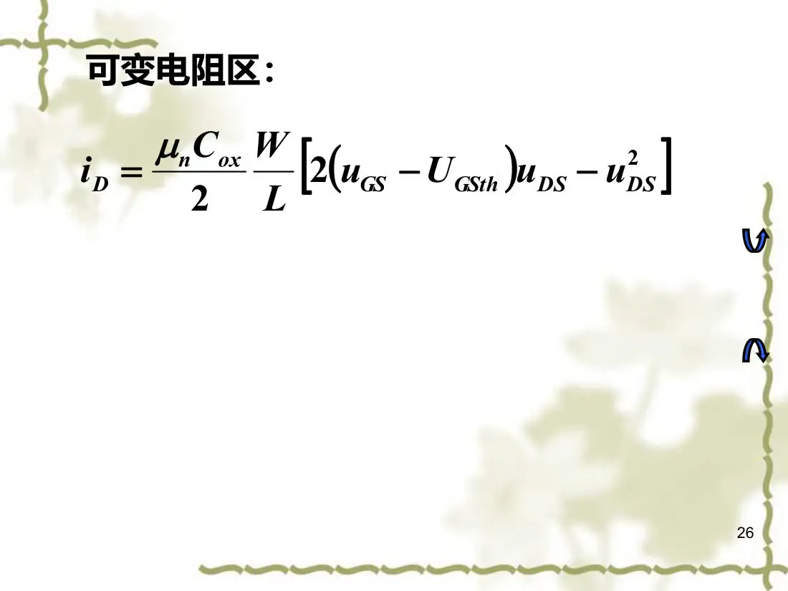

原文：

可变电阻区：

$$
i _ {D} = \frac {\mu_ {n} C _ {o x}}{2} \frac {W}{L} \left[ 2 (u _ {G S} - U _ {G S t h}) u _ {D S} - u _ {D S} ^ {2} \right]
$$

26

### 27

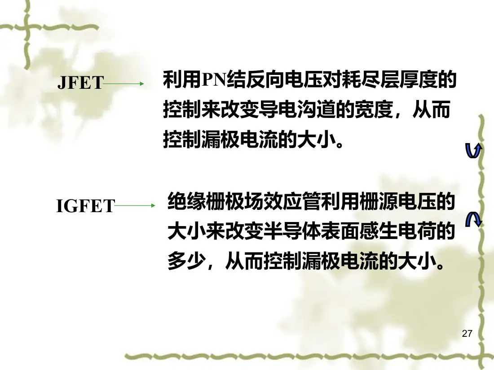

原文：

JFET → 利用PN结反向电压对耗尽层厚度的控制来改变导电沟道的宽度，从而控制漏极电流的大小。

IGFET → 绝缘栅极场效应管利用栅源电压的大小来改变半导体表面感生电荷的多少，从而控制漏极电流的大小。

27

### N沟道耗尽型 MOSFET

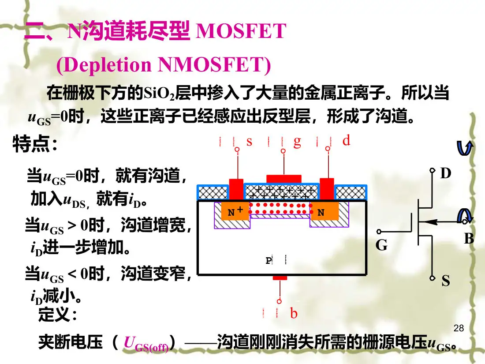

原文：

N沟道耗尽型 MOSFET

(Depletion NMOSFET)

在栅极下方的 $\mathrm{SiO}_{2}$ 层中掺入了大量的金属正离子。所以当 $u_{\mathrm{GS}} = 0$ 时，这些正离子已经感应出反型层，形成了沟道。

特点:

当 $u_{GS}=0$ 时，就有沟道，
加入 $u_{DS}$ ，就有 $i_{D}$ 。

当 $u_{GS}>0$ 时，沟道增宽， $i_{D}$ 进一步增加。

当 $u_{GS}<0$ 时，沟道变窄， $i_{D}$ 减小。

定义:

夹断电压（ $U_{\mathrm{GS(off)}}$ ）——沟道刚刚消失所需的栅源电压 $u_{\mathrm{GS}}$ 。

$u_{\mathrm{GS}^{\circ}}$

28

### $$

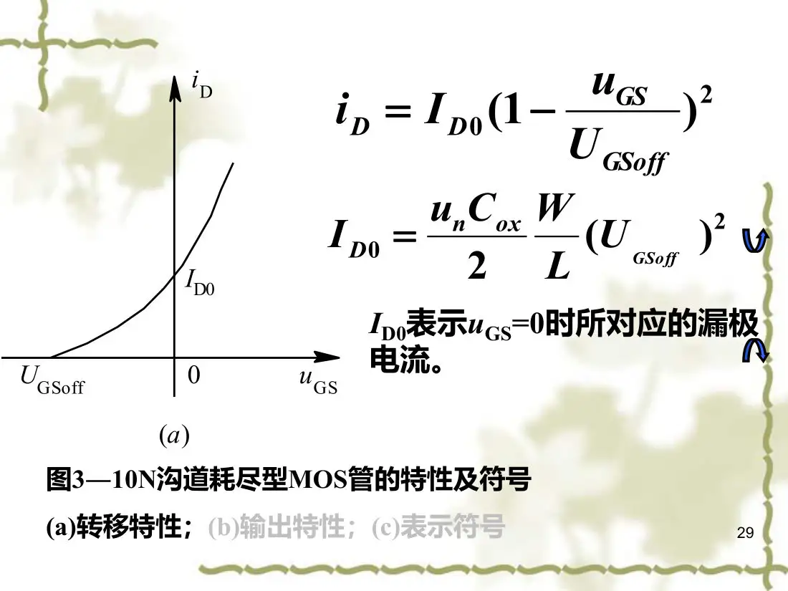

原文：

$$
i _ {D} = I _ {D 0} (1 - \frac {u _ {G S}}{U _ {G S o f f}}) ^ {2}
$$

$$
I _ {D 0} = \frac {u _ {n} C _ {o x}}{2} \frac {W}{L} (U _ {\text { GSoff }}) ^ {2} \cup
$$

$I_{D0}$ 表示 $u_{GS}=0$ 时所对应的漏极电流。

(a)

图3—10N沟道耗尽型MOS管的特性及符号

(a)转移特性；(b)输出特性；(c)表示符号

29

### 30

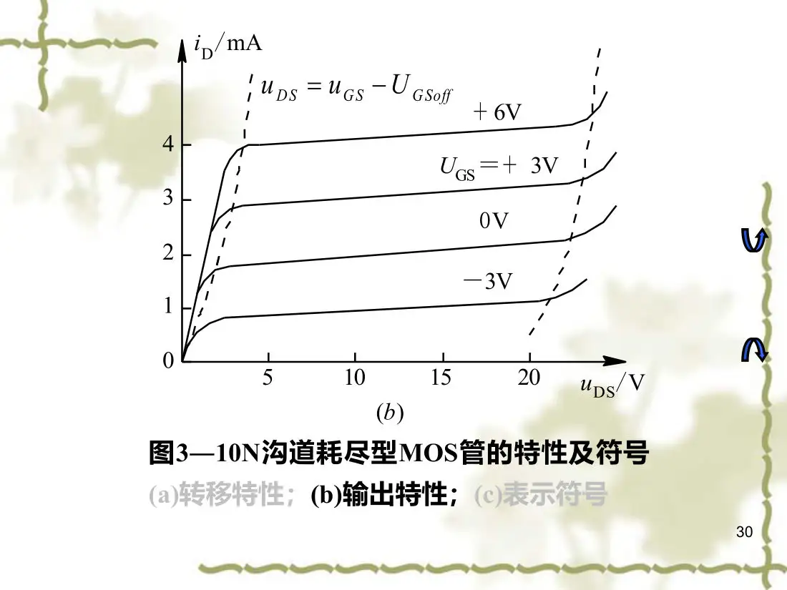

原文：

30

### 双极型和场效应型三极管的比较

原文：

双极型和场效应型三极管的比较

<table><tr><td></td><td>双极型三极管</td><td>单极型场效应管</td></tr><tr><td>载流子</td><td>多子扩散少子漂移</td><td>多子(或少子)漂移</td></tr><tr><td>输入量</td><td>电流输入</td><td>电压输入</td></tr><tr><td>控制</td><td>电流控制电流源</td><td>电压控制电流源</td></tr><tr><td>输入电阻</td><td>几十到几千欧</td><td>几兆欧以上</td></tr><tr><td>制造工艺</td><td>不宜大规模集成</td><td>适宜大规模和超大规模集成</td></tr></table>

31

### 3.2 场效应管的工作状态分析及其偏置电路

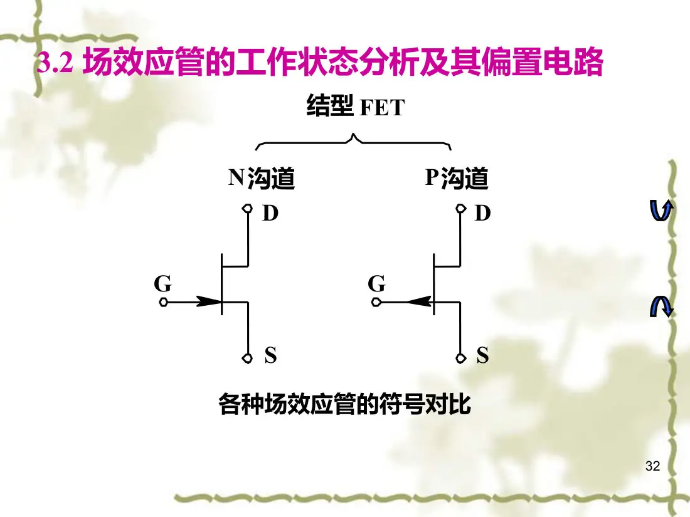

原文：

3.2 场效应管的工作状态分析及其偏置电路

结型FET

N沟道

P沟道

各种场效应管的符号对比

32

### MOSFET

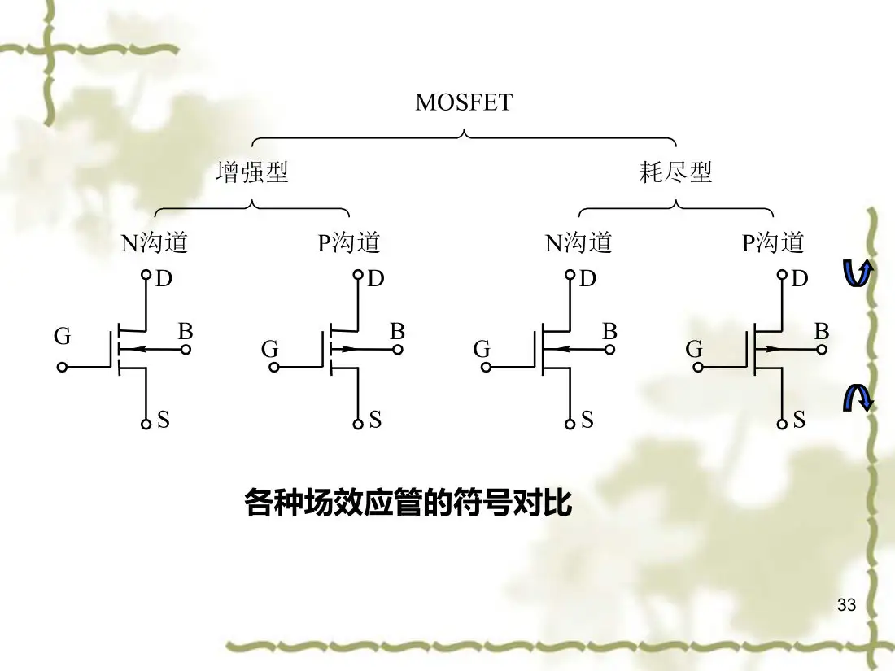

原文：

MOSFET

增强型

耗尽型

N沟道

P沟道

N沟道

P沟道

各种场效应管的符号对比

33

### 34

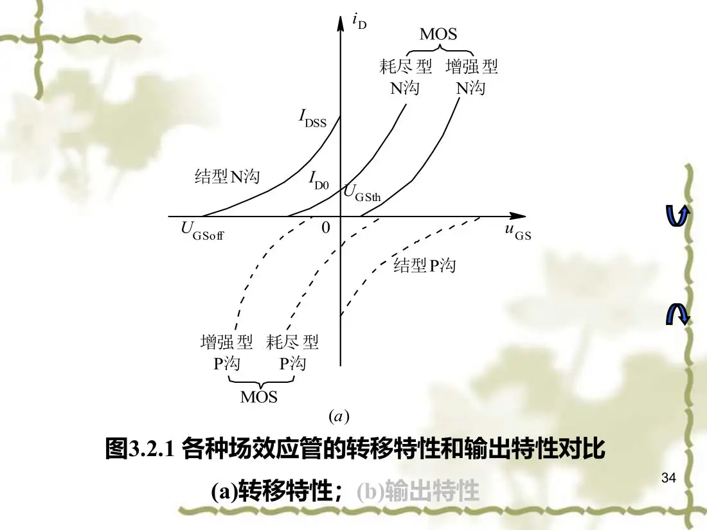

原文：

34

### 35

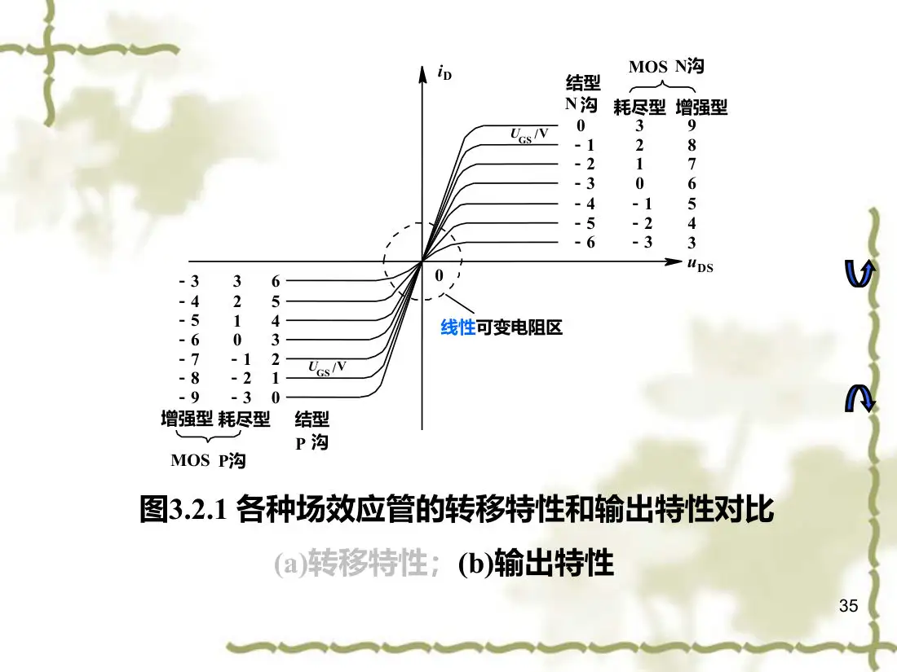

原文：

35

### 表 3.2.1 场效应管工作区间与极间电压的关系

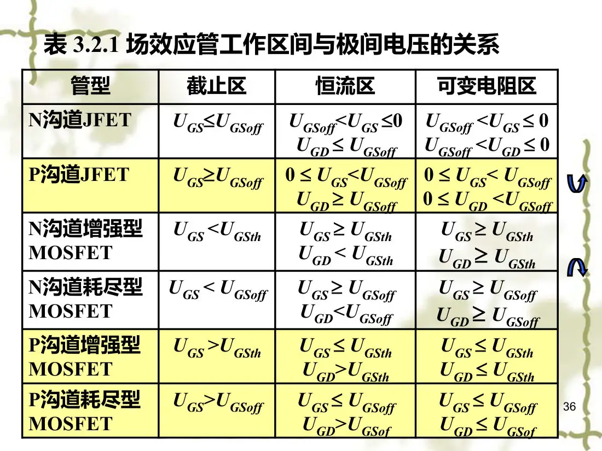

原文：

表 3.2.1 场效应管工作区间与极间电压的关系
<table><tr><td>管型</td><td>截止区</td><td>恒流区</td><td>可变电阻区</td></tr><tr><td>N沟道JFET</td><td> $U_{GS} \leq U_{GSoff}$ </td><td> $U_{GSoff} < U_{GS} \leq 0$  $U_{GD} \leq U_{GSoff}$ </td><td> $U_{GSoff} < U_{GS} \leq 0$  $U_{GSoff} < U_{GD} \leq 0$ </td></tr><tr><td>P沟道JFET</td><td> $U_{GS} \geq U_{GSoff}$ </td><td> $0 \leq U_{GS} < U_{GSoff}$  $U_{GD} \geq U_{GSoff}$ </td><td> $0 \leq U_{GS} < U_{GSoff}$  $0 \leq U_{GD} < U_{GSoff}$ </td></tr><tr><td>N沟道增强型MOSFET</td><td> $U_{GS} < U_{GSth}$ </td><td> $U_{GS} \geq U_{GSth}$  $U_{GD} < U_{GSth}$ </td><td> $U_{GS} \geq U_{GSth}$  $U_{GD} \geq U_{GSth}$ </td></tr><tr><td>N沟道耗尽型MOSFET</td><td> $U_{GS} < U_{GSoff}$ </td><td> $U_{GS} \geq U_{GSoff}$  $U_{GD} < U_{GSoff}$ </td><td> $U_{GS} \geq U_{GSoff}$  $U_{GD} \geq U_{GSoff}$ </td></tr><tr><td>P沟道增强型MOSFET</td><td> $U_{GS} >U_{GSth}$ </td><td> $U_{GS} \leq U_{GSth}$  $U_{GD} >U_{GSth}$ </td><td> $U_{GS} \leq U_{GSth}$  $U_{GD} \leq U_{GSth}$ </td></tr><tr><td>P沟道耗尽型MOSFET</td><td> $U_{GS} >U_{GSoff}$ </td><td> $U_{GS} \leq U_{GSoff}$  $U_{GD} >U_{GSof}$ </td><td> $U_{GS} \leq U_{GSoff}$  $U_{GD} \leq U_{GSof}$ </td></tr></table>

### 表 3.2.1 场效应管工作区间与极间电压的关系

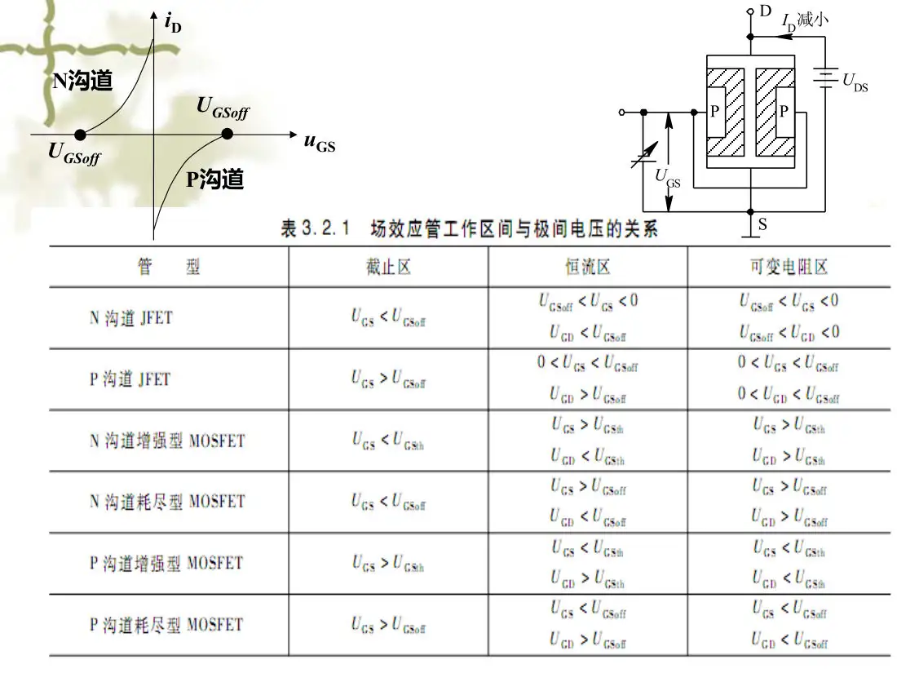

原文：

表 3.2.1 场效应管工作区间与极间电压的关系
<table><tr><td>管型</td><td>截止区</td><td>恒流区</td><td>可变电阻区</td></tr><tr><td>N沟道JFET</td><td> $U_{GS} < U_{GSoff}$ </td><td> $U_{GSoff} < U_{GS} < 0$  $U_{GD} < U_{GSoff}$ </td><td> $U_{GSoff} < U_{GS} < 0$  $U_{GSoff} < U_{GD} < 0$ </td></tr><tr><td>P沟道JFET</td><td> $U_{GS} >U_{GSoff}$ </td><td> $0 < U_{GS} < U_{GSoff}$  $U_{GD} >U_{GSoff}$ </td><td> $0 < U_{GS} < U_{GSoff}$  $0 < U_{GD} < U_{GSoff}$ </td></tr><tr><td>N沟道增强型MOSFET</td><td> $U_{GS} < U_{GSth}$ </td><td> $U_{GS} >U_{GSth}$  $U_{GD} < U_{GSth}$ </td><td> $U_{GS} >U_{GSth}$  $U_{GD} >U_{GSth}$ </td></tr><tr><td>N沟道耗尽型MOSFET</td><td> $U_{GS} < U_{GSoff}$ </td><td> $U_{GS} >U_{GSoff}$  $U_{GD} < U_{GSoff}$ </td><td> $U_{GS} >U_{GSoff}$  $U_{GD} >U_{GSoff}$ </td></tr><tr><td>P沟道增强型MOSFET</td><td> $U_{GS} >U_{GSth}$ </td><td> $U_{GS} < U_{GSth}$  $U_{GD} >U_{GSth}$ </td><td> $U_{GS} < U_{GSth}$  $U_{GD} < U_{GSth}$ </td></tr><tr><td>P沟道耗尽型MOSFET</td><td> $U_{GS} >U_{GSoff}$ </td><td> $U_{GS} < U_{GSoff}$  $U_{GD} >U_{GSoff}$ </td><td> $U_{GS} < U_{GSoff}$  $U_{GD} < U_{GSoff}$ </td></tr></table>

### 截止区：G极处沟道夹断。

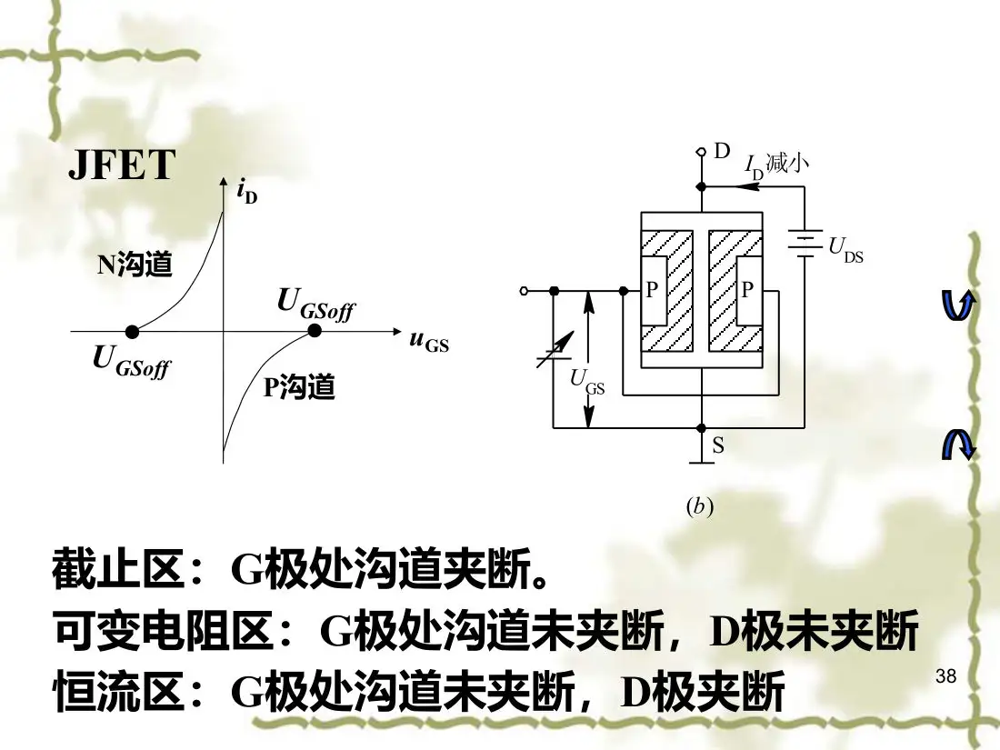

原文：

截止区：G极处沟道夹断。

可变电阻区：G极处沟道未夹断，D极未夹断

恒流区：G极处沟道未夹断，D极夹断

38

### N-JFET

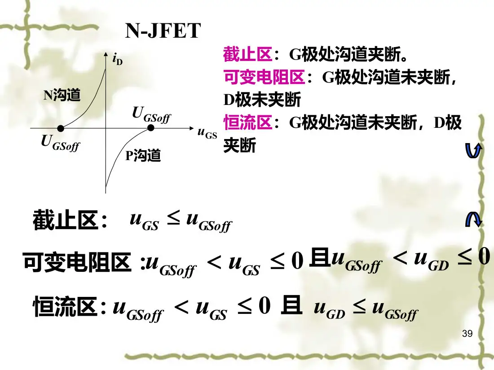

原文：

N-JFET

截止区：G极处沟道夹断。

可变电阻区：G极处沟道未夹断，D极未夹断

恒流区：G极处沟道未夹断，D极夹断

截止区： $u_{GS} \leq u_{GSoff}$

可变电阻区: $u_{GSoff} < u_{GS} \leq 0$ 且 $u_{GSoff} < u_{GD} \leq 0$

恒流区: $u_{GSoff} < u_{GS} \leq 0$ 且 $u_{GD} \leq u_{GSoff}$

39

### P-JFET

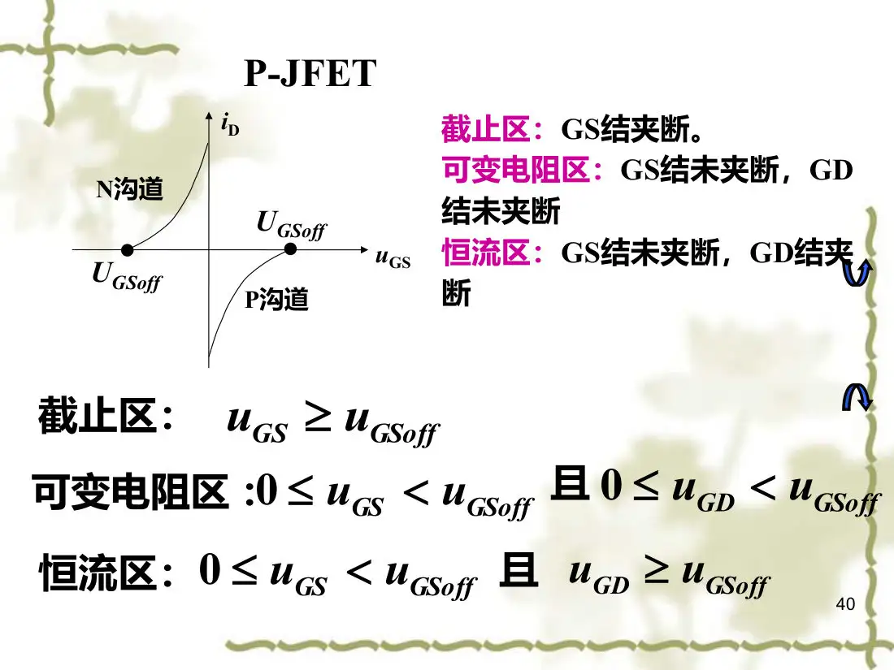

原文：

P-JFET

截止区：GS结夹断。

截止区： $u_{GS} \geq u_{GSoff}$ 可变电阻区：GS结未夹断，GD结未夹断

恒流区: GS结未夹断, GD结夹断

可变电阻区 : $0 \leq u_{GS} < u_{GSoff}$ 且 $0 \leq u_{GD} < u_{GSoff}$

恒流区： $0 \leq u_{GS} < u_{GSoff}$ 且 $u_{GD} \geq u_{GSoff}$

40

### E-MOSFET(增强型)

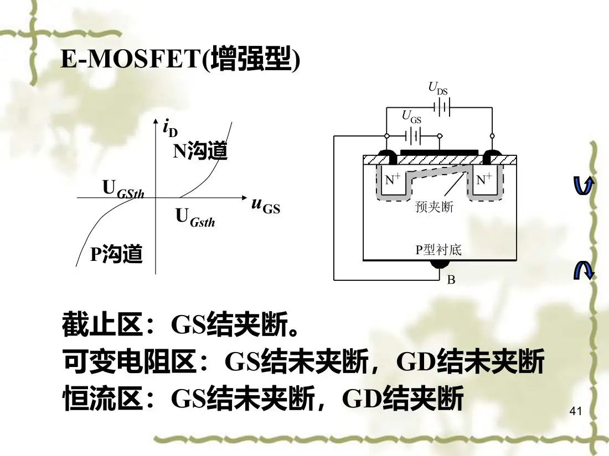

原文：

E-MOSFET(增强型)

截止区：GS结夹断。

可变电阻区：GS结未夹断，GD结未夹断  
恒流区：GS结未夹断，GD结夹断

41

### 截止区：GS结夹断。

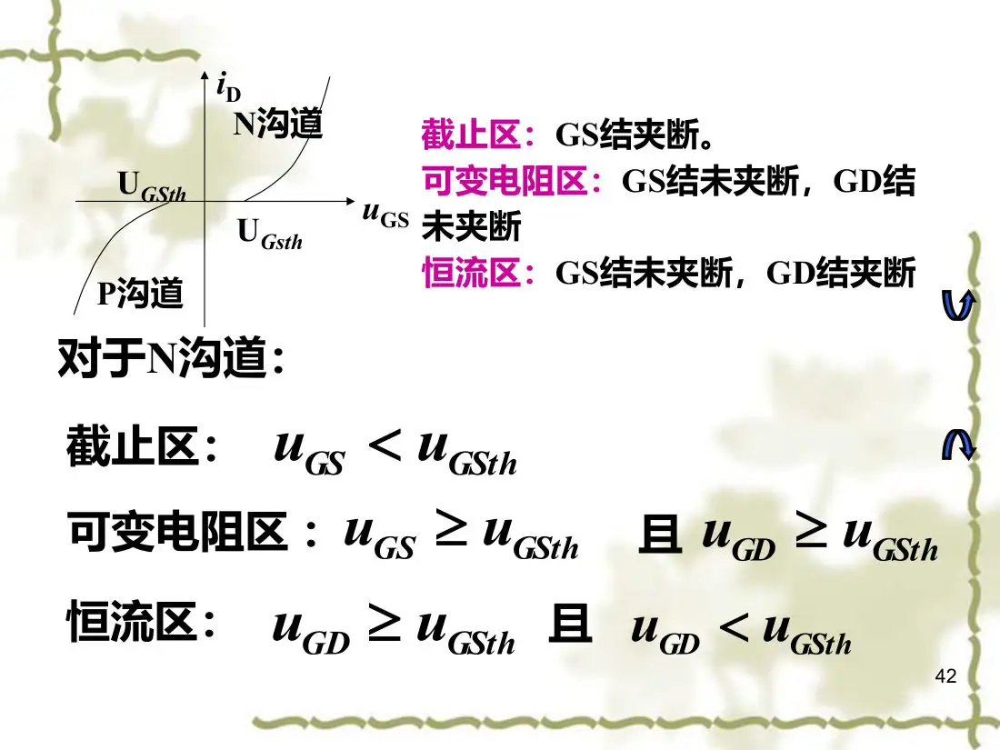

原文：

截止区：GS结夹断。

可变电阻区：GS结未夹断，GD结未夹断

恒流区：GS结未夹断，GD结夹断

对于N沟道：

截止区： $u_{GS} < u_{GSth}$

可变电阻区： $u_{GS} \geq u_{GSth}$ 且 $u_{GD} \geq u_{GSth}$

恒流区： $u_{GD} \geq u_{GSth}$ 且 $u_{GD} < u_{GSth}$

42

### 截止区：GS结夹断。

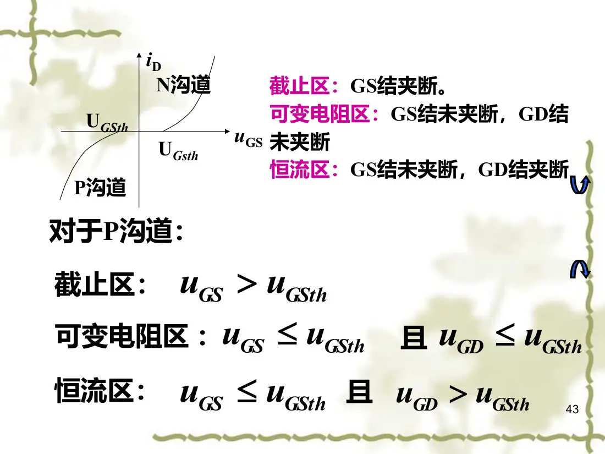

原文：

截止区：GS结夹断。

可变电阻区：GS结未夹断，GD结 $u_{GS}$ 未夹断

恒流区：GS结未夹断，GD结夹断，

对于P沟道：

截止区： $u_{GS} > u_{GSth}$

可变电阻区： $u_{GS} \leq u_{GSth}$ 且 $u_{GD} \leq u_{GSth}$

恒流区： $u_{GS} \leq u_{GSth}$ 且 $u_{GD} > u_{GSth}$

43

### D-MOSFET(耗尽型)

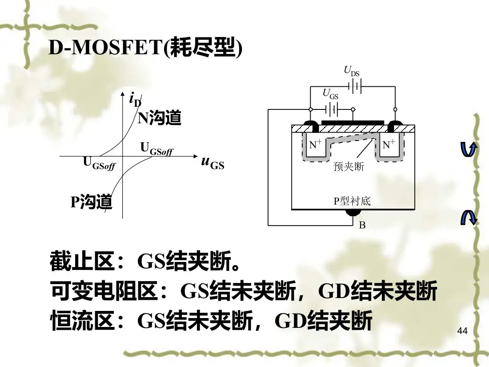

原文：

D-MOSFET(耗尽型)

截止区：GS结夹断。

可变电阻区：GS结未夹断，GD结未夹断  
恒流区：GS结未夹断，GD结夹断

44

### 截止区：GS结夹断。

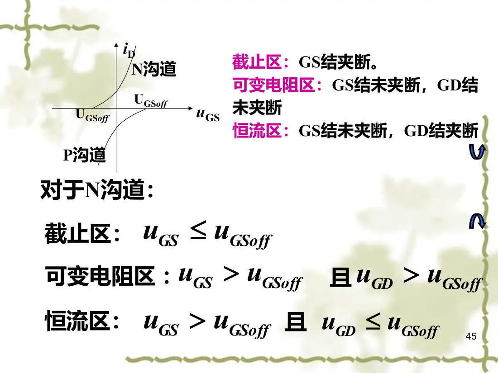

原文：

截止区：GS结夹断。

可变电阻区：GS结未夹断，GD结未夹断

恒流区：GS结未夹断，GD结夹断

对于N沟道：

截止区： $u_{GS} \leq u_{GSoff}$

可变电阻区： $u_{GS} > u_{GSoff}$ 且 $u_{GD} > u_{GSoff}$

恒流区： $u_{GS} > u_{GSoff}$ 且 $u_{GD} \leq u_{GSoff}$

45

### 截止区：GS结夹断。

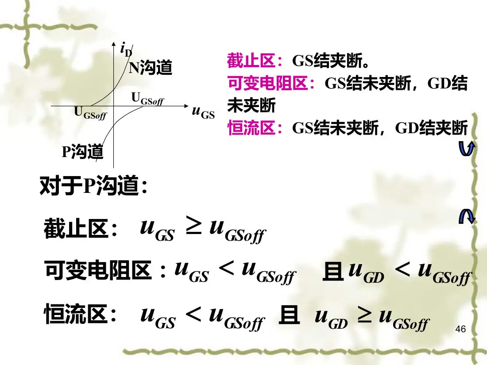

原文：

截止区：GS结夹断。

可变电阻区：GS结未夹断，GD结未夹断

恒流区：GS结未夹断，GD结夹断

对于P沟道：

截止区： $u_{GS} \geq u_{GSoff}$

可变电阻区： $u_{GS}<u_{GSoff}$ 且 $u_{GD}<u_{GSoff}$

恒流区： $u_{GS} < u_{GSoff}$ 且 $u_{GD} \geq u_{GSoff}$

46

### 恒流区的转移特性方程：

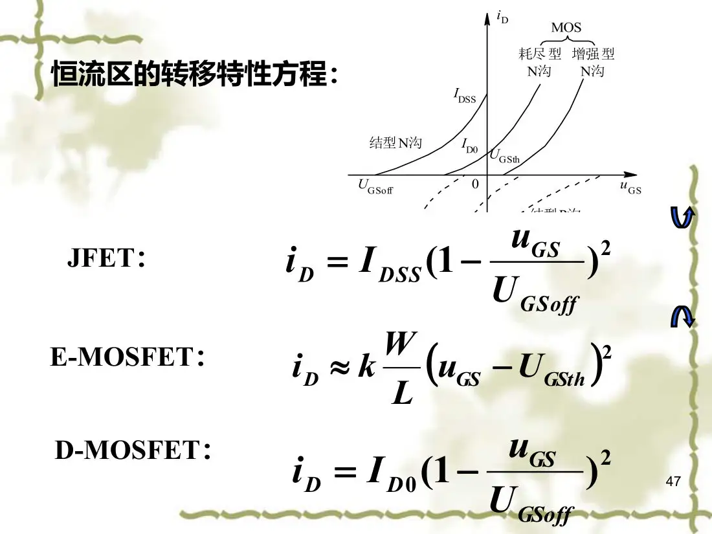

原文：

恒流区的转移特性方程：

JFET:

E-MOSFET:

D-MOSFET:

$$
i _ {D} = I _ {D S S} (1 - \frac {u _ {G S}}{U _ {G S o f f}}) ^ {2}
$$

$$
i _ {D} \approx k \frac {W}{L} \big (u _ {G S} - U _ {G S t h} \big) ^ {2}
$$

$$
i _ {D} = I _ {D 0} (1 - \frac {u _ {G S}}{U _ {G S o f f}}) ^ {2}
$$

47

### $$

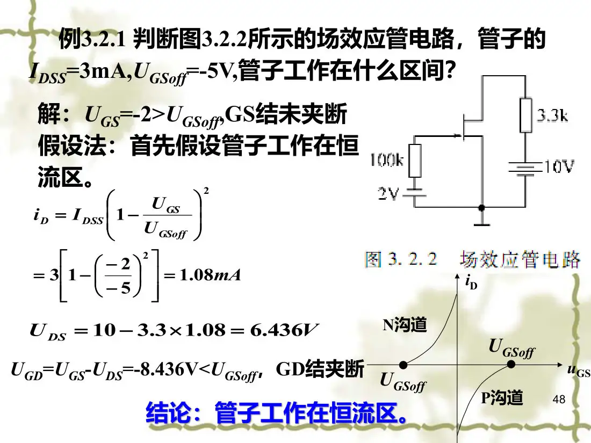

原文：

例3.2.1 判断图3.2.2所示的场效应管电路，管子的 $I_{DSS}=3mA,U_{GSoff}=-5V$ ，管子工作在什么区间？

解: $U_{GS} = -2 > U_{GSoff}$ , GS结未夹断假设法: 首先假设管子工作在恒流区。

$$
\boldsymbol {i} _ {D} = I _ {D S S} \left(1 - \frac {\boldsymbol {U} _ {G S}}{\boldsymbol {U} _ {G S o f f}}\right) ^ {2}
$$

$$
= 3 \left[ 1 - \left(\frac {- 2}{- 5}\right) ^ {2} \right] = 1. 0 8 m A
$$

$$
U _ {D S} = 1 0 - 3. 3 \times 1. 0 8 = 6. 4 3 6 V
$$

$U_{GD}=U_{GS}-U_{DS}=-8.436V<U_{GSoff},\quad GD$ 结夹断

结论：管子工作在恒流区。

### 3.2.2 场效应管的偏置电路

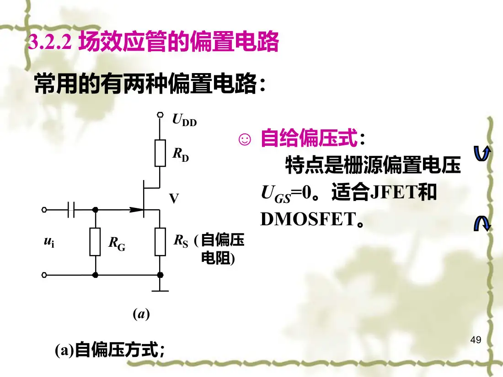

原文：

3.2.2 场效应管的偏置电路

常用的有两种偏置电路：

(a)自偏压方式;

自给偏压式：

特点是栅源偏置电压 $U_{GS}=0$ 。适合JFET和DMOSFET。

49

### (自偏压电阻)

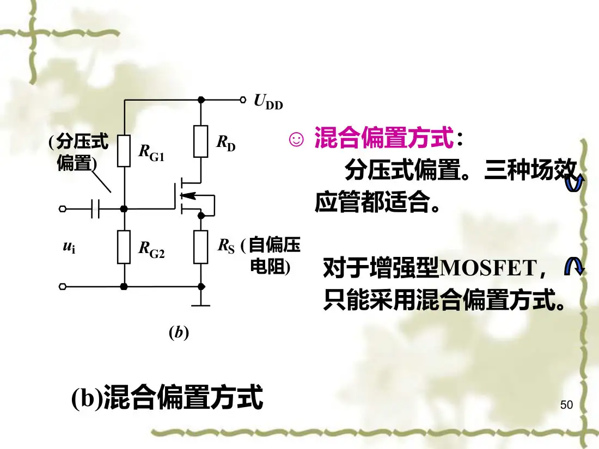

原文：

(自偏压电阻)

(b)

(b)混合偏置方式

😊 混合偏置方式：

分压式偏置。三种场效应管都适合。

对于增强型MOSFET，只能采用混合偏置方式。

50

### 51

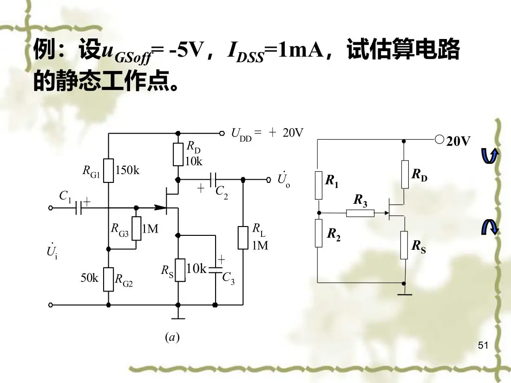

原文：

例：设 $u_{GSoff}=-5V$ ， $I_{DSS}=1mA$ ，试估算电路的静态工作点。

51

### 解：画直流通路。

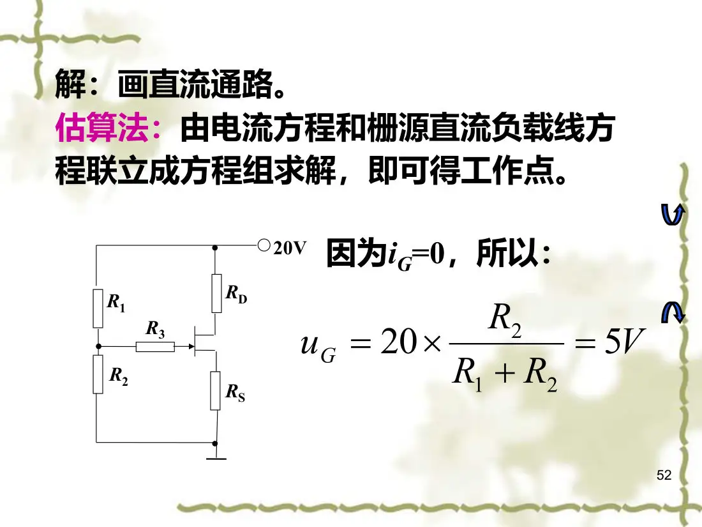

原文：

解：画直流通路。

估算法：由电流方程和栅源直流负载线方程联立成方程组求解，即可得工作点。

-○20V 因为 $i_{G}=0$ ，所以：

$$
u _ {G} = 2 0 \times \frac {R _ {2}}{R _ {1} + R _ {2}} = 5 V
$$

52

### 输入回路满足：

原文：

输入回路满足：

$$
U _ {G S} = 5 - R _ {S} \times I _ {D}
$$

同时在放大区满足：

$$
I _ {D} = I _ {D S S} \left(1 - \frac {U _ {G S}}{U _ {G S o f f}}\right) ^ {2} = 1 \left(1 - \frac {U _ {G S}}{- 5}\right) ^ {2}
$$

53

### $$

原文：

$$
\left\{ \begin{array}{l} U _ {G S} = 5 - R _ {S} \times I _ {D} \quad — — (1) \\ I _ {D} = I _ {D S S} \left(1 - \frac {U _ {G S}}{U _ {G S o f f}}\right) ^ {2} = 1 \left(1 - \frac {U _ {G S}}{- 5}\right) ^ {2} — — \end{array} \right.\tag{2}
$$

联立上述两方程，得到： $I_{D1}=0.61mA$ ， $I_{D2}=1.64mA$

将 $I_{D1}=0.61$ ， $I_{D2}=1.64mA$ 代入（1）式，分别得到 $U_{GS1}=-1.1V$ ， $U_{GS2}=-11.4V$ 因为 $U_{GS2}<U_{GSoff}=-5V$ ，所以 $I_{D2}$ 舍去。

54

### 因此： $I_{DQ}=0.61mA$

原文：

因此： $I_{DQ}=0.61mA$

$$
U _ {G S Q} = - 1. 1 \mathrm{V}
$$

则: $U_{DSQ} = 20 - 0.61 \times (10 + 10) = 7.8 \mathrm{~V} \Omega$

55

### 问题：对于自偏压式，如何联立方程？

原文：

问题：对于自偏压式，如何联立方程？

$$
\left\{ \begin{array} {l}U _ {G S} = - I _ {D} \times R _ {S} \\ I _ {D} = I _ {D S S} \Bigg (1 - \frac {U _ {G S}}{U _ {G S o f f}} \Bigg) ^ {2} \\ \end{array} \right. Ⓥ
$$

56

### 图解法

原文：

图解法

57

### 58

原文：

58

### 1. 对于自偏压方式

原文：

1. 对于自偏压方式

$$
u _ {G S} = - i _ {D} R _ {S} \quad \text { 栅源回路直流负载线方程 }
$$

2. 对于混合偏置方式

$$
u _ {G S} = \frac {R _ {G 2}}{R _ {G 1} + R _ {G 2}} U _ {D D} - i _ {D} R _ {S}
$$

—— 栅源回路直流负载线方程

59

### 3.3 场效应管放大电路

原文：

3.3 场效应管放大电路

场效应管有三种基本放大电路：共源、共漏和共栅。

其偏置电路也要保证管子工作在恒流区。由于场效应管的输入电流近似为0，因此它是电压控制器件。需要选择合适的 $U_{GS}$ 和 $U_{DS}$ 以保证管子工作在恒流区。

60

### 3.3.1 场效应管的低频交流小信号模型

原文：

3.3.1 场效应管的低频交流小信号模型

求解交流小信号等效电路与双极型晶体管类似。只是场效应管的输入电流为0，因此输出电流 $i_{D}$ 只受输入电压控制，不受输入电流控制。控制能力用跨导 $g_{m}$ 表示。

$$
g _ {m} = \frac {d i _ {D}}{d u _ {G S}} \bigg | _ {u _ {D S} = C}
$$

61

### 交流小信号等效电路：

原文：

交流小信号等效电路：

$r_{DS}$ 是反映了器件的沟道调制效应。

$$
r _ {d s} = \frac {d u _ {D S}}{d i _ {D}} \bigg | _ {u _ {G S Q}}
$$

$$
r _ {d s} = \frac {\left| U _ {A} \right|}{I _ {D Q}}
$$

(b)

62

### 第 63 页

原文：

$g_{m}$ 的求法： $g_{m}=\frac{di_{D}}{du_{GS}}\bigg|u_{DS}=C$ 在恒流区满足的电流方程：
结型场效应管： $i_{D}=I_{DSS}\left(1-\frac{u_{GS}}{U_{GSoff}}\right)^{2}$ 增强型MOS管： $i_{D}=K(u_{GS}-U_{GSth})^{2}$ 耗尽型MOS管： $i_{D}=I_{D0}(1-\frac{u_{GS}}{U_{GSoff}})^{2}$

### ①对JFET和耗尽型MOS管，

原文：

①对JFET和耗尽型MOS管，

$$
i _ {D} = I _ {D S S} \left(1 - \frac {u _ {G S}}{U _ {G S o f f}}\right) ^ {2}
$$

则对应工作点Q的 $g_{m}$ 为：

$$
g _ {m} = \frac {d i _ {D}}{d u _ {G S}} \bigg | _ {Q} = - \frac {2 I _ {D S S}}{U _ {G S o f f}} \sqrt {\frac {I _ {D Q}}{I _ {D S S}}}
$$

64

### $g_{m}$ 的求法:

原文：

$g_{m}$ 的求法:

②对增强型MOSFET，

$$
i _ {D} = \frac {\mu_ {n} C _ {o x}}{2} \frac {W}{L} \left(u _ {G S} - U _ {G S t h}\right) ^ {2}
$$

则对应工作点Q的 $g_{m}$ 为：

$$
g _ {m} = \sqrt {\frac {2 \mu_ {n} C _ {o x} W}{L} I _ {D Q}}
$$

$$
\mathbf {W} / \mathbf {L} \uparrow \rightarrow \mathbf {g} _ {m} \uparrow
$$

65

### 3.3.2 共源放大电路

原文：

3.3.2 共源放大电路

(a)电路；(b)低频小信号等效电路

66

### ![(b) 图3.3.2 共源放大电路及其低频小信号等效电路

原文：

67

### ① Au:

原文：

① Au:

$$
U _ {o} = - \mathbf {g} _ {m} U _ {g s} (r _ {d s} \| R _ {D} \| R _ {L})
$$

式中， $U_{gs}=U_{i}$ ，且一般满足 $R_{D}\parallel R_{L}<<r_{ds}$ 。所以，共源放大器的放大倍数 $A_{u}$ 为

$$
A _ {u} = \frac {U _ {o}}{U _ {i}} \approx - g _ {m} (R _ {D} \| R _ {L})
$$

若 $g_{m}=5mA/V$ ，则 $A_{u}=50$ 。

68

### 69

原文：

输出电阻： $R_{o} = R_{D}\parallel r_{ds}\approx R_{D} = 10k\Omega$

输入电阻： $R_{i} = R_{G3} + R_{G1}\parallel R_{G2} = 1.0375M\Omega$ 例3.3.2：场效应管放大器电路如图3.3.3所示，已知工作点的 $g_{m}=5mA/V$ ，试画出低频小信号等效电路，并计算增益 $A_{u}$ 。

69

### 第 70 页

### 解：低频小信号模型如上图所示。

原文：

解：低频小信号模型如上图所示。

$$
A _ {u} = \frac {\dot {U} _ {o}}{\dot {U} _ {i}} = \frac {- g _ {m} u _ {g s} (R _ {D} \| R _ {L})}{u _ {g s} + g _ {m} u _ {g s} R _ {S 1}} = - \frac {g _ {m}}{1 + g _ {m} R _ {S 1}} (R _ {D} \| R _ {L}) = - 8. 3
$$

71

### 3.3.3 共漏放大器

原文：

3.3.3 共漏放大器

(a)电路；(b)等效电路

72

### ① $A_{u}$ :

原文：

① $A_{u}$ :

$$
\dot {U} _ {o} = \dot {I} _ {d} (R _ {S} \| R _ {L}) = \dot {I} _ {d} R _ {L} ^ {\prime}
$$

$$
\begin{array}{r l} & {\dot {I} _ {d} = g _ {m} \dot {U} _ {G S} = g _ {m} [ \dot {U} _ {i} - \dot {I} _ {d} (R _ {S} \| R _ {L}) ] = g _ {m} (\dot {U} _ {i} - \dot {I} _ {d} R _ {L} ^ {'})} \\ & {\Rightarrow \dot {I} _ {d} = \frac {g _ {m}}{1 + g _ {m} R _ {L} ^ {'}} \dot {U} _ {i} A _ {u} = \frac {\dot {U} _ {o}}{\dot {U} _ {i}} = \frac {g _ {m} R _ {L} ^ {'}}{1 + g _ {m} R _ {L} ^ {'}}} \end{array}
$$

73

### 或：

原文：

或：

$$
A _ {u} = \frac {g _ {m} U _ {g s} (R _ {s} \| R _ {L})}{U _ {g s} + g _ {m} U _ {g s} (R _ {s} \| R _ {L})} = \frac {g _ {m} R _ {L} ^ {\prime}}{1 + g _ {m} R _ {L} ^ {\prime}} \leq 1
$$

74

### ![图3—19共漏电路及其等效电路

原文：

75

### 2. 输出电阻 $R_{0}$

原文：

2. 输出电阻 $R_{0}$

76

### 77

原文：

77

### 由图可见 $I_{o}=I_{R_{S}}+I'_{o}$

原文：

由图可见 $I_{o}=I_{R_{S}}+I'_{o}$

式中：

$$
\begin{array}{l} \dot {I} _ {R _ {S}} = \frac {U _ {o}}{R _ {S}} \\ \dot {I ^ {\prime}} _ {S} = - g _ {m} \dot {U} _ {g s} = - g _ {m} (- \dot {U} _ {o}) = g _ {m} \dot {U} _ {o} \end{array}
$$

所以，输出电阻为

$$
R _ {o} = \frac {\dot {U} _ {o}}{I _ {o}} = \frac {\dot {U} _ {o}}{\frac {\dot {U} _ {o}}{R _ {S}} + g _ {m} \dot {U} _ {o}} = \frac {1}{\frac {1}{R _ {S}} + \frac {1}{\frac {1}{g _ {m}}}}
$$

78

### $$

原文：

故

$$
R _ {o} = R _ {S} \left\| \frac {1}{g _ {m}} = 2 \times 1 0 ^ {3} \right\| \frac {1}{2 \times 1 0 ^ {- 3}} = 4 0 0 \Omega
$$

3. 输入电阻

$$
R _ {i} = R _ {G} = R _ {G 3} + R _ {G 1} \parallel R _ {G 2} = 1. 0 3 7 5 M \Omega \curvearrowright
$$

79

### 3—4—3若干问题的讨论

原文：

3—4—3若干问题的讨论

一、晶体管的跨导比场效应管的跨导大得多

晶体管的电流 $i_{C}$ 与发射结电压 $u_{BE}$ 成指数关系，而场效应管的漏极电流 $i_{D}$ 与栅源电压成平方律关系。

80

### 晶体管:

原文：

晶体管:

$$
i _ {C} = I _ {S} (e ^ {\frac {u _ {B E}}{U _ {T}}} - 1)
$$

$$
g _ {m} = \frac {d i _ {C}}{d u _ {B E}} \Big | _ {Q} = \frac {1}{r _ {e}} = \frac {I _ {C Q}}{U _ {T}}
$$

MOSFET:

$$
i _ {D} = \frac {u _ {n} C _ {o x}}{2} \frac {W}{L} (u _ {G S} - U _ {G S t h}) ^ {2}
$$

$$
g _ {m} = \frac {d i _ {D}}{d u _ {G S}} \Big | _ {Q} = \sqrt {\frac {2 u _ {n} u _ {n} C _ {o x} W}{L}} \sqrt {I _ {D Q}}
$$

JFET:

$$
g _ {m} = \frac {- 2 I _ {D S S}}{U _ {G S o f f}} \sqrt {\frac {I _ {D Q}}{I _ {D S S}}}
$$

81

### 二、关于温度稳定性

原文：

二、关于温度稳定性

82

### 三、关于体效应和背栅跨导

原文：

三、关于体效应和背栅跨导

$$
g _ {m b} = \frac {\Delta i _ {D}}{\Delta u _ {B S}} \bigg | _ {u _ {D S} = C \atop u _ {G S} = C}
$$

$$
\eta = \frac {g _ {m b}}{g _ {m}} <   1
$$

83

### 84

原文：

84

### 表 3-1 场效应管三种组态放大器性能比较

原文：

表 3-1 场效应管三种组态放大器性能比较
<table><tr><td></td><td>共源放大器</td><td>共漏放大器</td><td>共栅放大器</td></tr><tr><td>电路</td><td></td><td></td><td></td></tr><tr><td>电压增益</td><td> $A_u \approx -g_m (R_D \parallel R_L)$  $= -g_m R_L'$ </td><td> $A_u = \frac{g_m R_L'}{1 + g_m R_L'} < 1$ </td><td> $A_u = g_m R_L'$ </td></tr><tr><td>输入电阻</td><td> $R_i = R_G \parallel R_i' = R_G$  $(R_i' \to \infty)$ </td><td> $R_i = R_G$ </td><td> $R_i = R_S \parallel \frac{1}{g_m}$ </td></tr><tr><td>输出电阻</td><td> $R_o = R_D$ </td><td> $R_o = R_S \parallel \frac{1}{g_m}$ </td><td> $R_o \approx R_D$ </td></tr></table>

85

### 第 86 页

