# 《电路分析与电工电子技术》第3章作业（含解答）

原件经识别和整理；“参考解答”是我们补的。

## 3-5(b)

电路如题图 3-5 所示，试列网孔方程。

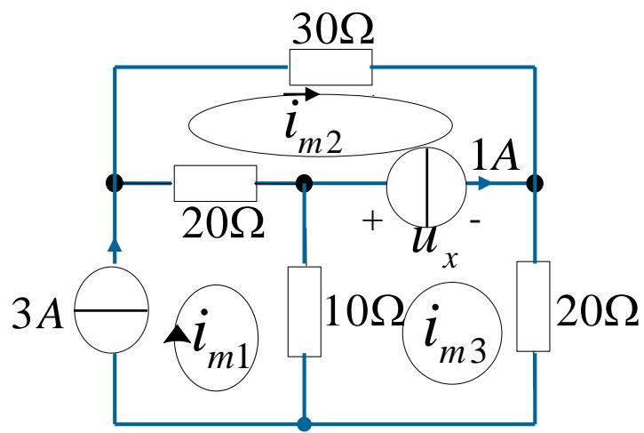

解：设电流源两端电压为 $u_x$，网孔电流如图所示。

$$
\left\{ \begin{array}{l} i_{m1} = 3 \\ -20 i_{m1} + (20+30) i_{m2} = u_x \\ -10 i_{m1} + (10+20) i_{m3} = -u_x \\ i_{m3} - i_{m2} = 1 \end{array} \right.
$$

$$
\therefore \left\{ \begin{array}{l} i_{m1} = 3 \\ -20 i_{m1} + 50 i_{m2} = u_x \\ -10 i_{m1} + 30 i_{m3} = -u_x \\ i_{m3} - i_{m2} = 1 \end{array} \right.
$$

## 3-6(b)

用网孔分析法求题图 3-6 所示电路中的电流 $i_x$ 和电压 $u_x$。

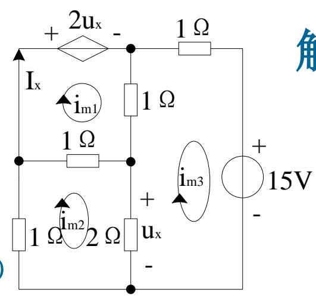

解：设各网孔电流如图所示：

$$
\left\{ \begin{array}{l} (1+1) i_{m1} - i_{m2} - i_{m3} = -2u_x \\ -i_{m1} + (1+2+1) i_{m2} - 2 i_{m3} = 0 \\ -i_{m1} - 2 i_{m2} + (1+1+2) i_{m3} = -15 \\ 2(i_{m2} - i_{m3}) = u_x \end{array} \right.
$$

$$
\therefore i_{m1} = -17.5\,\mathrm{A},\ i_{m2} = -11.25\,\mathrm{A},\ i_{m3} = -13.75\,\mathrm{A},\ u_x = 5\,\mathrm{V}
$$

## 3-9

电路如题所示，用节点分析法求电压 $u$。

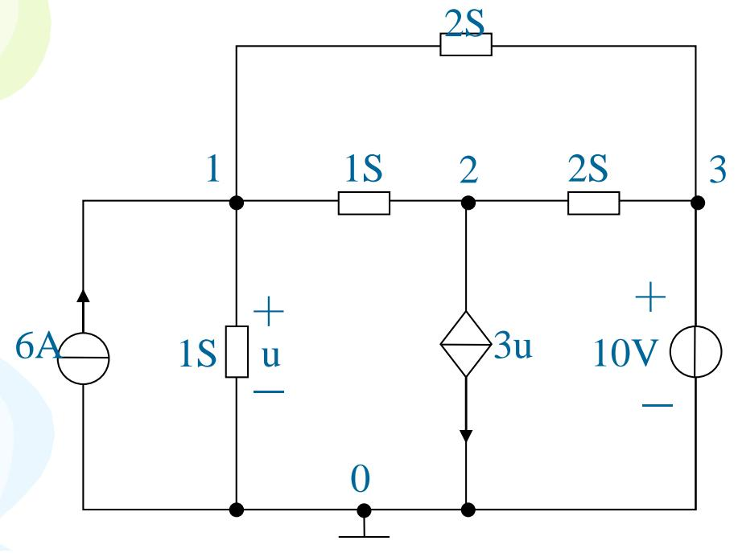

解：设节点 0 为参考节点，对节点 1、2 列节点方程，有：

$$
\left\{ \begin{array}{l} (1+1+2) u_{n1} - u_{n2} - 2 u_{n3} = 6 \\ -u_{n1} + (1+2) u_{n2} - 2 u_{n3} = -3u \\ u_{n3} = 10\,\mathrm{V} \\ u_{n1} = u \end{array} \right.
$$

$$
\therefore u = 7\,\mathrm{V}
$$

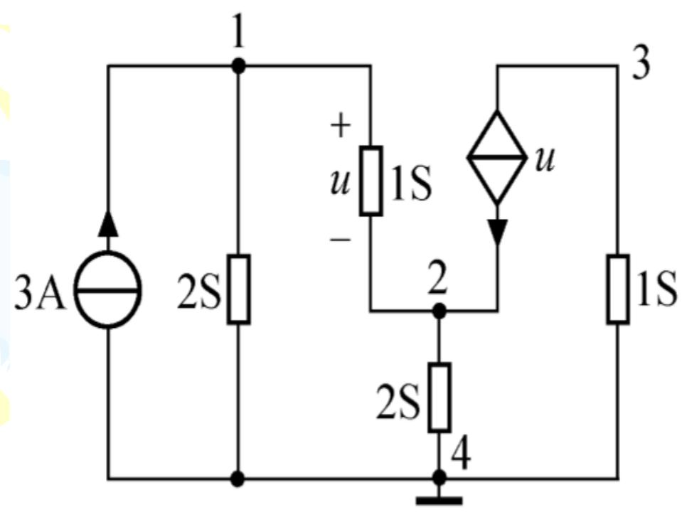

1 节点：$(2+1)u_{n1} - u_{n2} = 3$

2 节点：$(1+2)u_{n2} - u_{n1} = u$

3 节点：$u_{n3} = -u$

辅助方程：$u = u_{n1} - u_{n2}$

## 3-10

解一：

解二：

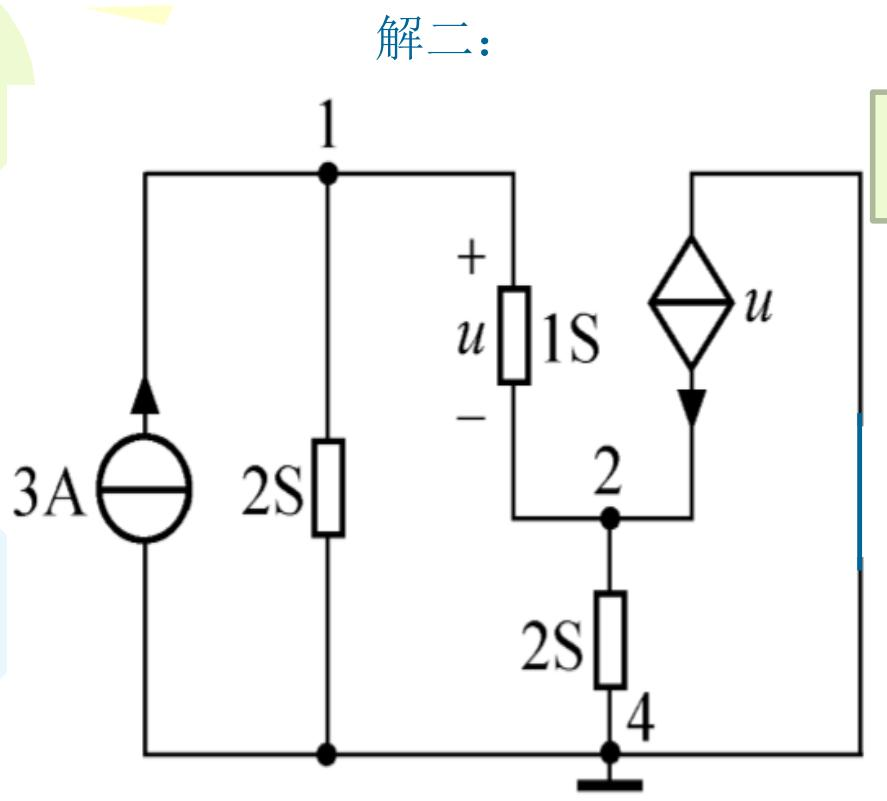

与（受控）电流源相连的电导不能计入自电导和互电导。

3 节点去掉。

1 节点：$(2+1)u_{n1} - u_{n2} = 3$

2 节点：$(1+2+\cdots)u_{n2} - u_{n1} = u$ 错误解

辅助方程：$u = u_{n1} - u_{n2}$

1 节点：$(2+1)u_{n1} - u_{n2} = 3$

2 节点：$(1+2)u_{n2} - u_{n1} = u$ 正确解

辅助方程：$u = u_{n1} - u_{n2}$

## 3-13

求题图所示电路中的电压 $u_{ab}$。

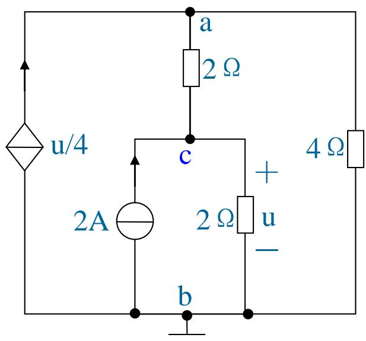

解：用节点分析法。设 b 为参考节点，对节点 a、c 分别列节点方程为：

$$
\left\{ \begin{array}{l} \left(\dfrac{1}{2}+\dfrac{1}{4}\right) u_{na} - \dfrac{1}{2} u_{nc} = \dfrac{u}{4} \\ -\dfrac{1}{2} u_{na} + \left(\dfrac{1}{2}+\dfrac{1}{2}\right) u_{nc} = 2 \\ u_{nc} = u \end{array} \right.
$$

$$
u_{na} = 4\,\mathrm{V},\ u_{nc} = 4\,\mathrm{V}
$$

$$
u_{ab} = u_a - u_b = u_{na} - 0 = u_{na} = 4\,\mathrm{V}
$$

## 3-15

线图如图所示，粗线表示树，试列举出其全部基本回路和基本割集。

解：基本回路：

I：$\{1,5\}$，方向与 1 同；

II：$\{2,7,6\}$，方向与 2 同；

III：$\{3,7,6,5\}$，方向与 3 同；

IV：$\{4,8,5,6,7\}$，方向与 4 同；

多余的不构成回路的树枝去掉

基本割集：

I：$\{1,5,3,4\}$，方向与 5 同；

II：$\{7,2,3,4\}$，方向与 7 同；

III：$\{4,8\}$，方向与 8 同；

IV：$\{6,2,3,4\}$，方向与 6 同；

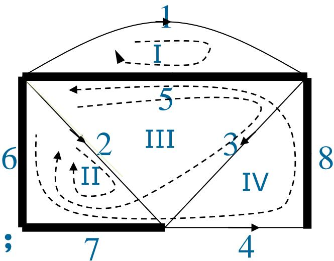

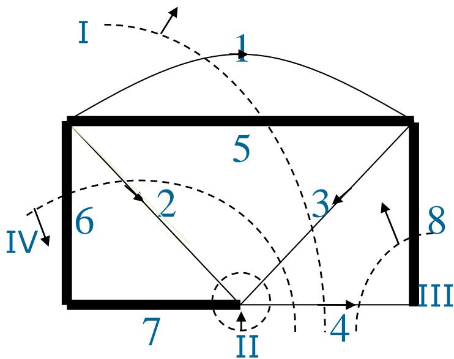

(a)

## 3-20

画出下图电路的对偶电路。

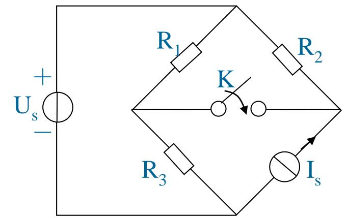

K 闭合对偶 K 打开

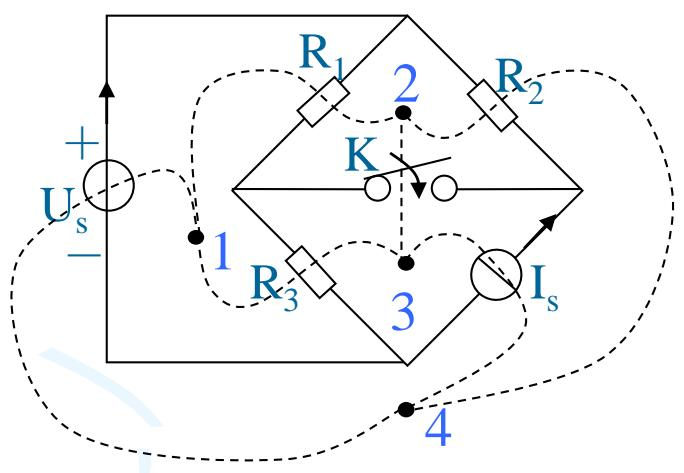

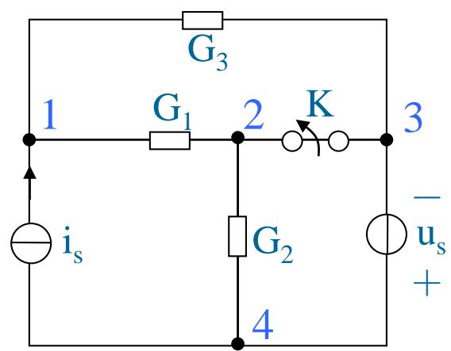
