# 《电路分析与电工电子技术》第5章 集成运算放大电路（课件）

原件的每一页，下面附识别出的文字。

### 第5章 集成运算放大电路

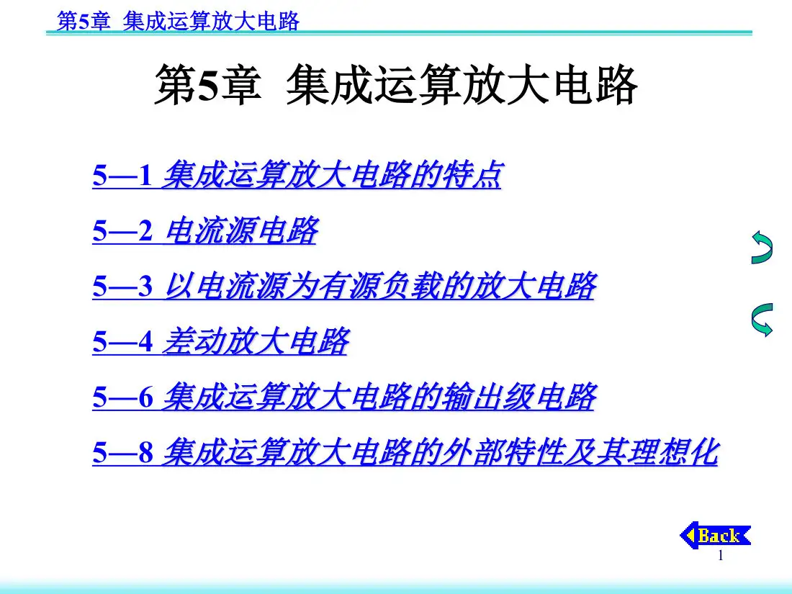

原文：

第5章 集成运算放大电路
5—1 集成运算放大电路的特点
5—2 电流源电路
5—3 以电流源为有源负载的放大电路
5—4 差动放大电路
5—6 集成运算放大电路的输出级电路
5—8 集成运算放大电路的外部特性及其理想化

第5章 集成运算放大电路

BacK

1

### 5.1 集成运算放大电路的特点

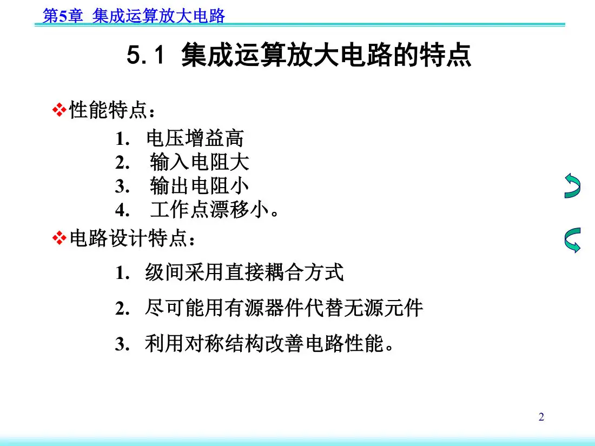

原文：

5.1 集成运算放大电路的特点

❖性能特点：

1. 电压增益高

2. 输入电阻大

3. 输出电阻小

4. 工作点漂移小。

❖电路设计特点：

1. 级间采用直接耦合方式

2. 尽可能用有源器件代替无源元件

3. 利用对称结构改善电路性能。

第5章 集成运算放大电路

2

### 第5章 集成运算放大电路

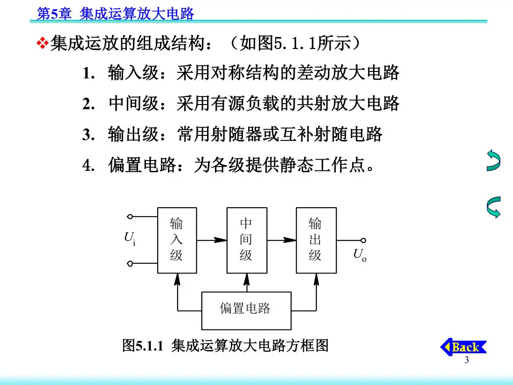

原文：

第5章 集成运算放大电路

❖集成运放的组成结构：（如图5.1.1所示）

1. 输入级：采用对称结构的差动放大电路

2. 中间级：采用有源负载的共射放大电路

3. 输出级：常用射随器或互补射随电路

4. 偏置电路：为各级提供静态工作点。

BacK

3

### 第5章 集成运算放大电路

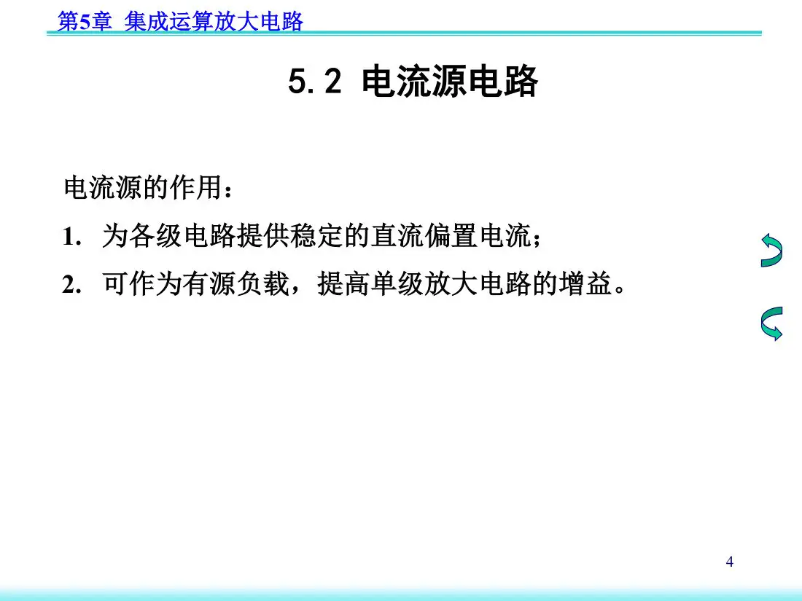

原文：

第5章 集成运算放大电路

5.2 电流源电路

电流源的作用：

1. 为各级电路提供稳定的直流偏置电流；

2. 可作为有源负载，提高单级放大电路的增益。

4

### 一、镜像电流源

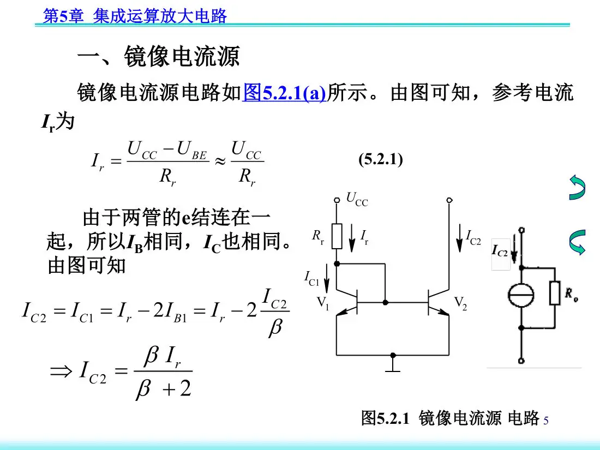

原文：

一、镜像电流源

镜像电流源电路如图5.2.1(a)所示。由图可知，参考电流$I _ { \mathrm { r } }$ 为

$$
I _ {r} = \frac {U _ {C C} - U _ {B E}}{R _ {r}} \approx \frac {U _ {C C}}{R _ {r}}
$$

由于两管的e结连在一起，所以 $I _ { \mathbf { B } }$ 相同， $I _ { \mathrm { C } }$ 也相同。由图可知

$$
\begin{array}{c} {I _ {C 2} = I _ {C 1} = I _ {r} - 2 I _ {B 1} = I _ {r} - 2 \frac {I _ {C 2}}{\beta}} \\ {\Rightarrow I _ {C 2} = \frac {\beta I _ {r}}{\beta + 2}} \end{array}\tag{5.2.1}
$$

第5章 集成运算放大电路

### $$

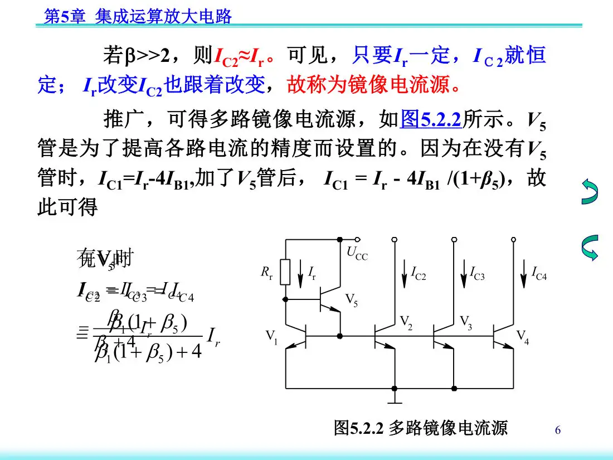

原文：

若 $\beta > > 2$ ，则 $I _ { \mathrm { C } 2 } { \approx } I _ { \mathrm { r } }$ 。可见，只要 $I _ { \mathrm { { r } } } -$ 定， $I _ { \textrm { C 2 } }$ 就恒定； $I _ { \mathrm { r } }$ 改变 $I _ { \mathrm { C } 2 }$ 也跟着改变，故称为镜像电流源。

推广，可得多路镜像电流源，如图5.2.2所示。 $V _ { 5 }$ 管是为了提高各路电流的精度而设置的。因为在没有 $V _ { 5 }$ 管时， $I _ { \mathrm { { C 1 } } } { = } I _ { \mathrm { { r } } } { = } 4 I _ { \mathrm { { B } } 1 }$ ,加了 $V _ { 5 }$ 管后， $I _ { \mathrm { C 1 } } = I _ { \mathrm { r } } - 4 I _ { \mathrm { B 1 } } / ( 1 { + } \beta _ { 5 } )$ ，故此可得

$$
\begin{array}{r l} & {\text {冤} \mathbf {V} _ {5} \text {时}} \\ & {I _ {\mathcal {C 2}} \equiv I _ {C \mathcal {C 3}} = I _ {C 4}} \\ & {\equiv \frac {\beta_ {1} (1 + \beta_ {5})}{\beta_ {1} ^ {+ 4} (1 + \beta_ {5}) + 4} I _ {r}} \end{array}
$$

第5章 集成运算放大电路

6

### 第5章 集成运算放大电路

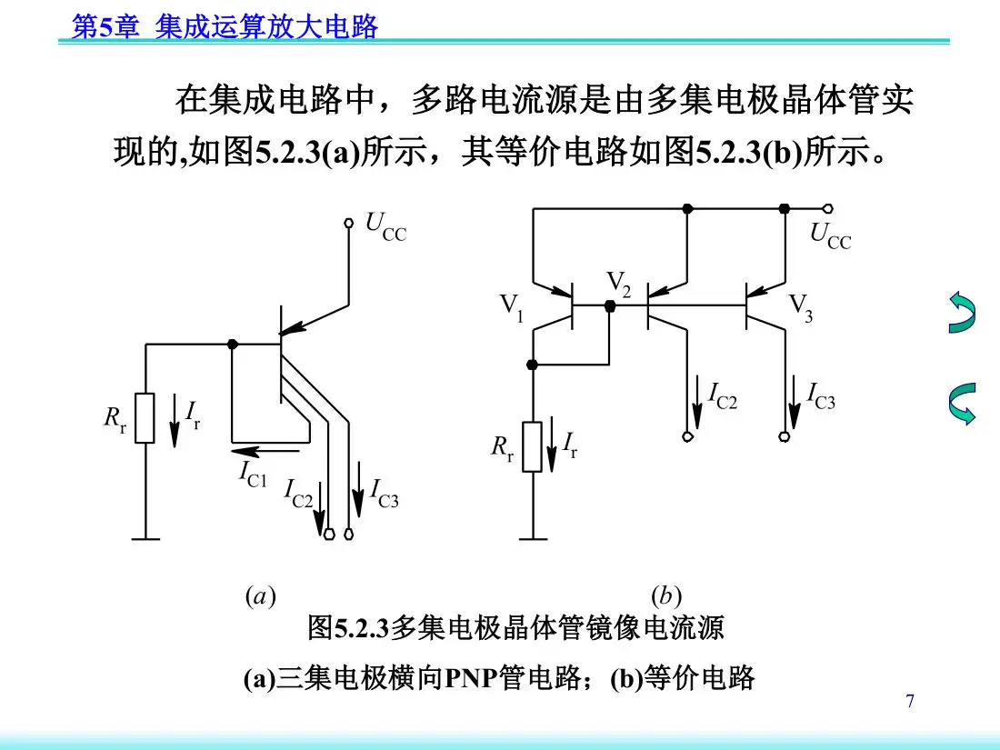

原文：

第5章 集成运算放大电路

在集成电路中，多路电流源是由多集电极晶体管实现的,如图5.2.3(a)所示，其等价电路如图5.2.3(b)所示。

7

### 二、比例电流源

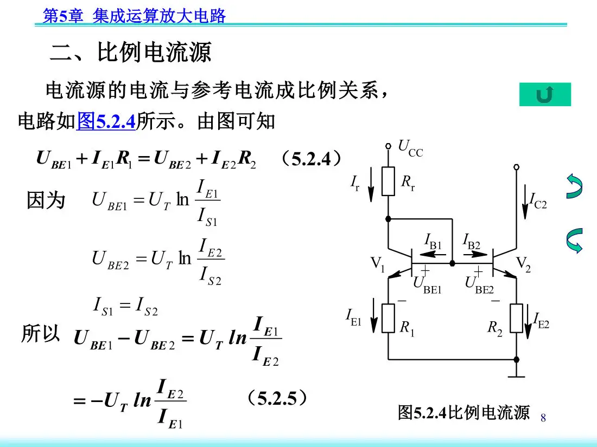

原文：

二、比例电流源

电流源的电流与参考电流成比例关系，电路如图5.2.4所示。由图可知

$$
\boldsymbol {U} _ {\boldsymbol {B E 1}} + \boldsymbol {I} _ {\boldsymbol {E 1}} \boldsymbol {R} _ {1} = \boldsymbol {U} _ {\boldsymbol {B E 2}} + \boldsymbol {I} _ {\boldsymbol {E 2}} \boldsymbol {R} _ {2}\tag{5.2.4}
$$

因为

$$
U _ {B E 1} = U _ {T} \ln \frac {I _ {E 1}}{I _ {S 1}}
$$

$$
U _ {B E 2} = U _ {T} \ln \frac {I _ {E 2}}{I _ {S 2}}
$$

所以

$$
\begin{array}{c} I _ {S 1} = I _ {S 2} \\ U _ {B E 1} - U _ {B E 2} = U _ {T} \ln \frac {I _ {E 1}}{I _ {E 2}} \end{array}
$$

$$
= - U _ {T} \ln \frac {I _ {E 2}}{I _ {E 1}}\tag{5.2.5}
$$

第5章 集成运算放大电路

### 当两管的射极电流相差10倍以内时：

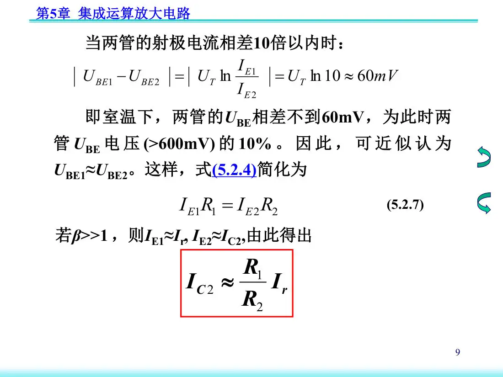

原文：

当两管的射极电流相差10倍以内时：

$$
\left| U _ {B E 1} - U _ {B E 2} \right| = \left| U _ {T} \ln \frac {I _ {E 1}}{I _ {E 2}} \right| = U _ {T} \ln 1 0 \approx 6 0 m V
$$

即室温下，两管的 $U _ { \mathbf { B E } }$ 相差不到60mV，为此时两管 $U _ { \mathbf { B E } }$ 电 压 (>600mV) 的 10% 。 因 此 ， 可 近 似 认 为$U _ { \mathbf { B E 1 } } { \approx } U _ { \mathbf { B E 2 } } { \mathrm { { c } } }$ 。这样，式(5.2.4)简化为

$$
I _ {E 1} R _ {1} = I _ {E 2} R _ {2}\tag{5.2.7}
$$

若 ${ \boldsymbol { \beta } } { \boldsymbol { > } } { \boldsymbol { > } } 1$ ，则 $I _ { \mathrm { E 1 } } { \approx } I _ { \mathrm { r } ^ { \circ } } I _ { \mathrm { E 2 } } { \approx } I _ { \mathrm { C 2 } }$ ,由此得出

$$
\boxed {I _ {C 2} \approx \frac {R _ {1}}{R _ {2}} I _ {r}}
$$

第5章 集成运算放大电路

9

### 第5章 集成运算放大电路

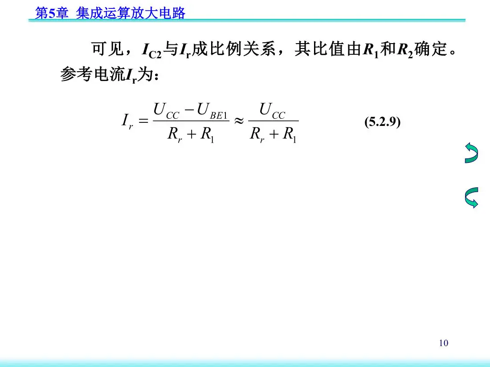

原文：

第5章 集成运算放大电路

可见， $I _ { \mathrm { C } 2 }$ 与 $I _ { \mathrm { r } }$ 成比例关系，其比值由 $R _ { 1 }$ 和 $R _ { 2 }$ 确定。参考电流 $I _ { \mathrm { r } }$ 为：

$$
I _ {r} = \frac {U _ {C C} - U _ {B E 1}}{R _ {r} + R _ {1}} \approx \frac {U _ {C C}}{R _ {r} + R _ {1}}\tag{5.2.9}
$$

10

### 三、微电流源

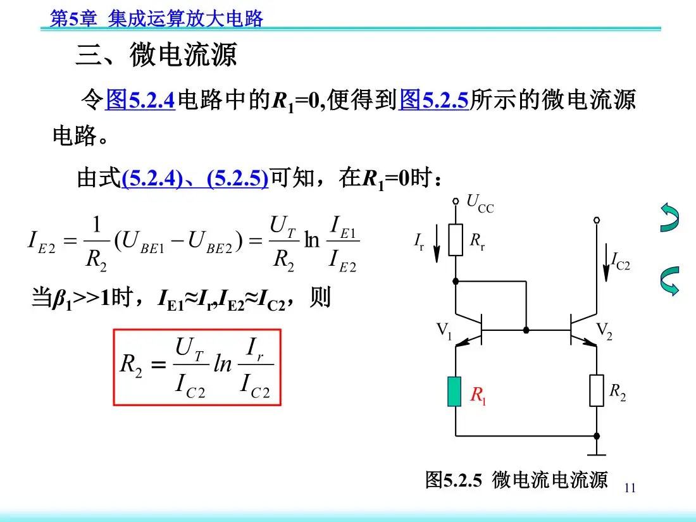

原文：

三、微电流源

令图5.2.4电路中的 $R _ { 1 } { = } \mathbf { 0 }$ ,便得到图5.2.5所示的微电流源电路。

由式(5.2.4)、(5.2.5)可知，在 $R _ { 1 } { = } \mathbf { 0 }$ 时：

$$
I _ {E 2} = \frac {1}{R _ {2}} (U _ {B E 1} - U _ {B E 2}) = \frac {U _ {T}}{R _ {2}} \ln \frac {I _ {E 1}}{I _ {E 2}}
$$

当 ${ \beta _ { 1 } } \mathrm { { > } } { > } 1$ 时， $I _ { \mathrm { E 1 } } { \approx } I _ { \mathrm { r } ^ { 3 } } I _ { \mathrm { E 2 } } { \approx } I _ { \mathrm { C } 2 } ,$ 则

$$
R _ {2} = \frac {U _ {T}}{I _ {C 2}} \ln \frac {I _ {r}}{I _ {C 2}}
$$

第5章 集成运算放大电路

11

### $$

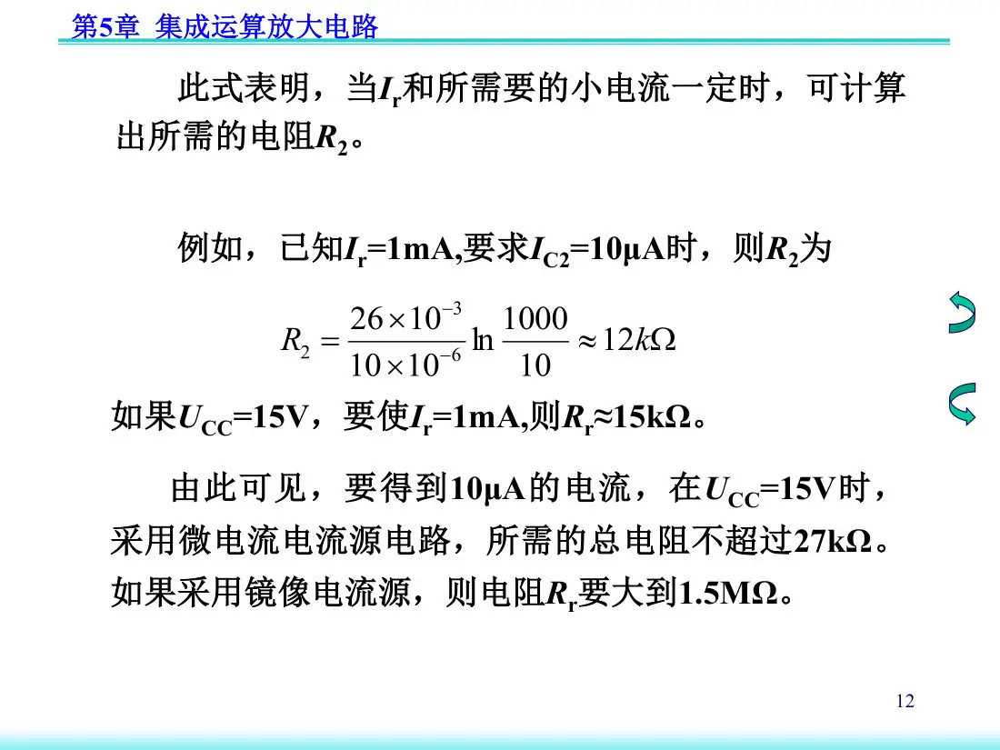

原文：

此式表明，当 $I _ { \mathrm { r } }$ 和所需要的小电流一定时，可计算出所需的电阻 $R _ { 2 }$ 。

例如，已知 $I _ { \mathrm { r } } { = } 1 \mathrm { m } \mathrm { A } ,$ 要求 $I _ { \mathrm { C } 2 } { = } 1 0 \mu \mathrm { A }$ 时，则 $\boldsymbol { R _ { 2 } }$ 为

$$
R _ {2} = \frac {2 6 \times 1 0 ^ {- 3}}{1 0 \times 1 0 ^ {- 6}} \ln \frac {1 0 0 0}{1 0} \approx 1 2 k \Omega
$$

如果 $U _ { \mathrm { C C } } { = } 1 5 \mathbf { V }$ ，要使 $I _ { \mathrm { r } } { = } 1 \mathrm { m } \mathrm { A }$ ,则 $R _ { \mathrm { r } } { \approx } 1 5 \mathrm { k } \Omega$

由此可见，要得到 $1 0 \mu \mathrm { A }$ 的电流，在 $U _ { \mathrm { C C } } { = } 1 5 \mathbf { V }$ 时，采用微电流电流源电路，所需的总电阻不超过 $2 7 \mathbf { k } \Omega$ 如果采用镜像电流源，则电阻 $R _ { \mathrm { r } }$ 要大到1.5MΩ。

第5章 集成运算放大电路

12

### 四、威尔逊电流源（负反馈型电流源）

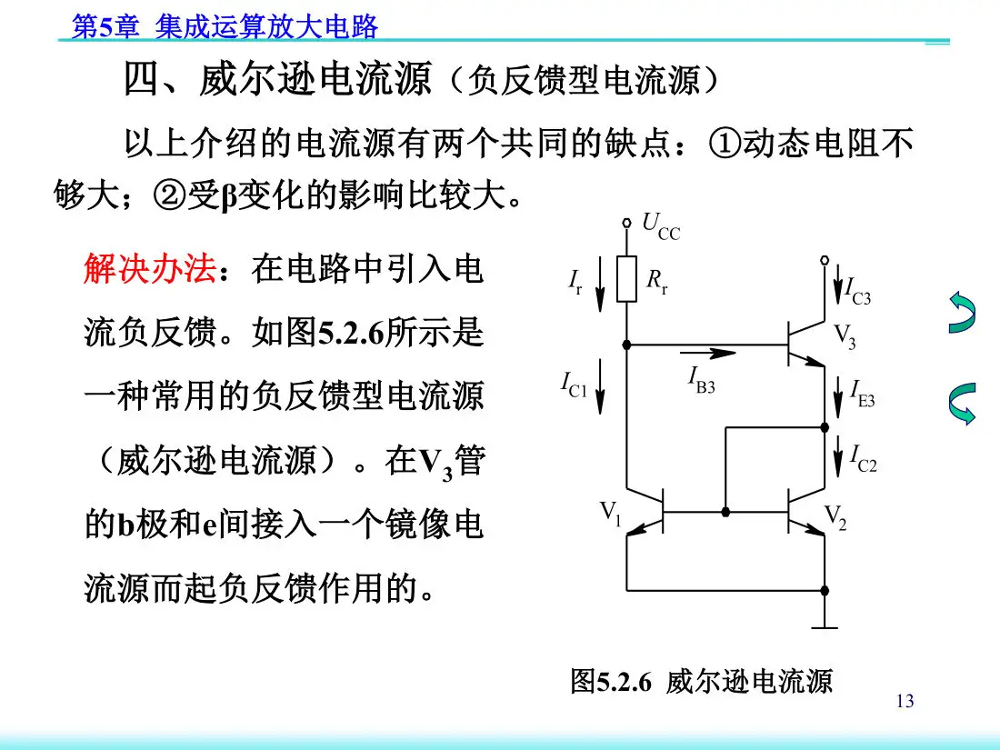

原文：

四、威尔逊电流源（负反馈型电流源）

以上介绍的电流源有两个共同的缺点：①动态电阻不够大；②受β变化的影响比较大。

解决办法：在电路中引入电流负反馈。如图5.2.6所示是一种常用的负反馈型电流源（威尔逊电流源）。在 $\mathbf { V } _ { 3 }$ 管的b极和e间接入一个镜像电流源而起负反馈作用的。

第5章 集成运算放大电路

13

### 电流稳定原理：

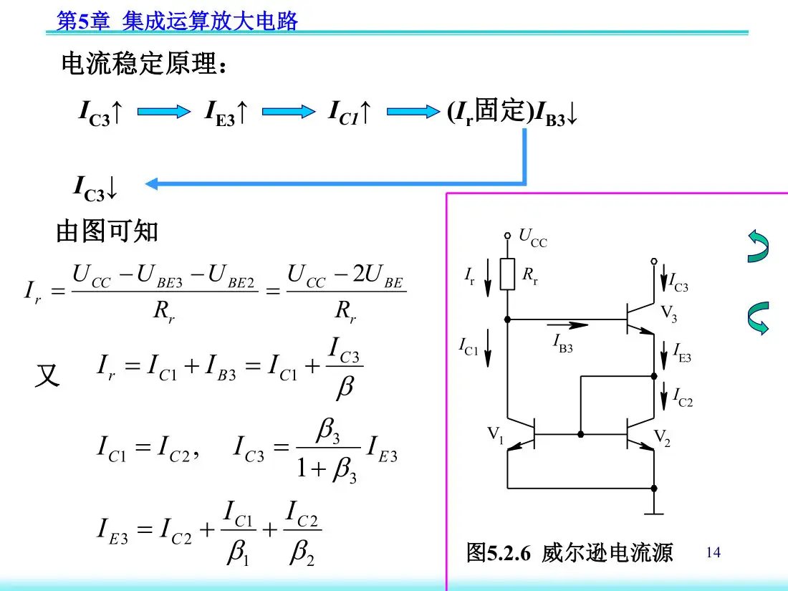

原文：

电流稳定原理：

由图可知

$$
I _ {r} = \frac {U _ {C C} - U _ {B E 3} - U _ {B E 2}}{R _ {r}} = \frac {U _ {C C} - 2 U _ {B E}}{R _ {r}}
$$

$$
\text {又} \quad I _ {r} = I _ {C 1} + I _ {B 3} = I _ {C 1} + \frac {I _ {C 3}}{\beta}
$$

$$
I _ {C 1} = I _ {C 2}, \quad I _ {C 3} = \frac {\beta_ {3}}{1 + \beta_ {3}} I _ {E 3}
$$

$$
I _ {E 3} = I _ {C 2} + \frac {I _ {C 1}}{\beta_ {1}} + \frac {I _ {C 2}}{\beta_ {2}}
$$

第5章 集成运算放大电路

14

### $$

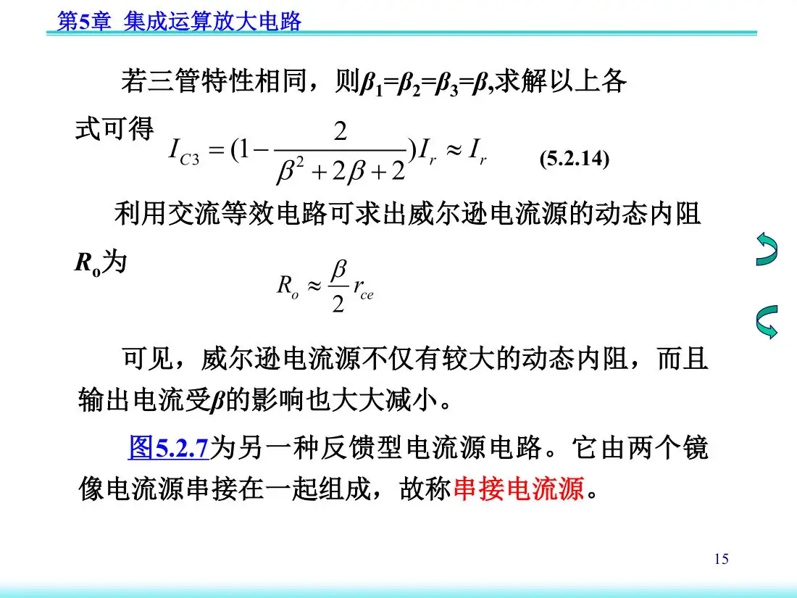

原文：

$$
\beta_ {1} = \beta_ {2} = \beta_ {3} = \beta_ {4}
$$

$$
I _ {C 3} = (1 - \frac {2}{\beta^ {2} + 2 \beta + 2}) I _ {r} \approx I _ {r}\tag{5.2.14}
$$

利用交流等效电路可求出威尔逊电流源的动态内阻$R _ { \mathbf { 0 } }$ 为 β

$$
R _ {o} \approx \frac {\beta}{2} r _ {c e}
$$

可见，威尔逊电流源不仅有较大的动态内阻，而且输出电流受 $\mathbf { \nabla } \beta$ 的影响也大大减小。

图5.2.7为另一种反馈型电流源电路。它由两个镜像电流源串接在一起组成，故称串接电流源。

第5章 集成运算放大电路

15

### 第5章 集成运算放大电路

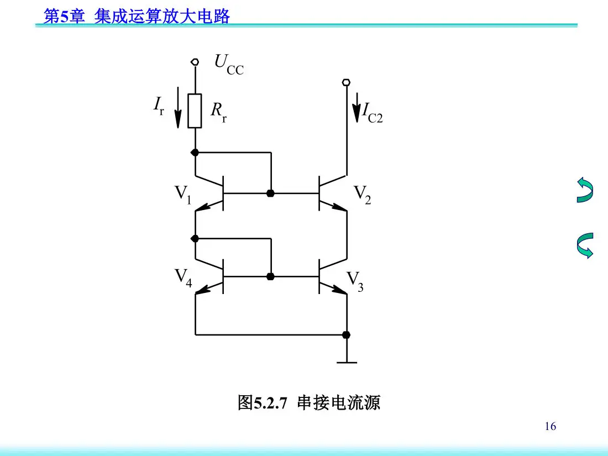

原文：

第5章 集成运算放大电路

16

### 5.3 以电流源为有源负载的放大电路

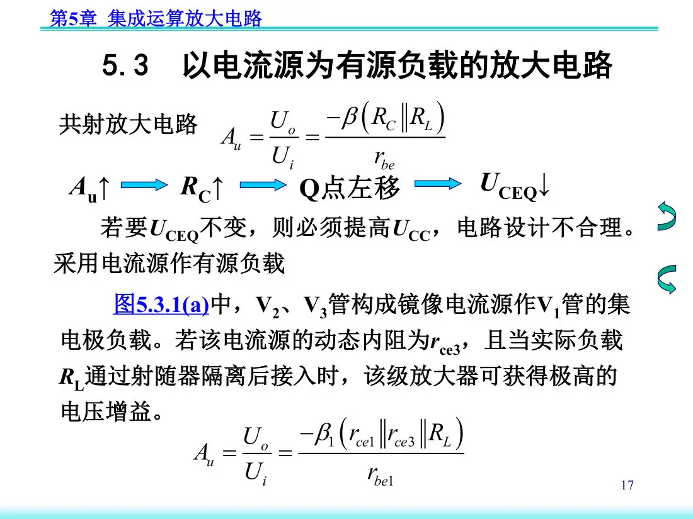

原文：

5.3 以电流源为有源负载的放大电路

共射放大电路 $A _ { u } = \frac { U _ { o } } { U _ { i } } = \frac { - \beta \big ( R _ { c } \left\| R _ { L } \right) } { r _ { b e } }$ Au↑ RC↑ UCEQ Q点左移 ↓

若要 $U _ { \mathbf { C E Q } }$ 不变，则必须提高 $U _ { \mathrm { C C } }$ ，电路设计不合理。采用电流源作有源负载

图5.3.1(a)中， $\mathbf { V } _ { 2 } , \mathbf { V } _ { 3 }$ 管构成镜像电流源作 $\mathbf { V _ { 1 } }$ 管的集电极负载。若该电流源的动态内阻为r ，且当实际负载 $\boldsymbol { r } _ { \mathrm { c e 3 } }$ $R _ { \mathrm { L } }$ 通过射随器隔离后接入时，该级放大器可获得极高的电压增益。 II II

$$
A _ {u} = \frac {U _ {o}}{U _ {i}} = \frac {- \beta_ {1} (r _ {c e 1} \| r _ {c e 3} \| R _ {L})}{r _ {b e 1}}
$$

第5章 集成运算放大电路

17

### 第5章 集成运算放大电路

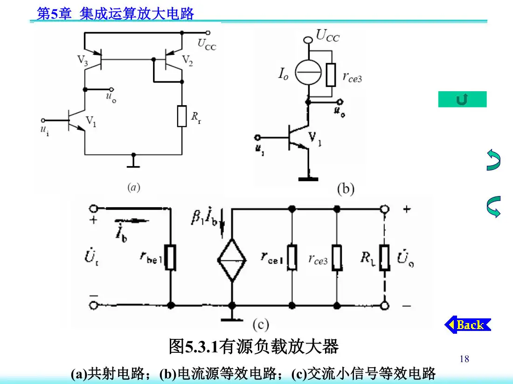

原文：

第5章 集成运算放大电路

→

18

### 5.4 差动放大电路

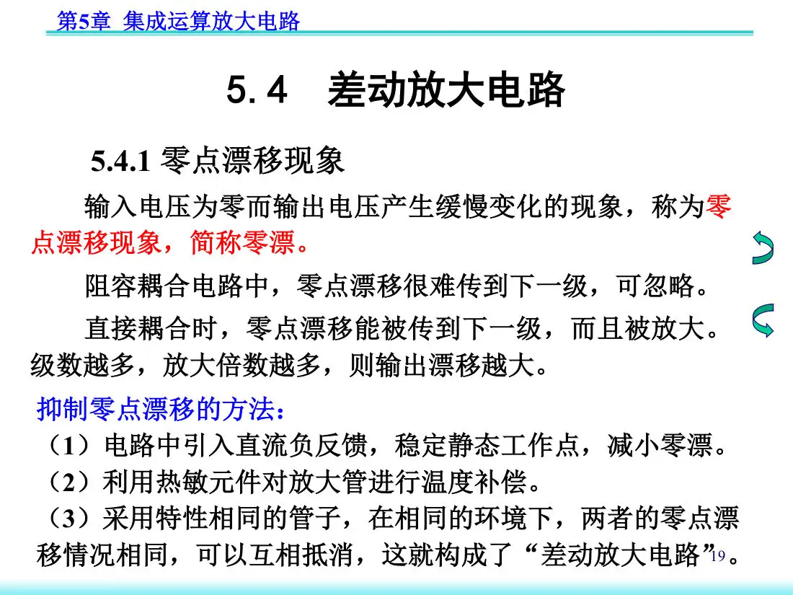

原文：

5.4 差动放大电路

5.4.1 零点漂移现象

输入电压为零而输出电压产生缓慢变化的现象，称为零点漂移现象，简称零漂。

阻容耦合电路中，零点漂移很难传到下一级，可忽略。

直接耦合时，零点漂移能被传到下一级，而且被放大。级数越多，放大倍数越多，则输出漂移越大。

抑制零点漂移的方法：

（1）电路中引入直流负反馈，稳定静态工作点，减小零漂。

（2）利用热敏元件对放大管进行温度补偿。

（3）采用特性相同的管子，在相同的环境下，两者的零点漂19移情况相同，可以互相抵消，这就构成了“差动放大电路”。

第5章 集成运算放大电路

### 第5章 集成运算放大电路

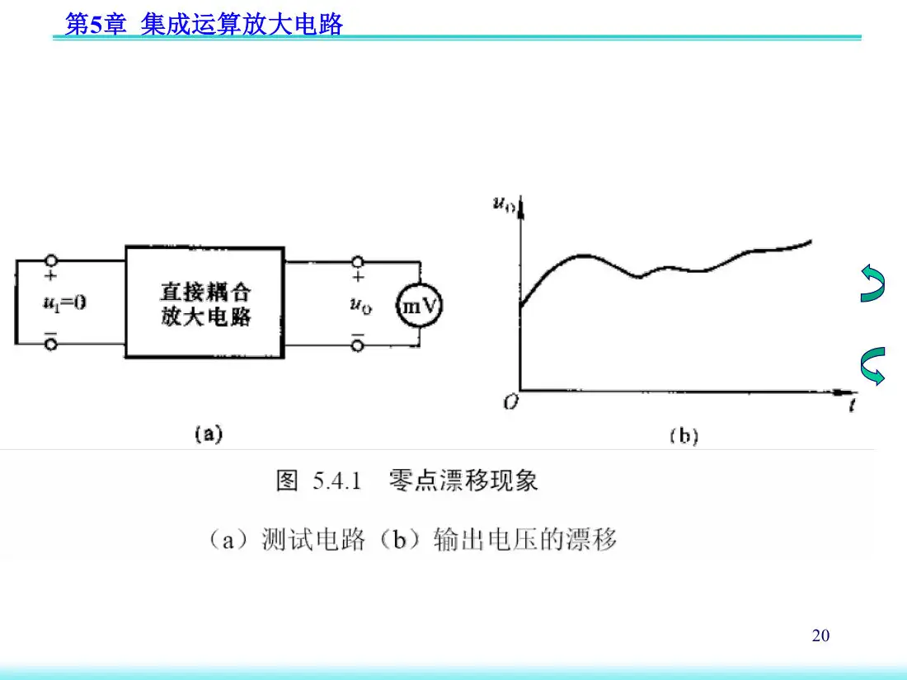

原文：

第5章 集成运算放大电路

20

### 5.4.2 差动放大电路的工作原理及性能分析

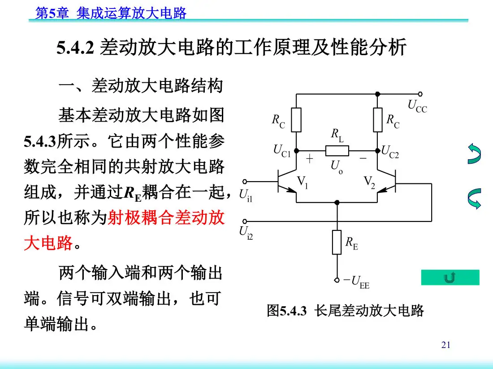

原文：

5.4.2 差动放大电路的工作原理及性能分析

一、差动放大电路结构

基本差动放大电路如图5.4.3所示。它由两个性能参数完全相同的共射放大电路组成，并通过 $R _ { \mathrm { E } }$ 耦合在一起，所以也称为射极耦合差动放大电路。

两个输入端和两个输出端。信号可双端输出，也可单端输出。

第5章 集成运算放大电路

21

### (5.4.3)

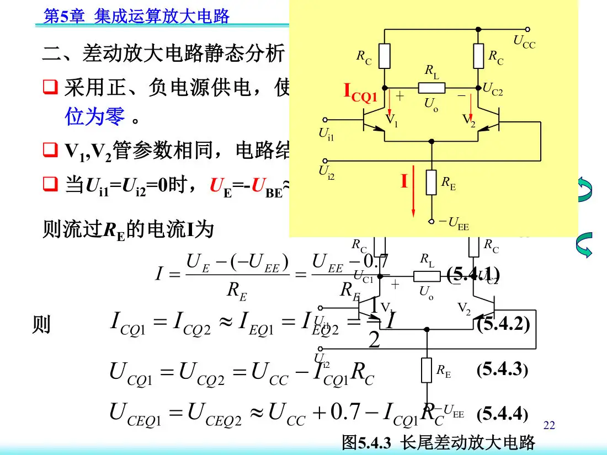

原文：

(5.4.3)

二、差动放大电路静态分析

❑采用正、负电源供电，使位为零 。

❑ $\mathbf { V _ { 1 } } , \mathbf { V _ { 2 } }$ 管参数相同，电路结

❑ 当 ${ \cal U } _ { \mathrm { i l } } { = } U _ { \mathrm { i } 2 } { = } 0$ 时， $U _ { \mathbf { E } } { = } U _ { \mathbf { B } \mathbf { E } } { \hat { \mathbf { \Omega } } }$ 则流过 $R _ { \mathrm { E } }$ 的电流I为

则

第5章 集成运算放大电路

### 静态时，差动放大器两输出端之间的直流电压为零。

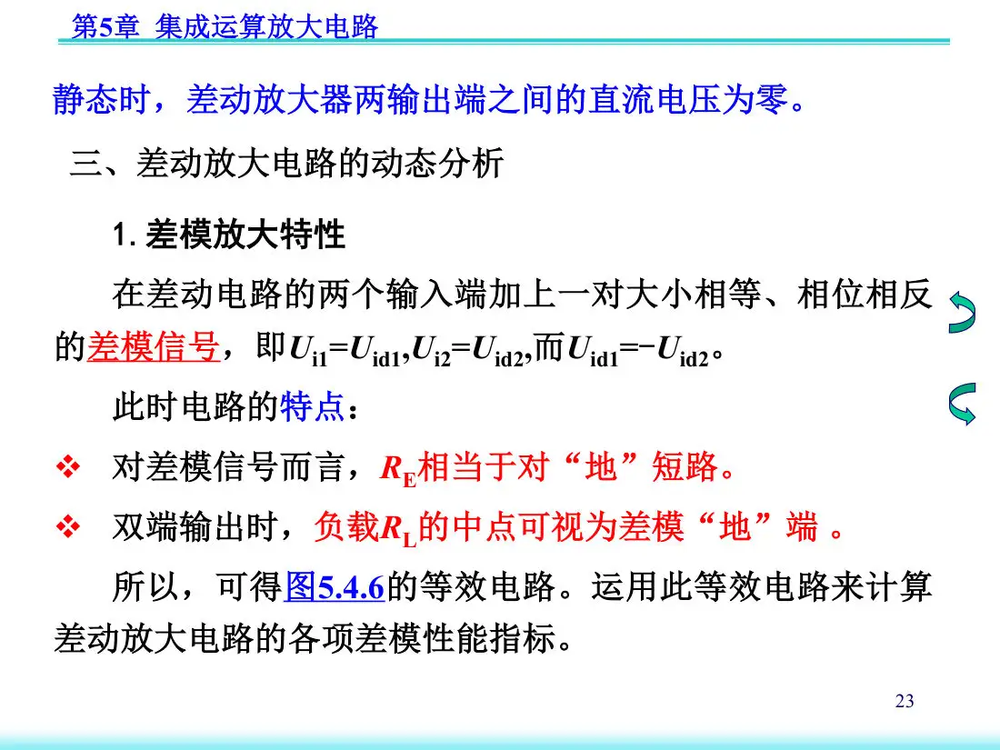

原文：

静态时，差动放大器两输出端之间的直流电压为零。

三、差动放大电路的动态分析

1.差模放大特性

在差动电路的两个输入端加上一对大小相等、相位相反的差模信号，即 $U _ { \mathbf { i } \mathbf { l } } { = } U _ { \mathbf { i } \mathbf { d } \mathbf { l } } , U _ { \mathbf { i } 2 } { = } U _ { \mathbf { i } \mathbf { d } 2 } ,$ ,而 $U _ { \mathrm { i d l } } { = } { - } U _ { \mathrm { i d } 2 }$

此时电路的特点：

❖ 对差模信号而言， $R _ { \mathrm { E } }$ 相当于对“地”短路。

双端输出时，负载 $R _ { \mathrm { L } }$ 的中点可视为差模“地”端 。

所以，可得图5.4.6的等效电路。运用此等效电路来计算差动放大电路的各项差模性能指标。

第5章 集成运算放大电路

23

### 第5章 集成运算放大电路

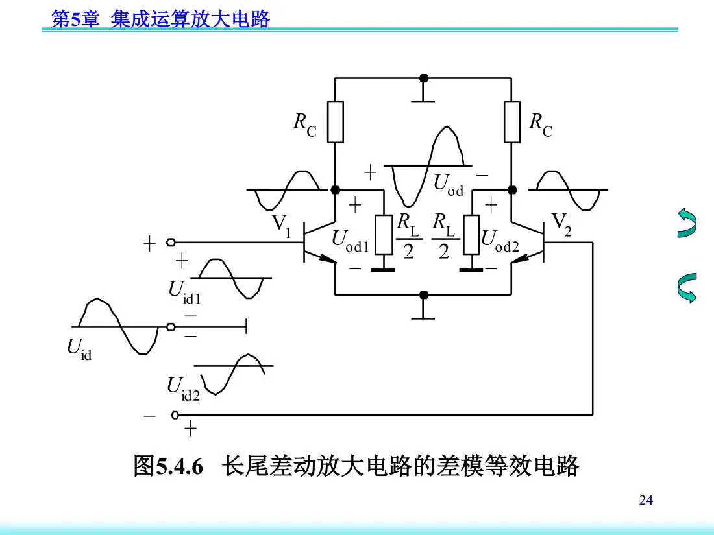

原文：

第5章 集成运算放大电路

24

### 第5章 集成运算放大电路

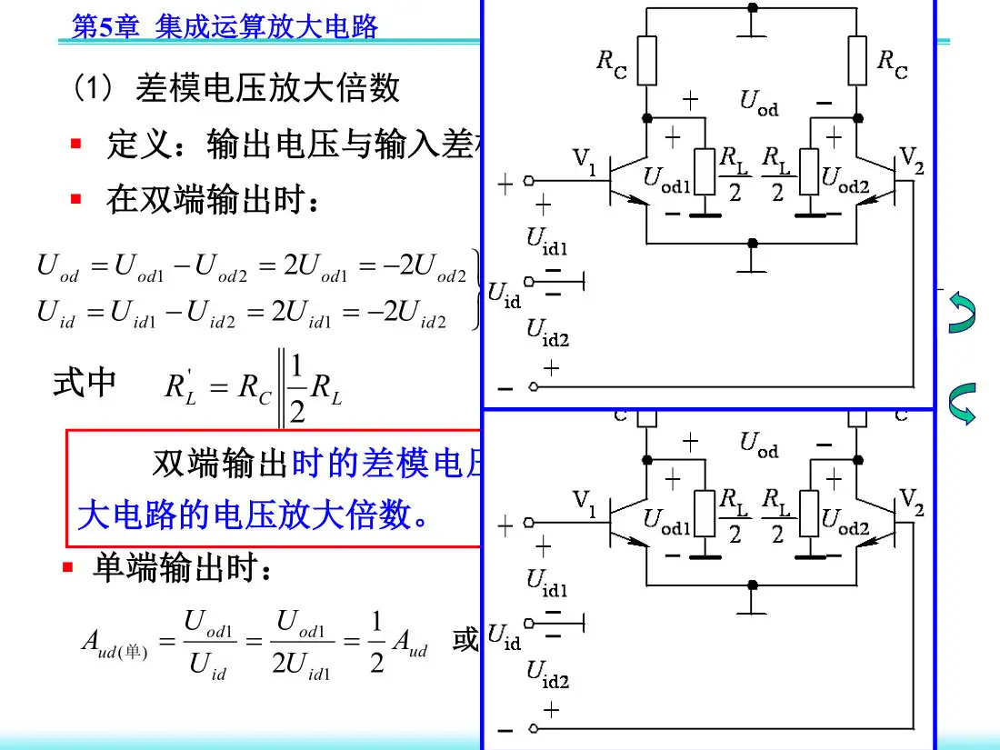

原文：

第5章 集成运算放大电路

(1) 差模电压放大倍数

▪ 定义：输出电压与输入差

▪ 在双端输出时：

$$
\begin{array}{l} {U _ {o d} = U _ {o d 1} - U _ {o d 2} = 2 U _ {o d 1} = - 2 U _ {o d 2}} \\ {U _ {i d} = U _ {i d 1} - U _ {i d 2} = 2 U _ {i d 1} = - 2 U _ {i d 2}} \end{array}
$$

式中 $R _ { L } ^ { ' } = R _ { C } \Bigg | \Bigg | \frac { 1 } { 2 } R _ { L }$

双端输出时的差模电大电路的电压放大倍数。

1 单端输出时：

$$
A _ {u d (\text {单})} = \frac {U _ {o d 1}}{U _ {i d}} = \frac {U _ {o d 1}}{2 U _ {i d 1}} = \frac {1}{2} A _ {u d}
$$

### 第5章 集成运算放大电路

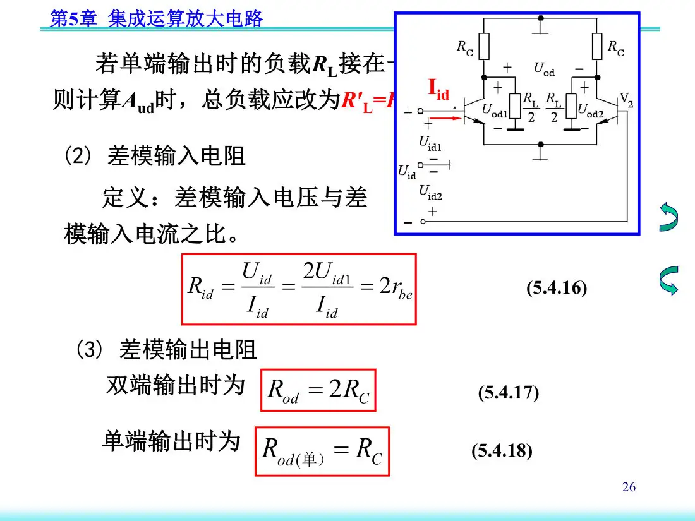

原文：

第5章 集成运算放大电路

若单端输出时的负载 $R _ { \mathrm { L } }$ 接在则计算 $A _ { \mathbf { u d } }$ 时，总负载应改为 $R _ { \mathrm { ~ L ~ } } ^ { \prime } { = }$

(2) 差模输入电阻

定义：差模输入电压与差模输入电流之比。

$$
R _ {i d} = \frac {U _ {i d}}{I _ {i d}} = \frac {2 U _ {i d 1}}{I _ {i d}} = 2 r _ {b e}
$$

(3) 差模输出电阻

双端输出时为

$$
R _ {o d} = 2 R _ {C}
$$

单端输出时为

$$
R _ {o d (\text {单})} = R _ {C}
$$

(5.4.16)

(5.4.17)

(5.4.18)

26

### 2.共模抑制特性

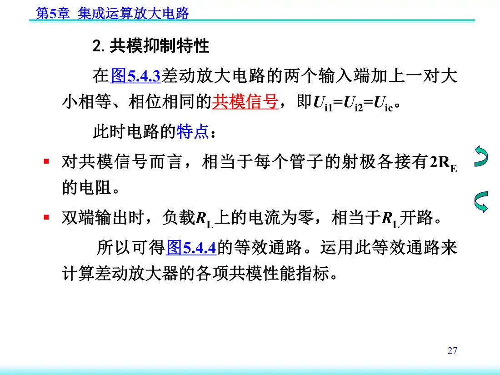

原文：

2.共模抑制特性

在图5.4.3差动放大电路的两个输入端加上一对大小相等、相位相同的共模信号，即 $U _ { \mathrm { i l } } { = } U _ { \mathrm { i } 2 } { = } U _ { \mathrm { i } \mathbf { c } }$ o

此时电路的特点：

▪ 对共模信号而言，相当于每个管子的射极各接有 $2 \mathbf { R } _ { \mathbf { E } }$ 的电阻。

▪ 双端输出时，负载 $R _ { \mathrm { L } }$ 上的电流为零，相当于 $R _ { \mathrm { L } }$ 开路。

所以可得图5.4.4的等效通路。运用此等效通路来计算差动放大器的各项共模性能指标。

第5章 集成运算放大电路

27

### 第5章 集成运算放大电路

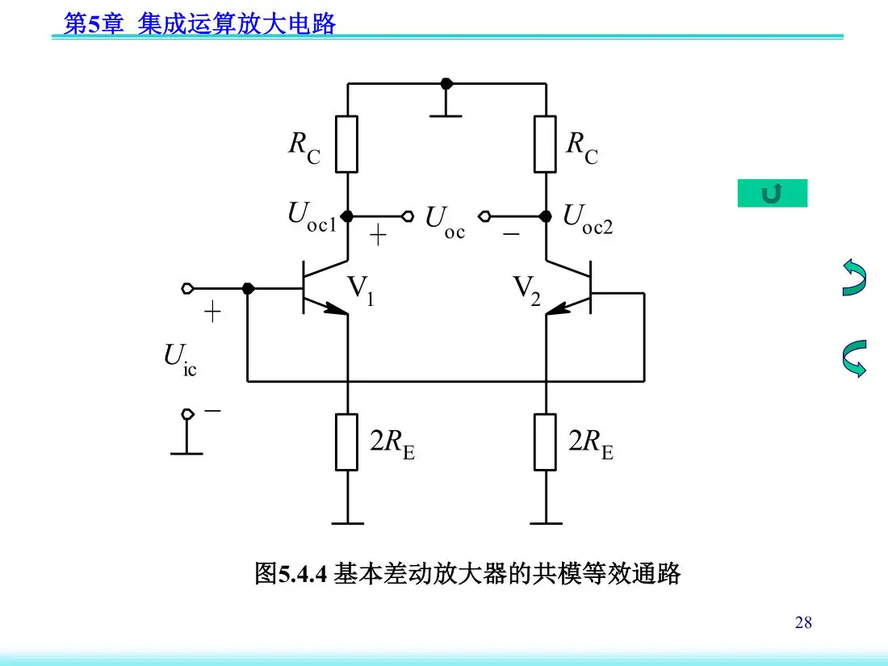

原文：

第5章 集成运算放大电路

28

### (1)共模电压放大倍数

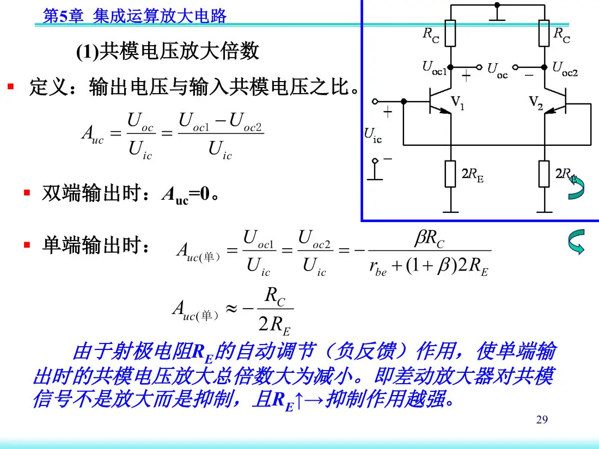

原文：

(1)共模电压放大倍数

▪ 定义：输出电压与输入共模电压之比。

$$
A _ {u c} = \frac {U _ {o c}}{U _ {i c}} = \frac {U _ {o c 1} - U _ {o c 2}}{U _ {i c}}
$$

▪ 双端输出时： $A _ { \mathrm { u c } } { = } \mathbf { 0 }$ 。

▪ 单端输出时： $A _ { u c ( \ddot { \mathbb { H } } ) } = \frac { U _ { o c 1 } } { U _ { i c } } = \frac { U _ { o c 2 } } { U _ { i c } } = - \frac { \beta R _ { c } } { r _ { b e } + ( 1 + \beta ) 2 R _ { E } }$

$$
A _ {u c (\text {单})} \approx - \frac {R _ {C}}{2 R _ {E}}
$$

由于射极电 $\beta { \cal H } R _ { E }$ 的自动调节（负反馈）作用，使单端输出时的共模电压放大总倍数大为减小。即差动放大器对共模信号不是放大而是抑制， $\mathcal { \underline { { H } } } R _ { E }$ ↑→抑制作用越强。

第5章 集成运算放大电路

29

### (2) 共模输入电阻

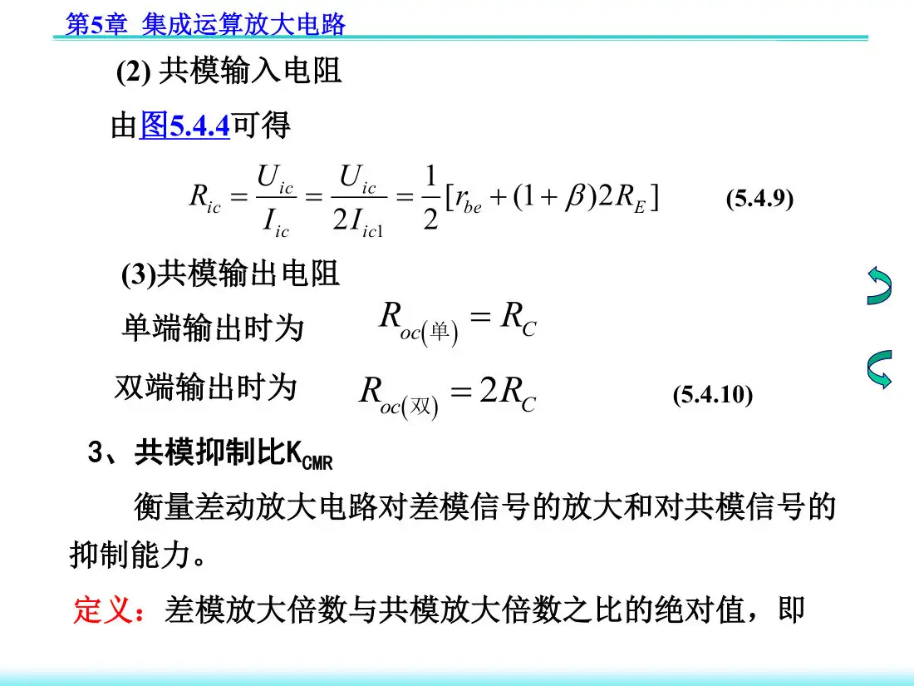

原文：

(2) 共模输入电阻

由图5.4.4可得

$$
R _ {i c} = \frac {U _ {i c}}{I _ {i c}} = \frac {U _ {i c}}{2 I _ {i c 1}} = \frac {1}{2} [ r _ {b e} + (1 + \beta) 2 R _ {E} ]\tag{5.4.9}
$$

(3)共模输出电阻

单端输出时为

$$
R _ {o c (\text {单})} = R _ {C}
$$

双端输出时为

$$
R _ {o c (\text {双})} = 2 R _ {C}\tag{5.4.10}
$$

3、共模抑制比 $K _ { \tt c M R }$

衡量差动放大电路对差模信号的放大和对共模信号的 抑制能力。

定义：差模放大倍数与共模放大倍数之比的绝对值，即

第5章 集成运算放大电路

### $$

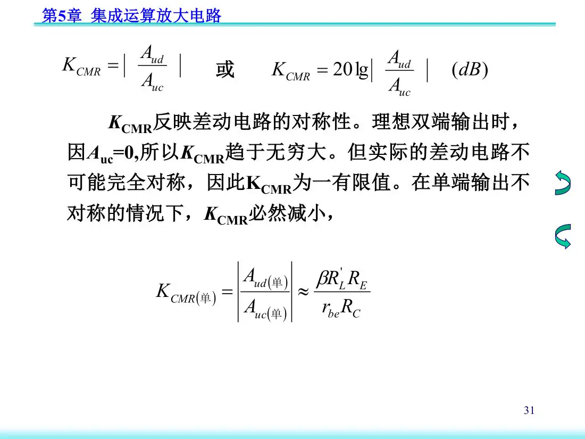

原文：

$$
K _ {C M R} = \left| \frac {A _ {u d}}{A _ {u c}} \right| \quad \text {或} \quad K _ {C M R} = 2 0 \lg \left| \frac {A _ {u d}}{A _ {u c}} \right|\tag{dB}
$$

$K _ { \mathrm { C M R } }$ 反映差动电路的对称性。理想双端输出时，因 $A _ { \mathbf { u c } } { = } \mathbf { 0 }$ ,所以 $K _ { \mathrm { C M R } }$ 趋于无穷大。但实际的差动电路不可能完全对称，因此 $\mathbf { K _ { C M R } }$ 为一有限值。在单端输出不对称的情况下， $K _ { \mathrm { C M R } }$ 必然减小，

$$
K _ {C M R (\text {单})} = \left| \frac {A _ {u d (\text {单})}}{A _ {u c (\text {单})}} \right| \approx \frac {\beta R _ {L} ^ {\prime} R _ {E}}{r _ {b e} R _ {C}}
$$

第5章 集成运算放大电路

31

### 解：（1）根据式5.4.1\~5.4.4得到

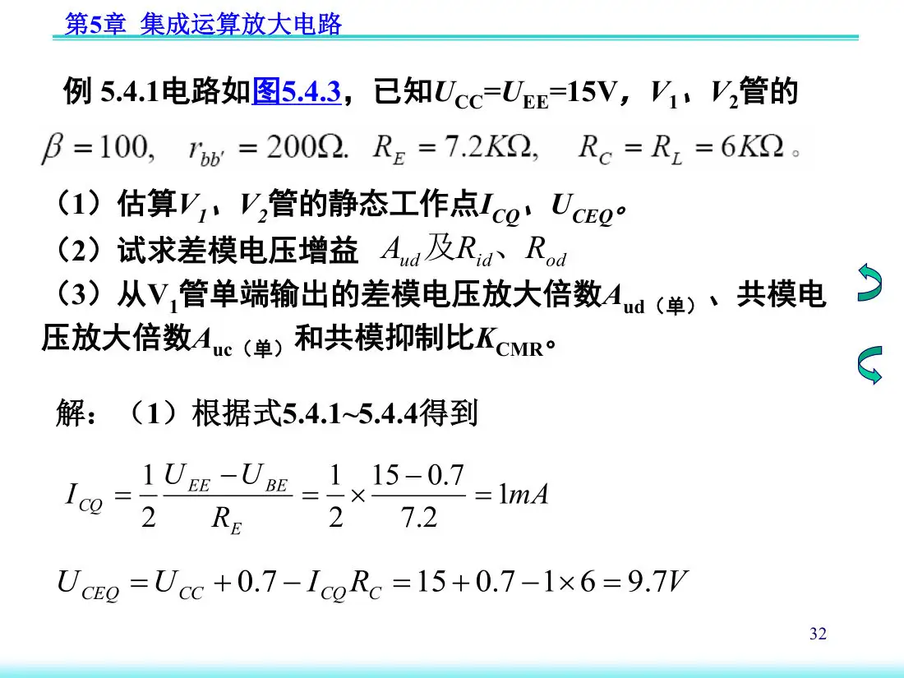

原文：

例 5.4.1电路如图5.4.3，已知 $U _ { \mathrm { C C } } { = } U _ { \mathrm { E E } } { = } 1 5 \mathrm { V } , V _ { 1 }$ 、 $V _ { 2 }$ 管的$\beta = 1 0 0 , \quad r _ { b b ^ { \prime } } = 2 0 0 \Omega . \ : \ : R _ { \scriptscriptstyle E } = 7 . 2 K \Omega , \quad R _ { \scriptscriptstyle C } = R _ { \scriptscriptstyle L } = 6 K \Omega$

（1）估算 $V _ { 1 } , \ V _ { 2 }$ 管的静态工作点 ${ \cal I } _ { c Q } , \ { \cal U } _ { c E Q ^ { o } }$

（2）试求差模电压增益 $A _ { u d }$ 及 $R _ { i d } \setminus \ R _ { o d }$

（3）从 $\mathbf { V _ { 1 } }$ 管单端输出的差模电压放大倍数 $A _ { \mathbf { u d } } ( \ncong )$ 、共模电压放大倍数 $A _ { \mathrm { { u c } } ( \sharp ) }$ 和共模抑制比 $K _ { \mathrm { C M R } ^ { \circ } }$

解：（1）根据式5.4.1\~5.4.4得到

$$
I _ {C Q} = \frac {1}{2} \frac {U _ {E E} - U _ {B E}}{R _ {E}} = \frac {1}{2} \times \frac {1 5 - 0 . 7}{7 . 2} = 1 m A
$$

$$
U _ {C E Q} = U _ {C C} + 0. 7 - I _ {C Q} R _ {C} = 1 5 + 0. 7 - 1 \times 6 = 9. 7 V
$$

第5章 集成运算放大电路

32

### （2）

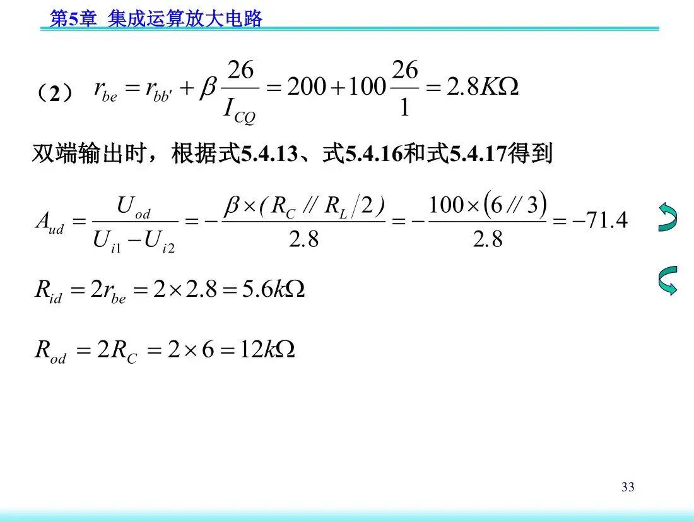

原文：

（2）

$$
r _ {b e} = r _ {b b ^ {\prime}} + \beta \frac {2 6}{I _ {C Q}} = 2 0 0 + 1 0 0 \frac {2 6}{1} = 2. 8 K \Omega
$$

双端输出时，根据式5.4.13、式5.4.16和式5.4.17得到

$$
\begin{array}{l} A _ {u d} = \frac {U _ {o d}}{U _ {i 1} - U _ {i 2}} = - \frac {\beta \times (R _ {C} / / R _ {L} / 2)}{2 . 8} = - \frac {1 0 0 \times (6 / / 3)}{2 . 8} = - 7 1. 4 \\ R _ {i d} = 2 r _ {b e} = 2 \times 2. 8 = 5. 6 k \Omega \\ R _ {o d} = 2 R _ {C} = 2 \times 6 = 1 2 k \Omega \end{array}
$$

第5章 集成运算放大电路

33

### （3）单端输出时

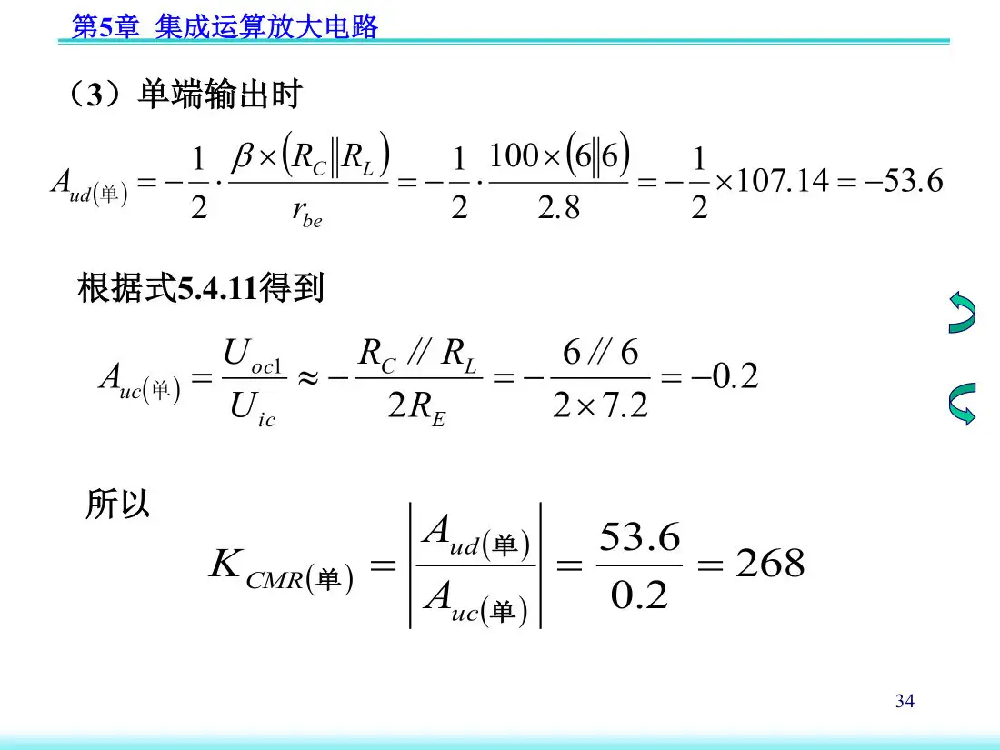

原文：

（3）单端输出时

$$
A _ {u d (\text {单})} = - \frac {1}{2} \cdot \frac {\beta \times \left(R _ {C} \| R _ {L}\right)}{r _ {b e}} = - \frac {1}{2} \cdot \frac {1 0 0 \times (6 \| 6)}{2 . 8} = - \frac {1}{2} \times 1 0 7. 1 4 = - 5 3. 6
$$

根据式5.4.11得到

$$
A _ {u c (\text {单})} = \frac {U _ {o c 1}}{U _ {i c}} \approx - \frac {R _ {C} / / R _ {L}}{2 R _ {E}} = - \frac {6 / / 6}{2 \times 7 . 2} = - 0. 2
$$

所以

$$
K _ {C M R (\text {单})} = \left| \frac {A _ {u d (\text {单})}}{A _ {u c (\text {单})}} \right| = \frac {5 3 . 6}{0 . 2} = 2 6 8
$$

第5章 集成运算放大电路

34

### 4、对任意输入信号的动态特性

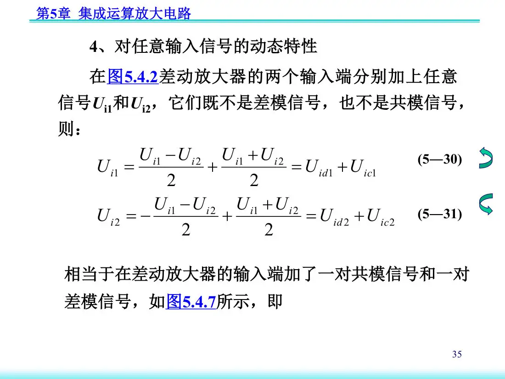

原文：

4、对任意输入信号的动态特性

在图5.4.2差动放大器的两个输入端分别加上任意信号 $U _ { \mathbf { i } \mathbf { l } }$ 和 $U _ { \mathbf { i } 2 }$ ，它们既不是差模信号，也不是共模信号，则：

$$
U _ {i 1} = \frac {U _ {i 1} - U _ {i 2}}{2} + \frac {U _ {i 1} + U _ {i 2}}{2} = U _ {i d 1} + U _ {i c 1}\tag{5—30}
$$

$$
U _ {i 2} = - \frac {U _ {i 1} - U _ {i 2}}{2} + \frac {U _ {i 1} + U _ {i 2}}{2} = U _ {i d 2} + U _ {i c 2}\tag{5—31}
$$

相当于在差动放大器的输入端加了一对共模信号和一对差模信号，如图5.4.7所示，即

第5章 集成运算放大电路

35

### 第5章 集成运算放大电路

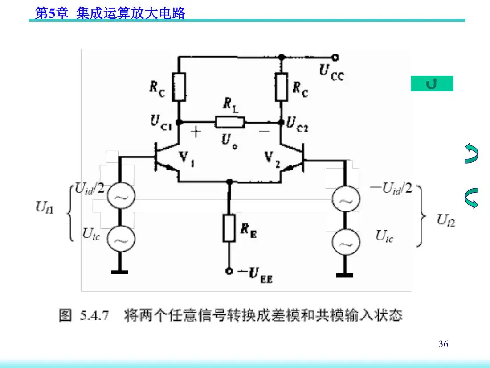

原文：

第5章 集成运算放大电路

36

### 第5章 集成运算放大电路

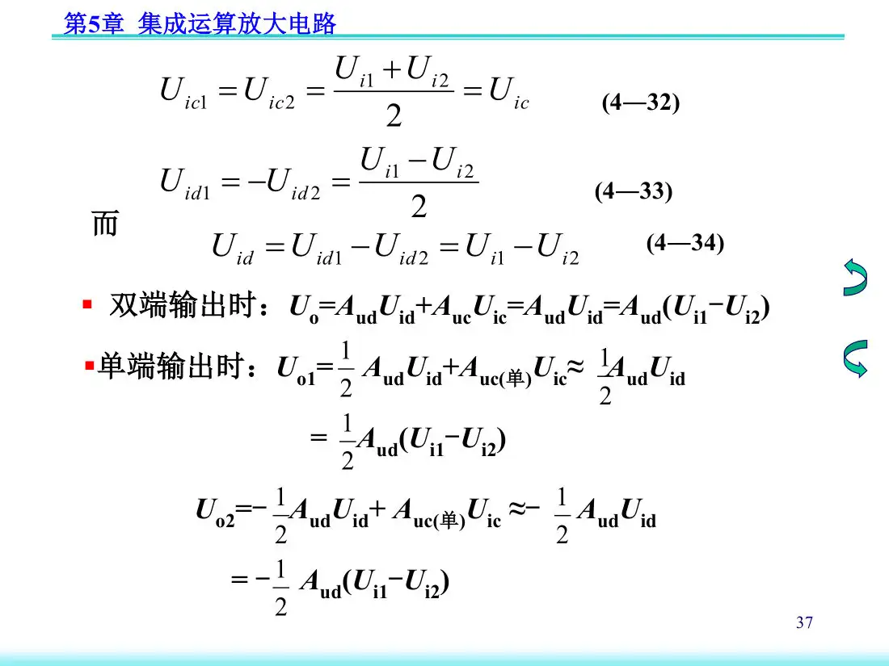

原文：

第5章 集成运算放大电路

$$
U _ {i c 1} = U _ {i c 2} = \frac {U _ {i 1} + U _ {i 2}}{2} = U _ {i c}\tag{4—32}
$$

而

$$
\begin{array}{r} U _ {i d 1} = - U _ {i d 2} = \frac {U _ {i 1} - U _ {i 2}}{2} \\ U _ {i d} = U _ {i d 1} - U _ {i d 2} = U _ {i 1} - U _ {i 2} \end{array}\tag{4—33}
$$

(4―34)

▪ 双端输出时： $U _ { \mathrm { o } } { = } A _ { \mathrm { u d } } U _ { \mathrm { i d } } { + } A _ { \mathrm { u c } } U _ { \mathrm { i c } } { = } A _ { \mathrm { u d } } U _ { \mathrm { i d } } { = } A _ { \mathrm { u d } } ( U _ { \mathrm { i 1 } } { - } U _ { \mathrm { i 2 } } )$

▪单端输出时： $\begin{array} { l } { { \displaystyle U _ { \mathbf { \sigma } _ { \mathbf { 0 } ^ { \mathbf { 1 } } } } = \frac { 1 } { 2 } A _ { \mathbf { \sigma } _ { \mathbf { u d } } } U _ { \mathbf { i d } } + A _ { \mathbf { \sigma } _ { \mathbf { u c } ( \mathit { \check { \box { d } } } ) } } U _ { \mathbf { i \hat { c } } } \approx \frac { 1 } { 2 } A _ { \mathbf { \sigma } _ { \mathbf { u d } } } U _ { \mathbf { i d } } } } \\ { { \displaystyle \quad \mathbf { \sigma } = \frac { 1 } { 2 } A _ { \mathbf { u d } } ( U _ { \mathbf { i 1 } } - U _ { \mathbf { i 2 } } ) } } \end{array}$

$$
\begin{array}{r l} & U _ {\mathrm{o2}} = - \frac {1}{2} A _ {\mathrm{ud}} U _ {\mathrm{id}} + A _ {\mathrm{uc(单)}} U _ {\mathrm{ic}} \approx - \frac {1}{2} A _ {\mathrm{ud}} U _ {\mathrm{id}} \\ & = - \frac {1}{2} A _ {\mathrm{ud}} (U _ {\mathrm{i1}} - U _ {\mathrm{i2}}) \end{array}
$$

37

### 无论是双端还是单端输出，差动放大器只放大两输入端的差信号。

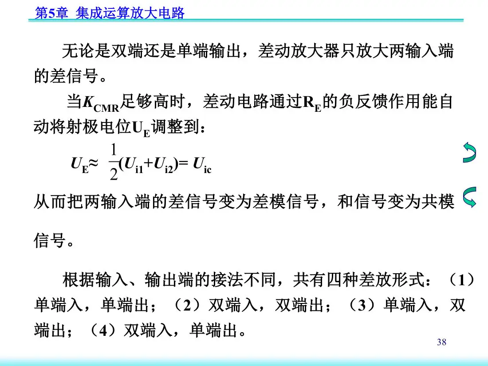

原文：

无论是双端还是单端输出，差动放大器只放大两输入端的差信号。

当 $K _ { \mathrm { { C M R } } }$ 足够高时，差动电路通过 $\mathbf { R _ { \mathrm { E } } }$ 的负反馈作用能自动将射极电位 $\mathbf { U _ { E } }$ 调整到：

$$
U _ {\mathrm{E}} \approx \frac {1}{2} (U _ {\mathrm{i1}} + U _ {\mathrm{i2}}) = U _ {\mathrm{ic}}
$$

从而把两输入端的差信号变为差模信号，和信号变为共模信号。

根据输入、输出端的接法不同，共有四种差放形式：（1）单端入，单端出；（2）双端入，双端出；（3）单端入，双端出；（4）双端入，单端出。2.0

第5章 集成运算放大电路

38

### 差放特性可以总结如下几点结论：

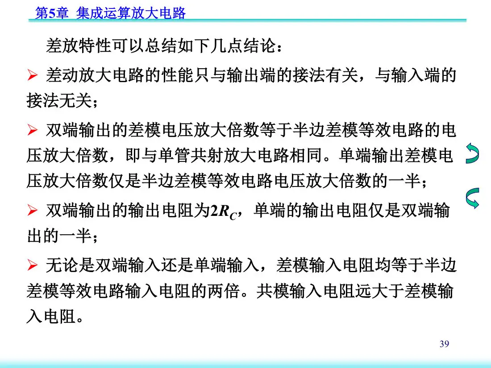

原文：

差放特性可以总结如下几点结论：

➢ 差动放大电路的性能只与输出端的接法有关，与输入端的接法无关；

➢ 双端输出的差模电压放大倍数等于半边差模等效电路的电压放大倍数，即与单管共射放大电路相同。单端输出差模电压放大倍数仅是半边差模等效电路电压放大倍数的一半；

➢ 双端输出的输出电阻为 $2 R _ { C }$ ，单端的输出电阻仅是双端输出的一半；

➢ 无论是双端输入还是单端输入，差模输入电阻均等于半边差模等效电路输入电阻的两倍。共模输入电阻远大于差模输入电阻。

第5章 集成运算放大电路

39

### 5.4.3 具有电流源的差动放大电路

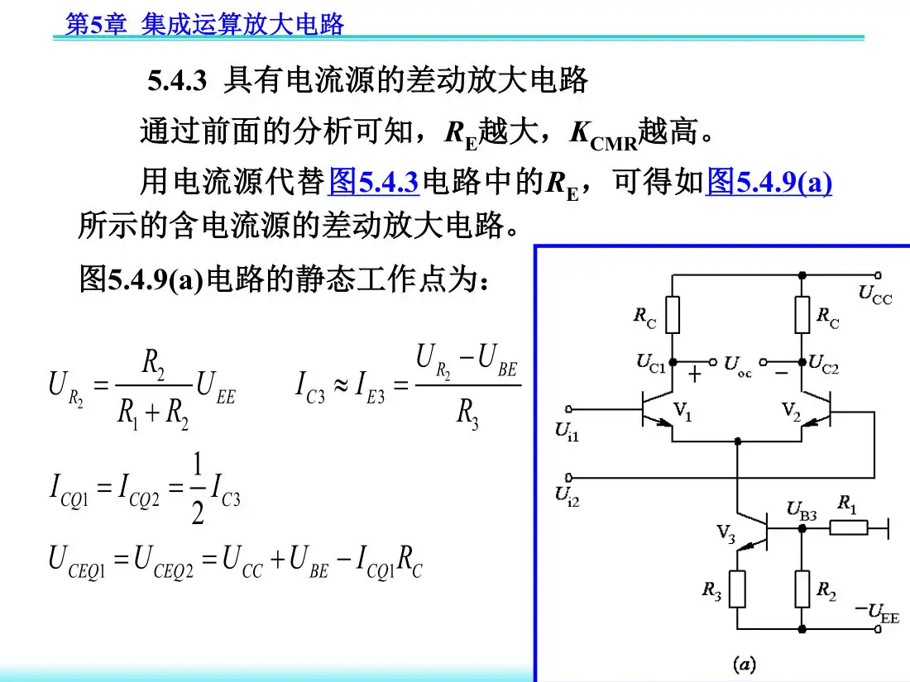

原文：

5.4.3 具有电流源的差动放大电路

通过前面的分析可知， $R _ { \mathrm { { E } } }$ 越大， $K _ { \mathrm { { C M R } } }$ 越高。

用电流源代替图5.4.3电路中的 $R _ { \mathrm { E } }$ ，可得如图5.4.9(a)所示的含电流源的差动放大电路。

图5.4.9(a)电路的静态工作点为：

$$
\begin{array}{l} {U _ {_ R _ {2}} = \frac {R _ {_ 2}}{R _ {_ 1} + R _ {_ 2}} U _ {_ E E} \qquad I _ {_ C 3} \approx I _ {_ E 3} = \frac {U _ {_ R _ {2}} - U _ {_ B E}}{R _ {_ 3}}} \\ {I _ {_ C Q 1} = I _ {_ C Q 2} = \frac {1}{2} I _ {_ C 3}} \\ {U _ {_ C E Q 1} = U _ {_ C E Q 2} = U _ {_ C C} + U _ {_ B E} - I _ {_ C Q 1} R _ {_ C}} \end{array}
$$

第5章 集成运算放大电路

### 第5章 集成运算放大电路

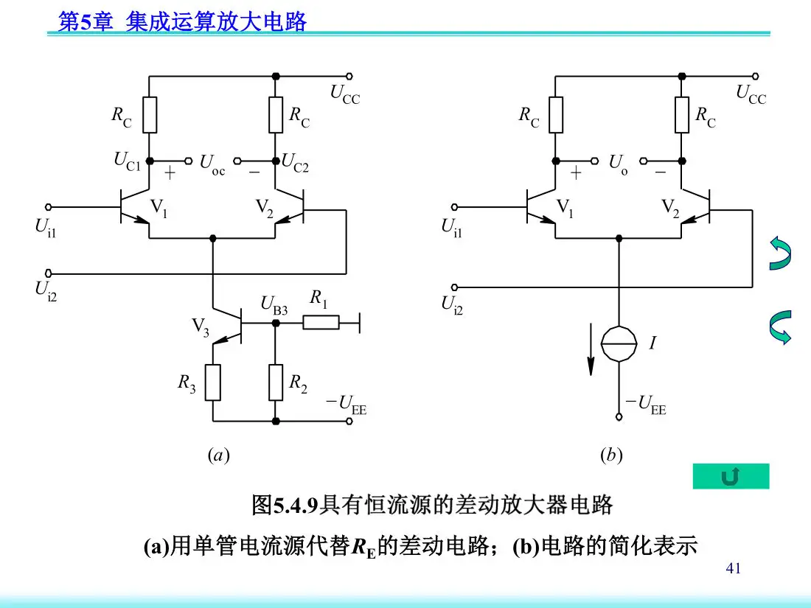

原文：

第5章 集成运算放大电路

41

### 第5章 集成运算放大电路

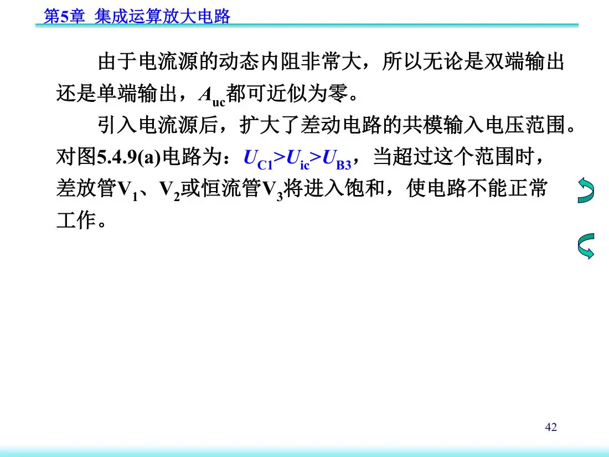

原文：

由于电流源的动态内阻非常大，所以无论是双端输出还是单端输出， $A _ { \mathrm { u c } }$ 都可近似为零。

引入电流源后，扩大了差动电路的共模输入电压范围。对图5.4.9(a)电路为： $U _ { \mathrm { { C 1 } } } { > } U _ { \mathrm { { i c } } } { > } U _ { \mathrm { { B 3 } } }$ ，当超过这个范围时，差放管 $\mathbf { V } _ { 1 } , \ \mathbf { V } _ { 2 }$ 或恒流管 $\mathbf { V } _ { 3 }$ 将进入饱和，使电路不能正常工作。

第5章 集成运算放大电路

42

### 5.4.4 差动放大电路的大信号分析

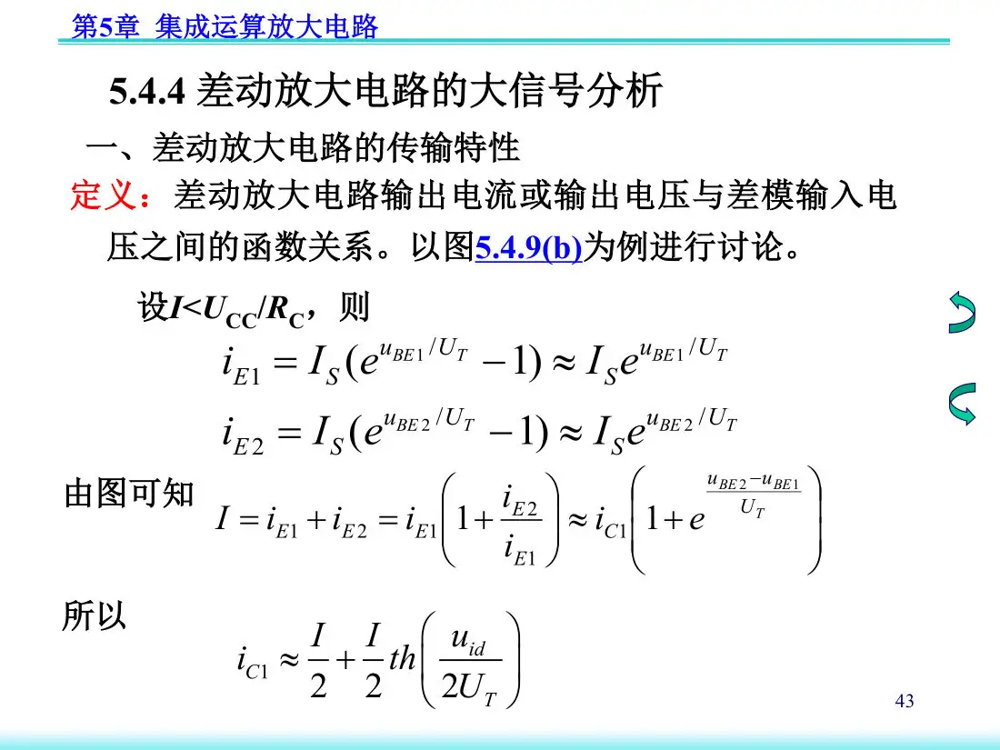

原文：

5.4.4 差动放大电路的大信号分析

一、差动放大电路的传输特性

定义：差动放大电路输出电流或输出电压与差模输入电压之间的函数关系。以图5.4.9(b)为例进行讨论。

设 $I { < } U _ { \mathrm { C C } } / R _ { \mathrm { C } } ,$ 则

$$
i _ {E 1} = I _ {S} (e ^ {u _ {B E 1} / U _ {T}} - 1) \approx I _ {S} e ^ {u _ {B E 1} / U _ {T}}
$$

$$
i _ {E 2} = I _ {S} (e ^ {u _ {B E 2} / U _ {T}} - 1) \approx I _ {S} e ^ {u _ {B E 2} / U _ {T}}
$$

由图可知

$$
I = i _ {E 1} + i _ {E 2} = i _ {E 1} \left(1 + \frac {i _ {E 2}}{i _ {E 1}}\right) \approx i _ {C 1} \left(1 + e ^ {\frac {u _ {B E 2} - u _ {B E 1}}{U _ {T}}}\right)
$$

所以

$$
i _ {C 1} \approx \frac {I}{2} + \frac {I}{2} t h \left(\frac {u _ {i d}}{2 U _ {T}}\right)
$$

第5章 集成运算放大电路

43

### 所以

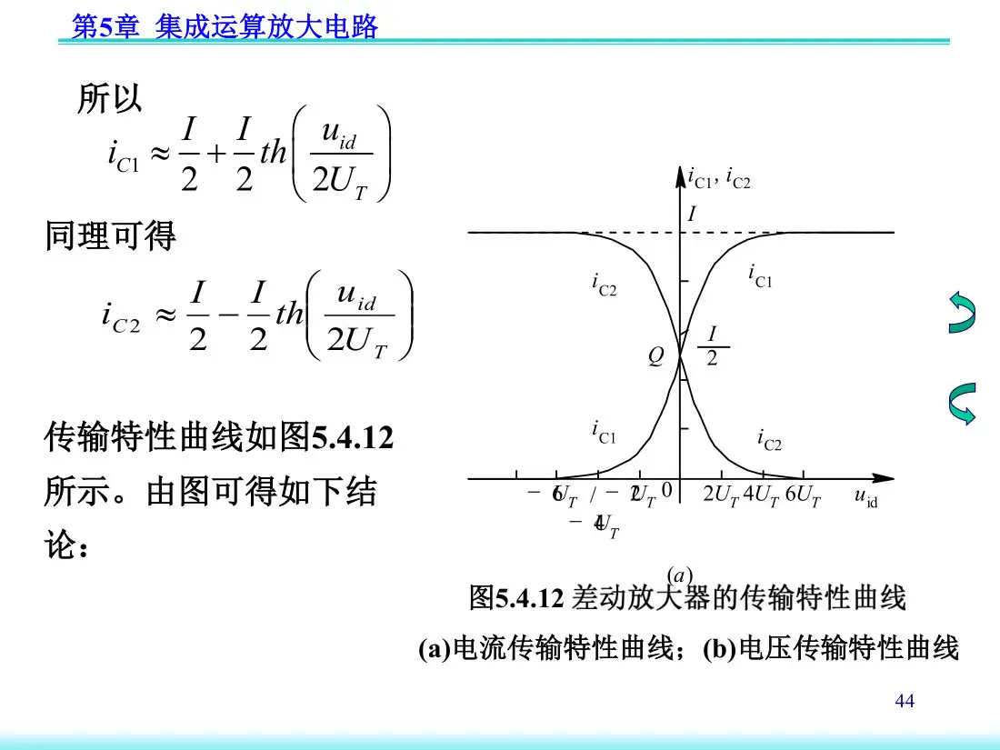

原文：

所以

$$
i _ {C 1} \approx \frac {I}{2} + \frac {I}{2} t h \left(\frac {u _ {i d}}{2 U _ {T}}\right)
$$

同理可得

$$
i _ {C 2} \approx \frac {I}{2} - \frac {I}{2} t h \left(\frac {u _ {i d}}{2 U _ {T}}\right)
$$

传输特性曲线如图5.4.12所示。由图可得如下结论：

第5章 集成运算放大电路

44

### 第5章 集成运算放大电路

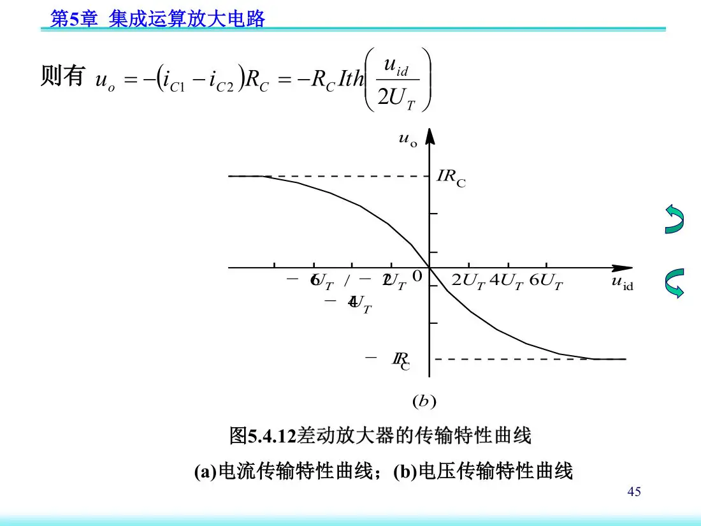

原文：

则有 $u _ { o } = - \big ( i _ { C 1 } - i _ { C 2 } \big ) R _ { C } = - R _ { C } I t h \Bigg ( \frac { u _ { i d } } { 2 U _ { T } } \Bigg )$

第5章 集成运算放大电路

45

### 第5章 集成运算放大电路

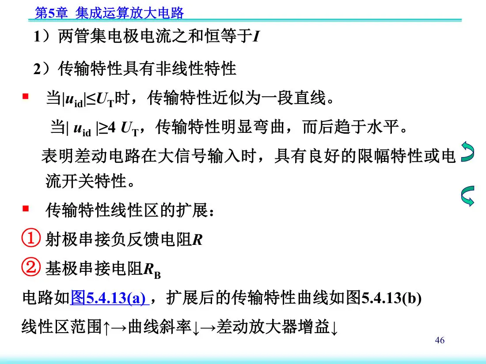

原文：

第5章 集成运算放大电路

1）两管集电极电流之和恒等于I

2）传输特性具有非线性特性

▪ 当 $| \pmb { u } _ { \mathbf { i d } } | { \le } U _ { \mathrm { T } }$ 时，传输特性近似为一段直线。

当| $u _ { \mathrm { i d } } \geq 4 ~ U _ { \mathrm { T } }$ ，传输特性明显弯曲，而后趋于水平。

表明差动电路在大信号输入时，具有良好的限幅特性或电流开关特性。

传输特性线性区的扩展：

①射极串接负反馈电阻R

② 基极串接电阻 $R _ { \mathrm { B } }$

电路如图5.4.13(a) ，扩展后的传输特性曲线如图5.4.13(b)线性区范围↑→曲线斜率↓→差动放大器增益↓

46

### 第5章 集成运算放大电路

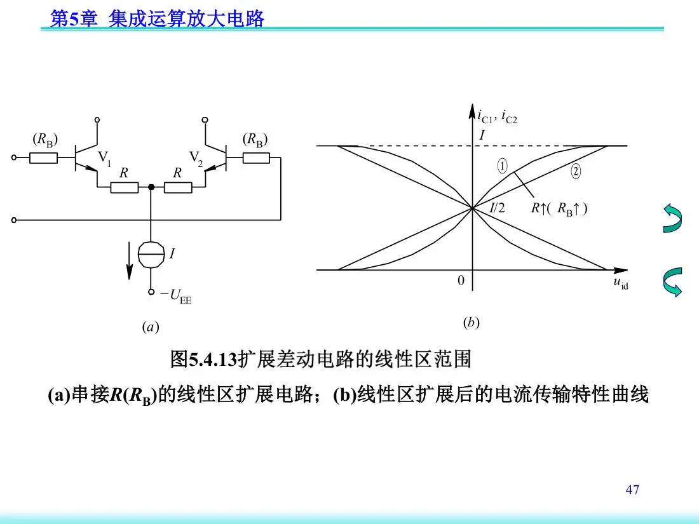

原文：

(a)串接 $R ( R _ { \mathrm { B } } )$ 的线性区扩展电路；(b)线性区扩展后的电流传输特性曲线

第5章 集成运算放大电路

47

### 二、差动放大电路正常工作的前提条件

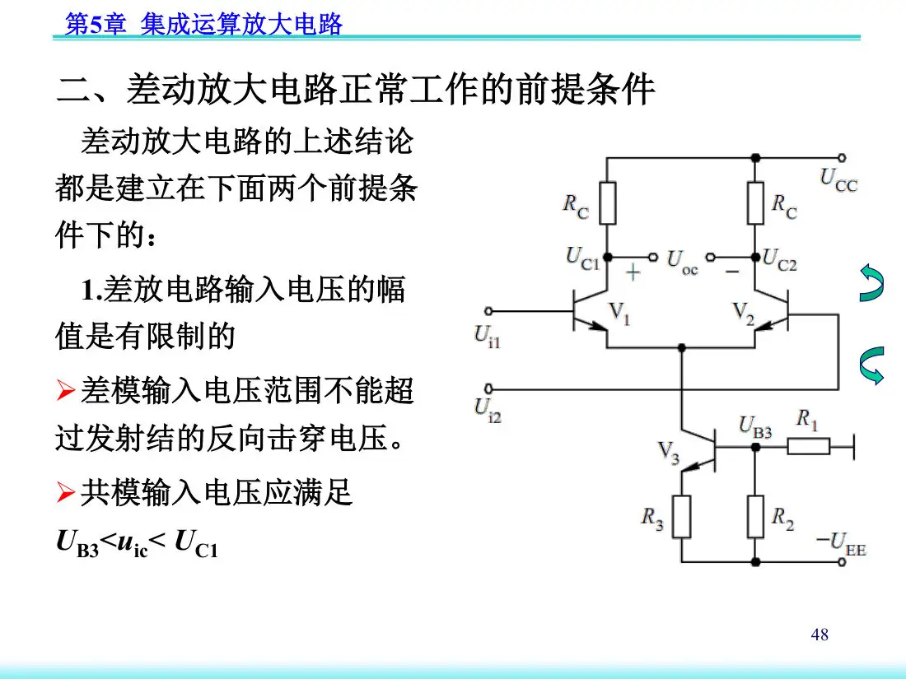

原文：

二、差动放大电路正常工作的前提条件

差动放大电路的上述结论都是建立在下面两个前提条件下的：

1.差放电路输入电压的幅值是有限制的

➢差模输入电压范围不能超过发射结的反向击穿电压。

➢共模输入电压应满足

$$
U _ {\mathrm{B3}} <   u _ {\mathrm{ic}} <   U _ {\mathrm{C1}}
$$

第5章 集成运算放大电路

48

### 2.电流源电流I小于差放管的集电极临界饱和电流ICS(临界)

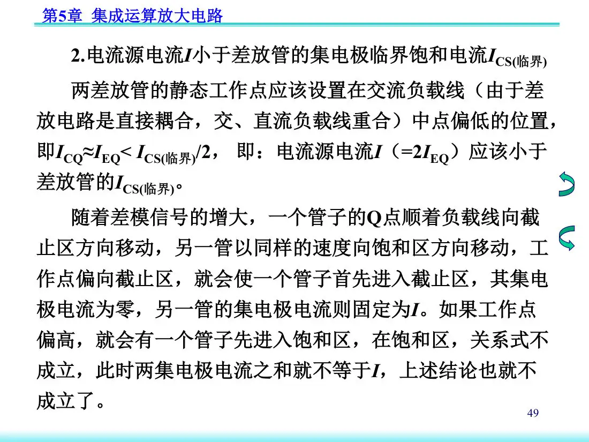

原文：

2.电流源电流I小于差放管的集电极临界饱和电流ICS(临界)

两差放管的静态工作点应该设置在交流负载线（由于差放电路是直接耦合，交、直流负载线重合）中点偏低的位置，即 $I _ { \mathrm { C Q } } { \approx } I _ { \mathrm { E Q } } { < } I _ { \mathrm { C S ( \mathbb { N } \mathrm { f } \mathrm { f } ) } } / 2$ ， 即：电流源电流I $( = 2 I _ { \mathrm { E Q } } )$ 应该小于差放管的ICS(临界)。

随着差模信号的增大，一个管子的Q点顺着负载线向截止区方向移动，另一管以同样的速度向饱和区方向移动，工作点偏向截止区，就会使一个管子首先进入截止区，其集电极电流为零，另一管的集电极电流则固定为I。如果工作点偏高，就会有一个管子先进入饱和区，在饱和区，关系式不成立，此时两集电极电流之和就不等于I，上述结论也就不成立了。49

第5章 集成运算放大电路

49

### 三、差动放大电路作模拟乘法器

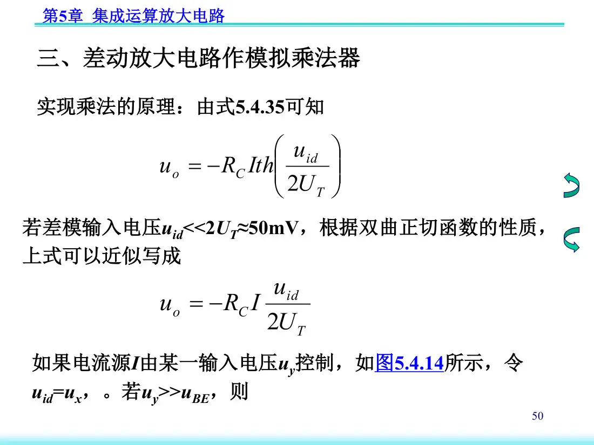

原文：

三、差动放大电路作模拟乘法器

实现乘法的原理：由式5.4.35可知

$$
u _ {o} = - R _ {C} I t h \left(\frac {u _ {i d}}{2 U _ {T}}\right)
$$

若差模输入电压 $\mu _ { i d } { < } { < } 2 U _ { T } { \approx } 5 0 \mathrm { m V }$ ，根据双曲正切函数的性质，上式可以近似写成

$$
u _ {o} = - R _ {C} I \frac {u _ {i d}}{2 U _ {T}}
$$

如果电流源I由某一输入电压u 控制，如图5.4.14所示，令 $\mathbfit { \Delta } \mathbf { u } _ { y }$ ${ \pmb u } _ { i d } \mathrm { = } { \pmb u } _ { x } ,$ 。若 $\mathbf { \sigma } _ { u _ { y } } > > u _ { B E } $ ，则

第5章 集成运算放大电路

50

### $$

原文：

则

$$
u _ {o} = k u _ {x} u _ {y}
$$

式中增益系数

$$
k = - \frac {R _ {C}}{2 U _ {T} R _ {r}}
$$

第5章 集成运算放大电路

51

### 5.4.5 差动放大电路的失调及温漂

原文：

5.4.5 差动放大电路的失调及温漂

一、差动放大器的失调

定义：差动放大器零输入时输出电压不为零的现象。

补偿方法：在输入端加补偿电压或电流，分别称为输入失调电压 $\bf { U } _ { I 0 }$ 和输入失调电流 ${ \bf { I } } _ { \bf { I 0 } }$ 。加了补偿后的实际不对称差动放大器如图5.4.16所示。

1．影响 $\bf { U } _ { I 0 }$ 和 $\bf { { I I } _ { I O } }$ 的因素当 $\bf { U } _ { i } { = } 0$ （输入短路)时 ， $\mathbf { U _ { I O } { = } U _ { B E 1 } { - } U _ { B E 2 } }$ ，而 $\mathbf { I } _ { \mathbf { C } } { \approx } \mathbf { I } _ { \mathbf { E } } { \approx } \mathbf { I } _ { \mathbf { S } }$ $e ^ { \left. ^ { U _ { B E } } \right/ } U _ { T }$

$$
U _ {B E 1} - U _ {B E 2} = U _ {T} \ln (\frac {I _ {C 1}}{I _ {C 2}} \frac {I _ {S 2}}{I _ {S 1}})
$$

第5章 集成运算放大电路

52

### 第5章 集成运算放大电路

原文：

第5章 集成运算放大电路

53

### $$

原文：

此时 $\bf { U _ { 0 } } { = } 0$ ，若 $I _ { C 1 } { = } I _ { C 2 }$

$$
\frac {I _ {S 2}}{I _ {S 1}} = \frac {I _ {S} + \Delta I _ {S}}{I _ {S}}
$$

又因为

$$
\ln {\frac {X + \Delta X}{X}} \approx {\frac {\Delta X}{X}} \left(\text {当} \Delta X <   <   X \text {时}\right)
$$

所以

$$
U _ {I O} \approx U _ {T} \left(\frac {\Delta I _ {S}}{I _ {S}}\right)
$$

上式说明，在不考虑 $R _ { C }$ 差值的情况下， $I _ { C 1 } { = } I _ { C 2 }$ ，此时失调电压取决于两管反向饱和电流 $I _ { s }$ 的差值。

第5章 集成运算放大电路

54

### $$

原文：

当输入端开路时，若 $I _ { C 1 } { = } I _ { C 2 } { = } I _ { C }$

$$
I _ {I O} = I _ {B 1} - I _ {B 2} = \frac {I _ {C 1}}{\beta_ {1}} - \frac {I _ {C 2}}{\beta_ {2}} = I _ {C} \left(\frac {1}{\beta_ {1}} - \frac {1}{\beta_ {2}}\right)
$$

所以

$$
I _ {I O} \approx I _ {B} (\frac {\Delta \beta}{\beta})
$$

所以，失调电流 ${ \mathbf { I _ { I O } } }$ 主要由β的失配大小决定，约为 ${ \bf 0 . 1 I _ { B } }$ 如果差动放大电路的输入信号源是低阻抗源，则 $\bf { U } _ { I 0 }$ 的影响是主要的；如果是高阻抗源，则 ${ \bf { I } } _ { \bf { I 0 } }$ 的影响是主要的。

第5章 集成运算放大电路

55

### 第5章 集成运算放大电路

原文：

第5章 集成运算放大电路

2．实际电路补偿

实际电路补偿有两类：一类是在集成电路制造过程中，采用调集电极电阻的方法；一类是外加调零电位器的方法，如图5.4.17所示。 9 U

56

### 第5章 集成运算放大电路

原文：

第5章 集成运算放大电路

无论 ${ \bf R } _ { \bf W }$ 的动臂在何处，其差模电压放大倍数和差模输入电阻分别为：

$$
A _ {u d} = \frac {U _ {o d}}{U _ {i d}} = - \frac {\beta R _ {C}}{r _ {b e} + (1 + \beta) \frac {1}{2} R _ {W}} \quad R _ {i} = 2 \left[ r _ {b e} + (1 + \beta) \frac {1}{2} R _ {W} \right]
$$

二、失调的温度漂移

差动放大器虽然可以通过调零措施，但失调会随温度的改变而发生变化。所以仍存在失调的温度漂移现象。

$U _ { \mathbf { I 0 } }$ 的温漂，可由 $\bf { U } _ { I 0 }$ 对T求导得出，并考虑到$\Delta R _ { \mathrm { C } } / R _ { \mathrm { C } } , ~ { \Delta I _ { \mathrm { S } } } / { I _ { \mathrm { S } } }$ 在很宽的温度范围内基本恒定，则

57

### 第5章 集成运算放大电路

原文：

第5章 集成运算放大电路

$$
\begin{array}{l} \frac {d U _ {I O}}{d T} = \frac {d (U _ {B E 1} - U _ {B E 2})}{d T} \\ = \frac {d (\frac {k T}{q} (\frac {\Delta I _ {S}}{I _ {S}}))}{d T} = \frac {k}{q} (\frac {\Delta I _ {S}}{I _ {S}}) = \frac {1}{T} \frac {k T}{q} (\frac {\Delta I _ {S}}{I _ {S}}) = \frac {U _ {I O}}{T} \end{array}
$$

说明： $\boxed { | 0 | }$ 的温漂与该温度下的 $\textcircled { 1 0 }$ 的大小成正比。

同样可得

$$
\frac {d I _ {I O}}{d T} \approx - I _ {B} \frac {\Delta \beta}{\beta} \frac {1}{\beta} \frac {d \beta}{d T} \approx - \frac {1}{\beta} \frac {d \beta}{d T} I _ {I O} = - C I _ {I O}
$$

说明 $1 5 0$ 的温漂主要取决于β的温度系数和 $j ( 0 )$ 本身。

BacK

58

### 5.6 集成运算放大器的输出级电路

原文：

5.6 集成运算放大器的输出级电路

图5.6.2所示为互补型射随器的原理图。$V _ { 1 } , V _ { 2 }$ 是两个特性相同的异型输出管，其中 $V _ { 1 }$ 为NPN管， $V _ { 2 }$ 为PNP管，它们分别与负载 $R _ { \mathrm { L } }$ 构成射极输出器。

第5章 集成运算放大电路

59

### S C

原文：

由图5.6.2可知，当忽略管子饱和压降时，最大输出电压幅度近似为± $U _ { \mathrm { C C } }$ ，而最大输出电流幅度近似为± $U _ { \mathrm { C \thinspace C } } / R _ { \mathrm { L } }$ 。由于晶体管实际存在导通电压，硅管约为0.7V,因而在正负半周内，只有当信号的绝对值大于0.7V时，管子才导通。而在0.7～-0.7V之间，两管的输出电流近似为零。因此，输出波形在两管轮流工作的衔接处呈现出失真，如图5.6.4所示。这种失真通常称为交越失真。图5.6.4是利用两管的合成转移特性曲线(即 $i _ { \mathrm { C } }$ 与u 的关系曲线)，形象地来说明交越失真产生 ${ \pmb u } _ { \mathbf { B E } }$ 的原因。

S C

第5章 集成运算放大电路

60

### 第5章 集成运算放大电路

原文：

第5章 集成运算放大电路

61

### 第5章 集成运算放大电路

原文：

为了克服交越失真，可以分别给两管发射结加一正向偏压，其值等于或稍大于导通电压。因而只要有信号输入， $V _ { 1 } , V _ { 2 }$ 即可轮流导通，从而消除交越失真。在集成运放中，常用的偏置方式如图5.6.3所示。

第5章 集成运算放大电路

62

### 第5章 集成运算放大电路

原文：

第5章 集成运算放大电路

63

### $$

原文：

$$
U _ {A B} \approx U _ {B E 4} (1 + \frac {R _ {1}}{R _ {2}})\tag{5.6.1}
$$

可见， $U _ { \mathbf { A B } }$ 是某一倍数的 $U _ { \mathbf { B E 4 9 } }$ 所以该电路也称为 $U _ { \mathbf { B E } }$ 的倍增电路。调整 $R _ { 1 } , R _ { 2 }$ 的比值，可以得到所需的偏压值。由于 $R _ { 1 }$ 从集电极反接到基极，具有负反馈作用，因而使A、B间的动态电阻很小，近似为一个恒压源

第5章 集成运算放大电路

64

### 5.8 集成运放电路的外部特性及其理想化

原文：

5.8 集成运放电路的外部特性及其理想化

5.8.1 集成运放的模型

集成运放有两个输入端，分别称为反相和同相输入端。

图5.8.1是集成运放的电路符号。从外部看，集成运放是一个双端输入、单端输出、具有高差模增益、高输入电阻、低输出电阻、能较好地抑制温漂的差动放大电路。

第5章 集成运算放大电路

65

### 第5章 集成运算放大电路

原文：

第5章 集成运算放大电路

66

### 在线性区，曲线的斜率为电压放大倍数，即

原文：

图5.8.2所示为集成运放的传输特性曲线。可见，集成运放有两个区间：线性区和非线性区。

在非线性区，输出被限幅，输出电压不是 $U _ { \mathbf { O H } }$ 就是 $U _ { \mathbf { O L } }$ 。

在线性区，曲线的斜率为电压放大倍数，即

$$
u _ {\mathrm{o}} = A _ {\mathrm{ud}} (u _ {-} - u _ {+})
$$

第5章 集成运算放大电路

67

### 5.8.3 理想集成运算放大电路

原文：

5.8.3 理想集成运算放大电路

一、理想化条件：

1) 开环差模电压增益 $A _ { \bf { 0 } d } \longrightarrow \infty !$ ；

2) 差模输入电阻 $R _ { \mathrm { i d } } {  } \infty$ ；

3) 输出电阻 $R _ { \mathbf { 0 } } { \ \longrightarrow } \mathbf { 0 }$ ；

$K _ { \mathrm { C M R } } ( \mathrm { C o m m o n - m o d e ~ R e j e c t i o n ~ R a t i o } ) {  } \infty$ ●の

5) 输入失调电流 $\mathrm { ( O f f s e t C u r r e n t s ) I _ { I O } } \mathrm { , }$ 失调电压(OffsetVoltages) $\bf { U } _ { I 0 }$ 和它们的温漂均为零；

6) 输入偏置电流 $\mathrm { ( B i a s \mathrm { ~ C u r r e n t ) } \mathrm { { I } _ { I B } = 0 } }$ ； 3dB带宽 $\mathbf { f _ { H } } { = } \infty ,$ ,等等。

第5章 集成运算放大电路

68

### 二、线性状态下理想运放的特性 ：

原文：

二、线性状态下理想运放的特性 ：

①理想运放的差模输入电压等于零。即 ${ \bf U } _ { + } { = } { \bf U }$ “虚 短”(Virtual Short Circuit)

②理想运放的输入电流等于零。即 $\mathbf { I _ { + } } \mathbf { = I _ { - } } \mathbf { = 0 } \mathbf { \ } ^ { 6 6 }$ 虚断” (Virtual Open Circuit)

第5章 集成运算放大电路

69

### 作 业 （P143）5.15.2 A5.4 C5.6\*5.8\*5.9

原文：

作 业 （P143）5.15.2 A5.4 C5.6\*5.8\*5.9

第5章 集成运算放大电路

70
