# 《电路分析与电工电子技术》第6章 反馈（课件）

原件的每一页，下面附识别出的文字。

### 第6章 反馈

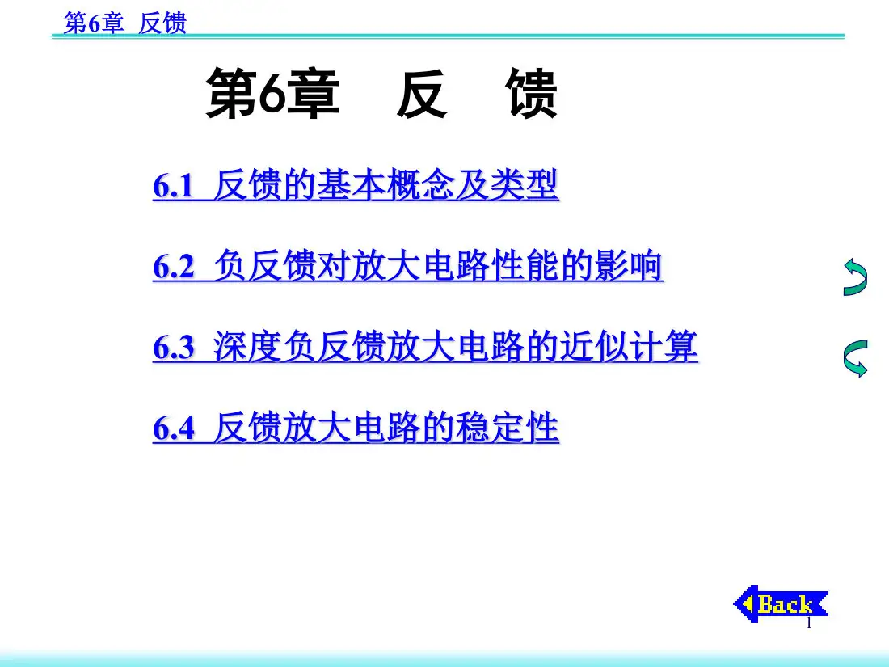

原文：

第6章 反馈

6.1 反馈的基本概念及类型

6.2 负反馈对放大电路性能的影响

6.3 深度负反馈放大电路的近似计算

6.4 反馈放大电路的稳定性

第6章 反馈

Back 1

### 6.1 反馈的基本概念及类型

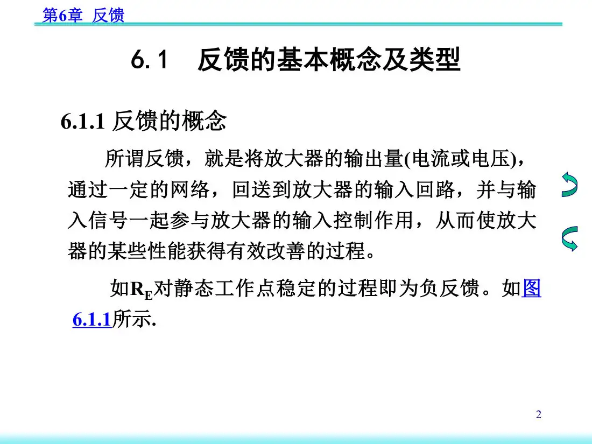

原文：

6.1 反馈的基本概念及类型

6.1.1 反馈的概念

所谓反馈，就是将放大器的输出量(电流或电压)，通过一定的网络，回送到放大器的输入回路，并与输入信号一起参与放大器的输入控制作用，从而使放大器的某些性能获得有效改善的过程。

如 $R_{E}$ 对静态工作点稳定的过程即为负反馈。如图6.1.1所示.

第6章 反馈

2

### 第6章 反馈

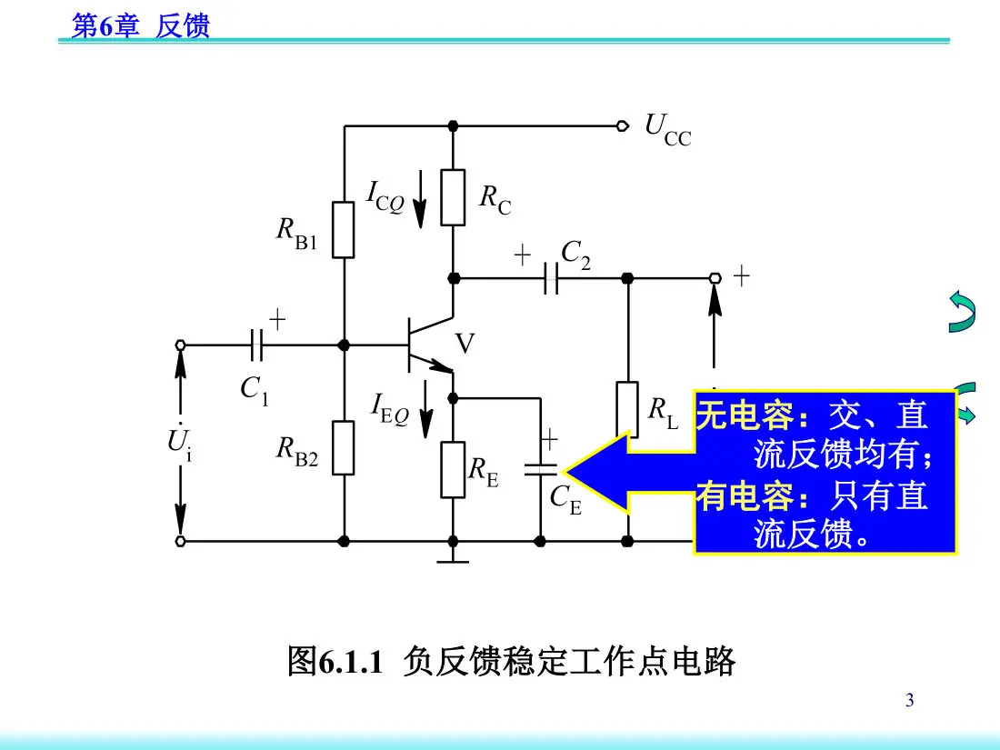

原文：

第6章 反馈

无电容：交、直流反馈均有；  
有电容：只有直流反馈。

图6.1.1 负反馈稳定工作点电路

3

### 第6章 反馈

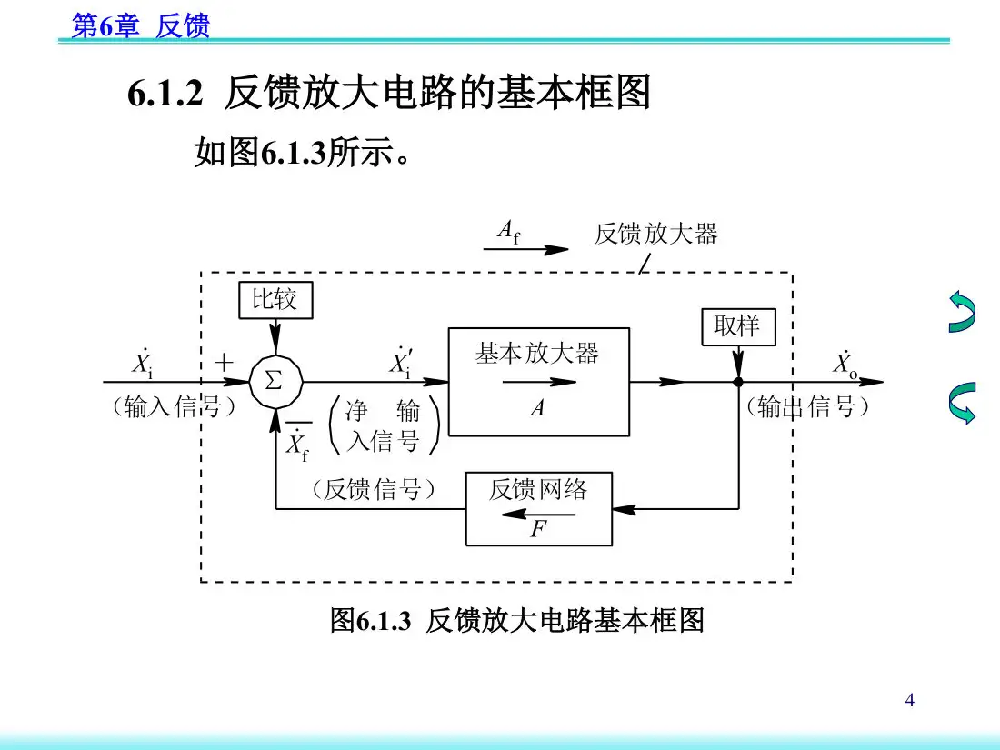

原文：

第6章 反馈

6.1.2 反馈放大电路的基本框图

如图6.1.3所示。

4

### 6.1.3 反馈放大器的基本方程

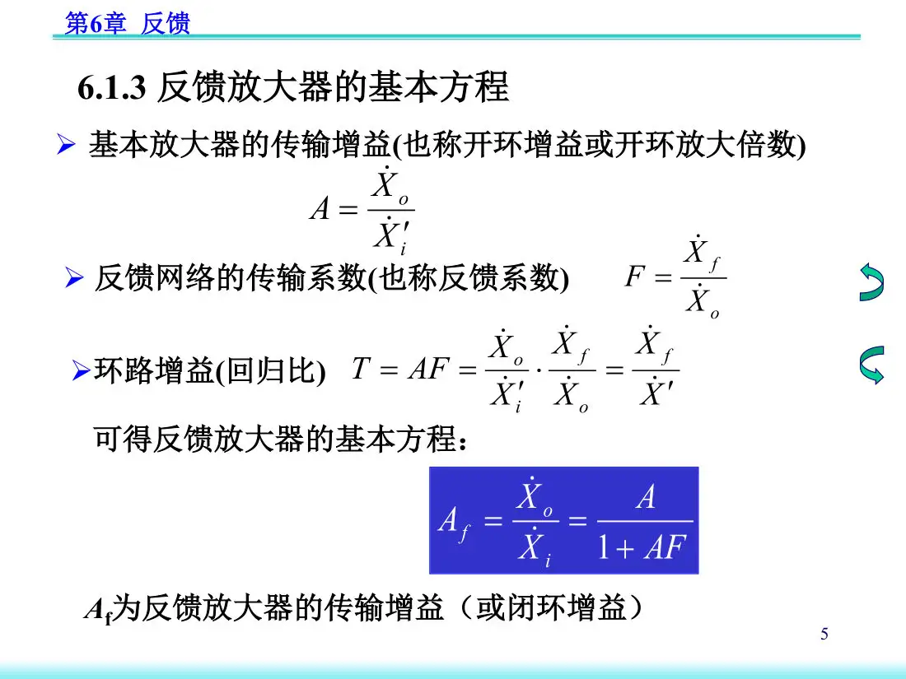

原文：

6.1.3 反馈放大器的基本方程

基本放大器的传输增益(也称开环增益或开环放大倍数)

$$
A = \frac {\dot {X} _ {o}}{\dot {X} _ {i} ^ {\prime}}
$$

$X_{i}$ ▶ 反馈网络的传输系数(也称反馈系数) $F = \frac{\dot{X}_{f}}{\dot{X}_{o}}$

环路增益(回归比) $T = AF = \frac{\dot{X}_{o}}{\dot{X}_{i}^{\prime}} \cdot \frac{\dot{X}_{f}}{\dot{X}_{o}} = \frac{\dot{X}_{f}}{\dot{X}^{\prime}}$ 可得反馈放大器的基本方程：

$$
A _ {f} = \frac {\dot {X} _ {o}}{\dot {X} _ {i}} = \frac {A}{1 + A F}
$$

$A_{f}$ 为反馈放大器的传输增益（或闭环增益）

第6章 反馈

5

### 第6章 反馈

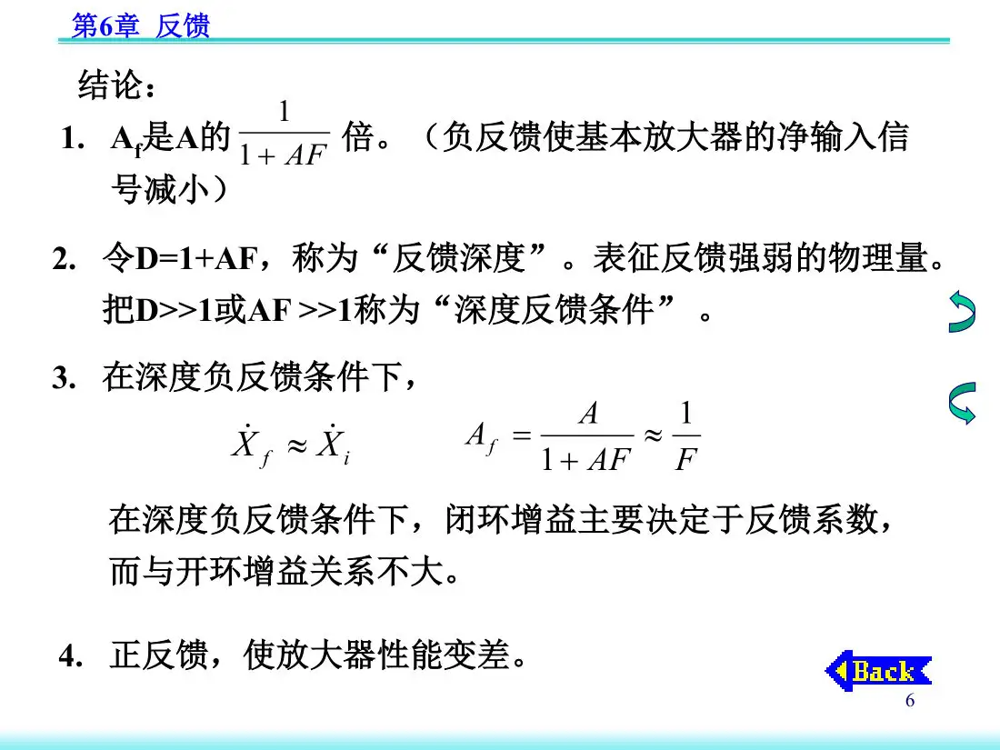

原文：

第6章 反馈

结论:

1. $\mathbf{A}_{\mathrm{f}}$ 是 $\mathbf{A}$ 的 $\frac{1}{1 + AF}$ 倍。（负反馈使基本放大器的净输入信号减小）

2. 令D=1+AF，称为“反馈深度”。表征反馈强弱的物理量。把D>>1或AF>>1称为“深度反馈条件”。

3. 在深度负反馈条件下，

$$
\dot {X} _ {f} \approx \dot {X} _ {i} \qquad A _ {f} = \frac {A}{1 + A F} \approx \frac {1}{F}
$$

在深度负反馈条件下，闭环增益主要决定于反馈系数，而与开环增益关系不大。

4. 正反馈，使放大器性能变差。

Back

6

### 6.1.4 负反馈放大电路的组态和四种基本类型

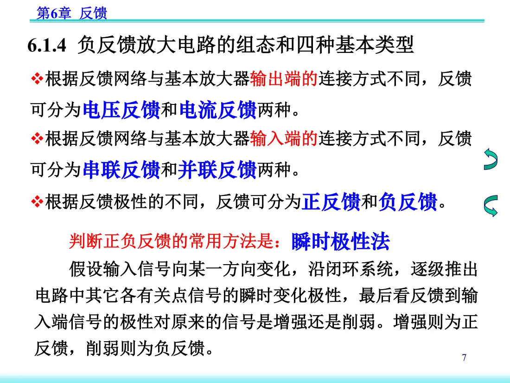

原文：

6.1.4 负反馈放大电路的组态和四种基本类型

根据反馈网络与基本放大器输出端的连接方式不同，反馈可分为电压反馈和电流反馈两种。

根据反馈网络与基本放大器输入端的连接方式不同，反馈可分为串联反馈和并联反馈两种。

根据反馈极性的不同，反馈可分为正反馈和负反馈。

判断正负反馈的常用方法是：瞬时极性法

假设输入信号向某一方向变化，沿闭环系统，逐级推出电路中其它各有关点信号的瞬时变化极性，最后看反馈到输入端信号的极性对原来的信号是增强还是削弱。增强则为正反馈，削弱则为负反馈。

第6章 反馈

### 第6章 反馈

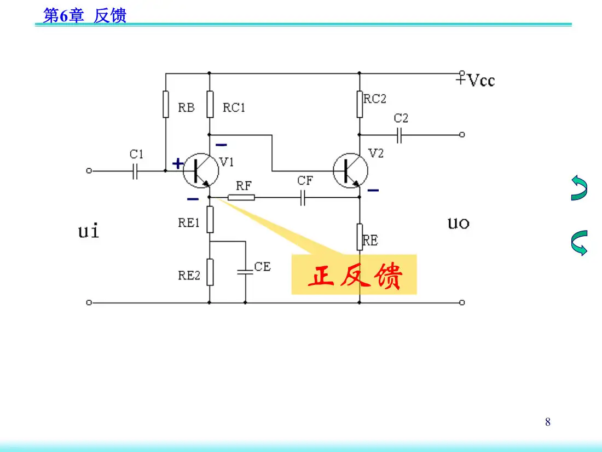

原文：

第6章 反馈

C

8

### 第6章 反馈

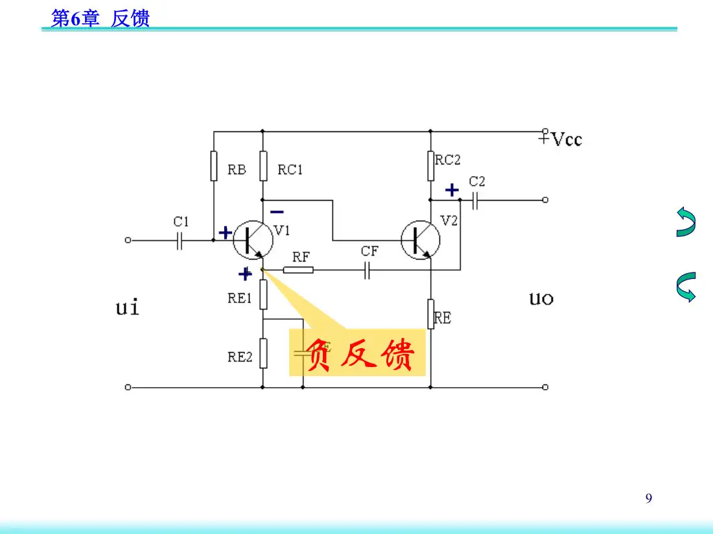

原文：

第6章 反馈

9

### 第6章 反馈

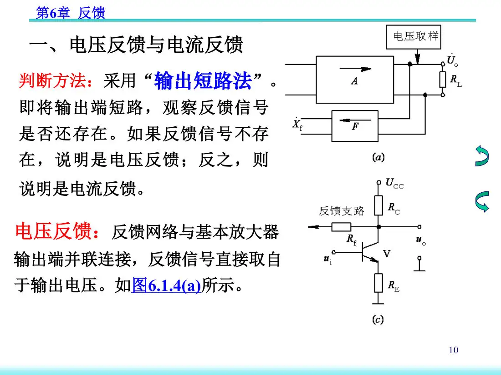

原文：

第6章 反馈

一、电压反馈与电流反馈

判断方法：采用“输出短路法”。即将输出端短路，观察反馈信号是否还存在。如果反馈信号不存在，说明是电压反馈；反之，则说明是电流反馈。

电压反馈：反馈网络与基本放大器输出端并联连接，反馈信号直接取自于输出电压。如图6.1.4(a)所示。

10

### 第6章 反馈

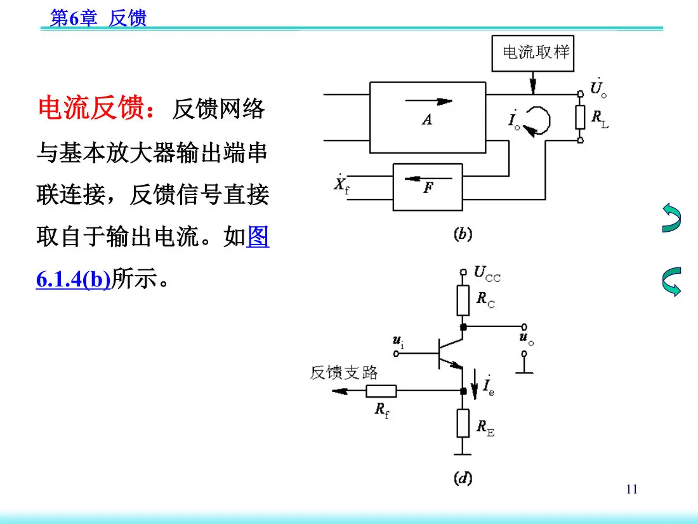

原文：

第6章 反馈

电流反馈：反馈网络与基本放大器输出端串联连接，反馈信号直接取自于输出电流。如图6.1.4(b)所示。

11

### 二、串联反馈与并联反馈

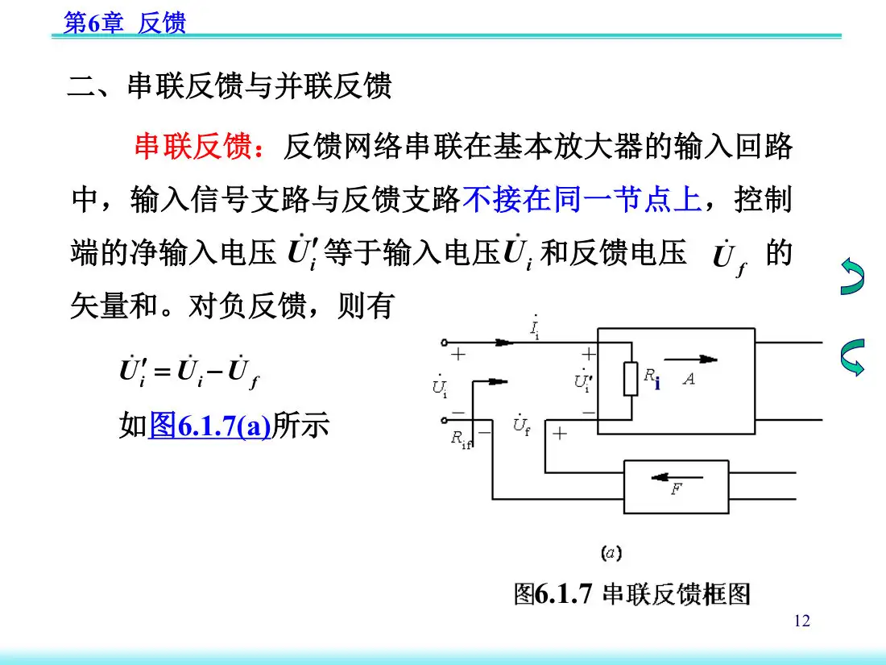

原文：

二、串联反馈与并联反馈

串联反馈：反馈网络串联在基本放大器的输入回路中，输入信号支路与反馈支路不接在同一节点上，控制端的净输入电压 $\dot{U}_{i}^{\prime}$ 等于输入电压 $\dot{U}_{i}$ 和反馈电压 $\dot{U}_{f}$ 的

矢量和。对负反馈，则有

$$
\dot {U} _ {i} ^ {\prime} = \dot {U} _ {i} - \dot {U} _ {f}
$$

如图6.1.7(a)所示

第6章 反馈

12

### 第6章 反馈

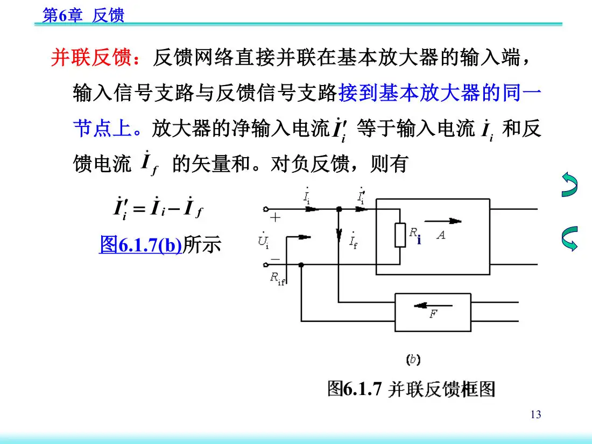

原文：

第6章 反馈

并联反馈：反馈网络直接并联在基本放大器的输入端，输入信号支路与反馈信号支路接到基本放大器的同一节点上。放大器的净输入电流 $\dot{I}_{i}^{\prime}$ 等于输入电流 $\dot{I}_{i}$ 和反馈电流 $\dot{I}_{f}$ 的矢量和。对负反馈，则有

$$
\dot {I} _ {i} ^ {\prime} = \dot {I} _ {i} - \dot {I} _ {f}
$$

图6.1.7(b)所示

13

### 第6章 反馈

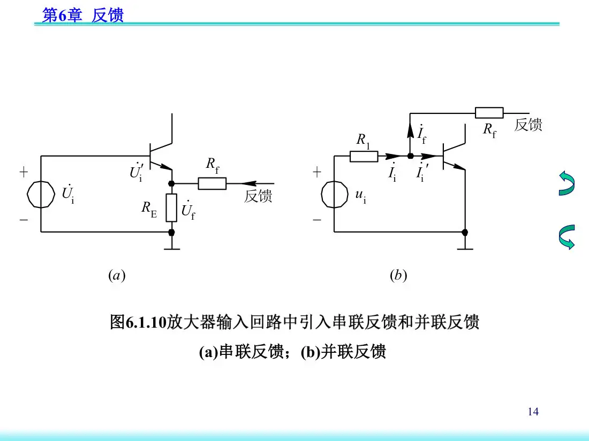

原文：

第6章 反馈

14

### 第6章 反馈

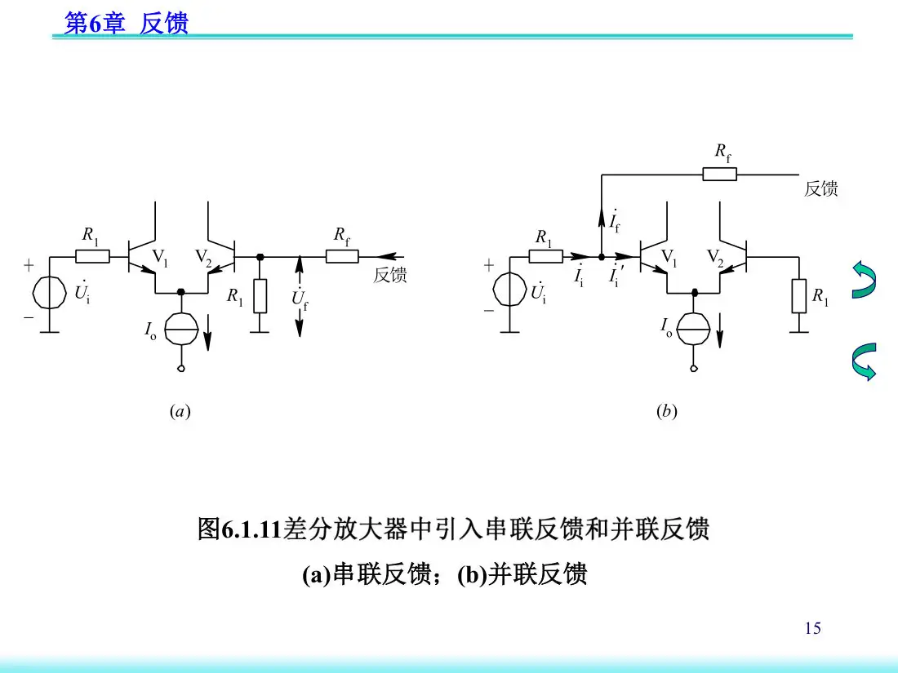

原文：

第6章 反馈

15

### 三、四种基本反馈类型

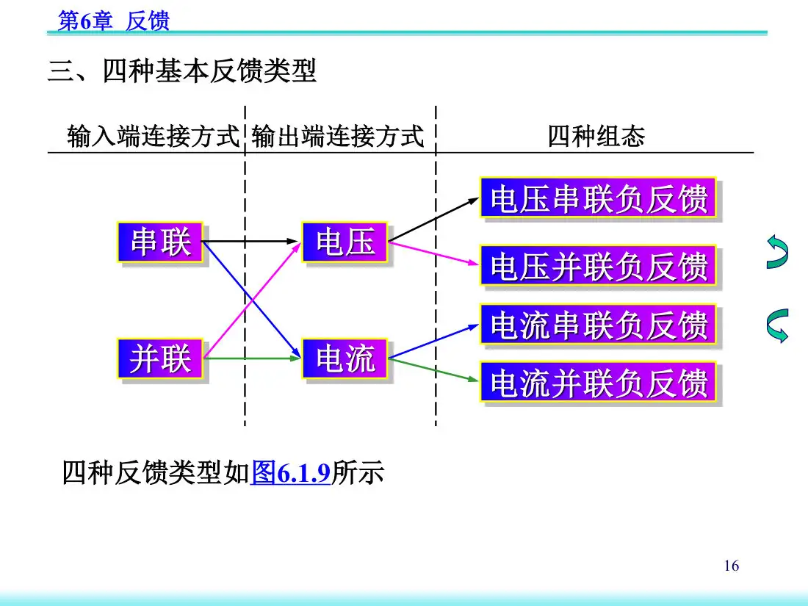

原文：

三、四种基本反馈类型

电压串联负反馈

电压并联负反馈

电流并联负反馈

四种反馈类型如图6.1.9所示

第6章 反馈

16

### 第6章 反馈

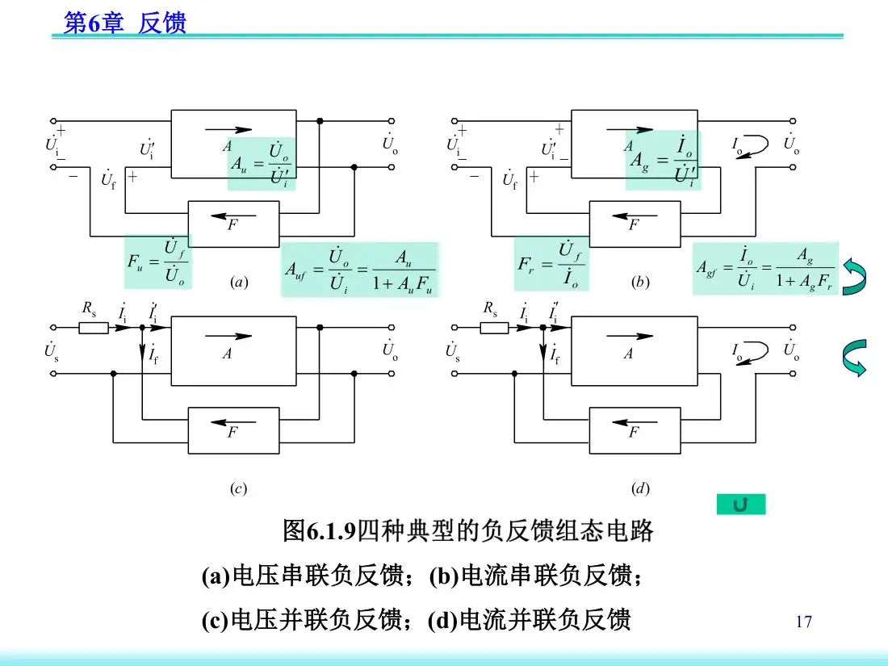

原文：

第6章 反馈

(a)电压串联负反馈；(b)电流串联负反馈；

(c)电压并联负反馈；(d)电流并联负反馈

17

### 第6章 反馈

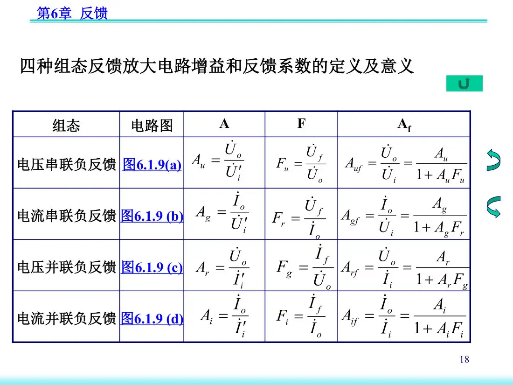

原文：

第6章 反馈

四种组态反馈放大电路增益和反馈系数的定义及意义

<table><tr><td>组态</td><td>电路图</td><td>A</td><td>F</td><td> $A_f$ </td></tr><tr><td>电压串联负反馈</td><td>图6.1.9(a)</td><td> $A_u = \frac{\dot{U}_o}{\dot{U}_i'}$ </td><td> $F_u = \frac{\dot{U}_f}{\dot{U}_o}$ </td><td> $A_{uf} = \frac{\dot{U}_o}{\dot{U}_i} = \frac{A_u}{1 + A_u F_u}$ </td></tr><tr><td>电流串联负反馈</td><td>图6.1.9(b)</td><td> $A_g = \frac{\dot{I}_o}{\dot{U}_i'}$ </td><td> $F_r = \frac{\dot{U}_f}{\dot{I}_o}$ </td><td> $A_{gf} = \frac{\dot{I}_o}{\dot{U}_i} = \frac{A_g}{1 + A_g F_r}$ </td></tr><tr><td>电压并联负反馈</td><td>图6.1.9(c)</td><td> $A_r = \frac{\dot{U}_o}{\dot{I}_i'}$ </td><td> $F_g = \frac{\dot{I}_f}{\dot{U}_o}$ </td><td> $A_{rf} = \frac{\dot{U}_o}{\dot{I}_i} = \frac{A_r}{1 + A_r F_g}$ </td></tr><tr><td>电流并联负反馈</td><td>图6.1.9(d)</td><td> $A_i = \frac{\dot{I}_o}{\dot{I}_i'}$ </td><td> $F_i = \frac{\dot{I}_f}{\dot{I}_o}$ </td><td> $A_{if} = \frac{\dot{I}_o}{\dot{I}_i} = \frac{A_i}{1 + A_i F_i}$ </td></tr></table>

18

### 四、负反馈放大电路举例

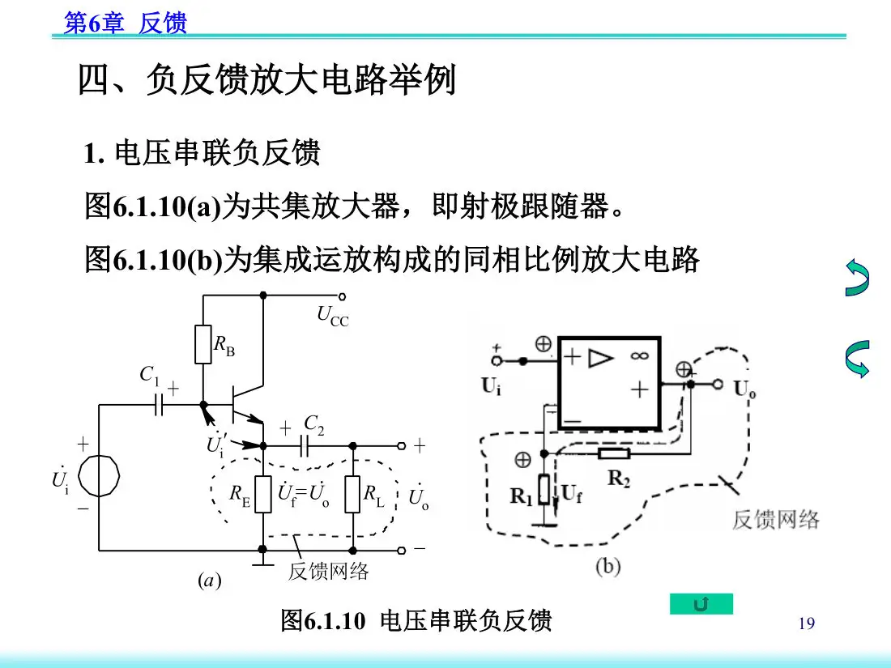

原文：

四、负反馈放大电路举例

1. 电压串联负反馈

图6.1.10(a)为共集放大器，即射极跟随器。

图6.1.10(b)为集成运放构成的同相比例放大电路

第6章 反馈

19

### 第6章 反馈

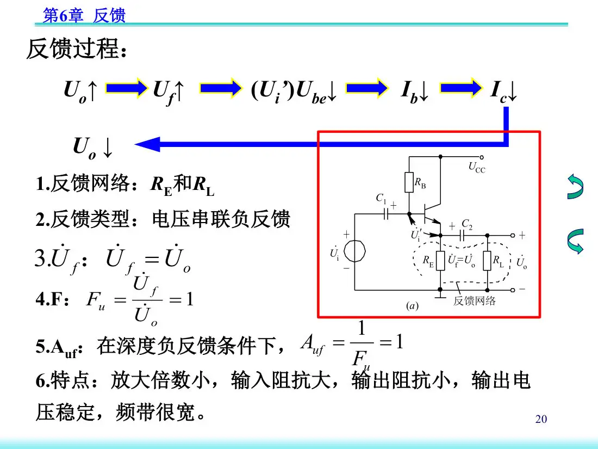

原文：

第6章 反馈

反馈过程:

1. 反馈网络： $R_{E}$ 和 $R_{L}$

2. 反馈类型：电压串联负反馈

3. $\dot{U}_{f}$ : $\dot{U}_{f_{\dot{u}}} = \dot{U}_{o}$

4.F: $F_{u} = \frac{U_{f}}{\dot{U}_{o}} = 1$

5. $A_{uf}$ : 在深度负反馈条件下， $A_{uf}=\frac{1}{F_{u}}=1$

6. 特点: 放大倍数小, 输入阻抗大, 输出阻抗小, 输出电压稳定, 频带很宽。

20

### 图6.1.10(b)电路是由运算放大器组成的负反馈电路。

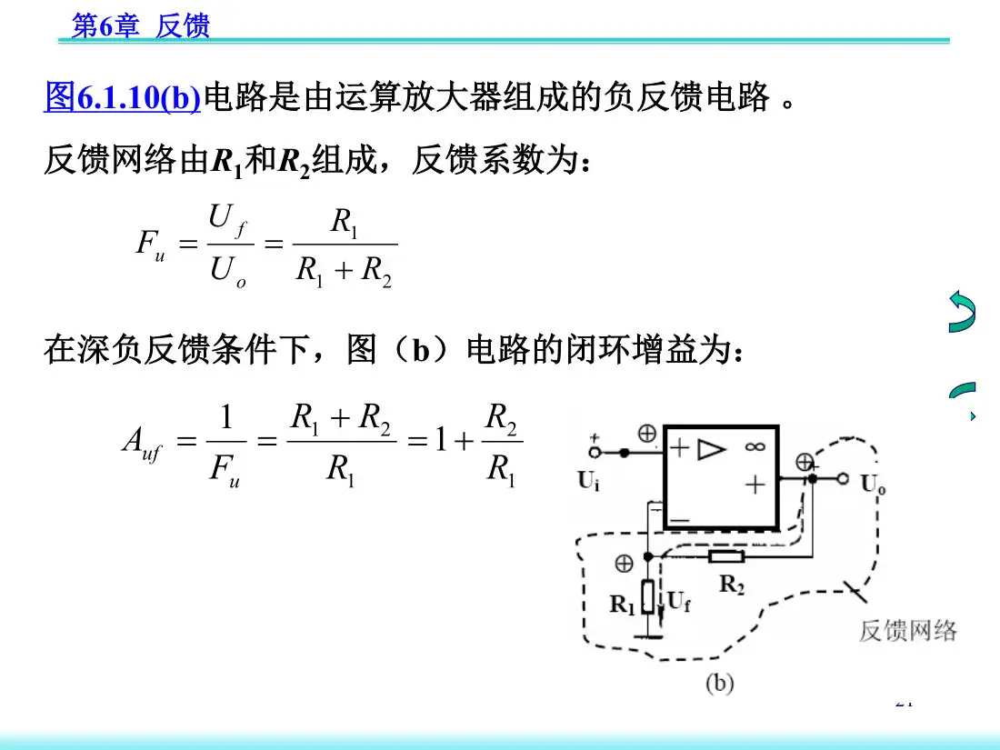

原文：

图6.1.10(b)电路是由运算放大器组成的负反馈电路。

反馈网络由 $R_{1}$ 和 $R_{2}$ 组成，反馈系数为：

$$
F _ {u} = \frac {U _ {f}}{U _ {o}} = \frac {R _ {1}}{R _ {1} + R _ {2}}
$$

在深负反馈条件下，图（b）电路的闭环增益为：

$$
A _ {u f} = \frac {1}{F _ {u}} = \frac {R _ {1} + R _ {2}}{R _ {1}} = 1 + \frac {R _ {2}}{R _ {1}}
$$

第6章 反馈

∠1

### 2.电流串联负反馈

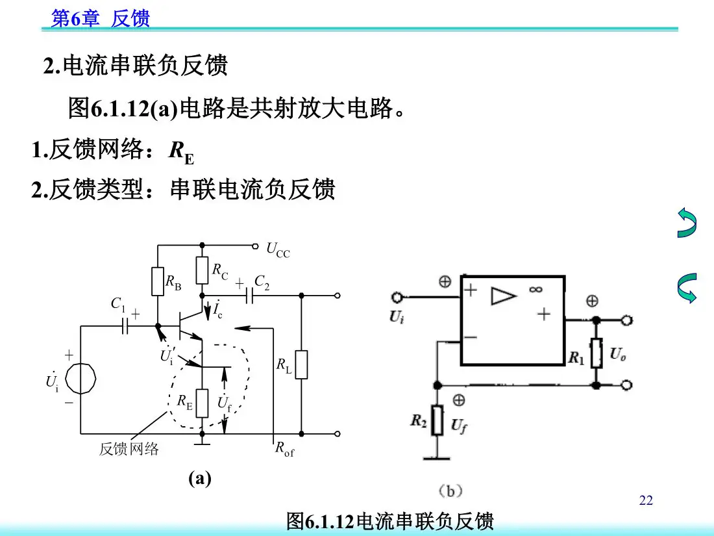

原文：

2.电流串联负反馈

图6.1.12(a)电路是共射放大电路。

1. 反馈网络: $R_{\mathrm{E}}$

2. 反馈类型：串联电流负反馈

第6章 反馈

图6.1.12电流串联负反馈

22

### $$

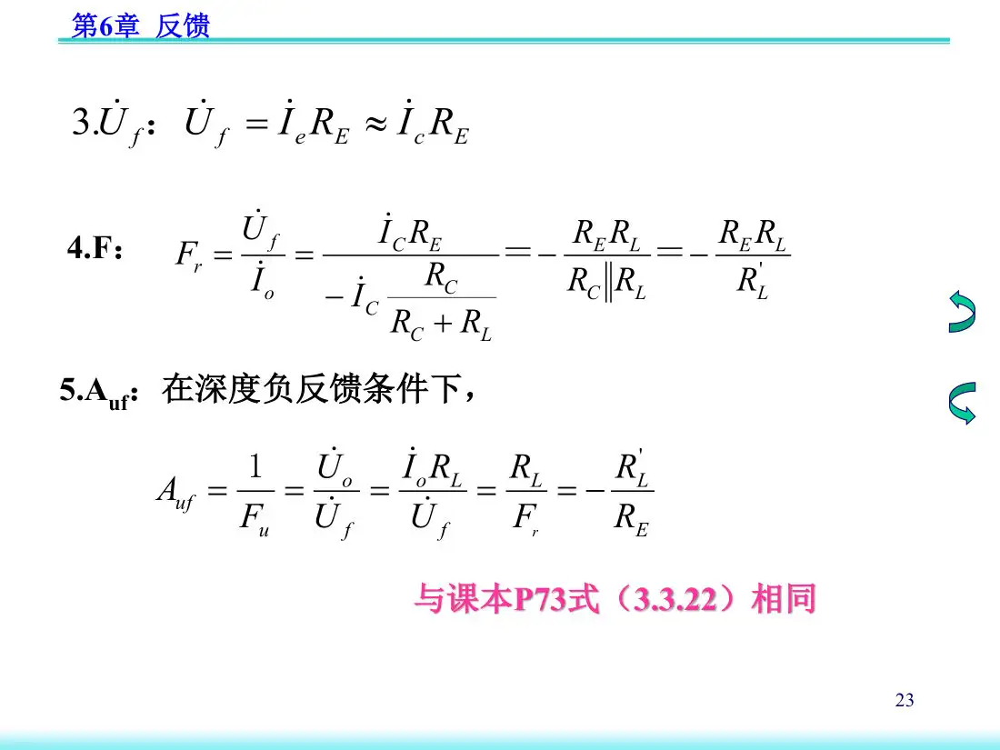

原文：

$$
3. \dot {U} _ {f}: \dot {U} _ {f} = \dot {I} _ {e} R _ {E} \approx \dot {I} _ {c} R _ {E}
$$

4.F:

$$
F _ {r} = \frac {\dot {U} _ {f}}{\dot {I} _ {o}} = \frac {\dot {I} _ {C} R _ {E}}{- \dot {I} _ {C} \frac {R _ {C}}{R _ {C} + R _ {L}}} = - \frac {R _ {E} R _ {L}}{R _ {C} \| R _ {L}} = - \frac {R _ {E} R _ {L}}{R _ {L} ^ {\prime}}
$$

5. $A_{uf}$ : 在深度负反馈条件下,

$$
A _ {u f} = \frac {1}{F _ {u}} = \frac {\dot {U} _ {o}}{\dot {U} _ {f}} = \frac {\dot {I} _ {o} R _ {L}}{\dot {U} _ {f}} = \frac {R _ {L}}{F _ {r}} = - \frac {R _ {L} ^ {\prime}}{R _ {E}}
$$

与课本P73式（3.3.22）相同

第6章 反馈

23

### 图（b）电路也是电流串联负反馈。反馈系数为

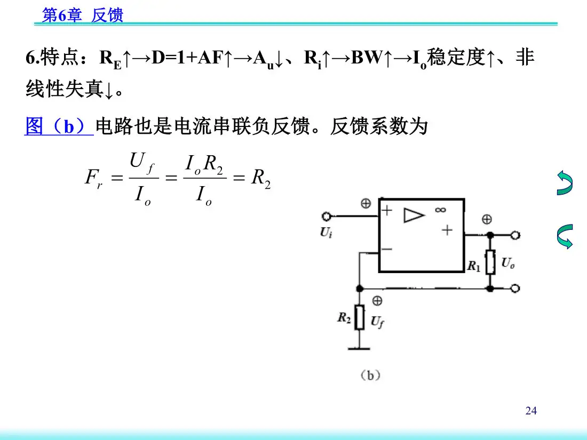

原文：

6. 特点: $\mathbf{R}_{\mathrm{E}} \uparrow \rightarrow \mathbf{D} = 1 + \mathbf{A} \mathbf{F} \uparrow \rightarrow \mathbf{A}_{\mathrm{u}} \downarrow$ 、 $\mathbf{R}_{\mathrm{i}} \uparrow \rightarrow \mathbf{B} \mathbf{W} \uparrow \rightarrow \mathbf{I}_{\mathrm{o}}$ 稳定度↑、非线性失真↓。

图（b）电路也是电流串联负反馈。反馈系数为

$$
F _ {r} = \frac {U _ {f}}{I _ {o}} = \frac {I _ {o} R _ {2}}{I _ {o}} = R _ {2}
$$

第6章 反馈

24

### 3.电压并联负反馈

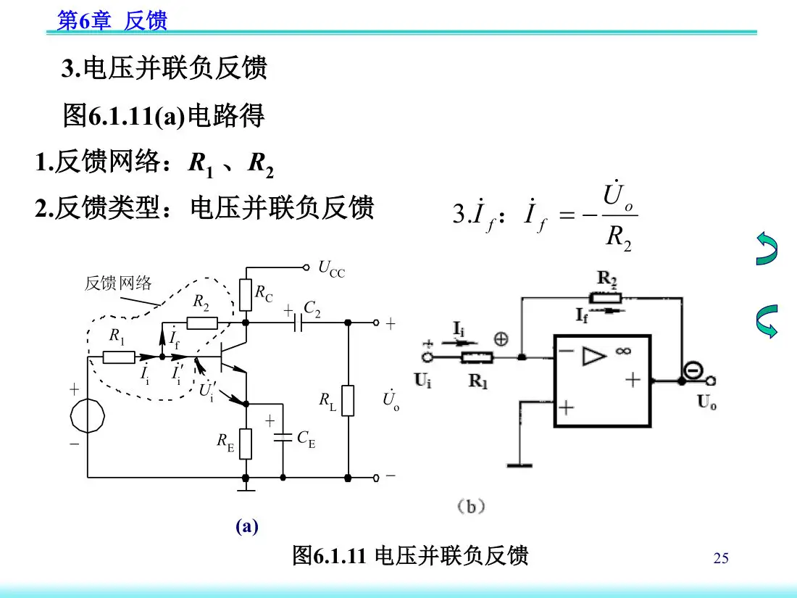

原文：

3.电压并联负反馈

图6.1.11(a)电路得

1. 反馈网络： $R_{1}$ 、 $R_{2}$

2. 反馈类型：电压并联负反馈

$$
3. \dot {I} _ {f}: \dot {I} _ {f} = - \frac {\dot {U} _ {o}}{R _ {2}}
$$

第6章 反馈

25

### 第6章 反馈

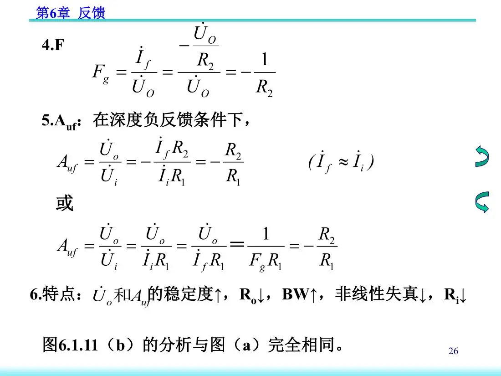

原文：

第6章 反馈

4.F

$$
F _ {g} = \frac {\dot {I} _ {f}}{\dot {U} _ {o}} = \frac {- \frac {\dot {U} _ {o}}{R _ {2}}}{\dot {U} _ {o}} = - \frac {1}{R _ {2}}
$$

5. $A_{uf}$ ：在深度负反馈条件下，

$$
A _ {u f} = \frac {\dot {U} _ {o}}{\dot {U} _ {i}} = - \frac {\dot {I} _ {f} R _ {2}}{\dot {I} _ {i} R _ {1}} = - \frac {R _ {2}}{R _ {1}} \qquad (\dot {I} _ {f} \approx \dot {I} _ {i})
$$

或

$$
A _ {u f} = \frac {\dot {U} _ {o}}{\dot {U} _ {i}} = \frac {\dot {U} _ {o}}{\dot {I} _ {i} R _ {1}} = \frac {\dot {U} _ {o}}{\dot {I} _ {f} R _ {1}} = \frac {1}{F _ {g} R _ {1}} = - \frac {R _ {2}}{R _ {1}}
$$

6. 特点: $\dot{U}_{o}$ 和 $A_{uf}$ 的稳定度↑, $\mathbf{R}_{\mathbf{o}} \downarrow$ , $\mathbf{BW} \uparrow$ , 非线性失真↓, $\mathbf{R}_{\mathbf{i}} \downarrow$

图6.1.11（b）的分析与图（a）完全相同。

26

### 4.电流并联负反馈

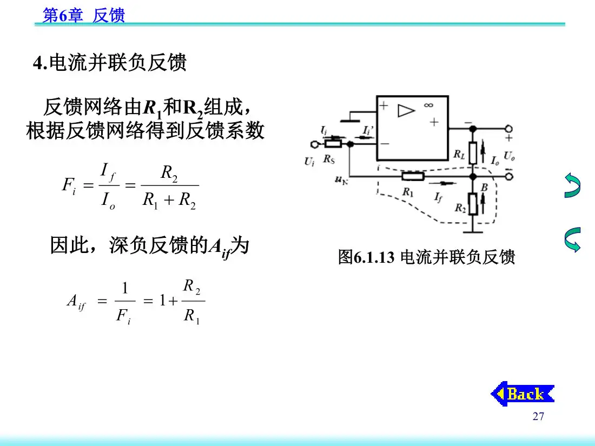

原文：

4.电流并联负反馈

反馈网络由 $R_{1}$ 和 $R_{2}$ 组成，根据反馈网络得到反馈系数

$$
F _ {i} = \frac {I _ {f}}{I _ {o}} = \frac {R _ {2}}{R _ {1} + R _ {2}}
$$

因此，深负反馈的 $A_{if}$ 为

$$
A _ {i f} = \frac {1}{F _ {i}} = 1 + \frac {R _ {2}}{R _ {1}}
$$

第6章 反馈

Back

27

### 6.2 负反馈对放大电路性能的影响

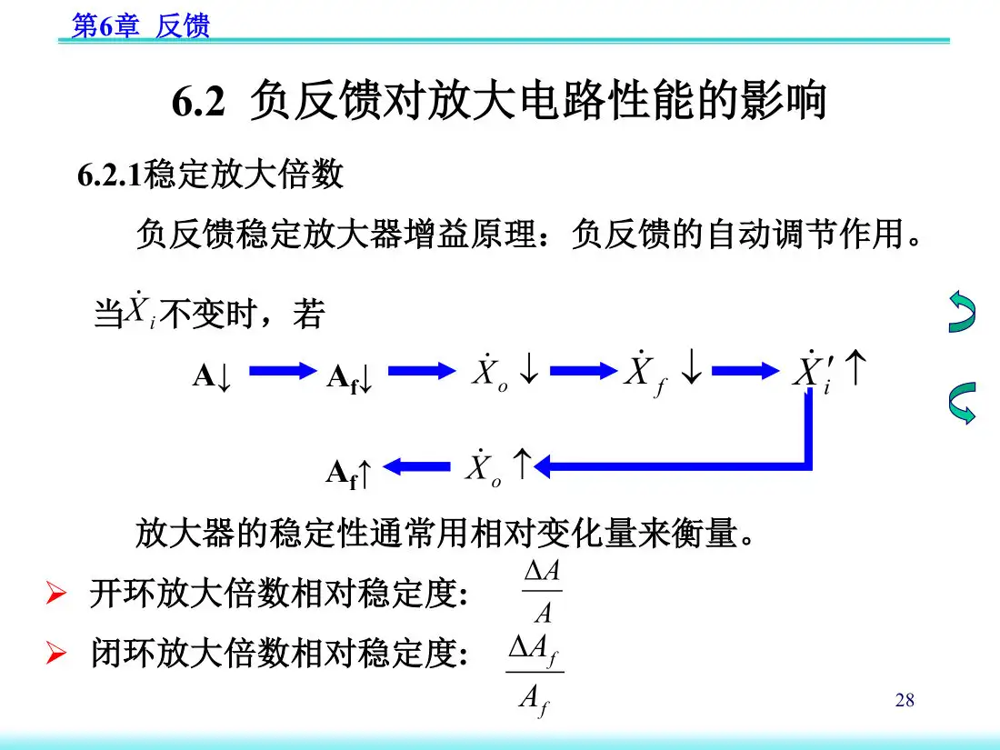

原文：

6.2 负反馈对放大电路性能的影响

6.2.1 稳定放大倍数

负反馈稳定放大器增益原理：负反馈的自动调节作用。

$$
\dot {X} _ {i}
$$

$$
\begin{array}{l} \mathbf {A} \downarrow \longrightarrow \mathbf {A _ {f}} \downarrow \longrightarrow \dot {\mathbf {X}} _ {o} \downarrow \longrightarrow \dot {\mathbf {X}} _ {f} \downarrow \longrightarrow \dot {\mathbf {X}} _ {i} ^ {\prime} \uparrow \\ \mathbf {A _ {f}} \uparrow \leftarrow \dot {\mathbf {X}} _ {o} \uparrow \end{array}
$$

放大器的稳定性通常用相对变化量来衡量。

开环放大倍数相对稳定度: $\frac{\Delta A}{A}$

闭环放大倍数相对稳定度: $\frac{\Delta A_{f}}{A_{f}}$

第6章 反馈

28

### $$

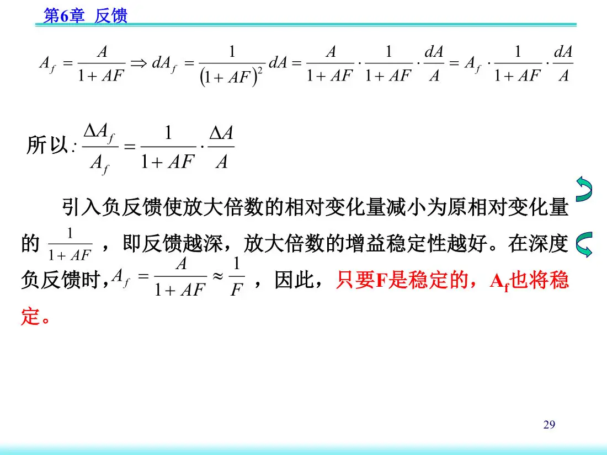

原文：

$$
A _ {f} = \frac {A}{1 + A F} \Rightarrow d A _ {f} = \frac {1}{(1 + A F) ^ {2}} d A = \frac {A}{1 + A F} \cdot \frac {1}{1 + A F} \cdot \frac {d A}{A} = A _ {f} \cdot \frac {1}{1 + A F} \cdot \frac {d A}{A}
$$

所以： $\frac{\Delta A_f}{A_f} = \frac{1}{1 + AF}\cdot \frac{\Delta A}{A}$

引入负反馈使放大倍数的相对变化量减小为原相对变化量的 $\frac{1}{1+AF}$ ，即反馈越深，放大倍数的增益稳定性越好。在深度负反馈时， $A_{f}=\frac{A}{1+AF}\approx\frac{1}{F}$ ，因此，只要F是稳定的， $A_{f}$ 也将稳定。

第6章 反馈

29

### 第6章 反馈

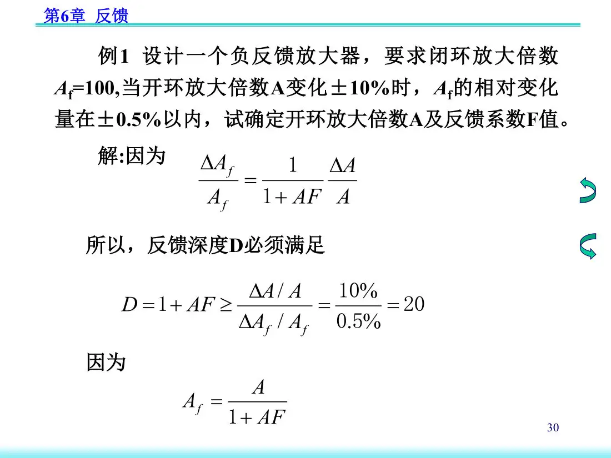

原文：

第6章 反馈

例1 设计一个负反馈放大器，要求闭环放大倍数 $A_{f}=100$ ，当开环放大倍数A变化±10%时， $A_{f}$ 的相对变化量在±0.5%以内，试确定开环放大倍数A及反馈系数F值。

解:因为

$$
\frac {\Delta A _ {f}}{A _ {f}} = \frac {1}{1 + A F} \frac {\Delta A}{A}
$$

所以，反馈深度D必须满足

$$
D = 1 + A F \geq \frac {\Delta A / A}{\Delta A _ {f} / A _ {f}} = \frac {10\%}{0.5\%} = 20
$$

因为

$$
A _ {f} = \frac {A}{1 + A F}
$$

30

### $$

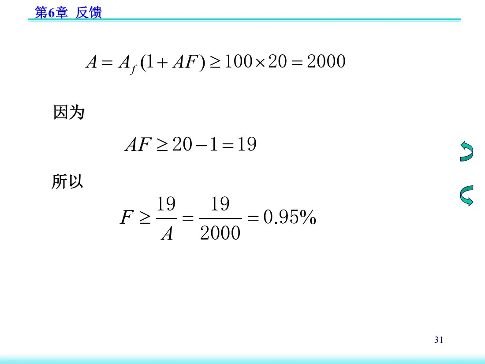

原文：

$$
A = A _ {f} (1 + A F) \geq 1 0 0 \times 2 0 = 2 0 0 0
$$

因为

$$
A F \geq 2 0 - 1 = 1 9
$$

所以

$$
F \geq \frac {1 9}{A} = \frac {1 9}{2 0 0 0} = 0.95\%
$$

第6章 反馈

31

### 6.2.2展宽通频带

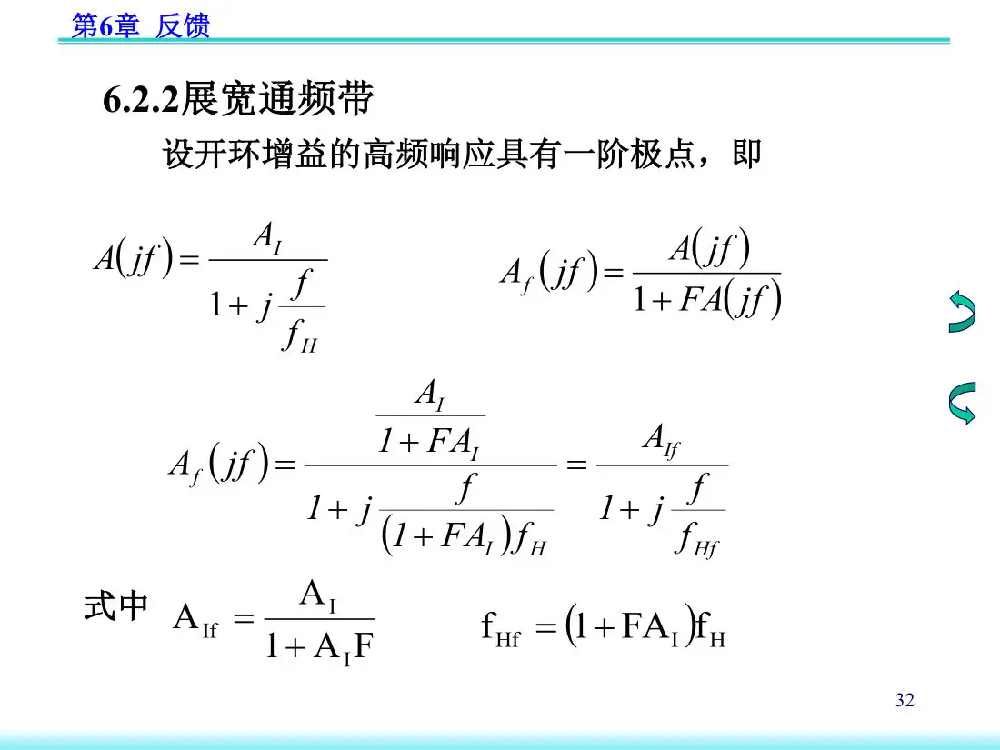

原文：

6.2.2展宽通频带

设开环增益的高频响应具有一阶极点，即

$$
A (j f) = \frac {A _ {I}}{1 + j \frac {f}{f _ {H}}} \quad A _ {f} (j f) = \frac {A (j f)}{1 + F A (j f)}
$$

$$
A _ {f} (j f) = \frac {\frac {A _ {I}}{1 + F A _ {I}}}{1 + j \frac {f}{(1 + F A _ {I}) f _ {H}}} = \frac {A _ {I f}}{1 + j \frac {f}{f _ {H f}}}
$$

式中

$$
\mathbf {A} _ {\mathrm{If}} = \frac {\mathbf {A} _ {\mathrm{I}}}{1 + \mathbf {A} _ {\mathrm{I}} \mathbf {F}} \quad \mathbf {f} _ {\mathrm{Hf}} = (1 + \mathbf {F A} _ {\mathrm{I}}) \mathbf {f} _ {\mathrm{H}}
$$

第6章 反馈

32

### 第6章 反馈

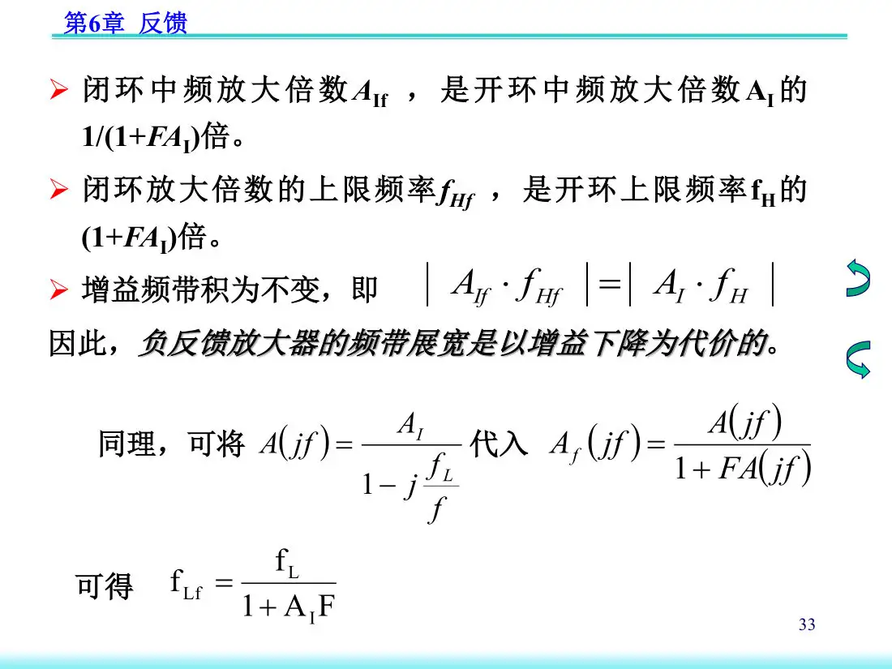

原文：

第6章 反馈

闭环中频放大倍数 $A_{If}$ ，是开环中频放大倍数 $A_{I}$ 的 $1/(1+FA_{I})$ 倍。

闭环放大倍数的上限频率 $f_{Hf}$ ，是开环上限频率 $f_{H}$ 的 $(1+FA_{I})$ 倍。

> 增益频带积为不变，即 $\left|A_{If} \cdot f_{Hf}\right| = \left|A_I \cdot f_H\right|$ 因此，负反馈放大器的频带展宽是以增益下降为代价的。

同理，可将 $A(jf)=\frac{A_{I}}{1-j\frac{f_{L}}{f}}$ 代入 $A_{f}(jf)=\frac{A(jf)}{1+FA(jf)}$ 可得 $f_{Lf}=\frac{f_{L}}{1+A_{I}F}$

### 第6章 反馈

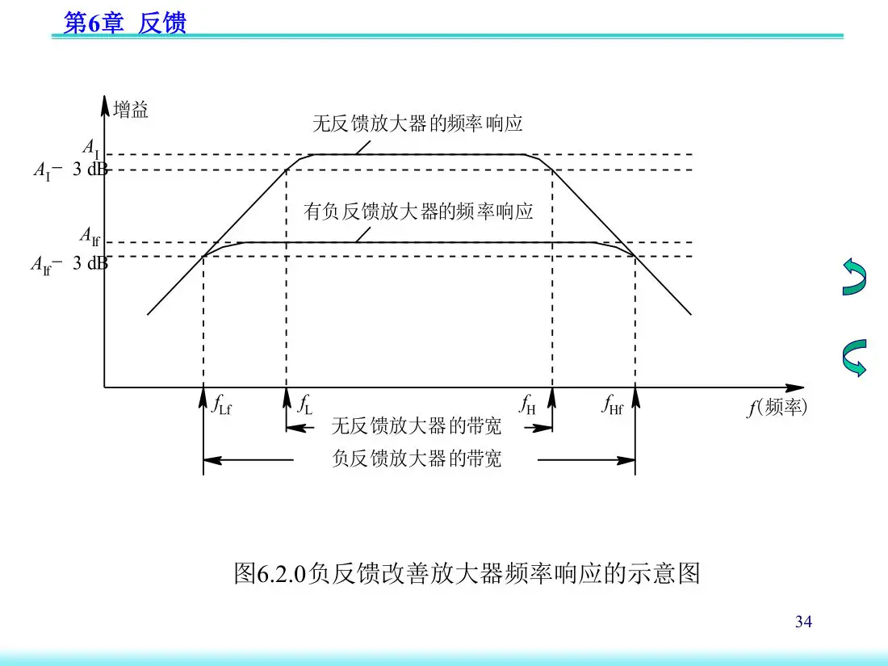

原文：

第6章 反馈

34

### 第6章 反馈

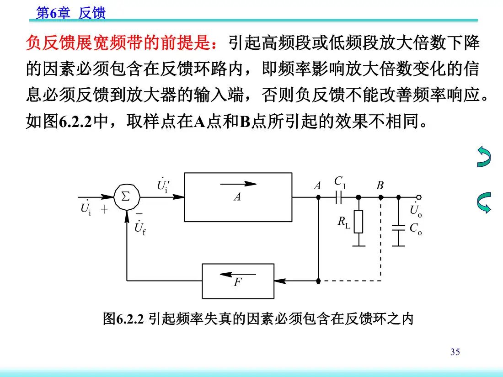

原文：

第6章 反馈

负反馈展宽频带的前提是：引起高频段或低频段放大倍数下降的因素必须包含在反馈环路内，即频率影响放大倍数变化的信息必须反馈到放大器的输入端，否则负反馈不能改善频率响应。如图6.2.2中，取样点在A点和B点所引起的效果不相同。

35

### 6.2.3减小非线性失真

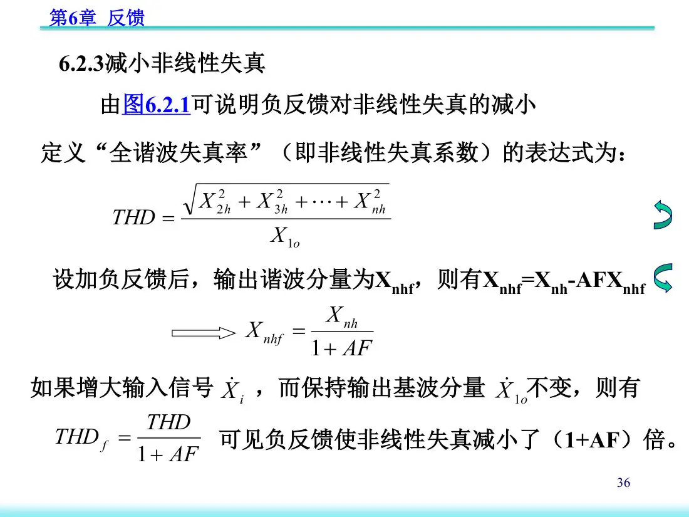

原文：

6.2.3减小非线性失真

由图6.2.1可说明负反馈对非线性失真的减小定义“全谐波失真率”（即非线性失真系数）的表达式为：

$$
T H D = \frac {\sqrt {X _ {2 h} ^ {2} + X _ {3 h} ^ {2} + \cdots + X _ {n h} ^ {2}}}{X _ {1 o}}
$$

设加负反馈后，输出谐波分量为 $X_{nhf}$ ，则有 $X_{nhf}=X_{nh}-AFX_{nhf}$

$$
\Longrightarrow X _ {n h f} = \frac {X _ {n h}}{1 + A F}
$$

如果增大输入信号 $\dot{X}_i$ ，而保持输出基波分量 $\dot{X}_{1o}$ 不变，则有 $THD_f = \frac{THD}{1 + AF}$ 可见负反馈使非线性失真减小了（1+AF）倍。

第6章 反馈

36

### 第6章 反馈

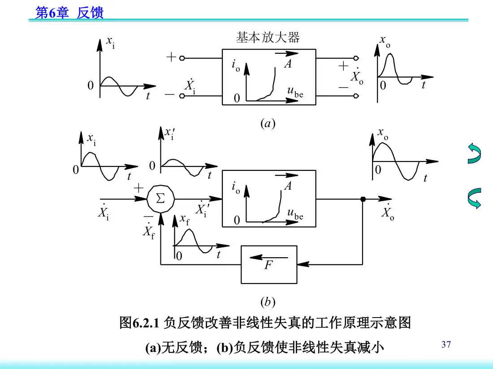

原文：

第6章 反馈

37

### 6-2-4 减小反馈环内的干扰和噪声

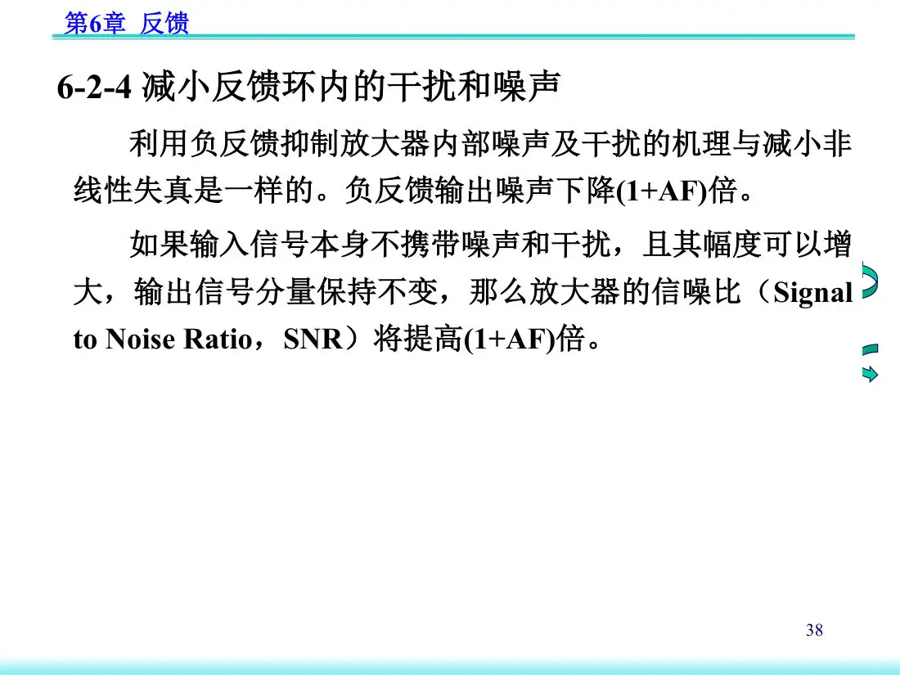

原文：

6-2-4 减小反馈环内的干扰和噪声

利用负反馈抑制放大器内部噪声及干扰的机理与减小非线性失真是一样的。负反馈输出噪声下降(1+AF)倍。

如果输入信号本身不携带噪声和干扰，且其幅度可以增大，输出信号分量保持不变，那么放大器的信噪比（Signal to Noise Ratio，SNR）将提高(1+AF)倍。

第6章 反馈

38

### 6.2.5 改变输入电阻和输出电阻

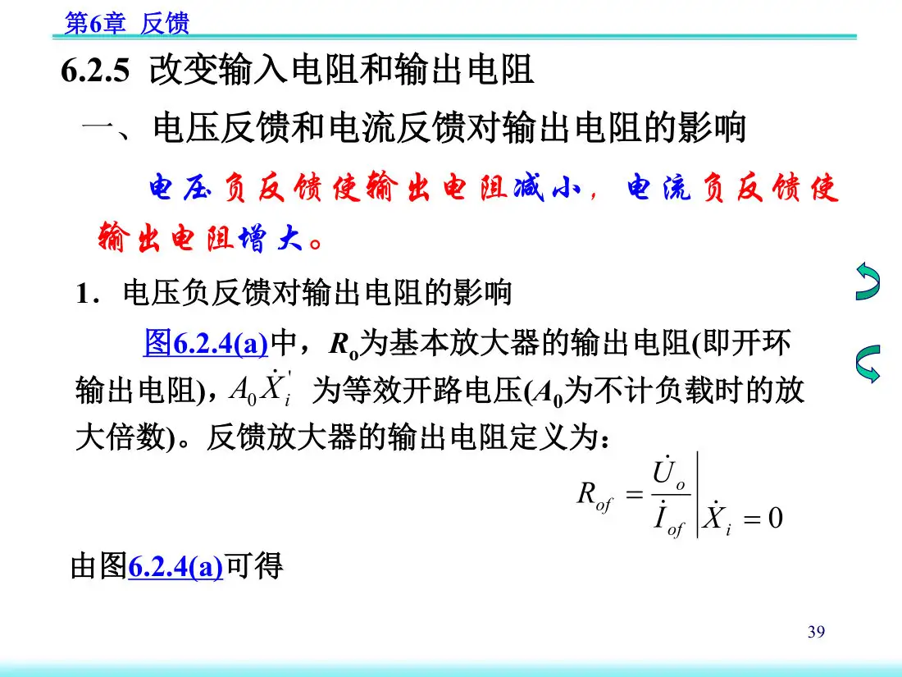

原文：

6.2.5 改变输入电阻和输出电阻

一、电压反馈和电流反馈对输出电阻的影响

电压负反馈使输出电阻减小，电流负反馈使输出电阻增大。

1. 电压负反馈对输出电阻的影响

图6.2.4(a)中， $R_{0}$ 为基本放大器的输出电阻(即开环输出电阻)， $A_{0}\dot{X}_{i}^{\prime}$ 为等效开路电压( $A_{0}$ 为不计负载时的放大倍数)。反馈放大器的输出电阻定义为：

$$
R _ {o f} = \frac {\dot {U} _ {o}}{\dot {I} _ {o f}} \bigg | _ {\dot {X} _ {i} = 0}
$$

由图6.2.4(a)可得

第6章 反馈

39

### $$

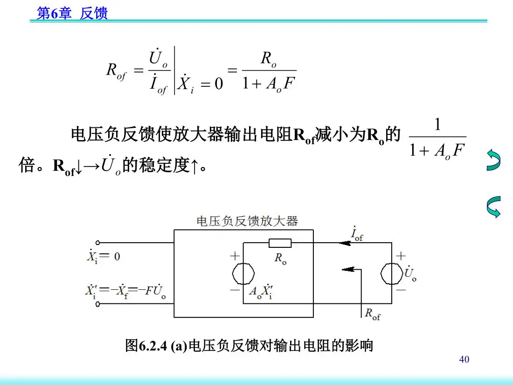

原文：

$$
R _ {o f} = \frac {\dot {U} _ {o}}{\dot {I} _ {o f}} \bigg | _ {\dot {X} _ {i} = 0} = \frac {R _ {o}}{1 + A _ {o} F}
$$

电压负反馈使放大器输出电阻 $R_{of}$ 减小为 $R_{o}$ 的倍。 $R_{of}\downarrow\rightarrow\dot{U}_{o}$ 的稳定度↑。

第6章 反馈

40

### 第6章 反馈

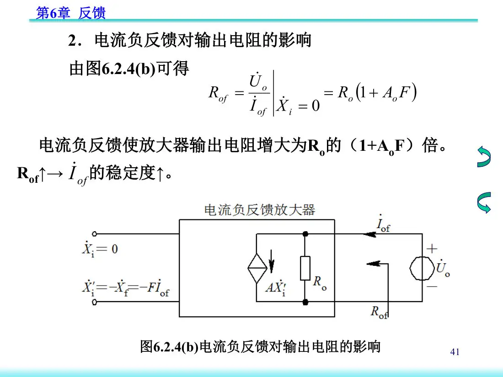

原文：

第6章 反馈

2. 电流负反馈对输出电阻的影响

由图6.2.4(b)可得

$$
R _ {o f} = \frac {\dot {U} _ {o}}{\dot {I} _ {o f}} \bigg | _ {\dot {X} _ {i} = 0} = R _ {o} (1 + A _ {o} F)
$$

电流负反馈使放大器输出电阻增大为 $R_{0}$ 的（1+ $A_{0}F$ ）倍。 $R_{of}\uparrow\rightarrow\dot{I}_{of}$ 的稳定度↑。

41

### 二、串联负反馈和并联负反馈对输入电阻的影响

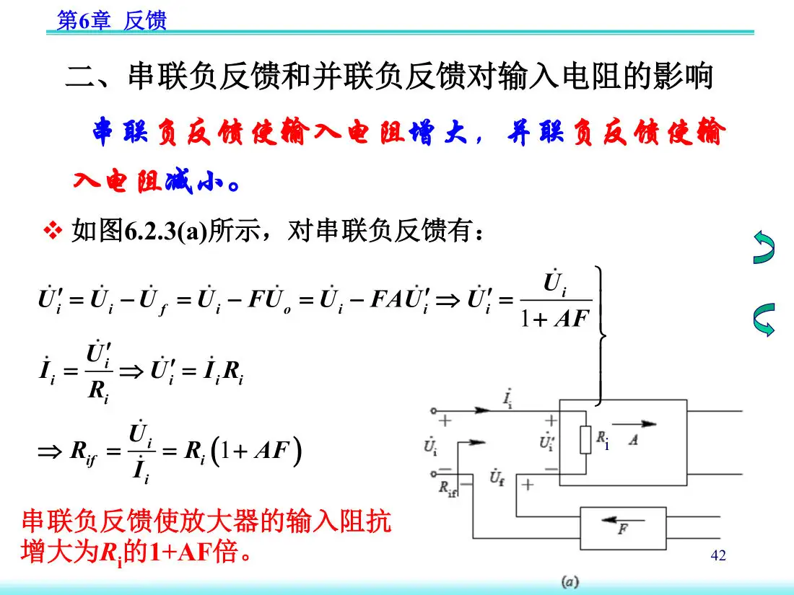

原文：

二、串联负反馈和并联负反馈对输入电阻的影响

串联负反馈使输入电阻增大，并联负反馈使输入电阻减小。

如图6.2.3(a)所示，对串联负反馈有：

$$
\dot {U} _ {i} ^ {\prime} = \dot {U} _ {i} - \dot {U} _ {f} = \dot {U} _ {i} - F \dot {U} _ {o} = \dot {U} _ {i} - F A \dot {U} _ {i} ^ {\prime} \Rightarrow \dot {U} _ {i} ^ {\prime} = \frac {\dot {U} _ {i}}{1 + A F}
$$

$$
\dot {I} _ {i} = \frac {\dot {U} _ {i} ^ {\prime}}{R _ {i}} \Rightarrow \dot {U} _ {i} ^ {\prime} = \dot {I} _ {i} R _ {i}
$$

$$
\Rightarrow R _ {i f} = \frac {\dot {U} _ {i}}{\dot {I} _ {i}} = R _ {i} (1 + A F)
$$

串联负反馈使放大器的输入阻抗增大为 $R_{i}$ 的1+AF倍。

第6章 反馈

(a)

42

### 第6章 反馈

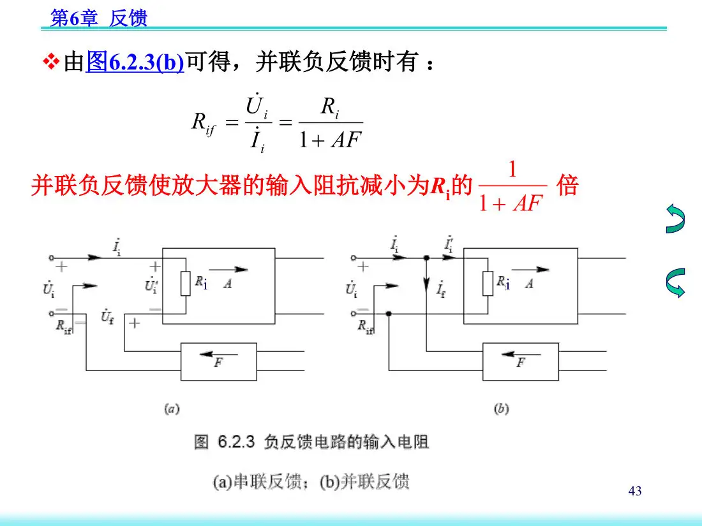

原文：

第6章 反馈

由图6.2.3(b)可得，并联负反馈时有：

$$
R _ {i f} = \frac {\dot {U} _ {i}}{\dot {I} _ {i}} = \frac {R _ {i}}{1 + A F}
$$

并联负反馈使放大器的输入阻抗减小为 $R_{i}$ 的 $\frac{1}{1+AF}$ 倍

(a)串联反馈；(b)并联反馈

43

### 第6章 反馈

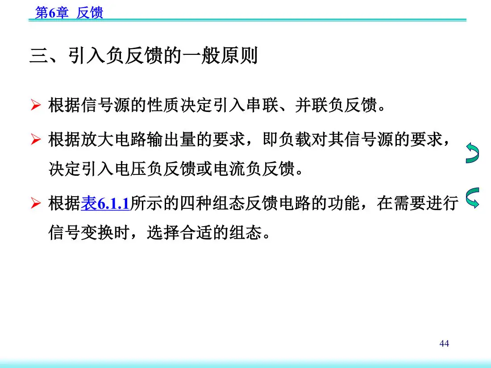

原文：

第6章 反馈

三、引入负反馈的一般原则

根据信号源的性质决定引入串联、并联负反馈。

根据放大电路输出量的要求，即负载对其信号源的要求，决定引入电压负反馈或电流负反馈。

根据表6.1.1所示的四种组态反馈电路的功能，在需要进行信号变换时，选择合适的组态。

44

### 基本放大器引入负反馈的原则

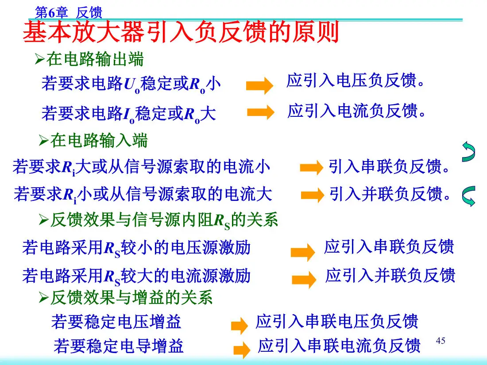

原文：

基本放大器引入负反馈的原则

在电路输出端

若要求电路 $U_{0}$ 稳定或 $R_{0}$ 小

若要求电路 $I_{0}$ 稳定或 $R_{0}$ 大

在电路输入端

若要求 $R_{i}$ 大或从信号源索取的电流小
若要求 $R_{i}$ 小或从信号源索取的电流大

➢反馈效果与信号源内阻 $R_{s}$ 的关系
若电路采用 $R_{s}$ 较小的电压源激励
若电路采用 $R_{s}$ 较大的电流源激励

反馈效果与增益的关系

若要稳定电压增益

若要稳定电导增益

应引入电压负反馈。

应引入电流负反馈。

引入串联负反馈。

引入并联负反馈。

应引入串联负反馈

应引入并联负反馈

应引入串联电压负反馈
应引入串联电流负反馈

第6章 反馈

45

### 6.3 深度负反馈放大电路的近似计算

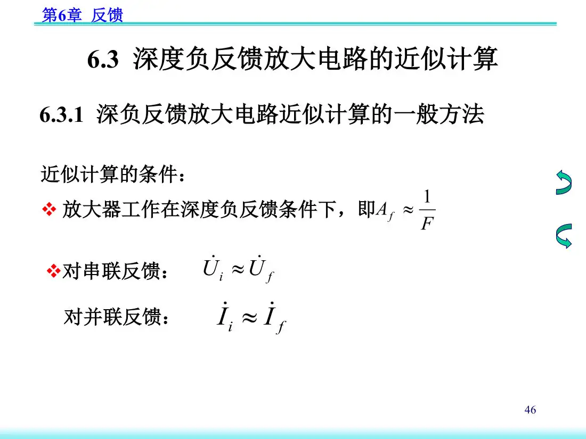

原文：

6.3 深度负反馈放大电路的近似计算

6.3.1 深负反馈放大电路近似计算的一般方法

近似计算的条件:

放大器工作在深度负反馈条件下，即 $A_{f}\approx\frac{1}{F}$

对串联反馈： $\dot{U}_i\approx \dot{U}_f$

对并联反馈： $\dot{I}_{i}\approx\dot{I}_{f}$

第6章 反馈

46

### 6.3.2 深负反馈放大电路的近似计算

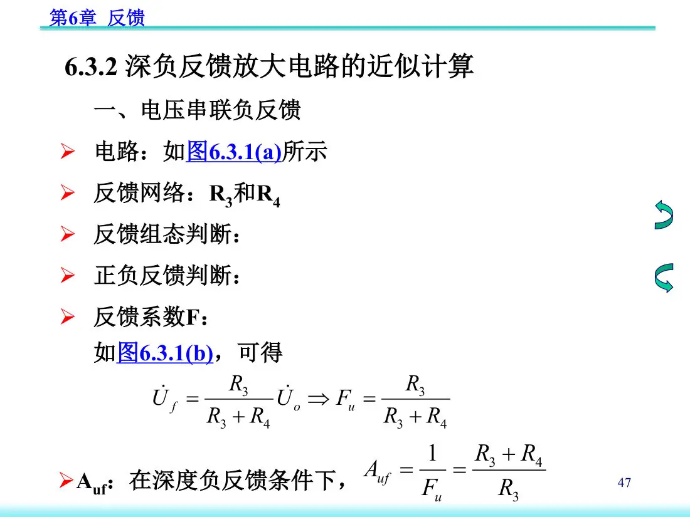

原文：

6.3.2 深负反馈放大电路的近似计算

一、电压串联负反馈

电路：如图6.3.1(a)所示

反馈网络： $R_{3}$ 和 $R_{4}$

反馈组态判断:

正负反馈判断:

反馈系数F:

如图6.3.1(b)，可得

$$
\dot {U} _ {f} = \frac {R _ {3}}{R _ {3} + R _ {4}} \dot {U} _ {o} \Rightarrow F _ {u} = \frac {R _ {3}}{R _ {3} + R _ {4}}
$$

$\mathbf{A}_{\mathrm{uf}}$ ：在深度负反馈条件下， $A_{uf} = \frac{1}{F_u} = \frac{R_3 + R_4}{R_3}$

第6章 反馈

47

### $$

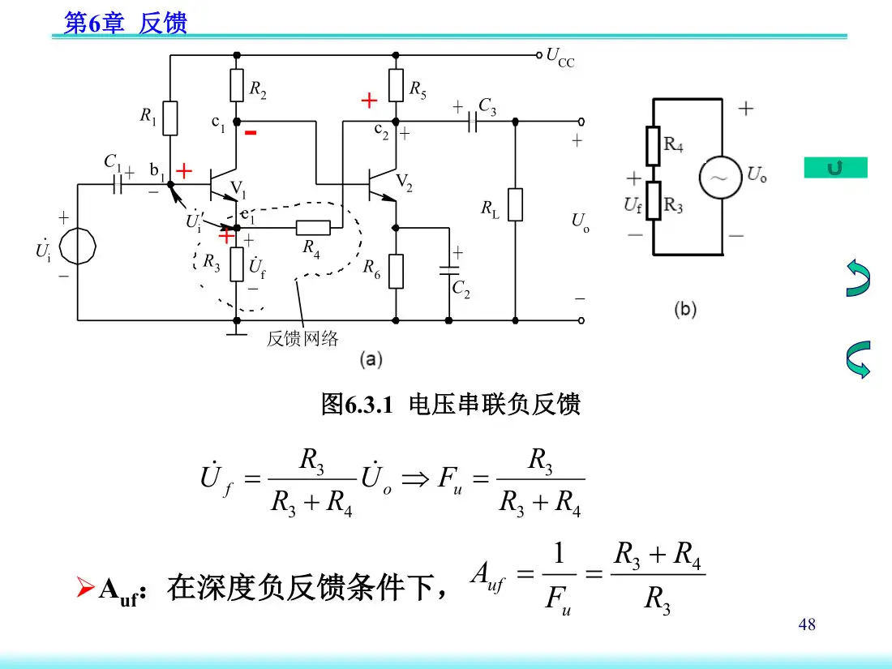

原文：

$$
\dot {U} _ {f} = \frac {R _ {3}}{R _ {3} + R _ {4}} \dot {U} _ {o} \Rightarrow F _ {u} = \frac {R _ {3}}{R _ {3} + R _ {4}}
$$

$\mathbf{A}_{\mathrm{uf}}$ ：在深度负反馈条件下， $A_{uf} = \frac{1}{F_u} = \frac{R_3 + R_4}{R_3}$

第6章 反馈

48

### (a)电压串联负反馈

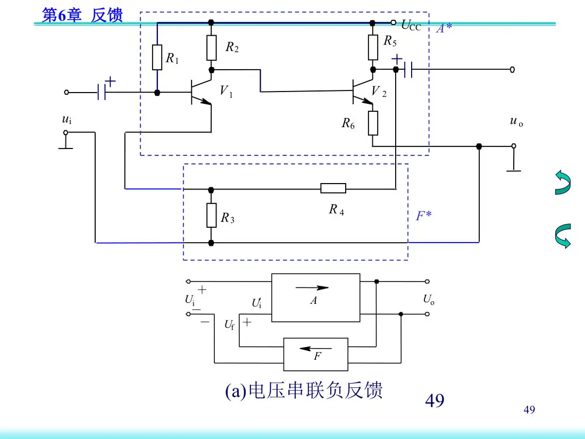

原文：

(a)电压串联负反馈

49

### 第6章 反馈

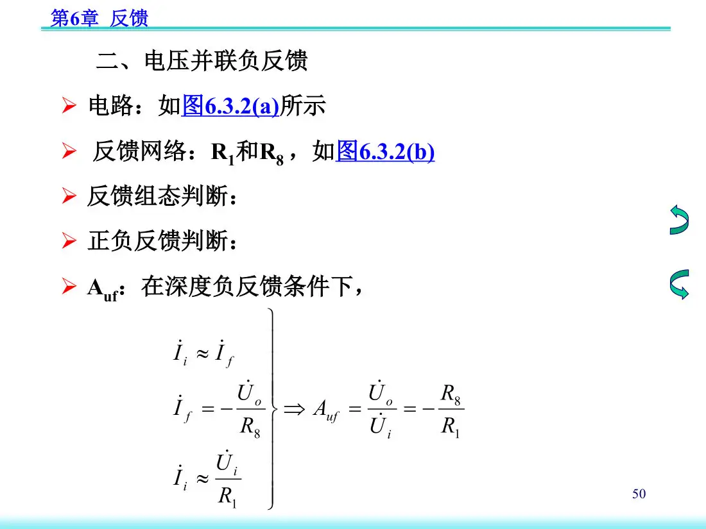

原文：

第6章 反馈

二、电压并联负反馈

电路：如图6.3.2(a)所示

反馈网络： $\mathbf{R}_1$ 和 $\mathbf{R}_8$ ，如图6.3.2(b)

反馈组态判断:

正负反馈判断:

$A_{uf}$ : 在深度负反馈条件下,

$$
\left. \begin{array}{l} \dot {I} _ {i} \approx \dot {I} _ {f} \\ \dot {I} _ {f} = - \frac {\dot {U} _ {o}}{R _ {8}} \\ \dot {I} _ {i} \approx \frac {\dot {U} _ {i}}{R _ {1}} \end{array} \right\} \Rightarrow A _ {u f} = \frac {\dot {U} _ {o}}{\dot {U} _ {i}} = - \frac {R _ {8}}{R _ {1}}
$$

50

### 第6章 反馈

原文：

第6章 反馈

$$
\left. \begin{array}{l} \dot {I} _ {i} \approx \dot {I} _ {f} \\ \dot {I} _ {f} = - \frac {\dot {U} _ {o}}{R _ {8}} \\ \dot {I} _ {i} \approx \frac {\dot {U} _ {i}}{R _ {1}} \end{array} \right\} \Rightarrow A _ {u f} = \frac {\dot {U} _ {o}}{\dot {U} _ {i}} = - \frac {R _ {8}}{R _ {1}}
$$

C

51

### 三、电流串联负反馈

原文：

三、电流串联负反馈

电路：如图6.3.3(a)所示

反馈网络： $R_{3}$ 、 $R_{7}$ 和 $R_{8}$ ，如图6.3.3(b)所示

反馈组态判断:

正负反馈判断：

$A_{uf}$ ：在深度负反馈条件下，

$$
\left. \begin{array}{l} \dot {U} _ {i} \approx \dot {U} _ {f} \\ \dot {U} _ {f} = \frac {R _ {7}}{R _ {3} + R _ {7} + R _ {8}} \dot {I} _ {e 3} R _ {3} \\ \dot {U} _ {o} = - \dot {I} _ {c 3} (R _ {6} \| R _ {L}) \approx - \dot {I} _ {e 3} R _ {L} ^ {\prime} \end{array} \right\} \Rightarrow A _ {u f} = \frac {\dot {U} _ {o}}{\dot {U} _ {i}} = - \frac {R _ {3} + R _ {7} + R _ {8}}{R _ {3} R _ {7}} R _ {L} ^ {\prime}
$$

第6章 反馈

52

### 第6章 反馈

原文：

第6章 反馈

$$
\left. \begin{array}{l} \dot {U} _ {i} \approx \dot {U} _ {f} \\ \dot {U} _ {f} = \frac {R _ {7}}{R _ {3} + R _ {7} + R _ {8}} \dot {I} _ {e 3} R _ {3} \\ \dot {U} _ {o} = - \dot {I} _ {c 3} (R _ {6} \| R _ {L}) \approx - \dot {I} _ {e 3} R _ {L} ^ {\prime} \end{array} \right\} \Rightarrow A _ {u f} = \frac {\dot {U} _ {o}}{\dot {U} _ {i}} = - \frac {R _ {3} + R _ {7} + R _ {8}}{R _ {3} R _ {7}} R _ {L} ^ {\prime}
$$

53

### 第6章 反馈

原文：

第6章 反馈

四、电流并联负反馈

电路：如图6.3.4(a)所示

反馈网络： $R_{1}$ 、 $R_{5}$ 和 $R_{6}$ ，如图6.3.4(b)所示

反馈组态判断:

正负反馈判断：

$\text{A}_{\text{uf}}$ : 在深度负反馈条件下，(其中 $R_{L}^{\prime} = R_{4} \| R_{L}$ )

$$
\left. \begin{array}{l} \dot {I} _ {i} \approx \dot {I} _ {f} \\ \dot {I} _ {f} \approx \frac {R _ {5}}{R _ {5} + R _ {6}} \dot {I} _ {e 2} \approx \frac {R _ {5}}{R _ {5} + R _ {6}} \dot {I} _ {c 2} \\ \dot {I} _ {i} = \frac {\dot {U} _ {i} - \dot {U} _ {i} ^ {\prime}}{R _ {1}} \approx \frac {\dot {U} _ {i}}{R _ {1}} \end{array} \right\} \Rightarrow A _ {u f} = \frac {\dot {U} _ {o}}{\dot {U} _ {i}} = \frac {\dot {I} _ {c 2} R _ {L} ^ {\prime}}{\dot {I} _ {i} R _ {1}} = \frac {\frac {R _ {5} + R _ {6}}{R _ {5}} \dot {I} _ {f} R _ {L} ^ {\prime}}{\dot {I} _ {i} R _ {1}} = \frac {R _ {5} + R _ {6}}{R _ {5} R _ {1}} R _ {L} ^ {\prime}
$$

54

### (b)

原文：

(b)

第6章 反馈

$$
\left. \begin{array}{l} \dot {I} _ {i} \approx \dot {I} _ {f} \\ \dot {I} _ {f} \approx \frac {R _ {5}}{R _ {5} + R _ {6}} \dot {I} _ {e 2} \approx \frac {R _ {5}}{R _ {5} + R _ {6}} \dot {I} _ {c 2} \\ \dot {I} _ {i} = \frac {\dot {U} _ {i} - \dot {U} _ {i} ^ {\prime}}{R _ {1}} \approx \frac {\dot {U} _ {i}}{R _ {1}} \end{array} \right\} \Rightarrow A _ {u f} = \frac {\dot {U} _ {o}}{\dot {U} _ {i}} = \frac {\dot {I} _ {c 2} R _ {L} ^ {'}}{\dot {I} _ {i} R _ {1}} = \frac {\frac {R _ {5} + R _ {6}}{R _ {5}} \dot {I} _ {f} R _ {L} ^ {'}}{\dot {I} _ {i} R _ {1}} = \frac {R _ {5} + R _ {6}}{R _ {5} R _ {1}} R _ {L} ^ {'}
$$

55

### 第6章 反馈

原文：

第6章 反馈

三、反馈放大器例题分析

例2电路如例2图所示。这是一个两级放大器，第一级为场效应管差分放大器，第二级为运放构成的反相比例放大器。

(1)为进一步提高输出电压稳定度，试正确引入反馈。

(2)计算开环放大倍数 $A_{u}=U_{o}/U_{i}$

(3)计算引入反馈后的闭环放大倍数 $A_{uf}=$ ?

(4)若一定要求引入并联电压负反馈，电路应如何改接？

56

### 第6章 反馈

原文：

第6章 反馈

解: (1) 提高输出电压稳定度, 引入电压负反馈, 如例2图虚线所示。两种方法: a) 将反馈引至V1管栅极(开关S→b)构成并联反馈; b) 将反馈引至V2栅极(开关S→a)构成串联反馈。

瞬时极性判别法判断反馈极性：开关S接a点，构成了串联电压负反馈，而接b点则为正反馈，所以电路应将开关S接a点。57

### 第6章 反馈

原文：

第6章 反馈

(2)开环增益。若将S接c点，则没有引入反馈，此时

$$
A _ {u} = \frac {U _ {o}}{\dot {U} _ {i}} = \frac {U _ {o 1}}{\dot {U} _ {i}} \cdot \frac {U _ {o}}{\dot {U} _ {o 1}} = A _ {u 1} \cdot A _ {u 2}
$$

其中:

$$
\begin{array}{l} A _ {u 1} = \frac {U _ {o 1}}{\dot {U} _ {i}} = - \frac {1}{2} g _ {m} (R _ {2} \| R _ {3}) \quad (\text {单端输出}) \\ A _ {u 2} = - \frac {R _ {4}}{R _ {3}} \end{array}
$$

58

### (3)引入串联电压负反馈后的闭环增益 $A_{uf}$ 为

原文：

(3)引入串联电压负反馈后的闭环增益 $A_{uf}$ 为

$$
A _ {u f} = 1 + \frac {R _ {f 1}}{R _ {1}}
$$

(4)若一定要求引入并联电压负反馈，最简单的办法是将第一级输出由 $V_{1}$ 管漏极改为 $V_{2}$ 管的漏极。

第6章 反馈

59

### 6.4 反馈放大电路的稳定性

原文：

6.4 反馈放大电路的稳定性

6.4.1 负反馈放大器稳定工作的条件

负反馈放大器的基本方程:

$$
\begin{array}{r l} & {{A _ {f} (j \omega) = \frac {A (j \omega)}{1 + A (j \omega) F (j \omega)} \qquad \left(A, F \mathrm{是} \varpi \mathrm{的函数}\right)}} \\ & {{A _ {f} (j \omega) = A _ {f} = \frac {A}{1 + A F} \qquad \left(A, F \mathrm{都是常数}\right)}} \\ & {{A (j \omega) F (j \omega) = A (j \omega) F = \left| A (j \omega) F \right| / _ {-} \Delta \varphi (j \omega) _ {-} = - 1}} \end{array}
$$

第6章 反馈

60

### 第6章 反馈

原文：

第6章 反馈

若 $A(\mathbf{j}\omega)F = \left|A(\mathbf{j}\omega)F\right|\angle \varphi (\mathbf{j}\omega) = -1$

则 $A_{\mathrm{f}}(\mathrm{j}\omega) = \frac{A(\mathrm{j}\omega)}{1 + A(\mathrm{j}\omega)F} = \infty$

----产生自激振荡

61

### $A(j\omega)F$ =1 ----振荡的振幅条件

原文：

$A(j\omega)F$ =1 ----振荡的振幅条件

$\varphi (\mathbf{j}\omega) = \pm (2n + 1)\pi$ （ $n\geq 0$ 的整数）

----振荡的相位条件

第6章 反馈

62

### 第6章 反馈

原文：

第6章 反馈

6.4.2 负反馈放大电路稳定性的判断

1. 利用环路增益判断负反馈放大电路的稳定性

63

### 第6章 反馈

原文：

第6章 反馈

稳定裕度

1. 幅度裕度

当相频特性的相位为-180 $^{0}$ 时，对数幅频特性所对应的增益值。一般要小于-10dB。

2. 相位裕度

对数幅频特性过横轴（即环路增益等于1）时，相频特性偏离- $180^{0}$ 的差值。一般要大于 $45^{0}$ 。

64

### 第6章 反馈

原文：

第6章 反馈

6.4.2 利用开环增益的波特图来判别放大器的稳定性

如果反馈网络F为常数，则我们可以用开环增益A(jω)直接来判断放大器是否能稳定工作。下面以集成运算放大器为例来说明该问题。某运算放大器的开环特性A(jω)为一个三极点放大器，即

$$
\begin{array}{l} A (j \omega) = \frac {A _ {I}}{(1 + j \frac {\omega}{\omega_ {1}}) (1 + j \frac {\omega}{\omega_ {2}}) (1 + j \frac {\omega}{\omega_ {3}})} \\ = \frac {1 0 0 0 0}{(1 + j \frac {f}{1 k H z}) (1 + j \frac {f}{1 0 k H z}) (1 + j \frac {f}{1 0 0 k H z})} \end{array}\tag{6—75}
$$

65

### 若闭环增益线交于-20dB/十倍频开环增益线 稳定

原文：

若闭环增益线交于-20dB/十倍频开环增益线 稳定
若闭环增益线交于-40dB/十倍频及以下开环增益线 自激

结束

第6章 反馈

66

### 第6章 反馈

原文：

第6章 反馈

67
