# 《电路分析与电工电子技术》第7章 集成运算放大器的应用（课件）

原件的每一页，下面附识别出的文字。

### 第7章 集成运算放大器的应用

原文：

第7章 集成运算放大器的应用

### 常用运算放大器外形图

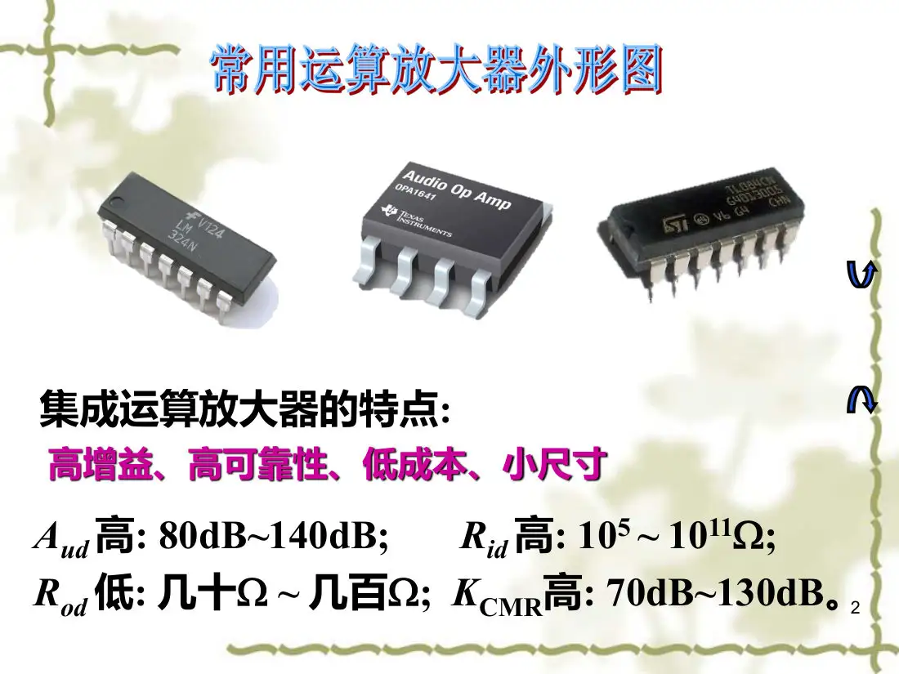

原文：

常用运算放大器外形图

集成运算放大器的特点:

高增益、高可靠性、低成本、小尺寸

$A_{ud}$ 高: 80dB\~140dB; $R_{id}$ 高: $10^{5} \sim 10^{11} \Omega$ ;

$R_{od}$ 低: 几十 $\Omega$ \~ 几百 $\Omega$ ; $K_{\mathrm{CMR}}$ 高: 70dB\~130dB。

### 回顾：理想运放特性

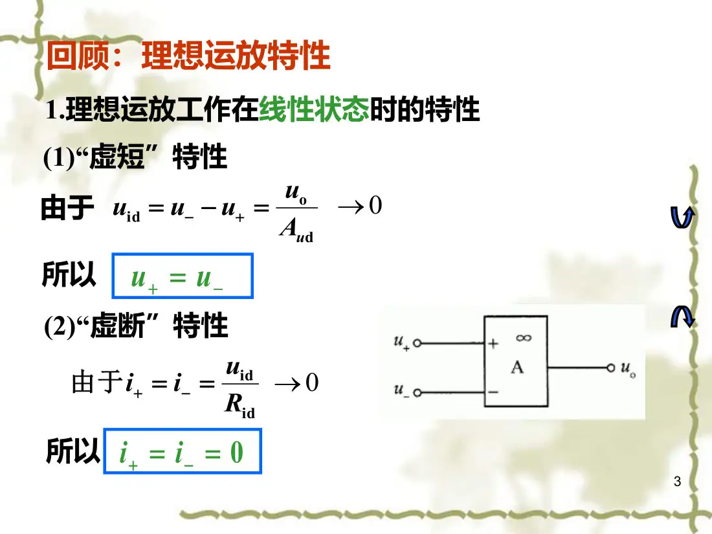

原文：

回顾：理想运放特性

1.理想运放工作在线性状态时的特性

(1)“虚短”特性

由于 $u_{\mathrm{id}} = u_{-} - u_{+} = \frac{u_0}{A_{ud}} \rightarrow 0$

所以 $u_{+} = u_{-}$

(2)“虚断”特性

由于 $i_{+}=i_{-}=\frac{u_{id}}{R_{id}}\rightarrow0$

所以 $i_{+}=i_{-}=0$

### 7.1 基本运算电路

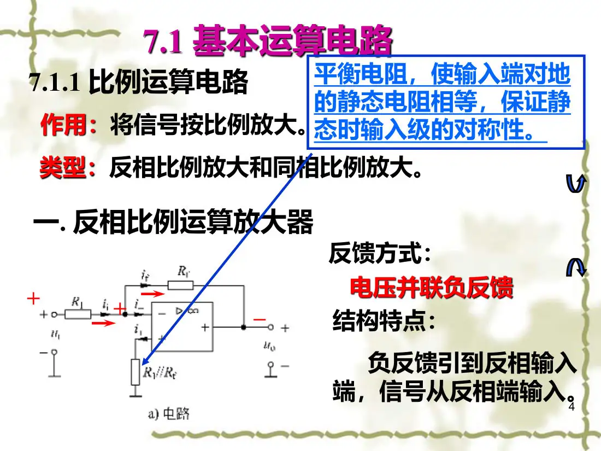

原文：

7.1 基本运算电路

7.1.1 比例运算电路

作用：将信号按比例放大。

平衡电阻，使输入端对地的静态电阻相等，保证静态时输入级的对称性。

类型：反相比例放大和同相比例放大。

一. 反相比例运算放大器

反馈方式：

电压并联负反馈
结构特点：

负反馈引到反相输入端，信号从反相端输入。

### 1. 闭环电压放大倍数 $A_{uf}$ 虚地点

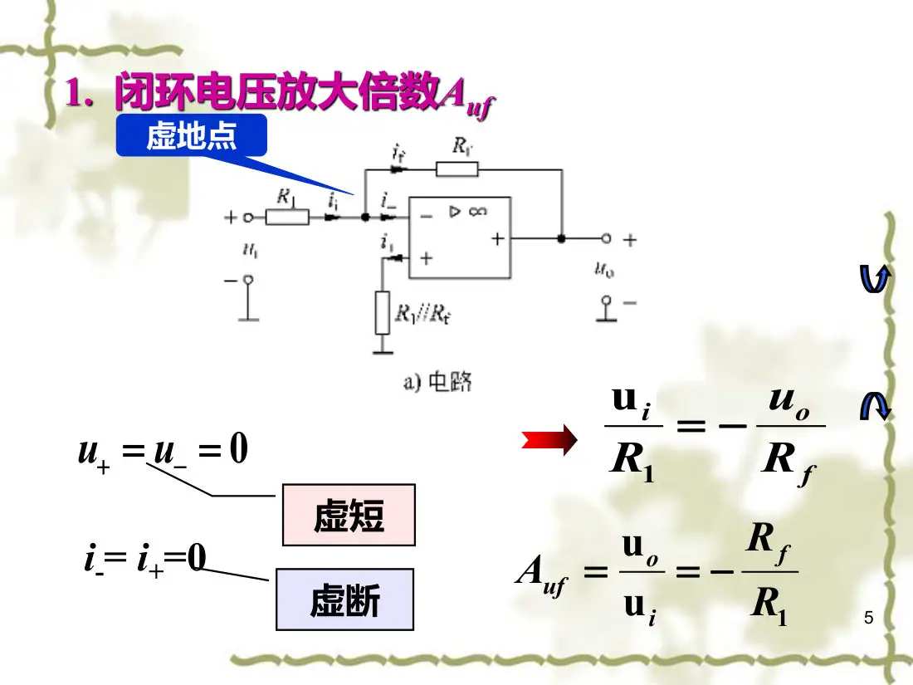

原文：

1. 闭环电压放大倍数 $A_{uf}$ 虚地点

a) 电路

$$
u _ {+} = u _ {-} = 0
$$

虚短

$$
i _ {-} = i _ {+} = 0
$$

虚断

$$
\rightarrow \frac {\mathbf {u} _ {i}}{R _ {1}} = - \frac {\mathbf {u} _ {o}}{R _ {f}} \cap
$$

$$
A _ {u f} = \frac {\mathbf {u} _ {o}}{\mathbf {u} _ {i}} = - \frac {R _ {f}}{R _ {1}}
$$

### 闭环传输特性

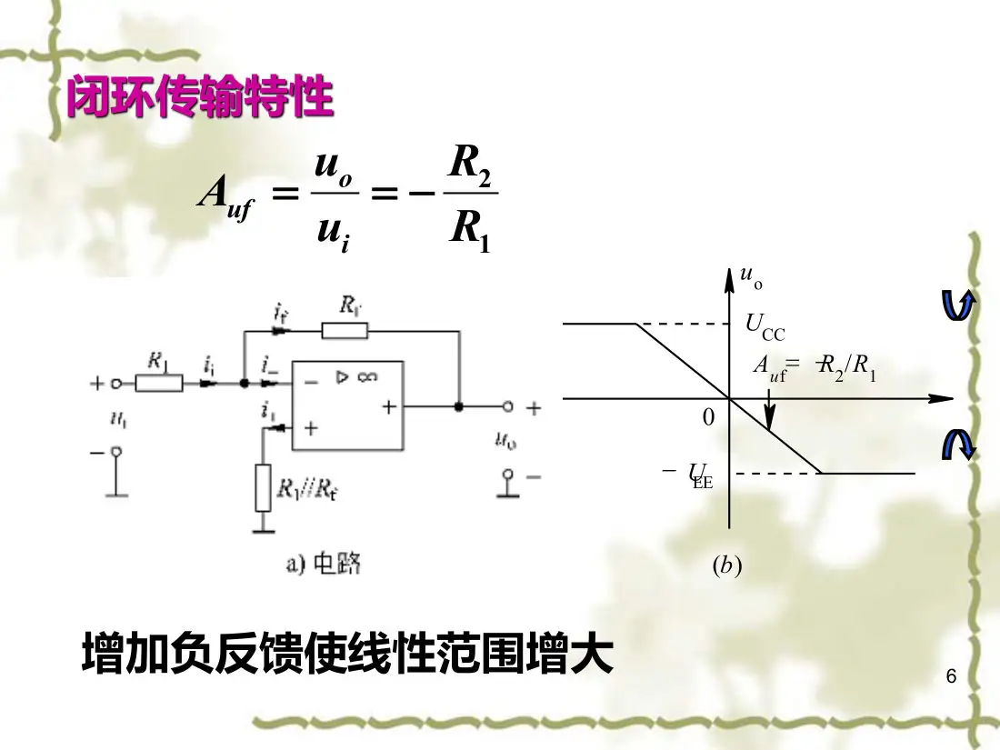

原文：

闭环传输特性

$$
A _ {u f} = \frac {u _ {o}}{u _ {i}} = - \frac {R _ {2}}{R _ {1}}
$$

增加负反馈使线性范围增大

6

### 2. 闭环输入电阻 $R_{if}$

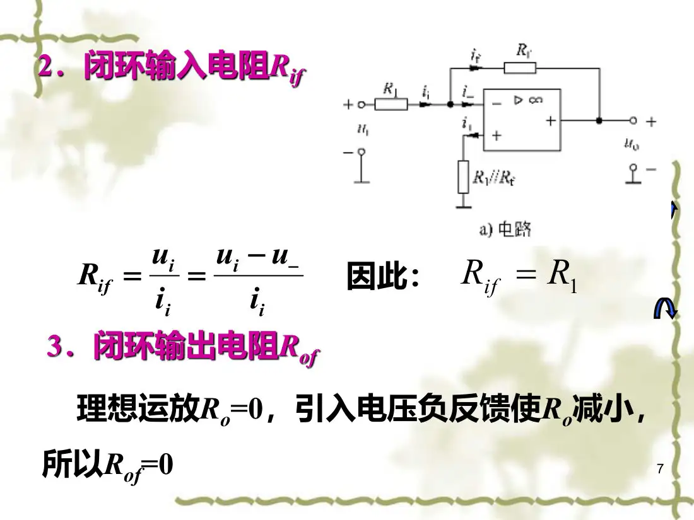

原文：

2. 闭环输入电阻 $R_{if}$

$R_{if} = \frac{u_i}{i_i} = \frac{u_i - u_-}{i_i}$ 因此： $R_{if} = R_1$

3. 闭环输出电阻 $R_{of}$

理想运放 $R_{o}=0$ ，引入电压负反馈使 $R_{o}$ 减小，
所以 $R_{of}=0$

### 2 同相比例放大电路

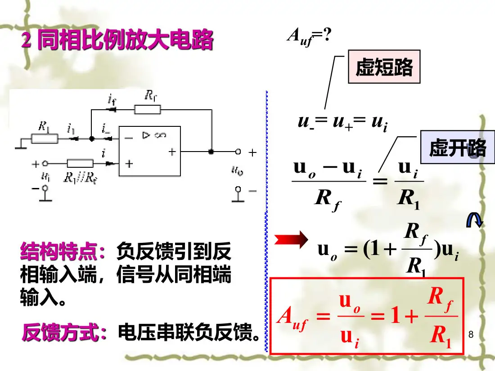

原文：

2 同相比例放大电路

结构特点：负反馈引到反相输入端，信号从同相端输入。

反馈方式：电压串联负反馈。

$$
A _ {u f} = ?
$$

虚短路

$$
u _ {-} = u _ {+} = u _ {i}
$$

$$
\frac {\mathbf {u} _ {o} - \mathbf {u} _ {i}}{R _ {f}} = \frac {\mathbf {u} _ {i}}{R _ {1}}
$$

虚开路

$$
\mathbf {u} _ {o} = (1 + \frac {R _ {f}}{R _ {1}}) \mathbf {u} _ {i}
$$

$$
A _ {u f} = \frac {\mathbf {u} _ {o}}{\mathbf {u} _ {i}} = 1 + \frac {R _ {f}}{R _ {1}}
$$

### 闭环传输特性

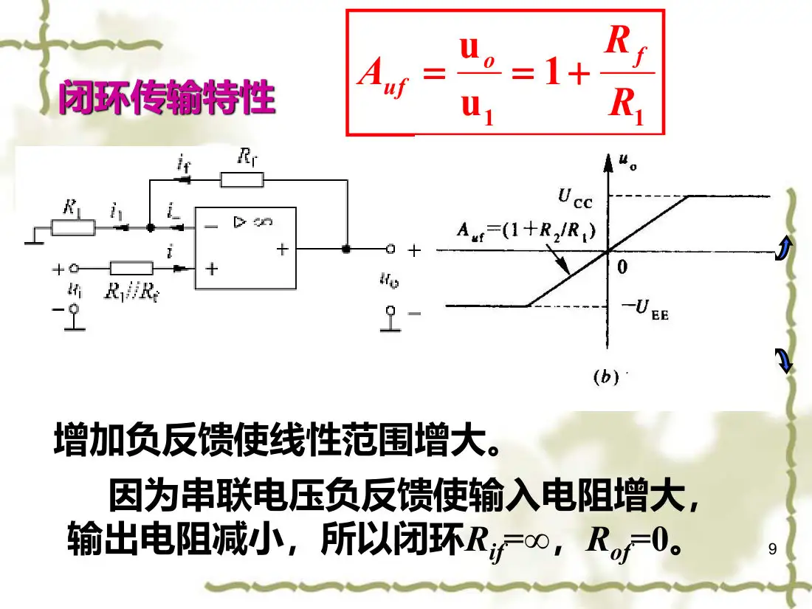

原文：

闭环传输特性

$$
\boxed {A _ {u f} = \frac {\mathbf {u} _ {o}}{\mathbf {u} _ {1}} = 1 + \frac {R _ {f}}{R _ {1}}}
$$

增加负反馈使线性范围增大。

因为串联电压负反馈使输入电阻增大，输出电阻减小，所以闭环 $R_{if}=\infty$ ， $R_{of}=0$ 。

### 令 $R_{f}=0,R_{1}=\infty,A_{uf}=$ ?

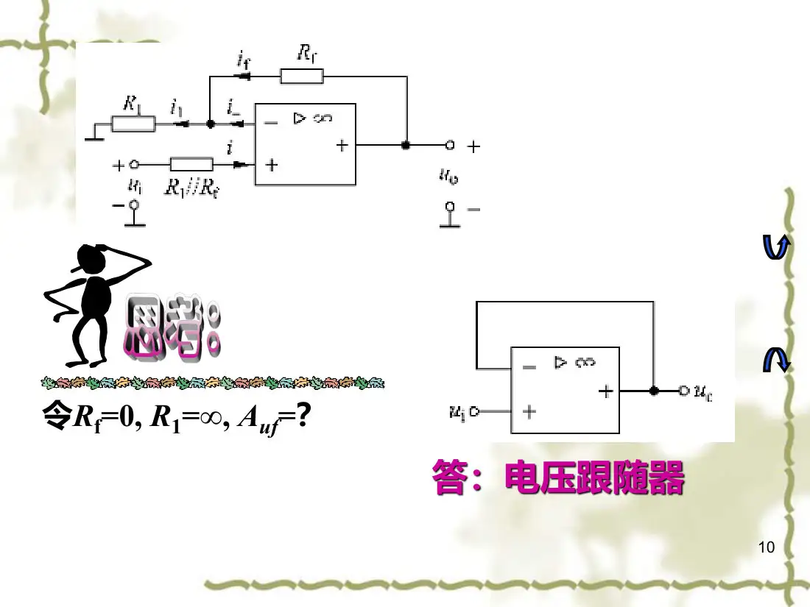

原文：

令 $R_{f}=0,R_{1}=\infty,A_{uf}=$ ?

答: 电压跟随器

10

### 7.1.2 求和运算电路(Adder)

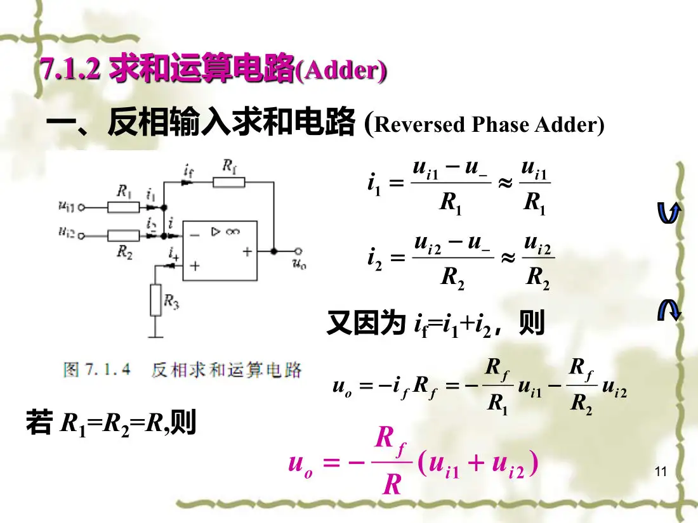

原文：

7.1.2 求和运算电路(Adder)

一、反相输入求和电路 (Reversed Phase Adder)

若 $R_{1} = R_{2} = R$ ，则

$$
i _ {1} = \frac {u _ {i 1} - u _ {-}}{R _ {1}} \approx \frac {u _ {i 1}}{R _ {1}}
$$

$$
i _ {2} = \frac {\boldsymbol {u} _ {i 2} - \boldsymbol {u} _ {-}}{R _ {2}} \approx \frac {\boldsymbol {u} _ {i 2}}{R _ {2}}
$$

又因为 $i_{\mathrm{f}} = i_{1} + i_{2}$ ，则

$$
\boldsymbol {u} _ {o} = - \boldsymbol {i} _ {f} R _ {f} = - \frac {R _ {f}}{R _ {1}} u _ {i 1} - \frac {R _ {f}}{R _ {2}} u _ {i 2}
$$

$$
u _ {o} = - \frac {R _ {f}}{R} (u _ {i 1} + u _ {i 2})
$$

11

### 2、同相输入求和电路

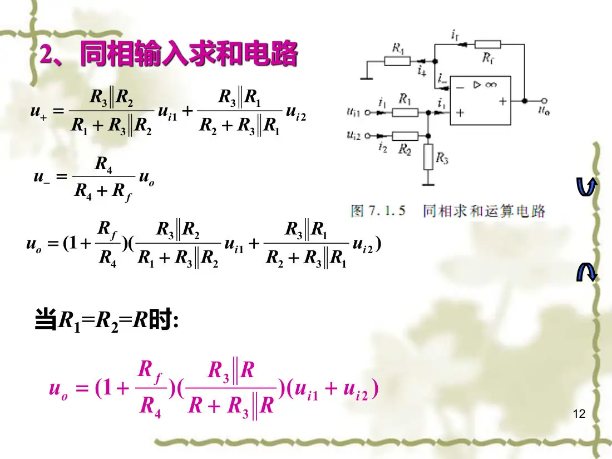

原文：

2、同相输入求和电路

$$
u _ {+} = \frac {R _ {3} \| R _ {2}}{R _ {1} + R _ {3} \| R _ {2}} u _ {i 1} + \frac {R _ {3} \| R _ {1}}{R _ {2} + R _ {3} \| R _ {1}} u _ {i 2}
$$

$$
u _ {-} = \frac {R _ {4}}{R _ {4} + R _ {f}} u _ {o}
$$

$$
u _ {o} = (1 + \frac {R _ {f}}{R _ {4}}) (\frac {R _ {3} \| R _ {2}}{R _ {1} + R _ {3} \| R _ {2}} u _ {i 1} + \frac {R _ {3} \| R _ {1}}{R _ {2} + R _ {3} \| R _ {1}} u _ {i 2})
$$

当 $R_{1}=R_{2}=R$ 时:

$$
u _ {o} = (1 + \frac {R _ {f}}{R _ {4}}) (\frac {R _ {3} \| R}{R + R _ {3} \| R}) (u _ {i 1} + u _ {i 2})
$$

12

### 反相求和器的特点：

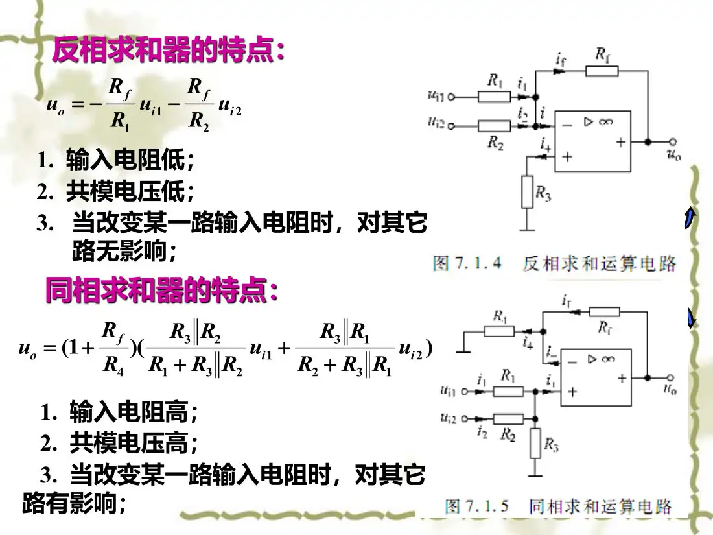

原文：

反相求和器的特点：

$$
\boldsymbol {u} _ {o} = - \frac {\boldsymbol {R} _ {f}}{\boldsymbol {R} _ {1}} \boldsymbol {u} _ {i 1} - \frac {\boldsymbol {R} _ {f}}{\boldsymbol {R} _ {2}} \boldsymbol {u} _ {i 2}
$$

1. 输入电阻低;

2. 共模电压低;

3. 当改变某一路输入电阻时，对其它路无影响；

同相求和器的特点：

$$
u _ {o} = (1 + \frac {R _ {f}}{R _ {4}}) (\frac {R _ {3} \| R _ {2}}{R _ {1} + R _ {3} \| R _ {2}} u _ {i 1} + \frac {R _ {3} \| R _ {1}}{R _ {2} + R _ {3} \| R _ {1}} u _ {i 2})
$$

1. 输入电阻高;

2. 共模电压高;

3. 当改变某一路输入电阻时，对其它路有影响；

### 例1 试设计满足 $u_{0}=2u_{i1}+5u_{i2}$ 的电路。

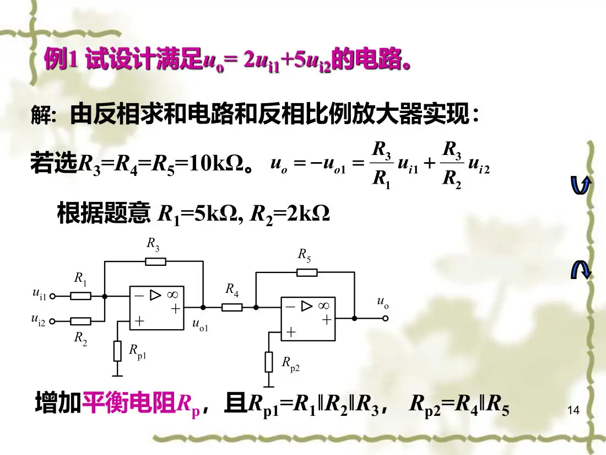

原文：

例1 试设计满足 $u_{0}=2u_{i1}+5u_{i2}$ 的电路。

解: 由反相求和电路和反相比例放大器实现:

若选 $R_{3} = R_{4} = R_{5} = 10\mathrm{k}\Omega$ 。 $u_{o} = -u_{o1} = \frac{R_{3}}{R_{1}} u_{i1} + \frac{R_{3}}{R_{2}} u_{i2}$

根据题意 $R_{1}=5k\Omega, R_{2}=2k\Omega$

增加平衡电阻 $R_{p}$ ，且 $R_{p1}=R_{1}\|R_{2}\|R_{3}$ ， $R_{p2}=R_{4}\|R_{5}$ 例：A/D变换器要求其输入电压的幅度为0～+5V，现有信号变化范围为-5V～+5V。试设计一电平抬高电路，将其变化范围变为0～+5V。

14

### 电平抬高电路

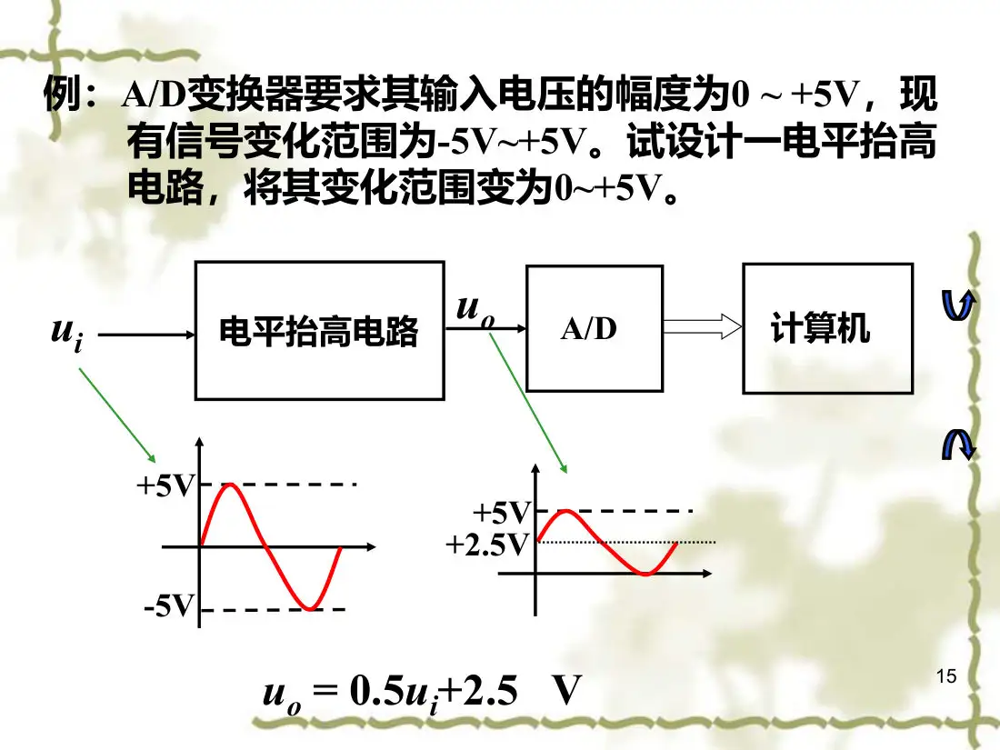

原文：

电平抬高电路

计算机

$$
u _ {o} = 0. 5 u _ {i} + 2. 5 \mathrm{V}
$$

15

### $$

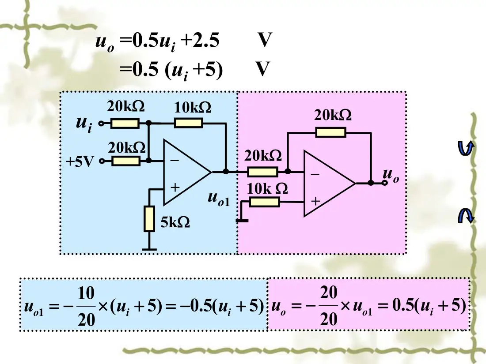

原文：

$$
\begin{array}{r l} {u _ {o} = 0. 5 u _ {i} + 2. 5} & {\mathrm{V}} \\ {= 0. 5 (u _ {i} + 5)} & {\mathrm{V}} \end{array}
$$

$$
u _ {o 1} = - \frac {1 0}{2 0} \times (u _ {i} + 5) = - 0. 5 (u _ {i} + 5) \quad u _ {o} = - \frac {2 0}{2 0} \times u _ {o 1} = 0. 5 (u _ {i} + 5)
$$

### 3、双端输入求和电路

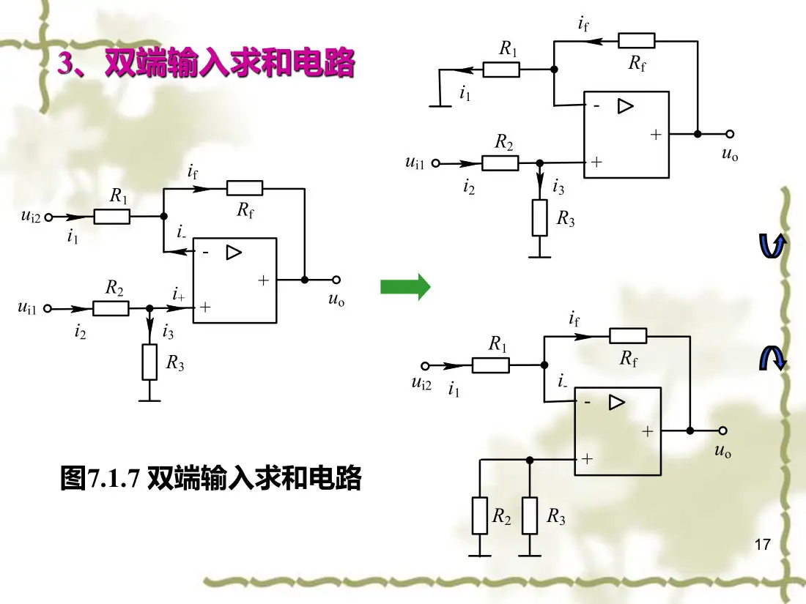

原文：

3、双端输入求和电路

17

### $$

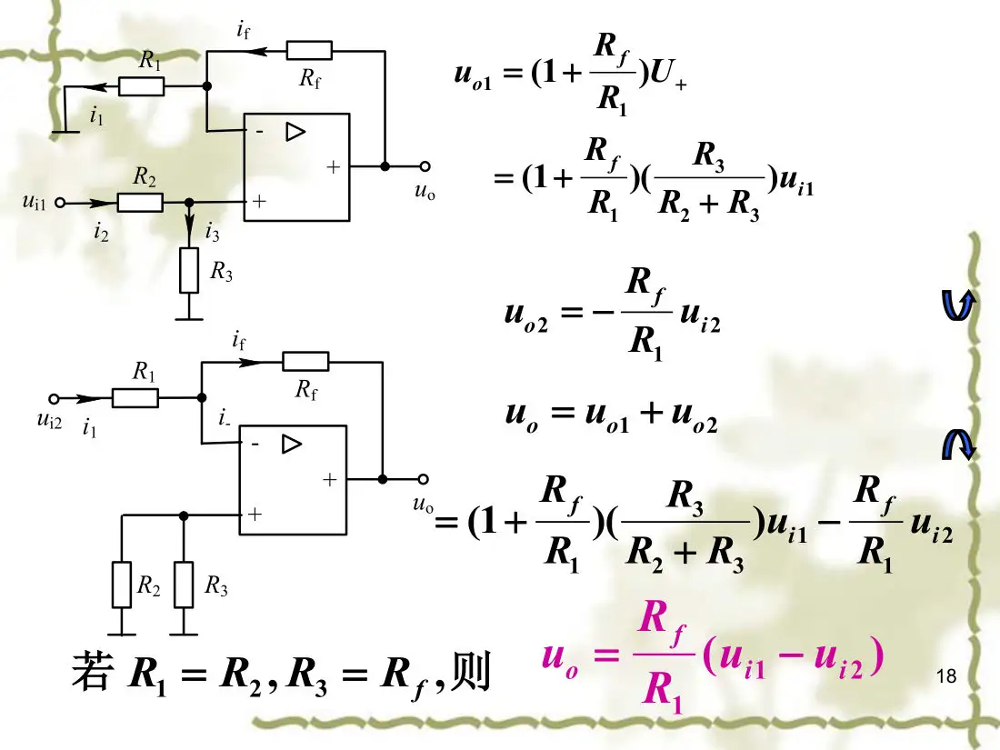

原文：

$$
\boldsymbol {u} _ {o 1} = (1 + \frac {\boldsymbol {R} _ {f}}{\boldsymbol {R} _ {1}}) \boldsymbol {U} _ {+}
$$

$$
= (1 + \frac {R _ {f}}{R _ {1}}) (\frac {R _ {3}}{R _ {2} + R _ {3}}) u _ {i 1}
$$

$$
\boldsymbol {u} _ {o 2} = - \frac {\boldsymbol {R} _ {f}}{\boldsymbol {R} _ {1}} \boldsymbol {u} _ {i 2}
$$

$$
\boldsymbol {u} _ {o} = \boldsymbol {u} _ {o 1} + \boldsymbol {u} _ {o 2}
$$

$$
\stackrel {\circ} {u _ {\mathrm{o}}} = (1 + \frac {R _ {f}}{R _ {1}}) (\frac {R _ {3}}{R _ {2} + R _ {3}}) u _ {i 1} - \frac {R _ {f}}{R _ {1}} u _ {i 2}
$$

若 $R_{1} = R_{2}, R_{3} = R_{f}$ , 则 $u_{o} = \frac{R_{f}}{R_{1}} (u_{i1} - u_{i2})$

### 7.1.3 积分和微分运算电路

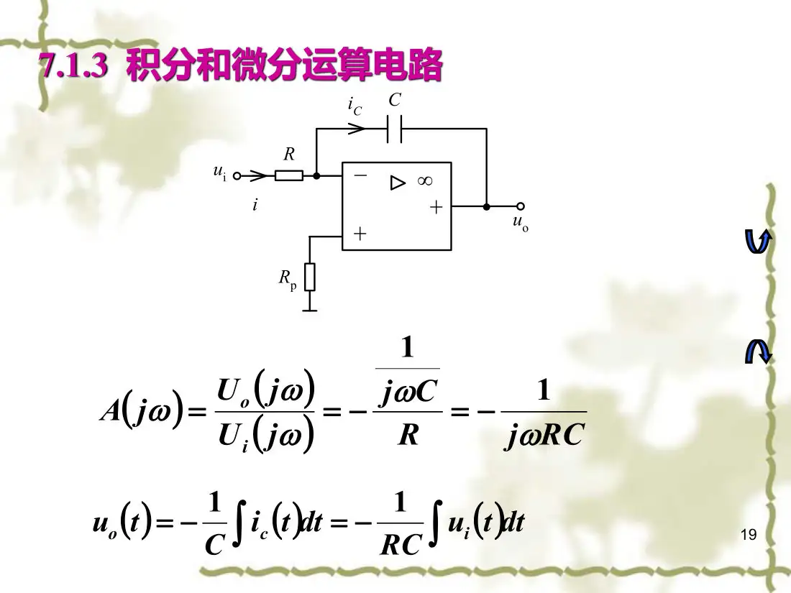

原文：

7.1.3 积分和微分运算电路

$$
A (j \omega) = \frac {U _ {o} (j \omega)}{U _ {i} (j \omega)} = - \frac {\frac {1}{j \omega C}}{R} = - \frac {1}{j \omega R C}
$$

$$
u _ {o} (t) = - \frac {1}{C} \int i _ {c} (t) d t = - \frac {1}{R C} \int u _ {i} (t) d t
$$

19

### 电容两端的初始电压为零。

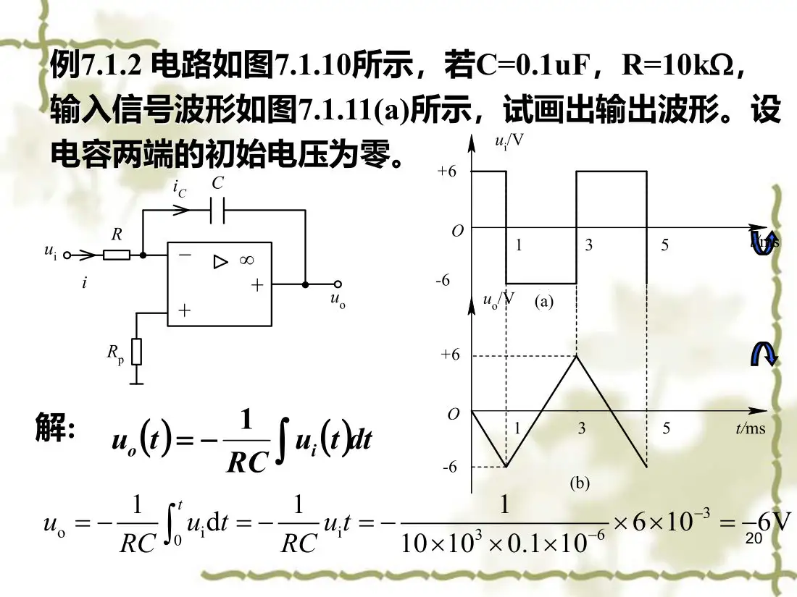

原文：

例7.1.2 电路如图7.1.10所示，若C=0.1uF，R=10kΩ，输入信号波形如图7.1.11(a)所示，试画出输出波形。设

电容两端的初始电压为零。

解: $u_{o}(t) = -\frac{1}{RC}\int u_{i}(t)dt$

$$
u _ {\mathrm{o}} = - \frac {1}{R C} \int_ {0} ^ {t} u _ {\mathrm{i}} \mathrm{d} t = - \frac {1}{R C} u _ {\mathrm{i}} t = - \frac {1}{1 0 \times 1 0 ^ {3} \times 0 . 1 \times 1 0 ^ {- 6}} \times 6 \times 1 0 ^ {- 3} = \frac {1}{2 0} \mathrm{V}
$$

### 2、微分运算电路

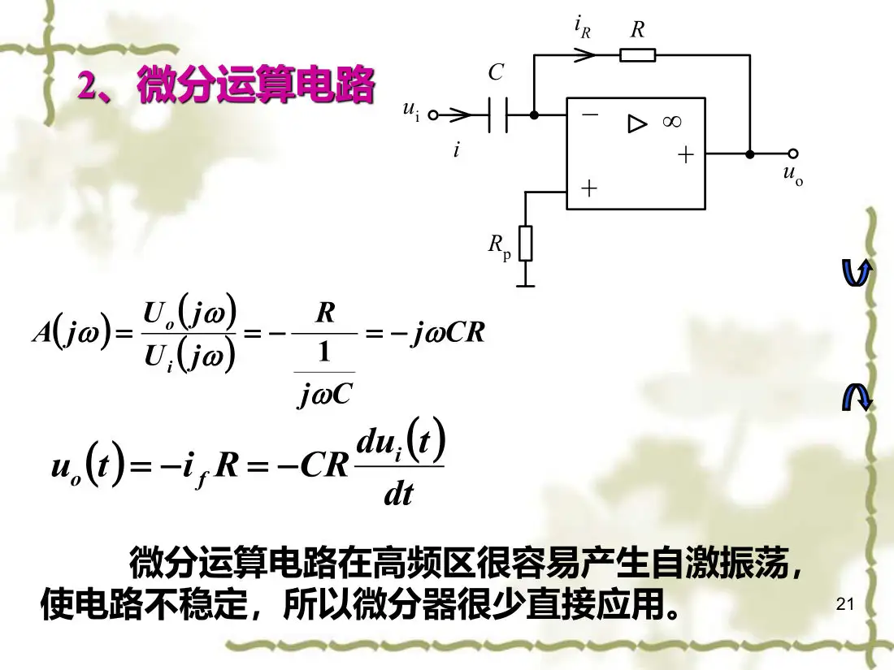

原文：

2、微分运算电路

$$
A (j \omega) = \frac {U _ {o} (j \omega)}{U _ {i} (j \omega)} = - \frac {R}{\frac {1}{j \omega C}} = - j \omega C R
$$

$$
u _ {o} (t) = - i _ {f} R = - C R \frac {d u _ {i} (t)}{d t}
$$

微分运算电路在高频区很容易产生自激振荡，使电路不稳定，所以微分器很少直接应用。

21

### 利用加法器和积分器可以用电路解微分方程：

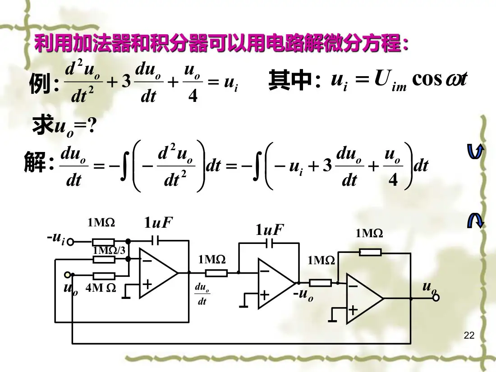

原文：

利用加法器和积分器可以用电路解微分方程：

例： $\frac{d^{2}u_{o}}{dt^{2}}+3\frac{du_{o}}{dt}+\frac{u_{o}}{4}=u_{i}$ 其中： $u_{i}=U_{im}\cos\omega t$ 求 $u_{o}$ =?

解： $\frac{du_o}{dt} = -\int \left(-\frac{d^2u_o}{dt^2}\right)dt = -\int \left(-u_i + 3\frac{du_o}{dt} +\frac{u_o}{4}\right)dt$

22

### 7.1.4 对数、反对数运算电路

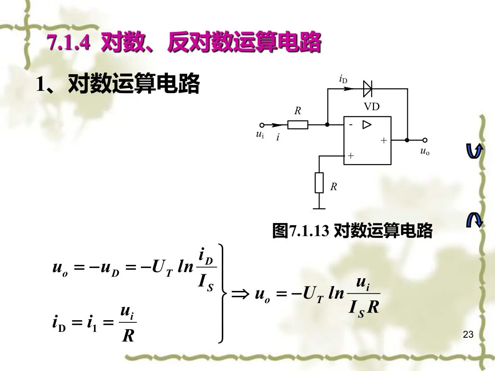

原文：

7.1.4 对数、反对数运算电路

1、对数运算电路

$$
\left. \begin{array}{l} u _ {o} = - u _ {D} = - U _ {T} \ln \frac {i _ {D}}{I _ {S}} \\ i _ {\mathrm{D}} = i _ {1} = \frac {u _ {i}}{R} \end{array} \right\} \Rightarrow u _ {o} = - U _ {T} \ln \frac {u _ {i}}{I _ {S} R}
$$

23

### $$

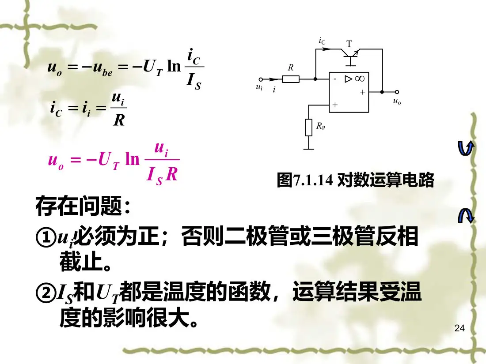

原文：

$$
\boldsymbol {u} _ {o} = - \boldsymbol {u} _ {b e} = - U _ {T} \ln \frac {\boldsymbol {i} _ {C}}{I _ {S}}
$$

$$
\boldsymbol {i} _ {C} = \boldsymbol {i} _ {i} = \frac {\boldsymbol {u} _ {i}}{R}
$$

$$
u _ {o} = - U _ {T} \ln \frac {u _ {i}}{I _ {S} R}
$$

图7.1.14 对数运算电路

存在问题：

① $u_{i}$ 必须为正；否则二极管或三极管反相截止。

② $I_{S}$ 和 $U_{T}$ 都是温度的函数，运算结果受温度的影响很大。

24

### 25

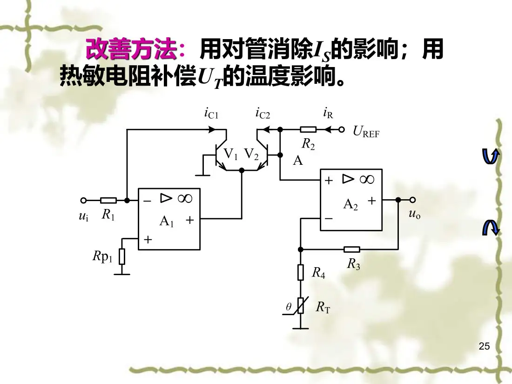

原文：

改善方法：用对管消除 $I_{S}$ 的影响；用热敏电阻补偿 $U_{T}$ 的温度影响。

25

### $$

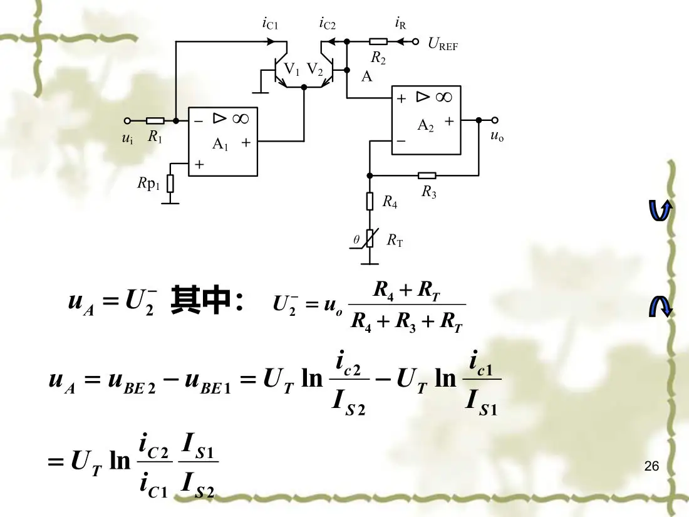

原文：

$u_{A}=U_{2}^{-}$ 其中： $U_{2}^{-}=u_{o}\frac{R_{4}+R_{T}}{R_{4}+R_{3}+R_{T}}$

$$
\boldsymbol {u} _ {A} = \boldsymbol {u} _ {B E 2} - \boldsymbol {u} _ {B E 1} = U _ {T} \ln \frac {\boldsymbol {i} _ {c 2}}{I _ {S 2}} - U _ {T} \ln \frac {\boldsymbol {i} _ {c 1}}{I _ {S 1}}
$$

$$
= U _ {T} \ln \frac {i _ {C 2}}{i _ {C 1}} \frac {I _ {S 1}}{I _ {S 2}}
$$

26

### $$

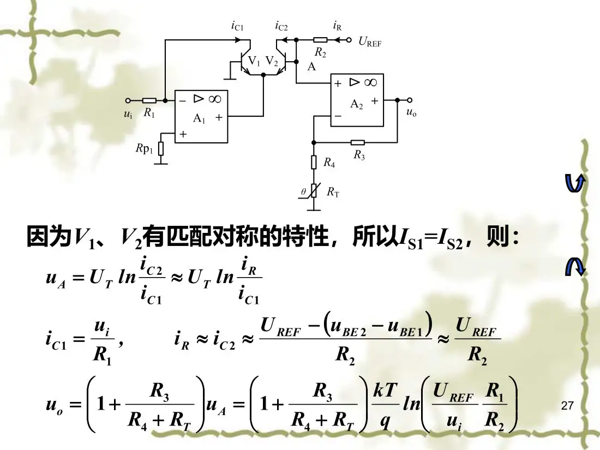

原文：

因为 $V_{1}$ 、 $V_{2}$ 有匹配对称的特性，所以 $I_{\mathrm{S} 1} = I_{\mathrm{S} 2}$ ，则：

$$
\boldsymbol {u} _ {A} = \boldsymbol {U} _ {T} \ln \frac {\boldsymbol {i} _ {C 2}}{\boldsymbol {i} _ {C 1}} \approx \boldsymbol {U} _ {T} \ln \frac {\boldsymbol {i} _ {R}}{\boldsymbol {i} _ {C 1}}
$$

$$
i _ {C 1} = \frac {u _ {i}}{R _ {1}}, \qquad i _ {R} \approx i _ {C 2} \approx \frac {U _ {R E F} - (u _ {B E 2} - u _ {B E 1})}{R _ {2}} \approx \frac {U _ {R E F}}{R _ {2}}
$$

$$
u _ {o} = \left(1 + \frac {R _ {3}}{R _ {4} + R _ {T}}\right) u _ {A} = \left(1 + \frac {R _ {3}}{R _ {4} + R _ {T}}\right) \frac {k T}{q} \ln \left(\frac {U _ {R E F}}{u _ {i}} \frac {R _ {1}}{R _ {2}}\right)
$$

### 2、反对数（指数）运算电路

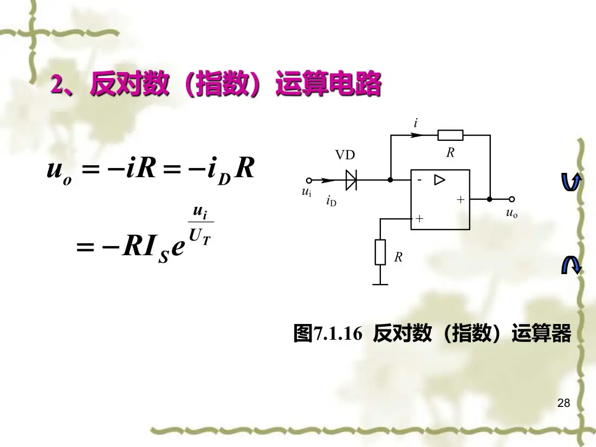

原文：

2、反对数（指数）运算电路

$$
\begin{array}{r} u _ {o} = - i R = - i _ {D} R \\ = - R I _ {S} e ^ {\frac {u _ {i}}{U _ {T}}} \end{array}
$$

28

### 7.2 电压比较器

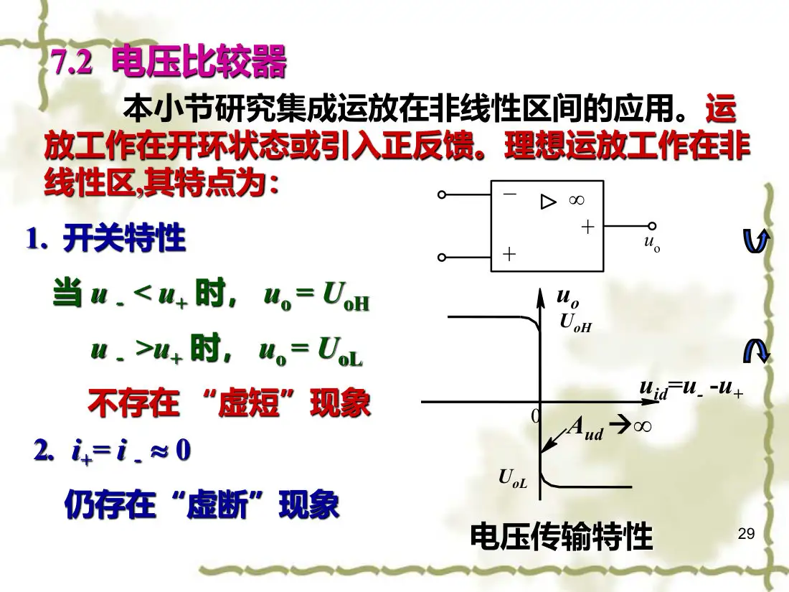

原文：

7.2 电压比较器

本小节研究集成运放在非线性区间的应用。运放工作在开环状态或引入正反馈。理想运放工作在非线性区,其特点为:

1. 开关特性

当 $u_{-}<u_{+}$ 时， $u_{0}=U_{0H}$

$u_{-}>u_{+}$ 时， $u_{0}=U_{0L}$

不存在“虚短”现象

2. $i_{+} = i_{-}\approx 0$

仍存在“虚断”现象

29

### 7.2.1 电压比较器概述

原文：

7.2.1 电压比较器概述

电压比较器的功能：

电压比较器用来比较输入电压与基准电压的大小。

电压比较器的种类：

单门限比较器、迟滞比较器和窗口比较器用途：

数模转换、数字仪表、自动控制和自动检测等技术领域，以及波形产生及变换等场合。

30

### 运放处于开环状态:

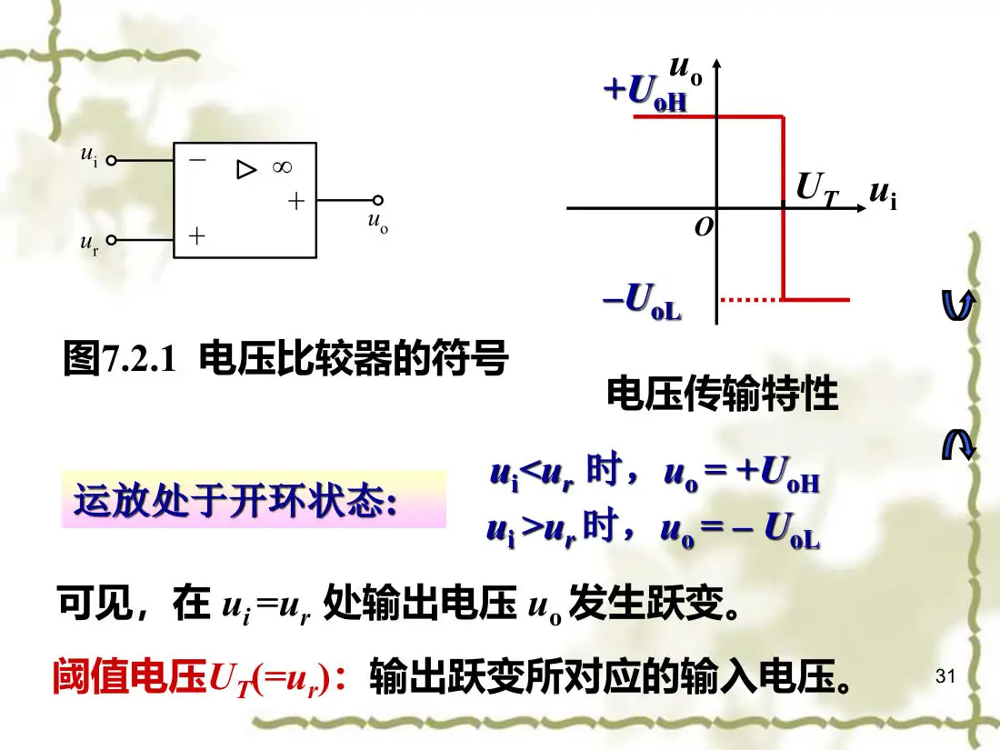

原文：

运放处于开环状态:

$u_{i}<u_{r}$ 时， $u_{0}=+U_{0H}$ $u_{i}>u_{r}$ 时， $u_{0}=-U_{0L}$

可见，在 $u_{i} = u_{r}$ 处输出电压 $u_{0}$ 发生跃变。

阈值电压 $U_{T}(=u_{r})$ ：输出跃变所对应的输入电压。

31

### 输入信号接在反相端

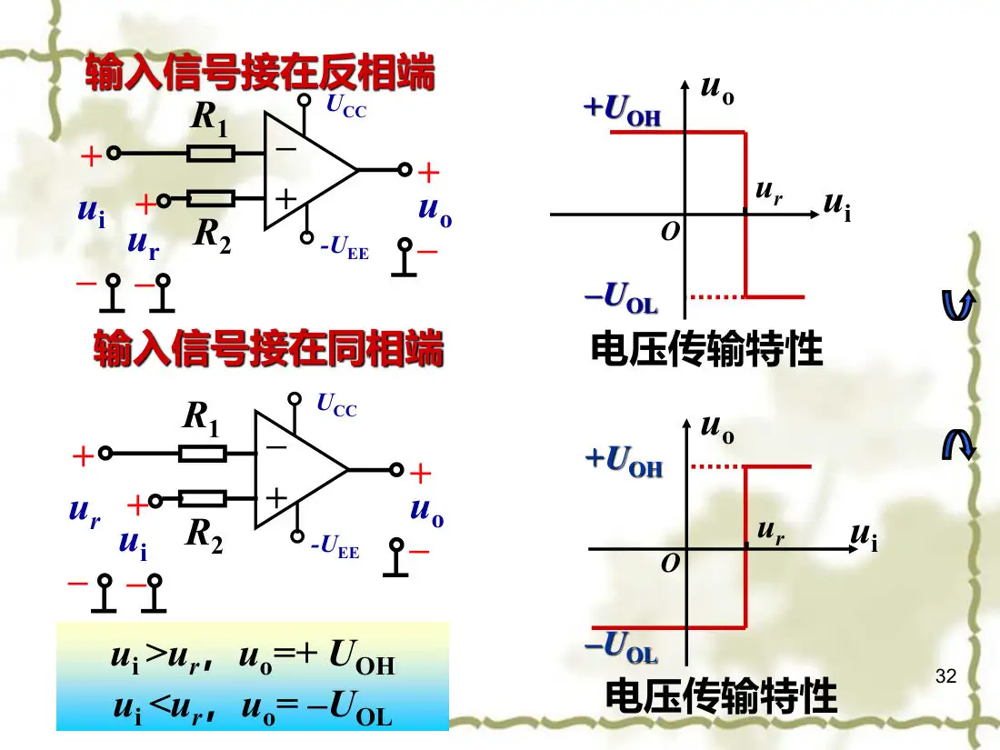

原文：

输入信号接在反相端

输入信号接在同相端

$$
u _ {\mathrm{i}} > u _ {r}, \quad u _ {\mathrm{o}} = + U _ {\mathrm{OH}}
$$

$$
u _ {\mathrm{i}} <   u _ {r}, \quad u _ {\mathrm{o}} = - U _ {\mathrm{OL}}
$$

32

### 电压比较器传输特性曲线的三个要素：

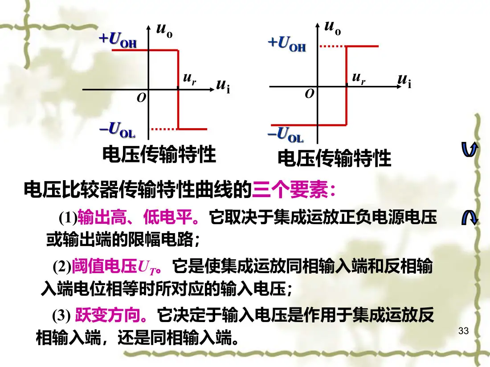

原文：

电压比较器传输特性曲线的三个要素：

(1)输出高、低电平。它取决于集成运放正负电源电压或输出端的限幅电路；

(2)阈值电压 $U_{T}$ 。它是使集成运放同相输入端和反相输入端电位相等时所对应的输入电压；

(3) 跃变方向。它决定于输入电压是作用于集成运放反相输入端，还是同相输入端。

### 常见输出限幅电路

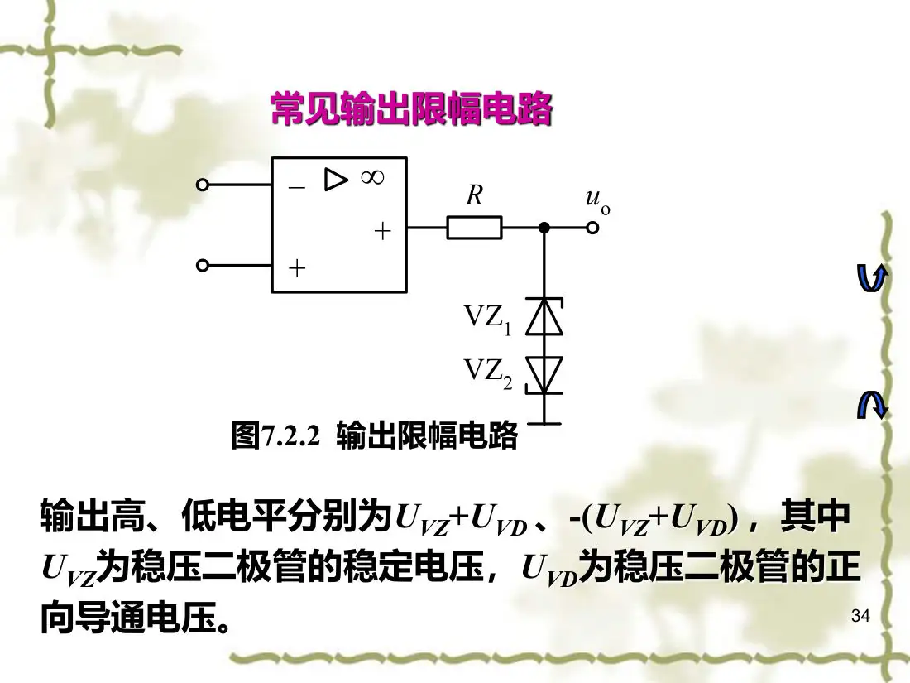

原文：

常见输出限幅电路

输出高、低电平分别为 $U_{VZ}+U_{VD}$ 、 $-(U_{VZ}+U_{VD})$ ，其中 $U_{VZ}$ 为稳压二极管的稳定电压， $U_{VD}$ 为稳压二极管的正向导通电压。

### 电压比较器的主要性能指标：

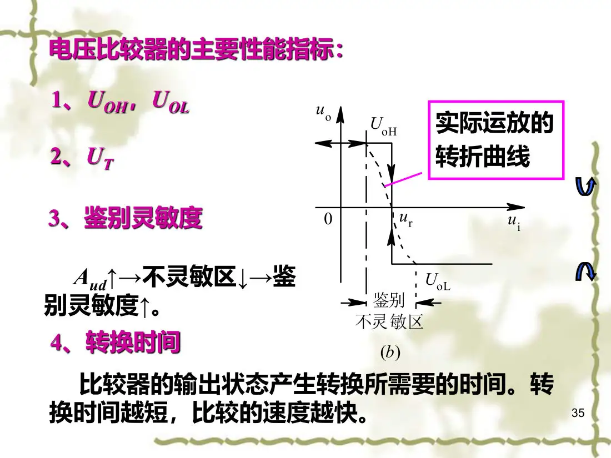

原文：

电压比较器的主要性能指标：

1、 $U_{OH}$ ， $U_{OL}$

2、 $U_{T}$

3、鉴别灵敏度

$A_{ud}\uparrow\rightarrow$ 不灵敏区 $\downarrow\rightarrow$ 鉴别灵敏度 $\uparrow$ 。

4、转换时间

比较器的输出状态产生转换所需要的时间。转换时间越短，比较的速度越快。

35

### 7.2.2 单门限比较器

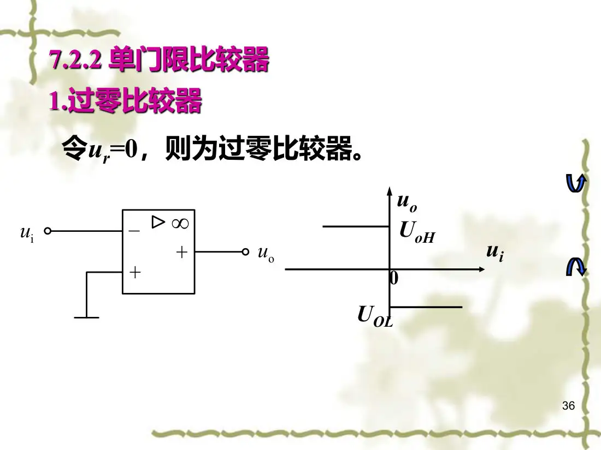

原文：

7.2.2 单门限比较器

1. 过零比较器

令 $u_{r}=0$ ，则为过零比较器。

36

### 7.2.2 单门限比较器 2. 固定电压比较器

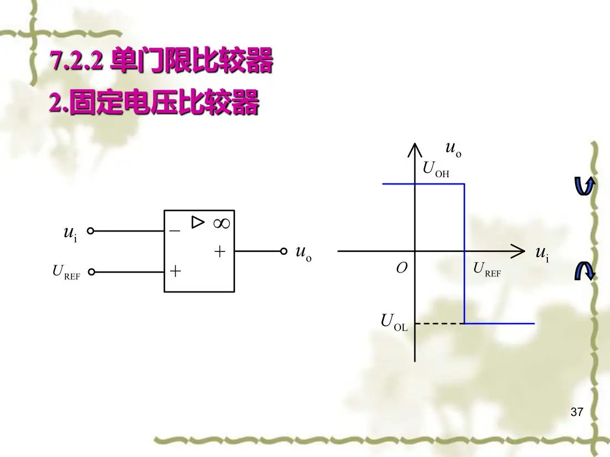

原文：

7.2.2 单门限比较器 2. 固定电压比较器

37

### 38

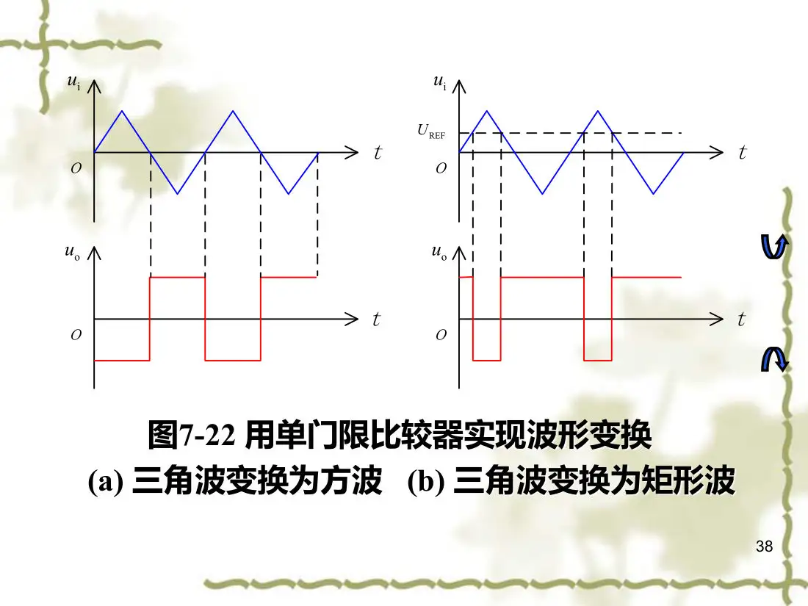

原文：

38

### 例：画出下面电路的传输特性：

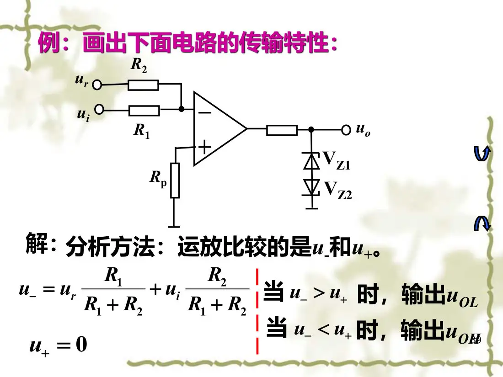

原文：

例：画出下面电路的传输特性：

解：分析方法：运放比较的是 $u_{-}$ 和 $u_{+}$ 。

$u_{-}=u_{r}\frac{R_{1}}{R_{1}+R_{2}}+u_{i}\frac{R_{2}}{R_{1}+R_{2}}$ 当 $u_{-}>u_{+}$ 时，输出 $u_{OL}$ $u_{+}=0$ 当 $u_{-}<u_{+}$ 时，输出 $u_{OB}$

### 也就是说，当 $u^{-} = u^{+}$

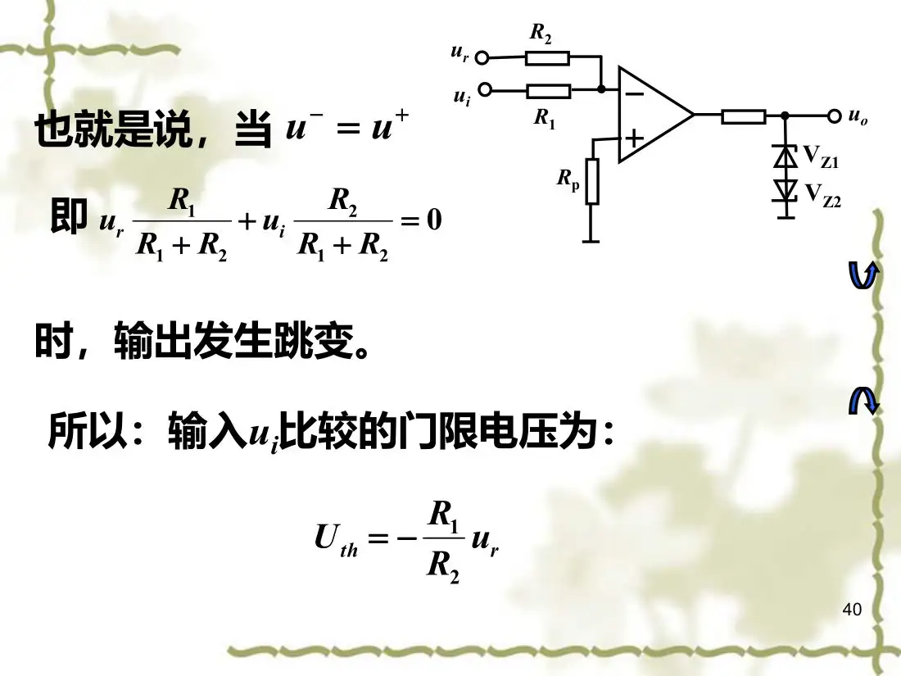

原文：

也就是说，当 $u^{-} = u^{+}$

即 $u_{r}\frac{R_{1}}{R_{1} + R_{2}} + u_{i}\frac{R_{2}}{R_{1} + R_{2}} = 0$

时，输出发生跳变。

所以：输入 $u_{i}$ 比较的门限电压为：

$$
U _ {t h} = - \frac {R _ {1}}{R _ {2}} u _ {r}
$$

40

### 转移特性曲线三要素:

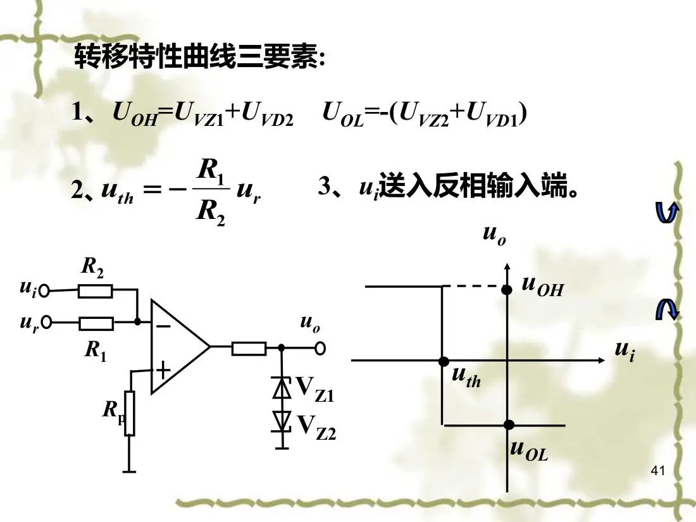

原文：

转移特性曲线三要素:

1、 $U_{OH}=U_{VZ1}+U_{VD2}\quad U_{OL}=-(U_{VZ2}+U_{VD1})$

2、 $u_{th}=-\frac{R_{1}}{R_{2}}u_{r}$ 3、 $u_{i}$ 送入反相输入端。

41

### 7.2.3 迟滞比较器

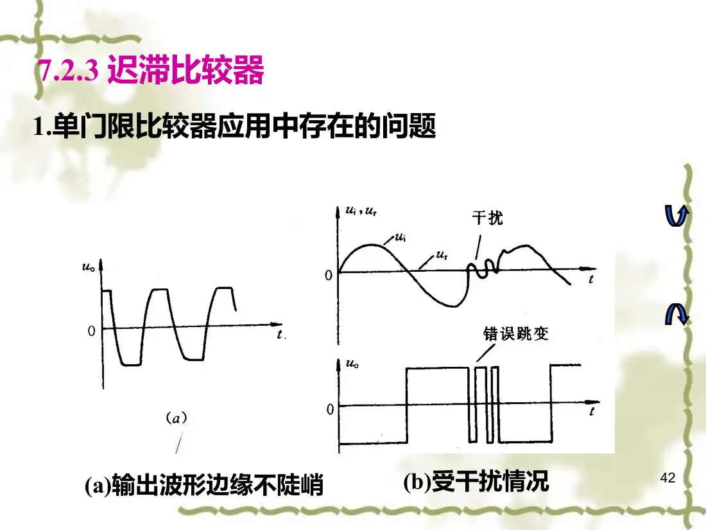

原文：

7.2.3 迟滞比较器

1. 单门限比较器应用中存在的问题

42

### 2.迟滞比较器电路及传输特性

原文：

2.迟滞比较器电路及传输特性

特点: 在比较器中引入正反馈 $\rightarrow A_{ud} \uparrow$ $\rightarrow$ 鉴别灵敏度 $\uparrow \rightarrow$ 转换速度 $\uparrow \rightarrow$ 改善了输出波形的边缘, 同时具有较强的抗干扰能力。

43

### 1)反相输入的迟滞比较器

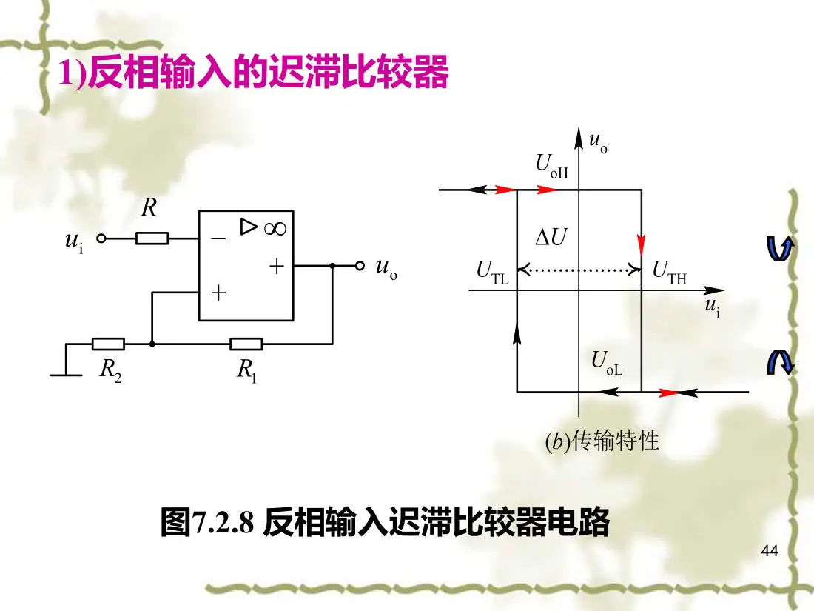

原文：

1)反相输入的迟滞比较器

44

### 阈值电压

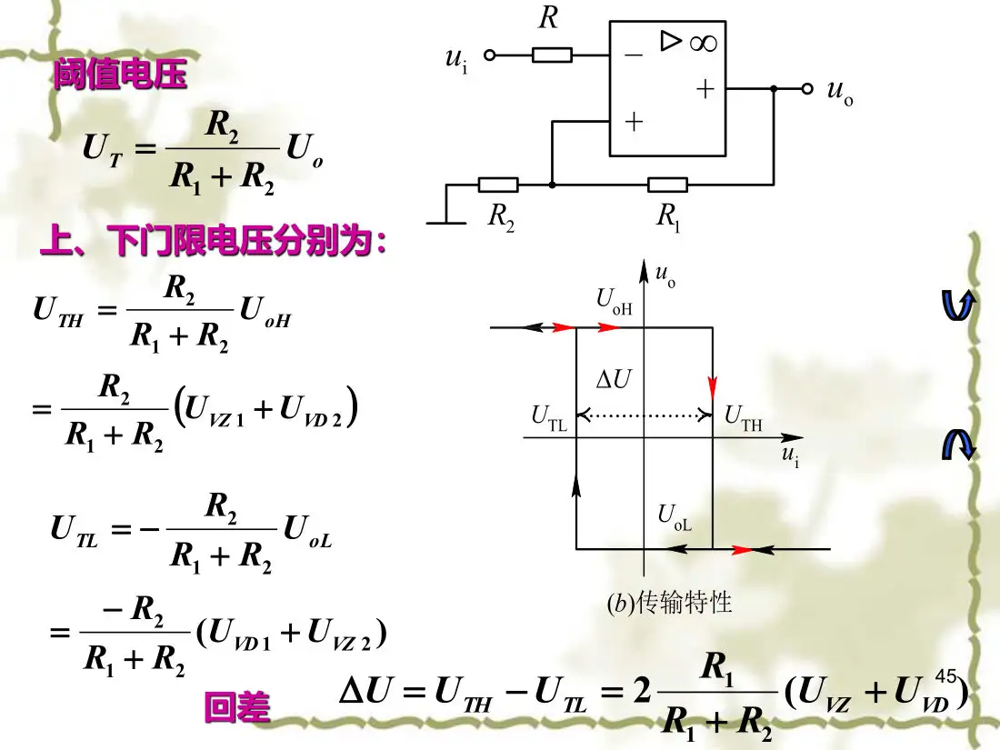

原文：

阈值电压

$$
U _ {T} = \frac {R _ {2}}{R _ {1} + R _ {2}} U _ {o}
$$

上、下门限电压分别为：

$$
\begin{array}{l} {U _ {T H} = \frac {R _ {2}}{R _ {1} + R _ {2}} U _ {o H}} \\ {= \frac {R _ {2}}{R _ {1} + R _ {2}} (U _ {V Z 1} + U _ {V D 2})} \end{array}
$$

$$
\begin{array}{l} U _ {T L} = - \frac {R _ {2}}{R _ {1} + R _ {2}} U _ {o L} \\ = \frac {- R _ {2}}{R _ {1} + R _ {2}} (U _ {V D 1} + U _ {V Z 2}) \end{array}
$$

回差

(b)传输特性

$$
\Delta U = U _ {T H} - U _ {T L} = 2 \frac {R _ {1}}{R _ {1} + R _ {2}} (U _ {V Z} + U _ {V D} ^ {4 5})
$$

### 迟滞比较器输出波形

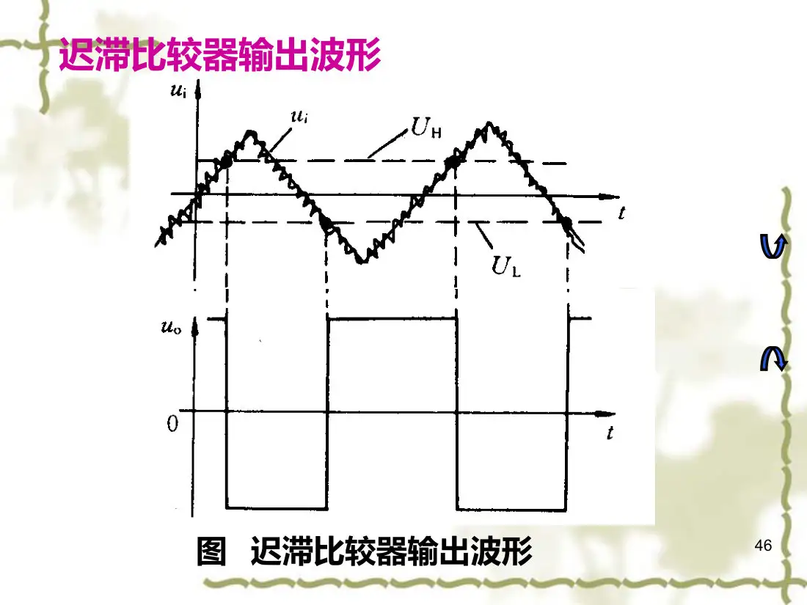

原文：

迟滞比较器输出波形

46

### 2) 同相输入迟滞比较器

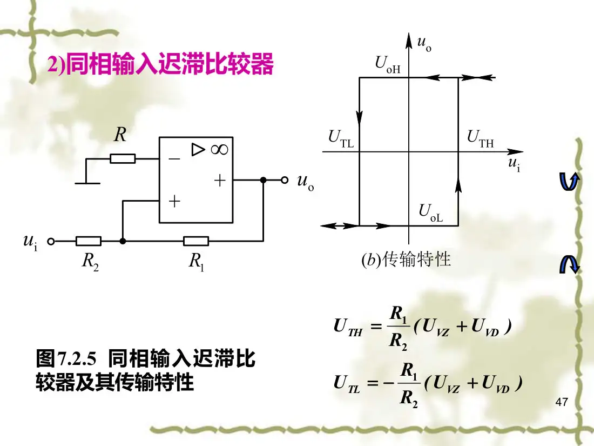

原文：

2) 同相输入迟滞比较器

$$
U _ {T H} = \frac {R _ {1}}{R _ {2}} (U _ {V Z} + U _ {V D})
$$

$$
U _ {T L} = - \frac {R _ {1}}{R _ {2}} (U _ {V Z} + U _ {V D})
$$

47

### 7.2.4 窗口比较器

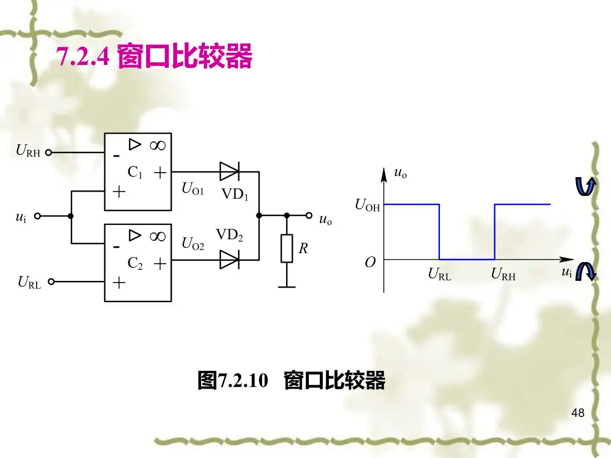

原文：

7.2.4 窗口比较器

48

### 总结

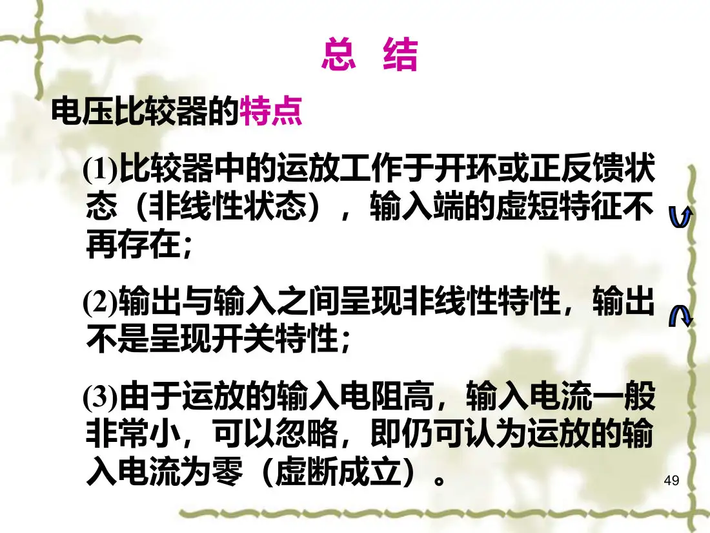

原文：

总结

电压比较器的特点

(1)比较器中的运放工作于开环或正反馈状态（非线性状态），输入端的虚短特征不再存在；

(2)输出与输入之间呈现非线性特性，输出不是呈现开关特性；

(3)由于运放的输入电阻高，输入电流一般非常小，可以忽略，即仍可认为运放的输入电流为零（虚断成立）。

49

### 50

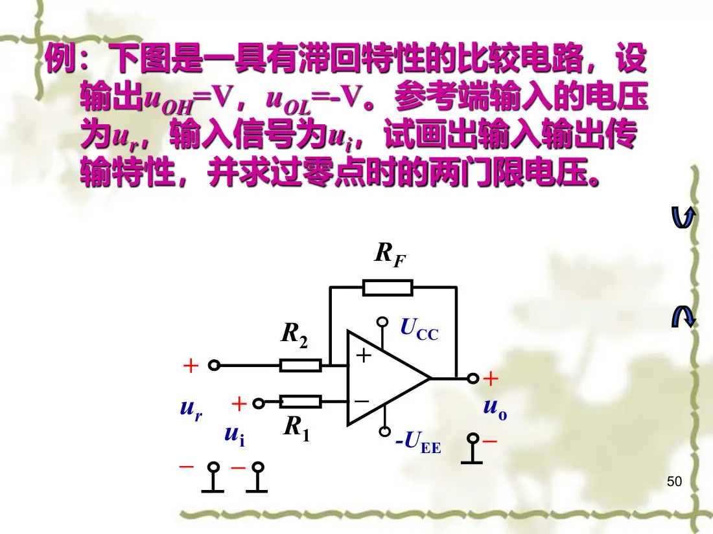

原文：

例：下图是一具有滞回特性的比较电路，设输出 $u_{OH}=V$ ， $u_{OL}=-V$ 。参考端输入的电压为 $u_{r}$ ，输入信号为 $u_{i}$ ，试画出输入输出传输特性，并求过零点时的两门限电压。

50

### $$

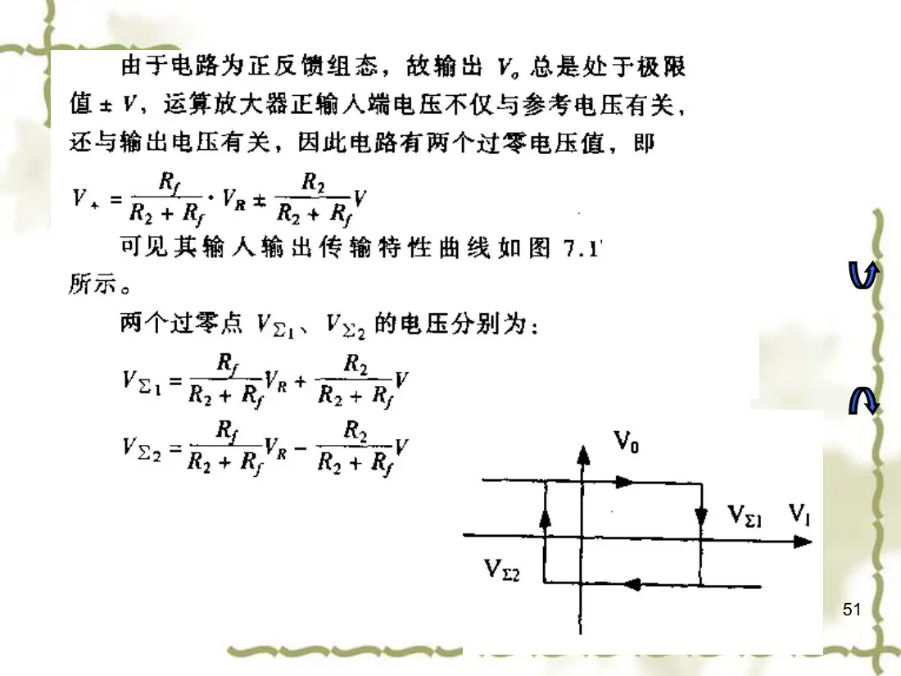

原文：

由于电路为正反馈组态，故输出 $V_{0}$ 总是处于极限值 $\pm V$ ，运算放大器正输入端电压不仅与参考电压有关，还与输出电压有关，因此电路有两个过零电压值，即

$$
V _ {+} = \frac {R _ {f}}{R _ {2} + R _ {f}} \cdot V _ {R} \pm \frac {R _ {2}}{R _ {2} + R _ {f}} V
$$

可见其输入输出传输特性曲线如图 7.1 所示。

两个过零点 $V_{\Sigma_{1}}$ 、 $V_{\Sigma_{2}}$ 的电压分别为：

$$
V _ {\Sigma_ {1}} = \frac {R _ {f}}{R _ {2} + R _ {f}} V _ {R} + \frac {R _ {2}}{R _ {2} + R _ {f}} V
$$

$$
V _ {\Sigma_ {2}} = \frac {R _ {f}}{R _ {2} + R _ {f}} V _ {R} - \frac {R _ {2}}{R _ {2} + R _ {f}} V
$$

51

### 正反馈

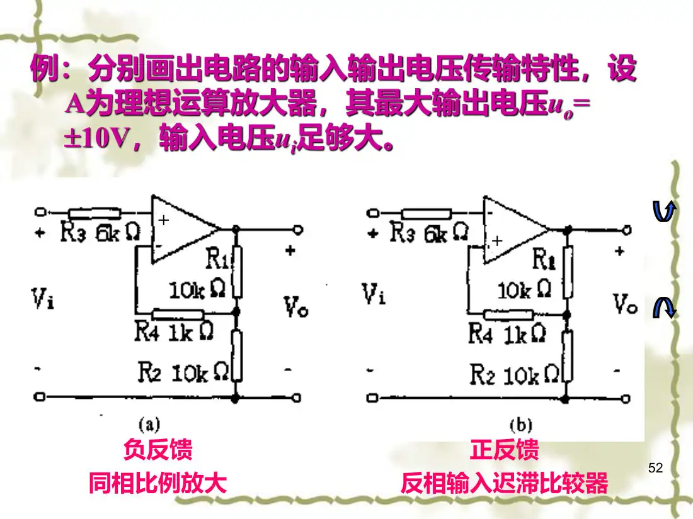

原文：

例：分别画出电路的输入输出电压传输特性，设A为理想运算放大器，其最大输出电压 $u_{o}=\pm10V$ ，输入电压 $u_{i}$ 足够大。

正反馈
反相输入迟滞比较器

52

### 解：

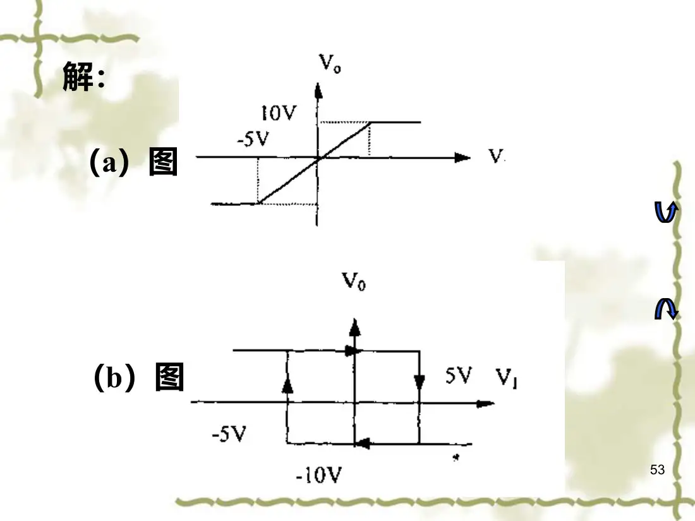

原文：

解：

### 7.3 弛张振荡器

原文：

7.3 弛张振荡器

弛张振荡器又称多谐振荡器，由滞回比较器和RC定时电路构成，无需外加激励信号，只要接通电源就可输出矩形波。

设电源刚接通时, 电容 $C$ 两端 $\bigcup$ 的电压 $u_{C} = 0$ , 输出高电平 $U_{Z}$

$$
u _ {\mathrm{O}} = U _ {\mathrm{Z}}
$$

$$
U _ {+} = \frac {R _ {2}}{R _ {1} + R _ {2}} U _ {\mathrm{z}}
$$

54

### $$

原文：

$$
T _ {1} = \tau_ {\text {放电}} \ln \frac {u (\infty) - u (t _ {1})}{u (\infty) - u (t _ {2})}
$$

$$
= R _ {f} C \ln \left(1 + \frac {2 R _ {2}}{R _ {1}}\right)
$$

$$
T _ {2} = R _ {\mathrm{f}} C \ln (1 + 2 \frac {R _ {2}}{R _ {1}}) \quad q = \frac {T _ {2}}{T} = 50 \% f _ {o} = \frac {1}{T} = \frac {1}{2 R _ {\mathrm{f}} C \ln (1 + 2 \frac {R _ {2}}{R _ {1}}) ^ {5 5}}
$$

### $$

原文：

$$
\tau_ {\mathrm{ch}} = (R + R _ {\mathrm{wab}}) C
$$

$$
\tau_ {\mathrm{dch}} = (R + R _ {\mathrm{wac}}) C
$$

56

### 7.4 精密二极管电路

原文：

7.4 精密二极管电路

7.4.1 精密整流电路

57

### 1. 精密半波整流电路

原文：

1. 精密半波整流电路

1）当 $u_{i}>0V$ 时， $u'_{o}<0$ ， $VD_{1}$ 截止， $VD_{2}$ 导通， $R_{1}$ 、 $R_{2}$ 构成反相比例放大器；

2）当 $u_{i}<0V$ 时， $u'_{o}>0$ ， $VD_{1}$ 导通， $VD_{2}$ 截止， $VD_{1}$ 导通保证运放处于闭环负反馈状态， $u_{o}=0$ 。

58

### 2. 精密全波整流电路—绝对值电路

原文：

2. 精密全波整流电路—绝对值电路

1）当 $u_{i}>0V$ 时，

$$
\begin{array}{r l} & {\mathbf {u _ {o 2}} = - \mathbf {u _ {i}},} \\ & {\mathbf {u _ {o}} = - \mathbf {u _ {o 1}} - 2 \mathbf {u _ {o 2}}} \\ & {\quad = - \mathbf {u _ {i}} + 2 \mathbf {u _ {i}} = \mathbf {u _ {i}}} \end{array}
$$

2）当 $u_{i}<0V$ 时，

$$
\mathbf {u _ {o 2}} = \mathbf {0 V},
$$

$$
\mathbf {u _ {o}} = - \mathbf {u _ {o 1}} = - \mathbf {u _ {i}}
$$

所以： $u_{0}=|u_{i}|$

59

### 60

原文：

60

### 7.5 有源滤波器

原文：

7.5 有源滤波器

7.5.1 滤波器作用与分类

作用：允许规定频率范围的信号通过，而规定频率外的信号受到很大的衰减。

主要用来滤除信号中无用的频率成分。

61

### 62

原文：

62

### 低通滤波器

原文：

低通滤波器
(LPF)

按选频特征

高通滤波器
(HPF)

带阻滤波器
(BEF)

带通滤波器(BPF)

63

### 7.5.2 一阶有源滤波器

原文：

7.5.2 一阶有源滤波器

1. 一阶低通有源滤波器

当 $\omega=0$ 时，C开路，同相比例放大器

当 $\omega \neq 0$ 时，

$$
\dot {U _ {-}} = \frac {R _ {1}}{R _ {1} + R _ {2}} \dot {U _ {0}}
$$

$$
U _ {+} = \frac {\frac {1}{j \omega C}}{R + \frac {1}{j \omega C}} \dot {U} _ {i}\tag{64}
$$

### 一阶低通滤波器的传递函数为:

原文：

一阶低通滤波器的传递函数为:

$$
\dot {A} _ {u} = \left(1 + \frac {R _ {2}}{R _ {1}}\right) \frac {1}{1 + j \omega R C} = \frac {A _ {u p}}{1 + j \frac {\omega}{\omega_ {0}}}
$$

$\omega_0$ 为通带截止频率， $\omega_0 = 1 / \mathrm{RC}$ $A_{up} = \left(1 + \frac{R_2}{R_1}\right)$

反相输入式一阶低通滤波器

d) 反相输入式电路

$$
\dot {A} _ {u} = \frac {A _ {u p}}{1 + j \omega R _ {2} C} = \frac {A _ {u p}}{1 + j \frac {\omega}{\omega_ {0}}}
$$

$$
A _ {u p} = - \frac {R _ {2}}{R _ {1}}
$$

$$
\omega_ {0} = \frac {1}{R _ {2} C}
$$

65

### 2. 一阶高通有源滤波器

原文：

2. 一阶高通有源滤波器

$$
\dot {U _ {\mathrm{-}}} = \frac {R _ {1}}{R _ {1} + R _ {2}} \dot {U _ {0}}
$$

$$
U _ {+} = \frac {\dot {R}}{R + \frac {1}{j \omega C}} \dot {U} _ {i}
$$

$$
A _ {u} = \frac {\dot {U} _ {\mathrm{o}}}{\dot {U} _ {\mathrm{i}}} = \frac {A _ {u p}}{1 - \mathrm{j} \frac {\omega_ {0}}{\omega}}
$$

$$
A _ {u p} = \left(1 + \frac {R _ {2}}{R _ {1}}\right)
$$

$$
\omega_ {0} = \frac {1}{R C}\tag{66}
$$

### $$

原文：

$$
\dot {A} _ {u} = - \frac {\frac {R _ {2}}{R _ {1}}}{1 - j \frac {\omega_ {0}}{\omega}} = \frac {A _ {u p}}{1 - j \frac {\omega_ {0}}{\omega}}
$$

$$
A _ {u p} = - \frac {R _ {2}}{R _ {1}} \quad \omega_ {0} = - \frac {1}{R _ {1} C}
$$

67

### 作业

原文：

作业

68

### 习题7-1

原文：

习题7-1

(a)

$$
u _ {+} = \frac {R _ {4}}{R _ {3} + R _ {4}} U _ {\mathrm{i}} \quad u _ {-} = \frac {R _ {1}}{R _ {1} + R _ {2}} U _ {\mathrm{o}}
$$

根据 $u_{+} = u_{-}$

$$
U _ {\mathrm{o}} = (1 + \frac {R _ {2}}{R _ {1}}) \frac {R _ {4}}{R _ {3} + R _ {4}} U _ {\mathrm{i}}
$$

69

### 习题7- 1

原文：

习题7- 1

(b)

当 $U_{\mathrm{i3}} = U_{\mathrm{i4}} = 0$ 时，电路转换为反相输入求和电路，输出

$$
U _ {\mathrm{o} 1 2} = - \left(\frac {R _ {3}}{R _ {1}} U _ {\mathrm{i} 1} + \frac {R _ {3}}{R _ {2}} U _ {\mathrm{i} 2}\right)
$$

当 $U_{\mathrm{i1}} = U_{\mathrm{i2}} = 0$ 时，电路转换为同相输入求和电路，输出

$$
U _ {\mathrm{o} 3 4} = \left(1 + \frac {R _ {3}}{R _ {1} / / R _ {2}}\right) \left(\frac {R _ {5} / / R _ {6}}{R _ {4} + R _ {5} / / R _ {6}} U _ {\mathrm{i} 3} + \frac {R _ {4} / / R _ {6}}{R _ {5} + R _ {4} / / R _ {6}} U _ {\mathrm{i} 4}\right)
$$

根据线性叠加原理，总输出为

$$
U _ {\mathbf {o}} = U _ {\mathbf {o 1 2}} + U _ {\mathbf {o 3 4}}
$$

70

### $$

原文：

习题7-4 $U_{1} = U_{2} = U_{3} = U_{4} = 10\mathrm{mV}$ $U_{\mathrm{o}} = ?$

$$
U _ {\mathrm{o} 1} = (1 + \frac {1 0 0}{2 0}) \frac {1 0 0}{2 0 + 1 0 0} U _ {\mathrm{i} 1} = 5 U _ {\mathrm{i} 1} \quad U _ {\mathrm{o} 4} = U _ {\mathrm{i} 4}
$$

71

### $$

原文：

习题7-4 $U_{1} = U_{2} = U_{3} = U_{4} = 10\mathrm{mV}$ $U_{\mathrm{o}} = ?$

$$
U _ {o} = - 1 0 U _ {\mathrm{i1}} - 3 U _ {\mathrm{i2}} + 2 U _ {\mathrm{i3}} + 4 U _ {\mathrm{i4}} = - 7 U _ {\mathrm{i1}} = - 7 0 \mathrm{mV}
$$

72

### 习题7-8 $R_{2}$

原文：

习题7-8 $R_{2}$

$$
u _ {\mathrm{o}} = (1 + \frac {R _ {2}}{R _ {1}}) u _ {\mathrm{i}} = (1 + \frac {1}{1}) u _ {\mathrm{i}} = 2 u _ {\mathrm{i}}
$$

### (d)

原文：

(d)

74

### 习题7-20

原文：

习题7-20

75

### 接直流平衡电阻 $R_{p}$ 使输入级的电路结构对称

原文：

接直流平衡电阻 $R_{p}$ 使输入级的电路结构对称

当输入全部为0时，确保输出也为0。

76
