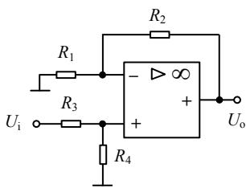
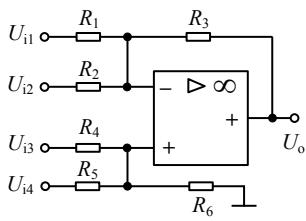
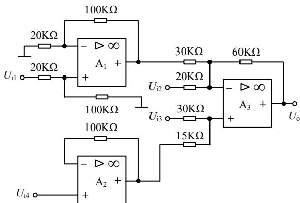
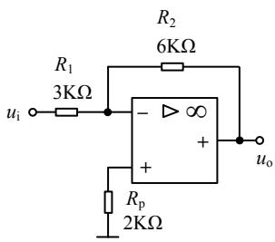
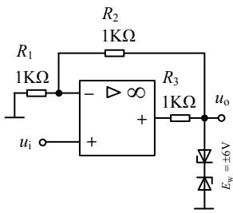
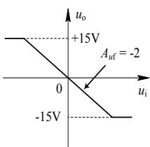
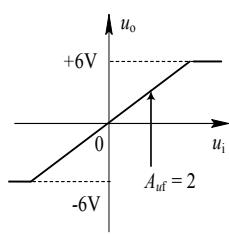
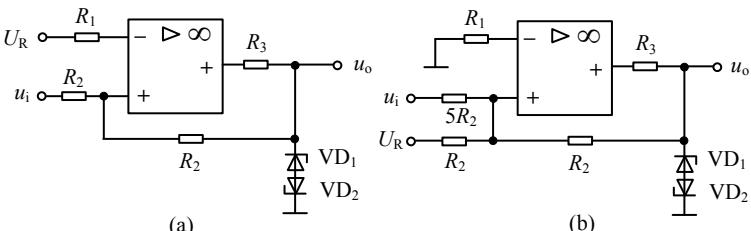
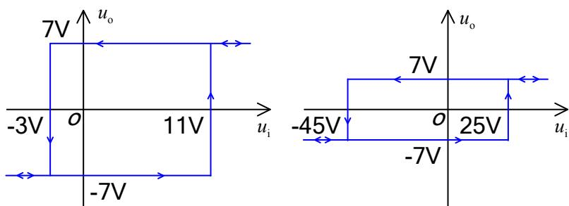

# 《电路分析与电工电子技术》第7章部分习题答案（张学军）

原件经识别和整理；“参考解答”是我们补的。

### 计算 1

试求图题 7.1 各电路的输出电压与输入电压的关系式。

答案：
(a) 根据虚断特性 $u_{+}=\frac{R_{4}}{R_{3}+R_{4}}U_{i},\quad u_{-}=\frac{R_{1}}{R_{1}+R_{2}}U_{0}$

根据虚短特性 $u_{+} = u_{-}$ ，所以 $U_{0} = (1 + \frac{R_2}{R_1})\frac{R_4}{R_3 + R_4} U_i$

(b) 当 $U_{i3} = U_{i4} = 0$ 时，电路转换为反相输入求和电路，输出

$$
U _ {\mathrm{o} 1 2} = - \left(\frac {R _ {3}}{R _ {1}} U _ {\mathrm{i} 1} + \frac {R _ {3}}{R _ {2}} U _ {\mathrm{i} 2}\right)
$$

当 $U_{i1}=U_{i2}=0$ 时，电路转换为同相输入求和电路，输出

$$
U _ {\mathrm{o} 3 4} = \left(1 + \frac {R _ {3}}{R _ {1} / / R _ {2}}\right) \left(\frac {R _ {5} / / R _ {6}}{R _ {4} + R _ {5} / / R _ {6}} U _ {\mathrm{i} 3} + \frac {R _ {4} / / R _ {6}}{R _ {5} + R _ {4} / / R _ {6}} U _ {\mathrm{i} 4}\right)
$$

根据线性叠加原理，总输出为

$$
U _ {\mathbf {o}} = U _ {\mathbf {o 1 2}} + U _ {\mathbf {o 3 4}}
$$

知识点：[基尔霍夫电压定律（KVL）及其应用](../../../topics/电路与电子技术/KVL.md)、[线性时不变电阻的伏安关系（欧姆定律）](../../../topics/电路与电子技术/线性电阻VCR.md)

### 计算 4

电路如图题 7.4 所示。已知 $U_{1}=U_{2}=U_{3}=U_{4}=10mV$ ，试求 $U_{0}=?$

答案：
运放 $\mathrm{A}_1$ 的输出为 $U_{\mathrm{o}1} = (1 + \frac{100}{20})\frac{100}{20 + 100} U_{\mathrm{i}1} = 5U_{\mathrm{i}1}$ ，运放 $\mathrm{A}_2$ 的输出为 $U_{\mathrm{o}4} = U_{\mathrm{i}4}$

$$
U _ {\mathrm{o}} = - \frac {6 0}{3 0} U _ {\mathrm{o} 1} - \frac {6 0}{2 0} U _ {\mathrm{i} 2} + (1 + \frac {6 0}{2 0 / / 3 0}) (\frac {1 5}{3 0 + 1 5} U _ {\mathrm{i} 3} + \frac {3 0}{3 0 + 1 5} U _ {\mathrm{o} 4}) = - 2 U _ {\mathrm{o} 1} - 3 U _ {\mathrm{i} 2} + 2 U _ {\mathrm{i} 3} + 4 U _ {\mathrm{o} 4}
$$

$$
= - 1 0 U _ {\mathrm{i} 1} - 3 U _ {\mathrm{i} 2} + 2 U _ {\mathrm{i} 3} + 4 U _ {\mathrm{i} 4} = - 7 U _ {\mathrm{i} 1} = - 7 0 \mathrm{mV}
$$

知识点：[理想电压源与理想电流源的特性](../../../topics/电路与电子技术/独立电源.md)、[线性时不变电阻的伏安关系（欧姆定律）](../../../topics/电路与电子技术/线性电阻VCR.md)、[基尔霍夫电压定律（KVL）及其应用](../../../topics/电路与电子技术/KVL.md)

### 计算 8

运放组成的电路如图题 7.8（a）、（b）所示，已知电源电压为 $\pm15V$ 。

(1) 试分别画出传输特性曲线 $u_{0}=f(u_{i})$ ;

(2) 若输入信号 $u_{i}=5\sin\omega t(V)$ ，试分别画出输出信号 $u_{o}$ 的波形。

答案：
(1) 电路（a）为反相比例放大器， $u_{0} = -\frac{R_{2}}{R_{1}} u_{i} = -\frac{6}{3} u_{i} = -2u_{i}$ ，电路（b）为同相比例放大器， $u_{0} = (1 + \frac{R_{2}}{R_{1}})u_{i} = (1 + \frac{1}{1})u_{i} = 2u_{i}$ ，所以它们的传输特性曲线分别如图7.8'（a）(b)所示。

（2）若输入信号 $u_{i}=5\sin\omega t(V)$ ，输出信号 $u_{0}$ 的波形分别如图 7.8' (c)(d) 所示。

知识点：[理想电压源与理想电流源的特性](../../../topics/电路与电子技术/独立电源.md)、[线性时不变电阻的伏安关系（欧姆定律）](../../../topics/电路与电子技术/线性电阻VCR.md)、[四种受控电源（VCVS、VCCS、CCVS、CCCS）的特性](../../../topics/电路与电子技术/受控电源.md)

### 计算 20

图题 7.20 所示为迟滞电压比较器电路，已知运放最大输出电压为 $\pm14V$ ，稳压管的稳定电压 $U_{Z}=6.3V$ ，稳压管的导通电压 $U_{\mathrm{D(on)}}=0.7V$ ， $U_{R}=2V$ 。试分别画出它们的传输特性并求出回差电压 $\Delta U$ 。

答案：
(a) 当 $u_{+} = u_{-}$ 时，输出处于临界状态，即将发生翻转。

根据虚断特性， $u_{-}=U_{R}$ ，

根据线性叠加原理， $u_{+}=\frac{R_{2}}{R_{2}+R_{2}}u_{i}+\frac{R_{2}}{R_{2}+R_{2}}u_{o}=\frac{1}{2}(u_{i}+u_{o})$

所以， $\frac{1}{2} (u_{\mathrm{i}} + u_{\mathrm{o}}) = U_{R}, u_{\mathrm{i}} = 2U_{R} - u_{\mathrm{o}} = 4 - u_{\mathrm{o}}$

当 $u_{0}=-7V$ 时， $u_{i}=U_{TH}=11V$ ；当 $u_{0}=7V$ 时， $u_{i}=U_{TL}=-3V$ 。

出回差电压 $\Delta U = U_{\mathrm{TH}} - U_{\mathrm{TL}} = 11 + 3 = 14\mathrm{V}$ 。传输特性如图7. $20^{\prime}$ (a)。

(b) 当 $u_{+} = u_{-}$ 时，输出处于临界状态，即将发生翻转。

根据虚断特性， $u_{-}=0$ ，

根据线性叠加原理，

$$
u _ {+} = \frac {0 . 5 R _ {2}}{5 R _ {2} + 0 . 5 R _ {2}} u _ {\mathrm{i}} + \frac {5 R _ {2} / / R _ {2}}{5 R _ {2} / / R _ {2} + R _ {2}} U _ {\mathrm{R}} + \frac {5 R _ {2} / / R _ {2}}{5 R _ {2} / / R _ {2} + R _ {2}} u _ {\mathrm{o}} = \frac {1}{1 1} u _ {\mathrm{i}} + \frac {5}{1 1} U _ {\mathrm{R}} + \frac {5}{1 1} u _ {\mathrm{o}}
$$

所以， $\frac{1}{11} u_{\mathrm{i}} + \frac{5}{11} U_{\mathrm{R}} + \frac{5}{11} u_{\mathrm{o}} = 0$ ， $u_{\mathrm{i}} = -5u_{\mathrm{o}} - 5U_{\mathrm{R}} = -5u_{\mathrm{o}} - 10$

当 $u_{0}=-7V$ 时， $u_{i}=U_{TH}=25V$ ；当 $u_{0}=7V$ 时， $u_{i}=U_{TL}=-45V$ 。

出回差电压 $\Delta U = U_{TH} - U_{TL} = 25 + 45 = 70V$ 。传输特性如图 7.20' (b)。

知识点：[理想电压源与理想电流源的特性](../../../topics/电路与电子技术/独立电源.md)、[线性时不变电阻的伏安关系（欧姆定律）](../../../topics/电路与电子技术/线性电阻VCR.md)、[基尔霍夫电流定律（KCL）及其应用](../../../topics/电路与电子技术/KCL.md)
