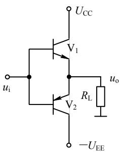
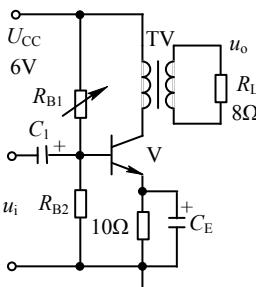
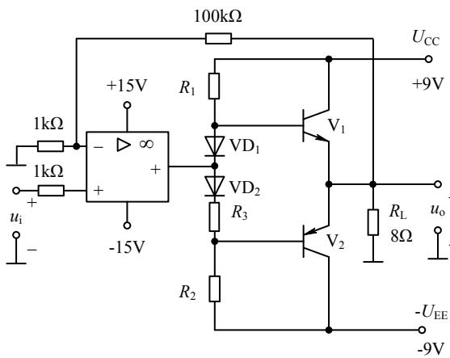

# 《电路分析与电工电子技术》第8章 功率放大器部分习题答案

原件经识别和整理；“参考解答”是我们补的。

## 计算 1

设 2AX81 的 $I_{\text{CM}} = 200\text{mA}$，$P_{\text{CM}} = 200\text{mW}$，$U_{(\text{BR})\text{CEO}} = 15\text{V}$；3AD6 的 $P_{\text{CM}} = 10\text{W}$（加散热板），$I_{\text{CM}} = 2\text{A}$，$U_{(\text{BR})\text{CEO}} = 24\text{V}$。求它们在变压器耦合单管甲类功放中的最佳交流负载电阻值。

解：当静态工作点 Q 确定后，适当选取交流负载电阻值 $R_{L}^{\prime}$，使 Q 点位于交流负载线位于放大区部分的中点，则可输出最大不失真功率，此时的 $R_{L}^{\prime}$ 称为最佳交流负载电阻。

忽略三极管的饱和压降和截止区，则有 $U_{cc} = I_{cQ} R'_{L}$。

同时应满足以下限制：$U_{CC} \cdot I_{CQ} \leq P_{CM}$，$U_{CC} \leq \frac{U_{(BR)CEO}}{2}$，$I_{CQ} \leq \frac{I_{CM}}{2}$。

(1) 对 2AX81 而言，应满足 $U_{cc}\cdot I_{CQ}\leq200\text{mW}$，$U_{cc}\leq7.5\text{V}$，$I_{CQ}\leq100\text{mA}$。取 $U_{cc}\cdot I_{CQ}=200\text{mW}$。

当 $U_{\mathrm{CC}} = 7.5\mathrm{V}$ 时，$I_{\mathrm{CQ}} = 26.7\mathrm{mA}$，此时 $R_{\mathrm{L}}^{\prime}$ 最大，$R_{\mathrm{L(max)}}^{\prime} = \frac{7.5}{26.7} = 0.28\mathrm{k}\Omega$；当 $I_{\mathrm{CQ}} = 100\mathrm{mA}$，$U_{\mathrm{CC}} = 2\mathrm{V}$ 时，此时 $R_{\mathrm{L}}^{\prime}$ 最小，$R_{\mathrm{L(min)}}^{\prime} = \frac{2}{100} = 0.02\mathrm{k}\Omega$；故最佳交流负载电阻值 $R_{\mathrm{L}}^{\prime}$ 为：$0.02\mathrm{k}\Omega \sim 0.28\mathrm{k}\Omega$。

(2) 对 3AD6 而言，应满足 $U_{cc}\cdot I_{CQ}\leq10\text{W}$，$U_{cc}\leq12\text{V}$，$I_{CQ}\leq1\text{A}$。取 $U_{cc}\cdot I_{CQ}=10\text{W}$。

当 $U_{CC}=12\text{V}$ 时，$I_{CQ}=0.83\text{A}$，此时 $R_{L}^{\prime}$ 最大，$R_{L(max)}^{\prime}=\frac{12}{0.83}=14.46\Omega$；

当 $I_{CQ}=1\text{A}$ 时，$U_{CC}=10\text{V}$，此时 $R_{L}^{\prime}$ 最小，$R_{\mathrm{L(min)}}^{\prime}=\frac{10}{1}=10\Omega$；

故最佳交流负载电阻值 $R_{L}^{\prime}$ 为：$10\Omega \sim 14.46\Omega$。

## 计算 2

图题 8-2 为理想乙类互补推挽功放电路，设 $U_{CC}=15\text{V}$，$U_{EE}=-15\text{V}$，$R_{L}=4\Omega$，$U_{CE(sat)}=0$，输入为正弦信号。试求

(1) 输出信号的最大功率；

(2) 输出最大信号功率时电源的功率、集电极功耗（单管）和效率；

(3) 每个晶体管的最大耗散功率 $P_{Tm}$ 是多少？在此条件下的效率是多少？

解：(1) $P_{\mathrm{om}} = \frac{1}{2}\frac{U_{\mathrm{CC}}^2}{R_{\mathrm{L}}} = \frac{1}{2}\times \frac{15^2}{4} = 28.13\mathrm{W}$

$$
P _ {\mathrm{Em}} = 2 U _ {\mathrm{cc}} \cdot \frac {U _ {\mathrm{cc}}}{\pi R _ {\mathrm{L}}} = \frac {2}{\pi} \times \frac {1 5 ^ {2}}{4} = 3 5. 8 3 \mathrm{W}\tag{2}
$$

$$
P _ {\mathrm{T}} = \frac {1}{2} (P _ {\mathrm{E}} - P _ {\mathrm{o}}) = \frac {1}{2} \times (3 5. 8 3 - 2 8. 1 3) = 3. 8 5 \mathrm{W}
$$

$$
\eta = \frac {\pi}{4} \xi = \frac {\pi}{4} = 78.5 \%
$$

(3) $P_{\mathrm{Tm}} = 0.2P_{\mathrm{om}} = 0.2\times 28.13 = 5.63\mathrm{W}$

$$
\eta = \frac {\pi}{4} \xi = \frac {\pi}{4} \times \frac {2}{\pi} = 50 \%
$$

## 计算 5

单管甲类功放电路如图题 8-5 所示，输出变压器的匝比 $n = 3$，其初级直流电阻 $r_1 = 10\Omega$，次级直流电阻 $r_2 = 1\Omega$，采用 3AX61 管（参数为 $I_{\mathrm{CM}} = 500\mathrm{mA}$，$P_{\mathrm{CM}} = 500\mathrm{mW}$，$U_{(\mathrm{BR})\mathrm{CEO}} = 30\mathrm{V}$，$\beta = 80$），忽略 $U_{\mathrm{CE(sat)}}$。调节上偏电阻 $R_{\mathrm{B1}}$ 可使 $R_{\mathrm{L}}$ 获得最大不失真输出功率为多少？

解：由题意知：

$$
R _ {\mathrm{L}} ^ {\prime} = n ^ {2} \left(R _ {\mathrm{L}} + r _ {2}\right) + r _ {1} = 9 \times (8 + 1) + 1 0 = 9 1 \Omega
$$

$$
U _ {\mathrm{CEQ}} = U _ {\mathrm{CC}} - I _ {\mathrm{CQ}} \left(r _ {1} + R _ {\mathrm{E}}\right) = 6 - 2 0 I _ {\mathrm{CQ}}
$$

当 Q 点位于交流负载线位于放大区部分的中点时，可输出最大不失真功率。所以，$U_{CEQ} = I_{CQ} R'_{L}$，即 $6 - 20 I_{CQ} = 91 I_{CQ}$。

解得 $I_{\mathrm{CQ}} = 0.054\mathrm{A} = 54\mathrm{mA}$，$U_{\mathrm{CEQ}} = 4.91\mathrm{V}$

$R_{\mathrm{L}}^{\prime}$ 获得最大不失真输出功率为 $P_{\mathrm{o}}^{\prime} = \frac{1}{2} U_{\mathrm{CEQ}}I_{\mathrm{CQ}} = \frac{1}{2}\times 4.91\times 0.054 = 0.13\mathrm{W}$，$R_{\mathrm{L}}$ 获得最大不失真输出功率为 $P_{\mathrm{o}} = P_{\mathrm{o}}^{\prime}\frac{R_{\mathrm{L}}}{R_{\mathrm{L}}^{\prime}} = 0.13\times \frac{72}{91} = 0.10\mathrm{W}$。

## 计算 8

功放电路如图题 8-8 所示，试问

(1) 指出电路中的反馈通路，并判断反馈组态；

(2) 估算电路在深度负反馈时的闭环电压增益；

(3) 设晶体管的饱和压降为 0.5V，电路的最大输出功率为多少？晶体管的参数 $I_{CM}$、$P_{CM}$、$U_{(BR)CEO}$ 如何选取？

(4) 如要求输出电压 $U_{om}=8V$，输入信号 $U_{im}=?$

解：(1) $100k\Omega$、$1\ k\Omega$ 电阻构成了互补乙类功放电路和运放构成的同相比例放大器之间的反馈通路。引入了级间电压串联负反馈。

(2) $U_{\mathrm{f}} = \frac{1}{100 + 1} U_{\mathrm{o}}$，根据 $U_{\mathrm{i}} = U_{\mathrm{f}}$，所以得 $A_{uf} = \frac{U_0}{U_i} = \frac{100 + 1}{1} = 101$

(3) $P_{\mathrm{om}} = \frac{1}{2}\frac{U_{\mathrm{om}}^2}{R_{\mathrm{L}}} = \frac{1}{2}\frac{(U_{\mathrm{CC}} - U_{\mathrm{CE(sat)}})^2}{R_{\mathrm{L}}} = \frac{1}{2}\times \frac{(9 - 0.5)^2}{8} = 4.52\mathrm{W}$

晶体管的参数应满足如下条件：

$$
\begin{array}{l} P _ {\mathrm{CM}} > 0. 2 P _ {\mathrm{om}} = 0. 2 \times 4. 5 2 = 0. 9 0 \mathrm{W} \\ I _ {\mathrm{CM}} > \frac {U _ {\mathrm{om}}}{R _ {\mathrm{L}}} = \frac {U _ {\mathrm{CC}} - U _ {\mathrm{CE(sat)}}}{R _ {\mathrm{L}}} = \frac {8 . 5}{8} = 1. 0 6 \mathrm{A} \\ U _ {(\mathrm{BR}) \mathrm{CEO}} > 2 U _ {\mathrm{CC}} - U _ {\mathrm{CE(sat)}} = 1 8 - 0. 5 = 1 7. 5 \mathrm{V} \end{array}
$$

(4) 因为 $A_{\mathrm{uf}} = 101, U_{\mathrm{om}} = 8\mathrm{V}$，所以 $U_{\mathrm{im}} = \frac{U_{\mathrm{om}}}{A_{\mathrm{uf}}} = \frac{8}{101}\mathrm{V} = 79.2\mathrm{mV}$
