# 《电路分析与电工电子技术》第8章 功率放大电路（课件）

原件的每一页，下面附识别出的文字。

### 第8章 功率放大电路

原文：

第8章 功率放大电路

### 8.1 功率放大电路的特点和分类：

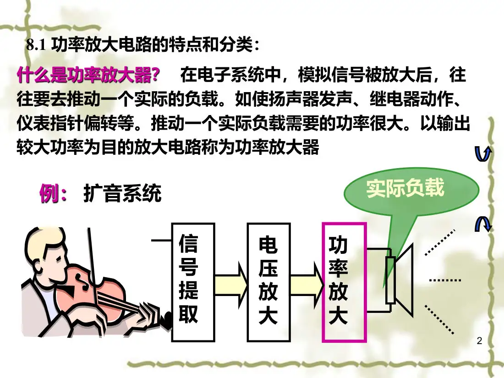

原文：

8.1 功率放大电路的特点和分类：

什么是功率放大器？在电子系统中，模拟信号被放大后，往往要去推动一个实际的负载。如使扬声器发声、继电器动作、仪表指针偏转等。推动一个实际负载需要的功率很大。以输出较大功率为目的放大电路称为功率放大器

实际负载

### 例2：温度控制

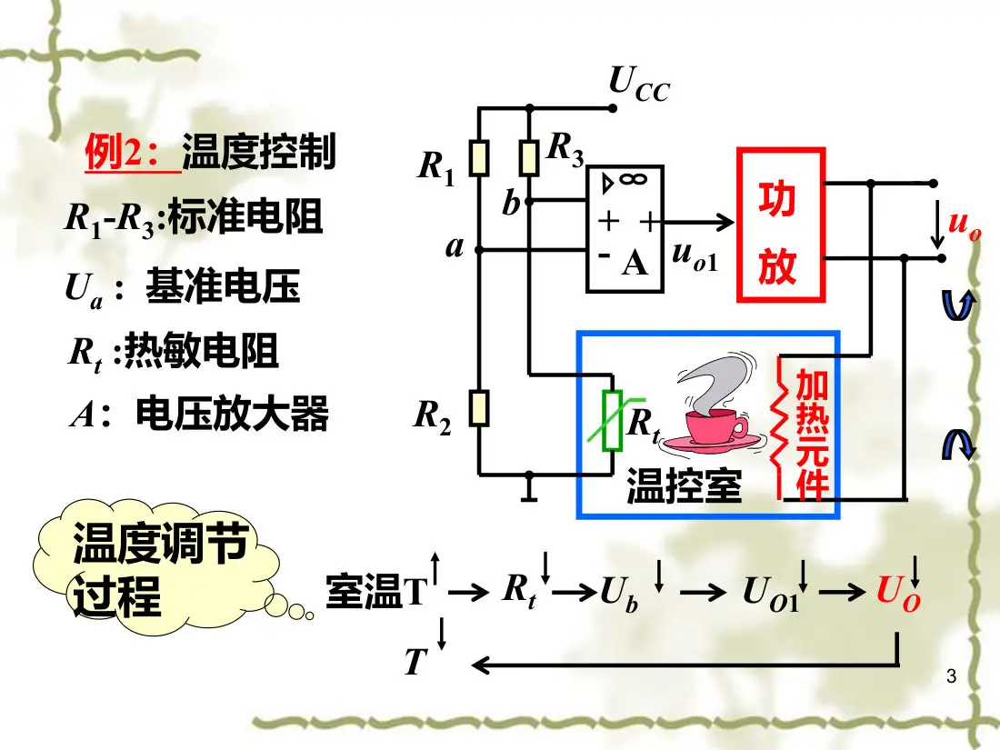

原文：

例2：温度控制

$R_{1}-R_{3}$ :标准电阻

$U_{a}$ ：基准电压

$R_{t}$ :热敏电阻

A: 电压放大器

温度调节过程

室温T↑→R↓t→Ub↓→Uo1↓→Uo
T↓←

### 1、功放电路的特点

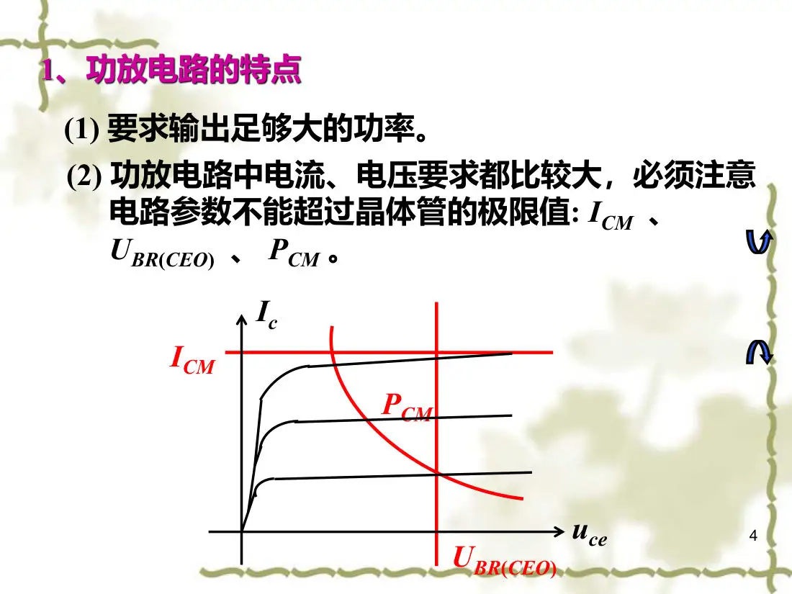

原文：

1、功放电路的特点

(1) 要求输出足够大的功率。

(2) 功放电路中电流、电压要求都比较大，必须注意电路参数不能超过晶体管的极限值: $I_{CM}$ 、

$$
U _ {B R (C E O)} \cdot P _ {C M} \circ
$$

### 1、功放电路的特点

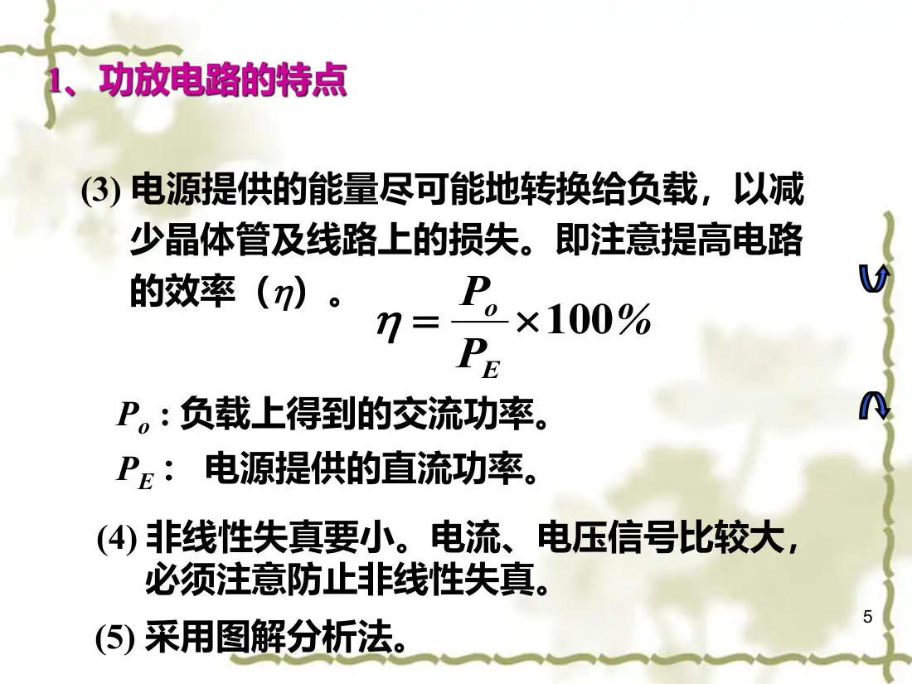

原文：

1、功放电路的特点

(3) 电源提供的能量尽可能地转换给负载，以减少晶体管及线路上的损失。即注意提高电路的效率（ $\eta$ ）。 $\eta = \frac{P_o}{P_E} \times 100\%$

$P_{o}$ ：负载上得到的交流功率。

$P_{E}$ ：电源提供的直流功率。

(4) 非线性失真要小。电流、电压信号比较大，必须注意防止非线性失真。

(5) 采用图解分析法。

5

### 电压放大器和功率放大器的相同点：

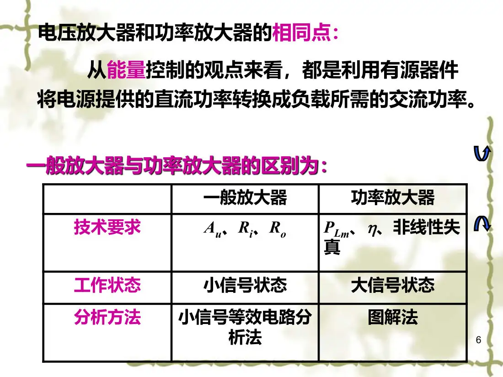

原文：

电压放大器和功率放大器的相同点：

从能量控制的观点来看，都是利用有源器件将电源提供的直流功率转换成负载所需的交流功率。

一般放大器与功率放大器的区别为：

<table><tr><td></td><td>一般放大器</td><td>功率放大器</td></tr><tr><td>技术要求</td><td> $A_u$ 、 $R_i$ 、 $R_o$ </td><td> $P_{Lm}$ 、 $η$ 、非线性失真</td></tr><tr><td>工作状态</td><td>小信号状态</td><td>大信号状态</td></tr><tr><td>分析方法</td><td>小信号等效电路分析法</td><td>图解法</td></tr></table>

### 二、工作状态分类

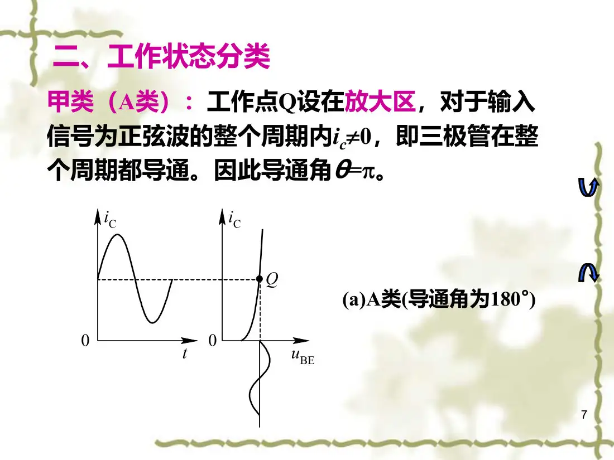

原文：

二、工作状态分类

甲类（A类）：工作点Q设在放大区，对于输入信号为正弦波的整个周期内 $i_{c}\neq0$ ，即三极管在整个周期都导通。因此导通角 $\theta=\pi$ 。

(a)A类(导通角为 $180^{\circ}$ )

### (b)B类(导通角为 $90^{\circ}$ )

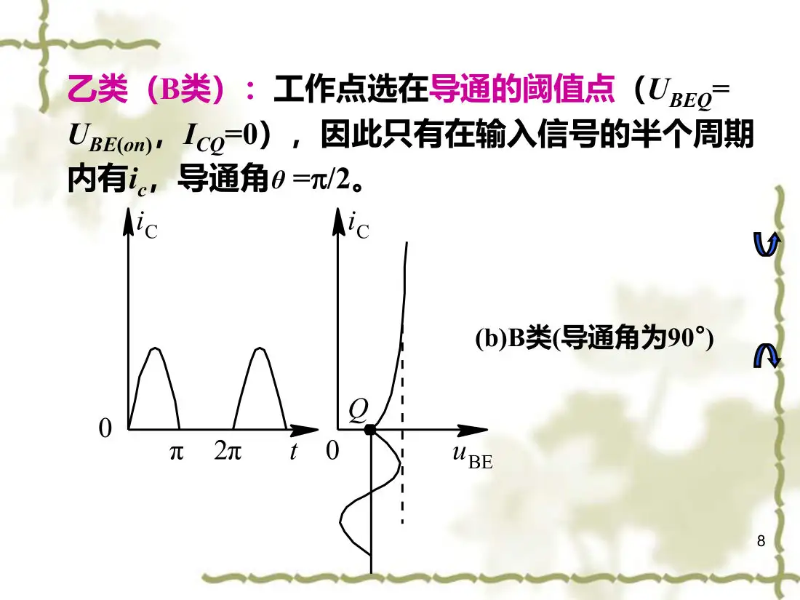

原文：

乙类（B类）：工作点选在导通的阈值点（ $U_{BEQ}=U_{BE(on)}, I_{CQ}=0$ ），因此只有在输入信号的半个周期内有 $i_{c}$ ，导通角 $\theta=\pi/2$ 。

(b)B类(导通角为 $90^{\circ}$ )

### 第 9 页

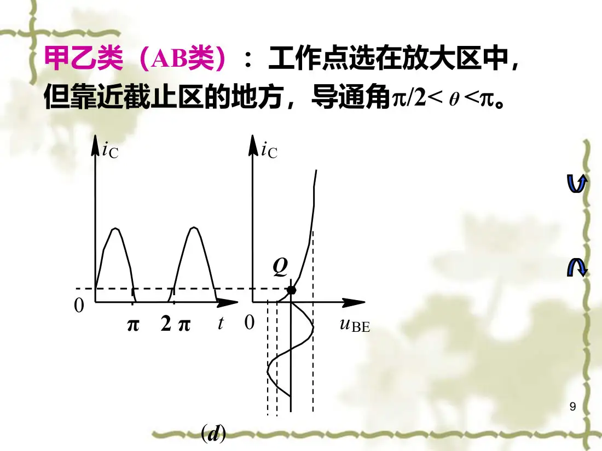

原文：

甲乙类（AB类）：工作点选在放大区中，但靠近截止区的地方，导通角 $\pi / 2 < \theta < \pi$ 。

### 10

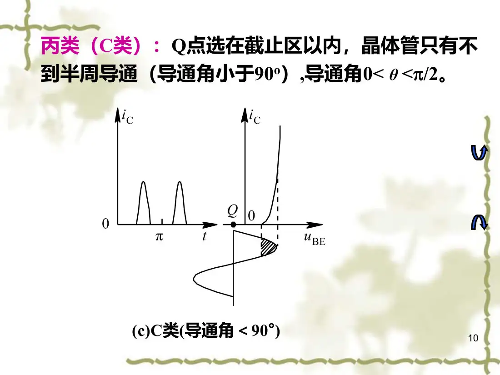

原文：

丙类（C类）：Q点选在截止区以内，晶体管只有不到半周导通（导通角小于 $90^{\circ}$ ），导通角 $0 < \theta < \pi / 2$ 。

10

### 8.2甲类功率放大器

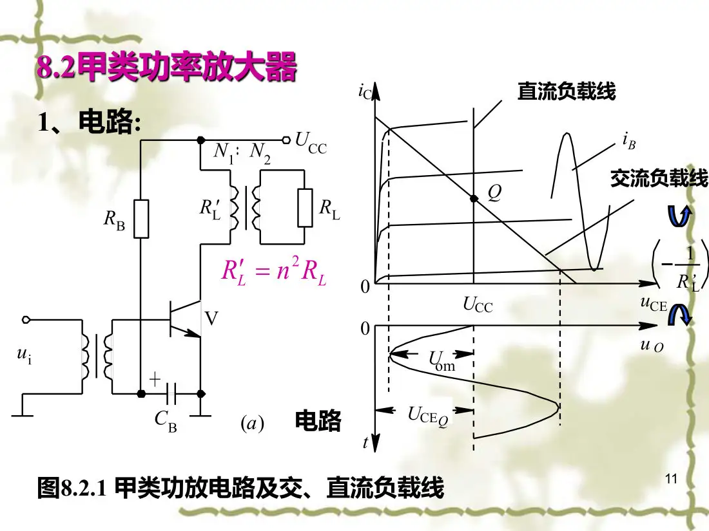

原文：

8.2甲类功率放大器

1、电路:

11

### 直流负载线

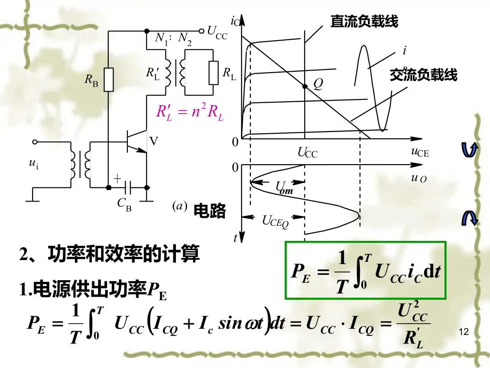

原文：

直流负载线

2、功率和效率的计算

1. 电源供出功率 $P_{\mathrm{E}}$

$$
P _ {E} = \frac {1}{T} \int_ {0} ^ {T} U _ {c c} i _ {c} \mathrm{d} t
$$

$$
P _ {E} = \frac {1}{T} \int_ {0} ^ {T} U _ {c c} (I _ {c Q} + I _ {c} \sin \omega t) d t = U _ {c c} \cdot I _ {c Q} = \frac {U _ {c c} ^ {2}}{R _ {L} ^ {\prime}}
$$

12

### 2. 电路输出功率 $P_{0}$

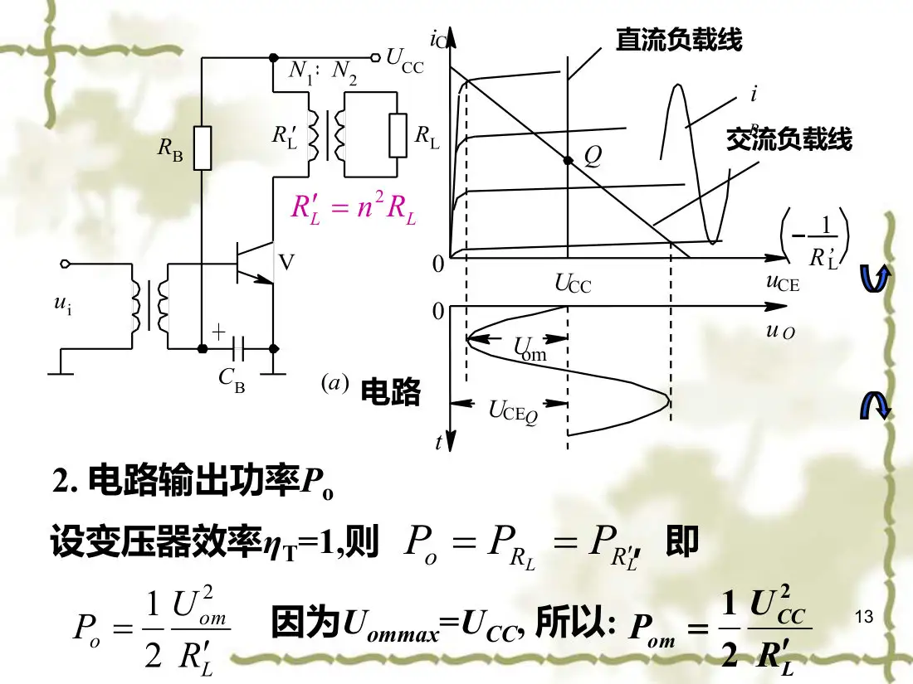

原文：

2. 电路输出功率 $P_{0}$

设变压器效率 $\eta_{T}=1$ ,则 $P_{o}=P_{R_{L}}=P_{R_{L}^{\prime}}$ 即 $P_{o}=\frac{1}{2}\frac{U_{om}^{2}}{R_{L}^{\prime}}$ 因为 $U_{ommax}=U_{CC}$ ，所以： $P_{om}=\frac{1}{2}\frac{U_{CC}^{2}}{R_{L}^{\prime}}$

### 3. 管子功耗 $P_{T}$

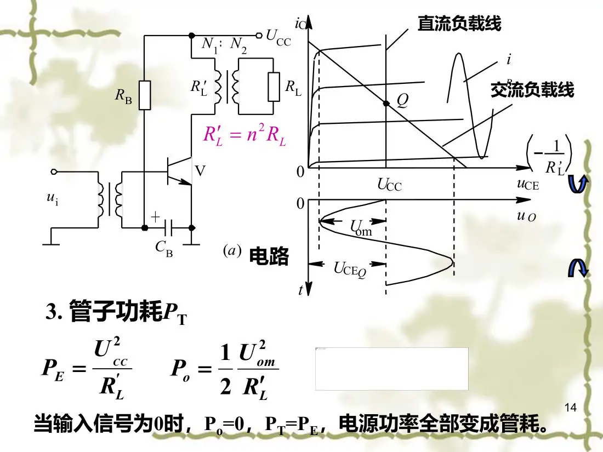

原文：

3. 管子功耗 $P_{T}$

$$
P _ {E} = \frac {U _ {c c} ^ {2}}{R _ {L} ^ {\prime}} \quad P _ {o} = \frac {1}{2} \frac {U _ {o m} ^ {2}}{R _ {L} ^ {\prime}}
$$

当输入信号为0时， $P_{o}=0$ ， $P_{T}=P_{E}$ ，电源功率全部变成管耗。

14

### (a) 电路

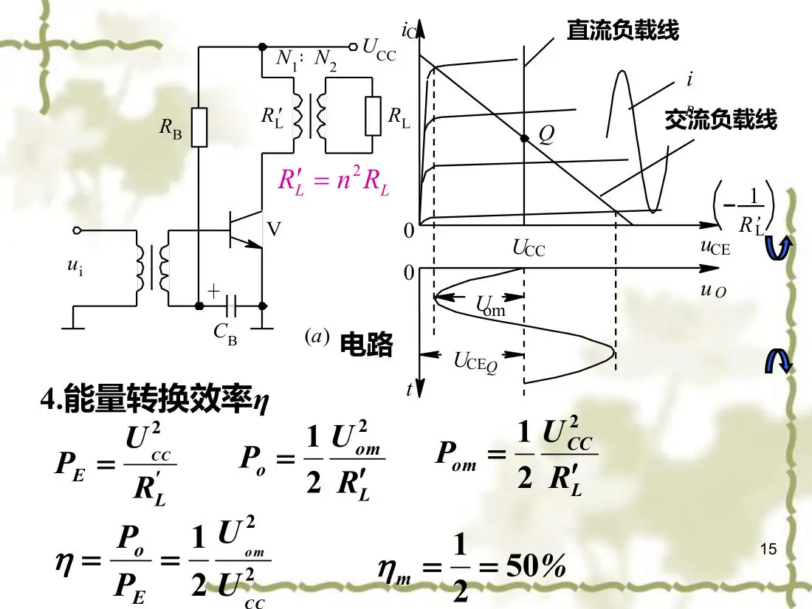

原文：

(a) 电路

4.能量转换效率η

$$
P _ {E} = \frac {U _ {c c} ^ {2}}{R _ {L} ^ {\prime}} \quad P _ {o} = \frac {1}{2} \frac {U _ {o m} ^ {2}}{R _ {L} ^ {\prime}} \quad P _ {o m} = \frac {1}{2} \frac {U _ {c c} ^ {2}}{R _ {L} ^ {\prime}}
$$

$$
\eta = \frac {P _ {o}}{P _ {E}} = \frac {1}{2} \frac {U _ {o m} ^ {2}}{U _ {c c} ^ {2}}
$$

直流负载线

$$
\eta_ {m} = \frac {1}{2} = 50 \%
$$

15

### 如何解决效率低的问题？

原文：

如何解决效率低的问题？

办法：降低Q点。

缺点：但又会引起截止失真。

既降低Q点又不会引起截止失真的办法：采用推挽输出电路，或互补跟随乙类功率放大器。

16

### 8.3 互补推挽乙类功率放大电路

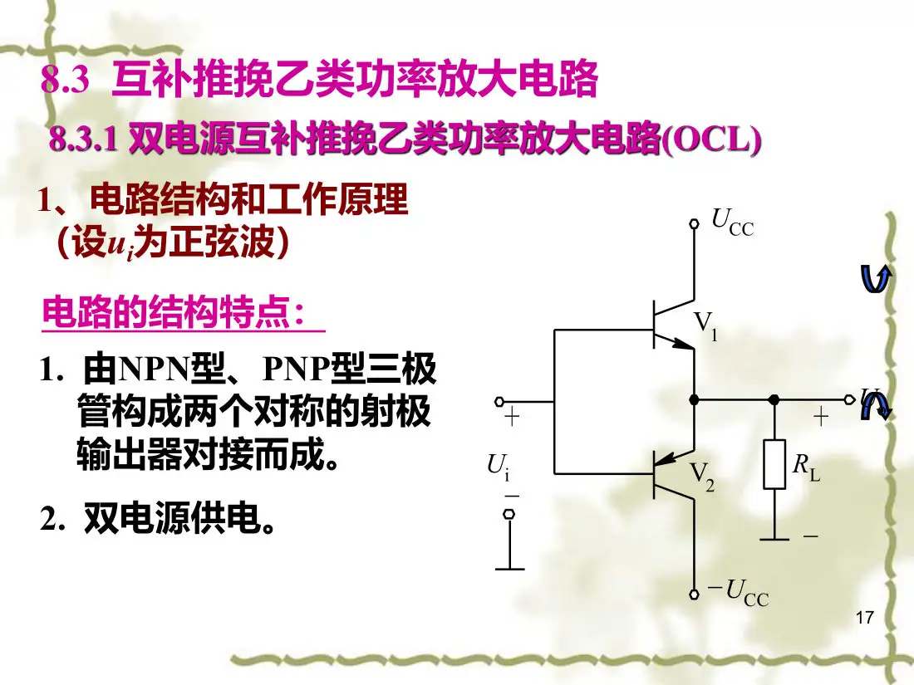

原文：

8.3 互补推挽乙类功率放大电路

8.3.1 双电源互补推挽乙类功率放大电路(OCL)

1、电路结构和工作原理
(设 $u_{i}$ 为正弦波)

电路的结构特点:

1. 由NPN型、PNP型三极管构成两个对称的射极输出器对接而成。

2. 双电源供电。

17

### 静态分析：

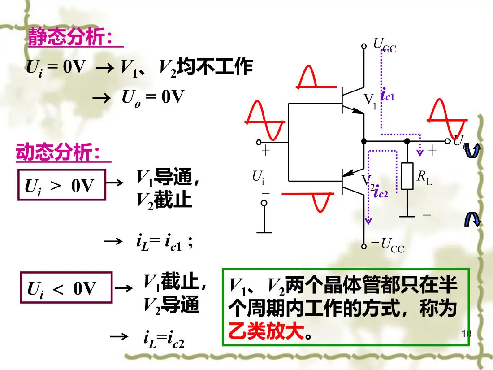

原文：

静态分析：

$$
\begin{array}{r l}U _ {i} = 0 \mathrm{V}&\rightarrow V _ {1}, V _ {2} \text {均不工作}\\&\rightarrow U _ {o} = 0 \mathrm{V}\end{array}
$$

动态分析：

$$
\begin{array}{r l}\boxed {U _ {i} > 0 \mathrm{V}}&\rightarrow V _ {1} \text {导通,}\\&\rightarrow V _ {2} \text {截止}\\&\rightarrow i _ {L} = i _ {c 1};\end{array}
$$

$$
\begin{array}{r l}\boxed {U _ {i} <   0 \mathrm{V}}&\rightarrow V _ {1} \text {截止},\\&\rightarrow V _ {2} \text {导通}\\&\rightarrow i _ {L} = i _ {c 2}\end{array}
$$

$V_{1}$ 、 $V_{2}$ 两个晶体管都只在半个周期内工作的方式，称为乙类放大。

18

### 电路特点:

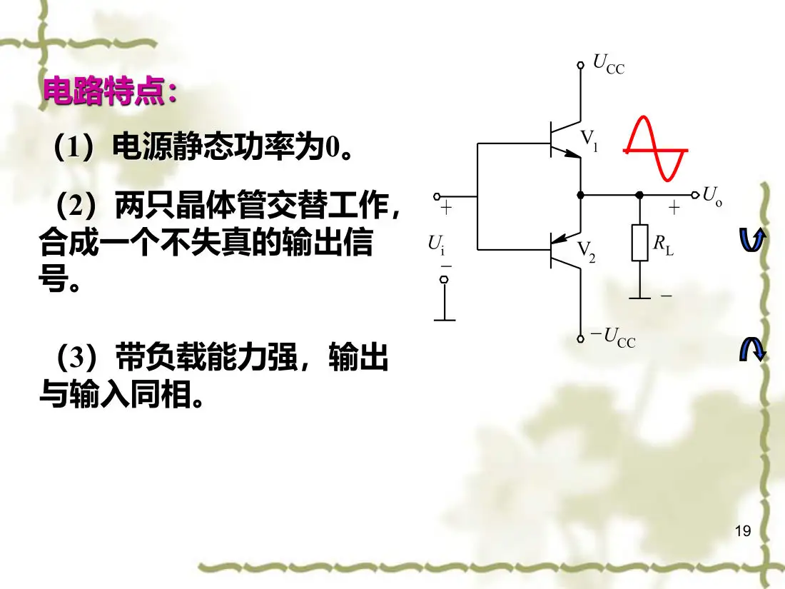

原文：

电路特点:

(1) 电源静态功率为0。

(2) 两只晶体管交替工作, 合成一个不失真的输出信号。

(3) 带负载能力强，输出与输入同相。

19

### 2. 功率与效率的计算

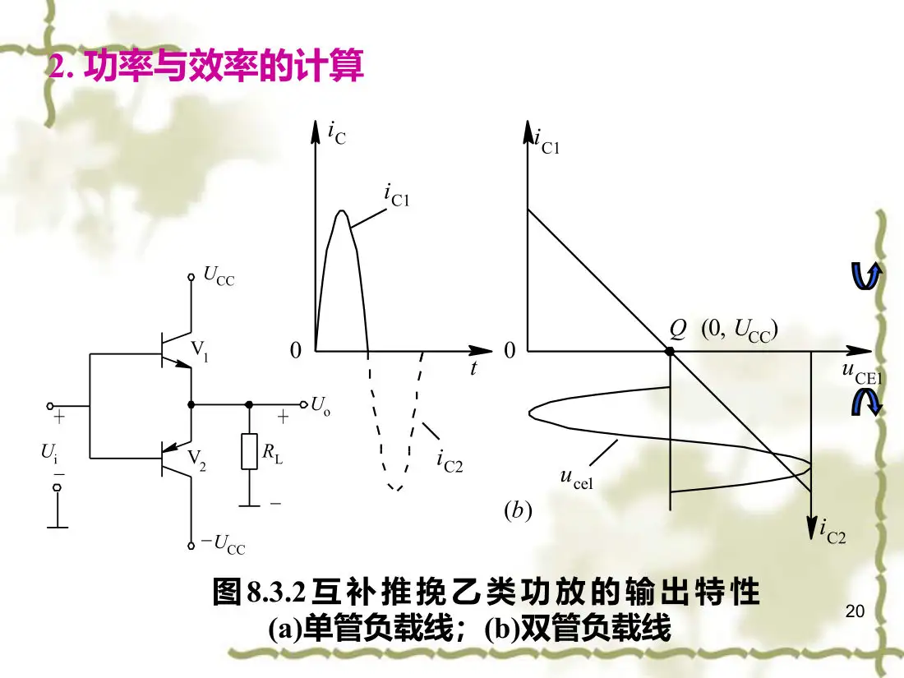

原文：

2. 功率与效率的计算

20

### 1) 输出交流功率 $P_{0}$

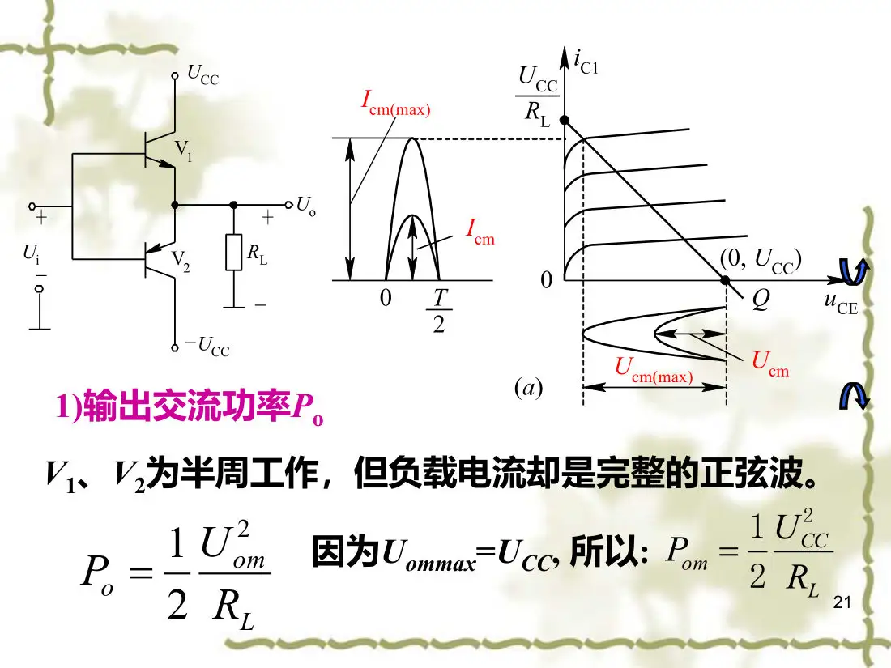

原文：

1) 输出交流功率 $P_{0}$

$V_{1}$ 、 $V_{2}$ 为半周工作，但负载电流却是完整的正弦波。

$P_{o}=\frac{1}{2}\frac{U_{om}^{2}}{R_{L}}$ 因为 $U_{ommax}=U_{CC}$ ，所以： $P_{om}=\frac{1}{2}\frac{U_{CC}^{2}}{R_{L}}$

### 2)电源提供的功率

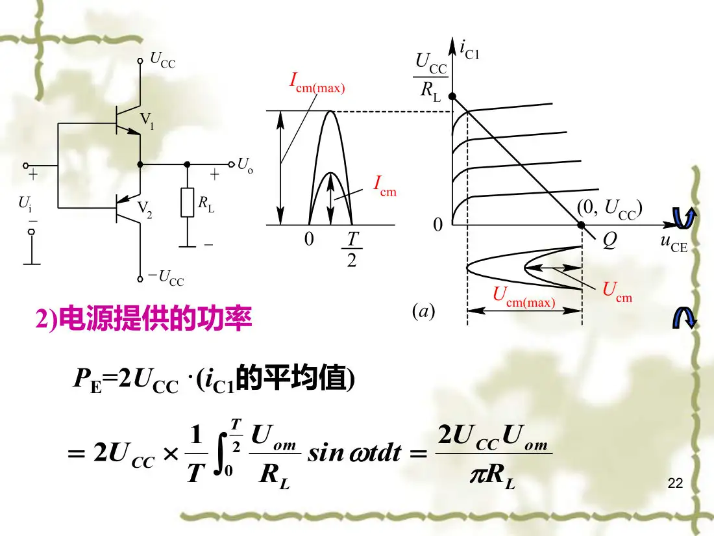

原文：

2)电源提供的功率

$P_{E}=2U_{CC}\cdot(i_{C1}$ 的平均值

$$
= 2 U _ {c c} \times \frac {1}{T} \int_ {0} ^ {\frac {T}{2}} \frac {U _ {o m}}{R _ {L}} \sin \omega t d t = \frac {2 U _ {c c} U _ {o m}}{\pi R _ {L}}
$$

22

### 2)电源提供的功率

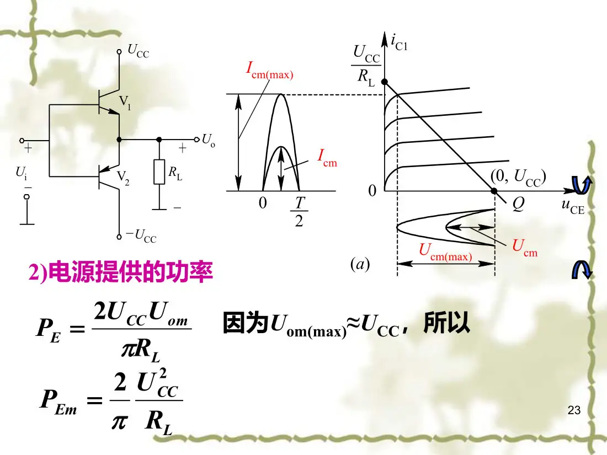

原文：

2)电源提供的功率

$P_{E}=\frac{2U_{CC}U_{om}}{\pi R_{L}}$ 因为 $U_{\mathrm{om(max)}}\approx U_{\mathrm{CC}}$ ，所以

$$
P _ {E m} = \frac {2}{\pi} \frac {U _ {c c} ^ {2}}{R _ {L}}
$$

23

### 2)电源提供的功率

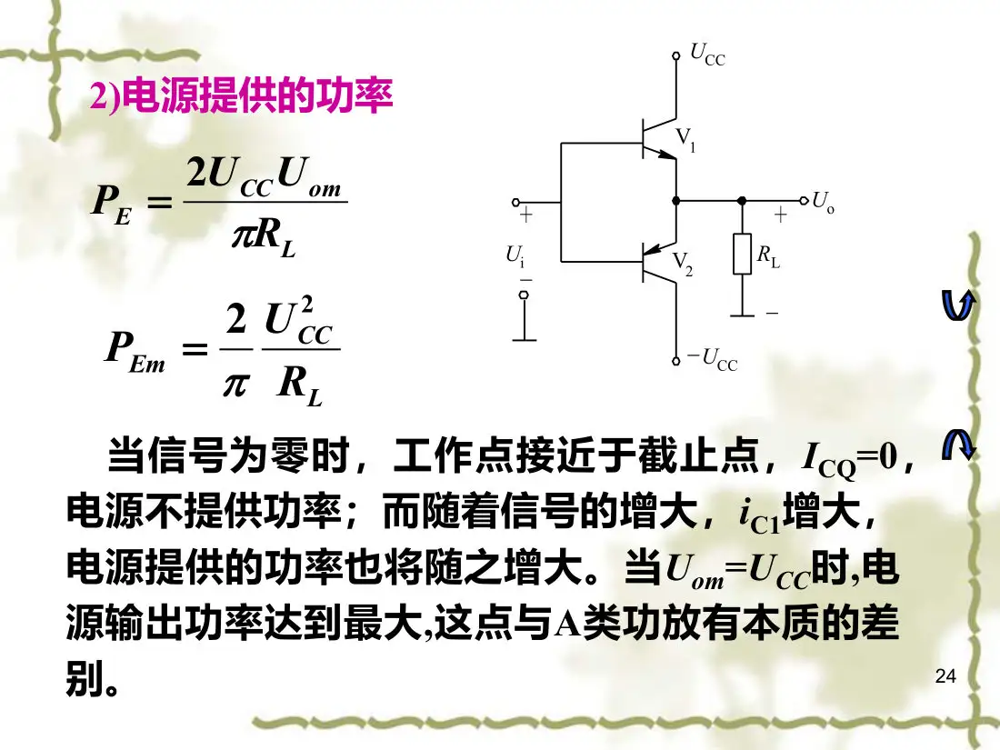

原文：

2)电源提供的功率

$$
P _ {E} = \frac {2 U _ {c c} U _ {o m}}{\pi R _ {L}}
$$

$$
P _ {E m} = \frac {2}{\pi} \frac {U _ {c c} ^ {2}}{R _ {L}}
$$

当信号为零时，工作点接近于截止点， $I_{\mathrm{CQ}} = 0$ ，电源不提供功率；而随着信号的增大， $i_{\mathrm{C1}}$ 增大，电源提供的功率也将随之增大。当 $U_{om} = U_{CC}$ 时，电源输出功率达到最大，这点与A类功放有本质的差别。

24

### 3)转换能量的效率η

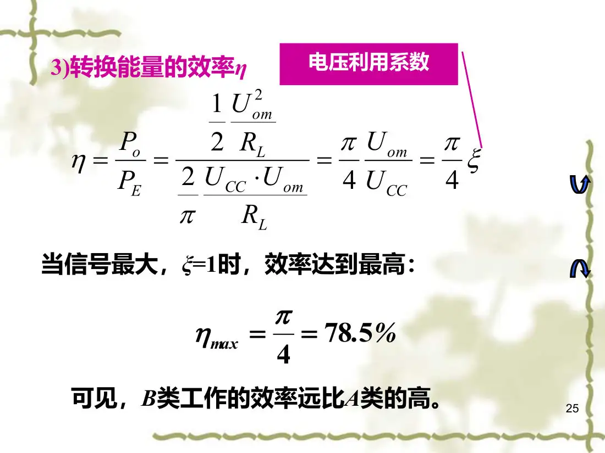

原文：

3)转换能量的效率η

电压利用系数

$$
\eta = \frac {P _ {o}}{P _ {E}} = \frac {\frac {1}{2} \frac {U _ {o m} ^ {2}}{R _ {L}}}{\frac {2}{\pi} \frac {U _ {C C} \cdot U _ {o m}}{R _ {L}}} = \frac {\pi}{4} \frac {U _ {o m}}{U _ {C C}} = \frac {\pi}{4} \xi
$$

当信号最大， $\xi = 1$ 时，效率达到最高：

$$
\eta_ {m a x} = \frac {\pi}{4} = 78.5 \%
$$

可见，B类工作的效率远比A类的高。

25

### 4)每个管子损耗 $\mathrm{P_T}$

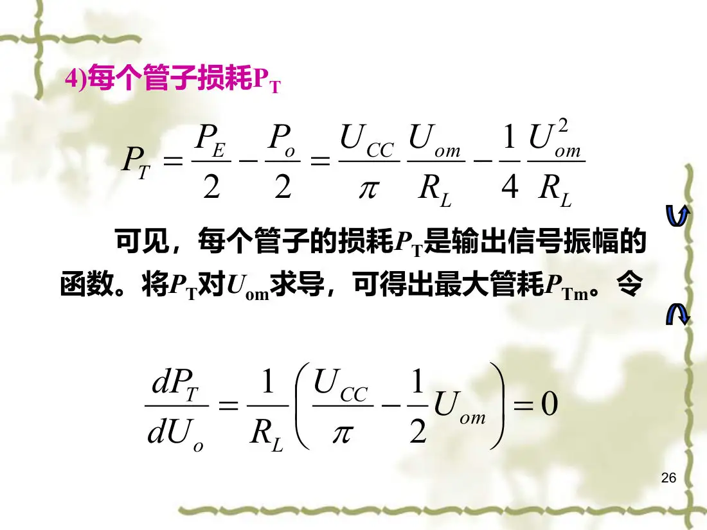

原文：

4)每个管子损耗 $\mathrm{P_T}$

$$
P _ {T} = \frac {P _ {E}}{2} - \frac {P _ {o}}{2} = \frac {U _ {C C}}{\pi} \frac {U _ {o m}}{R _ {L}} - \frac {1}{4} \frac {U _ {o m} ^ {2}}{R _ {L}}
$$

可见，每个管子的损耗 $P_{T}$ 是输出信号振幅的函数。将 $P_{T}$ 对 $U_{om}$ 求导，可得出最大管耗 $P_{Tm}$ 。令

$$
\frac {d P _ {T}}{d U _ {o}} = \frac {1}{R _ {L}} \left(\frac {U _ {C C}}{\pi} - \frac {1}{2} U _ {o m}\right) = 0
$$

26

### $$

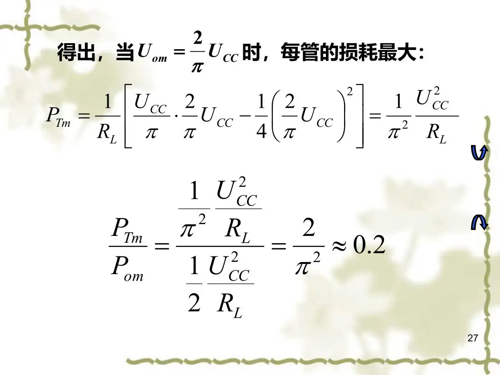

原文：

得出，当 $U_{om} = \frac{2}{\pi} U_{CC}$ 时，每管的损耗最大：

$$
P _ {T m} = \frac {1}{R _ {L}} \left[ \frac {U _ {C C}}{\pi} \cdot \frac {2}{\pi} U _ {C C} - \frac {1}{4} \left(\frac {2}{\pi} U _ {C C}\right) ^ {2} \right] = \frac {1}{\pi^ {2}} \frac {U _ {C C} ^ {2}}{R _ {L}}
$$

$$
\frac {P _ {T m}}{P _ {o m}} = \frac {\frac {1}{\pi^ {2}} \frac {U _ {C C} ^ {2}}{R _ {L}}}{\frac {1}{2} \frac {U _ {C C} ^ {2}}{R _ {L}}} = \frac {2}{\pi^ {2}} \approx 0. 2
$$

27

### 3. 选择功率管

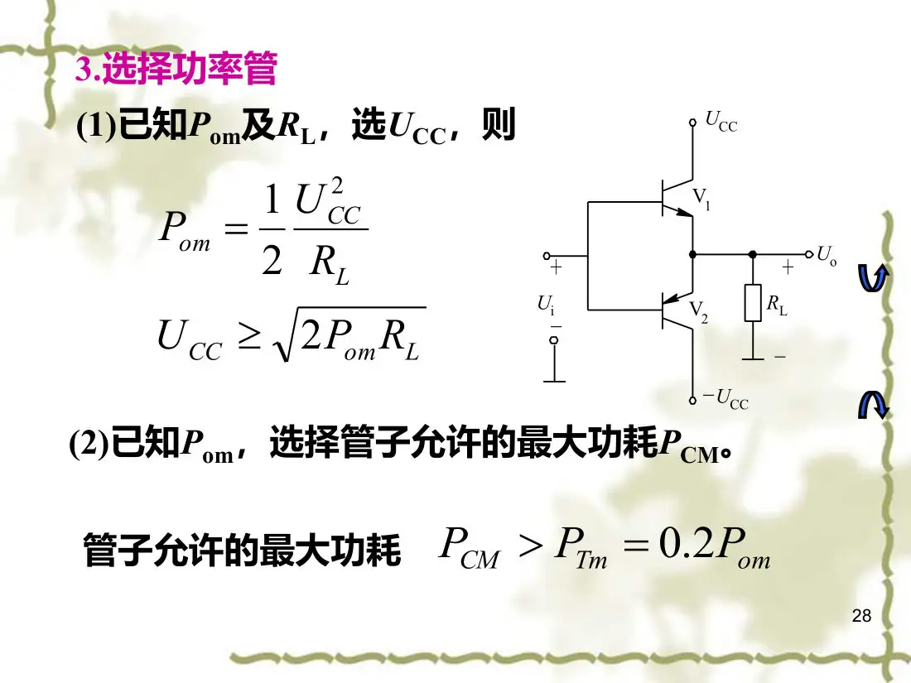

原文：

3. 选择功率管

(1)已知 $P_{om}$ 及 $R_{L}$ ，选 $U_{CC}$ ，则

$$
P _ {o m} = \frac {1}{2} \frac {U _ {C C} ^ {2}}{R _ {L}}
$$

$$
U _ {C C} \geq \sqrt {2 P _ {o m} R _ {L}}
$$

(2)已知 $P_{om}$ ，选择管子允许的最大功耗 $P_{CM}$ 。

管子允许的最大功耗 $P_{CM} > P_{Tm} = 0.2P_{om}$ (3)管子的击穿电压 $U_{(BR)CEO}$ $U_{(BR)CEO} > 2U_{CC}$

28

### (4)管子允许的最大电流 $I_{CM}$ 。

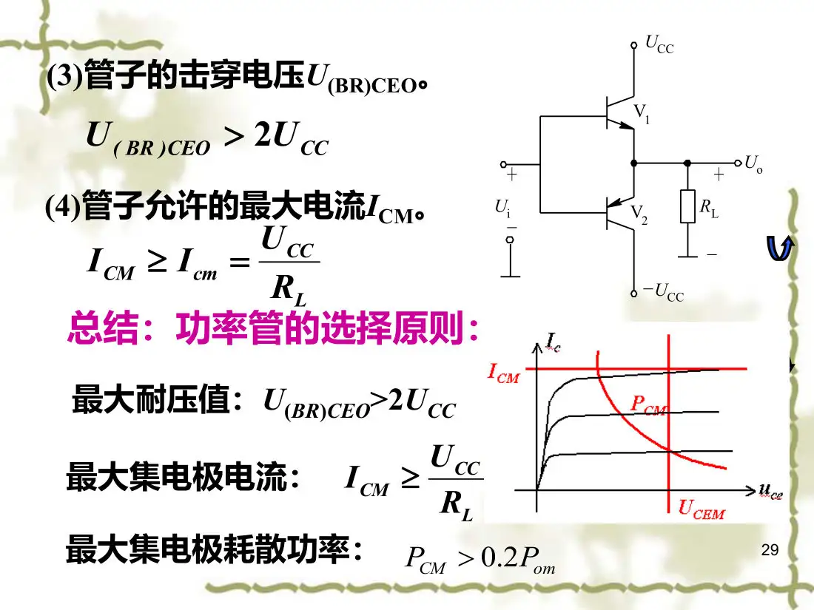

原文：

(4)管子允许的最大电流 $I_{CM}$ 。

$$
I _ {C M} \geq I _ {c m} = \frac {U _ {c c}}{R _ {L}}
$$

总结: 功率管的选择原则:
最大耐压值: $U_{(BR)CEO} > 2U_{CC}$ 最大集电极电流: $I_{CM} \geq \frac{U_{CC}}{R_L}$ 最大集电极耗散功率: $P_{CM} > 0$

$$
P _ {C M} > 0. 2 P _ {o m}
$$

29

### 乙类放大的输入输出波形关系:

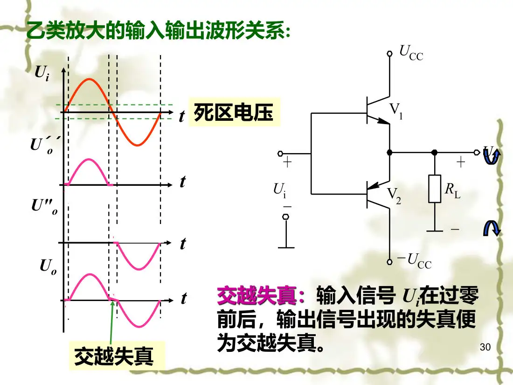

原文：

乙类放大的输入输出波形关系:

死区电压

交越失真：输入信号 $U_{i}$ 在过零前后，输出信号出现的失真便为交越失真。

30

### 乙类放大的特点:

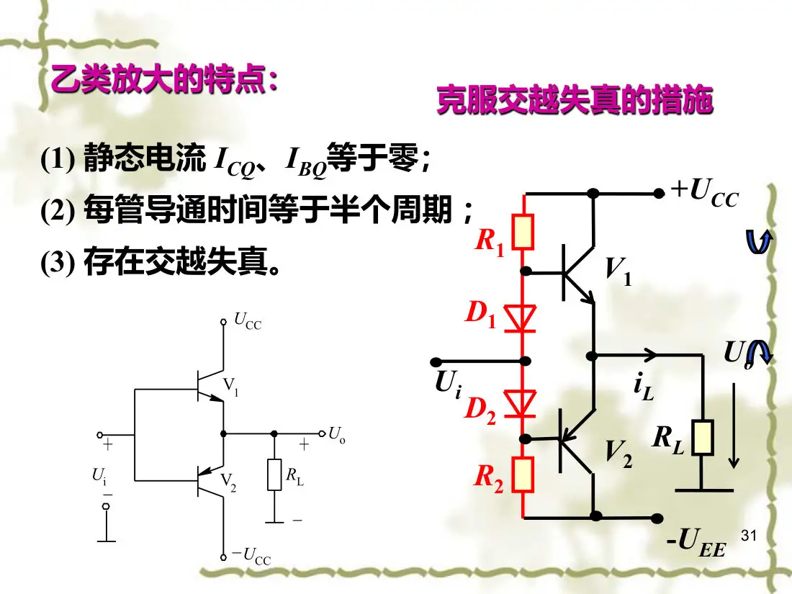

原文：

乙类放大的特点:

(1) 静态电流 $I_{CQ}$ 、 $I_{BQ}$ 等于零；

(2) 每管导通时间等于半个周期；

(3) 存在交越失真。

克服交越失真的措施

### 32

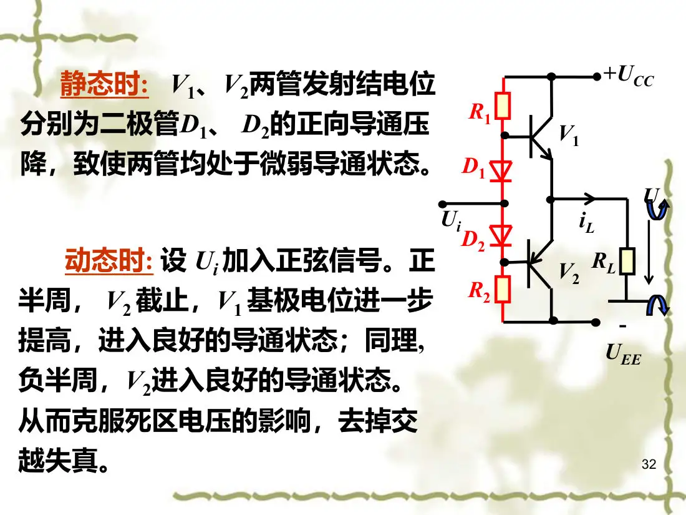

原文：

静态时: $V_{1} 、 V_{2}$ 两管发射结电位分别为二极管 $D_{1} 、 D_{2}$ 的正向导通压降, 致使两管均处于微弱导通状态。

动态时: 设 $U_{i}$ 加入正弦信号。正半周， $V_{2}$ 截止， $V_{1}$ 基极电位进一步提高，进入良好的导通状态；同理，负半周， $V_{2}$ 进入良好的导通状态。从而克服死区电压的影响，去掉交越失真。

32

### $U_{BE}$ 电压倍增电路

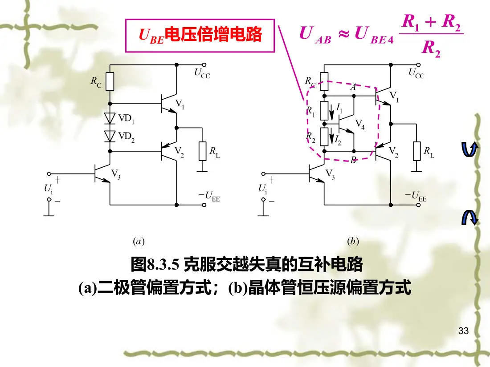

原文：

$U_{BE}$ 电压倍增电路

$$
U _ {A B} \approx U _ {B E 4} \frac {R _ {1} + R _ {2}}{R _ {2}}
$$

(a)二极管偏置方式；(b)晶体管恒压源偏置方式

33

### 8.3.2 单电源互补跟随乙类功率放大器(OTL)

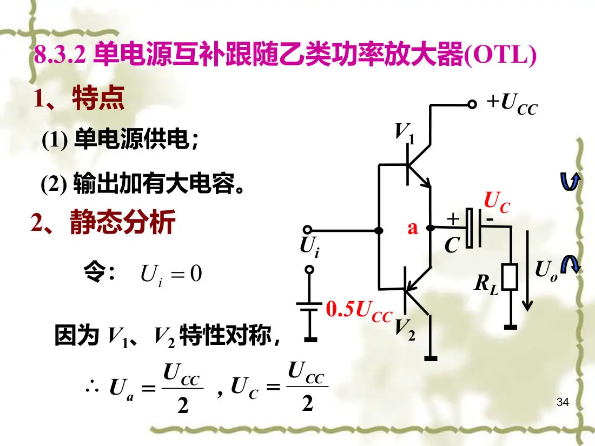

原文：

8.3.2 单电源互补跟随乙类功率放大器(OTL)

1、特点

(1) 单电源供电；

(2) 输出加有大电容。

2、静态分析

令： $U_{i} = 0$

$$
V _ {1}, \quad V _ {2}
$$

$$
\therefore U _ {a} = \frac {U _ {c c}}{2}, U _ {c} = \frac {U _ {c c}}{2}
$$

34

### 3、动态分析

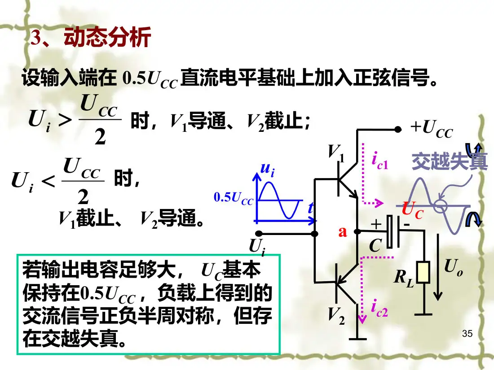

原文：

3、动态分析

设输入端在 $0.5U_{cc}$ 直流电平基础上加入正弦信号。

$U_{i} > \frac{U_{cc}}{2}$ 时， $V_{1}$ 导通、 $V_{2}$ 截止；

$U_{i}<\frac{U_{cc}}{2}$ 时， $V_{1}$ 截止、 $V_{2}$ 导通。

若输出电容足够大， $U_{C}$ 基本保持在 $0.5U_{CC}$ ，负载上得到的交流信号正负半周对称，但存在交越失真。

35

### $$

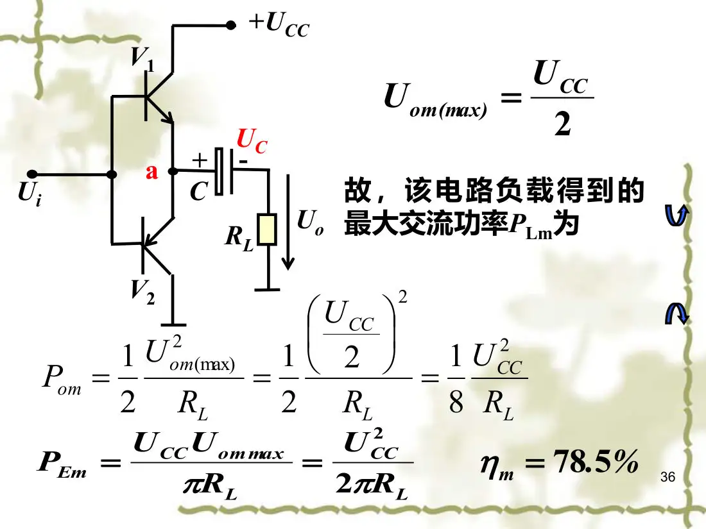

原文：

$$
U _ {o m (m a x)} = \frac {U _ {c c}}{2}
$$

故，该电路负载得到的最大交流功率 $P_{Lm}$ 为

$$
P _ {o m} = \frac {1}{2} \frac {U _ {o m (\mathrm{max})} ^ {2}}{R _ {L}} = \frac {1}{2} \frac {\left(\frac {U _ {c c}}{2}\right) ^ {2}}{R _ {L}} = \frac {1}{8} \frac {U _ {c c} ^ {2}}{R _ {L}}
$$

$$
P _ {E m} = \frac {U _ {C C} U _ {o m m a x}}{\pi R _ {L}} = \frac {U _ {C C} ^ {2}}{2 \pi R _ {L}} \eta_ {m} = 78.5
$$

36

### 带前置放大级的单电源功率放大器

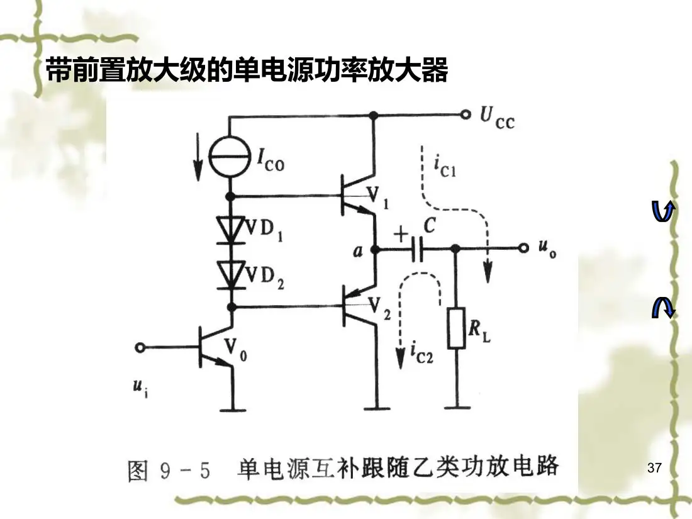

原文：

带前置放大级的单电源功率放大器

37

### 实用OTL互补输出功放电路

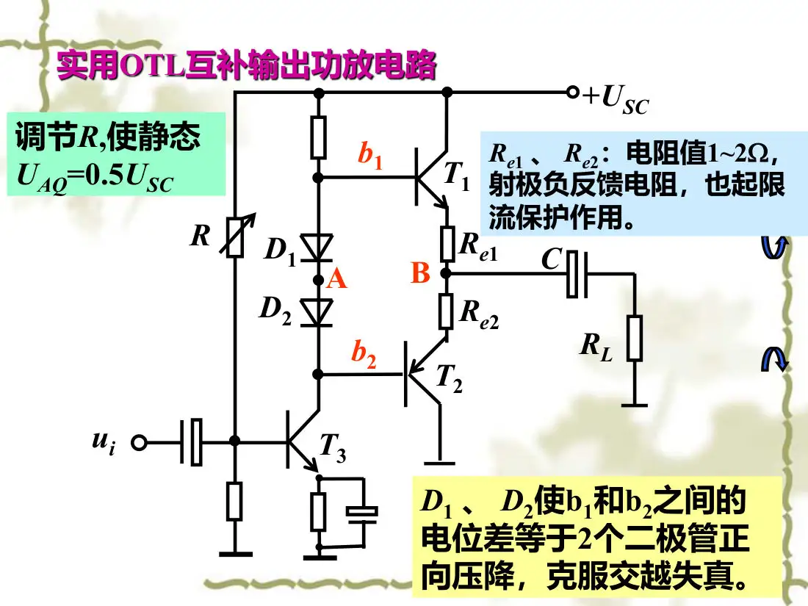

原文：

实用OTL互补输出功放电路

调节R,使静态 $U_{AQ}=0.5U_{SC}$

$R_{e1}$ 、 $R_{e2}$ ：电阻值1\~2Ω，射极负反馈电阻，也起限流保护作用。

$D_{1}$ 、 $D_{2}$ 使 $\mathbf{b}_1$ 和 $\mathbf{b}_2$ 之间的电位差等于2个二极管正向压降，克服交越失真。

### 乙类功放的几个关键公式：

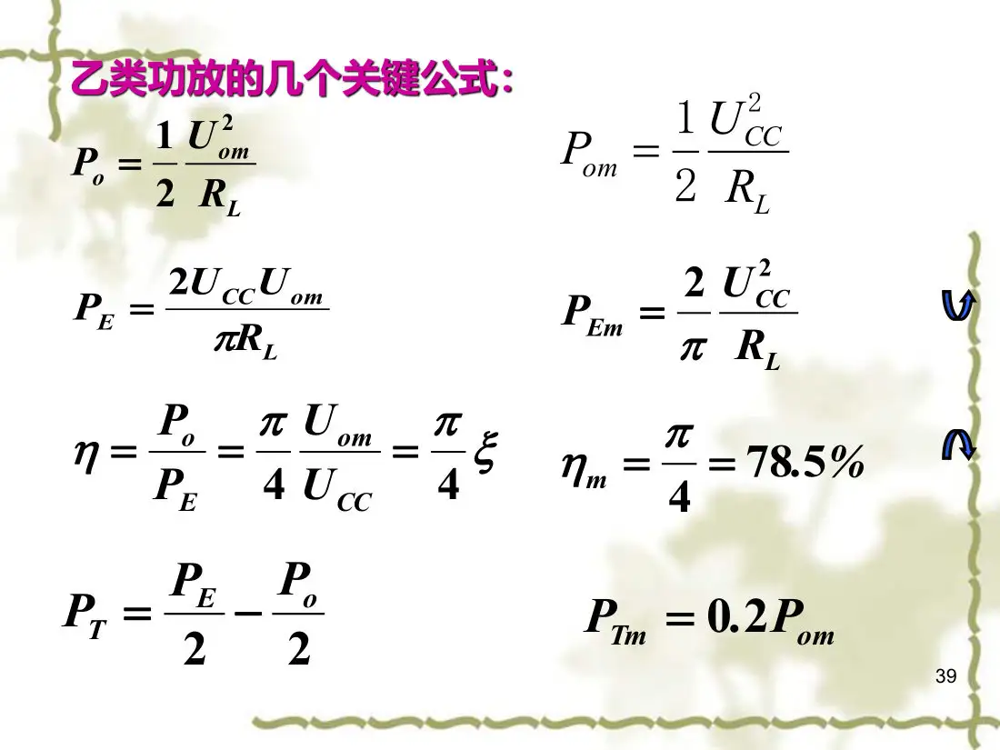

原文：

乙类功放的几个关键公式：

$$
P _ {o} = \frac {1}{2} \frac {U _ {o m} ^ {2}}{R _ {L}}
$$

$$
P _ {o m} = \frac {1}{2} \frac {U _ {c c} ^ {2}}{R _ {L}}
$$

$$
P _ {E} = \frac {2 U _ {C C} U _ {o m}}{\pi R _ {L}}
$$

$$
P _ {E m} = \frac {2}{\pi} \frac {U _ {c c} ^ {2}}{R _ {L}}
$$

$$
\eta = \frac {P _ {o}}{P _ {E}} = \frac {\pi}{4} \frac {U _ {o m}}{U _ {c c}} = \frac {\pi}{4} \xi \quad \eta_ {m} = \frac {\pi}{4} = 78.5
$$

$$
P _ {T} = \frac {P _ {E}}{2} - \frac {P _ {o}}{2}
$$

$$
P _ {T m} = 0. 2 P _ {o m}
$$

39

### $$

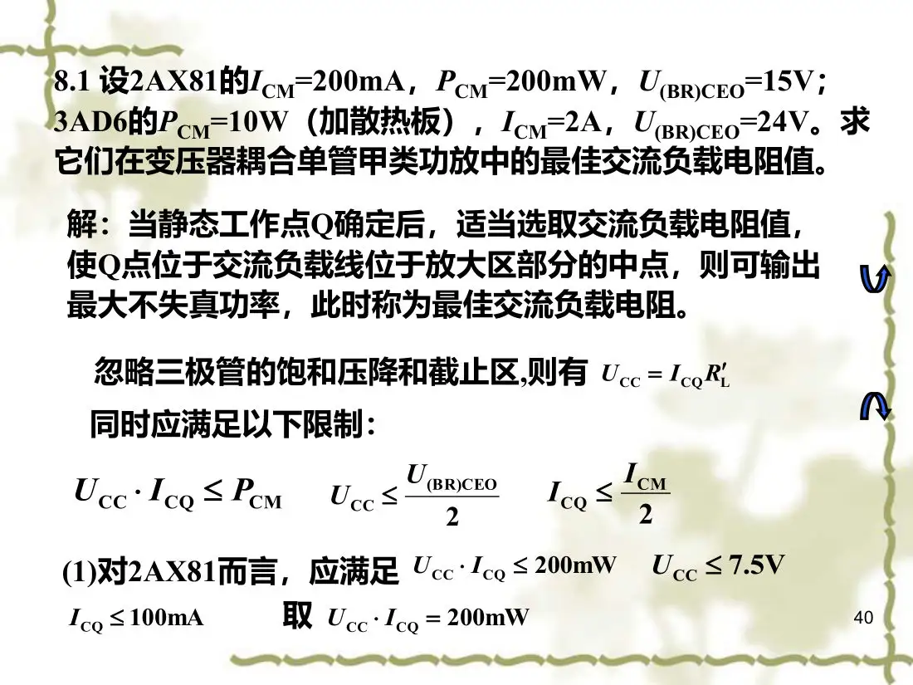

原文：

8.1 设2AX81的 $I_{CM}=200mA$ ， $P_{CM}=200mW$ ， $U_{(BR)CEO}=15V$ ；
3AD6的 $P_{CM}=10W$ （加散热板）， $I_{CM}=2A$ ， $U_{(BR)CEO}=24V$ 。求它们在变压器耦合单管甲类功放中的最佳交流负载电阻值。

解：当静态工作点Q确定后，适当选取交流负载电阻值，使Q点位于交流负载线位于放大区部分的中点，则可输出最大不失真功率，此时称为最佳交流负载电阻。

忽略三极管的饱和压降和截止区,则有 $U_{cc} = I_{CQ} R_{L}'$ 同时应满足以下限制：

$$
U _ {\mathrm{CC}} \cdot I _ {\mathrm{CQ}} \leq P _ {\mathrm{CM}} U _ {\mathrm{CC}} \leq \frac {U _ {\mathrm{(BR)CEO}}}{2} I _ {\mathrm{CQ}} \leq \frac {I _ {\mathrm{CM}}}{2}
$$

(1)对2AX81而言，应满足 $U_{cc} \cdot I_{cQ} \leq 200mW$ $U_{cc} \leq 7.5V$ $I_{cQ} \leq 100mA$ 取 $U_{cc} \cdot I_{cQ} = 200mW$

40

### 解：

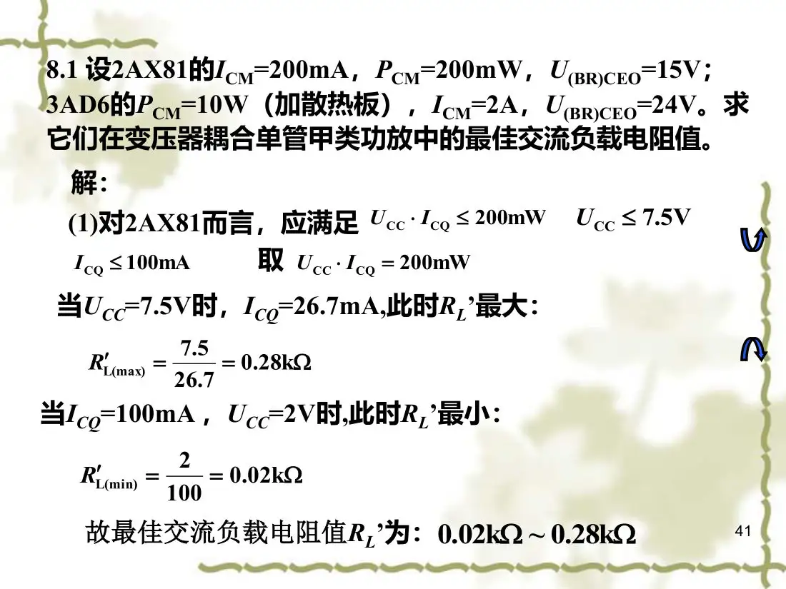

原文：

8.1 设2AX81的 $I_{CM}=200mA$ ， $P_{CM}=200mW$ ， $U_{(BR)CEO}=15V$ ；
3AD6的 $P_{CM}=10W$ （加散热板）， $I_{CM}=2A$ ， $U_{(BR)CEO}=24V$ 。求它们在变压器耦合单管甲类功放中的最佳交流负载电阻值。

解：

(1)对2AX81而言，应满足 $U_{cc} \cdot I_{cq} \leq 200mW$ $U_{cc} \leq 7.5V$ $I_{CQ} \leq 100mA$ 取 $U_{cc} \cdot I_{CQ} = 200mW$

当 $U_{CC}=7.5V$ 时， $I_{CQ}=26.7mA$ ，此时 $R_{L}$ 最大：

$$
R _ {\mathrm{L} (\max)} ^ {\prime} = \frac {7 . 5}{2 6 . 7} = 0. 2 8 \mathrm{k} \Omega
$$

当 $I_{CQ}=100mA$ ， $U_{CC}=2V$ 时,此时 $R_{L}$ 最小:

$$
R _ {\mathrm{L(min)}} ^ {\prime} = \frac {2}{1 0 0} = 0. 0 2 \mathrm{k} \Omega
$$

故最佳交流负载电阻值 $R_{L}$ 为：0.02kΩ\~0.28kΩ

41

### 解：

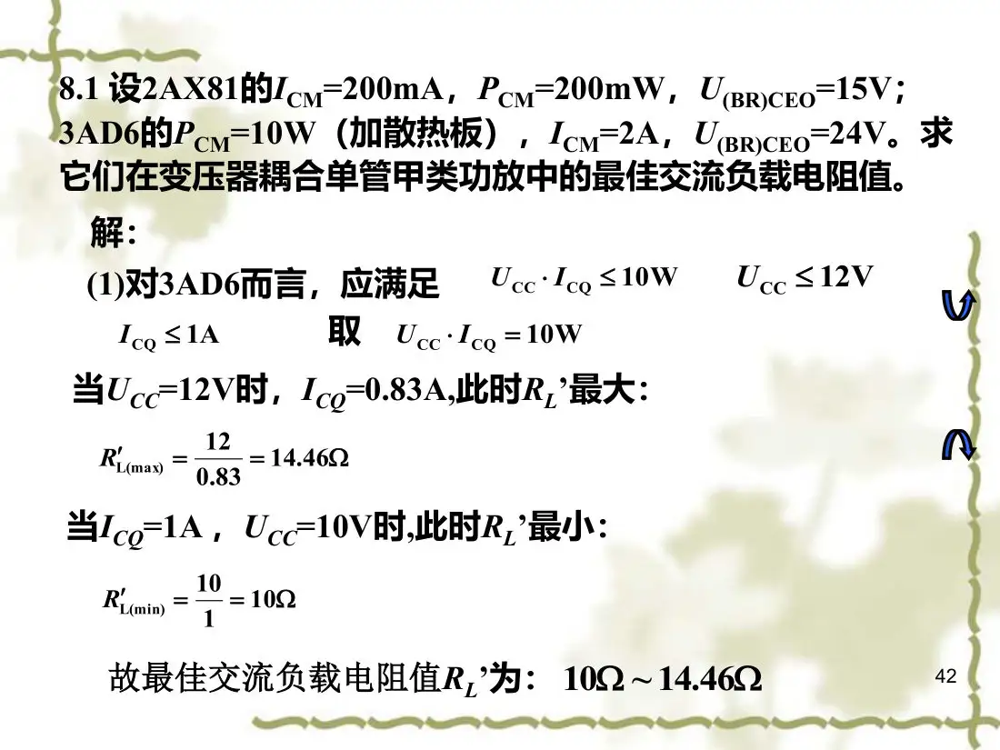

原文：

8.1 设2AX81的 $I_{CM}=200mA$ ， $P_{CM}=200mW$ ， $U_{(BR)CEO}=15V$ ；
3AD6的 $P_{CM}=10W$ （加散热板）， $I_{CM}=2A$ ， $U_{(BR)CEO}=24V$ 。求它们在变压器耦合单管甲类功放中的最佳交流负载电阻值。

解：

(1)对3AD6而言，应满足 $U_{\mathrm{cc}} \cdot I_{\mathrm{CQ}} \leq 10 \mathrm{~W}$ $U_{\mathrm{cc}} \leq 12 \mathrm{~V}$

$$
I _ {\mathrm{CQ}} \leq 1 \mathrm{A} \quad \text {取} \quad U _ {\mathrm{CC}} \cdot I _ {\mathrm{CQ}} = 1 0 \mathrm{W}
$$

当 $U_{CC}=12V$ 时， $I_{CQ}=0.83A$ ，此时 $R_{L}$ 最大：

$$
R _ {\mathrm{L} (\max)} ^ {\prime} = \frac {1 2}{0 . 8 3} = 1 4. 4 6 \Omega
$$

当 $I_{CQ}=1A$ ， $U_{CC}=10V$ 时,此时 $R_{L}$ 最小:

$$
R _ {\mathrm{L(min)}} ^ {\prime} = \frac {1 0}{1} = 1 0 \Omega
$$

故最佳交流负载电阻值 $R_{L}$ 为：10Ω\~14.46Ω

42

### (1)输出信号的最大功率;

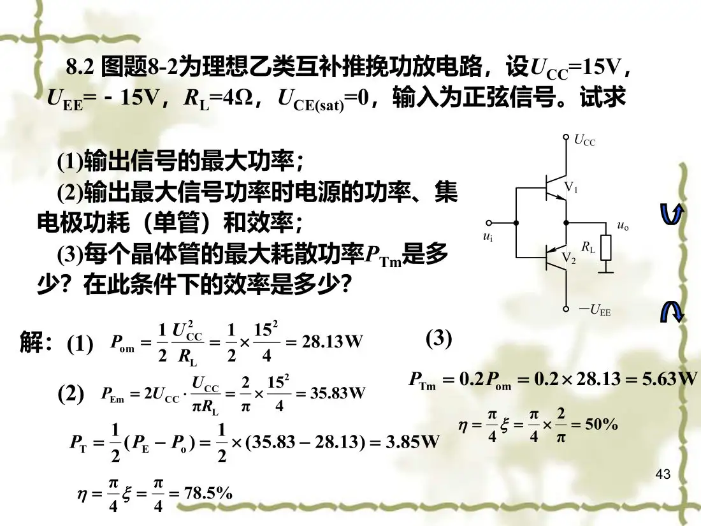

原文：

8.2 图题8-2为理想乙类互补推挽功放电路，设 $U_{CC}=15V$ ， $U_{EE}=-15V$ ， $R_{L}=4\Omega$ ， $U_{CE(sat)}=0$ ，输入为正弦信号。试求

(1)输出信号的最大功率;

(2)输出最大信号功率时电源的功率、集电极功耗（单管）和效率；

(3)每个晶体管的最大耗散功率 $P_{Tm}$ 是多少？在此条件下的效率是多少？

解：(1) $P_{\mathrm{om}} = \frac{1}{2}\frac{U_{\mathrm{CC}}^2}{R_{\mathrm{L}}} = \frac{1}{2}\times \frac{15^2}{4} = 28.13\mathrm{W}$

(3)

$$
P _ {\mathrm{Em}} = 2 U _ {\mathrm{CC}} \cdot \frac {U _ {\mathrm{CC}}}{\pi R _ {\mathrm{L}}} = \frac {2}{\pi} \times \frac {1 5 ^ {2}}{4} = 3 5. 8 3 \mathrm{W}\tag{2}
$$

$$
P _ {\mathrm{T}} = \frac {1}{2} \left(P _ {\mathrm{E}} - P _ {\mathrm{o}}\right) = \frac {1}{2} \times (3 5. 8 3 - 2 8. 1 3) = 3. 8 5 \mathrm{W}
$$

$$
P _ {\mathrm{Tm}} = 0. 2 P _ {\mathrm{om}} = 0. 2 \times 2 8. 1 3 = 5. 6 3 \mathrm{W}
$$

$$
\eta = \frac {\pi}{4} \xi = \frac {\pi}{4} \times \frac {2}{\pi} = 50 \%
$$

$$
\eta = \frac {\pi}{4} \xi = \frac {\pi}{4} = 78.5 ‰
$$

43

### 解：由题意知：

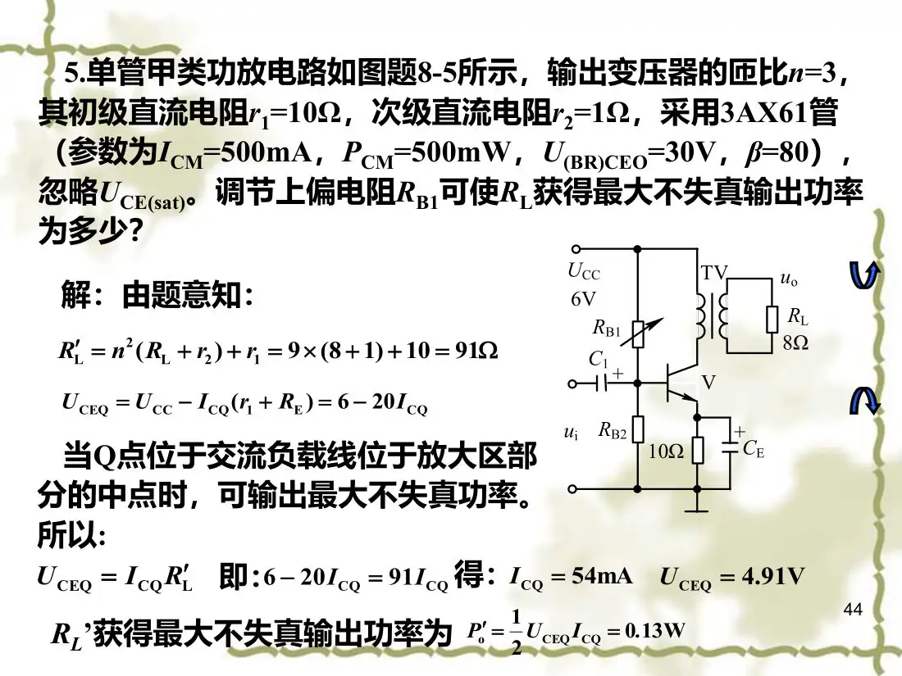

原文：

5.单管甲类功放电路如图题8-5所示，输出变压器的匝比n=3，其初级直流电阻 $r_{1}=10\Omega$ ，次级直流电阻 $r_{2}=1\Omega$ ，采用3AX61管（参数为 $I_{CM}=500mA$ ， $P_{CM}=500mW$ ， $U_{(BR)CEO}=30V$ ， $\beta=80$ ），忽略 $U_{CE(sat)}$ 。调节上偏电阻 $R_{B1}$ 可使 $R_{L}$ 获得最大不失真输出功率为多少？

解：由题意知：

$$
\begin{array}{l} R _ {\mathrm{L}} ^ {\prime} = n ^ {2} (R _ {\mathrm{L}} + r _ {2}) + r _ {1} = 9 \times (8 + 1) + 1 0 = 9 1 \Omega \\ U _ {\mathrm{CEQ}} = U _ {\mathrm{CC}} - I _ {\mathrm{CQ}} (r _ {1} + R _ {\mathrm{E}}) = 6 - 2 0 I _ {\mathrm{CQ}} \end{array}
$$

当Q点位于交流负载线位于放大区部分的中点时，可输出最大不失真功率。

所以:

$U_{CEQ}=I_{CQ}R'_{L}$ 即:6-20 $I_{CQ}=91I_{CQ}$ 得: $I_{CQ}=54mA$ $U_{CEQ}=4.91V$ $R_{L}$ 获得最大不失真输出功率为 $P_{o}^{\prime}=\frac{1}{2}U_{CEQ}I_{CQ}=0.13W$

### 解：

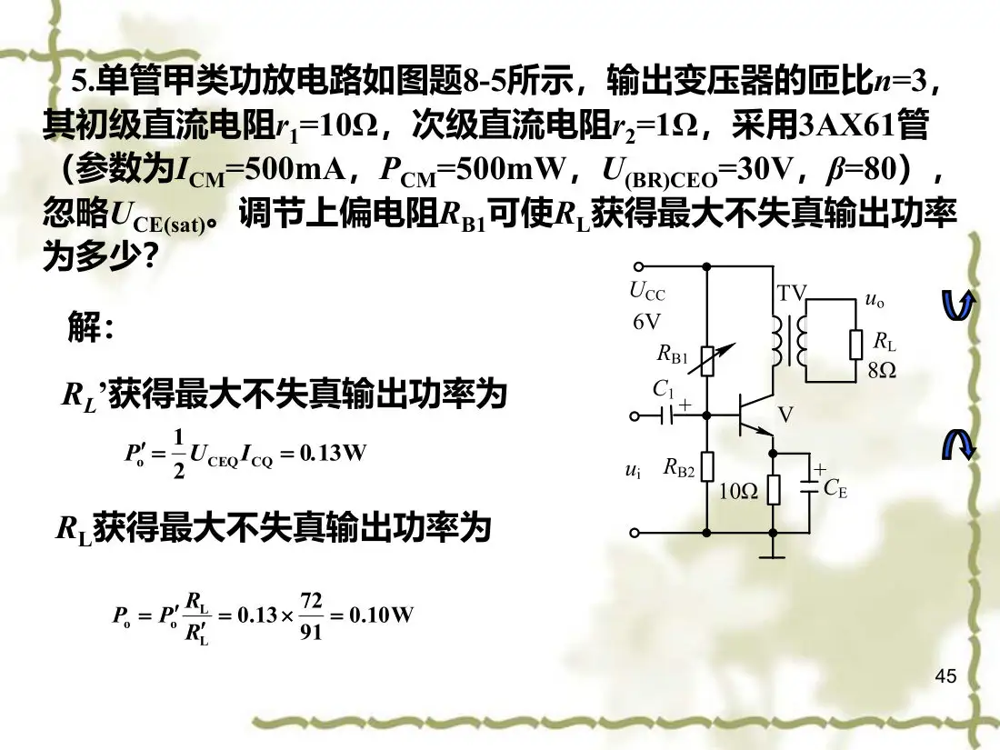

原文：

5.单管甲类功放电路如图题8-5所示，输出变压器的匝比n=3，其初级直流电阻 $r_{1}=10\Omega$ ，次级直流电阻 $r_{2}=1\Omega$ ，采用3AX61管（参数为 $I_{CM}=500mA$ ， $P_{CM}=500mW$ ， $U_{(BR)CEO}=30V$ ， $\beta=80$ ），忽略 $U_{CE(sat)}$ 。调节上偏电阻 $R_{B1}$ 可使 $R_{L}$ 获得最大不失真输出功率为多少？

解：

$R_{L}$ 获得最大不失真输出功率为

$$
P _ {\mathrm{o}} ^ {\prime} = \frac {1}{2} U _ {\mathrm{CEQ}} I _ {\mathrm{CQ}} = 0. 1 3 \mathrm{W}
$$

$R_{L}$ 获得最大不失真输出功率为

$$
P _ {\mathrm{o}} = P _ {\mathrm{o}} ^ {\prime} \frac {R _ {\mathrm{L}}}{R _ {\mathrm{L}} ^ {\prime}} = 0. 1 3 \times \frac {7 2}{9 1} = 0. 1 0 \mathrm{W}
$$

45

### $$

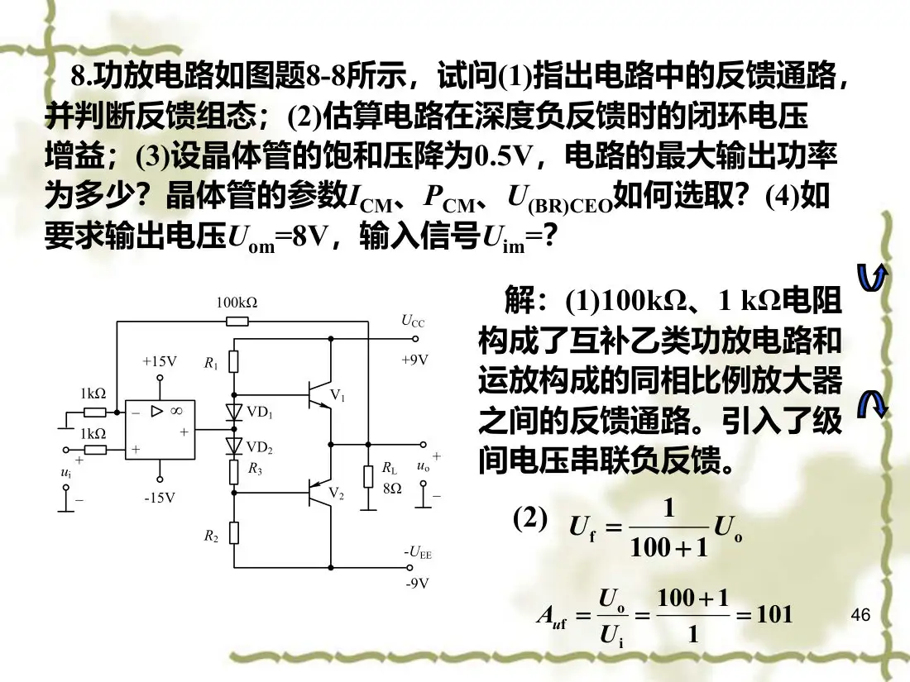

原文：

8. 功放电路如图题8-8所示，试问(1)指出电路中的反馈通路，并判断反馈组态；(2)估算电路在深度负反馈时的闭环电压增益；(3)设晶体管的饱和压降为0.5V，电路的最大输出功率为多少？晶体管的参数 $I_{CM}$ 、 $P_{CM}$ 、 $U_{(BR)CEO}$ 如何选取？(4)如要求输出电压 $U_{om}=8V$ ，输入信号 $U_{im}=?$

解：(1)100kΩ、1 kΩ电阻构成了互补乙类功放电路和运放构成的同相比例放大器之间的反馈通路。引入了级间电压串联负反馈。

$$
U _ {\mathrm{f}} = \frac {1}{1 0 0 + 1} U _ {\mathrm{o}}\tag{2}
$$

$$
A _ {u f} = \frac {U _ {\mathrm{o}}}{U _ {\mathrm{i}}} = \frac {1 0 0 + 1}{1} = 1 0 1\tag{46}
$$

### 解:(3)

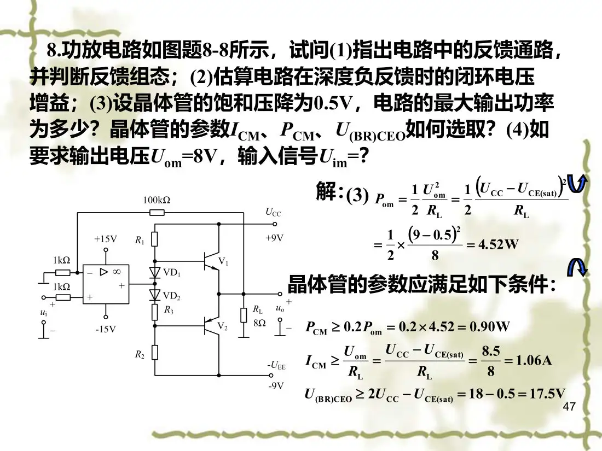

原文：

8. 功放电路如图题8-8所示，试问(1)指出电路中的反馈通路，并判断反馈组态；(2)估算电路在深度负反馈时的闭环电压增益；(3)设晶体管的饱和压降为0.5V，电路的最大输出功率为多少？晶体管的参数 $I_{CM}$ 、 $P_{CM}$ 、 $U_{(BR)CEO}$ 如何选取？(4)如要求输出电压 $U_{om}=8V$ ，输入信号 $U_{im}=$ ?

解:(3)

$$
\begin{array}{l} P _ {\mathrm{om}} = \frac {1}{2} \frac {U _ {\mathrm{om}} ^ {2}}{R _ {\mathrm{L}}} = \frac {1}{2} \frac {\left(U _ {\mathrm{CC}} - U _ {\mathrm{CE(sat)}}\right) ^ {2}}{R _ {\mathrm{L}}} \\ = \frac {1}{2} \times \frac {(9 - 0 . 5) ^ {2}}{8} = 4. 5 2 \mathrm{W} \end{array}
$$

晶体管的参数应满足如下条件：

$$
P _ {\mathrm{CM}} \geq 0. 2 P _ {\mathrm{om}} = 0. 2 \times 4. 5 2 = 0. 9 0 \mathrm{W}
$$

$$
I _ {\mathrm{CM}} \geq \frac {U _ {\mathrm{om}}}{R _ {\mathrm{L}}} = \frac {U _ {\mathrm{CC}} - U _ {\mathrm{CE(sat)}}}{R _ {\mathrm{L}}} = \frac {8 . 5}{8} = 1. 0 6 \mathrm{A}
$$

$$
U _ {(\mathrm{BR}) \mathrm{CEO}} \geq 2 U _ {\mathrm{CC}} - U _ {\mathrm{CE(sat)}} = 1 8 - 0. 5 = 1 7. 5 \mathrm{V}
$$

47

### 解：(4)因为

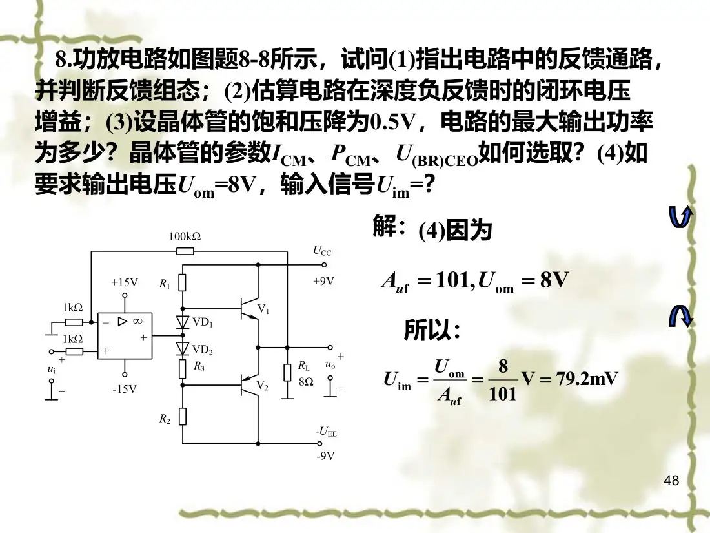

原文：

8. 功放电路如图题8-8所示，试问(1)指出电路中的反馈通路，并判断反馈组态；(2)估算电路在深度负反馈时的闭环电压增益；(3)设晶体管的饱和压降为0.5V，电路的最大输出功率为多少？晶体管的参数 $I_{CM}$ 、 $P_{CM}$ 、 $U_{(BR)CEO}$ 如何选取？(4)如要求输出电压 $U_{om}=8V$ ，输入信号 $U_{im}=?$

解：(4)因为

$$
A _ {u \mathrm{f}} = 1 0 1, U _ {\mathrm{om}} = 8 \mathrm{V}
$$

所以：

$$
U _ {\mathrm{im}} = \frac {U _ {\mathrm{om}}}{A _ {u f}} = \frac {8}{1 0 1} \mathrm{V} = 7 9. 2 \mathrm{mV}
$$

48

### 9- 2 整流器和直流稳压电源

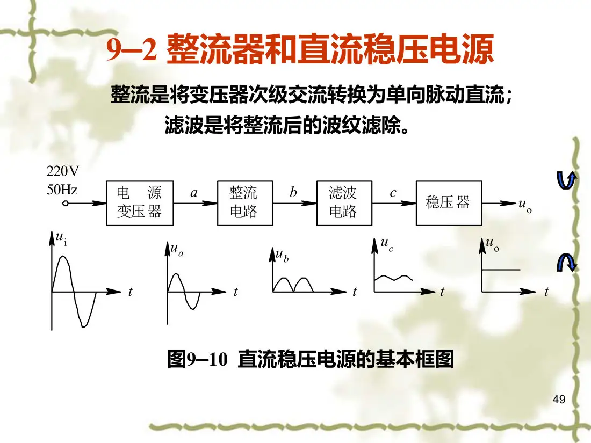

原文：

9- 2 整流器和直流稳压电源

整流是将变压器次级交流转换为单向脉动直流；滤波是将整流后的波纹滤除。

49

### 9-2-1整流滤波电路

原文：

9-2-1整流滤波电路

一、整流滤波电路

常用的整流电路有半波整流、全波整流、桥式整流和倍压整流。

常用的滤波电路有电容滤波、电感电容Γ型滤波、电阻电容Π型滤波。

50

### 51

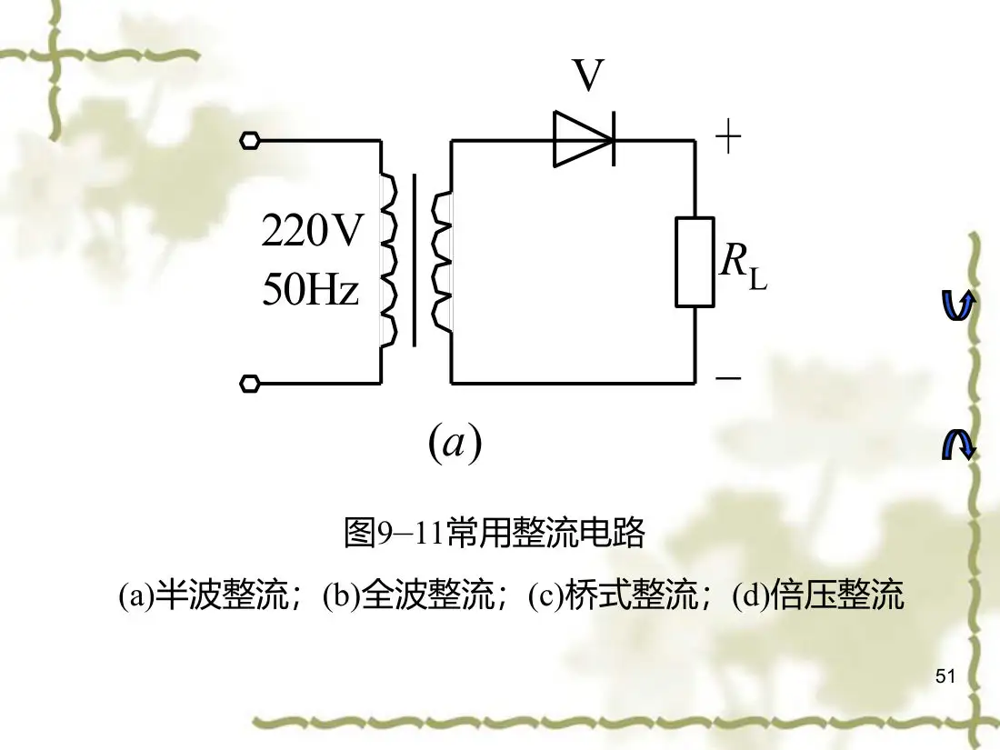

原文：

51

### 52

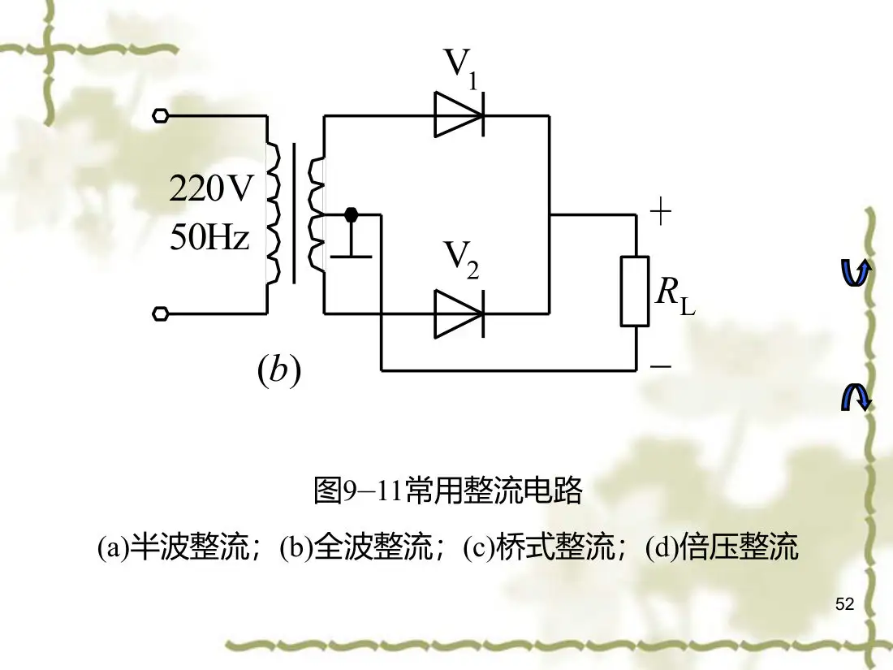

原文：

52

### 53

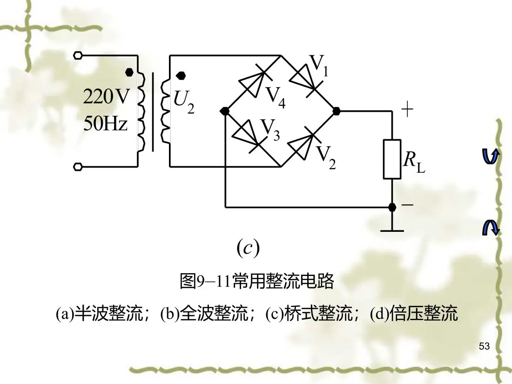

原文：

53

### 54

原文：

54

### 55

原文：

55

### 二、整流滤波电路的工作原理及主要性能

原文：

二、整流滤波电路的工作原理及主要性能

1. 工作原理

56

### 57

原文：

57

### 58

原文：

58

### 2. 主要性能

原文：

2. 主要性能

1) 输出直流电压 $U_{0}$

不接滤波电容(C=0)时： $U_{o}=\frac{2}{\pi}U'_{im}=0.9U'_{im}$ 当接入滤波电容(C≠0)，且负载 $R_{L}=\infty$ 时：

$$
U _ {o} = 1. 4 1 4 U _ {i} ^ {\prime} = U _ {i m} ^ {\prime}
$$

一般情况下 $(R_{\mathrm{L}} \neq \infty, \mathrm{C} \neq 0)$ ， $U_{\mathrm{o}}$ 的估算值为：

$$
U _ {o} \approx 1. 2 U _ {i} ^ {\prime}
$$

59

### 2) 滤波电容估算值

原文：

式中为 $U_{i}^{\prime}$ 变压器次级单边交流电压有效值，为交流振幅。

变压比 $n=\frac{N_{2}}{N_{1}}=\frac{U_{i}^{\prime}}{220V}$

2) 滤波电容估算值

$$
R _ {L} C _ {L} \geq (3 \sim 5) \frac {T}{2}
$$

此时，波纹电压峰峰值 $U_{rpp}$ 约为

$$
U _ {r p p} \approx \frac {I _ {L} T}{2 C _ {L}}
$$

式中：T为交流电网信号周期； $I_{\mathrm{L}}$ 为负载电流。

60

### 3)整流管的选择

原文：

3)整流管的选择

(1)整流管最大允许电流

$$
I _ {F} > \frac {I _ {L}}{2}
$$

(2)整流管反向击穿电压。

$$
U _ {B R} > 2 U _ {i m} ^ {\prime}
$$

61

### 62

原文：

62

### 9-2-2串联反馈型线性稳压器的工作原理 一、电路

原文：

9-2-2串联反馈型线性稳压器的工作原理 一、电路

63

### 二、主要参数

原文：

二、主要参数

1. 主要指标

1)稳压系数S

$$
S = \left. \frac {\Delta U _ {o}}{\frac {U _ {o}}{\Delta U _ {i}}} \right| _ {\substack {\mathrm{负载不变} \\ \mathrm{工作温度不变}}}
$$

64

### 2)输出电阻 $R_{o}$

原文：

2)输出电阻 $R_{o}$

$$
R _ {o} = \frac {\Delta U _ {o}}{\Delta I _ {L}} \bigg | _ {U _ {i} \mathrm{不变} _ {\mathrm{工作温度不变}}}
$$

3)温度系数 $S_{T}$

$$
S _ {T} = \frac {\Delta U _ {o}}{\Delta T} \bigg | _ {U _ {i} \text {不变} I _ {L} \text {不变}}
$$

65

### 2. 调整管参数

原文：

2. 调整管参数

3.电路输出电压调节

(1)大波段调节依靠改变整流器变压器抽头。

(2)波段内调节靠电位器 $R_{w}$ 。

$$
U _ {-} = U _ {+} \quad U _ {-} = (1 + \frac {R _ {1}}{R _ {2}}) U _ {o} = U _ {+} = U _ {R E F}
$$

$$
U _ {o} = (1 + \frac {R _ {1}}{R _ {2}}) U _ {R E F}
$$

66

### 三、集成三端稳压器

原文：

三、集成三端稳压器

67

### 68

原文：

68

### 69

原文：

69

### $$

原文：

$$
U _ {o} \approx (1 + \frac {R _ {2}}{R _ {1}}) U _ {R 1} = (1 + \frac {R _ {2}}{R _ {1}}) U _ {o} ^ {\prime}
$$

图9- 17三端稳压器功能的扩展

70

### 71

原文：

71

### 9-2-3开关型稳压器

原文：

9-2-3开关型稳压器

72

### 73

原文：

73

### 74

原文：

74

### 75

原文：

75

### 9- 3- 4 功率管的保护

原文：

9- 3- 4 功率管的保护

为保证功率管的正常运行，要附加一些保护电路，包括安全区保护、过流保护、过热保护等等。

1. 在VMOS的栅极加限流、限压电阻和反接二极管；

2. 在感性负载上并联电容和二极管；

3. 在功率管的c、e间并联稳压二极管。

76

### 第 77 页

### 二、二次击穿现象与安全工作区

原文：

二、二次击穿现象与安全工作区

1. 功率管在实际应用中，常发现功耗并未超额，管子也不发烫，但却突然失效。这种损坏不少是由于“二次击穿”所致。

2. 当集电极电压 $u_{CE}$ 增大时，首先可能出现一次击穿(图中AB段)。这种击穿是正常的雪崩击穿。二次击穿的起点与 $i_{B}$ 大小有关。通常将其起始点连线称为二次击穿临界线，如图9—23(b)所示。

78

### 79

原文：

79

### 80

原文：

为保证功率管安全可靠地工作，除保证电流小于 $I_{CM}$ 、功耗小于 $P_{CM}$ 、工作反压小于一次击穿电压 $U_{(BR)CEO}$ 外，还应避免进入二次击穿区。所以，功率管的安全工作区如图9—24所示。

80

### 81

原文：

81
