# 《电路分析与电工电子技术》第8章 正弦稳态电路分析 作业解答

原件经识别和整理；“参考解答”是我们补的。

## 8-4

已知三个同频率的正弦电流：$i_{1} = 10 \sin (\omega t + 120^{\circ})\ \mathrm{A}$，$i_{2} = 20 \cos (\omega t - 150^{\circ})\ \mathrm{A}$，$i_{3} = -30 \cos (\omega t - 30^{\circ})\ \mathrm{A}$。试比较它们的相位差。

解：

$$
\begin{array}{r l}
& i_{1} = 10 \sin (\omega t + 120^{\circ}) = 10 \cos (\omega t + 30^{\circ})\ \mathrm{A} \\
& i_{2} = 20 \cos (\omega t - 150^{\circ})\ \mathrm{A} \\
& i_{3} = -30 \cos (\omega t - 30^{\circ}) = 30 \cos (\omega t + 150^{\circ})\ \mathrm{A} \\
& \therefore \theta_{12} = 30^{\circ} - (-150^{\circ}) = 180^{\circ} \\
& \theta_{23} = -150^{\circ} - 150^{\circ} = -300^{\circ} \Rightarrow \theta_{23} = 60^{\circ} \\
& \theta_{31} = 150^{\circ} - 30^{\circ} = 120^{\circ}
\end{array}
$$

## 8-5

试求下列正弦量的振幅向量和有效值向量：

$$
\begin{array}{l}
(1)\ i_{1} = 5 \cos \omega t\ \mathrm{A} \\
(2)\ i_{2} = -10 \cos \left(\omega t + \frac{\pi}{2}\right)\ \mathrm{A} \\
(3)\ i_{3} = 15 \sin (\omega t - 135^{\circ})\ \mathrm{A}
\end{array}
$$

解：

(1) $i_{1} = 5\cos\omega t\ \mathrm{A} \Rightarrow \dot{I}_{1m} = 5\angle 0^{\circ}\ \mathrm{A}$，$\dot{I}_{1} = 2.5\sqrt{2}\angle 0^{\circ} \approx 3.54\angle 0^{\circ}\ \mathrm{A}$

$$
\begin{array}{r l}
(2)\ & i_{2} = -10 \cos \left(\omega t + \frac{\pi}{2}\right) = 10 \cos \left(\omega t - \frac{\pi}{2}\right) \\
\Rightarrow & \dot{I}_{2m} = 10 \angle -\frac{\pi}{2}\ \mathrm{A},\ \dot{I}_{2} = 5\sqrt{2} \angle -\frac{\pi}{2}\ \mathrm{A}
\end{array}
$$

$$
\begin{array}{r l}
(3)\ & i_{3} = 15 \sin (\omega t - 135^{\circ}) = 15 \cos (\omega t - 225^{\circ}) = 15 \cos (\omega t + 135^{\circ}) \\
\Rightarrow & \dot{I}_{3m} = 15 \angle 135^{\circ}\ \mathrm{A},\ \dot{I}_{3} = 7.5\sqrt{2} \angle 135^{\circ}\ \mathrm{A} \approx 10.605 \angle 135^{\circ}\ \mathrm{A}
\end{array}
$$

## 8-6

已知 $\omega = 314\ \mathrm{rad/s}$，试写出下列相量所代表的正弦量。

(1) $\dot{I}_{1} = 10\angle \frac{\pi}{2}\ \mathrm{A}$

(2) $\dot{I}_{2m} = 2\angle \frac{3}{4}\pi\ \mathrm{A}$

(3) $\dot{U}_{1} = 3 + \mathrm{j}4\ \mathrm{V}$

(4) $\dot{U}_{2m} = 5 + \mathrm{j}5\ \mathrm{V}$

(1) $i_{1}(t) = 10\sqrt{2}\cos \left(314t + \frac{\pi}{2}\right)\ \mathrm{A}$

(2) $i_{2}(t) = 2\cos \left(314t + \frac{3}{4}\pi\right)\ \mathrm{A}$

(3) $u_{1}(t) = 5\sqrt{2}\cos (314t + 53.1^{\circ})\ \mathrm{V}$

(4) $u_{2}(t) = 5\sqrt{2}\cos (314t + 45^{\circ})\ \mathrm{V}$

## 8-10

电路如题图 7-10 所示，已知 $u = 100\cos(10t+45^{\circ})\ \mathrm{V}$，$i_{1} = i = 10\cos(10t+45^{\circ})\ \mathrm{A}$，$i_{2} = 20\cos(10t+135^{\circ})\ \mathrm{A}$。试判断元件 1、2、3 的性质及数值。

解：本题利用 KCL 及元件 VCR 相量形式分析。

$$
\begin{array}{l}
\dot{U}_{m} = 100\angle 45^{\circ}\ \mathrm{V}, \\
\dot{I}_{m} = \dot{I}_{1m} = 10\angle 45^{\circ}\ \mathrm{A}, \\
\dot{I}_{2m} = 20\angle 135^{\circ}\ \mathrm{A}
\end{array}
$$

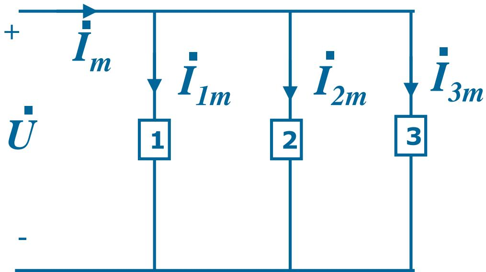

由 KCL 相量形式得

$$
\begin{array}{l}
\dot{I}_{3m} = \dot{I}_{m} - \dot{I}_{1m} - \dot{I}_{2m} = 10\angle 45^{\circ} - 10\angle 45^{\circ} - 20\angle 135^{\circ} \\
= -20\angle 135^{\circ} = 20\angle -45^{\circ}\ \mathrm{A}
\end{array}
$$

对于元件 1

$$
\begin{array}{l}
\dot{U}_{m} = 100\angle 45^{\circ}\ \mathrm{V}, \\
\dot{I}_{1m} = 10\angle 45^{\circ}\ \mathrm{A},
\end{array}
$$

由于其电压电流同相，故其为电阻元件，且

$$
R = \frac{\dot{U}_{m}}{\dot{I}_{1m}} = \frac{100\angle 45^{\circ}}{10\angle 45^{\circ}} = 10\ \Omega
$$

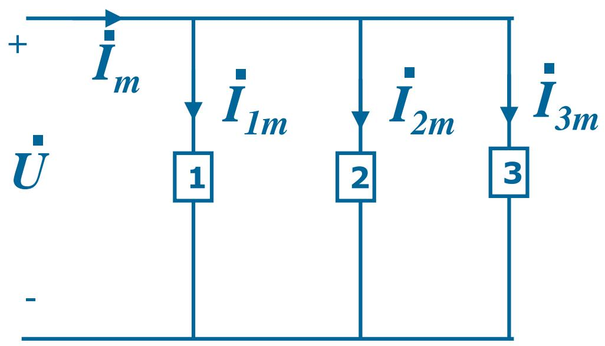

对于元件 2

$$
\begin{array}{l}
\dot{U}_{m} = 100\angle 45^{\circ}\ \mathrm{V}, \\
\dot{I}_{2m} = 20\angle 135^{\circ}\ \mathrm{A},
\end{array}
$$

由于其电流超前电压 $90^{\circ}$，故其为电容元件，且

$$
\omega C = \frac{I_{m}}{U_{m}} = \frac{20}{100} = \frac{1}{5}\ \Omega, \quad C = \frac{1}{50}\ \mathrm{F}
$$

对于元件 3

$$
\begin{array}{l}
\dot{U}_{m} = 100\angle 45^{\circ}\ \mathrm{V}, \\
\dot{I}_{3m} = 20\angle -45^{\circ}\ \mathrm{A},
\end{array}
$$

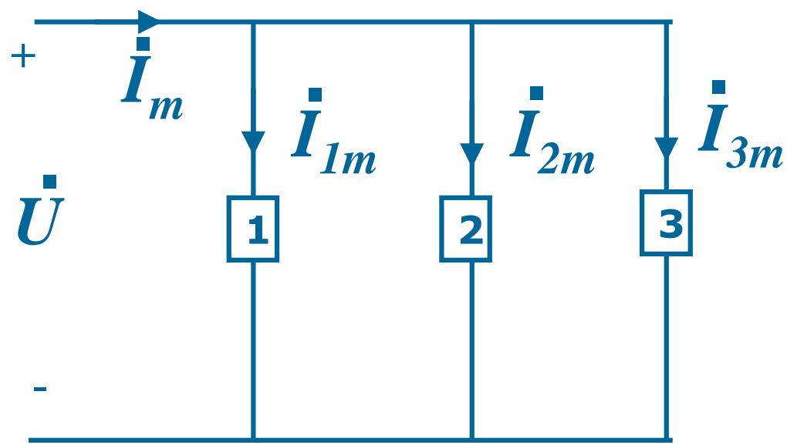

由于其电流滞后电压 $90^{\circ}$，故其为电感元件，且

$$
\omega L = \frac{U_{m}}{I_{3m}} = \frac{100}{20} = 5\ \Omega, \quad L = 0.5\ \mathrm{H}
$$

## 8-13

试求题图 7-13 所示电路的输入阻抗和导纳，以及该电路的最简串联等效电路和并联等效电路，$\omega = 10\ \mathrm{rad/s}$。

解：

$$
\begin{array}{l}
Z_{ab} = \frac{(1 - \mathrm{j}1)(-\mathrm{j}1)}{(1 - \mathrm{j}1) + (-\mathrm{j}1)} + 3 + \mathrm{j}3 \\
= \frac{-1 - \mathrm{j}1}{1 - \mathrm{j}2} + 3 + \mathrm{j}3 \\
= \frac{1 - \mathrm{j}3}{5} + 3 + \mathrm{j}3 = 3.2 + \mathrm{j}2.49
\end{array}
$$

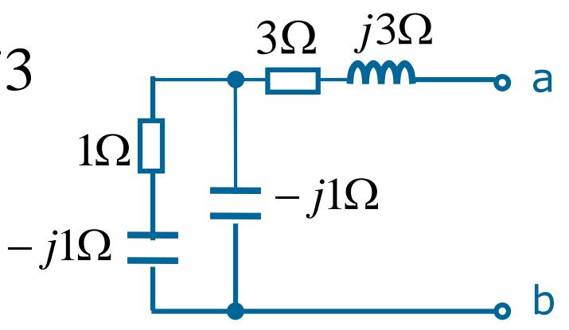

$$
Y_{ab} = \frac{1}{Z_{ab}} = \frac{1}{\frac{16}{5} + \mathrm{j}\frac{12}{5}} = 0.2 - \mathrm{j}0.15\ \mathrm{S}
$$

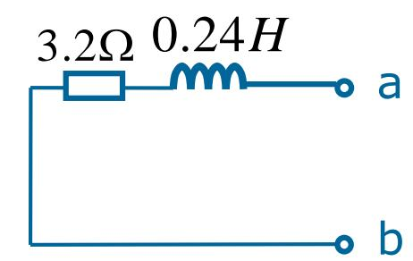

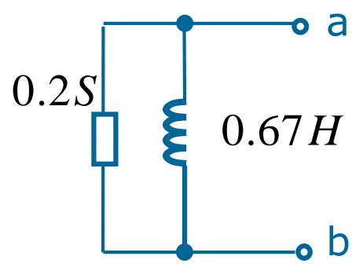

(a) $\omega = 10^{6}\ \mathrm{rad/s}$

## 8-15a

试求题图 8-15 所示各二端网络的输入阻抗。

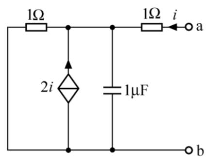

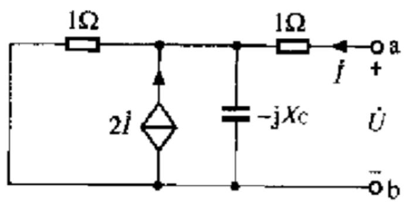

作题图 8-15(a) 的相量模型如解图 8-15(a) 所示。由于电路中含有受控源，故用加压求流法求其等效阻抗。设在解图 7-15(a) 端子上加电压 $\dot{U}$，此时端子上电流为 $\dot{I}$，参考方向如图所示，由 KVL 得

$$
\begin{array}{r l}
\dot{U} & = \dot{I} + 1 \parallel (-\mathrm{j}1) \times (\dot{I} + 2\dot{I}) \\
& = \dot{I} + \frac{-\mathrm{j}1}{1 - \mathrm{j}1} \times 3\dot{I} = \frac{1 - \mathrm{j}4}{1 - \mathrm{j}1}\dot{I}
\end{array}
$$

故

$$
Z_{\mathrm{sh}} = \frac{\dot{U}}{\dot{I}} = \frac{1 - \mathrm{j}4}{1 - \mathrm{j}1} = \frac{5}{2} - \mathrm{j}\frac{3}{2}\ \Omega
$$

## 8-15b

试求题图 7-15 所示各二端网络的输入阻抗。

解：

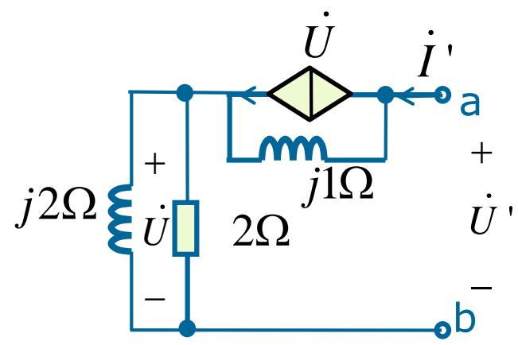

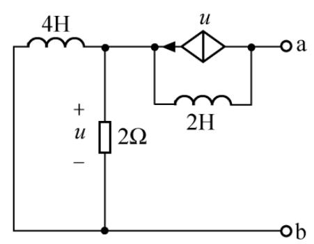

$$
\dot{U}^{\prime} = \mathrm{j}\dot{I}^{\prime} - \mathrm{j}\dot{U} + \dot{U}
$$

$$
\dot{U} = \dot{I}^{\prime}(2 \parallel \mathrm{j}2)
$$

$$
\begin{array}{c}
\therefore \dot{U}^{\prime} = \mathrm{j}\dot{I}^{\prime} + \frac{\mathrm{j}4}{2 + \mathrm{j}2}(1 - \mathrm{j})\dot{I}^{\prime} = (2 + \mathrm{j}1)\dot{I}^{\prime} \\
\therefore Z_{i} = (2 + \mathrm{j}1)\ \Omega
\end{array}
$$

## 8-16

在题图 7-16 所示电路中，已知 $U_{C} = 15\ \mathrm{V}$，$U_{L} = 12\ \mathrm{V}$，$U_{R} = 4\ \mathrm{V}$，求电压 $U$ 为多少？

解：

$$
U = \sqrt{U_{R}^{2} + (U_{L} - U_{C})^{2}} = \sqrt{4^{2} + (12 - 15)^{2}} = 5\ \mathrm{V}
$$

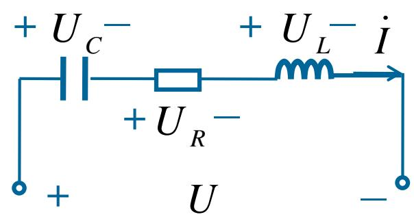

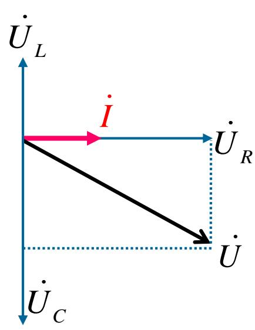

# 电路分析与电工电子技术 第 8 章 正弦稳态电路分析 作业解答（2）

本资料为《电路分析与电工电子技术》第 8 章作业解答的第 2 部分，包含第 11–17 页的识别内容整理。

## 计算题 18

**题目：**
RL 串联电路，在题图 7-18(a) 直流情况下，电流表的读数为 50mA，电压表的读数为 6V。在 $f = 10^{3} \text{ Hz}$ 交流情况下，电压表 $V_{1}$ 读数为 6V， $V_{2}$ 读数为 10V，如图 (b) 所示。试求 R、L 的值。

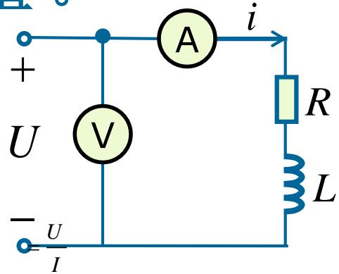

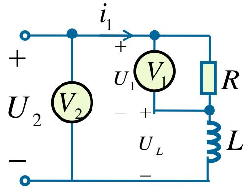

**解法一：**

直流时电感相当于短路，则：

$$
R = \frac {U}{I} = \frac {6}{50 \times 10 ^ {-3}} = 120\ \Omega
$$

交流时相量图如图 (c)，则：

$$
U _ {L} = \sqrt {U _ {2} ^ {2} - U _ {1} ^ {2}} = \sqrt {10^2 - 6^2} = 8\ \text{V}
$$

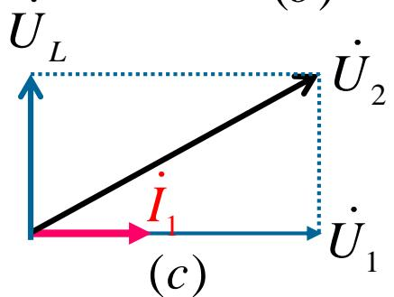

由分压关系 $\frac {U _ {1}}{R} = \frac {U _ {L}}{\omega L}$ 可得：

$$
L = \frac {U _ {L} R}{\omega U _ {1}} = \frac {8 \times 120}{2 \pi \times 10 ^ {3} \times 6} \approx 25.5\ \text{mH}
$$

**另解：**

直流时电感相当于短路，则：

$$
R = \frac {U}{I} = \frac {6}{50 \times 10 ^ {-3}} = 120\ \Omega
$$

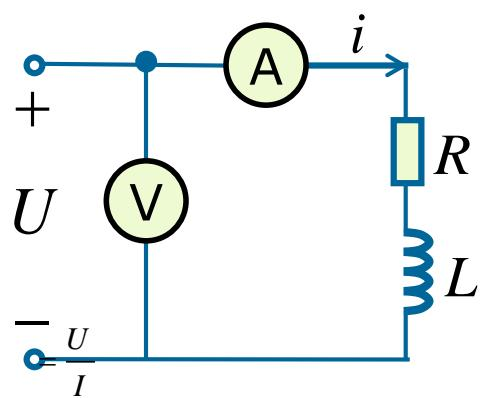

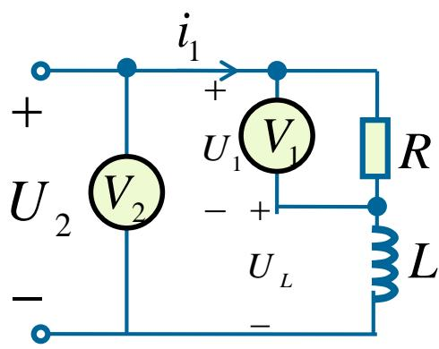

(b)

交流时设 $\dot{U}_1 = 6\angle 0^\circ \text{ V}$，则：

$$
\dot{I}_1 = \frac{\dot{U}_1}{R} = \frac{6\angle 0^\circ}{120} = 0.05\angle 0^\circ \text{ A}
$$

由于 $Z = R + j\omega L$，故阻抗模 $|Z| = \sqrt{R^2 + (\omega L)^2}$。根据欧姆定律：

$$
|Z| = \frac{U_2}{I_1} = \frac{10}{0.05} = 200\ \Omega
$$

由此解得：

$$
L = \frac {\sqrt {200 ^ {2} - R ^ {2}}}{\omega} = \frac {\sqrt {200 ^ {2} - 120 ^ {2}}}{2 \pi \times 10 ^ {3}} \approx 25.5\ \text{mH}
$$

## 计算题 19

**题目：**
题图 7-19 所示电路，已知电流表 A1 的读数为 10A，电压表 V1 的读数为 100V；试画相量图求电流表 A2 和电压表 V2 的读数。

**解：**

设各电压、电流如图，且设 $\dot{U}_{1}$ 为参考向量，则：

$$
\dot {U} _ {1} = 100 \angle 0 ^ {\circ}\ \text{V}
$$

电容支路电流：
$$
\dot {I} _ {c} = \frac {\dot {U} _ {1}}{- j X _ {c}} = \frac {100 \angle 0 ^ {\circ}}{X _ {c} \angle - 90 ^ {\circ}} = 10 \angle 90 ^ {\circ}\ \text{A}
$$
*(注：此处隐含 $X_c=10\Omega$)*

电阻电感支路电流（假设阻抗为 $5+j5$）：
$$
\dot {I} _ {1} = \frac {\dot {U} _ {1}}{5 + j 5} = \frac {100 \angle 0 ^ {\circ}}{5 \sqrt {2} \angle 45 ^ {\circ}} = 10 \sqrt {2} \angle - 45 ^ {\circ}\ \text{A}
$$

故由相量图可得总电流 $\dot{I}_{2}$：
$$
\therefore \dot{I}_{2} = \dot{I}_{1} + \dot{I}_{C} = 10\angle 0^{\circ}\ \text{A}
$$
*(即电流表 A2 读数为 10A)*

由相量图计算电压表 V2 读数：
$$
\dot {U} _ {c 2} = (- j 10) \dot {I} _ {2} = 100 \angle - 90 ^ {\circ}\ \text{V}
$$
$$
\dot {U} _ {2} = \dot {U} _ {C 2} + \dot {U} _ {1} = 100 \sqrt {2} \angle - 45 ^ {\circ}\ \text{V}
$$
*(即电压表 V2 读数为 $100\sqrt{2} \approx 141.4\text{V}$)*

## 计算题 22

**题目：**
8-22(b) 试分别列写下列电路的网孔方程和节点方程，各图中 $u_{s} = 10 \cos 2 t \text{ V}, i_{s} = 0.5 \cos (2 t - 30^{\circ}) \text{ A}$。

### (1) 列网孔方程

**有效值相量：**
$$
\dot{I}_{\mathrm{s}} = \frac{0.5\angle - 30^{\circ}}{\sqrt{2}}\text{A}, \quad \dot{U}_{\mathrm{s}} = \frac{10\angle 0^{\circ}}{\sqrt{2}}\text{V}
$$

方程组如下：
$$
\begin{cases}
(2-j0.5)\dot{I}_1 - (2-j0.5)\dot{I}_3 = \frac{10\angle 0^{\circ}}{\sqrt{2}} - \dot{U}_x \\
(1+j2)\dot{I}_2 - j2\dot{I}_3 = \dot{U}_x \\
-(1-j0.5)\dot{I}_1 - j2\dot{I}_2 + (3+j1.5)\dot{I}_3 = 0 \\
\dot{I}_2 - \dot{I}_1 = \frac{0.5\angle - 30^{\circ}}{\sqrt{2}}
\end{cases}
$$

> [!NOTE]
> 振幅相量和有效值相量都有，推荐有效值相量做！

**振幅相量：**

$$
I _ {\mathrm{Sm}} = 0. 5 \angle - 30 ^ {\circ} \text{A}
$$
$$
U _ {\mathrm{Sm}} = 10 \angle 0 ^ {\circ} \text{V}
$$

方程组如下：
$$
\left\{ \begin{array}{l} 
{(2 - j 0. 5) \dot {I} _ {1 m} - (2 - j 0. 5) \dot {I} _ {3 m} = 10 \angle 0 ^ {\circ} - \dot {U} _ {x m}} \\ 
{(1 + j 2) \dot {I} _ {2 m} - j 2 \dot {I} _ {3 m} = \dot {U} _ {x m}} \\ 
{-(1 - j 0. 5) \dot {I} _ {1 m} - j 2 \dot {I} _ {2 m} + (3 + j 1. 5) \dot {I} _ {3 m} = 0} \\ 
{\dot {I} _ {2 m} - \dot {I} _ {1 m} = 0. 5 \angle - 30 ^ {\circ}} 
\end{array} \right.
$$

知识点：[基尔霍夫电压定律（KVL）及其应用](../../../topics/电路与电子技术/KVL.md)、[理想电压源与理想电流源的特性](../../../topics/电路与电子技术/独立电源.md)

### (2) 列节点方程

**有效值相量：**

$$
\begin{array}{l} 
\dot {I _ {\mathrm{s}}} = \frac {0 . 5 \angle - 30 ^ {\circ}}{\sqrt {2}} \text{A} \\ 
\dot {U _ {\mathrm{s}}} = \frac {10 \angle 0 ^ {\circ}}{\sqrt {2}} \text{V} 
\end{array}
$$

方程组如下：
$$
\begin{array}{l} 
(1 + \frac {1}{2} + \frac {1}{1 - 0 . 5 j}) \dot {U _ {1}} - \frac {1}{1 - 0 . 5 j} \dot {U _ {2}} - \frac {1}{2} \dot {U _ {3}} = \frac {10 \angle 0 ^ {\circ}}{\sqrt {2}} \\ 
-\frac {1}{1 - 0 . 5 j} \dot {U _ {1}} + (\frac {1}{2 j} + \frac {1}{1 - 0 . 5 j}) \dot {U _ {2}} - \frac {1}{2 j} \dot {U _ {3}} = \frac {0 . 5 \angle - 30 ^ {\circ}}{\sqrt {2}} \\ 
-\frac {1}{2} \dot {U _ {1}} - \frac {1}{2 j} \dot {U _ {2}} + (\frac {1}{2} + 1 + \frac {1}{2 j}) \dot {U _ {3}} = 0 
\end{array}
$$

> [!TIP]
> 注：$1-0.5j$ 是一条支路，作为一个整体，是一个阻抗。

**振幅相量：**

$$
I _ {\mathrm{Sm}} = 0. 5 \angle - 30 ^ {\circ} \text{A}
$$
$$
\dot {U _ {\mathrm{Sm}}} = 10 \angle 0 ^ {\circ} \text{V}
$$

方程组如下：
$$
\left\{ \begin{array}{l} 
\left(1 + \frac {1}{2} + \frac {1}{1 - 0 . 5 j}\right) \dot {U} _ {1 m} - \frac {1}{1 - 0 . 5 j} \dot {U} _ {2 m} - \frac {1}{2} \dot {U} _ {3 m} = \frac {10 \angle 0 ^ {\circ}}{1} \\ 
-\frac {1}{1 - 0 . 5 j} \dot {U} _ {1 m} + \left(\frac {1}{2 j} + \frac {1}{1 - 0 . 5 j}\right) \dot {U} _ {2 m} - \frac {1}{2 j} \dot {U} _ {3 m} = 0. 5 \angle - 30 ^ {\circ} \\ 
-\frac {1}{2} \dot {U} _ {1 m} - \frac {1}{2 j} \dot {U} _ {2 m} + \left(\frac {3}{2} + \frac {1}{2 j}\right) \dot {U} _ {3 m} = 0 
\end{array} \right.
$$

# 《电路分析与电工电子技术》第8章 正弦稳态电路分析 作业解答（第3部分）

本资料为《电路分析与电工电子技术》第8章正弦稳态电路分析作业解答的第3部分，包含计算题的详细解题过程。内容已根据上下文修正识别错误，整理为Markdown格式。

## 一、计算题

知识点：[理想电压源与理想电流源的特性](../../../topics/电路与电子技术/独立电源.md)、[线性时不变电阻的伏安关系（欧姆定律）](../../../topics/电路与电子技术/线性电阻VCR.md)、[基尔霍夫电流定律（KCL）及其应用](../../../topics/电路与电子技术/KCL.md)

### 计算 23

**题干：**
试求题图7-23所示有源二端网络的戴维南等效电路。

**参考解答：**

(1) 求开路电压 $\dot{U}_{oc}$：

$$
\left\{ \begin{array}{l} \dot {U} _ {o c} = - 2 \dot {I} _ {1} - (- j 1) \dot {I} _ {1} + 5 \angle 0 ^ {\circ} \\ \dot {I} _ {1} = \frac {5 \angle 0 ^ {\circ}}{- j 1 + (2 / / j 2)} = 5 \angle 0 ^ {\circ} \\ \therefore \dot {U} _ {o c} = - 5 + j 5 = 5 \sqrt {2} \angle 1 3 5 ^ {\circ} \end{array} \right.
$$

或采用分流公式法：

$$
: \left\{ \begin{array}{l} \dot {U} = - 2 \dot {I} _ {1} - (- j \dot {I} _ {1}) \\ \dot {I} _ {1} = - \frac {- j 1}{\frac {1}{- j 1} + \frac {1}{2} + \frac {1}{j 2}} \dot {I} \end{array} \right.
$$

(2) 求等效阻抗 $Z_{0}$：

$$
\left\{ \begin{array}{l} \dot {U} = - 2 \dot {I} _ {1} - (- j \dot {I} _ {1}) \\ \dot {I} = - \dot {I} _ {1} + \frac {(- j 1) (- \dot {I} _ {1})}{2} + \frac {(- j 1) (- \dot {I} _ {1})}{j 2} \end{array} \right.
$$

可得： $\dot{U} = (3 + j1)\dot{I}$

$$
\therefore Z _ {0} = (3 + j 1) \Omega
$$

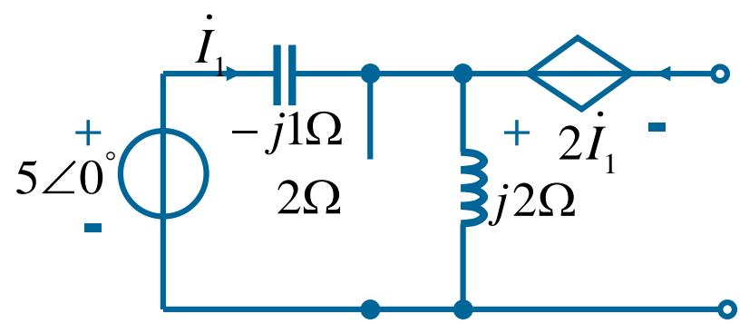

戴维南等效电路图参数：
- 电压源：$5\sqrt{2}\angle135^{\circ} V$
- 等效阻抗：$3+j1 \Omega$

**说明：**
若给的图是时域的，则等效戴维南电路图也必须是时域的，即：要将 $Z_{0} = (3 + j1)$ 转换成一电阻串联电感。

---

知识点：[基尔霍夫电流定律（KCL）及其应用](../../../topics/电路与电子技术/KCL.md)、[基尔霍夫电压定律（KVL）及其应用](../../../topics/电路与电子技术/KVL.md)、[线性时不变电阻的伏安关系（欧姆定律）](../../../topics/电路与电子技术/线性电阻VCR.md)

### 计算 25

**题干：**
已知关联参考方向下的无源二端网络的端口电压 $u(t)$ 和电流 $i(t)$ 分别为 $u(t)=10\cos(100t+70^{\circ})V$ 和 $i(t)=2\cos(100t+40^{\circ})A$ ，试求各种情况下的P、Q和S。

**参考解答：**

先将各量写成相量形式：

$$
\begin{array}{l} \dot {U} = 5 \sqrt {2} \angle 7 0 ^ {\circ} V, \quad \dot {I} = \sqrt {2} \angle 4 0 ^ {\circ} A \\ P = U I \cos \theta_ {z} = 5 \sqrt {2} \times \sqrt {2} \cos 3 0 ^ {\circ} = 5 \sqrt {3} W \\ Q = U I \sin \theta_ {z} = 5 \sqrt {2} \times \sqrt {2} \sin 3 0 ^ {\circ} = 5 Var \\ S = U I = 1 0 VA \end{array}
$$

另解（利用复功率）：

$$
\begin{array}{r l} & {\tilde {S} = \dot {U} ^ {*} I = 5 \sqrt {2} \angle 7 0 ^ {\circ} \times \sqrt {2} \angle - 4 0 ^ {\circ}} \\ & {= 1 0 \angle 3 0 ^ {\circ} = 5 \sqrt {3} + j 5} \\ & {\therefore P = 5 \sqrt {3} W, Q = 5 Var, S = 1 0 VA} \end{array}
$$

---

知识点：[元件吸收与产生功率的计算与判断](../../../topics/电路与电子技术/功率计算.md)

### 计算 27

**题干：**
二端网络如题图7-27所示，已知 $\dot{U}_{s}=50\angle0^{\circ}V$ ，电源提供的平均功率为312.5W，试求 $X_{c}$ 的数值。

*(注：此处原题附带电路示意图，识别结果中表格部分为干扰项，核心信息为电路结构及解题过程)*

**参考解答：**

将电路等效为诺顿模型，并设各支路电流和电压如相量模型图所示，其中：

$$
\begin{array}{r l} & {\dot {I} _ {S} = \frac {U _ {S}}{j 8} = 6. 2 5 \angle - 9 0 ^ {\circ} A} \\ & {P = I _ {_ R} ^ {2} R = 3 1 2. 5 \Rightarrow I _ {_ R} = 6. 2 5 A} \\ & {\because \dot {I} _ {S} = \dot {I} _ {_ R} + \dot {I} _ {_ C} + \dot {I} _ {_ L} \quad \text {即} \mathrm{I} _ {\mathrm{S}} = \sqrt {\left(\mathrm{I} _ {\mathrm{C}} - \mathrm{I} _ {\mathrm{L}}\right) ^ {2} + \mathrm{I} _ {_ \mathrm{R}} ^ {2}} \text {且} \because \mathrm{I} _ {\mathrm{R}} = \mathrm{I} _ {\mathrm{S}}} \\ & {\therefore \mathrm{I} _ {\mathrm{C}} = \mathrm{I} _ {\mathrm{L}} \quad \text {而} \mathrm{I} _ {\mathrm{C}} = \frac {\mathrm{U}}{\mathrm{X} _ {\mathrm{C}}}, \mathrm{I} _ {\mathrm{L}} = \frac {\mathrm{U}}{8} \quad \therefore \mathrm{X} _ {\mathrm{C}} = 8 \Omega} \end{array}
$$

# 电路分析与电工电子技术 第8章 正弦稳态电路分析 作业解答

整理自《电路分析与电工电子技术》第8章 正弦稳态电路分析 作业解答（识别工具读出内容，第22–30页）。

## 一、计算题

知识点：[元件吸收与产生功率的计算与判断](../../../topics/电路与电子技术/功率计算.md)、[基尔霍夫电流定律（KCL）及其应用](../../../topics/电路与电子技术/KCL.md)

### 计算 1

**题干：** 如题图7-28所示，已知某感性负载接于电压220V、频率50Hz的交流电源上，其吸收的平均功率为40W，端口电流I=0.66A，试求感性负载的功率因数；如欲使电路的功率因数提高到0.9，问至少需并联多大电容C?

(213页例题8-20)

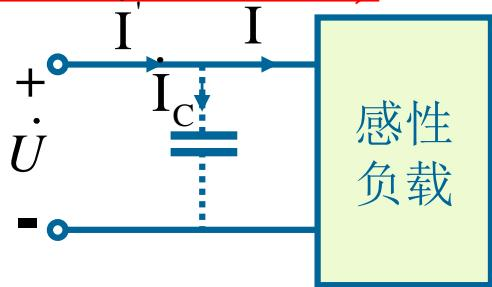

解：∵ $P = UI \cos \theta_{z}$

故：$pf=\cos\theta_{z}=\frac{P}{UI}=\frac{40}{220\times0.66}\approx0.275$ 且 $\theta_{z}=74^{\circ}$

当 $\mathbf{p}_f^{\prime} = \cos \theta_z^{\prime} = 0.9, I^{\prime} = \frac{P}{U\cdot\mathbf{p}_{f}^{\prime}} = \frac{40}{220\times 0.9}\approx 0.202A$

且 $\theta_{z} = 25.8^{\circ}$ 设 $\dot{U} = 220\angle 0^{\circ}$

$$
\therefore \dot {\mathrm{I}} _ {\mathrm{C}} = \dot {\mathrm{I}} ^ {\prime} - \dot {\mathrm{I}} = 0. 2 0 2 \angle - 2 5. 8 ^ {\circ} - 0. 6 6 \angle - 7 4 ^ {\circ} \approx j 0. 5 5 \mathrm{A}
$$

$$
\because I _ {c} = \omega C U \Rightarrow C = \frac {I _ {c}}{2 \pi f U} = \frac {0 . 5 5}{2 \times 3 . 1 4 \times 5 0 \times 2 2 0} \approx 7. 9 \mu f
$$

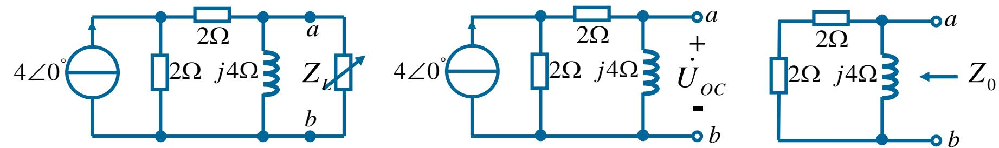

答案：功率因数约为0.275；需并联电容约7.9μF。

### 计算 2

**题干：** 正弦稳态电路如题图7-29所示，若 $Z_{L}$ 可变，试问为何值时可获得最大功率？最大功率 $P_{\mathrm{max}}$ 为多少？

解：1）求开路电压 $\dot{U}_{oc}$ ：

$$
\dot {U} _ {o c} = 4 \angle 0 ^ {\circ} \times \frac {2}{2 + 2 + j 4} \times j 4 = \frac {8 \angle 9 0 ^ {\circ}}{\sqrt {2} \angle 4 5 ^ {\circ}} = 4 \sqrt {2} \angle 4 5 ^ {\circ} V
$$

2) 求等效阻抗 $Z_{0}$ :

$$
Z _ {0} = (2 + 2) / / j 4 = \frac {4 \angle 9 0 ^ {\circ}}{\sqrt {2} \angle 4 5 ^ {\circ}} = 2 + j 2 \Omega
$$

3) 当 $Z_{L} = Z_{0} = 2 - j2\Omega$ 时，最大功率为：

$$
P _ {\max} = \frac {U _ {o c} ^ {2}}{4 R _ {0}} = \frac {(4 \sqrt {2}) ^ {2}}{4 \times 2} = 4 W
$$

答案：$Z_L = 2 - j2\Omega$；最大功率为4W。

知识点：[理想电压源与理想电流源的特性](../../../topics/电路与电子技术/独立电源.md)、[线性时不变电阻的伏安关系（欧姆定律）](../../../topics/电路与电子技术/线性电阻VCR.md)、[基尔霍夫电压定律（KVL）及其应用](../../../topics/电路与电子技术/KVL.md)

### 计算 3

**题干：** 电路如题图7-30所示，试求负载 $Z_{L}$ 为何值时可获得最大功率？最大功率 $P_{\mathrm{max}}$ 为多少？

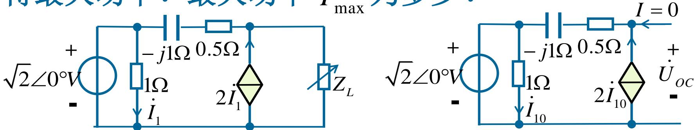

解：$\dot{U}_{OC} = 2\dot{I}_{10}(0.5 - j1) + \sqrt{2}\angle 0^{\circ}$

$$
\dot {I} _ {1 0} = \frac {\sqrt {2} \angle 0 ^ {\circ}}{1} = \sqrt {2} \angle 0 ^ {\circ} A
$$

$$
\therefore \dot {U} _ {o c} = 2 \sqrt {2} - j 2 \sqrt {2} = 4 \angle - 4 5 ^ {\circ} V
$$

$$
\dot {I} _ {1} = 0 A \Rightarrow 2 \dot {I} _ {1} = 0 \quad \therefore Z _ {0} = 0. 5 - j 1 \Omega
$$

当 $Z_{L}=Z_{0}=0.5+j1\Omega$ 时，可获得最大功率： $P_{max}=\frac{U_{oc}^{2}}{4R_{0}}=8W$

答案：$Z_L = 0.5+j1\Omega$；最大功率为8W。

知识点：[理想电压源与理想电流源的特性](../../../topics/电路与电子技术/独立电源.md)、[线性时不变电阻的伏安关系（欧姆定律）](../../../topics/电路与电子技术/线性电阻VCR.md)、[元件吸收与产生功率的计算与判断](../../../topics/电路与电子技术/功率计算.md)

### 计算 4

**题干：** 电路如题图7-30所示，试求负载 $Z_{L}$ 为何值时可获得最大功率？最大功率 $P_{\mathrm{max}}$ 为多少？

*(注：此题为原题重复，解答同上)*

解：$\dot{U}_{OC} = 2\dot{I}_{10}(0.5 - j1) + \sqrt{2}\angle 0^{\circ}$

$$
\dot {I} _ {1 0} = \frac {\sqrt {2} \angle 0 ^ {\circ}}{1} = \sqrt {2} \angle 0 ^ {\circ} A
$$

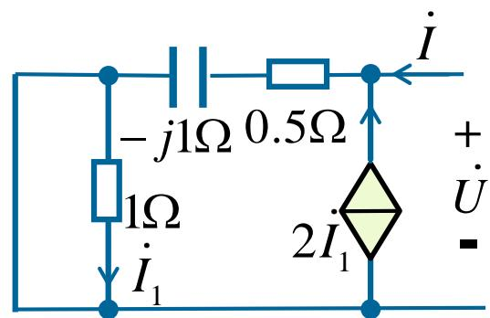

$$
\therefore \dot {U} _ {o c} = 2 \sqrt {2} - j 2 \sqrt {2} = 4 \angle - 4 5 ^ {\circ} V
$$

$$
\dot {I} _ {1} = 0 A \Rightarrow 2 \dot {I} _ {1} = 0 \quad \therefore Z _ {0} = 0. 5 - j 1 \Omega
$$

当 $Z_{L}=Z_{0}=0.5+j1\Omega$ 时，可获得最大功率： $P_{max}=\frac{U_{oc}^{2}}{4R_{0}}=8W$

答案：$Z_L = 0.5+j1\Omega$；最大功率为8W。

知识点：[理想电压源与理想电流源的特性](../../../topics/电路与电子技术/独立电源.md)、[四种受控电源（VCVS、VCCS、CCVS、CCCS）的特性](../../../topics/电路与电子技术/受控电源.md)、[元件吸收与产生功率的计算与判断](../../../topics/电路与电子技术/功率计算.md)

### 计算 5

**题干：** 已知三相电路中星形连接的三相负载每相阻抗 $Z = 12 + j16 \Omega$ ，接至对称三相电源，其线电压为 $380 \mathrm{~V}$ 。若端线阻抗忽略不计，试求线电流及负载吸收的功率；若将此三相负载改为三角形连接，线电流及负载吸收的功率将变成多少？

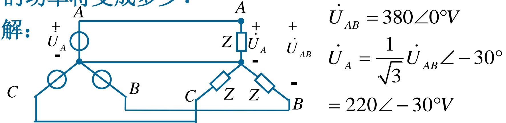

**星形连接：**

$$
\dot {I} _ {A} = \frac {\dot {U} _ {A}}{Z} = \frac {2 2 0 \angle - 3 0 ^ {\circ}}{1 2 + j 1 6} = \frac {2 2 0 \angle - 3 0 ^ {\circ}}{2 0 \angle 5 3. 1 ^ {\circ}} = 1 1 \angle - 8 3. 1 ^ {\circ} A
$$

$$
\therefore I _ {l} = I _ {P} = 1 1 A
$$

$$
P = 3 U _ {P} I _ {P} \cos \theta_ {Z} = 3 \times 2 2 0 \times 1 1 \times \cos 5 3. 1 ^ {\circ} = 4 3 5 6 W
$$

**三角形连接：**

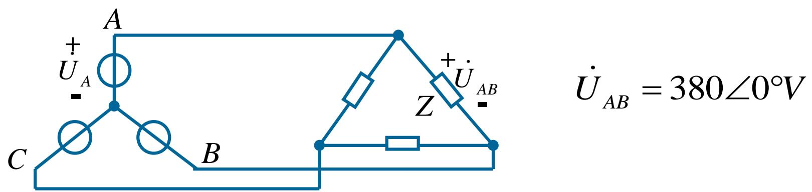

$$
\dot {I} _ {A B} = \frac {\dot {U} _ {A B}}{Z} = \frac {3 8 0 \angle 0 ^ {\circ}}{1 2 + j 1 6} = \frac {3 8 0 \angle 0 ^ {\circ}}{2 0 \angle 5 3. 1 ^ {\circ}} = 1 9 \angle - 5 3. 1 ^ {\circ} A
$$

$$
I _ {P} = 1 9 A = \frac {1}{\sqrt {3}} I _ {l} \Rightarrow I _ {l} = 3 2. 9 A
$$

$$
P = 3 U _ {P} I _ {P} \cos \theta_ {Z} = 3 \times 3 8 0 \times 1 9 \times \cos 5 3. 1 ^ {\circ} = 1 2 9 9 6 W
$$

答案：
1. 星形连接：线电流11A，功率4356W。
2. 三角形连接：线电流32.9A，功率12996W。

知识点：[线性时不变电阻的伏安关系（欧姆定律）](../../../topics/电路与电子技术/线性电阻VCR.md)、[元件吸收与产生功率的计算与判断](../../../topics/电路与电子技术/功率计算.md)、[理想电压源与理想电流源的特性](../../../topics/电路与电子技术/独立电源.md)

### 计算 6

**题干：** （无具体题干文字，仅给出条件和结果）

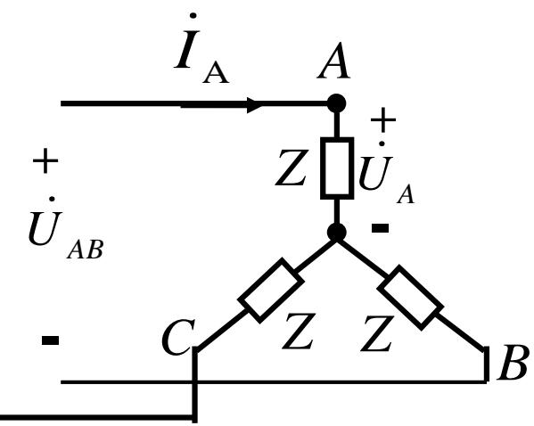

由题意可知 $\dot{U}_{\mathrm{AB}} = 380\angle 60^{\circ}\mathrm{V}$

星形连接A相负载相电压 $\dot{U}_{\mathrm{A}} = \frac{1}{\sqrt{3}}\dot{U}_{\mathrm{AB}}\angle -30^{\circ} = 220\angle 30^{\circ}\mathrm{V}$

A相负载相电流 $\dot{I}_{\mathrm{A}} = \frac{\dot{U}_{\mathrm{A}}}{Z} = \frac{220\angle 30^{\circ}}{3 + 4j} = 44\angle -23.1^{\circ}\mathrm{A}$

根据对称三相电路对称性

$$
\dot {I} _ {B} = 4 4 \angle - 2 3. 1 ^ {\circ} - 1 2 0 ^ {\circ} = 4 4 \angle - 1 4 3. 1 ^ {\circ} A
$$

$$
\dot {I} _ {c} = 4 4 \angle - 2 3. 1 ^ {\circ} + 1 2 0 ^ {\circ} = 4 4 \angle 9 6. 9. 1 ^ {\circ} A
$$

$$
\begin{array}{r l} P = 3 U _ {\mathrm{p}} I _ {\mathrm{p}} \cos \theta_ {Z} & = 3 \times 2 2 0 \times 4 4 \times \cos 5 3. 1 ^ {\circ} = 1 7 4 2 4 \mathrm{W} \\ i _ {A} (t) & = 4 4 \sqrt {2} \cos (3 1 4 t - 2 3. 1 ^ {\circ}) \mathrm{A} \\ i _ {B} (t) & = 4 4 \sqrt {2} \cos (3 1 4 t - 1 4 3. 1 ^ {\circ}) \mathrm{A} \\ i _ {C} (t) & = 4 4 \sqrt {2} \cos (3 1 4 t + 9 6. 9 ^ {\circ}) \mathrm{A} \end{array}
$$

答案：总功率17424W；各相电流瞬时值见上方公式。

知识点：[元件吸收与产生功率的计算与判断](../../../topics/电路与电子技术/功率计算.md)、[线性时不变电阻的伏安关系（欧姆定律）](../../../topics/电路与电子技术/线性电阻VCR.md)

### 计算 7

**题干：** 题图7-41所示二端网络N的端口电流、电压分别为

$$
\begin{array}{c} {i (t) = 5 \cos t + 2 \cos (2 t + \frac {\pi}{4}) A,} \\ {u (t) = 3 + \cos (t + \frac {\pi}{2}) + \cos (2 t - \frac {\pi}{4}) + \cos (3 t - \frac {\pi}{3}) V} \end{array}
$$

试求网络吸收的平均功率。

解:

$$
\begin{array}{r l} & P = \sum_ {k = 0} ^ {3} U _ {k} I _ {k} \cos \theta_ {Z k} \\ & \qquad = U _ {0} I _ {0} + U _ {1} I _ {1} \cos \frac {\pi}{2} + U _ {2} I _ {2} \cos (- \frac {\pi}{2}) \\ & \qquad = 3 \times 0 + \frac {1}{\sqrt {2}} \cdot \frac {5 \sqrt {2}}{2} \cos \frac {\pi}{2} + \frac {1}{\sqrt {2}} \cdot \sqrt {2} \cos (- \frac {\pi}{2}) = 0 \end{array}
$$

答案：平均功率为0W。

知识点：[元件吸收与产生功率的计算与判断](../../../topics/电路与电子技术/功率计算.md)

### 计算 8

**题干：** 已知流过 $2 \Omega$ 电阻的电流

$$
i (t) = 2 + 2 \sqrt {2} \cos t + \sqrt {2} \cos (2 t + 3 0 ^ {\circ}) A,
$$

试求电阻消耗的平均功率。

解:

$$
\begin{array}{r l} & P = \sum_ {k = 0} ^ {2} I _ {k} ^ {2} R \\ & \qquad = (I _ {0} ^ {2} + I _ {1} ^ {2} + I _ {2} ^ {2}) R = (2 ^ {2} + 2 ^ {2} + 1 ^ {2}) \times 2 = 1 8 W \end{array}
$$

答案：平均功率为18W。

知识点：[线性时不变电阻的伏安关系（欧姆定律）](../../../topics/电路与电子技术/线性电阻VCR.md)、[元件吸收与产生功率的计算与判断](../../../topics/电路与电子技术/功率计算.md)
