# 《电路分析与电工电子技术》第9章 直流稳压电源（课件）

原件的每一页，下面附识别出的文字。

### 第九章

原文：

第九章

直流稳压电源

### 第九章 直流稳压电源

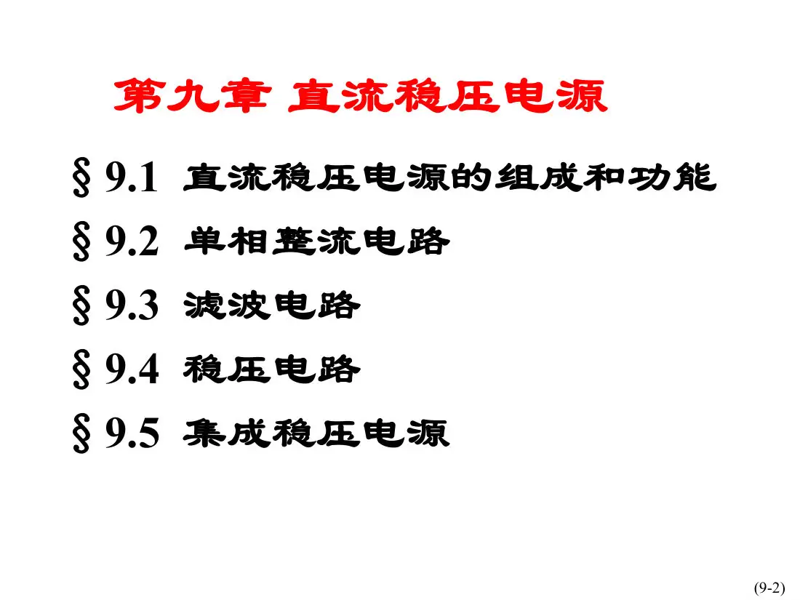

原文：

第九章 直流稳压电源
§ 9.1 直流稳压电源的组成和功能
§ 9.2 单相整流电路
§ 9.3 滤波电路
§ 9.4 稳压电路
§ 9.5 集成稳压电源

(9-2)

### §9.1 直流稳压电源的组成和功能

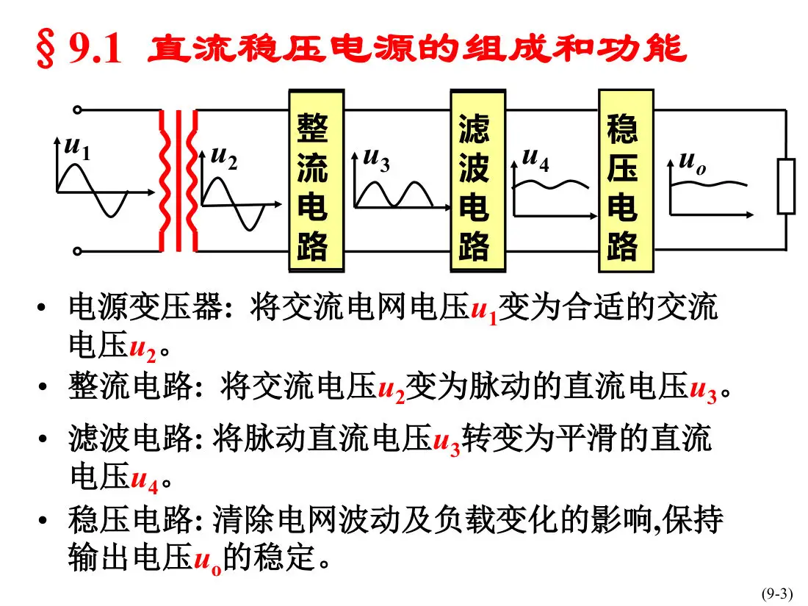

原文：

§9.1 直流稳压电源的组成和功能

• 电源变压器: 将交流电网电压 $\pmb { u } _ { 1 }$ 变为合适的交流电压 $\pmb { u } _ { 2 }$ 。

• 整流电路: 将交流电压 $\pmb { u } _ { 2 }$ 变为脉动的直流电压 $\pmb { u } _ { 3 }$ 。

• 滤波电路: 将脉动直流电压 $u _ { 3 }$ 转变为平滑的直流电压 $\pmb { u } _ { 4 }$ 。

• 稳压电路: 清除电网波动及负载变化的影响,保持输出电压 ${ \pmb u } _ { \mathbf { 0 } }$ 的稳定。

(9-3)

### §9.2 单相整流电路

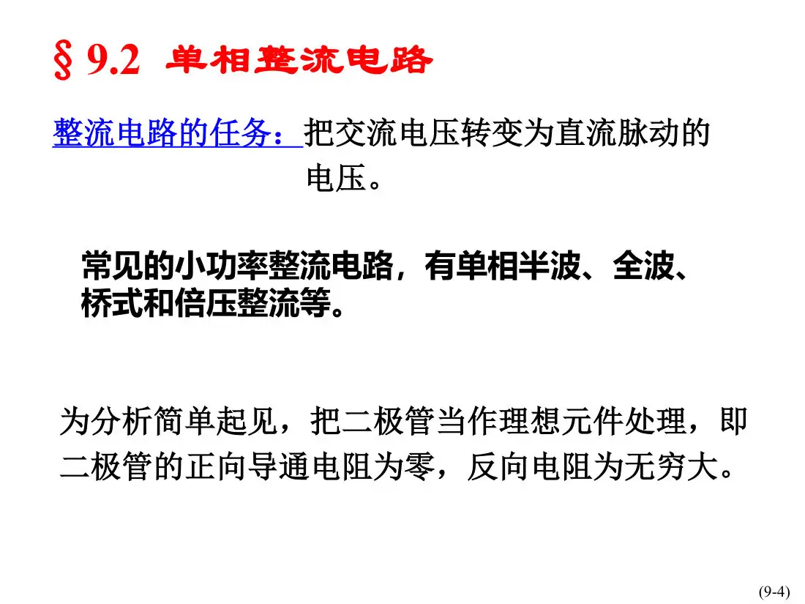

原文：

§9.2 单相整流电路

整流电路的任务：把交流电压转变为直流脉动的电压。

常见的小功率整流电路，有单相半波、全波、桥式和倍压整流等。

为分析简单起见，把二极管当作理想元件处理，即二极管的正向导通电阻为零，反向电阻为无穷大。

(9-4)

### §9.2.1 单相半波整流电路的工作原理

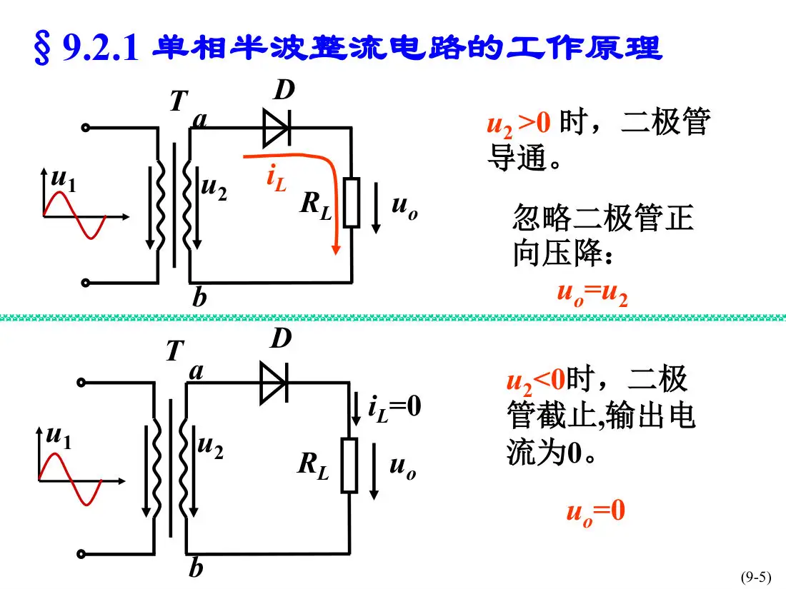

原文：

§9.2.1 单相半波整流电路的工作原理

$u _ { 2 } > 0$ 时，二极管导通。

忽略二极管正向压降：

$$
u _ {o} = u _ {2}
$$

$u _ { 2 } { < } 0$ 时，二极管截止,输出电流为0。

$$
u _ {o} = 0\tag{9-5}
$$

### (1) 输出电压波形：

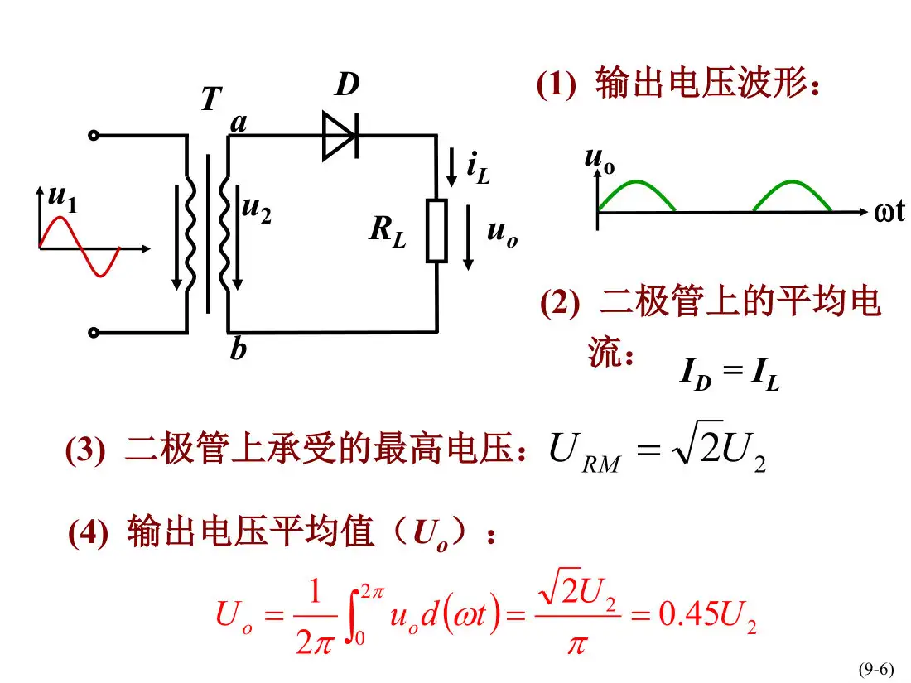

原文：

(1) 输出电压波形：

(2) 二极管上的平均电流：$I _ { D } = I _ { L }$

(3) 二极管上承受的最高电压： $U _ { R M } = \sqrt { 2 } U _ { 2 }$

(4) 输出电压平均值 $( U _ { o } )$

$$
U _ {o} = \frac {1}{2 \pi} \int_ {0} ^ {2 \pi} u _ {o} d (\omega t) = \frac {\sqrt {2} U _ {2}}{\pi} = 0. 4 5 U _ {2}\tag{9-6}
$$

### §9.2.2 单相全波整流电路的工作原理

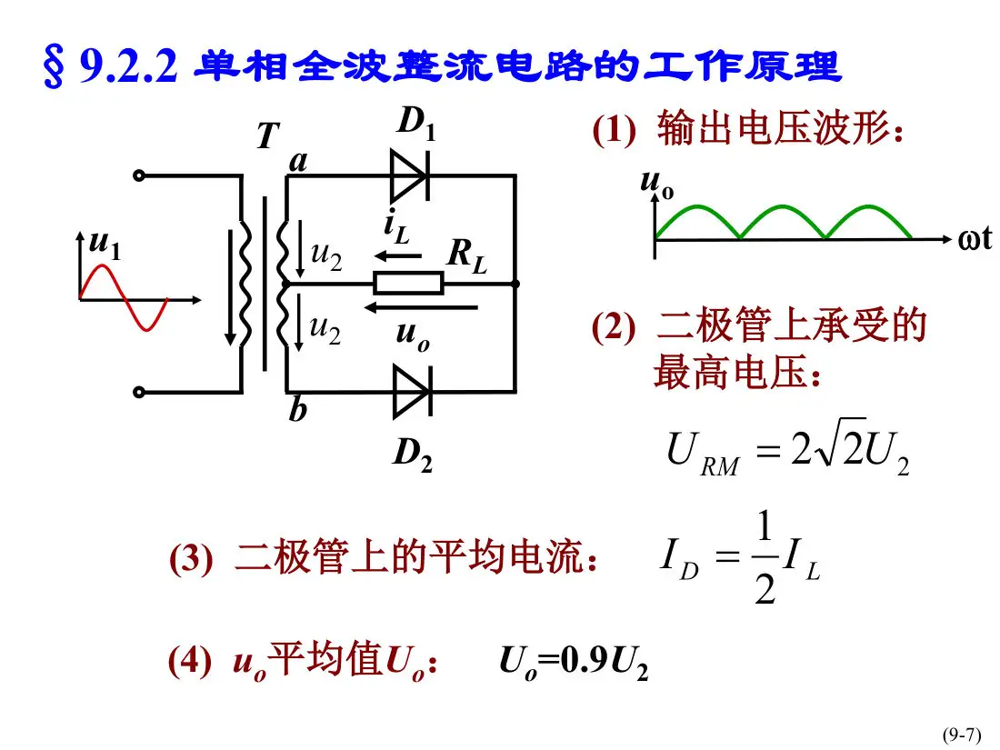

原文：

§9.2.2 单相全波整流电路的工作原理

(1) 输出电压波形：

(2) 二极管上承受的最高电压：

$$
U _ {R M} = 2 \sqrt {2} U _ {2}
$$

(3) 二极管上的平均电流： $I _ { { \scriptscriptstyle D } } = \frac { 1 } { 2 } I _ { { \scriptscriptstyle L } }$

(4) ${ \pmb u } _ { o }$ 平均值 $U _ { o }$ $U _ { o } { = } 0 . 9 U _ { 2 }$

(9-7)

### §9.2.3 单相桥式整流电路的工作原理

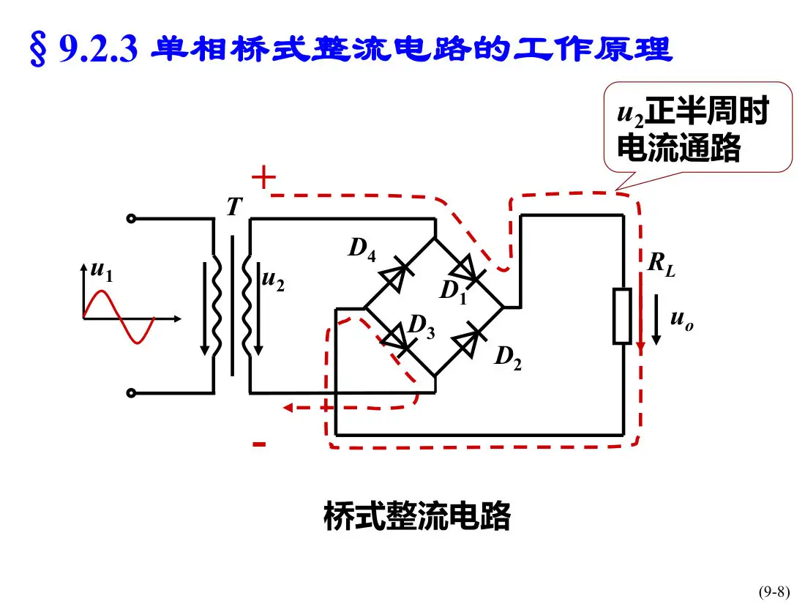

原文：

§9.2.3 单相桥式整流电路的工作原理

u2正半周时电流通路

(9-8)

### u2负半周时 电流通路

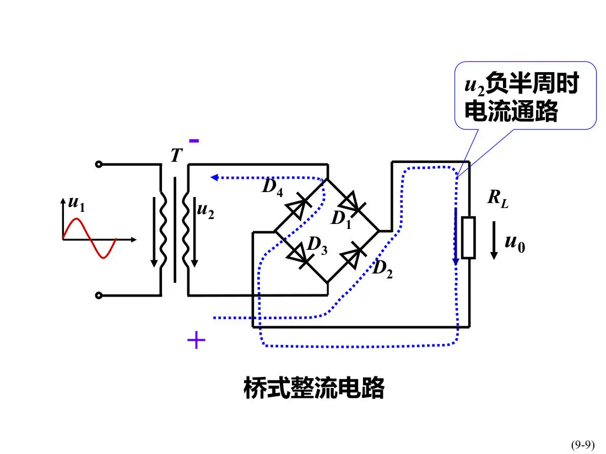

原文：

u2负半周时 电流通路

(9-9)

### 桥式整流电路输出波形及二极管上电压波形

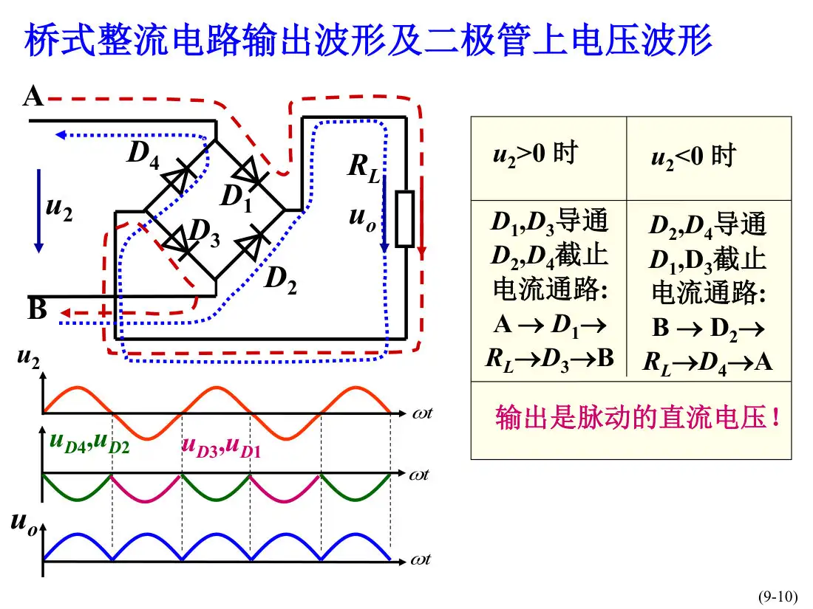

原文：

桥式整流电路输出波形及二极管上电压波形

<table><tr><td> $u_{2}>0$ 时</td><td> $u_{2}<0$ 时</td></tr><tr><td> $D_{1},D_{3}$ 导通 $D_{2},D_{4}$ 截止电流通路: $A\rightarrow D_{1}\rightarrow R_{L}\rightarrow D_{3}\rightarrow B$ </td><td> $D_{2},D_{4}$ 导通 $D_{1},D_{3}$ 截止电流通路: $B\rightarrow D_{2}\rightarrow R_{L}\rightarrow D_{4}\rightarrow A$ </td></tr><tr><td colspan="2">输出是脉动的直流电压!</td></tr></table>

(9-10)

### §9.2.4 倍压整流电路的工作原理

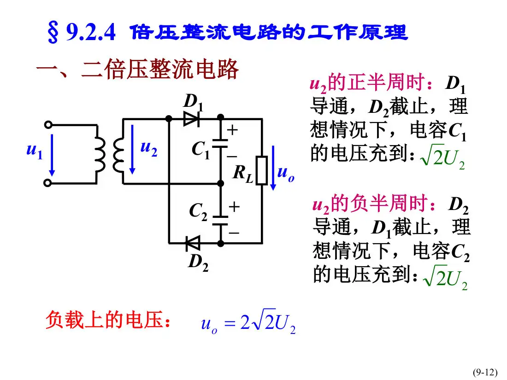

原文：

§9.2.4 倍压整流电路的工作原理

一、二倍压整流电路

负载上的电压： $u _ { o } = 2 \sqrt { 2 } U _ { 2 }$ $\pmb { u } _ { 2 }$ 的正半周时： $D _ { 1 }$ 导通， $D _ { 2 }$ 截止，理想情况下，电容 $C _ { 1 }$ 的电压充到： $\sqrt { 2 } U _ { 2 }$

$\pmb { u } _ { 2 }$ 的负半周时： $D _ { 2 }$ 导通， $D _ { 1 }$ 截止，理想情况下，电容 $C _ { 2 }$ 的电压充到： $\sqrt { 2 } U _ { 2 }$

(9-12)

### 二、多倍压整流电路

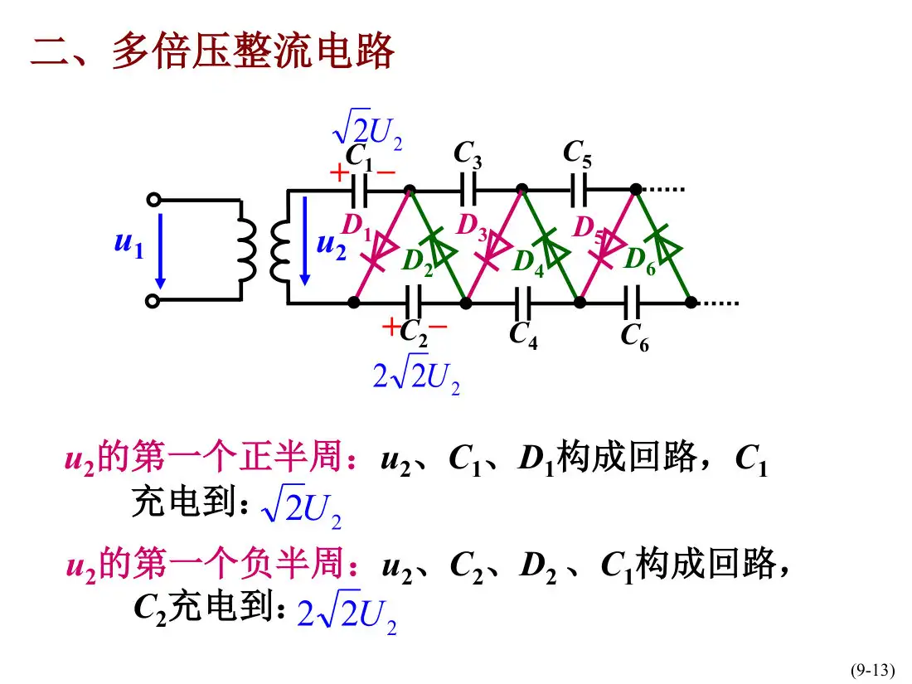

原文：

二、多倍压整流电路

$\pmb { u } _ { 2 }$ 的第一个正半周： $u _ { 2 } \setminus C _ { 1 } \setminus D _ { 1 }$ 构成回路， $C _ { 1 }$ 充电到： $\sqrt { 2 } U _ { 2 }$

$\pmb { u } _ { 2 }$ 的第一个负半周： $u _ { 2 } \setminus C _ { 2 } \setminus D _ { 2 } \setminus C _ { 1 }$ 构成回路，$C _ { 2 }$ 充电到： $2 \sqrt { 2 } U _ { 2 }$

(9-13)

### 把电容接在相应电容组的两端，即可获得所需的多倍压直流输出。

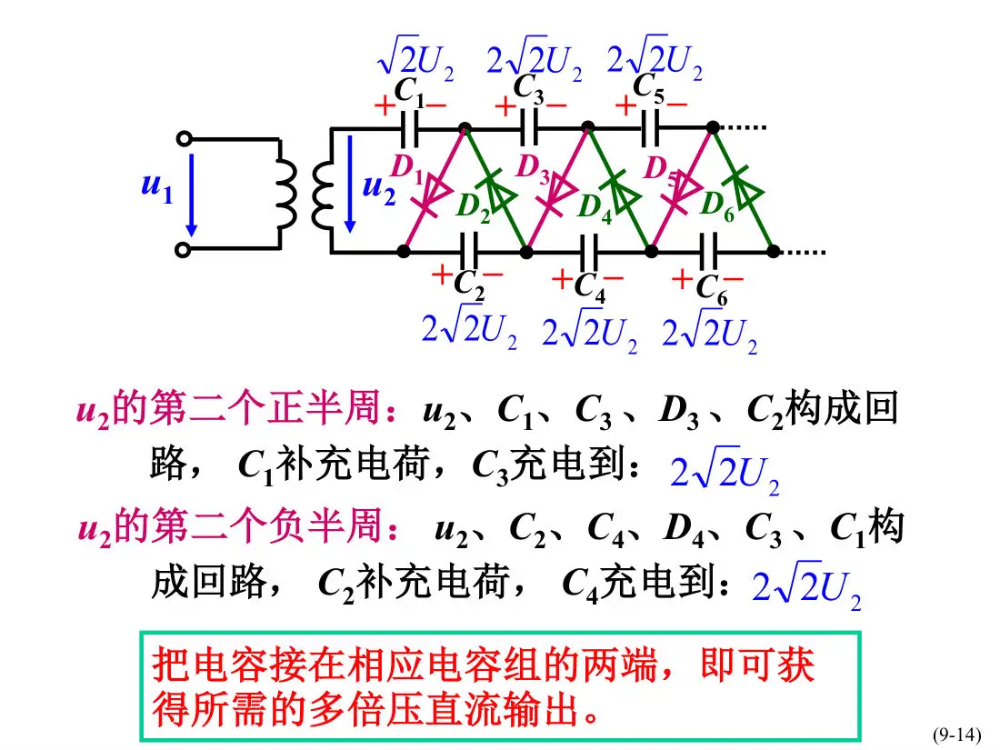

原文：

$\pmb { u } _ { 2 }$ 的第二个正半周： $u _ { 2 } \setminus C _ { 1 ^ { \setminus } } \ C _ { 3 } \setminus D _ { 3 } \setminus C _ { 2 }$ 构成回路， $C _ { 1 }$ 补充电荷， $C _ { 3 }$ 充电到： $2 \sqrt { 2 } U _ { 2 }$

$\pmb { u } _ { 2 }$ 的第二个负半周： $u _ { 2 } \circ \ C _ { 2 } \circ \ C _ { 4 } \circ \ D _ { 4 } \circ \ C _ { 3 } \circ \ C _ { 1 }$ 构成回路， $C _ { 2 }$ 补充电荷， $C _ { 4 }$ 充电到： $2 \sqrt { 2 } U _ { 2 }$

把电容接在相应电容组的两端，即可获得所需的多倍压直流输出。

(9-14)

### §9.2.5 整流电路的主要参数

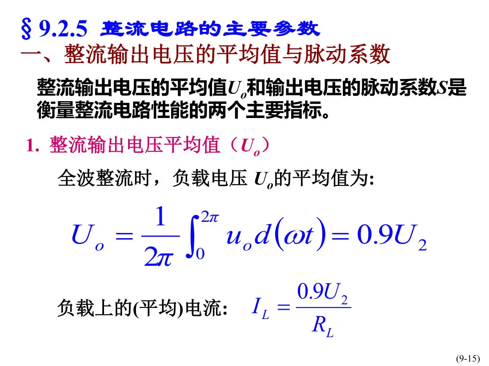

原文：

§9.2.5 整流电路的主要参数

一、整流输出电压的平均值与脉动系数

整流输出电压的平均值 $U _ { o }$ 和输出电压的脉动系数S是衡量整流电路性能的两个主要指标。

1. 整流输出电压平均值 $( U _ { o } )$

全波整流时，负载电压 $U _ { o }$ 的平均值为:

$$
U _ {o} = \frac {1}{2 \pi} \int_ {0} ^ {2 \pi} u _ {o} d (\omega t) = 0. 9 U _ {2}
$$

负载上的(平均)电流: $I _ { L } = { \frac { 0 . 9 U _ { { } _ { 2 } } } { R _ { { } _ { L } } } }$

(9-15)

### 2. 脉动系数 S

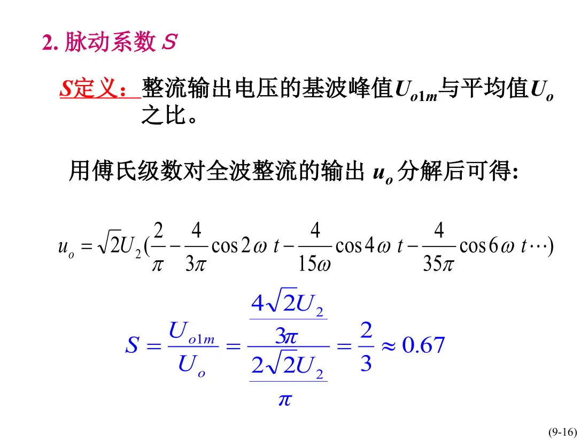

原文：

2. 脉动系数 S

S定义：整流输出电压的基波峰值 $U _ { o 1 m }$ 与平均值 $U _ { o }$ 之比。

用傅氏级数对全波整流的输出 ${ \pmb u } _ { o }$ 分解后可得:

$$
\begin{array}{c} u _ {o} = \sqrt {2} U _ {2} (\frac {2}{\pi} - \frac {4}{3 \pi} \cos 2 \omega t - \frac {4}{1 5 \omega} \cos 4 \omega t - \frac {4}{3 5 \pi} \cos 6 \omega t \dots) \\ S = \frac {U _ {o 1 m}}{U _ {o}} = \frac {\frac {4 \sqrt {2} U _ {2}}{3 \pi}}{\underline {{2 \sqrt {2} U _ {2}}}} = \frac {2}{3} \approx 0. 6 7 \end{array}
$$

(9-16)

π

### 二、平均电流与反向峰值电压

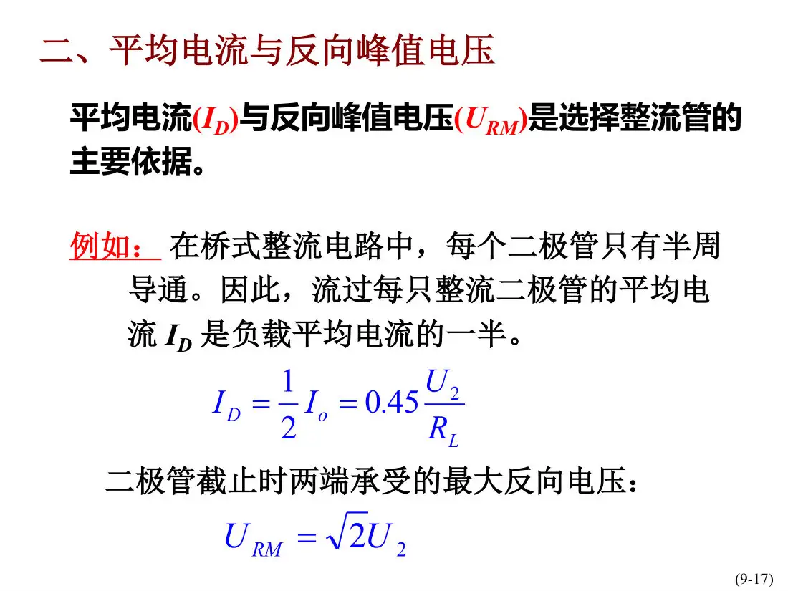

原文：

二、平均电流与反向峰值电压

平均电流 $( I _ { D } )$ 与反向峰值电压 $( U _ { R M } )$ 是选择整流管的主要依据。

例如： 在桥式整流电路中，每个二极管只有半周导通。因此，流过每只整流二极管的平均电流 $I _ { D }$ 是负载平均电流的一半。

$$
I _ {D} = \frac {1}{2} I _ {o} = 0. 4 5 \frac {U _ {2}}{R _ {L}}
$$

二极管截止时两端承受的最大反向电压：

$$
U _ {R M} = \sqrt {2} U _ {2}\tag{9-17}
$$

### §9.3 滤波电路

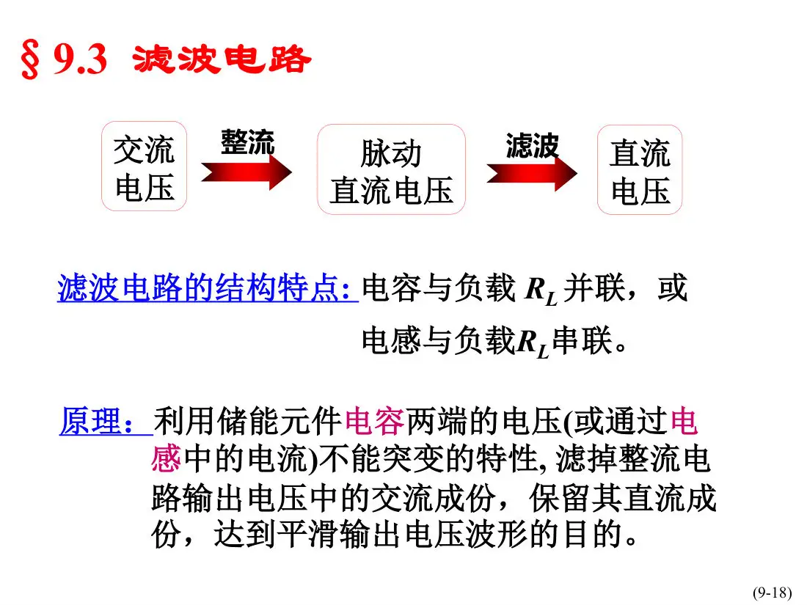

原文：

§9.3 滤波电路

滤波电路的结构特点: 电容与负载 $R _ { L }$ 并联，或电感与负载 $R _ { L }$ 串联。

原理：利用储能元件电容两端的电压(或通过电感中的电流)不能突变的特性, 滤掉整流电路输出电压中的交流成份，保留其直流成份，达到平滑输出电压波形的目的。

(9-18)

### §9.3.1 电容滤波电路

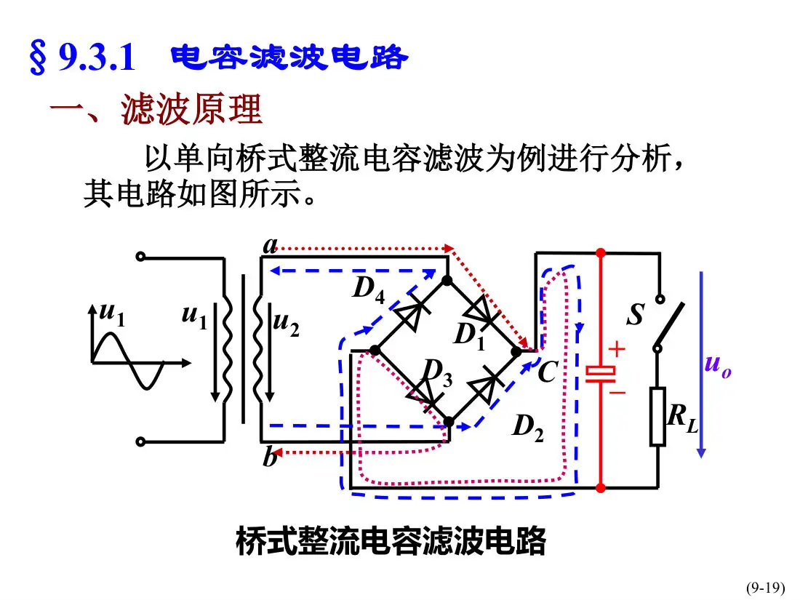

原文：

§9.3.1 电容滤波电路

一、滤波原理

以单向桥式整流电容滤波为例进行分析，其电路如图所示。

(9-19)

### 1. $R _ { L }$ 未接入时(忽略整流电路内阻)

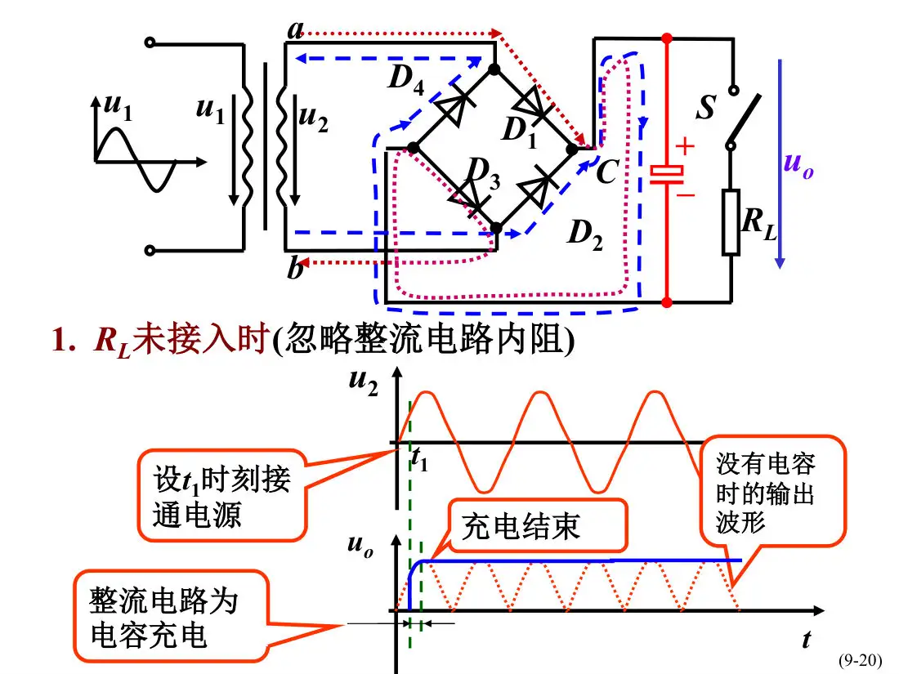

原文：

1. $R _ { L }$ 未接入时(忽略整流电路内阻)

(9-20)

### (9-21)

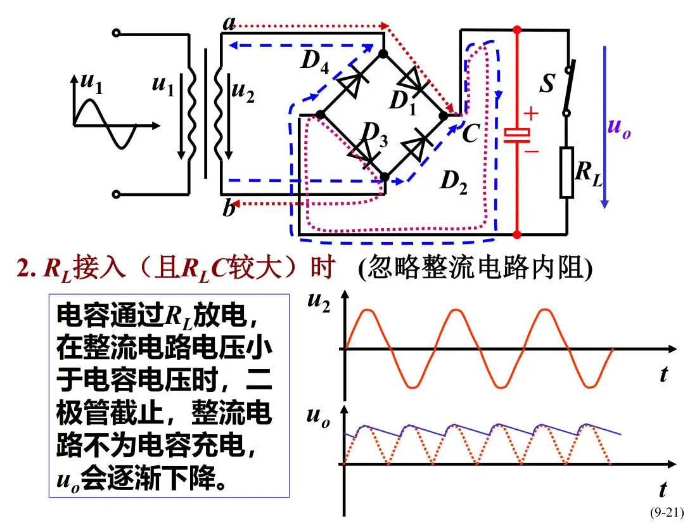

原文：

2. $R _ { L }$ 接入（且 $R _ { L }$ C较大）时 (忽略整流电路内阻)

电容通过 $R _ { L }$ 放电，在整流电路电压小于电容电压时，二极管截止，整流电路不为电容充电，${ \pmb u } _ { o }$ 会逐渐下降。

(9-21)

### 可见，采用电容滤波时，整流管的导通角较小。

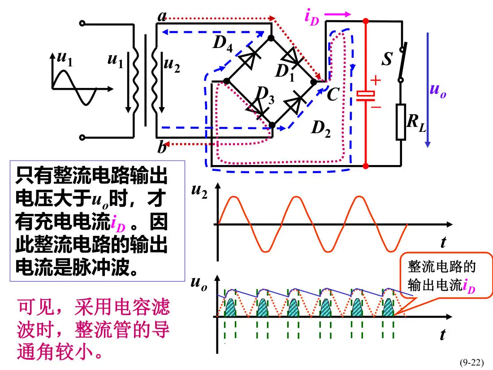

原文：

只有整流电路输出电压大于 ${ \mathbf { } } ^ { \Pi } { \pmb { u } } _ { o }$ 时，才有充电电流i 。因此整流电路的输出电流是脉冲波。

可见，采用电容滤波时，整流管的导通角较小。

(9-22)

### $R _ { L }$ C越小，输出电压越低。

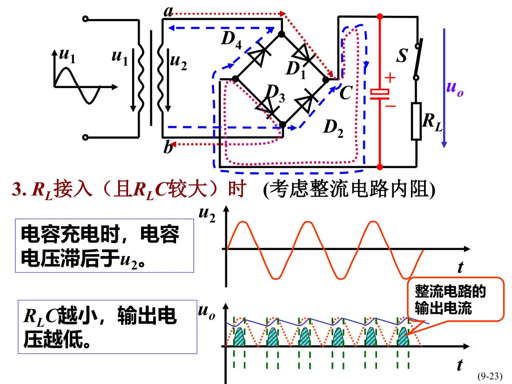

原文：

3. $R _ { L }$ 接入（且 $R _ { L }$ C较大）时 (考虑整流电路内阻)

电容充电时，电容电压滞后于 $\mathbf { \delta } \mathbf { u } _ { 2 }$ 。

$R _ { L }$ C越小，输出电压越低。

(9-23)

### 二、电容滤波电路的特点

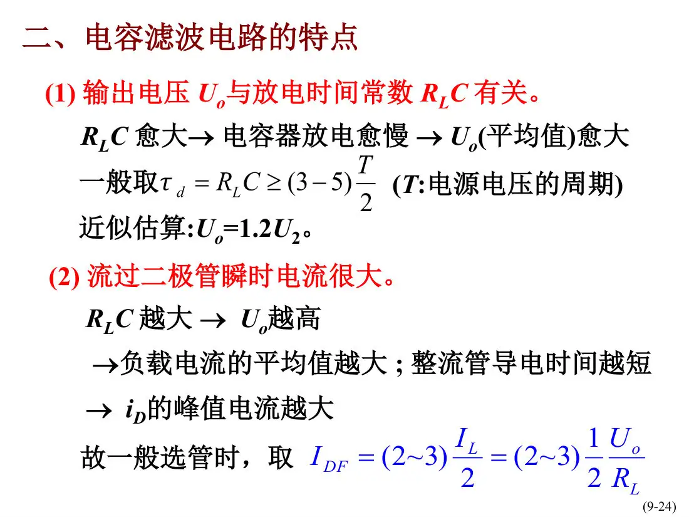

原文：

二、电容滤波电路的特点

(1) 输出电压 $U _ { o }$ 与放电时间常数 $R _ { L } C$ 有关。$R _ { L } C$ 愈大→ 电容器放电愈慢 $\to U _ { o }$ (平均值)愈大一般取 $\boldsymbol { \tau } _ { d } = R _ { L } \boldsymbol { C } \geq ( 3 - 5 ) \frac { T } { 2 }$ (T:电源电压的周期)近似估算: $U _ { o } { = } 1 . 2 U _ { 2 }$ 。

(2) 流过二极管瞬时电流很大。$R _ { L } C$ 越大 $\to U _ { o }$ 越高→负载电流的平均值越大 ; 整流管导电时间越短$ i _ { D }$ 的峰值电流越大故一般选管时，取 $I _ { D F } = ( 2 { \sim } 3 ) \frac { I _ { L } } { 2 } = ( 2 { \sim } 3 ) \frac { 1 } { 2 } \frac { U _ { o } } { R _ { L } }$ (9

(9-24)

### (3) 输出特性(外特性)

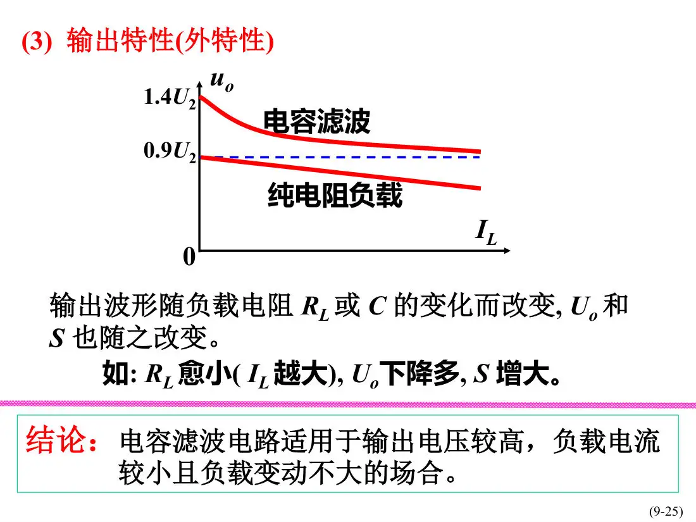

原文：

(3) 输出特性(外特性)

输出波形随负载电阻 $R _ { L }$ 或 C的变化而改变, $U _ { o }$ 和$\pmb { S }$ 也随之改变。

如: $R _ { L }$ 愈 $\pmb { I } \mathbf { l } ( I _ { L }$ 越大), $U _ { o }$ 下降多, S 增大。

结论：电容滤波电路适用于输出电压较高，负载电流较小且负载变动不大的场合。

(9-25)

### §9.3.2 电感滤波

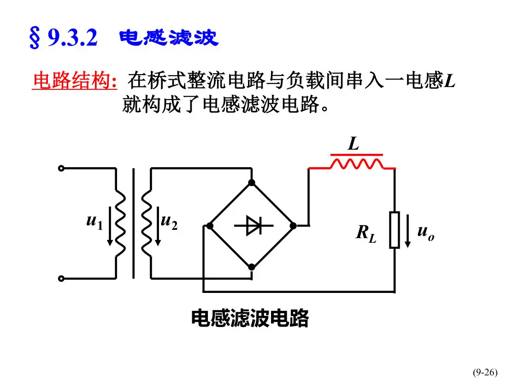

原文：

§9.3.2 电感滤波

电路结构: 在桥式整流电路与负载间串入一电感L就构成了电感滤波电路。

(9-26)

### 一、滤波原理

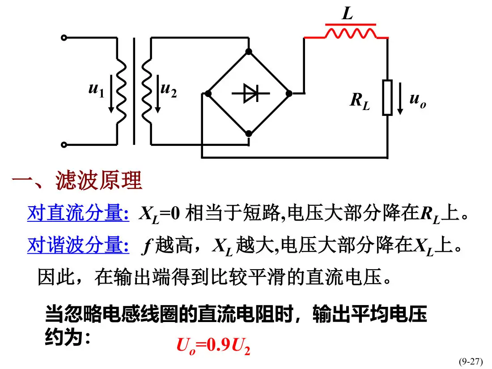

原文：

一、滤波原理

对直流分量: $X _ { L } { = } \mathbf { 0 }$ 相当于短路,电压大部分降在 $R _ { L }$ 上。对谐波分量: f越高， $X _ { L }$ 越大,电压大部分降在 $X _ { L }$ 上。因此，在输出端得到比较平滑的直流电压。

当忽略电感线圈的直流电阻时，输出平均电压约为： $U _ { o } { = } 0 . 9 U _ { 2 }$

(9-27)

### 二、电感滤波的特点

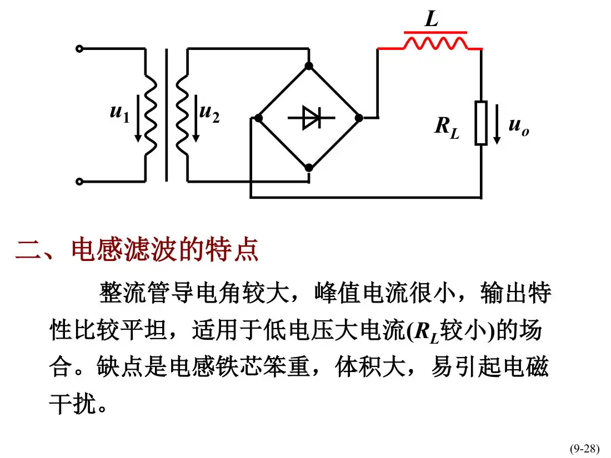

原文：

二、电感滤波的特点

整流管导电角较大，峰值电流很小，输出特性比较平坦，适用于低电压大电流 $( R _ { L }$ 较小)的场合。缺点是电感铁芯笨重，体积大，易引起电磁干扰。

(9-28)

### \*§9.3.3 其他形式的滤波电路

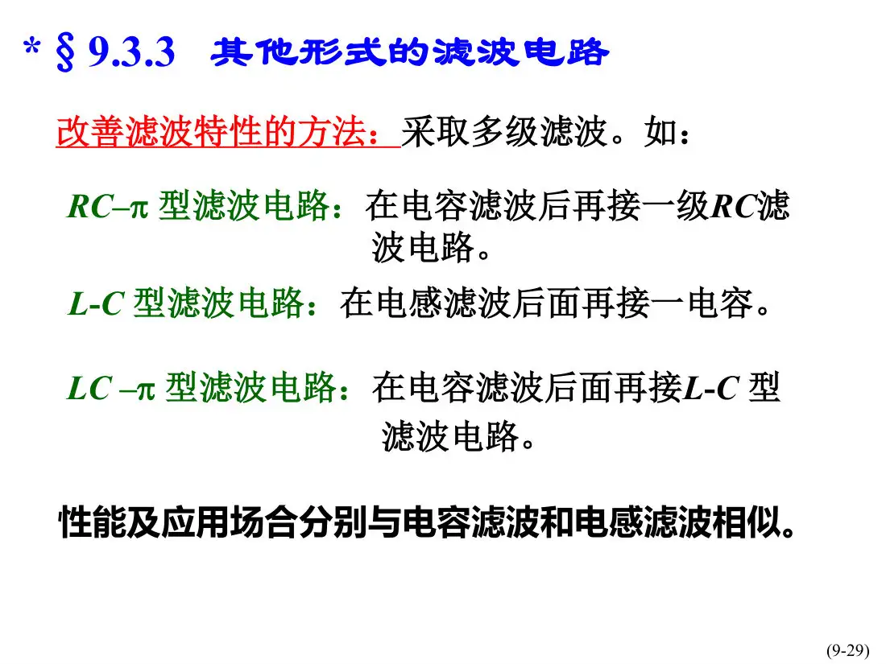

原文：

\*§9.3.3 其他形式的滤波电路

改善滤波特性的方法：采取多级滤波。如：

$R C - \pi$ 型滤波电路：在电容滤波后再接一级RC滤波电路。

L-C 型滤波电路：在电感滤波后面再接一电容。

$L C - \pi$ 型滤波电路：在电容滤波后面再接L-C 型滤波电路。

性能及应用场合分别与电容滤波和电感滤波相似。

(9-29)

### 一、 $R C - \pi$ 型滤波电路

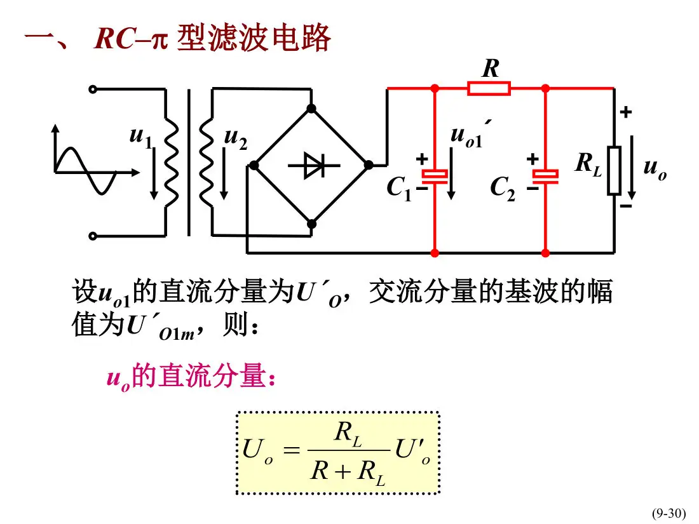

原文：

一、 $R C - \pi$ 型滤波电路

$$
\begin{array}{c} \text {   u } _ {1} \\ \text {   u } _ {2} \\ \text {   C } _ {1} \text {   +   } \text {   C } _ {2} \text {   +   } \text {   R } _ {L} \\ \text {   u } _ {o 1} ^ {\prime} \\ \text {   u } _ {o} \end{array}
$$

设 ${ \pmb u } _ { o 1 }$ 的直流分量为 $U _ { \ o } ^ { \prime } ,$ 交流分量的基波的幅值为 $U _ { \ o 1 m } ^ { \prime } ,$ ，则：

${ \pmb u } _ { o }$ 的直流分量：

$$
\left| U _ {o} = \frac {R _ {L}}{R + R _ {L}} U _ {o} ^ {\prime} \right|\tag{9-30}
$$

### ${ \pmb u } _ { o }$ 的交流分量的基波的幅值：

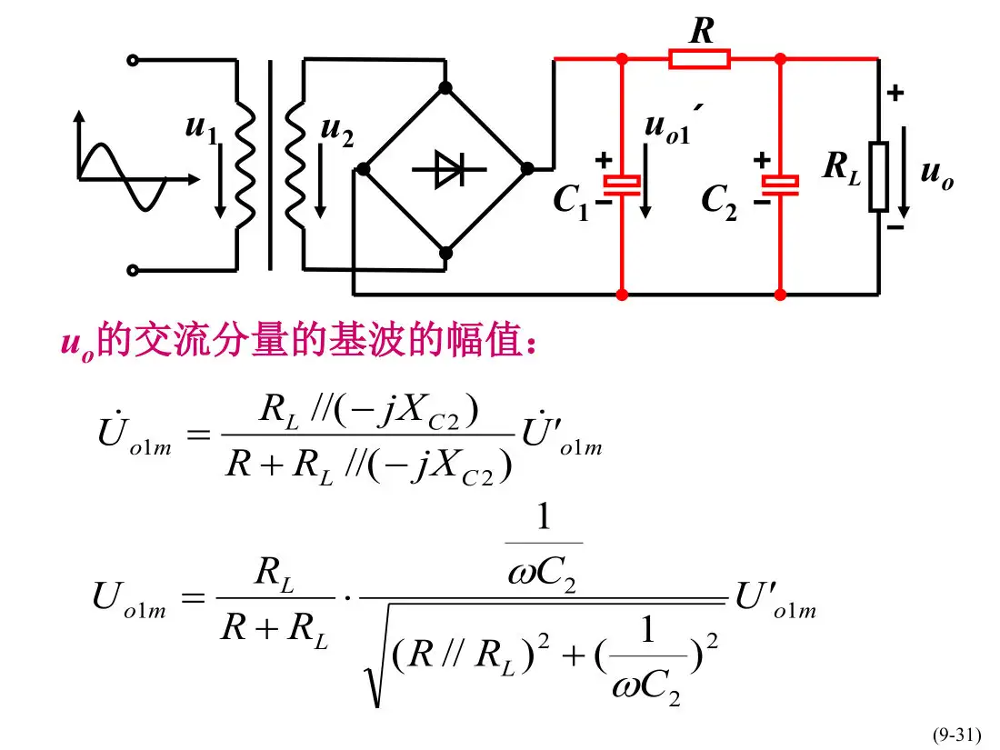

原文：

${ \pmb u } _ { o }$ 的交流分量的基波的幅值：

$$
\begin{array}{l} \dot {U} _ {o 1 m} = \frac {R _ {L} / / (- j X _ {C 2})}{R + R _ {L} / / (- j X _ {C 2})} \dot {U ^ {\prime}} _ {o 1 m} \\ U _ {o 1 m} = \frac {R _ {L}}{R + R _ {L}} \cdot \frac {\frac {1}{\omega C _ {2}}}{\sqrt {(R / / R _ {L}) ^ {2} + (\frac {1}{\omega C _ {2}}) ^ {2}}} U _ {o 1 m} ^ {\prime} \end{array}\tag{9-31}
$$

### $$

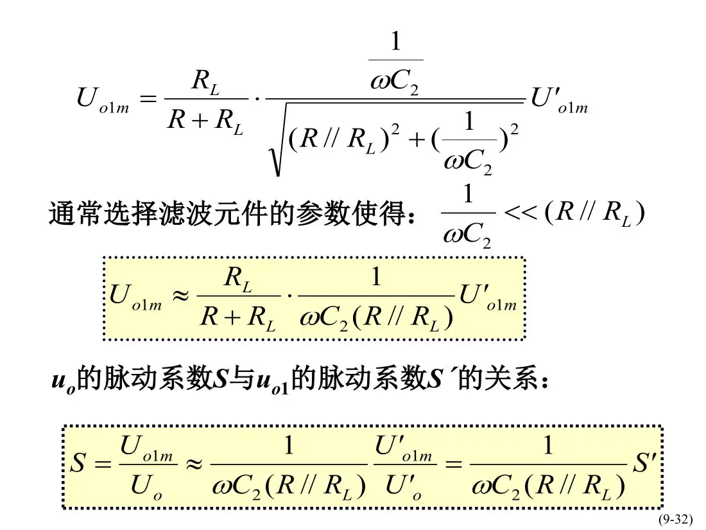

原文：

$$
U _ {o 1 m} = \frac {R _ {L}}{R + R _ {L}} \cdot \frac {\frac {1}{\omega C _ {2}}}{\sqrt {(R / / R _ {L}) ^ {2} + (\frac {1}{\omega C _ {2}}) ^ {2}}} U _ {o 1 m} ^ {\prime}
$$

通常选择滤波元件的参数使得： $\frac { 1 } { \omega C _ { 2 } } < < ( R / / R _ { L } )$

$$
\left| U _ {o 1 m} \approx \frac {R _ {L}}{R + R _ {L}} \cdot \frac {1}{\omega C _ {2} (R / / R _ {L})} U _ {o 1 m} ^ {\prime} \right|
$$

${ \pmb u } _ { o }$ 的脉动系数S与 ${ \pmb u } _ { o 1 }$ 的脉动系数S ´的关系：

$$
S = \frac {U _ {o 1 m}}{U _ {o}} \approx \frac {1}{\omega C _ {2} (R / / R _ {L})} \frac {U _ {o 1 m} ^ {\prime}}{U _ {o} ^ {\prime}} = \frac {1}{\omega C _ {2} (R / / R _ {L})} S ^ {\prime}\tag{9-32}
$$

### 二、L-C型滤波电路

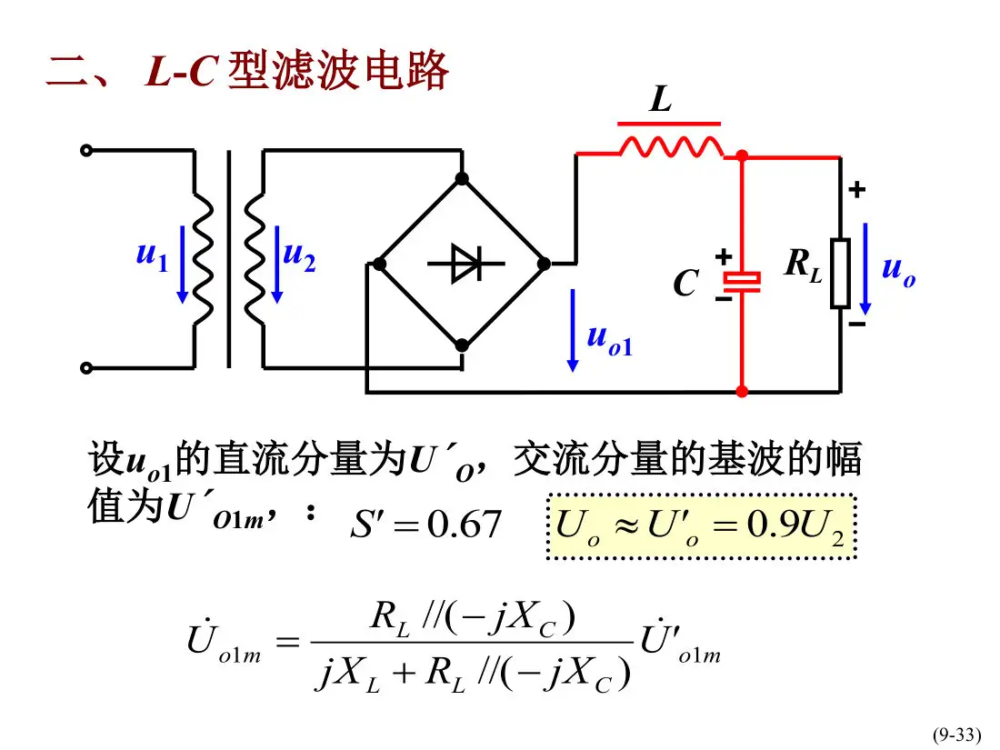

原文：

二、L-C型滤波电路

设 ${ \cal u } _ { o 1 }$ 的直流分量为 $U _ { \ o } ^ { \prime } ,$ 交流分量的基波的幅值为 $U _ { \ o 1 m } ^ { \prime } ,$ $S ^ { \prime } { = } 0 . 6 7$ $U _ { o } \approx U _ { o } ^ { \prime } = 0 . 9 U _ { 2 }$

$$
\dot {U} _ {o 1 m} = \frac {R _ {L} / / (- j X _ {C})}{j X _ {L} + R _ {L} / / (- j X _ {C})} \dot {U ^ {\prime}} _ {o 1 m}\tag{9-33}
$$

### $$

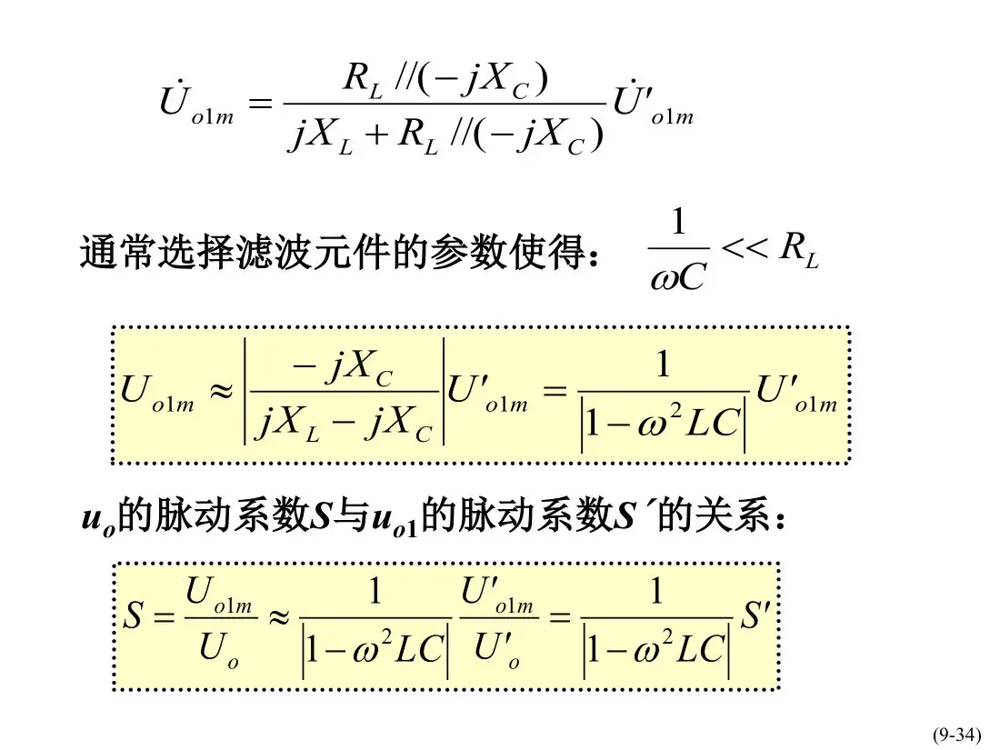

原文：

$$
\dot {U} _ {o 1 m} = \frac {R _ {L} / / (- j X _ {C})}{j X _ {L} + R _ {L} / / (- j X _ {C})} \dot {U ^ {\prime}} _ {o 1 m}
$$

通常选择滤波元件的参数使得： $\frac { 1 } { \omega C } < < R _ { L }$

$$
U _ {o 1 m} \approx \left| \frac {- j X _ {C}}{j X _ {L} - j X _ {C}} \right| U _ {o 1 m} ^ {\prime} = \frac {1}{\left| 1 - \omega^ {2} L C \right|} U _ {o 1 m} ^ {\prime}
$$

${ \pmb u } _ { o }$ 的脉动系数S与 ${ \pmb u } _ { o 1 }$ 的脉动系数 $s$ ´的关系：

$$
\vdots S = \frac {U _ {o 1 m}}{U _ {o}} \approx \frac {1}{\left| 1 - \omega^ {2} L C \right|} \frac {U _ {o 1 m} ^ {\prime}}{U _ {o} ^ {\prime}} = \frac {1}{\left| 1 - \omega^ {2} L C \right|} S ^ {\prime} \vdots\tag{9-34}
$$

### 三、LC –型滤波电路

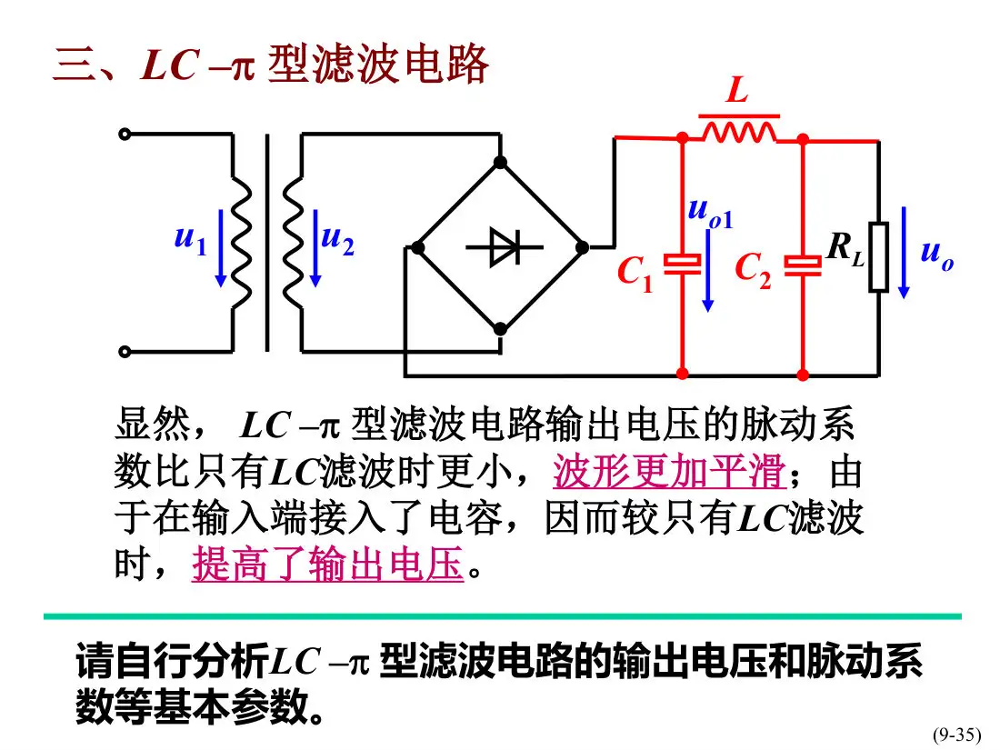

原文：

三、LC –型滤波电路

显然， $L C - \pi$ 型滤波电路输出电压的脉动系数比只有LC滤波时更小，波形更加平滑；由于在输入端接入了电容，因而较只有LC滤波时，提高了输出电压。

请自行分析LC – 型滤波电路的输出电压和脉动系数等基本参数。

(9-35)

### §9.4 稳压电路

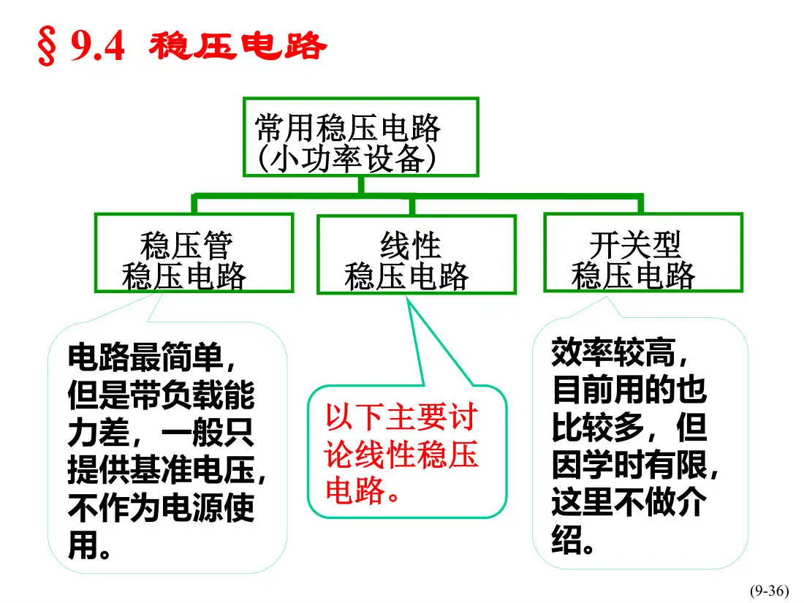

原文：

§9.4 稳压电路

(9-36)

### §9.4.1 稳压电路的主要性能指标

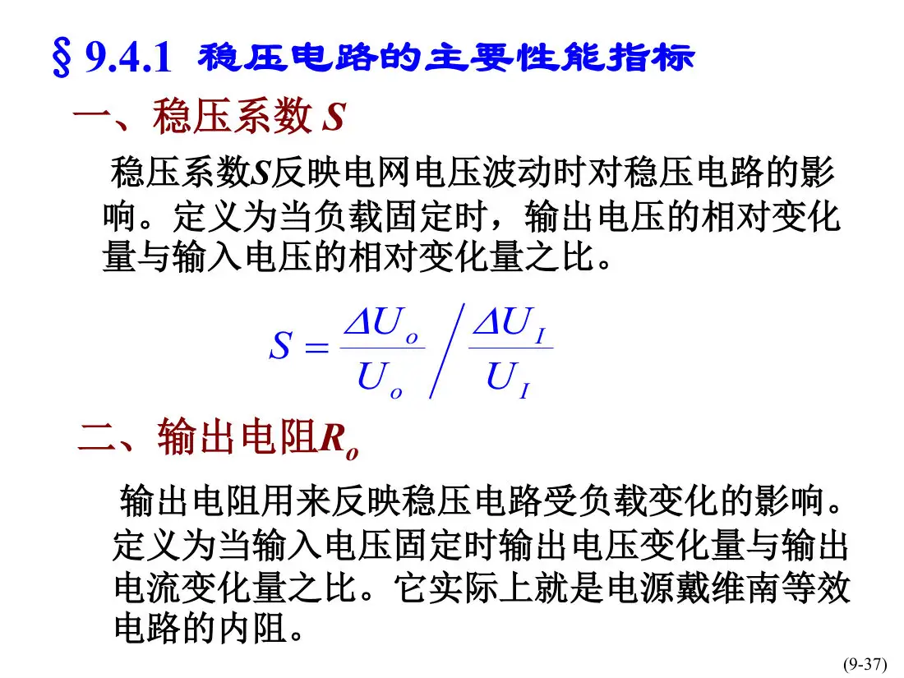

原文：

§9.4.1 稳压电路的主要性能指标

一、稳压系数S

稳压系数S反映电网电压波动时对稳压电路的影响。定义为当负载固定时，输出电压的相对变化量与输入电压的相对变化量之比。

$$
S = \frac {\Delta U _ {o}}{U _ {o}} / \frac {\Delta U _ {I}}{U _ {I}}
$$

二、输出电阻 $R _ { o }$

输出电阻用来反映稳压电路受负载变化的影响。定义为当输入电压固定时输出电压变化量与输出电流变化量之比。它实际上就是电源戴维南等效电路的内阻。

(9-37)

### 三．纹波抑制比 $\mathbf { S _ { R } }$

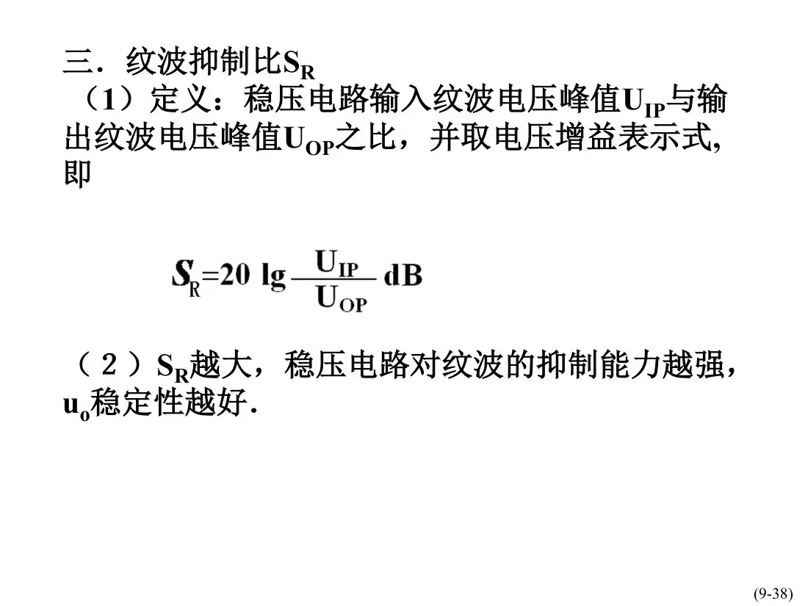

原文：

三．纹波抑制比 $\mathbf { S _ { R } }$

（1）定义：稳压电路输入纹波电压峰值 $\mathbf { U } _ { \mathbf { I } \mathbf { P } }$ 与输 出纹波电压峰值 $\bf { U } _ { o p }$ 之比，并取电压增益表示式, 即

$$
\mathbf {S} _ {\mathrm{R}} = 2 0 \lg \frac {\mathrm{U} _ {\mathrm{IP}}}{\mathrm{U} _ {\mathrm{OP}}} \mathrm{dB}
$$

（2） $\mathbf { S _ { R } }$ 越大，稳压电路对纹波的抑制能力越强，${ \bf u _ { 0 } }$ 稳定性越好

(9-38)

### §9.4.2 串联反馈式稳压电路

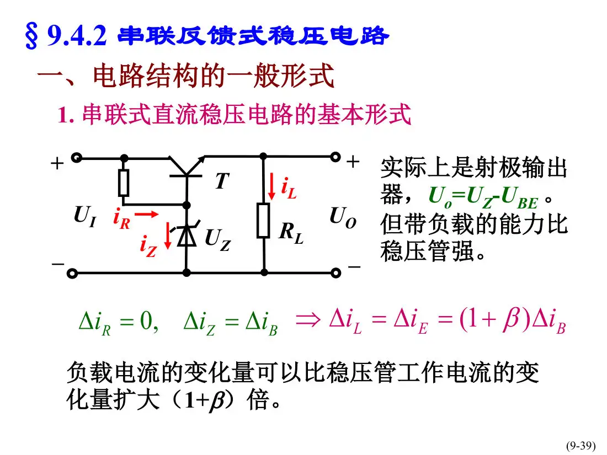

原文：

§9.4.2 串联反馈式稳压电路

一、电路结构的一般形式

1. 串联式直流稳压电路的基本形式

实际上是射极输出器， $U _ { o } { = } U _ { Z } { = } U _ { B E }$ 。但带负载的能力比稳压管强。

$$
\Delta i _ {R} = 0, \quad \Delta i _ {Z} = \Delta i _ {B} \Rightarrow \Delta i _ {L} = \Delta i _ {E} = (1 + \beta) \Delta i _ {B}
$$

负载电流的变化量可以比稳压管工作电流的变化量扩大 $( 1 + \beta )$ 倍。

(9-39)

### 串联式直流稳压电路的基本形式两个主要缺点：

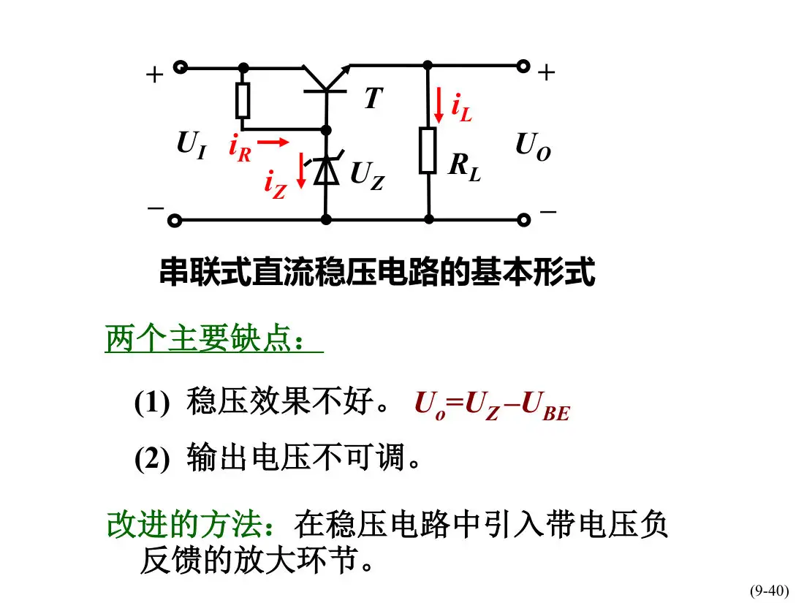

原文：

串联式直流稳压电路的基本形式两个主要缺点：

(1) 稳压效果不好。 $U _ { o } { = } U _ { Z } { - } U _ { B E }$

(2) 输出电压不可调。

改进的方法：在稳压电路中引入带电压负反馈的放大环节。

(9-40)

### 2. 具有放大环节的串联型稳压电路

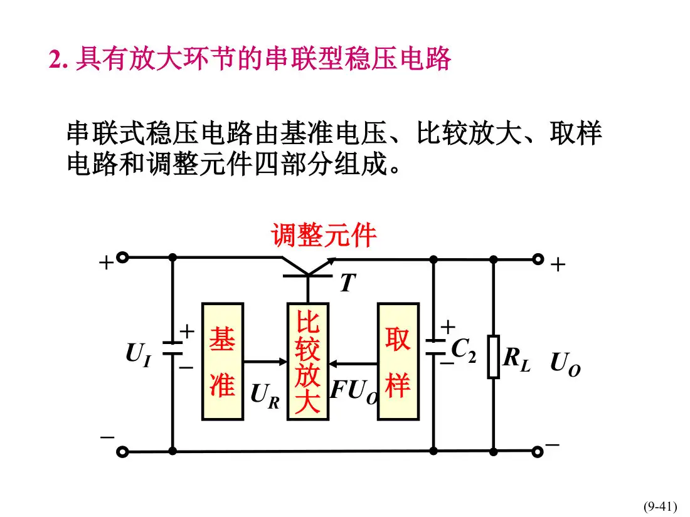

原文：

2. 具有放大环节的串联型稳压电路

串联式稳压电路由基准电压、比较放大、取样电路和调整元件四部分组成。

(9-41)

### 比较放大器：可以是单管放大电路，差动放大电路，集成运算放大器。

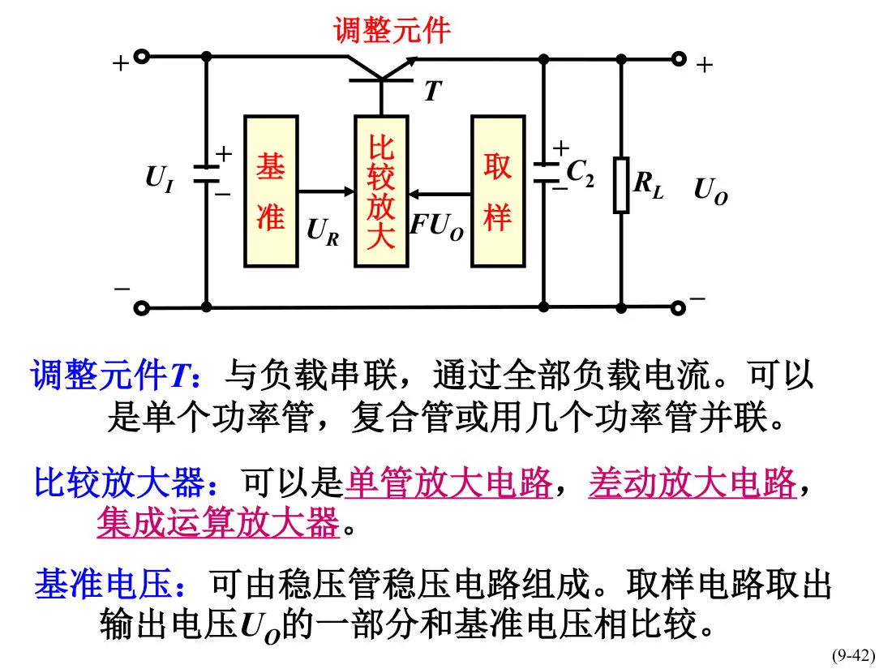

原文：

调整元件T：与负载串联，通过全部负载电流。可以是单个功率管，复合管或用几个功率管并联。

比较放大器：可以是单管放大电路，差动放大电路，集成运算放大器。

基准电压：可由稳压管稳压电路组成。取样电路取出输出电压 $U _ { O }$ 的一部分和基准电压相比较。

(9-42)

### (9-43)

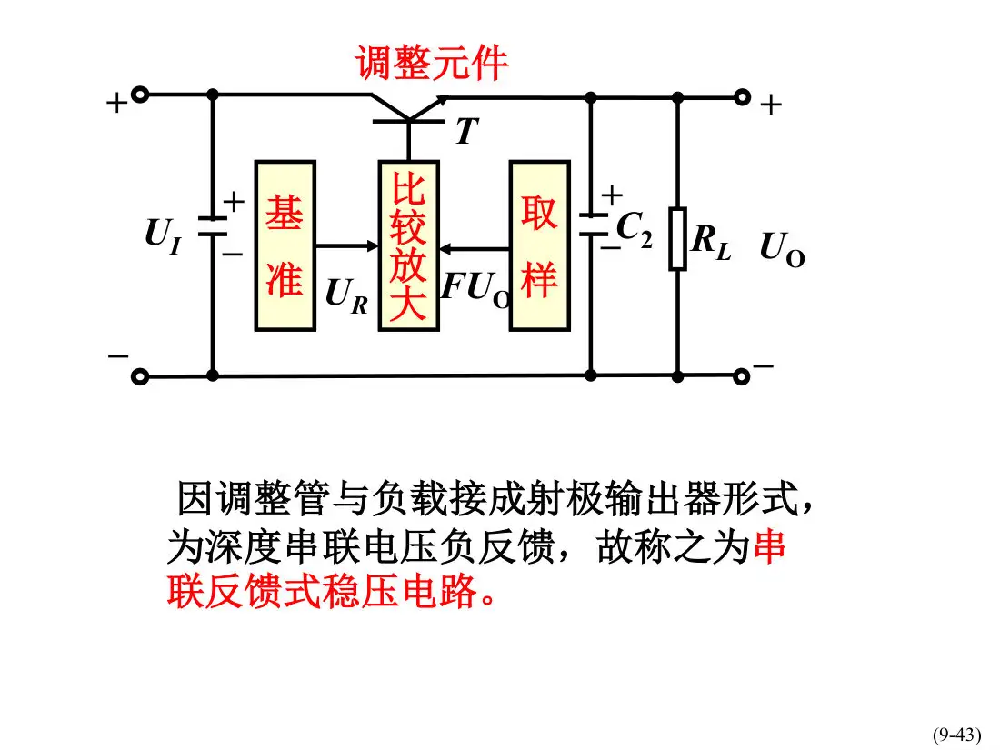

原文：

因调整管与负载接成射极输出器形式，为深度串联电压负反馈，故称之为串联反馈式稳压电路。

(9-43)

### 一种实际的串联式稳压电源

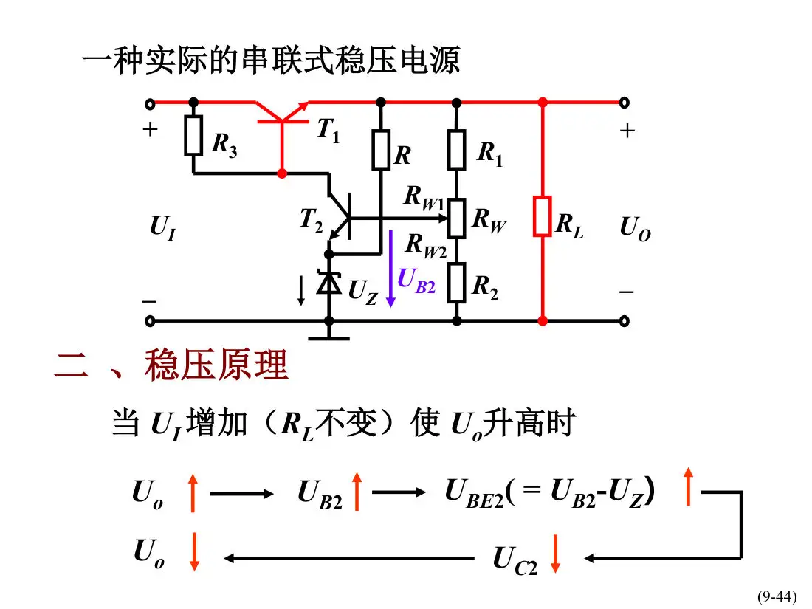

原文：

一种实际的串联式稳压电源

二 、稳压原理

当 $U _ { I }$ 增加 $( R _ { L }$ 不变）使 $U _ { o }$ 升高时

$$
\begin{array}{l} U _ {o} \uparrow \longrightarrow U _ {B 2} \uparrow \longrightarrow U _ {B E 2} (= U _ {B 2} - U _ {Z}) \uparrow \\ U _ {o} \downarrow \longleftarrow U _ {C 2} \downarrow \end{array}\tag{9-44}
$$

### 三 、输出电压的确定和调节范围

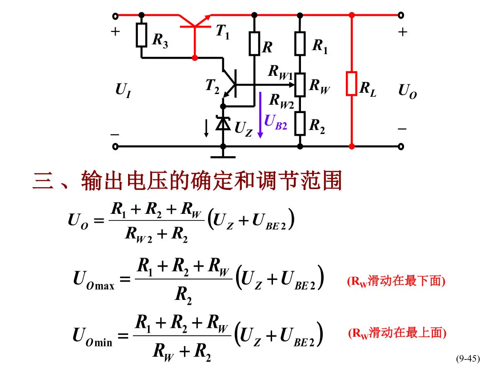

原文：

三 、输出电压的确定和调节范围

$$
U _ {o} = \frac {R _ {1} + R _ {2} + R _ {W}}{R _ {W 2} + R _ {2}} \left(U _ {z} + U _ {B E 2}\right)
$$

$$
U _ {o \max} = \frac {R _ {1} + R _ {2} + R _ {W}}{R _ {2}} \left(U _ {Z} + U _ {B E 2}\right)
$$

$$
U _ {o \min} = \frac {R _ {1} + R _ {2} + R _ {W}}{R _ {W} + R _ {2}} \left(U _ {Z} + U _ {B E 2}\right)
$$

(R 滑动在最下面)

$( \mathbf { R } _ { \mathbf { W } }$ 滑动在最上面)

(9-45)

### 四 、影响稳压特性的主要因素

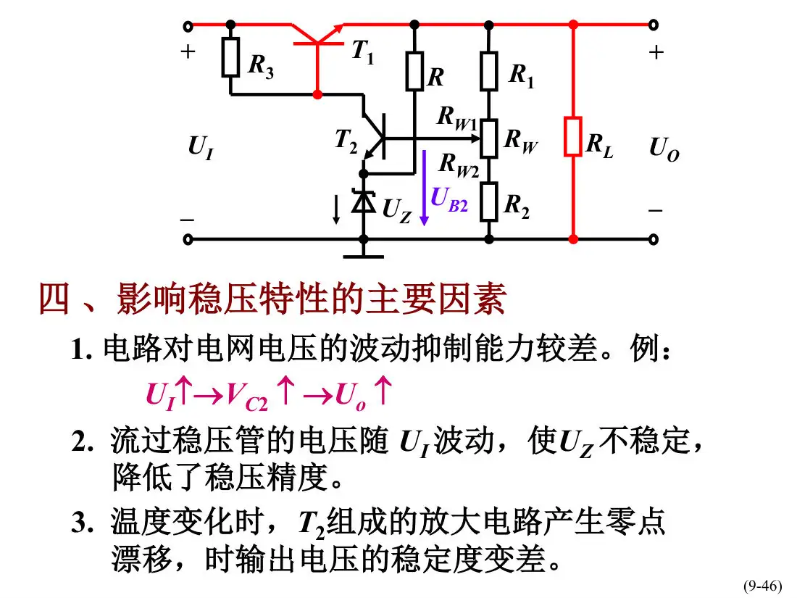

原文：

四 、影响稳压特性的主要因素

1. 电路对电网电压的波动抑制能力较差。例：$U _ { I } \uparrow \to V _ { C 2 } \uparrow \to U _ { o }$ 

2. 流过稳压管的电压随 $U _ { I }$ 波动，使 $U _ { Z }$ 不稳定，降低了稳压精度。

3. 温度变化时， $T _ { 2 }$ 组成的放大电路产生零点漂移，时输出电压的稳定度变差。

(9-46)

### 五、改进措施

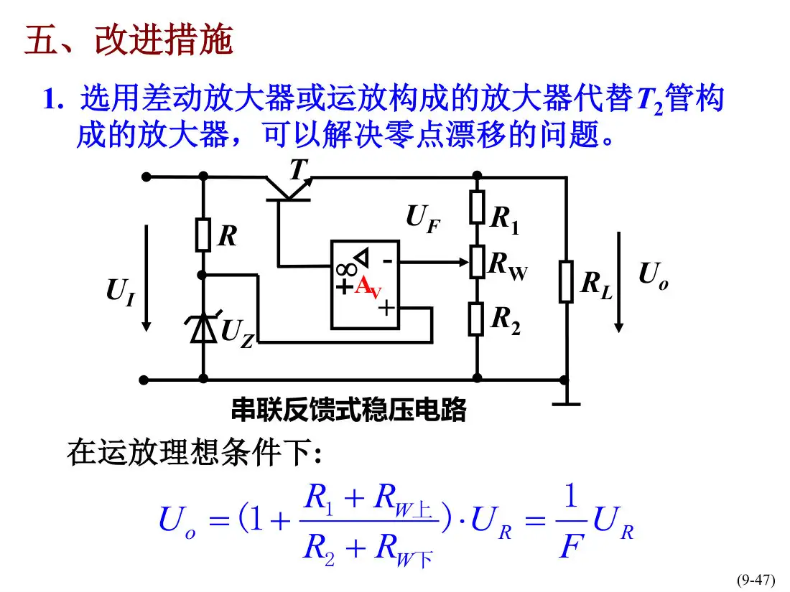

原文：

五、改进措施

1. 选用差动放大器或运放构成的放大器代替 $T _ { 2 }$ 管构成的放大器，可以解决零点漂移的问题。

在运放理想条件下:

$$
U _ {o} = (1 + \frac {R _ {1} + R _ {W \text {上}}}{R _ {2} + R _ {W \text {下}}}) \cdot U _ {R} = \frac {1}{F} U _ {R}\tag{9-47}
$$

### 2. 采用辅助电源(比较放大部分的电源)。

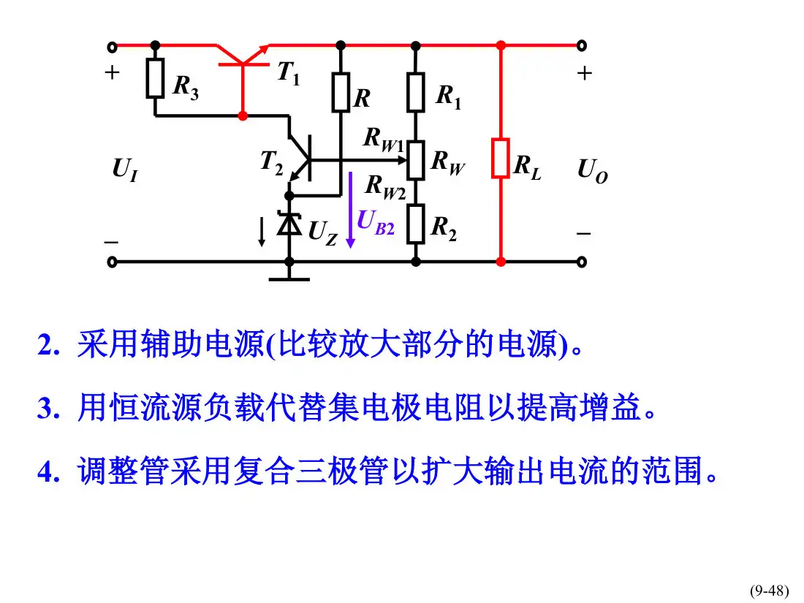

原文：

2. 采用辅助电源(比较放大部分的电源)。

3. 用恒流源负载代替集电极电阻以提高增益。

4. 调整管采用复合三极管以扩大输出电流的范围。

(9-48)

### 七、串联反馈式稳压电路缺点

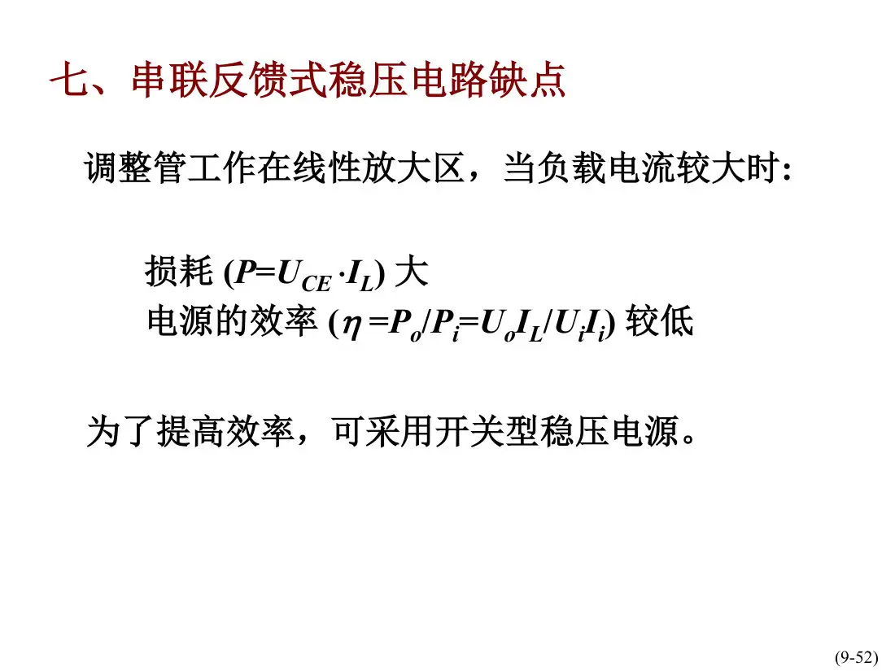

原文：

七、串联反馈式稳压电路缺点

调整管工作在线性放大区，当负载电流较大时:

损耗 $\scriptstyle ( P = U _ { C E } \cdot I _ { L } )$ 大

电源的效率 $( \eta = P _ { o } / P _ { i } { = } U _ { o } I _ { L } / U _ { i } I _ { i } )$ 较低

为了提高效率，可采用开关型稳压电源。

(9-52)

### §9.5 集成稳压电源

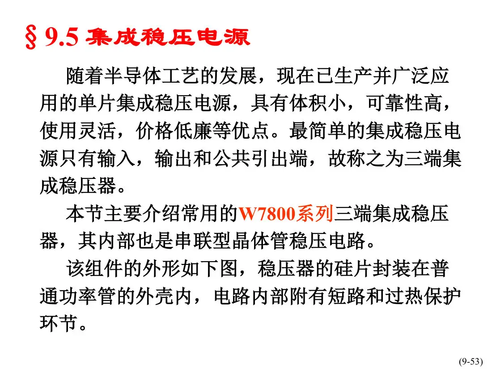

原文：

§9.5 集成稳压电源

随着半导体工艺的发展，现在已生产并广泛应用的单片集成稳压电源，具有体积小，可靠性高，使用灵活，价格低廉等优点。最简单的集成稳压电源只有输入，输出和公共引出端，故称之为三端集成稳压器。

本节主要介绍常用的W7800系列三端集成稳压器，其内部也是串联型晶体管稳压电路。

该组件的外形如下图，稳压器的硅片封装在普通功率管的外壳内，电路内部附有短路和过热保护环节。

(9-53)

### W7800系列稳压器外形

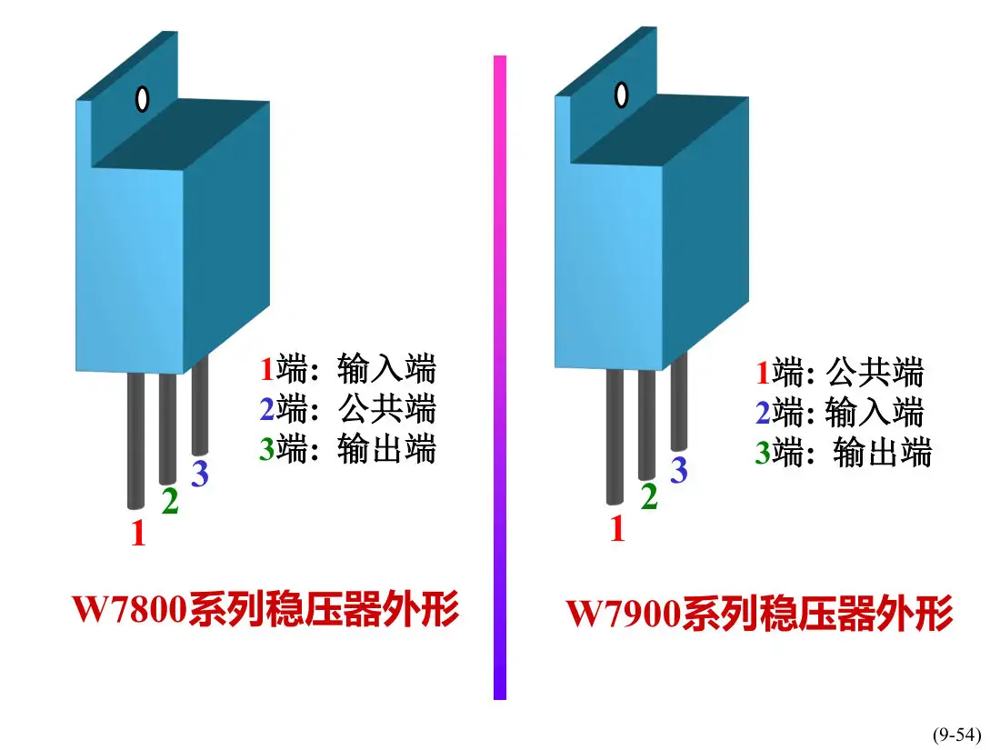

原文：

W7800系列稳压器外形

W7900系列稳压器外形

### §9.5.2 集成稳压电源的分类

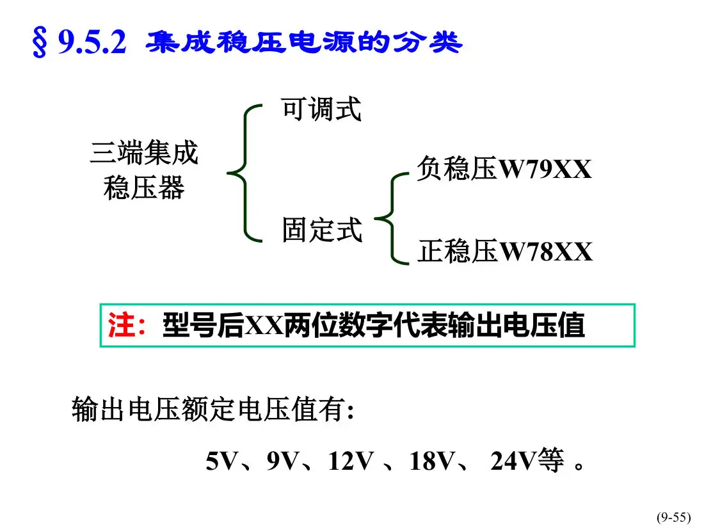

原文：

§9.5.2 集成稳压电源的分类

注：型号后XX两位数字代表输出电压值

输出电压额定电压值有:

$$
5 \mathrm{V} 、 9 \mathrm{V} 、 1 2 \mathrm{V} 、 1 8 \mathrm{V} 、 2 4 \mathrm{V} \text {等 。}\tag{9-55}
$$

### §9.5.2 应用电路

原文：

§9.5.2 应用电路

一、输出为固定电压的电路

输出为固定正压时的接法如图所示。

注意：输入与输出端之间的电压不得低于3V！

(9-56)

### 二 、输出正负电压的电路

原文：

二 、输出正负电压的电路

正负电压同时输出电路

(9-57)

### 三、提高输出电压的电路

原文：

三、提高输出电压的电路

$U _ { X Y }$ : 为W78XX固定输出电压

$$
U _ {o} = U _ {X X} + U _ {Z}\tag{9-58}
$$

### 四、输出电压可调式电路

原文：

四、输出电压可调式电路

用三端稳压器也可以实现输出电压可调，下图是用W7805组成的7－30V可调式稳压电源。

(9-59)

### $$

原文：

$$
\begin{array}{c} U _ {I} \\ 3 3 V \end{array} \text {W7805} \begin{array}{c} 1 \\ 2 \\ 6 \\ F 0 0 7 \end{array} \text {F007} \begin{array}{c} 3 \\ 7 \\ 4 \\ 3 \end{array} \text {10k} \begin{array}{c} R _ {1} \\ R _ {2} \end{array} \text {Co}
$$

运算放大器作为电压跟随器使用, 它的电源就借助于稳压器的输入直流电压。由于运放的输入阻抗很高 ,输出阻抗很低，可以克服稳压器受输出电流变化的影响。

$$
\left.\begin{array}{l}U _ {o 1} = U _ {-} = U _ {+} = \frac {R _ {2}}{R _ {1} + R _ {2}} U _ {o}\\U _ {o} = U _ {o 1} + U _ {X X}\end{array}\right\}\rightarrow\begin{array}{c}U _ {o} = U _ {X X} \cdot (1 + \frac {R _ {2}}{R _ {1}})\\(U _ {X X} = 5 \mathbf {V})\end{array}\tag{9-60}
$$

### 第九章

原文：

第九章

结束
