# 《电路分析与电工电子技术》第9章 耦合电感与变压器习题解答

原件经识别和整理；“参考解答”是我们补的。

## 习题 9-1

试标出题图 9-1 所示耦合线圈的同名端。

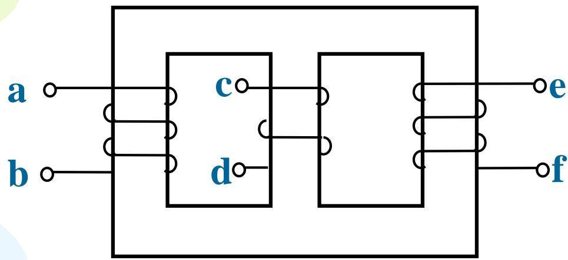

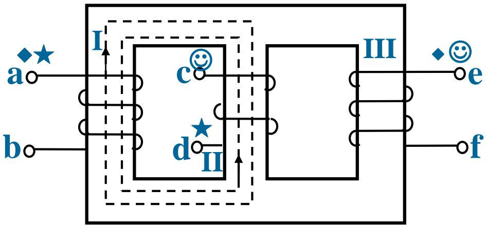

解：对线圈 I 与线圈 II，设电流分别从 a、c 端流入线圈，则线圈 I 与线圈 II 中的自磁链与互磁链方向相反，故：

a 端与 d 端为同名端。

同理可得：c 端与 e 端为同名端；a 端与 e 端为同名端。

## 习题 9-2(c)

写出题图 9-2 各耦合电感的伏安关系。

$$
\begin{array}{r} u_{I} = L_{1} \frac{d i_{1}}{d t} + M \frac{d i_{2}}{d t} \\ u_{2} = -L_{2} \frac{d i_{2}}{d t} - M \frac{d i_{1}}{d t} \end{array}
$$

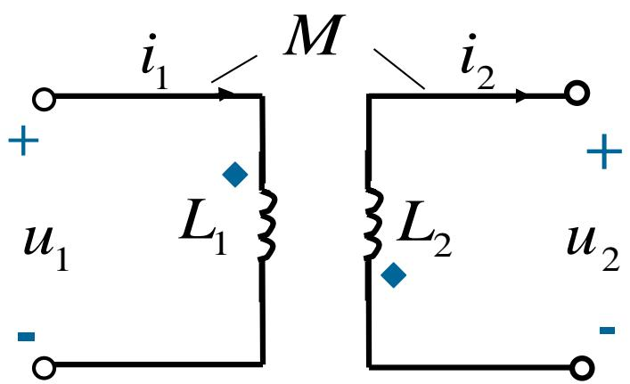

## 习题 9-3

试求题图 9-3 中的电压 $u_{2}$。

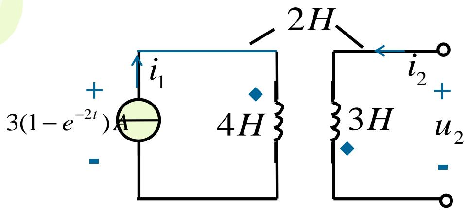

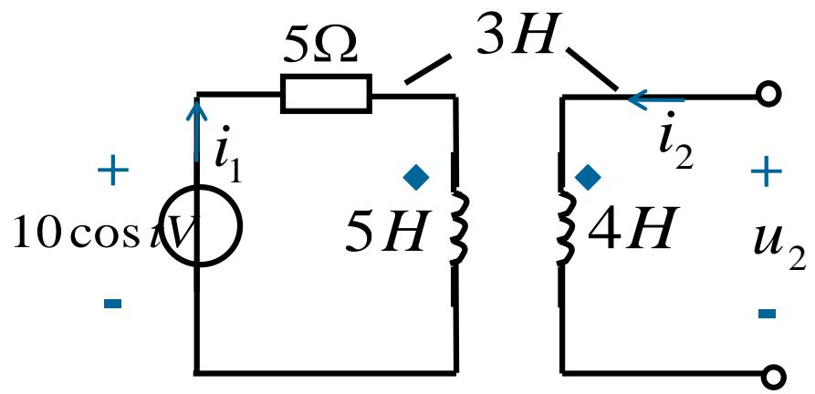

解：(a) $\because i_{2}=0$，故：

$$
u_{2} = -M \frac{d i_{1}}{d t} = -2 \frac{d\left[3\left(1-e^{-2 t}\right)\right]}{d t} = -12 e^{-2 t} \mathrm{~V}
$$

(b) $\because i_{2}=0$，故：$\dot{I}_{1}=\frac{5\sqrt{2}\angle 0^{\circ}}{5+j 5}=1\angle -45^{\circ} \mathrm{A}$，$\therefore \dot{U}_{2}=j \omega M \dot{I}_{1}=3\angle 45^{\circ} \mathrm{V}$，$u_{2}=3\sqrt{2} \cos \left(t+45^{\circ}\right) \mathrm{V}$。

## 习题 9-4

耦合电感 $L_{1}=6 \mathrm{H}$，$L_{2}=4 \mathrm{H}$，$M=2 \mathrm{H}$，试求题图 9-4 中三种连接时的等效电感 $L_{eq}$。

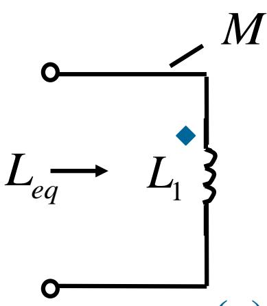

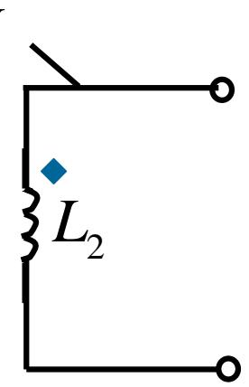

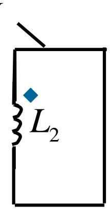

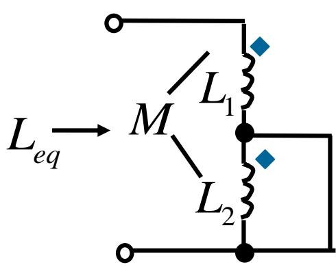

解：(a) 两线圈电流 $i$ 为 0，因此两电感可等效为如解图 9-4(a)-(1) 所示的三端连接，经去耦等效为解图 9-4(a)-(2)；

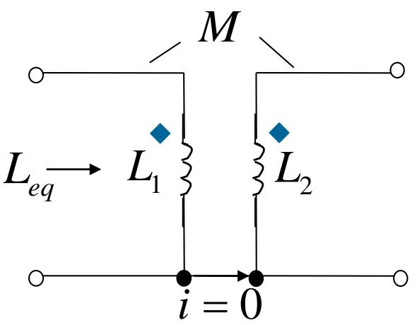

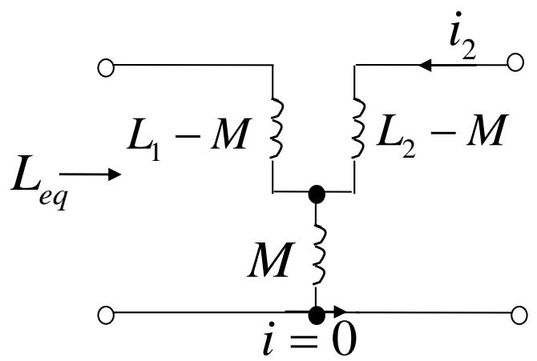

因为 $i_{2}=0$，故 $L_{1}-M$ 与 $M$ 串联，则等效电感为：

$$
L_{eq} = L_{1} - M + M = L_{1} = 6 \mathrm{H}
$$

也可直接利用耦合电感的伏安关系来确定。

(b) 同 (a)，$L_{1}$ 和 $L_{2}$ 为同名端相连的三端连接，去耦等效如解图 9-4(b)，则等效电感为：

$$
L_{eq} = (L_{1} - M) + (L_{2} - M) / / M = L_{1} - M + \frac{M\left(L_{2}-M\right)}{L_{2}-M+M} = 5 \mathrm{H}
$$

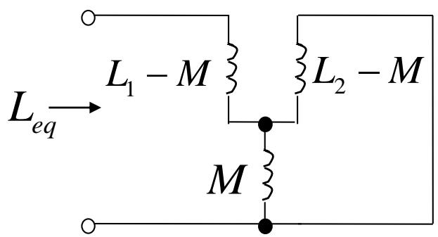

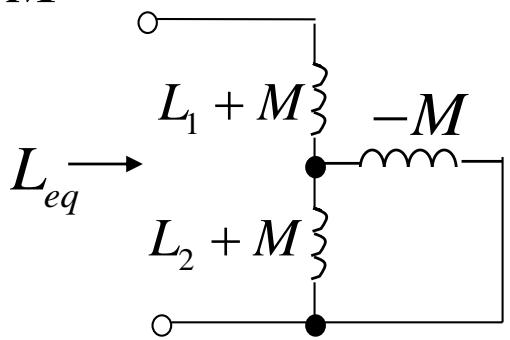

(c) $L_{1}$ 和 $L_{2}$ 为异名端相连的三端连接，去耦等效如解图 9-4(c)，则等效电感为：

$$
\begin{array}{r l} L_{eq} & = (L_{1} + M) + (L_{2} + M) / / (-M) \\ & = L_{1} + M + \frac{-M\left(L_{2}+M\right)}{L_{2}+M-M} = 5 \mathrm{H} \end{array}
$$

## 习题 9-6

电路如题图 9-6 所示，$\omega=10^{3} \mathrm{rad/s}$，$L_{1}=L_{2}=1 \mathrm{H}$，$M=0.5 \mathrm{H}$，$C_{1}=C_{2}=1 \mu \mathrm{F}$，试求 $Z_{ab}$ 和 $Z_{ad}$。

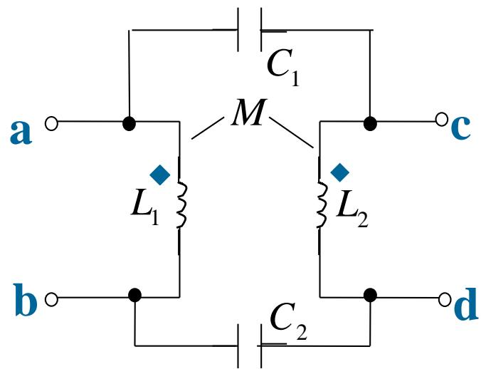

解：(1) 求 $Z_{ab}$：

从 a、b 两端看入，因为 c、d 端上电流为 0，故原电路可等效为如解图 9-6(1)-(a) 所示，而 $L_{1}$ 和 $L_{2}$ 为同名端相连的三端连接，经去耦等效后如解图 9-6(1)-(b)，则：

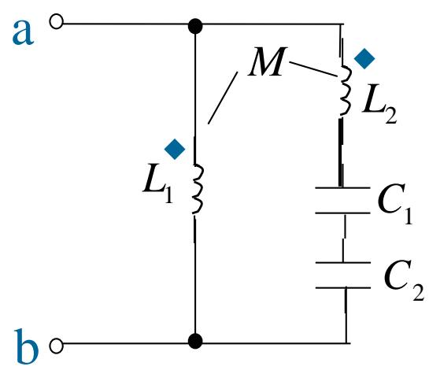

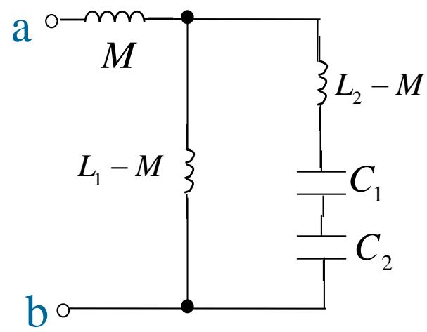

$$
\begin{array}{r l} Z_{ab} & = j \omega M + j \omega\left(L_{1}-M\right) / / \left[j \omega\left(L_{2}-M\right) + \frac{1}{j \omega C_{1}} + \frac{1}{j \omega C_{2}}\right] \\ & = j 500 + j 500 / / [j 500 - j 1000 - j 1000] \\ & = j 1250 \Omega \end{array}
$$

(2) 求 $Z_{ad}$：

从 a、d 两端看入，因为 b、c 端上电流为 0，故原电路可等效为如解图 9-6(2)-(a) 所示，而 $L_{1}$ 和 $L_{2}$ 为同名端相连的三端连接，经去耦等效后如解图 9-6(2)-(b)；

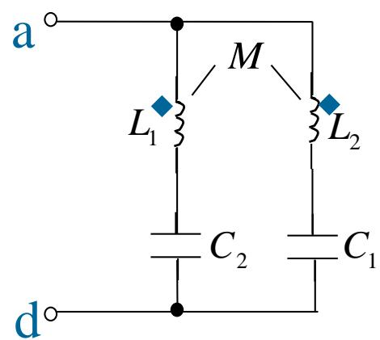

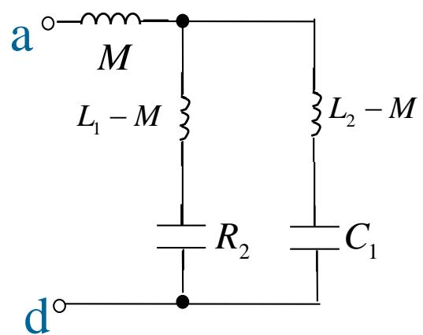

$$
\begin{array}{r l} Z_{ad} & = j \omega M + \left[j \omega\left(L_{1}-M\right) + \frac{1}{j \omega C_{2}}\right] / / \left[j \omega\left(L_{2}-M\right) + \frac{1}{j \omega C_{1}}\right] \\ & = j 500 + [j 500 - j 1000] / / [j 500 - j 1000] \\ & = j 250 \Omega \end{array}
$$

## 习题 9-8

在题图 9-8 所示电路中，已知 $R_{1}=R_{2}=10 \Omega$，$\omega L_{1}=30 \Omega$，$\omega L_{2}=20 \Omega$，$\omega M=20 \Omega$，$\dot{U}_{s}=100\angle 0^{\circ} \mathrm{V}$。试求电压相量 $\dot{U}_{2}$。

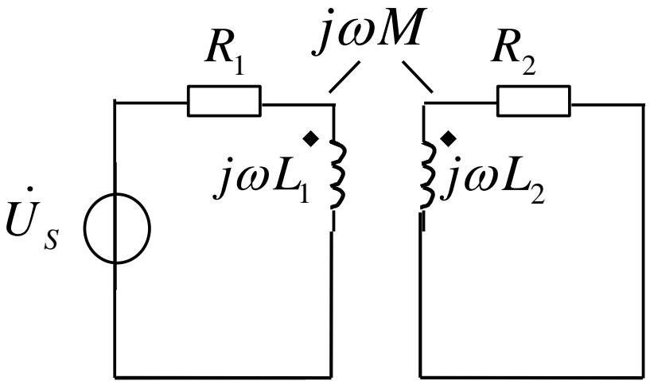

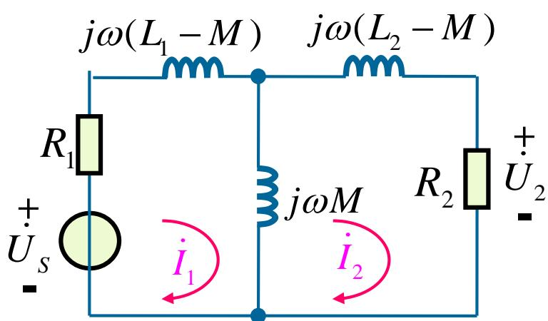

解：$L_{1}$ 和 $L_{2}$ 为同名端相连的三端连接，经去耦等效后如解图 9-8：

设网孔电流分别为 $\dot{I}_{1}$、$\dot{I}_{2}$，则网孔方程为：

$$
\left\{ \begin{array}{l} \left[R_{1} + j \omega\left(L_{1}-M\right) + j \omega M\right] \dot{I}_{1} - j \omega M \dot{I}_{2} = \dot{U}_{s} \\ -j \omega M \dot{I}_{1} + \left[R_{2} + j \omega\left(L_{2}-M\right) + j \omega M\right] \dot{I}_{2} = 0 \\ \dot{U}_{2} = \dot{I}_{2} R_{2} = 39.2\angle -11.3^{\circ} \mathrm{V} \end{array} \right.
$$

## 习题 9-11

题图 9-11 所示电路中，试求当 $Z_{L}$ 为多大时可获得最大功率，以及它获得的最大功率为多少？

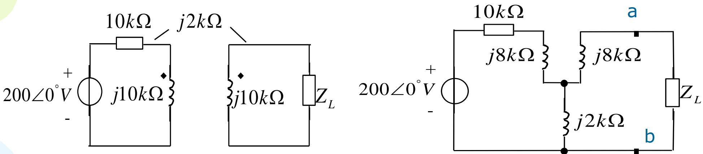

解：去耦等效后的电路如图：

(1) 负载 $Z_{L}$ 拿走，求开路电压 $\dot{U}_{oc}$：

$$
\dot{U}_{oc} = 200\angle 0^{\circ} \times \frac{j 2}{10 + j 8 + j 2} = 20\sqrt{2}\angle 45^{\circ} \mathrm{V}
$$

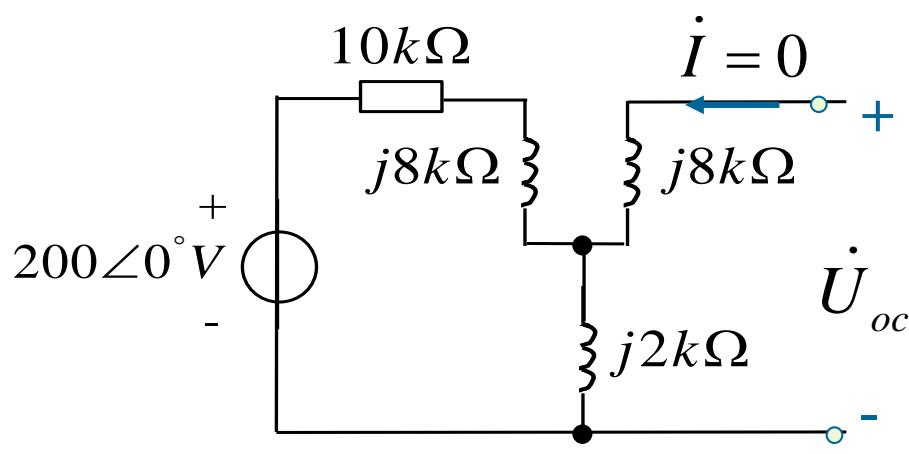

## 计算 2

(2) 求 $Z_{L}$ 以左的等效阻抗 $Z_{0}$ :

$$
Z _ {0} = (1 0 + j 8) / / j 2 + j 8 = (0. 2 + j 9. 8) k \Omega
$$

故， $Z_{L}=Z_{0}^{*}=(0.2-j9.8)k\Omega$ 时，可获得最大功率。

故， $Z_{L}$ 可获得的最大功率为：

$$
P _ {L \max} = \frac {U _ {o c} ^ {2}}{4 R _ {0}} = \frac {(2 0 \sqrt {2}) ^ {2}}{4 \times 0 . 2 \times 1 0 ^ {3}} = 1 W
$$

### 计算 3

在题图 9-12 所示电路中，已知 $\dot{U}_{s}=20\angle0^{\circ}V$ ，试求电流相量 $\dot{I}$ 。

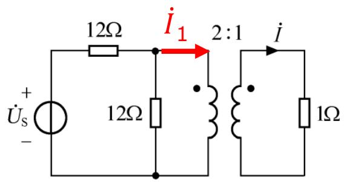

解：变压器次级搬移到初级，得图

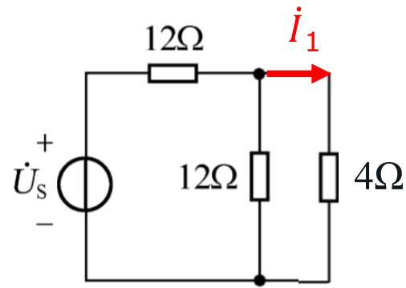

$$
\dot {I} _ {1} = \frac {2 0 \angle 0 ^ {\circ}}{1 2 + 1 2 / / 4} \times \frac {1 2}{1 2 + 4} = 1 \angle 0 ^ {\circ} \mathrm{A}
$$

$$
\dot {I} = \mathrm{n} \dot {I} _ {1} = 2 \angle 0 ^ {\circ} \mathrm{A}
$$

答案：$\dot{I} = 2 \angle 0 ^ {\circ} \mathrm{A}$

知识点：[基尔霍夫电流定律（KCL）及其应用](../../../topics/电路与电子技术/KCL.md)、[基尔霍夫电压定律（KVL）及其应用](../../../topics/电路与电子技术/KVL.md)、[理想电压源与理想电流源的特性](../../../topics/电路与电子技术/独立电源.md)

### 计算 4

试求题图9-13所示的正弦稳态电路中的 $i(t)$ 和 $u(t)$ 。

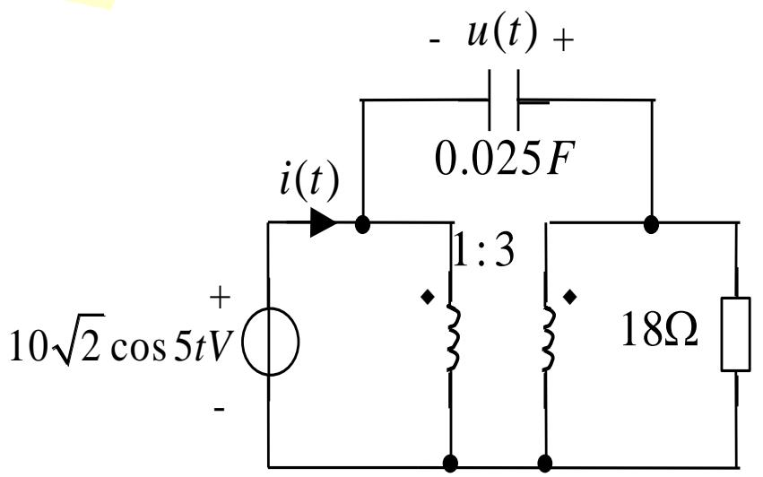

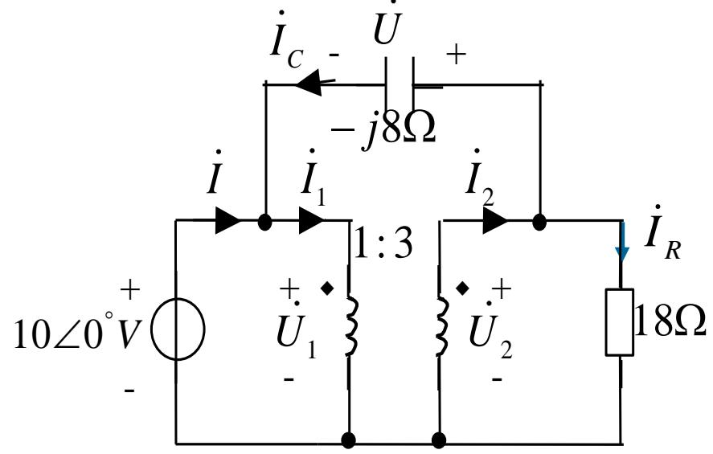

解：电路的相量模型如解图 9-13；

$$
\dot {U} = \dot {U} _ {2} - \dot {U} _ {1} = 2 \dot {U} _ {1} = 2 0 \angle 0 ^ {\circ}
$$

$$
\dot {I} _ {1} = 3 \dot {I} _ {2} = 5 + j 7. 5 A
$$

$$
\dot {I} _ {C} = \frac {\dot {U}}{- j 8} = \frac {5}{2} \angle 9 0 ^ {\circ} A, \quad \dot {I} _ {R} = \frac {\dot {U} _ {2}}{1 8} = \frac {5}{3} \angle 0 ^ {\circ} A
$$

$$
\therefore \dot {I} = \dot {I} _ {1} - \dot {I} _ {C} = 5 + j 5 = 5 \sqrt {2} \angle 4 5 ^ {\circ} A
$$

$$
\therefore u (t) = 2 0 \sqrt {2} \cos 5 t V
$$

$$
\therefore \dot {I} _ {2} = \dot {I} _ {R} + \dot {I} _ {C} = \frac {5}{3} + j \frac {5}{2} A
$$

$$
i (t) = 1 0 \cos (5 t + 4 5 ^ {\circ}) A
$$

答案：$u(t) = 20\sqrt{2} \cos 5t \text{ V}, \quad i(t) = 10 \cos(5t + 45^\circ) \text{ A}$

知识点：[基尔霍夫电流定律（KCL）及其应用](../../../topics/电路与电子技术/KCL.md)、[线性时不变电阻的伏安关系（欧姆定律）](../../../topics/电路与电子技术/线性电阻VCR.md)、[理想电压源与理想电流源的特性](../../../topics/电路与电子技术/独立电源.md)

### 计算 5

电路如题图 9-16 所示，试确定理想变压器的匝比，使 $20\Omega$ 电阻获得的功率最大。

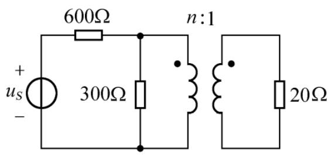

解：次级阻抗搬移到初级端，得

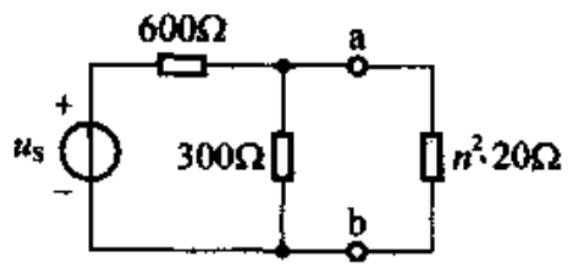

此时，20欧姆获得的最大功率即为 $20^{*}n^{2}$ 最大功率。

则，ab 以左的戴维南模型等效电阻为:

$$
R _ {0} = 6 0 0 / / 3 0 0 = 2 0 0 \Omega ,
$$

当 $20 \times n^{2} = R_{0}$ , 即 $n = \sqrt{10} \approx 3$ 时, $20\Omega$ 电阻获得最大功率。

答案：$n = \sqrt{10} \approx 3$

知识点：[理想电压源与理想电流源的特性](../../../topics/电路与电子技术/独立电源.md)、[线性时不变电阻的伏安关系（欧姆定律）](../../../topics/电路与电子技术/线性电阻VCR.md)、[四种受控电源（VCVS、VCCS、CCVS、CCCS）的特性](../../../topics/电路与电子技术/受控电源.md)

### 计算 6

电路如题图9-18所示, 已知 $R_{1} = R_{2} = 5 \Omega, R_{L} = 1 k \Omega, C = 0.25 \mu F, L_{1} = 1 H$ , $L_{2} = 4 H, M = 2 H, u_{s} = 120 \cos 1000 t V$ 求电流 $i$ 。

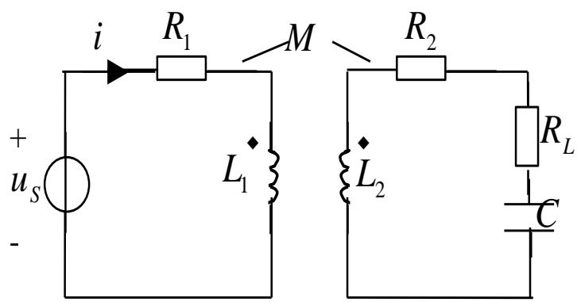

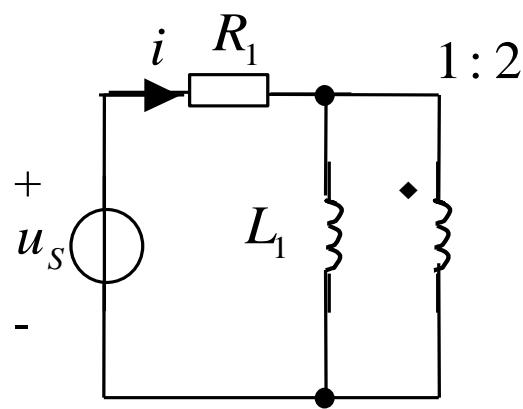

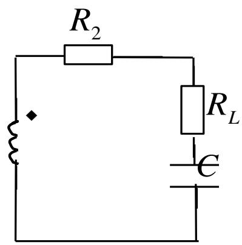

解：由于 $M = \sqrt{L_{1}L_{2}} = 2H$ ，故为全耦合变压器，电路等效为解图；其中： $n=\sqrt{\frac{L_{1}}{L_{2}}}=0.5:1$

$$
Z = R _ {1} + \mathrm{j} \omega L / / (\frac {R _ {2}}{4} + \frac {R _ {L}}{4} + \frac {1}{4 \mathrm{j} \omega \mathrm{C}})
$$

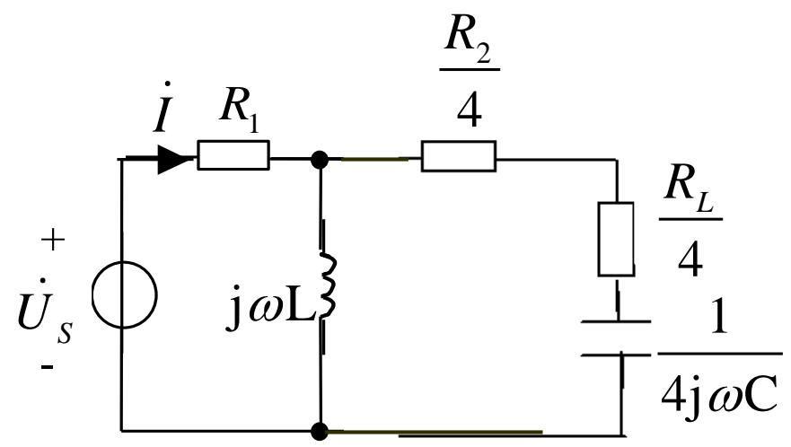

$$
\dot {I} = \frac {\dot {U} _ {s}}{Z} = \frac {6 0 \sqrt {2} \angle 0 ^ {\circ}}{5 + \mathrm{j} 1 0 0 0 / / (\frac {1}{4} \times (1 0 0 5 - \mathrm{j} 4 0 0 0))} \approx 2 0. 6 \angle - 1 4 ^ {\circ} \mathrm{mA}
$$

$$
\therefore i (t) = 2 0. 6 \sqrt {2} \cos (1 0 0 0 t - 1 4 ^ {\circ}) m A
$$

另解: $L_{1}$ 和 $L_{2}$ 为同名端相连的三端连接, 经去耦等效后如下图:

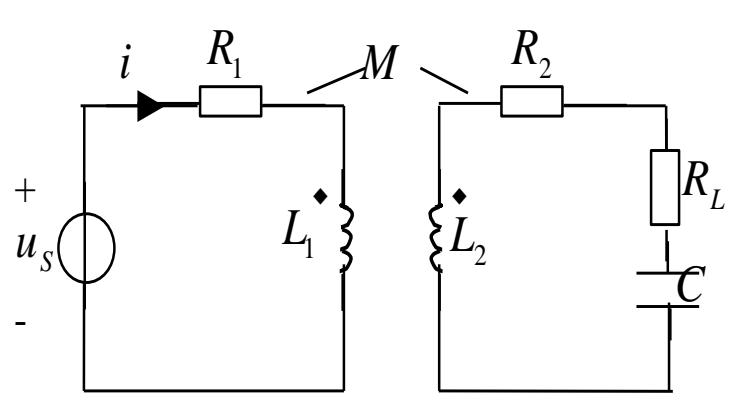

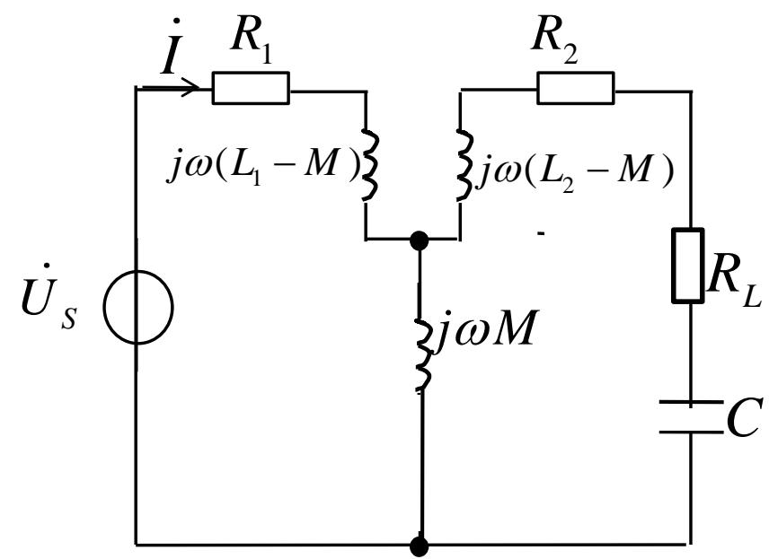

$$
R _ {1} + j \omega (L _ {1} - M) + j \omega M / / \left[ j \omega (L _ {2} - M) + R _ {2} + R _ {L} + \frac {1}{j \omega C} \right]
$$

$$
= \frac {\dot {U} _ {s}}{5 - j 1 0 0 0 + j 2 0 0 0 / / (j 2 0 0 0 + 1 0 0 5 - j 4 0 0 0)} = \frac {\dot {U} _ {s}}{3 9 8 5 + j 1 0 0 0}
$$

补充：此题为全耦合+一阶电路综合题目。注意：此题去耦时候必须不能用三端去耦，用全耦合等效成理想变压器模型。

答案：$i (t) = 2 0. 6 \sqrt {2} \cos (1 0 0 0 t - 1 4 ^ {\circ}) m A$

知识点：[四种受控电源（VCVS、VCCS、CCVS、CCCS）的特性](../../../topics/电路与电子技术/受控电源.md)

### 计算 7

题图8-20所示的电路原已稳定，t=0时开关K闭合，求t>0时电流 $i_{1}(t)$ 和电压 $u_{2}(t)$ 。

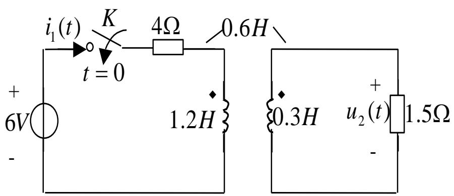

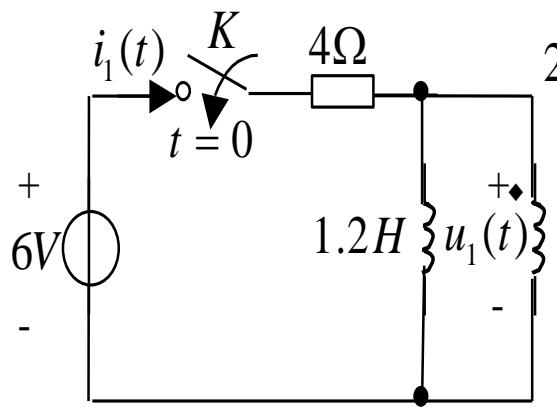

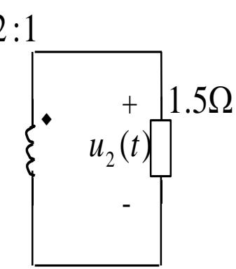

解: 由于 $M = \sqrt{L_{1} L_{2}} = 0.6 H$ , 故为全耦合变压器, 电路等效为如解图8-20(1)-(a); 其中:

$$
n = \sqrt {\frac {L}{L _ {2}}} = 2: 1
$$

次级线圈的阻抗搬移到初级线圈后的电路模型如解图8-20(1)-(b);

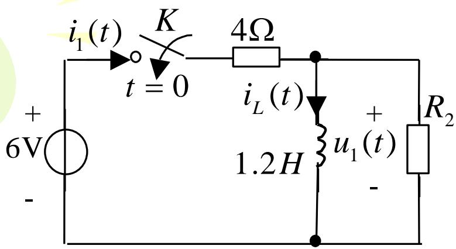

其中：搬移后的电阻为 $R_{2}=n^{2}\cdot1.5=6\Omega$ ；利用三要素法求解：

(1) $t = 0^{-}$ 时， $i_{L}(0^{-}) = 0A$ ； $t = 0^{+}$ 时 $i_{L}(0^{+}) = i_{L}(0^{-}) = 0A$ ，则：

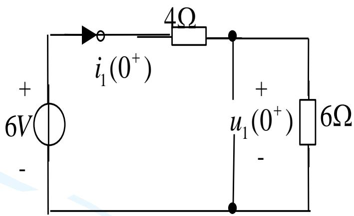

$$
\begin{array}{l} i _ {1} (0 ^ {+}) = \frac {6}{4 + 6} = 0. 6 A \\ u _ {1} (0 ^ {+}) = 6 \times i _ {1} (0 ^ {+}) = 3. 6 V \end{array}
$$

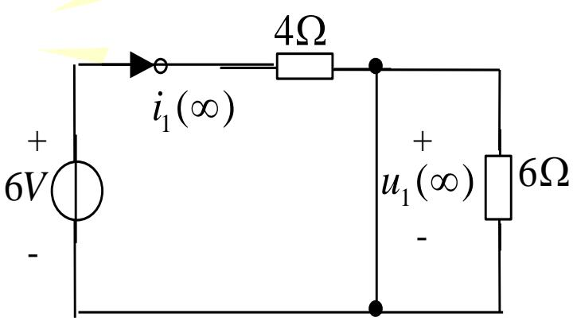

(2) $t \to \infty$ 时的电路图如解图8-20(2)-(b), 则可得:

$$
\begin{array}{l} {i _ {1} (\infty) = \frac {6}{4} = 1. 5 A} \\ {u _ {1} (\infty) = 0 V} \end{array}
$$

(3) 求时间常数: $R_{eq} = 4 // 6 = 2.4 \Omega$

$$
\tau = \frac {L _ {1}}{R _ {e q}} = \frac {1 . 2}{2 . 4} = 0. 5 s
$$

(4) 全响应为: $i_1(t) = i_1(\infty) + [i_1(0^+) - i_1(\infty)]e^{-t/\tau} = 1.5 - 0.9e^{-2t}A, t > 0$

$$
\begin{array}{l} {u _ {1} (t) = u _ {1} (\infty) + [ u _ {1} (0 ^ {+}) - u _ {1} (\infty) ] e ^ {- \frac {t}{\tau}} = 3. 6 e ^ {- 2 t} V, t > 0} \\ {\therefore u _ {2} (t) = \frac {1}{n} u _ {1} (t) = 1. 8 e ^ {- 2 t} V, t > 0} \end{array}
$$

订正：原文中 $i_1(t)$ 的全响应公式指数部分写为 $e^{-\tau}$，根据上下文及标准三要素法公式应为 $e^{-t/\tau}$，且后续计算结果 $e^{-2t}$ 也印证了这一点（因为 $1/\tau = 2$）。

答案：$i_1(t) = 1.5 - 0.9e^{-2t} \text{ A}, \quad u_2(t) = 1.8e^{-2t} \text{ V} \quad (t > 0)$

知识点：[理想电压源与理想电流源的特性](../../../topics/电路与电子技术/独立电源.md)、[线性时不变电阻的伏安关系（欧姆定律）](../../../topics/电路与电子技术/线性电阻VCR.md)、[基尔霍夫电压定律（KVL）及其应用](../../../topics/电路与电子技术/KVL.md)
