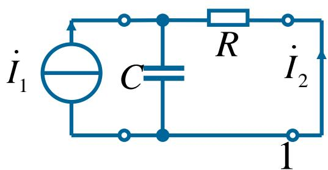
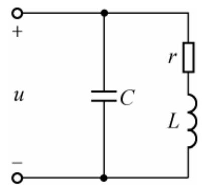
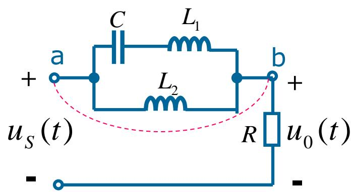
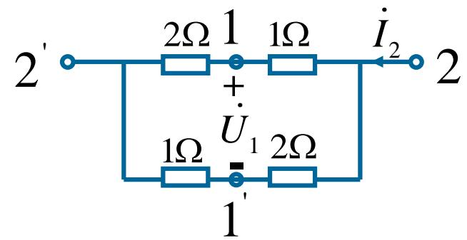
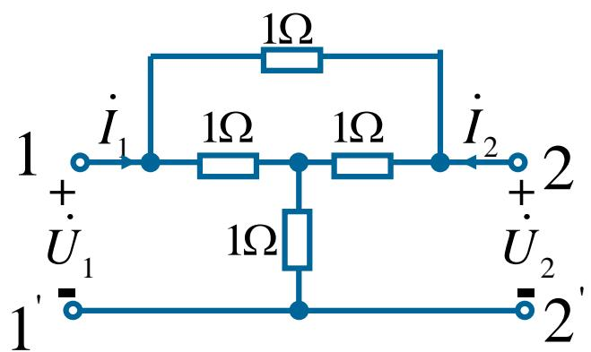

# 《电路分析与电工电子技术》第十、十一章作业答案

原件经识别和整理；“参考解答”是我们补的。

## 一、电路分析与电工电子技术

### 10-3 试求题图10-2所示电路的转移电流比、截止频率和通频带。

解: (a)

$$
K _ {I} (j \omega) = \frac {\dot {I} _ {2}}{\dot {I} _ {1}} = - \frac {\overline {{j \omega C}}}{R + \frac {1}{j \omega C}} = - \frac {1}{1 + j \omega R C}
$$

令 $\omega_{C} = \frac{1}{RC}$ ，则： $K_{I}(j\omega) = -\frac{1}{1 + j\frac{\omega}{\omega_{C}}}$

当 $\omega = 0$ 时， $\left|K_{i}(j\omega)\right| = 1,\theta (\omega) = 0$

当 $\omega = \omega_{C}$ 时， $\left|K_{i}(j\omega)\right| = 1 / \sqrt{2}\quad \theta (\omega) = -\pi /4$

当 $\omega \to \infty$ 时， $\left|K_{i}(j\omega)\right| \to 0,\theta (\omega)\to -\pi /2$

$\therefore \left|K_{U}(j\omega)\right| = \frac{1}{\sqrt{1 + \left(\frac{\omega}{\omega_{C}}\right)^{2}}}$

截止角频率为： $\omega_{C} = \frac{1}{RC} rad / s$

通频带为： $\left[0,\frac{1}{RC}\right]$ 为低通滤波。

知识点：[基尔霍夫电流定律（KCL）及其应用](../../../topics/电路与电子技术/KCL.md)、[理想电压源与理想电流源的特性](../../../topics/电路与电子技术/独立电源.md)

### 10-4 RLC 串联谐振电路，已知 $L = 160 \mu \mathrm{H}$ ， $C = 250 \mathrm{pF}$ ， $R = 10 \Omega$ ，电源电压 $U_{\mathrm{S}} = 1 \mathrm{mV}$ 。试求 $f_{0} 、 Q 、 B W 、 I_{0} 、 U_{\mathrm{L} 0} 、 U_{\mathrm{C} 0}$ 。

$$
f _ {0} = \frac {\omega_ {0}}{2 \pi} = \frac {1}{2 \pi \sqrt {L C}} = 0. 7 9 6 \mathrm{MHz}
$$

$$
Q = \frac {\omega_ {0} L}{R} = 8 0
$$

$$
B W = \frac {f _ {0}}{Q} = 9. 9 7 \mathrm{kHz} \quad \text {or} \quad B W = \frac {\omega_ {0}}{Q} = 6. 2 6 \times 1 0 ^ {4} \mathrm{rad/s}
$$

根据 $\dot{U}_{s}=\dot{I}_{0}R$

根据 $\dot{U}_{\mathrm{C}} = -jQ\dot{U}_{\mathrm{s}}$ 两边取模 $U_{\mathrm{C}} = QU_{\mathrm{s}} = 80m\mathrm{V}$

根据 $\dot{U}_{L}=jQ\dot{U}_{s}$ 两边取模 $U_{L}=QU_{s}=80mV$

知识点：[理想电压源与理想电流源的特性](../../../topics/电路与电子技术/独立电源.md)、[线性时不变电阻的伏安关系（欧姆定律）](../../../topics/电路与电子技术/线性电阻VCR.md)、[四种受控电源（VCVS、VCCS、CCVS、CCCS）的特性](../../../topics/电路与电子技术/受控电源.md)

### 10-6 已知 RLC 串联电路的谐振频率为 $3.5 \mathrm{MHz}$ , 特性阻抗为 $1 \mathrm{k} \Omega$ 。(1) 试求电感 $L$ 和电容 $C$ ; (2) 若电路的品质因数为 50, 输入电压的有效值为 $10 \mathrm{mV}$ , 试求电容输出电压 $U_{\mathrm{c}}$ , 及回路的带宽 $B W$ 。

$$
\rho = \omega_ {0} L = \frac {1}{\omega_ {0} C}
$$

$$
L = \frac {\rho}{\omega_ {0}} = \frac {\rho}{2 \pi f _ {0}} = 4 5. 5 \mu \mathrm{H}, \mathrm{C} = \frac {1}{\rho \omega_ {0}} = \frac {1}{\rho 2 \pi f _ {0}} = 4 5. 5 \mathrm{pF}
$$

$$
\dot {U} _ {\mathrm{c}} = - j Q \dot {U} _ {\mathrm{s}}, U _ {\mathrm{c}} = Q U _ {\mathrm{s}} = 5 0 0 \mathrm{mV}
$$

$$
B W = \frac {f _ {0}}{Q} = 7 0 \mathrm{kHz}
$$

知识点：[理想电压源与理想电流源的特性](../../../topics/电路与电子技术/独立电源.md)、[线性时不变电阻的伏安关系（欧姆定律）](../../../topics/电路与电子技术/线性电阻VCR.md)、[基尔霍夫电压定律（KVL）及其应用](../../../topics/电路与电子技术/KVL.md)

### 10-10 题图 10-10 所示的电路，已知 $r=8\Omega$ ， $L=40mH$ ， $C=2500pF$ 。试求（1）该电路的 $f_{0}$ 、 $Z_{0}$ 、 $\rho$ 及 Q；（2）若输入电流 i 的有效值为 $10\mu A$ ，求电压 u 的有效值。

等效电路

$$
L ^ {\prime} = L, \quad G _ {0} = \frac {C}{L} \times r = 5 \times 1 0 ^ {- 7} \mathrm{S}
$$

$f_{0} = \frac{1}{2\pi\sqrt{LC}} = 15.9\mathrm{kHz}$

$Z_{0} = \frac{1}{G_{0}} = 2\mathrm{M}\Omega$

$\rho = \sqrt{\frac{L}{C}} = 4k\Omega$

$Q = \frac{\omega_0C}{G_0} = \frac{\frac{1}{\sqrt{LC}}C}{\frac{C}{L}\times r} = \frac{\sqrt{\frac{L}{C}}}{r} = 500$

并联谐振， $\dot{U} = Z_0\dot{I},\therefore U = \frac{1}{G_0} I = 20\mathrm{V}$

知识点：[线性时不变电阻的伏安关系（欧姆定律）](../../../topics/电路与电子技术/线性电阻VCR.md)、[元件吸收与产生功率的计算与判断](../../../topics/电路与电子技术/功率计算.md)

### 10-15 题图10-15所示电路中，已知

$$
u _ {s} (t) = 1 0 \cos 3 1 4 t + 2 \cos 3 \times 3 1 4 t V, u _ {0} (t) = 2 \cos 3 \times 3 1 4 t V, C = 9. 4 \mu F
$$

试求 $L_{1}$ 和 $L_{2}$ 的值。

解： $\omega_{1} = 314$ 时， $u_{s}(t)$ 的该频率分量在 $\mathbb{R}$ 上的电压为零，故，相当于 $\mathbf{ab}$ 端在该频率时开路，即 $\mathbf{LC}$ 回路发生并联谐振，则： $\omega_{1} = 314 = \frac{1}{\sqrt{(L_{1} + L_{2})C}} \Rightarrow L_{2} = 0.96H$

$\omega_{2} = 3 \times 314$ 时， $u_{s}(t)$ 的该频率分量全部作用在 $\mathbb{R}$ 上，故，此时 $\mathbf{LC}$ 回路发生串联谐振，即相当于 $\mathbf{ab}$ 端在该频率时短路，则： $\omega_{2} = 3 \times 314 = \frac{1}{\sqrt{L_{1}C}} \Rightarrow L_{1} = 0.12H$

知识点：[基尔霍夫电压定律（KVL）及其应用](../../../topics/电路与电子技术/KVL.md)

### 11-1(a) 求题图得11-1所示二端网络的Z参数。

解: 利用Z参数的定义求解。设端口电压、电流如图,则有:

$$
Z _ {1 1} = \left. \frac {\dot {U} _ {1}}{\dot {I} _ {1}} \right| _ {\dot {I} _ {2} = 0} = (1 + 2) / / (2 + 1) = 1. 5 \Omega
$$

$\dot{I}_{1}=0$ 时等效电路如右图，则有：

$$
Z _ {1 2} = \left. \frac {\dot {U} _ {1}}{\dot {I} _ {2}} \right| _ {\dot {I} _ {1} = 0} = \frac {\frac {I _ {2}}{2} \times 2 - \frac {I _ {2}}{2} \times 1}{\dot {I} _ {2}} = 0. 5 \Omega
$$

因原网络是线性无源二端网络，有： $Z_{21}=Z_{12}=0.5\Omega$

$$
\begin{array}{c} \text {2Ω 1 1Ω} \\ \text {1Ω 1' 2Ω} \\ \text {2' - U_{2} + i_{2}} \end{array}
$$

$$
Z _ {2 2} = \left. \frac {\dot {U} _ {2}}{\dot {I} _ {2}} \right| _ {\dot {I} _ {1} = 0} = (1 + 2) / / (2 + 1) = 1. 5 \Omega
$$

$$
\therefore Z = \left[ \begin{array}{l l} 1. 5 & 0. 5 \\ 0. 5 & 1. 5 \end{array} \right] \Omega
$$

知识点：[线性时不变电阻的伏安关系（欧姆定律）](../../../topics/电路与电子技术/线性电阻VCR.md)、[基尔霍夫电流定律（KCL）及其应用](../../../topics/电路与电子技术/KCL.md)、[基尔霍夫电压定律（KVL）及其应用](../../../topics/电路与电子技术/KVL.md)

### 11-2(a) 求题图得11-2所示二端口网络的Y参数。

解：设端口电压、电流如图，则有：

$\dot{U}_{2}=0$ ，相当于2和 $2^{\prime}$ 端短路，故：

$$
Y _ {1 1} = \frac {\dot {I} _ {1}}{\dot {U} _ {1}} \Bigg | _ {\dot {U} _ {2} = 0} = \frac {1}{1 / / (1 + 1 / / 1)} = \frac {5}{3} S
$$

$\dot{U}_{1} = 0$ ，相当于1和 $1^{\prime}$ 端短路，等效电路如右图，

$$
Y _ {1 2} = \left. \frac {\dot {I} _ {1}}{\dot {U} _ {2}} \right| _ {\dot {U} _ {1} = 0} = - \frac {\dot {U} _ {2} / 1 + \frac {U _ {2}}{1 + 1 / / 1} \cdot \frac {1}{2}}{\dot {U} _ {2}} = - \frac {4}{3} S
$$

而该网络是线性无源二端对称网络，则有：

$$
Y _ {2 2} = Y _ {1 1} = \frac {5}{3} S, Y _ {2 1} = Y _ {1 2} = - \frac {4}{3} S
$$

$$
\therefore Y = \left[ \begin{array}{c c} \frac {5}{3} & - \frac {4}{3} \\ - \frac {4}{3} & \frac {5}{3} \end{array} \right] S
$$

知识点：[线性时不变电阻的伏安关系（欧姆定律）](../../../topics/电路与电子技术/线性电阻VCR.md)、[基尔霍夫电流定律（KCL）及其应用](../../../topics/电路与电子技术/KCL.md)、[基尔霍夫电压定律（KVL）及其应用](../../../topics/电路与电子技术/KVL.md)
