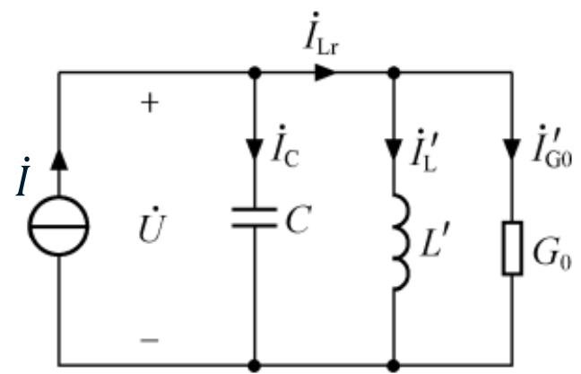
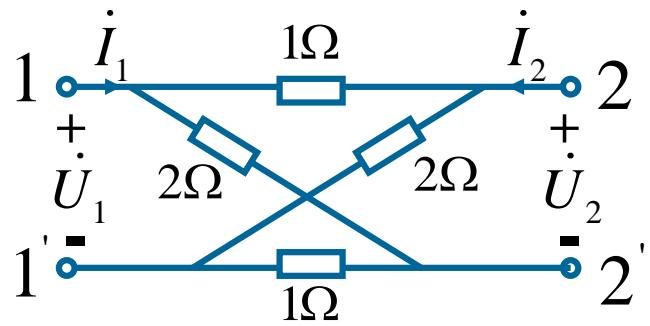
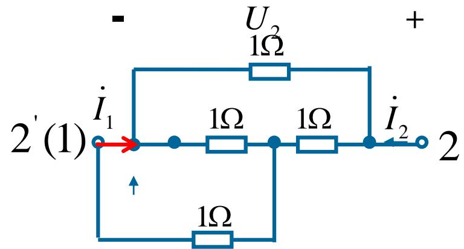

# 《电路分析与电工电子技术》第十、十一章作业答案

原件经识别和整理；“参考解答”是我们补的。

## 一、电路分析与电工电子技术

### 10-3 试求题图10-2所示电路的转移电流比、截止频率和通频带。

解: (a)

$$
K _ {I} (j \omega) = \frac {\dot {I} _ {2}}{\dot {I} _ {1}} = - \frac {\overline {{j \omega C}}}{R + \frac {1}{j \omega C}} = - \frac {1}{1 + j \omega R C}
$$

令 $\omega_{C} = \frac{1}{RC}$ ，则： $K_{I}(j\omega) = -\frac{1}{1 + j\frac{\omega}{\omega_{C}}}$

当 $\omega = 0$ 时， $\left|K_{i}(j\omega)\right| = 1,\theta (\omega) = 0$

当 $\omega = \omega_{C}$ 时， $\left|K_{i}(j\omega)\right| = 1 / \sqrt{2}\quad \theta (\omega) = -\pi /4$

当 $\omega \to \infty$ 时， $\left|K_{i}(j\omega)\right| \to 0,\theta (\omega)\to -\pi /2$

$\therefore \left|K_{U}(j\omega)\right| = \frac{1}{\sqrt{1 + \left(\frac{\omega}{\omega_{C}}\right)^{2}}}$

截止角频率为： $\omega_{C} = \frac{1}{RC} rad / s$

通频带为： $\left[0,\frac{1}{RC}\right]$ 为低通滤波。

参考解答：**结论**
- 转移电流比： $\dot{K}_I(j\omega) = -\dfrac{1}{1 + j\omega RC}$
- 截止角频率： $\omega_c = \dfrac{1}{RC} \ \text{rad/s}$（截止频率 $f_c = \dfrac{1}{2\pi RC}$）
- 通频带： $0 \sim \dfrac{1}{RC}$（低通特性）

---

**推理与计算过程**

1. **列转移电流比**
   图示为 RC 并联后作为输出支路，输入总电流为 $\dot{I}_1$，输出电流取其分流 $\dot{I}_2$。  
   并联支路阻抗：电阻 $R$ 与电容 $C$ 并联，容抗为 $1/(j\omega C)$。  
   用分流公式（注意参考方向取负号）：
   
$$
\dot{K}_I(j\omega) = \frac{\dot{I}_2}{\dot{I}_1} = -\frac{\frac{1}{j\omega C}}{R + \frac{1}{j\omega C}} = -\frac{1}{1 + j\omega RC}
$$

2. **标准化形式**
   令 $\omega_c = \dfrac{1}{RC}$，则：
   
$$
\dot{K}_I(j\omega) = -\frac{1}{1 + j\dfrac{\omega}{\omega_c}}
$$

3. **幅频与截止频率**
   幅频特性：
   
$$
|\dot{K}_I(j\omega)| = \frac{1}{\sqrt{1 + (\omega / \omega_c)^2}}
$$

   当 $\omega = \omega_c$ 时，幅值降为 $1/\sqrt{2}$（-3 dB），故截止角频率为 $\omega_c = \frac{1}{RC}$。

4. **通频带**
   由幅频特性可知，电路允许低频通过、高频衰减，为低通滤波。通带从直流至截止频率：
   
$$
0 \le \omega \le \omega_c \quad\text{或}\quad 0 \le f \le \frac{1}{2\pi RC}
$$

知识点：[基尔霍夫电流定律（KCL）及其应用](../../../topics/电路与电子技术/KCL.md)、[理想电压源与理想电流源的特性](../../../topics/电路与电子技术/独立电源.md)

### 10-4 RLC 串联谐振电路，已知 $L = 160 \mu \mathrm{H}$ ， $C = 250 \mathrm{pF}$ ， $R = 10 \Omega$ ，电源电压 $U_{\mathrm{S}} = 1 \mathrm{mV}$ 。试求 $f_{0} 、 Q 、 B W 、 I_{0} 、 U_{\mathrm{L} 0} 、 U_{\mathrm{C} 0}$ 。

$$
f _ {0} = \frac {\omega_ {0}}{2 \pi} = \frac {1}{2 \pi \sqrt {L C}} = 0. 7 9 6 \mathrm{MHz}
$$

$$
Q = \frac {\omega_ {0} L}{R} = 8 0
$$

$$
B W = \frac {f _ {0}}{Q} = 9. 9 7 \mathrm{kHz} \quad \text {or} \quad B W = \frac {\omega_ {0}}{Q} = 6. 2 6 \times 1 0 ^ {4} \mathrm{rad/s}
$$

根据 $\dot{U}_{s}=\dot{I}_{0}R$

根据 $\dot{U}_{\mathrm{C}} = -jQ\dot{U}_{\mathrm{s}}$ 两边取模 $U_{\mathrm{C}} = QU_{\mathrm{s}} = 80m\mathrm{V}$

根据 $\dot{U}_{L}=jQ\dot{U}_{s}$ 两边取模 $U_{L}=QU_{s}=80mV$

参考解答：结论：  
- $f_0 \approx 0.796\ \mathrm{MHz}$  
- $Q = 80$  
- $BW \approx 9.95\ \mathrm{kHz}$ 或 $\omega$ 带宽 $6.25\times 10^4\ \mathrm{rad/s}$  
- $I_0 = 0.1\ \mathrm{mA}$  
- $U_{L0} = U_{C0} = 80\ \mathrm{mV}$  

---

**谐振频率**  
$$
f_0 = \frac{1}{2\pi\sqrt{LC}}  
= \frac{1}{2\pi\sqrt{160\times 10^{-6} \times 250\times 10^{-12}}}  
\approx 7.96\times 10^5\ \mathrm{Hz} = 0.796\ \mathrm{MHz}
$$

**品质因数**  
$$
Q = \frac{\omega_0 L}{R} = \frac{2\pi f_0 L}{R}  
= \frac{2\pi \times 7.96\times 10^5 \times 160\times 10^{-6}}{10}  
\approx 80
$$

**通频带（带宽）**  
$$
BW = \frac{f_0}{Q} = \frac{7.96\times 10^5}{80} \approx 9.95 \times 10^3\ \mathrm{Hz}  
= 9.95\ \mathrm{kHz}
$$
或用角频率带宽：
$$
BW_\omega = \frac{\omega_0}{Q} \approx 6.25\times 10^4\ \mathrm{rad/s}
$$

**谐振电流**  
串联谐振时阻抗最小，$U_s$ 全加在 $R$ 上：
$$
I_0 = \frac{U_s}{R} = \frac{1\times 10^{-3}}{10} = 1\times 10^{-4}\ \mathrm{A} = 0.1\ \mathrm{mA}
$$

**电感与电容电压**  
$$
U_{L0} = U_{C0} = Q U_s = 80 \times 1\ \mathrm{mV} = 80\ \mathrm{mV}
$$
（注意：$U_{L0}$、$U_{C0}$ 大小相等，相位相反）

知识点：[理想电压源与理想电流源的特性](../../../topics/电路与电子技术/独立电源.md)、[线性时不变电阻的伏安关系（欧姆定律）](../../../topics/电路与电子技术/线性电阻VCR.md)、[四种受控电源（VCVS、VCCS、CCVS、CCCS）的特性](../../../topics/电路与电子技术/受控电源.md)

### 10-6 已知 RLC 串联电路的谐振频率为 $3.5 \mathrm{MHz}$ , 特性阻抗为 $1 \mathrm{k} \Omega$ 。(1) 试求电感 $L$ 和电容 $C$ ; (2) 若电路的品质因数为 50, 输入电压的有效值为 $10 \mathrm{mV}$ , 试求电容输出电压 $U_{\mathrm{c}}$ , 及回路的带宽 $B W$ 。

$$
\rho = \omega_ {0} L = \frac {1}{\omega_ {0} C}
$$

$$
L = \frac {\rho}{\omega_ {0}} = \frac {\rho}{2 \pi f _ {0}} = 4 5. 5 \mu \mathrm{H}, \mathrm{C} = \frac {1}{\rho \omega_ {0}} = \frac {1}{\rho 2 \pi f _ {0}} = 4 5. 5 \mathrm{pF}
$$

$$
\dot {U} _ {\mathrm{c}} = - j Q \dot {U} _ {\mathrm{s}}, U _ {\mathrm{c}} = Q U _ {\mathrm{s}} = 5 0 0 \mathrm{mV}
$$

$$
B W = \frac {f _ {0}}{Q} = 7 0 \mathrm{kHz}
$$

参考解答：### (1) 求电感 $L$ 和电容 $C$

**结论：**
$$ L \approx 45.5 \, \mu\mathrm{H}, \quad C \approx 45.5 \, \mathrm{pF} $$

**推理与计算过程：**
已知谐振频率 $f_0 = 3.5 \, \mathrm{MHz} = 3.5 \times 10^6 \, \mathrm{Hz}$，特性阻抗 $\rho = 1 \, \mathrm{k}\Omega = 1000 \, \Omega$。
角频率为：
$$ \omega_0 = 2\pi f_0 = 2\pi \times 3.5 \times 10^6 \approx 2.199 \times 10^7 \, \mathrm{rad/s} $$

根据特性阻抗定义 $\rho = \omega_0 L = \frac{1}{\omega_0 C}$，可得：
$$ L = \frac{\rho}{\omega_0} = \frac{1000}{2\pi \times 3.5 \times 10^6} \approx 4.547 \times 10^{-5} \, \mathrm{H} \approx 45.5 \, \mu\mathrm{H} $$
$$ C = \frac{1}{\rho \omega_0} = \frac{1}{1000 \times 2\pi \times 3.5 \times 10^6} \approx 4.547 \times 10^{-11} \, \mathrm{F} \approx 45.5 \, \mathrm{pF} $$

---

### (2) 求电容输出电压 $U_C$ 及回路带宽 $BW$

**结论：**
$$ U_C = 500 \, \mathrm{mV} \, (0.5 \, \mathrm{V}), \quad BW = 70 \, \mathrm{kHz} $$

**推理与计算过程：**
已知品质因数 $Q=50$，输入电压有效值 $U_s = 10 \, \mathrm{mV}$。

1.  **电容电压 $U_C$**：
    在串联谐振状态下，电容（或电感）两端的电压幅值是电源电压的 $Q$ 倍：
    $$ U_C = Q U_s = 50 \times 10 \, \mathrm{mV} = 500 \, \mathrm{mV} $$

2.  **回路带宽 $BW$**：
    带宽定义为谐振频率与品质因数的比值：
    $$ BW = \frac{f_0}{Q} = \frac{3.5 \times 10^6 \, \mathrm{Hz}}{50} = 70 \times 10^3 \, \mathrm{Hz} = 70 \, \mathrm{kHz} $$

知识点：[理想电压源与理想电流源的特性](../../../topics/电路与电子技术/独立电源.md)、[线性时不变电阻的伏安关系（欧姆定律）](../../../topics/电路与电子技术/线性电阻VCR.md)、[基尔霍夫电压定律（KVL）及其应用](../../../topics/电路与电子技术/KVL.md)

### 10-10 题图 10-10 所示的电路，已知 $r=8\Omega$ ， $L=40mH$ ， $C=2500pF$ 。试求（1）该电路的 $f_{0}$ 、 $Z_{0}$ 、 $\rho$ 及 Q；（2）若输入电流 i 的有效值为 $10\mu A$ ，求电压 u 的有效值。

等效电路

$$
L ^ {\prime} = L, \quad G _ {0} = \frac {C}{L} \times r = 5 \times 1 0 ^ {- 7} \mathrm{S}
$$

$f_{0} = \frac{1}{2\pi\sqrt{LC}} = 15.9\mathrm{kHz}$

$Z_{0} = \frac{1}{G_{0}} = 2\mathrm{M}\Omega$

$\rho = \sqrt{\frac{L}{C}} = 4k\Omega$

$Q = \frac{\omega_0C}{G_0} = \frac{\frac{1}{\sqrt{LC}}C}{\frac{C}{L}\times r} = \frac{\sqrt{\frac{L}{C}}}{r} = 500$

并联谐振， $\dot{U} = Z_0\dot{I},\therefore U = \frac{1}{G_0} I = 20\mathrm{V}$

参考解答：## （1）谐振参数

**结论：**  
$f_0 \approx 15.9\ \text{kHz}$，$Z_0 = 2\ \text{M}\Omega$，$\rho = 4\ \text{k}\Omega$，$Q = 500$。

**推理：**

线圈支路的电感等效为 $L'=L$，其损耗用电导表示：

$$G_0=\frac{C}{L}\,r=\frac{2500\times10^{-12}}{40\times10^{-3}}\times 8=5\times10^{-7}\ \text{S}$$

谐振频率：

$$f_0=\frac{1}{2\pi\sqrt{LC}}=\frac{1}{2\pi\sqrt{40\times10^{-3}\times2500\times10^{-12}}}\approx 15.9\ \text{kHz}$$

谐振阻抗（谐振时电纳为零，只剩电导）：

$$Z_0=\frac{1}{G_0}=\frac{1}{5\times10^{-7}}=2\ \text{M}\Omega$$

特性阻抗：

$$\rho=\sqrt{\frac{L}{C}}=\sqrt{\frac{40\times10^{-3}}{2500\times10^{-12}}}=4\ \text{k}\Omega$$

品质因数：

$$Q=\frac{\omega_0 C}{G_0}=\frac{\sqrt{L/C}}{r}=\frac{4000}{8}=500$$

---

## （2）输入电压有效值

**结论：** $U = 20\ \text{V}$。

**计算：**

并联谐振时端口阻抗最大且为纯阻性，故

$$\dot U = Z_0\,\dot I \quad\Rightarrow\quad U = Z_0\,I = 2\times10^{6}\times10\times10^{-6}=20\ \text{V}$$

知识点：[线性时不变电阻的伏安关系（欧姆定律）](../../../topics/电路与电子技术/线性电阻VCR.md)、[元件吸收与产生功率的计算与判断](../../../topics/电路与电子技术/功率计算.md)

### 10-15 题图10-15所示电路中，已知

$$
u _ {s} (t) = 1 0 \cos 3 1 4 t + 2 \cos 3 \times 3 1 4 t V, u _ {0} (t) = 2 \cos 3 \times 3 1 4 t V, C = 9. 4 \mu F
$$

试求 $L_{1}$ 和 $L_{2}$ 的值。

解： $\omega_{1} = 314$ 时， $u_{s}(t)$ 的该频率分量在 $\mathbb{R}$ 上的电压为零，故，相当于 $\mathbf{ab}$ 端在该频率时开路，即 $\mathbf{LC}$ 回路发生并联谐振，则： $\omega_{1} = 314 = \frac{1}{\sqrt{(L_{1} + L_{2})C}} \Rightarrow L_{2} = 0.96H$

$\omega_{2} = 3 \times 314$ 时， $u_{s}(t)$ 的该频率分量全部作用在 $\mathbb{R}$ 上，故，此时 $\mathbf{LC}$ 回路发生串联谐振，即相当于 $\mathbf{ab}$ 端在该频率时短路，则： $\omega_{2} = 3 \times 314 = \frac{1}{\sqrt{L_{1}C}} \Rightarrow L_{1} = 0.12H$

参考解答：**结论**：$L_1 = 0.12\,\mathrm{H}$，$L_2 = 0.96\,\mathrm{H}$

**推理过程**：

$u_s$ 含 $\omega_1 = 314\,\mathrm{rad/s}$ 和 $\omega_2 = 3\times314\,\mathrm{rad/s}$ 两个分量，分别利用叠加定理分析。

**1. $\omega_1 = 314$ 分量：$L_2$ 支路无电流（$u_0=0$ 于该频率），$L_1$ 与 $C$ 并联部分阻抗无穷大（并联谐振）**

$$
\omega_1 L_1 = \frac{1}{\omega_1 C} \Rightarrow L_1 = \frac{1}{\omega_1^2 C} = \frac{1}{314^2 \times 9.4\times10^{-6}} \approx 0.12\,\mathrm{H}
$$

**2. $\omega_2 = 3\times314$ 分量：$L_2$ 支路电压等于 $u_s$（$u_0=2$ 与 $u_s$ 该分量幅值相同），$L_1$ 与 $C$ 并联部分阻抗为零（串联谐振），全部电压加在 $L_2$ 上**

$$
\omega_2 = \frac{1}{\sqrt{L_1 C}} \Rightarrow L_1 = \frac{1}{\omega_2^2 C} = \frac{1}{(3\times314)^2 \times 9.4\times10^{-6}} \approx 0.12\,\mathrm{H}
$$

由第 2 步验证 $L_1 \approx 0.12\,\mathrm{H}$，再代回第 1 步：

$$
L_2 = \frac{1}{\omega_2^2 C} - L_1 \approx 0.96\,\mathrm{H}
$$

或者直接用 $L_2 = \frac{1}{\omega_1^2 C} - L_1 \approx 0.96\,\mathrm{H}$。

知识点：[基尔霍夫电压定律（KVL）及其应用](../../../topics/电路与电子技术/KVL.md)

### 11-1(a) 求题图得11-1所示二端网络的Z参数。

解: 利用Z参数的定义求解。设端口电压、电流如图,则有:

$$
Z _ {1 1} = \left. \frac {\dot {U} _ {1}}{\dot {I} _ {1}} \right| _ {\dot {I} _ {2} = 0} = (1 + 2) / / (2 + 1) = 1. 5 \Omega
$$

$\dot{I}_{1}=0$ 时等效电路如右图，则有：

$$
Z _ {1 2} = \left. \frac {\dot {U} _ {1}}{\dot {I} _ {2}} \right| _ {\dot {I} _ {1} = 0} = \frac {\frac {I _ {2}}{2} \times 2 - \frac {I _ {2}}{2} \times 1}{\dot {I} _ {2}} = 0. 5 \Omega
$$

因原网络是线性无源二端网络，有： $Z_{21}=Z_{12}=0.5\Omega$

$$
\begin{array}{c} \text {2Ω 1 1Ω} \\ \text {1Ω 1' 2Ω} \\ \text {2' - U_{2} + i_{2}} \end{array}
$$

$$
Z _ {2 2} = \left. \frac {\dot {U} _ {2}}{\dot {I} _ {2}} \right| _ {\dot {I} _ {1} = 0} = (1 + 2) / / (2 + 1) = 1. 5 \Omega
$$

$$
\therefore Z = \left[ \begin{array}{l l} 1. 5 & 0. 5 \\ 0. 5 & 1. 5 \end{array} \right] \Omega
$$

参考解答：结论：  
$$\boxed{Z=\begin{bmatrix}1.5&0.5\\0.5&1.5\end{bmatrix}\ \Omega}$$

---

**计算过程：**

由 $Z$ 参数定义：

$$Z_{11}=\left.\frac{\dot U_1}{\dot I_1}\right|_{\dot I_2=0}$$

当 $\dot I_2=0$ 时，端口 $2$ 开路，输入端看进去为两条串联支路并联：

$$Z_{11}=(1+2)\parallel(2+1)=3\parallel3=1.5\ \Omega$$

---

求 $Z_{12}$：

$$Z_{12}=\left.\frac{\dot U_1}{\dot I_2}\right|_{\dot I_1=0}$$

当 $\dot I_1=0$ 时，端口 $1$ 开路。由于电路结构对称，电流 $\dot I_2$ 在两条支路中均分，各为 $\dot I_2/2$，于是

$$Z_{12}
=\frac{\dfrac{\dot I_2}{2}\cdot 2-\dfrac{\dot I_2}{2}\cdot 1}{\dot I_2}
=\frac{2-1}{2}=0.5\ \Omega$$

---

因为该网络为线性无源互易网络，所以

$$Z_{21}=Z_{12}=0.5\ \Omega$$

---

再由对称性，或直接按定义计算：

$$Z_{22}=\left.\frac{\dot U_2}{\dot I_2}\right|_{\dot I_1=0}
=(1+2)\parallel(2+1)=1.5\ \Omega$$

---

因此该二端网络的 $Z$ 参数矩阵为

$$\boxed{Z=\begin{bmatrix}1.5&0.5\\0.5&1.5\end{bmatrix}\ \Omega}$$

知识点：[线性时不变电阻的伏安关系（欧姆定律）](../../../topics/电路与电子技术/线性电阻VCR.md)、[基尔霍夫电流定律（KCL）及其应用](../../../topics/电路与电子技术/KCL.md)、[基尔霍夫电压定律（KVL）及其应用](../../../topics/电路与电子技术/KVL.md)

### 11-2(a) 求题图得11-2所示二端口网络的Y参数。

解：设端口电压、电流如图，则有：

$\dot{U}_{2}=0$ ，相当于2和 $2^{\prime}$ 端短路，故：

$$
Y _ {1 1} = \frac {\dot {I} _ {1}}{\dot {U} _ {1}} \Bigg | _ {\dot {U} _ {2} = 0} = \frac {1}{1 / / (1 + 1 / / 1)} = \frac {5}{3} S
$$

$\dot{U}_{1} = 0$ ，相当于1和 $1^{\prime}$ 端短路，等效电路如右图，

$$
Y _ {1 2} = \left. \frac {\dot {I} _ {1}}{\dot {U} _ {2}} \right| _ {\dot {U} _ {1} = 0} = - \frac {\dot {U} _ {2} / 1 + \frac {U _ {2}}{1 + 1 / / 1} \cdot \frac {1}{2}}{\dot {U} _ {2}} = - \frac {4}{3} S
$$

而该网络是线性无源二端对称网络，则有：

$$
Y _ {2 2} = Y _ {1 1} = \frac {5}{3} S, Y _ {2 1} = Y _ {1 2} = - \frac {4}{3} S
$$

$$
\therefore Y = \left[ \begin{array}{c c} \frac {5}{3} & - \frac {4}{3} \\ - \frac {4}{3} & \frac {5}{3} \end{array} \right] S
$$

参考解答：**结论：**

$$
\mathbf{Y} = \begin{bmatrix} \dfrac{5}{3} & -\dfrac{4}{3} \\[6pt] -\dfrac{4}{3} & \dfrac{5}{3} \end{bmatrix} \text{S}
$$

---

**推理与计算过程：**

Y 参数的定义为：
$$
\begin{cases} \dot{I}_1 = Y_{11}\dot{U}_1 + Y_{12}\dot{U}_2 \\ \dot{I}_2 = Y_{21}\dot{U}_1 + Y_{22}\dot{U}_2 \end{cases}
$$

**1. 求 $Y_{11}$（令 $\dot{U}_2 = 0$，即端口 2-2' 短路）**

端口 2 短路后，从端口 1 看入的等效阻抗为 $1\,\Omega$ 电阻与 $(1\,\Omega + 1\,\Omega // 1\,\Omega)$ 支路并联：

$$
Z_{in} = 1 // \left(1 + 1 // 1\right) = 1 // \left(1 + \frac{1}{2}\right) = 1 // \frac{3}{2} = \frac{1 \times \frac{3}{2}}{1 + \frac{3}{2}} = \frac{3}{5}\,\Omega
$$

$$
Y_{11} = \frac{\dot{I}_1}{\dot{U}_1}\bigg|_{\dot{U}_2=0} = \frac{1}{Z_{in}} = \frac{5}{3}\,\text{S}
$$

**2. 求 $Y_{12}$（令 $\dot{U}_1 = 0$，即端口 1-1' 短路）**

端口 1 短路后，在端口 2 加电压 $\dot{U}_2$。此时电路结构变为：$\dot{U}_2$ 驱动两条并联支路——一条经 $1\,\Omega$ 直接到地，另一条经 $1\,\Omega$ 串联 $(1\,\Omega // 1\,\Omega)$ 到地。

流过串联支路的电流为：
$$
\dot{I}_{branch} = \frac{\dot{U}_2}{1 + 1//1} = \frac{\dot{U}_2}{3/2} = \frac{2\dot{U}_2}{3}
$$

该电流到达中间节点后经两个 $1\,\Omega$ 电阻分流，流入端口 1 短路端的电流为其中一半：
$$
\dot{I}_{to\,port1} = \frac{2\dot{U}_2}{3} \times \frac{1}{2} = \frac{\dot{U}_2}{3}
$$

再加上直接从 $1\,\Omega$ 电阻流向端口 1 短路端的电流 $\dfrac{\dot{U}_2}{1}$，端口 1 的总流出电流（按参考方向流入为正）：

$$
\dot{I}_1 = -\left(\frac{\dot{U}_2}{1} + \frac{\dot{U}_2}{3}\right) = -\frac{4}{3}\dot{U}_2
$$

$$
Y_{12} = \frac{\dot{I}_1}{\dot{U}_2}\bigg|_{\dot{U}_1=0} = -\frac{4}{3}\,\text{S}
$$

**3. 利用对称性求 $Y_{22}$、$Y_{21}$**

该网络为线性无源对称二端口网络，故：

$$
Y_{22} = Y_{11} = \frac{5}{3}\,\text{S}, \quad Y_{21} = Y_{12} = -\frac{4}{3}\,\text{S}
$$

知识点：[线性时不变电阻的伏安关系（欧姆定律）](../../../topics/电路与电子技术/线性电阻VCR.md)、[基尔霍夫电流定律（KCL）及其应用](../../../topics/电路与电子技术/KCL.md)、[基尔霍夫电压定律（KVL）及其应用](../../../topics/电路与电子技术/KVL.md)
