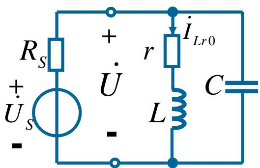
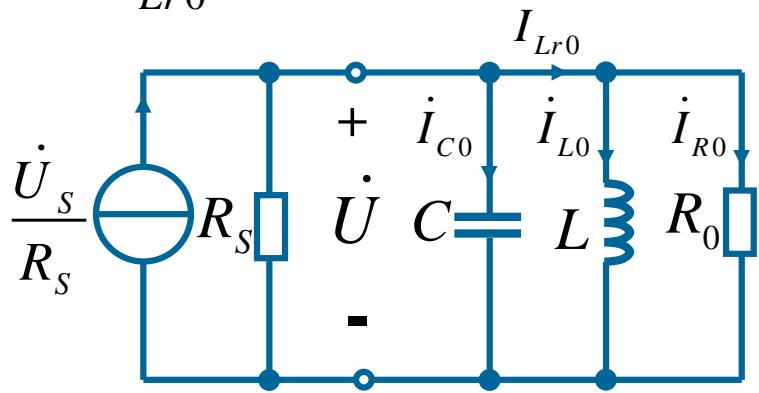
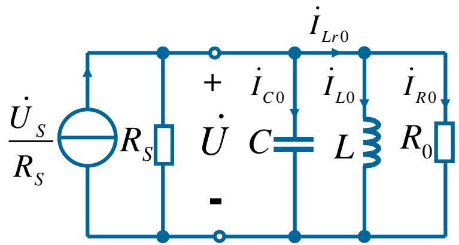

# 《电路分析与电工电子技术》课后习题10-11解答

原件经识别和整理；“参考解答”是我们补的。

## 计算 1

题图 10-11 所示并联谐振电路，$L = 0.1\ \mathrm{mH}$，$C = 100\ \mathrm{pF}$，$r = 10\ \Omega$，$R_s = 100\ \mathrm{k}\Omega$，$\dot{U}_s = 2\angle 0^\circ$，试求：

1. 谐振角频率 $\omega_0$；
2. 端电压 $\dot{U}$；
3. 整个电路的品质因数 $Q'$；
4. 谐振时电容支路电流 $\dot{I}_{C0}$ 及电感支路电流 $\dot{I}_{Lr0}$。

答案：

这是一个实际的并联谐振电路，其等效电路如右图所示；且

$$R_0 = \frac{L}{Cr} = 100\ \mathrm{k}\Omega$$

(1) 谐振角频率

$$\omega_0 = \frac{1}{\sqrt{LC}} = 10^7\ \mathrm{rad/s}$$

(2) 端电压

$$\dot{U} = \frac{\dot{U}_s}{R} \times (R_s \parallel R_0) = 1\angle 0^\circ\ \mathrm{V}$$

(3) 整个电路的品质因数

$$Q' = \frac{\omega_0 C}{G} = \omega_0 CR = \omega_0 C (R_s \parallel R_0) = 50$$

(4) 谐振时各支路电流

$$\dot{I}_{C0} = jQ' \cdot \frac{\dot{U}_s}{R_s} = 1\angle 90^\circ\ \mathrm{mA} \quad (\text{或}\ \dot{I}_{C0} = j\omega_0 C \dot{U})$$

$$\dot{I}_{L0} = -\dot{I}_{C0} = 1\angle -90^\circ\ \mathrm{mA}$$

$$\dot{I}_{R0} = \frac{\dot{U}_s}{R_s} \cdot \frac{R_s}{R_s + R_0} = 0.01\angle 0^\circ\ \mathrm{mA}$$

$$\therefore \dot{I}_{Lr0} = \dot{I}_{L0} + \dot{I}_{R0} = 0.01\angle 0^\circ + 1\angle -90^\circ = 0.01 - j1\ \mathrm{mA}$$
