# 《电路分析与电工电子技术》运算放大器的线性应用（实验）

原件经识别和整理；“参考解答”是我们补的。

## 集成运算放大器

集成，是由多级的放大电路构成的放大器，具有极高的增益性能；

可以实现信号的运算、处理、波形的产生，和信号波形的变换等功能，应用十分广泛。

最基本的功能就是可以实现信号的加、减、乘、除、积分等基本运算，因此称为运算放大器。

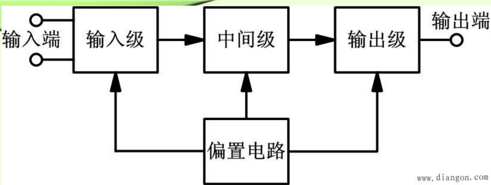

通常由输入级、中间级、输出级三部分构成。

输入级就是一个高共模抑制比的差动放大器，减小零点漂移，增大输入阻抗。

中间级主要提供较大的电压放大倍数，由共射极放大电路构成。

输出级主要是提供大的输出电流、小的输出阻抗，从而提高带负载的能力。

## 一、运算放大器简介

### 1、集成运放符号

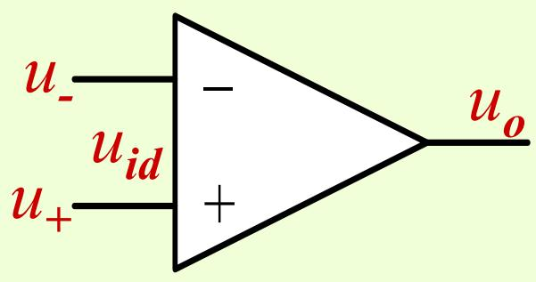

$$
\begin{array}{c c c} u _ {-} & - \triangleright \infty \\ u _ {i d} & + \\ u _ {+} & + \end{array} \quad u _ {o}
$$

(1)“+”为同相输入端，表明信号从该端输入时，输出信号与之同相。

(2)“−”为反相输入端，表明信号从该端输入时，输出信号与之反相。

### 2、集成运放传输特性

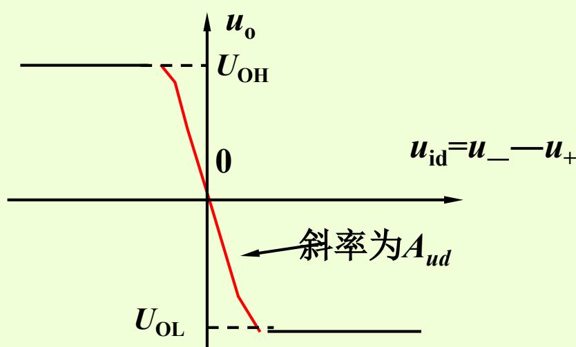

### 3、运放理想化条件

①开环差模电压放大倍数 $A _ { u d } = \infty$ ；

$$
u _ {0} = A _ {u d} (u _ {-} - u _ {+})
$$

②差模输入电阻 $R _ { i d } = \infty$ ；

③差模输出电阻 $R _ { \mathrm { o d } } = 0$ ；

### 4、线性状态下理想运放的特性

1、虚短特性

$$
\left(u _ {-} - u _ {+}\right) = \frac {u _ {o}}{A _ {u d}} = 0
$$

$$
\Rightarrow u _ {+} = u _ {-}
$$

2、虚断特性

$$
i _ {+} = i _ {-} = 0
$$

### 5、非线性状态下理想运放的特性

1、“离散”特性 $u _ { o } = U _ { O H }$ 或 $U _ { o L }$

2、虚断特性

$$
i _ {+} = i _ {-} = 0
$$

## 集成运算放大器器件介绍

### 1、管脚分布

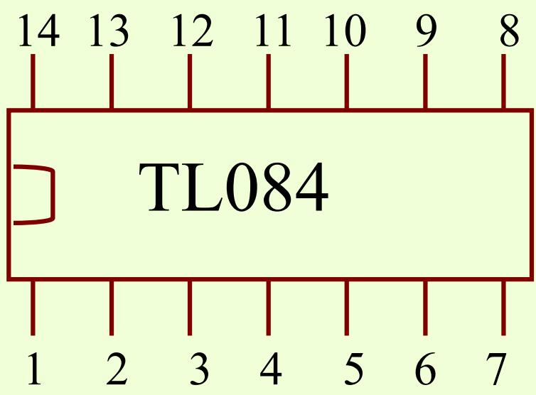

名称正对自己，芯片缺口朝左从左下角开始向逆时针方向，管脚号从 1#~14#

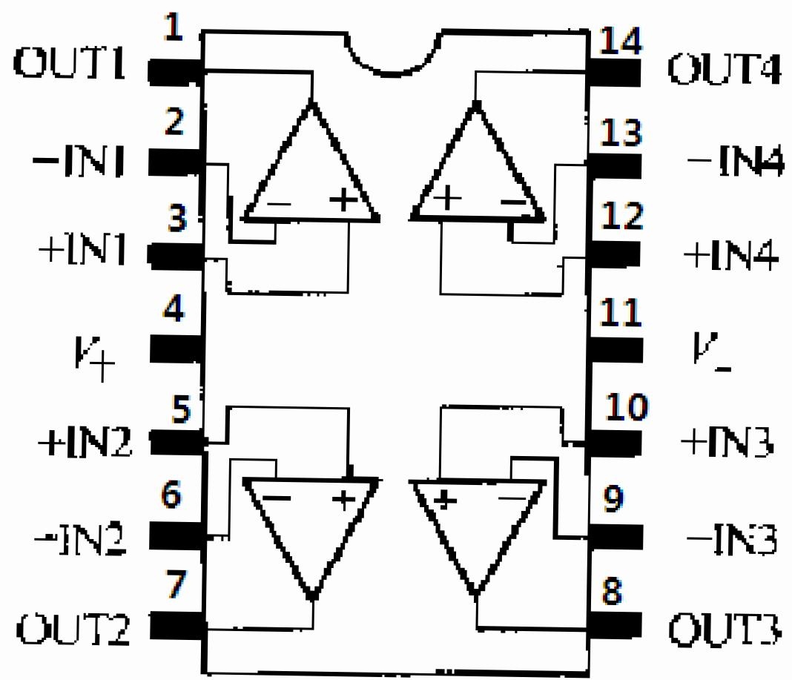

| 符号 | 参数 | 最大值 |
| --- | --- | --- |
| $V_{CC}$ | 供电电压 | ±16V |
| $V_i$ | 输入电压 | ±15V 或 $V_{CC}$ |
| $V_{id}$ | 差分输入电压 | ±30V |

### 注意

1. 所有的电压值，除差分电压以外，都是相对于零参考电平的电源电压（地）。

2. 差分电压是反向输入端和正向输入端的差值。

3. 输入电压的幅度绝不能超过电源电压或 15 伏的大小，以较少者为准。

### 2、电源的连接

集成运放的电源有双电源和单电源，是为晶体管电路提供直流稳压源。双电源一般要求正负电压值对称。

LM324/TL084 可根据需要在 ±1.5~±16V 之间选用合适的对称电源电压。

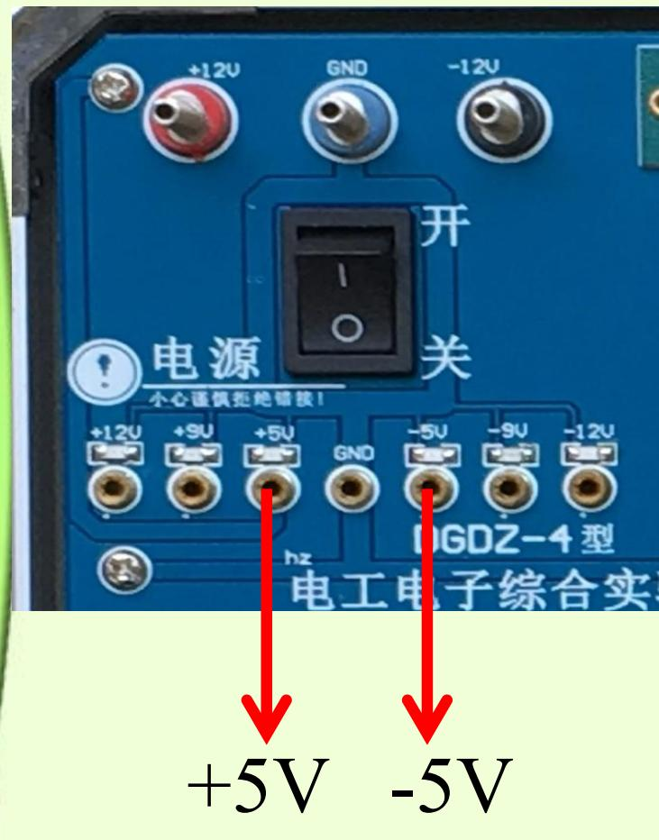

需要成对的直流正负电源，用万用表确认电压值是否正确！然后将其引入电路。

直流电源电压越大，所允许的输入电压和输出电压幅值越大。所以可以尽量选择 ±12V 电源。

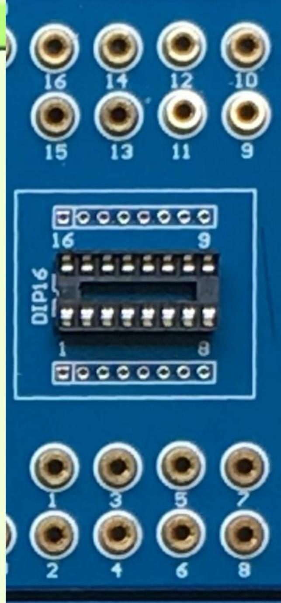

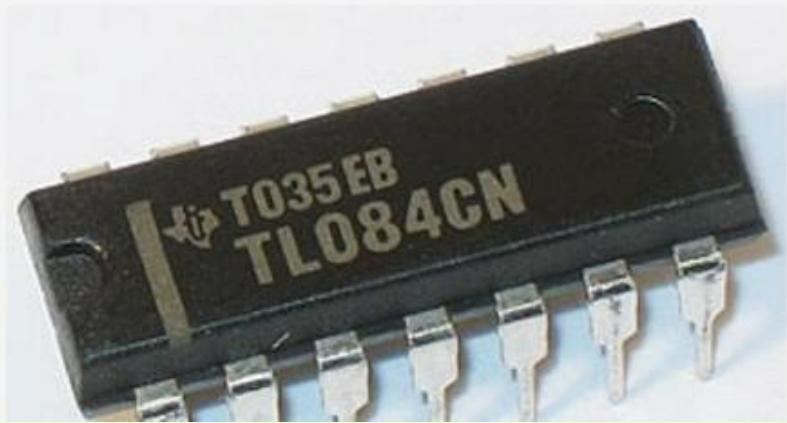

### 注意

芯片是 14 脚芯片，而实验箱上插槽却是 16 脚的。

因此要注意芯片管脚与插孔编号的对应关系！！

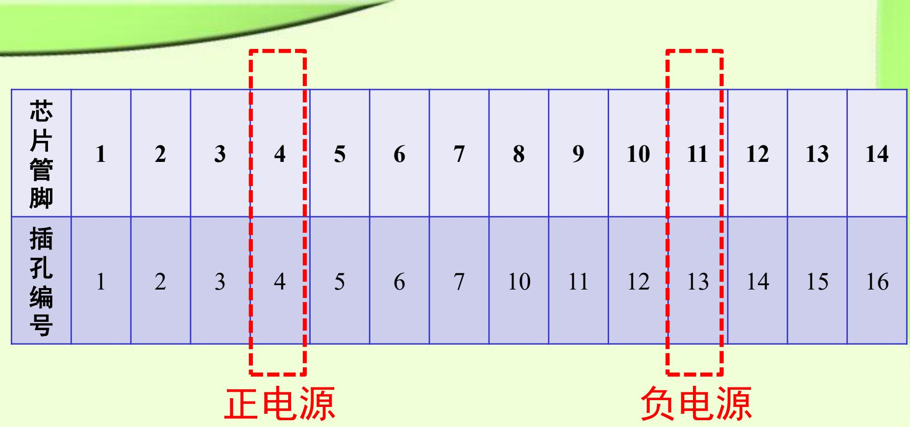

### 注意

芯片 4、11 号管脚分别是正负电源输入端。因此：实验箱 4 号插孔接正电源，13 号插孔接负电源。

拔起芯片时，应该用起子或镊子从芯片与插座之间插入，将器件轻轻地并保持平衡撬出。

否则，极易将集成电路的管脚弄弯或损坏。

### 3、运放好坏的判别方法

#### 电压跟随器

$$
u _ {o} = u _ {i}
$$

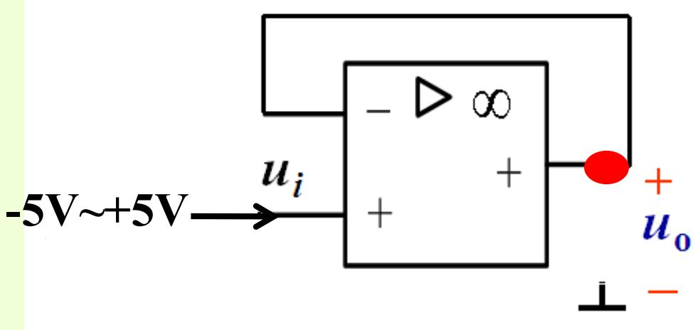

检验步骤：

1. 运放如图连接，且正确供电（例如 ±5V）。

2. 使正向端输入直流电压在 -4V~+4V 之间变化，用万用表电压档监控。

3. 电压跟随器的特点是，输出信号与输入信号完全一样。因此，应当看到，用万用表电压档看输出端 $u_o$，输出的也是跟 $u_i$ 完全一样的直流信号。

可变化的稳定直流电压如何得到？

方法一 采用直流稳压源供电

但实际电压一定要用电压表测量得出

方法二 函数信号发生器
生成一个纯直流信号 $V_{DC}$：Arb → 按屏幕右侧最下方蓝色的箭头按钮 → “选择波形” → “直流” → 按下白色的返回按钮 → 在“偏移”选项上改变电压值

## 实验内容

### 1、反相比例放大器

虚地

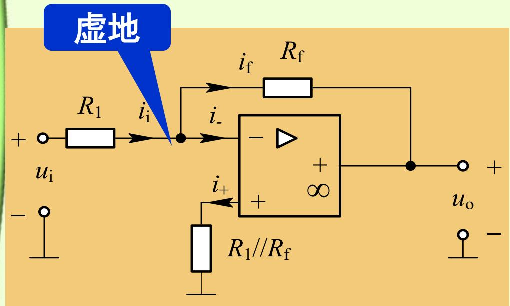

反相比例放大器

虚短

虚断

$$
i _ {-} = i _ {+} = 0
$$

$$
i _ {i} = \frac {u _ {i} - u _ {-}}{R _ {1}} = \frac {u _ {i}}{R _ {1}}
$$

$$
i _ {f} = - \frac {u _ {o} - u _ {-}}{R _ {f}} = - \frac {u _ {o}}{R _ {f}}
$$

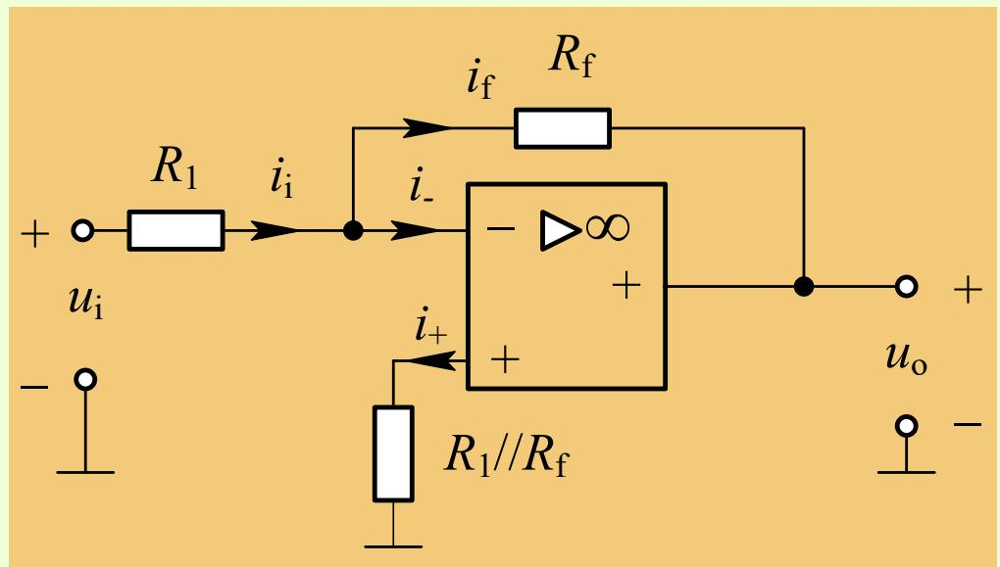

$$
i _ {i} = i _ {f} + i _ {-} = i _ {f}
$$

$$
\rightarrow \frac {u _ {i}}{R _ {1}} = - \frac {u _ {o}}{R _ {f}}
$$

$$
A _ {u f} = \frac {u _ {o}}{u _ {i}} = - \frac {R _ {f}}{R _ {1}}
$$

设计要求：

反向比例器，$\mathbf{U_0 = -10U_i}$，输入阻抗 $R_i = 1\mathrm{k}\Omega$

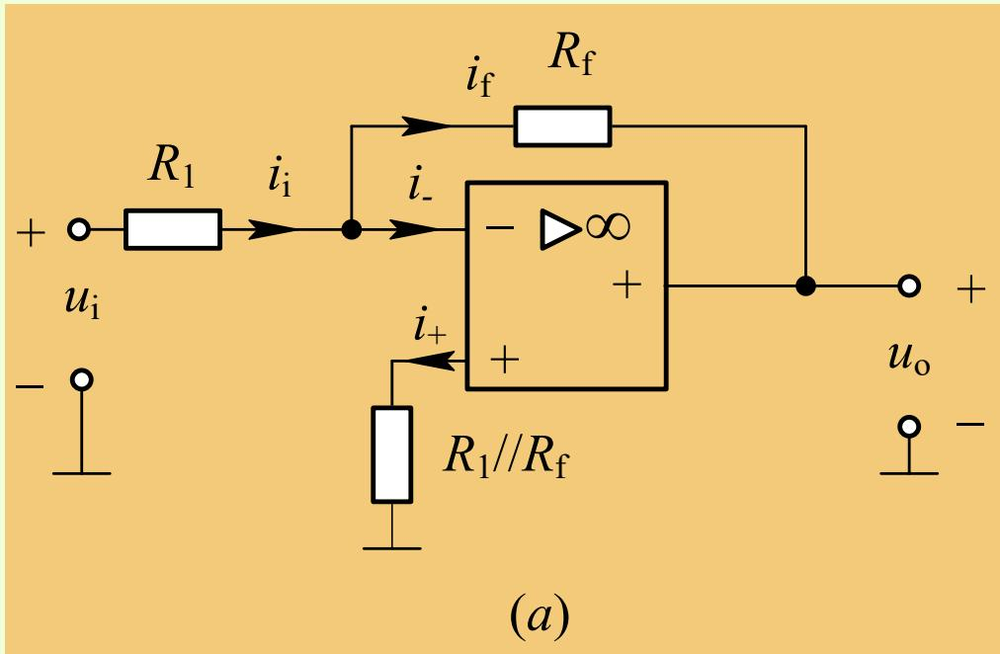

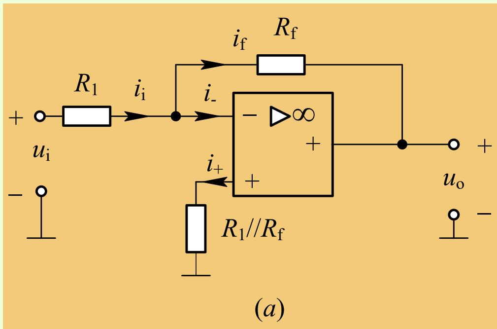

正弦波，$\mathrm{U_i = 0.1Vrms}$，$\mathrm{f = 1kHz}$，无直流偏置

示波器 CH1 测 $U_i$，CH2 测 $U_o$，触发源为？

画出 $U_i$ 和 $U_o$ 的波形，标清各波形周期、最大值、最小值，注意相位关系。

### 2、反相加法电路

反相加法电路

$$
R _ {3} = R _ {1} \big \| R _ {2} \big \| R _ {f}
$$

$$
u _ {+} = u _ {-} = 0
$$

虚短

虚断

$$
i _ {-} = i _ {+} = 0
$$

$$
i _ {1} = \frac {u _ {i 1} - u _ {-}}{R _ {1}} = \frac {u _ {i 1}}{R _ {1}}
$$

$$
i _ {2} = \frac {u _ {i 2} - u _ {-}}{R _ {2}} = \frac {u _ {i 2}}{R _ {2}}
$$

$$
i _ {f} = \frac {u _ {-} - u _ {o}}{R _ {f}} = - \frac {u _ {o}}{R _ {f}}
$$

$$
i _ {f} = i _ {1} + i _ {2}
$$

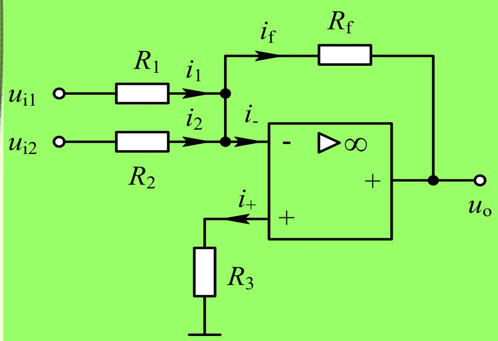

$$
- \frac {u _ {o}}{R _ {f}} = \frac {u _ {i 1}}{R _ {1}} + \frac {u _ {i 2}}{R _ {2}}
$$

$$
u _ {o} = - \left(\frac {R _ {f}}{R _ {1}} u _ {i 1} + \frac {R _ {f}}{R _ {2}} u _ {i 2}\right)
$$

## 二、反相加法电路设计与实验

### 设计过程

**电路图：**
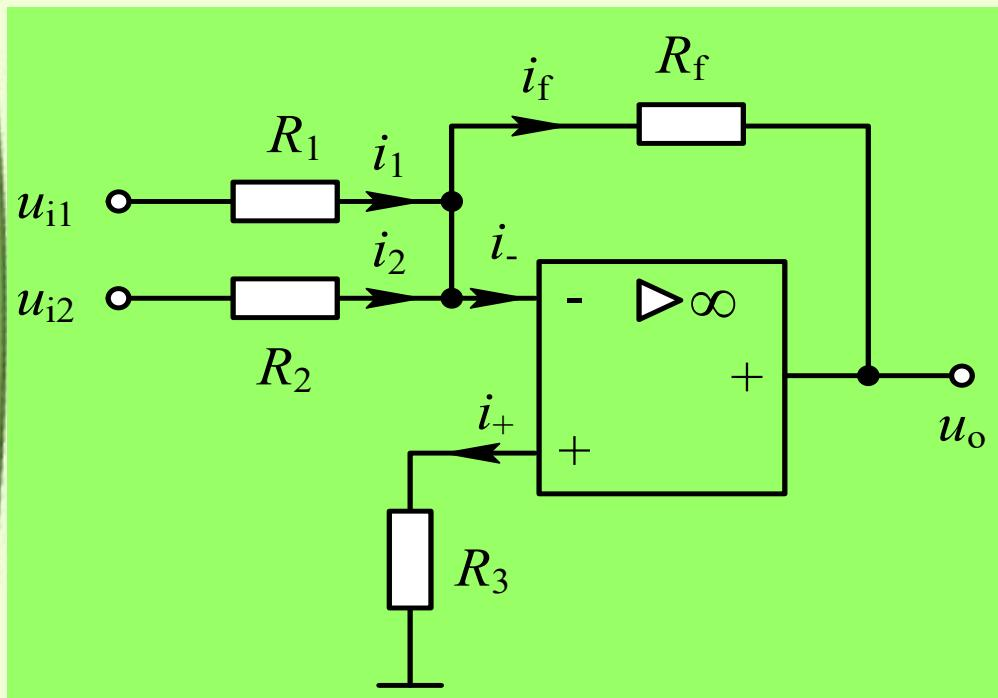

**理论公式：**
$$
u _ { o } = - \left(\frac {R _ {f}}{R _ {1}} u _ {i 1} + \frac {R _ {f}}{R _ {2}} u _ {i 2}\right)
$$

**设计要求：**
$$
u _ {o} = - \left(2 u _ {i 1} + 5 u _ {i 2}\right)
$$

由此得出电阻比例关系：
$$
\frac {R _ {f}}{R _ {1}} = 2, \quad \frac {R _ {f}}{R _ {2}} = 5
$$

**约束条件与取值：**
又要求 $R _ { i 1 } \geq 5 \mathrm { k } \Omega$，$R _ { i 2 } \geq 5 \mathrm { k } \Omega$。

不妨取：
$$
R _ { 1 } = 2 5 \mathrm { k } \Omega , \quad R _ { 2 } = 1 0 \mathrm { k } \Omega , \quad R _ { f } = 5 0 \mathrm { k } \Omega
$$

此时满足：
$$
u _ {o} = - \left(2 u _ {i 1} + 5 u _ {i 2}\right)
$$

其中反馈电阻：
$$
R _ {f} = 5 0 \mathrm { k } \Omega
$$

输入端平衡电阻 $R_3$ 的计算（用于消除偏置电流影响）：
$$
\begin{array}{l} {R _ {3} = R _ {1} / / R _ {2} / / R _ {f}} \\ {= 6. 2 5 \mathrm { k } \Omega} \end{array}
$$

取标称值：
$$
R _ {3} = 5 \mathrm { k } \Omega
$$

---

### 实验内容与操作

**实验电路图：**
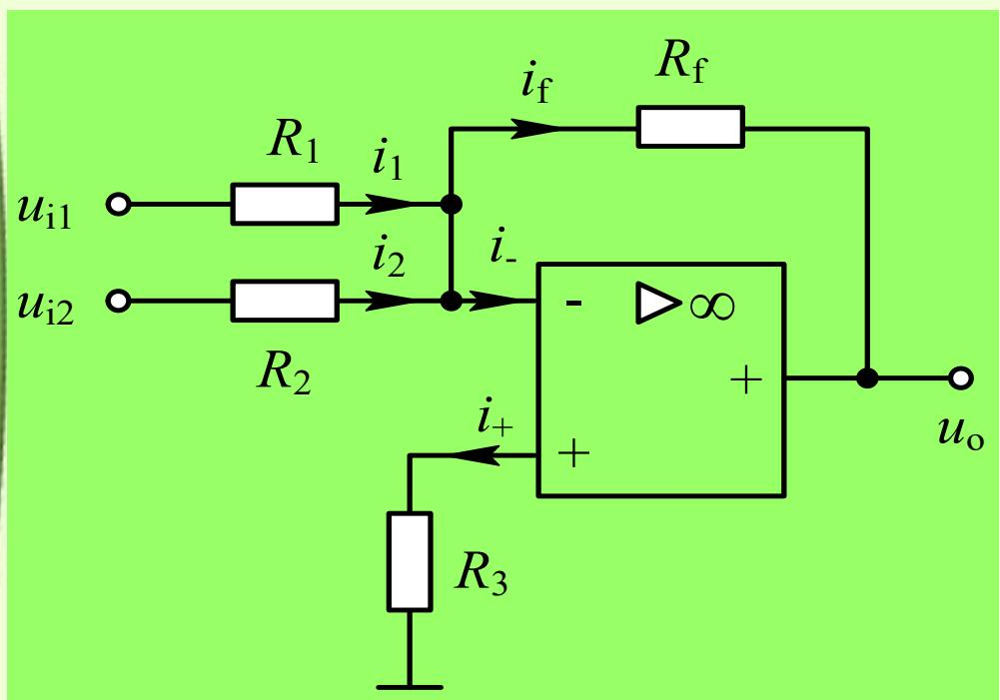

**输入信号设置：**
*   $U _ { i 1 } = 0 . 2 \mathrm { V } _ { \mathrm { r m s } }$，1kHz 正弦波，无直流偏置。
*   $U _ { i 2 } = 1 \mathrm { V }$，直流信号。

**观测波形图：**
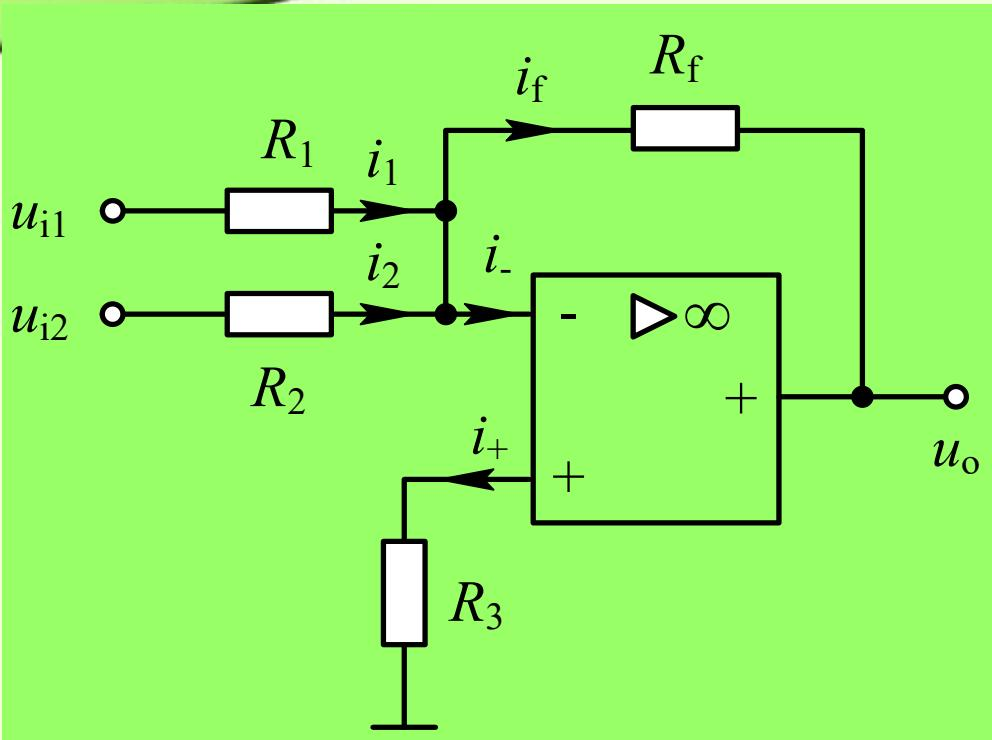

**绘图要求：**
Ui1、Ui2、$\mathrm { U o }$ 三个波形画在同一个坐标系中，标注清楚各自名称、周期、幅值。注意相位关系，注意基线位置。

**示波器操作要点：**
1.  **触发源**：需确认触发源设置正确。
2.  **耦合方式**：示波器注意使用**直流耦合**。
3.  **测量方法**：
    *   正弦波要测出“最大值”和“最小值”。
    *   直流信号，要测出“最大值”。

**画图的建议：**
1.  将示波器上各通道的“基线”彼此重合。
2.  各通道的“垂直档位”尽量一致。
3.  所有的波形尽量都在同一屏幕内，不要超出。（垂直档位）

如此画图，就可以“所见即所得”，直接画在同一个坐标系中。

---

### 准备工作与注意事项

1.  **导线检查**：检查每一根导线。不要用过长的导线。精简电路。
2.  **电源连接**：按正确方法连接电源，检查插孔中电压是否正确。建议使用 ±12V 电源对运放供电。
3.  **芯片选用**：选用 TL084 芯片，注意管脚和插孔的关系，正负电源极性不可接反。
4.  **运放检验**：用“电压跟随法”检验运放的好坏。使用过程中损坏率很高，必须在检验后方能使用。
5.  **仪表接入**：外接仪表一定要通过接线柱接入。仪表信号线要从实验箱外侧绕过，不可横跨电路上方。
6.  **结束操作**：实验结束拔出芯片时，注意规范操作。

---

### 课后思考题

1.  书上 P112，习题七。
2.  P111 设计任务 6：设计加法电路，写出设计过程。（正向加法器，或反相加法器+反相器）

### 预习内容

运算放大器的非线性运用，正弦波发生器（P113）和方波发生器（P116）。
