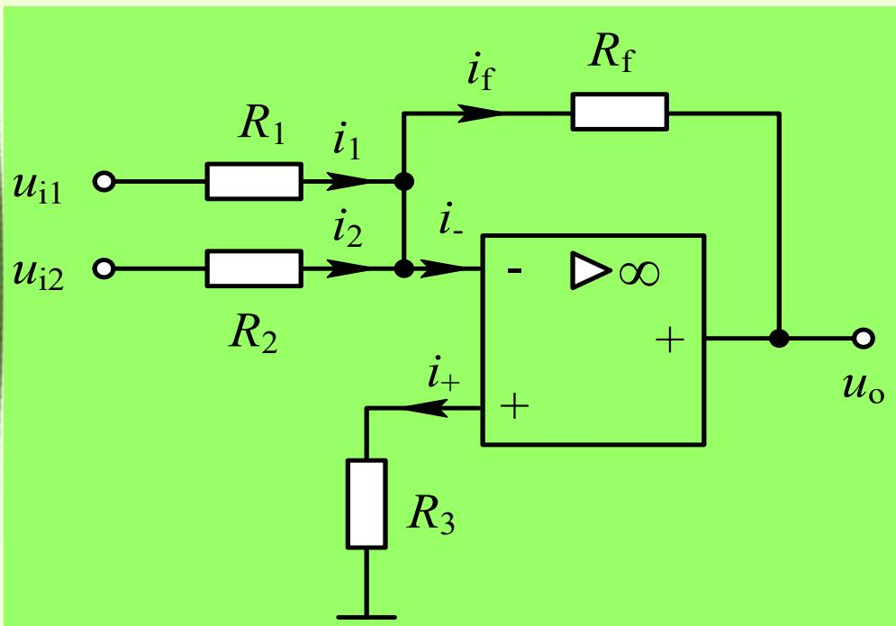
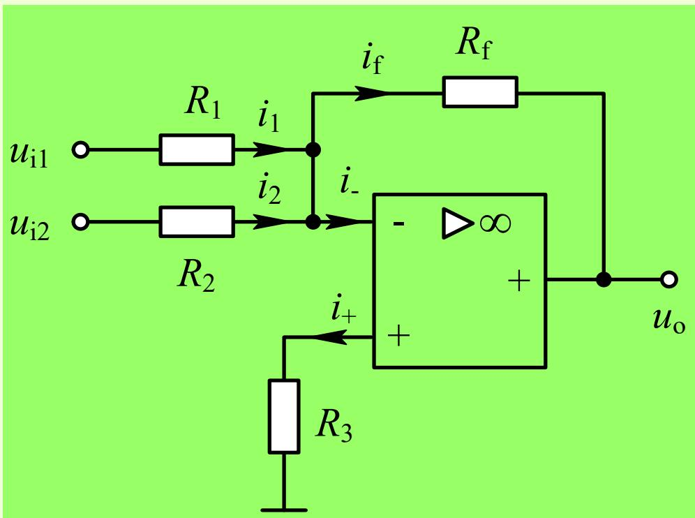
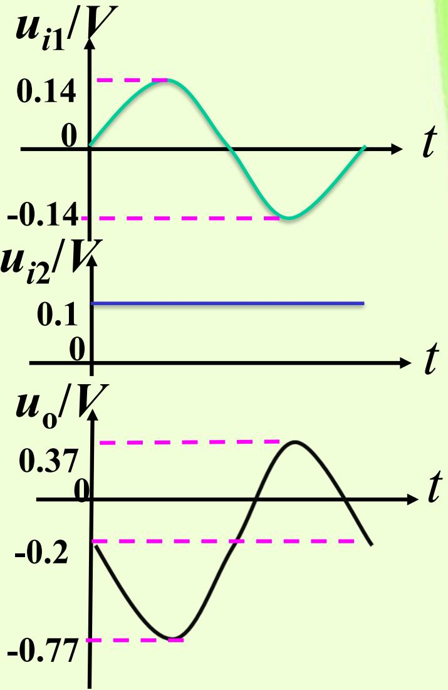
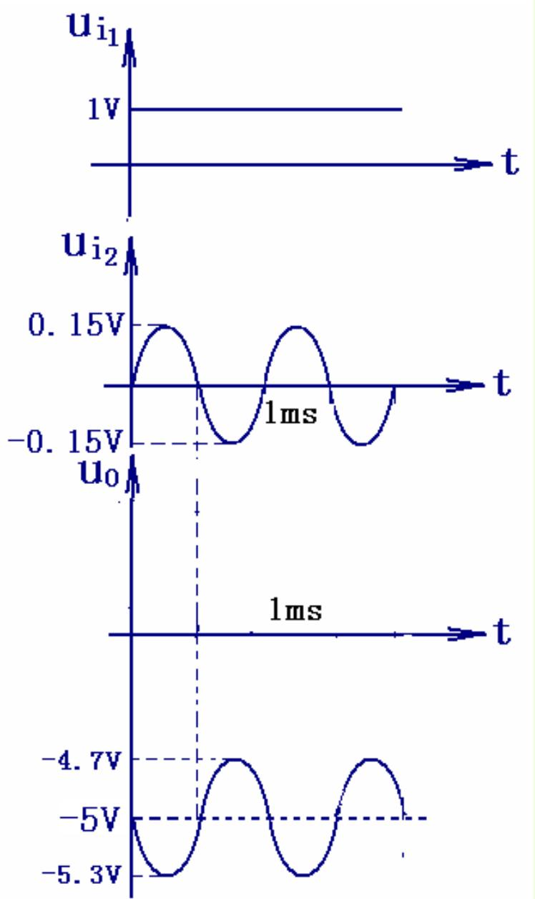
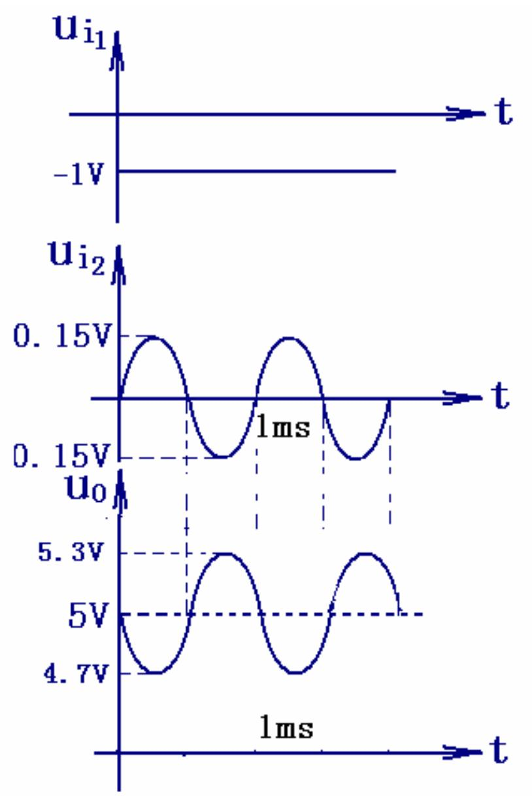
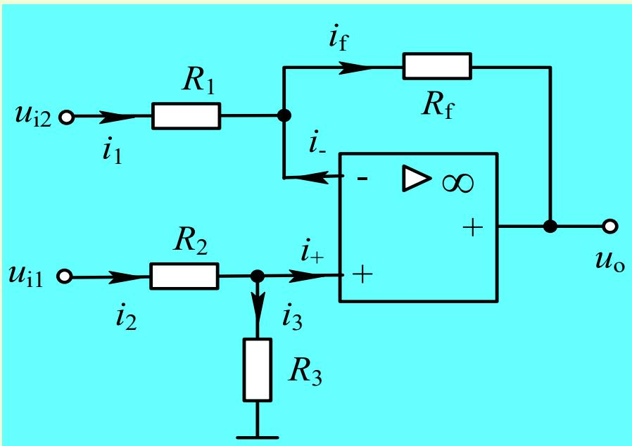
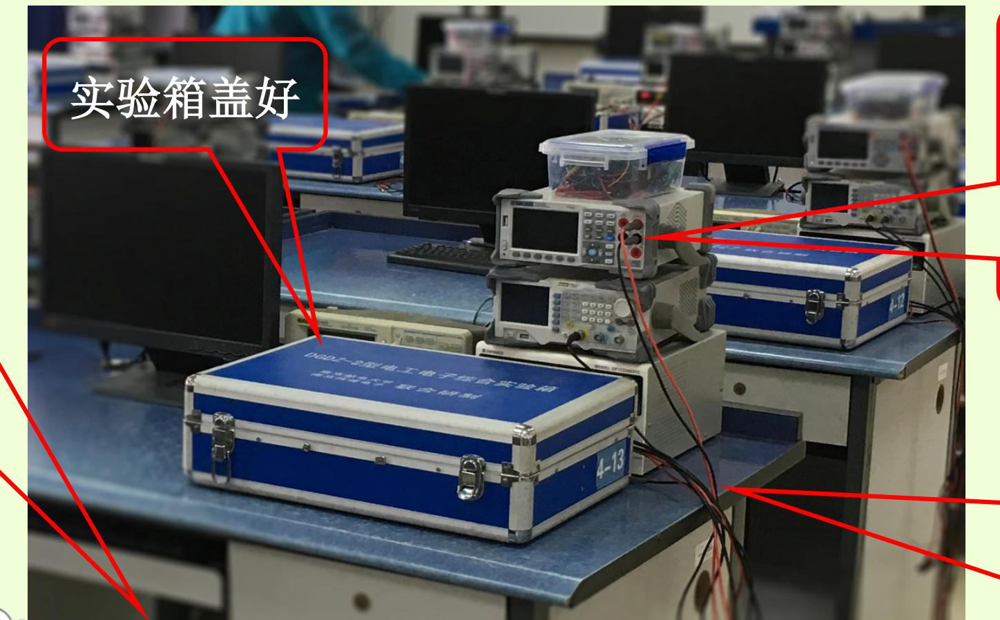

# 《电路分析与电工电子技术》运算放大器的线性应用实验（课件）

原件经识别和整理；“参考解答”是我们补的。

# 运算放大器的线性应用实验（课件）

本资料为《电路分析与电工电子技术》课程中关于“运算放大器的线性应用”的实验课件第1部分，由识别工具读取并整理。

## 一、实验目的

### 实验目的 1

1. 掌握运算放大器的使用方法。
2. 掌握用集成运算放大器构成各种基本运算电路的方法。
3. 理解集成运算放大器线性应用的电路原理。

## 二、实验仪器

### 实验仪器

- 双踪示波器
- 函数信号发生器
- DGDZ-2型电工电子综合实验箱

## 三、实验原理

### 一、运算放大器简介

#### 1. 集成运放符号

$$
\begin{array}{c} u _ { - } + \boxed { - \triangleright \infty} \\ u _ { i d } + \\ u _ { + } - \boxed { + } \end{array} \boxed {u _ { o}}
$$

#### 2. 集成运放传输特性

#### 3. 运放理想化条件

1. 开环差模电压放大倍数 $A _ { u d } = \infty$；
2. 差模输入电阻 $R _ { i d } = \infty$；
3. 输出电阻 $R _ { o d } = 0$；

$$
u _ { 0 } = A _ { u d } (u _ { - } - u _ { + })
$$

#### 4. 线性状态下理想运放的特性

1. **虚短特性**

$$
\left(u _ { - } - u _ { + }\right) = \frac {u _ { o}}{A _ { u d}} = 0
$$

$$
\Rightarrow u _ { + } = u _ { - }
$$

2. **虚断特性**

$$
i _ { + } = i _ { - } = 0
$$

#### 5. 非线性状态下理想运放的特性

1. **“离散”特性**：$u _ { o } = U _ { O H }$ 或 $U _ { o L }$
2. **虚断特性**：$i _ { + } = i _ { - } = 0$

### 二、器件介绍

#### 1. 管脚分布

#### 2. 电源的连接

集成运放的电源有双电源和单电源。双电源一般是对称型的。LM324/TL084可根据需要在 $\pm 1.5 \sim \pm 16\text{V}$ 之间选用合适的对称电源电压。

**运算放大器工作范围**：
★ 电源电压取 $\pm 9\text{V}$，TL084的输出为一个对管，负载是有源负载，上饱和区为 $1.5\text{V}$，下饱和区为 $0.5\text{V}$，为保险起见，统统取 $1.5\text{V}$，这样TL084的动态范围为 $+7.5\text{V} \sim -7.5\text{V}$。

**电源连接注意事项**：
采用双电源方式调整电源电压 $\pm 12\text{V}$。芯片电源千万不能加反！！

#### 3. 好坏的判别（电压跟随器）

$$
u _ { o } = u _ { i }
$$

调节电位器，使输入电压在 $-5\text{V} \sim +5\text{V}$ 之间变化，则输出电压也应该在这个范围变化。若输出电压不变化，或只在电源电压的 $70\% \sim 80\%$ 左右变化，则运放损坏。

**LM324（TL084）运算放大器检测**：
接成射级跟随器电路，如果在动态范围以内，输出电压 $U_o$ 随着 $U_i$ 的变化而变化，则运放是好的，否则运放是坏的。当 $U_o=U_i$ 时，运放正常工作。

## 四、实验内容

### 1. 反相比例放大器

利用**虚地**、**虚短**、**虚断**特性进行分析：

$$
u _ { + } = u _ { - } = 0
$$

$$
i _ { - } = i _ { + } = 0
$$

$$
i _ { i } = \frac {u _ { i } - u _ { -}}{R _ { 1}} = \frac {u _ { i}}{R _ { 1}}
$$

$$
i _ { f } = - \frac {u _ { o } - u _ { -}}{R _ { f}} = - \frac {u _ { o}}{R _ { f}}
$$

设定参数：
$$
R _ { f } = 100\text{k}\Omega, \quad R _ { 1 } = 20\text{k}\Omega
$$

推导增益：
$$
i _ { i } = i _ { f } + i _ { - } = i _ { f }
$$

$$
\rightarrow \frac {u _ { i}}{R _ { 1}} = - \frac {u _ { o}}{R _ { f}}
$$

$$
A _ { u f } = \frac {u _ { o}}{u _ { i}} = - \frac {R _ { f}}{R _ { 1}} = - \frac {100}{20} = -5
$$

平衡电阻计算：
$$
R _ { P } = R _ { 1 } / / R _ { f } = 16.7\text{k}\Omega
$$
取标称值 $R _ { P } = 16\text{k}\Omega$。

**实验任务**：
设 $A _ { u } = -5$。
1. 直流 $U_i = 0.5\text{V}$
2. 交流 $U_i = 0.5\text{V}$（有效值正弦波，$f = 1\text{kHz}$）

画出输入和输出的电压波形，标清各波形周期、上下峰值。

**直流信号产生方法**：
★ 用电位器分压的方式得到所需直流信号。要选用较小固定阻值的电位器。直流电压值采用在电路测量方式。
★ 用函数信号发生器产生近似直流的信号。

**波形记录示范**：

### 2. 加法电路

根据虚短、虚断及基尔霍夫电流定律：

$$
R _ { 3 } = R _ { 1 } \bigg \| R _ { 2 } \bigg \| R _ { f }
$$

$$
u _ { + } = u _ { - } = 0
$$

$$
i _ { - } = i _ { + } = 0
$$

$$
i _ { 1 } = \frac {u _ { i 1 } - u _ { -}}{R _ { 1}} = \frac {u _ { i 1}}{R _ { 1}}
$$

$$
i _ { 2 } = \frac {u _ { i 2 } - u _ { -}}{R _ { 2}} = \frac {u _ { i 2}}{R _ { 2}}
$$

$$
i _ { f } = \frac {u _ { - } - u _ { o}}{R _ { f}} = - \frac {u _ { o}}{R _ { f}}
$$

$$
i _ { f } = i _ { 1 } + i _ { 2 }
$$

$$
- \frac {u _ { o}}{R _ { f}} = \frac {u _ { i 1}}{R _ { 1}} + \frac {u _ { i 2}}{R _ { 2}}
$$

$$
u _ { o } = - \left(\frac {R _ { f}}{R _ { 1}} u _ { i 1 } + \frac {R _ { f}}{R _ { 2}} u _ { i 2 }\right)
$$

## 运算放大器的线性应用

### 加法电路

取 $R_f = 100\,\text{k}\Omega$，则

$$
u_o = -\left(\frac{R_f}{R_1}u_{i1} + \frac{R_f}{R_2}u_{i2}\right)
$$

$$
\begin{array}{l}
u_o = -2\left(2u_{i1} + u_{i2}\right) \\
u_o = -\left(4u_{i1} + 2u_{i2}\right)
\end{array}
$$

$$
\frac{R_f}{R_1} = 4,\quad \frac{R_f}{R_2} = 2
$$

$$
R_1 = 25\,\text{k}\Omega,\quad R_2 = 50\,\text{k}\Omega
$$

$$
u_o = -2\left(2u_{i1} + u_{i2}\right)
$$

$$
R_f = 100\,\text{k}\Omega
$$

$$
R_1 = 25\,\text{k}\Omega,\quad R_2 = 50\,\text{k}\Omega
$$

$$
R_3 = R_1 \parallel R_2 \parallel R_f = 14.4\,\text{k}\Omega
$$

取标称值

$$
R_3 = 15\,\text{k}\Omega
$$

$$
u_o = -2\left(2u_{i1} + u_{i2}\right)
$$

### 实验内容

$U_{i1} = 0.1\,\text{V}$ …有效值正弦波，$f = 1\,\text{kHz}$；$U_{i2} = \pm 1\,\text{V}$ …直流

画出输入和输出的电压波形，标清各波形周期、上下峰值。

$$
u_o = -2\left(2u_{i1} + u_{i2}\right)
$$

波形记录示范

### 减法电路

取 $R_f = 100\,\text{k}\Omega$，则

$$
u_o = \frac{R_f}{R_1}\left(u_{i1} - u_{i2}\right)
$$

$$
u_o = 3\left(u_{i1} - u_{i2}\right)
$$

若 $R_1 = R_2,\ R_3 = R_f$

$$
R_1 = R_2 = 33\,\text{k}\Omega
$$

取标称值

$$
R_1 = R_2 = 31\,\text{k}\Omega
$$

## 实验步骤

1. 将实验箱双电源接好。
2. 将运放双电源接好。
3. 检测运放的好坏。
4. 按照电路原理图搭建电路。

## 实验结束整理

导线不要取下，放到侧面。

实验箱盖好，凳子摆放到桌下。

实验结束后，请关闭仪器电源！整理好实验桌！实验箱放在桌面上，打扫卫生，器件、垃圾带走！

## 谢谢！
