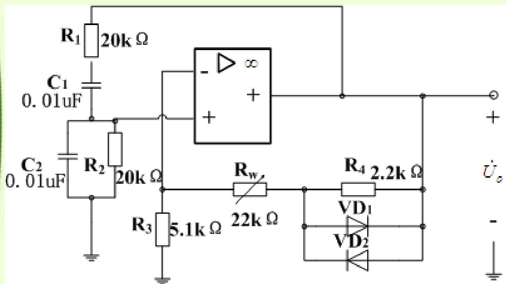
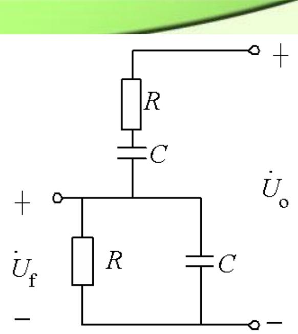
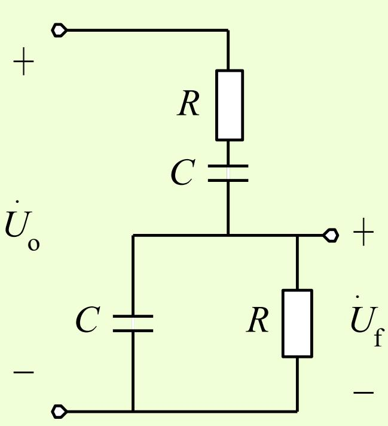
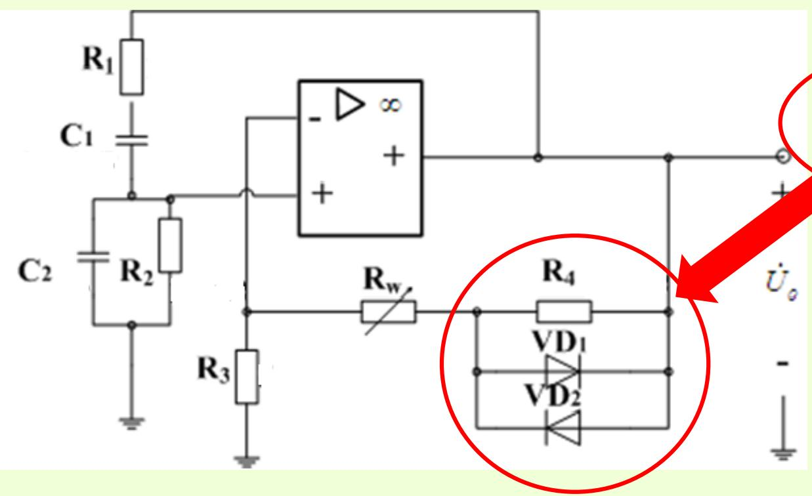
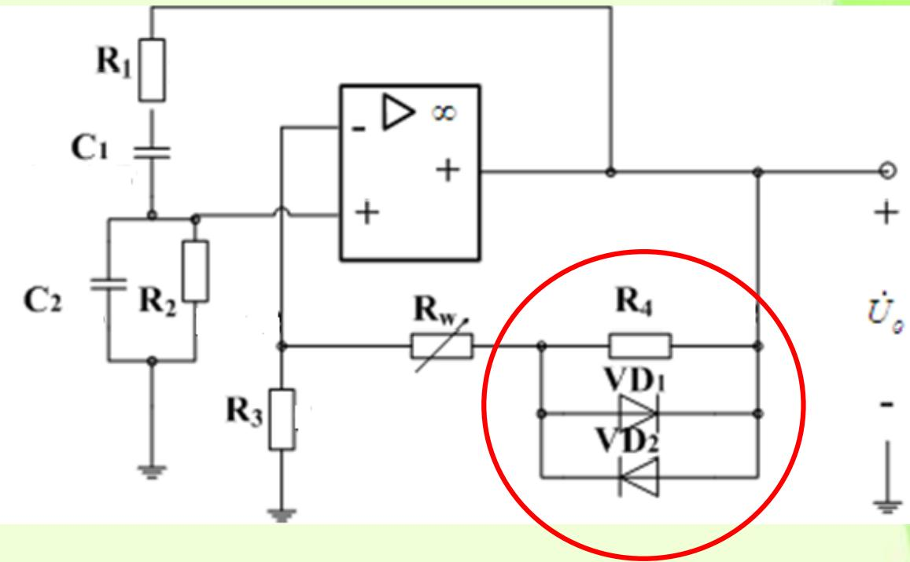
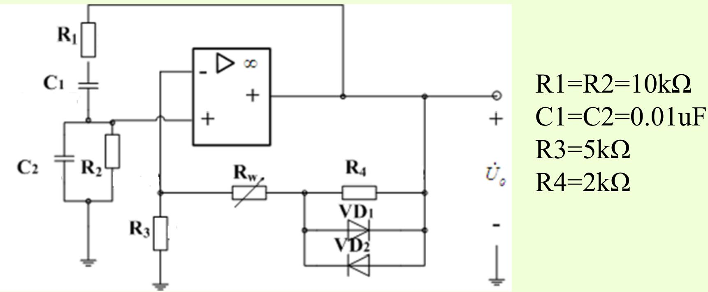
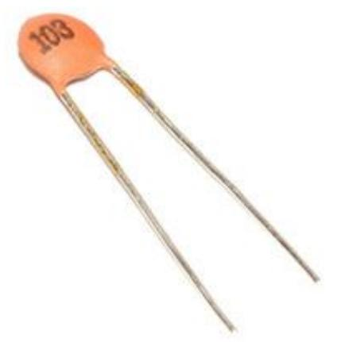
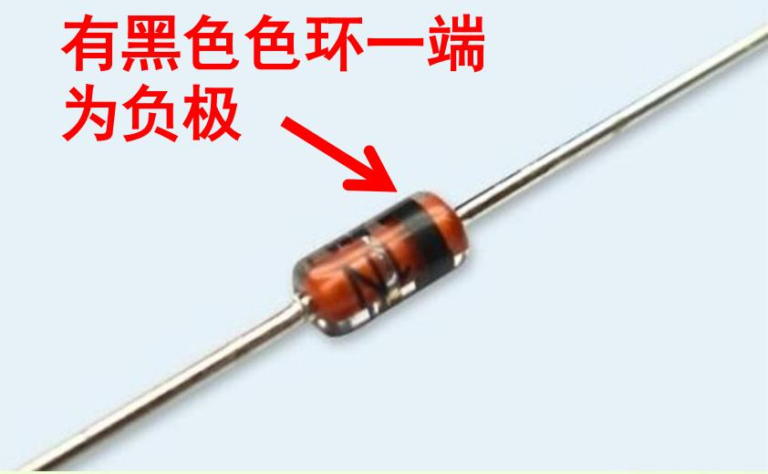

# 《电路分析与电工电子技术》运算放大器的非线性应用（实验）

原件经识别和整理；“参考解答”是我们补的。

## 一、实验目的与基础理论

### 实验目的

1. 掌握运算放大器的非线性使用方法。
2. 理解集成运算放大器非线性应用的电路原理。

### 非线性状态下理想运放的特性

集成运放电压传输特性如下：

$$
\begin{array}{c c} u _ {0} & \\ U _ {\mathrm{OH}} & \\ 0 & \\ U _ {\mathrm{OL}} & \end{array} \quad u _ {\mathrm{id}} = u _ {-} - u _ {+}
$$

**特性总结：**

1. **“离散”特性**：
   - 当 $u_- > u_+$ 时，$u_o = U_{OL}$（输出低电平）。
   - 当 $u_- < u_+$ 时，$u_o = U_{OH}$（输出高电平）。
   
2. **虚断特性**：
   - $i_+ = i_- = 0$

## 二、方波发生器电路分析

### 电路构成

方波发生器主要由以下四部分组成：
1. 运算放大器
2. 稳压器（D1, D2）
3. 正反馈支路（R1, R2）
4. 负反馈支路（R, C）

### ① 运算放大器部分

根据非线性的“离散”特性：
- 若 $U_- > U_+$，运放输出低电平 $U_{OL}$。
- 若 $U_- < U_+$，运放输出高电平 $U_{OH}$。
- 该电路可看作电压比较器。

**工作原理：**
- $U_-$ 的值由负反馈支路 "$R-C$" 决定。
- $U_+$ 的值由正反馈支路 "$R1-R2$" 决定。
- $U_-$ 和 $U_+$ 的值周期性地发生变化，大小关系也在变化，从而引起运放的输出在高、低电平之间切换。

### ② 稳压器部分

**结构：**
由一对相对摆放的稳压管构成。假设两个稳压管完全相同，正向导通电压为 $U_{VD}$，反向击穿电压为 $U_{VZ}$。

**原理：**
如此相对摆放，当外加电压足够大时，两个稳压管总是有一个导通，另一个反向击穿。总的电压降只会取 $\pm (U_{VD} + U_{VZ})$ 两个值。
假设 $U_Z = U_{VD} + U_{VZ}$，则输出电压 $U_o$ 只会取 $\pm U_Z$ 两个固定值。
电阻 $R_o$ 承受从 $U_{OH}$ 到 $U_Z$ 的电压降。

**注意事项：**
- 必须在 $U_{OH} (或 U_{OL}) > U_Z$，即一只稳压管反向击穿的情况下，稳压器才能将最终输出电压 $U_o$ 限制在 $\pm U_Z$ 上。
- 如果 $U_{OH} < U_Z$，稳压管无法击穿，起不到稳压作用，则最终的 $U_o$ 将取决于 $U_{OH} (或 U_{OL})$。

### ③ 正反馈支路部分

**结构：**
由电阻 R1 和 R2 串联构成，R2 上方节点连接到运放的正向端。

**原理：**
因此运放正向端电压为：
$$
U_+ = \pm U_Z \cdot \frac{R_2}{R_1 + R_2}
$$
只会取正、负两个固定的值。
运放的反相端电压 $U_-$ 的值与之不同，根据两者的大小关系，来决定运放的输出电压。

### ④ 负反馈支路（充放电支路）部分

**结构：**
由负反馈电阻 R 和电容 C 构成。电容 C 上极板电压 $U_C$ 即为运放反相端电压 $U_-$。

**充电过程：**
- R 左侧电位为 $U_C$，右侧为 $\pm U_Z$。
- 假设开始时 R 右侧电位为 $+U_Z$。因为 $+U_Z > U_C$，电流将向左流动，即对电容充电，使得 $U_C$ 增大。
- 此时，运放正向端电压 $U_+ = +U_Z \cdot \frac{R_2}{R_1 + R_2} > U_C$。
- 当 $U_C$ 增大到与 $U_+$ 相等并超过时，即 $U_- > U_+$，运放将输出低电平，$+U_Z$ 也将切换成 $-U_Z$。

**放电过程：**
- 于是 R 右侧电位变为 $-U_Z$。因为 $-U_Z < U_C$，电流将向右流动，即电容对外放电，使得 $U_C$ 减小。
- 此时，运放正向端电压 $U_+ = -U_Z \cdot \frac{R_2}{R_1 + R_2} < U_C$。
- 当 $U_C$ 降低到与 $U_+$ 相等并更低时，即 $U_- < U_+$，运放将输出高电平，$-U_Z$ 也将切换成 $+U_Z$。

如此循环，发生周期性的变化。

### 频率计算公式

$$
T_1 = RC \ln \left(1 + 2 \frac{R_2}{R_1}\right)
$$

$$
T_2 = RC \ln \left(1 + 2 \frac{R_2}{R_1}\right)
$$

$$
T = T_1 + T_2 = 2RC \ln \left(1 + 2 \frac{R_2}{R_1}\right)
$$

$$
f_0 = \frac{1}{2RC \ln \left(1 + 2 \frac{R_2}{R_1}\right)}
$$

$$
U_Z = U_{VD} + U_{VZ}
$$

## 三、设计任务与分析

### 设计任务

设计一个方波产生电路，输出方波频率为 1kHz，幅度不小于 6V，相对误差＜±10%，计算电路参数，画出电路图。

**参数确定依据：**

1. **要求“幅度不小于 6V”**：
   - 即要求方波的峰峰值 $V_{PP} \ge 6V$，只要 $U_Z \ge 3V$ 即可。
   - 因此可以选用反向击穿电压 3V，正向导通电压 0.7V 的稳压管。
   - $U_Z = 3 + 0.7 = 3.7V$，满足条件。
   - 需要两个这样的管子，参数完全一致。如果管子参数不一致，将出现波形上下不对称的现象。

2. **要求“频率 1kHz”**：
   $$
   f_0 = \frac{1}{2RC \ln \left(1 + 2 \frac{R_2}{R_1}\right)}
   $$
   - 频率由 R、C、R1、R2 共同决定，可以自由配置。
   - 例如：为了计算方便，可以使分母的对数部分 $\ln(*) = 1$。
   - 发现当 $R_2 = 10k\Omega$，$R_1 = 11k\Omega$ 时，$\ln(*) \approx \ln(e) = 1$。
   - 此时 $f_0 = \frac{1}{2RC} = 1kHz$，解得 $RC = 500\mu s$。
   - 可以取 $R = 50k\Omega$，$C = 0.01\mu F$。
   - 另外限流电阻 $R_o$ 的取值较随意，取 1kΩ 即可。

### 实验内容

记录运算放大器反相输入端 $U_-$ 和最终输出信号 $U_o$ 的波形，并用测量模式测出各信号的频率、最大值、最小值，标在图中。对比测量值与理论计算值。

### 思考题

#### 思考 1

**问题：** 改变 R1/R2，电容两端电压幅度和频率是否发生改变？

**解答：**
都改变。
- $U_c$ 就是 $U_-$，$U_-$ 总是不断向 $U_+$ 靠近。
- $U_+$ 的值是由 R2 与 R1 分压决定的，因此 $U_c$ 也随 R1、R2 阻值而变化。
- 频率公式为：
  $$
  f_0 = \frac{1}{2RC \ln \left(1 + 2 \frac{R_2}{R_1}\right)}
  $$
  频率是由上述公式确定，因此也随阻值而变化。

#### 思考 2

**问题：** 如果稳压管开路，输出波形会发生什么变化？

**解答：**
如果稳压管开路，输出波形的幅值就不受稳压的限制，高、低电平分别等于运算放大器的输出电压 $U_{OH}$ 和 $U_{OL}$。

#### 思考 3

**问题：** 如果有一个稳压管接反了，输出波形将发生什么变化？试画出波形图。

**解答：**
当两个稳压管正反相对时，总是一个导通、另一个反向击穿。
如果有一个接反，那就是两个都导通（0.7+0.7=1.4V），或者两个都击穿（3V+3V=6V）的状态（如果运放的供电电压足够大的话）。
波形将是上下不对称的，根据接反的管子上下位置的不同，会有两种情况：
1. 高电平 1.4V，低电平 -6V
2. 高电平 6V，低电平 -1.4V

#### 思考 4

**问题：** 如果实验中，一个同学将 1N4148 二极管当成稳压管接入电路，试画出波形图。

**解答：**
1N4148 管的正向导通电压为 0.7V，反向击穿电压为 75V。
如果与正常的 0.7V/3V 的稳压管正反对接在一起，产生的压降将是 3.7V 和 75.7V 两种。
显然运放是提供不了 75.7V 这么大的击穿电压的，此时相当于稳压管开路，输出的 $U_o$ 等于运放的 $U_{OH}$ 或 $U_{OL}$。但 3.7V 的击穿电压运放还是能提供的。
根据两个管子上下放置的位置不同，最终输出有两种情况：
1. 高电平为 3.7V，低电平为 $U_{OL}$
2. 高电平为 $U_{OH}$，低电平为 -3.7V

## 二、文氏电桥振荡器

### 电路构成

① 由运放构成的正相放大电路。

② 由 RC 串并联网络构成的正反馈支路，作用是产生振荡。

③ 由若干电阻组成的负反馈支路。

### 电路的基本变化过程

由 RC 串并联电路产生振荡，将正弦信号输入运放的正向端，进行正向放大，得到 $U_o$。

$U_o$ 经过正反馈，再次成为 RC 串并联电路的激励信号，继续产生正弦波（电压增益）。

同时，$U_o$ 经过负反馈网络的分压，将分压输入运放的反相端，反相端信号进行反向增大，再放大与原来的 $U_o$ 叠加，对 $U_o$ 形成负反馈，使 $U_o$ 减小（电压衰减）。

正反馈与负反馈一起使最终的输出 $U_o$ 稳定在一定的状态，得到稳定的正弦信号。

### 正反馈支路——RC 振荡电路

$U_o$ 是输入信号，来自运放输出端；$U_F$ 是输出信号，送到运放正相端。

$$
\begin{array}{l}
\dot{F} = \frac{\dot{U_F}}{\dot{U_O}} = \frac{R \| \frac{1}{j\omega C}}{R + \frac{1}{j\omega C} + R \| \frac{1}{j\omega C}} \\
= \frac{\frac{R}{1 + j\omega C R}}{R + \frac{1}{j\omega C} + \frac{R}{1 + j\omega C R}} \\
= \frac{1}{3 + j\left(\omega C R - \frac{1}{\omega C R}\right)}
\end{array}
$$

正反馈支路反馈系数 $\dot{F}$ 的复频域表达式，就是这个 RC 电路的传输函数。

$$
\dot{F} = \frac{\dot{U_F}}{\dot{U_O}} = \frac{1}{3 + j\left(\omega C R - \frac{1}{\omega C R}\right)}
$$

要使电路起振，必要条件之一就是满足相位条件，即 $U_F$ 与 $U_o$ 相位差为零，所以反馈系数的虚部必须为零。

只有取

$$
\omega = \omega_0 = \frac{1}{RC}
$$

此时

$$
\dot{F} = \frac{\dot{U_F}}{\dot{U_O}} = \frac{1}{3}
$$

$$
\omega = \omega_0 = \frac{1}{RC}, \quad f_0 = \frac{\omega}{2\pi} = \frac{1}{2\pi RC}
$$

设计要求 $f_0 = 1.5\ \mathrm{kHz}$，可令 $R = 10\ \mathrm{k\Omega}$，$C = 0.01\ \mathrm{\mu F}$。

R 和 C 的值决定了 f，也就是决定了后面正弦波的频率，因此这个 RC 振荡电路也叫做选频网络。

### 起振的幅值条件

电路起振还需要满足幅值条件 $\left|\dot{A}\dot{F}\right| > 1$，其中 $\dot{A}$ 为负反馈闭环增益：

$$
\dot{A} = \frac{R_3 + R_W + R'}{R_3}
$$

其中 $R'$ 是 $R_4$ 与两个二极管的并联电阻。

由于 $\dot{F} = \frac{1}{3}$，最终得到

$$
R_W + R' > 2R_3
$$

因此，电路产生振荡的幅值条件，就是在负反馈支路中：

$$
R_W + R' > 2R_3
$$

通过调节电位器 $R_W$ 的阻值，满足上述条件，得到正弦波的输出。

如果 $R_W$ 值太小，将无法起振，输出是一直线。

如果 $R_W$ 值太大，增益 A 将过大，输出信号幅值过大，将超出运放的合理输出范围（$U_{OH} \sim U_{OL}$），波形将同时出现削顶和削底失真。

为了更容易看到振荡，$R_3$ 可以取 $5\ \mathrm{k\Omega}$，$R_W$ 可以取阻值较大的电位器。

### 稳幅电路

$R_4$ 上正反并联两个二极管，它们在输出电压 $U_o$ 的正负半周内分别导通。

当输出电压 $U_o$ 过大时，二极管正向导通电流增大，动态电阻减小，因此反馈到运放的 $U_-$ 增大，产生更大的负反馈，使 $U_o$ 幅值减小。

当输出电压 $U_o$ 较小时，此结构使负反馈减小，$U_o$ 又增大。

因此，这样的设计，最终可以使输出 $U_o$ 稳定在某个值，达到动态稳幅的效果。

二极管正向导通电阻是随电流而大幅变化的，因此在二极管的基础上并联一个电阻 $R_4$，使之变化不那么剧烈，最终的输出波形将会更稳定。

$R_4$ 的取值应接近于二极管的正向导通电阻，可以取 $2\ \mathrm{k\Omega}$。

### 实验内容

根据计算出的参数搭建电路，用示波器观察 $U_o$ 的波形。

调整 $R_W$ 的值，使电路起振，看到正弦波。

继续增大 $R_W$，使电路达到最大不失真状态（无削顶、削底失真）。

在此状态下，画出 $U_o$ 波形，测出其频率和最大值、最小值，标在波形图中，与设计值进行比较。

### 思考题

1. 电路不起振，应增大 $R_W$。
2. 输出波形失真，应减小 $R_W$。
3. 要改变频率，应改变正反馈支路中 R 和 C 的值。可以将反馈电阻 R 改成电位器，随时调整。

### 准备工作

1. 检查要用的导线。
2. 正确连接正负电源，检查插孔中供电是否正常。
3. 将运放芯片正确插入插槽，正确供电（±12 V），用电压跟随法检查运放的好坏。
4. 找出要用的电容（103 电容两个），电阻 10 kΩ 两个，1 kΩ 两个，50 kΩ、5 kΩ、2 kΩ 各一个。两个 3 V 稳压二极管，两个 1N4148 二极管（注意极性）。检查所用电位器 $R_W$ 的好坏（47 kΩ 或 100 kΩ）。

### 稳压管的分辨

| 名称 | 稳压值 | 个数 | 特征 | 作用 |
| --- | --- | --- | --- | --- |
| 3V 稳压管 | 3 V | 2 个 | 褐色，较粗 | 方波发生器实验 |
| 1N4148 | 75 V | 2 个 | 褐色，较细 | 文氏桥电路实验 |
| 1N4740 | 10 V | 1 个 | 褐色，最细长 | |

### 连接电路注意

1. 完成一条支路，再接其他支路。
2. 完成一条线，用铅笔做记号。
3. 电路连接完成之后，最后接入示波器。
4. 尽量减少导线，尽量用短导线。
5. 自己检查，相互检查。

实验结束，芯片要用镊子取出，不要遗忘。
