# 《电路分析与电工电子技术》运算放大器的非线性应用实验（基础实验A第七次课课件）

原件经识别和整理；“参考解答”是我们补的。

# 运算放大器的非线性应用

本资料整理自《电路分析与电工电子技术》实验课件（基础实验A第七次课），包含实验目的、仪器、内容及原理推导。

## 一、实验准备

### 实验目的

1. 掌握运算放大器的非线性使用方法。
2. 理解集成运算放大器非线性应用的电路原理。

### 实验仪器

- 双踪示波器
- 函数信号发生器
- DGDZ-2型电工电子综合实验箱

## 二、实验内容与原理

### 1、电压比较器

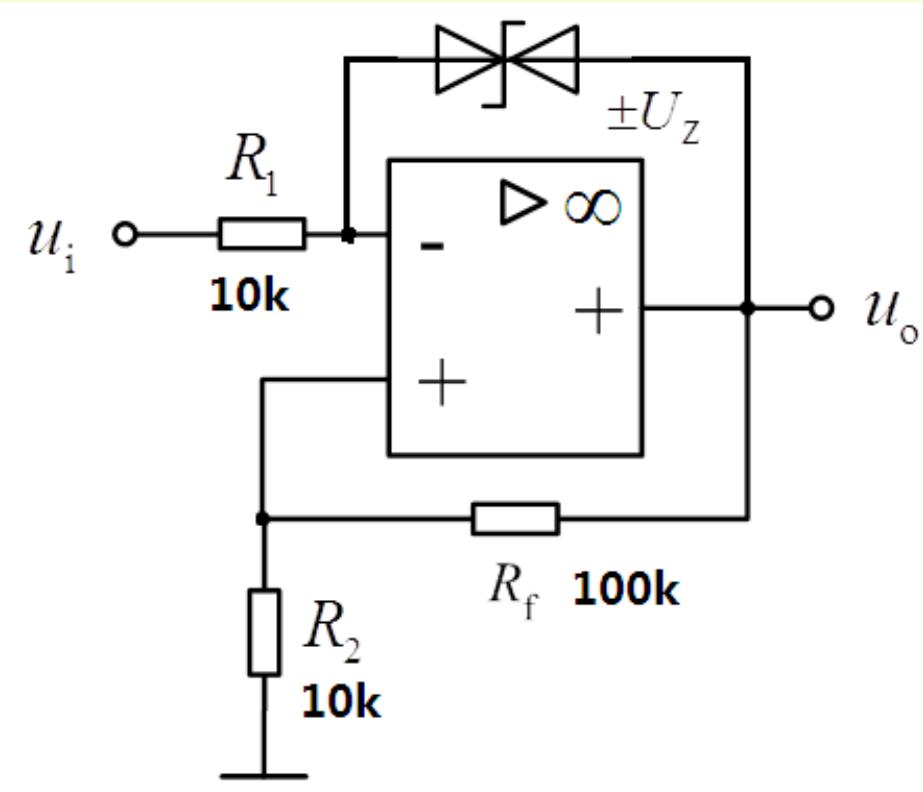

**输出电平：**
$$U_{OH} = + U_Z$$
$$U_{OL} = - U_Z$$

**阈值电压：**
$$U_{TH} = \frac{R_2}{R_2 + R_f} U_{OH}$$
$$U_{TL} = \frac{R_2}{R_2 + R_f} U_{OL}$$

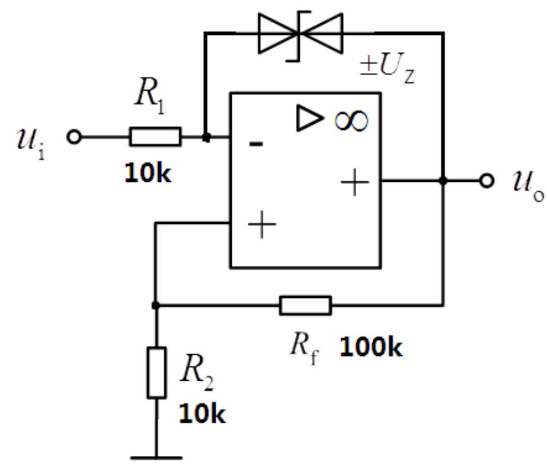

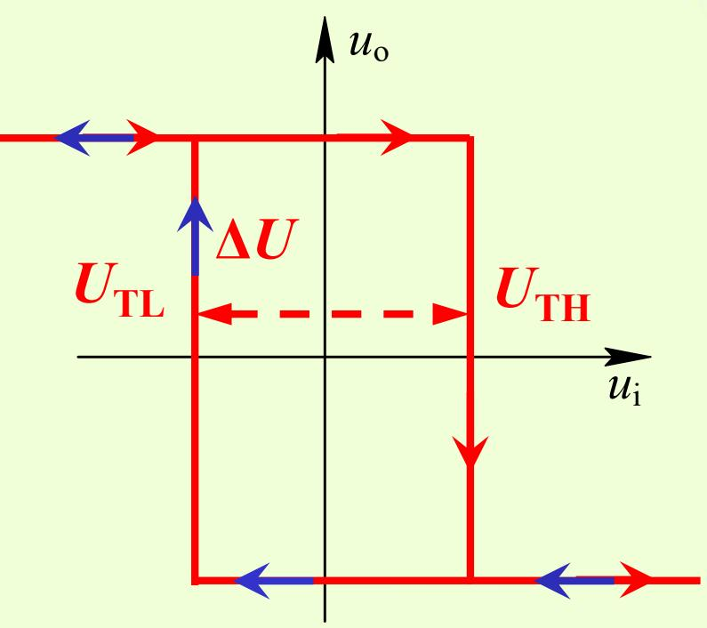

**实验内容：**
输入信号 $u_i$ 为 $f=1\text{kHz}$ 的正弦信号，增大 $u_i$ 的幅度，使输出成为矩形波。记录输入和输出信号波形，标清各波形周期和上、下峰值。

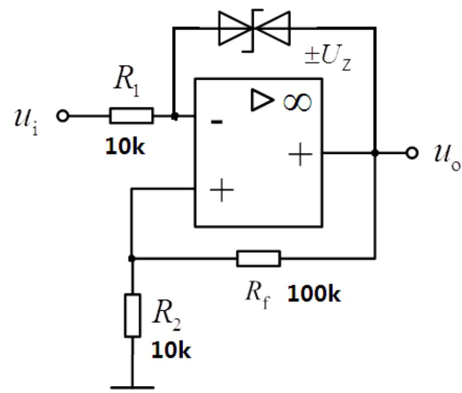

### 2、文氏电桥振荡器

**振荡频率：**
设 $R_1 = R_2 = R$，$C_1 = C_2 = C$，则：
$$f = \frac{1}{2 \pi R C}$$

代入典型值计算（$R=20\text{k}\Omega$, $C=0.01\mu\text{F}$）：
$$f = \frac{1}{2 \times \pi \times 20 \times 10^3 \times 0.01 \times 10^{-6}} \approx 796\text{Hz}$$

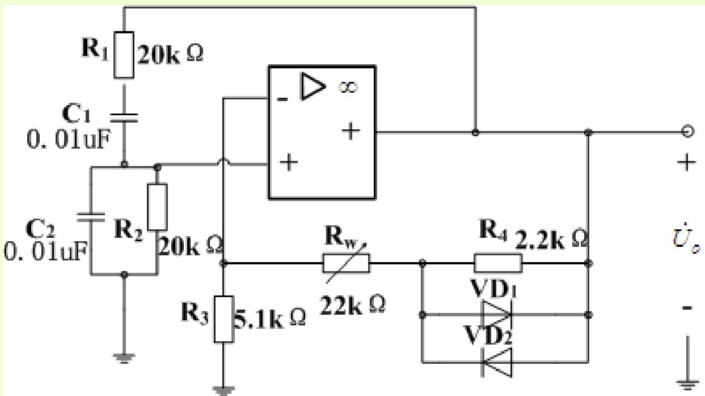

**起振条件：**
根据振幅起振条件 $AF > 1$。
反馈系数 $F = \frac{1}{3}$。
$$A \times \frac{1}{3} > 1 \implies A > 3$$

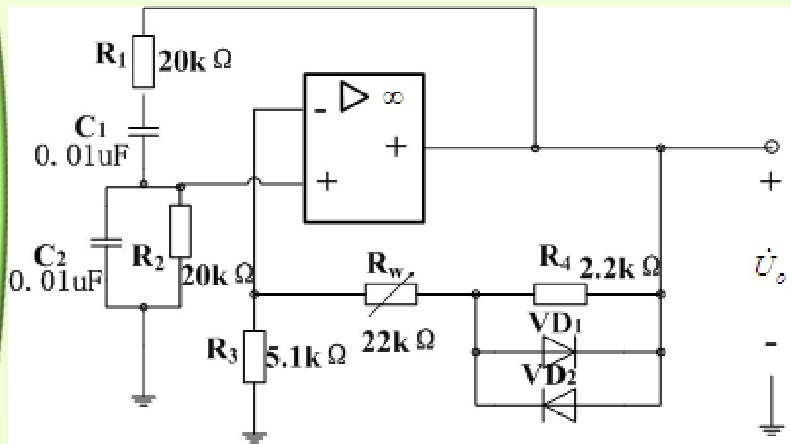

**稳幅条件推导：**
放大倍数 $A = 1 + \frac{R_W + r_D}{R_3}$。
因此起振需满足：
$$R_W + r_D > 2 R_3$$

**稳幅电路说明：**
在 $R_4$ 上正反并联两个二极管，它们在输出电压 $u_o$ 的正负半周内分别导通。
- **起振之初**：由于 $u_o$ 幅值很小，尚不足以使二极管导通，正向二极管近于开路，此时 $R_W > 2 R_3$，满足 $A>3$ 的起振条件。
- **稳定过程**：随着振荡幅度的增大，正向二极管导通，其正向电阻逐渐减小，直到 $R_W = 2 R_3$，此时 $A=3$，振荡稳定。

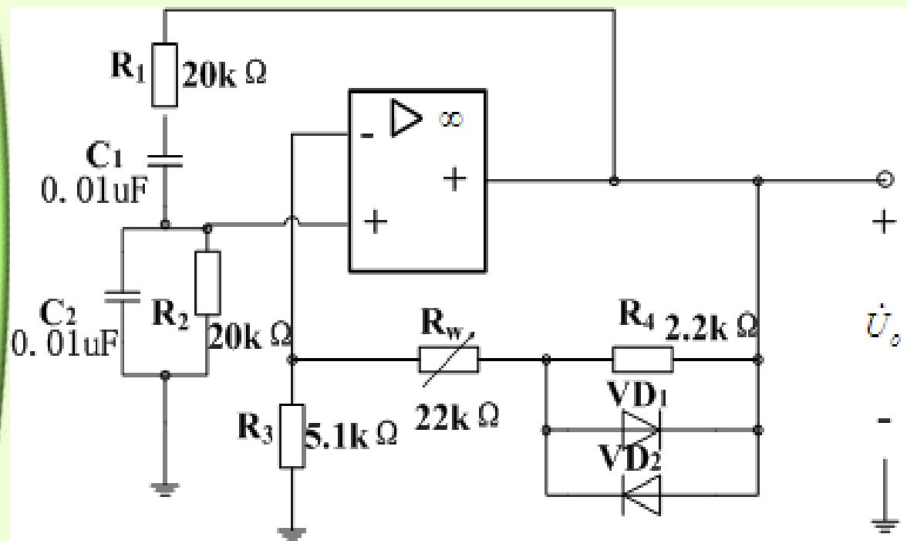

**实验内容：**
记录输出信号波形。标清信号周期、上下峰值。

### 3、方波发生器

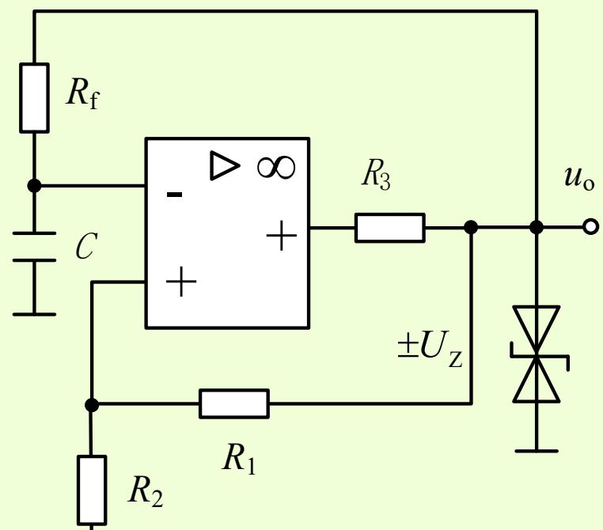

**工作原理分析：**

1. 当电容电压 $u_C = 0$ 时，输出 $u_o = U_Z$。
   同相输入端电压：
   $$U_+ = \frac{R_2}{R_1 + R_2} U_Z$$

2. 当输出翻转至 $U_{OL} = -U_Z$ 时，反相输入端电压变为：
   $$U_- = - \frac{R_2}{R_1 + R_2} U_Z$$

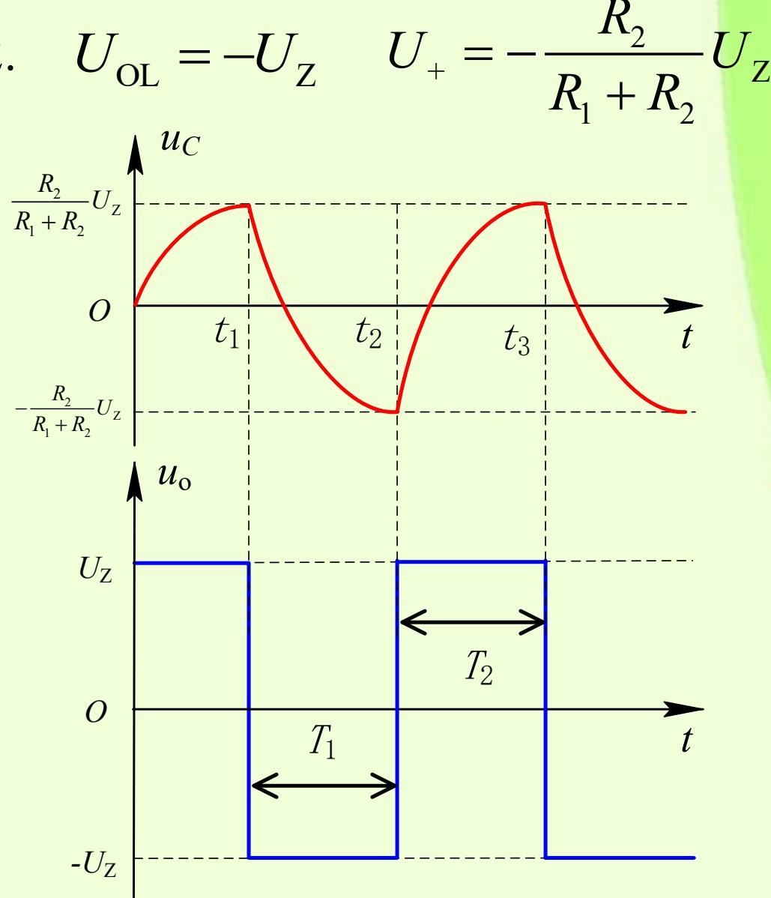

**周期与频率公式：**
充电时间 $T_1$ 和放电时间 $T_2$ 相等：
$$T_1 = T_2 = R_f C \ln \left(1 + 2 \frac{R_2}{R_1}\right)$$
总周期 $T = T_1 + T_2$：
$$T = 2 R_f C \ln \left(1 + 2 \frac{R_2}{R_1}\right)$$
振荡频率 $f_o$：
$$f_o = \frac{1}{T} = \frac{1}{2 R_f C \ln \left(1 + 2 \frac{R_2}{R_1}\right)}$$

**实验内容：**
记录发生器同相输入端、反相输入端和输出端的波形，并标清各波形的周期和上下峰值。

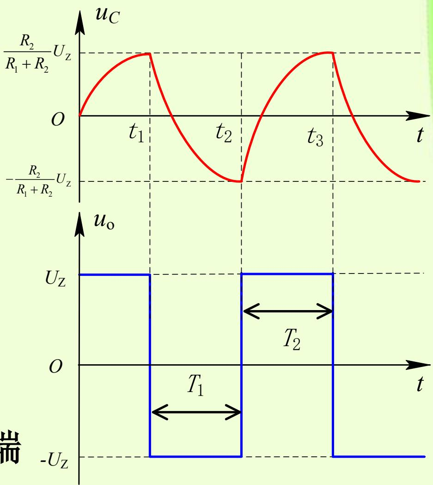

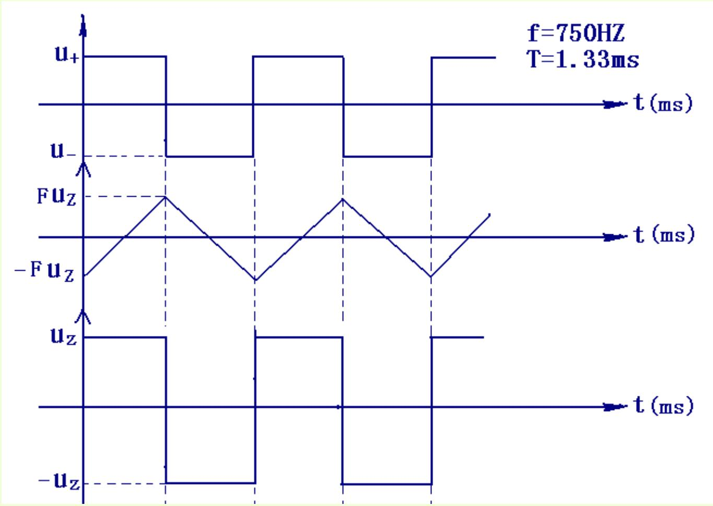
