# 《电路分析》第4章作业1（含答案）

原件经识别和整理；“参考解答”是我们补的。

## 一、习题

### 习题 1

电路如题图4-1所示，试用叠加定理求电流 $i$。

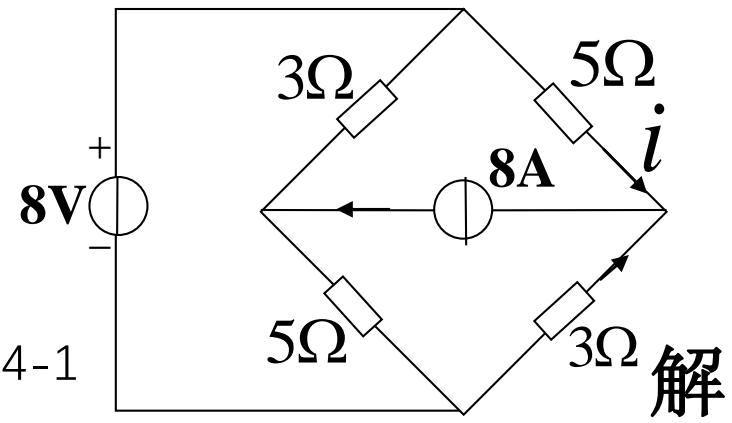

答案：
利用叠加定理：

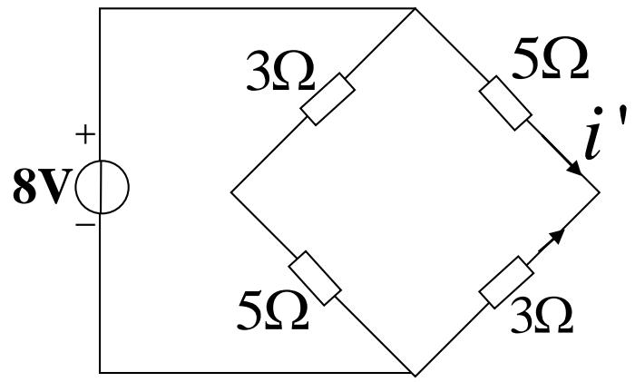

(1) 当电压源单独作用时,

$$
i ^ {\prime} = \frac {8}{3 + 5} = 1 A
$$

(2) 当电流源单独作用时,

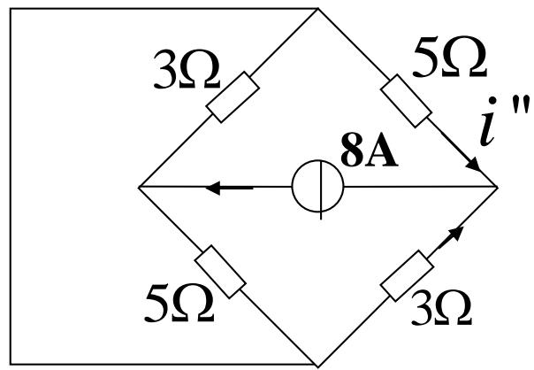

$$
i ^ {\prime \prime} = \frac {3}{3 + 5} \times 8 = 3 A
$$

(3) 总电流为:

$$
i = i ^ {\prime} + i ^ {\prime \prime} = 4 A
$$

知识点：[理想电压源与理想电流源的特性](../../../topics/电路与电子技术/独立电源.md)、[线性时不变电阻的伏安关系（欧姆定律）](../../../topics/电路与电子技术/线性电阻VCR.md)、[基尔霍夫电流定律（KCL）及其应用](../../../topics/电路与电子技术/KCL.md)

### 习题 5

(1) 题图 4-5 所示的线性网络 N 只含电阻。若 $i_{\mathrm{S} 1}=8 \mathrm{~A}, i_{\mathrm{S} 2}=12 \mathrm{~A}$ 时, $u_{x}=80 \mathrm{~V}$ ; 若 $i_{\mathrm{S} 1}=-8 \mathrm{~A}, i_{\mathrm{S} 2}=4 \mathrm{~A}$ 时, $u_{x}=0 \mathrm{~V}$ 。当 $i_{\mathrm{S} 1}=i_{\mathrm{S} 2}=20 \mathrm{~A}$ 时, $u_{x}$ 为多少? (2) 若所示网络 N 含有独立源, 当 $i_{\mathrm{S} 1}=i_{\mathrm{S} 2}=0$ 时, $u_{x}=-40 \mathrm{~V}$ ; 所有 (1) 中的数据仍有效。当 $i_{\mathrm{S} 1}=i_{\mathrm{S} 2}=20 \mathrm{~A}$ 时, 电压 $u_{x}$ 为多少?

答案：
（1）由线性网络的齐次性和叠加性，可设：

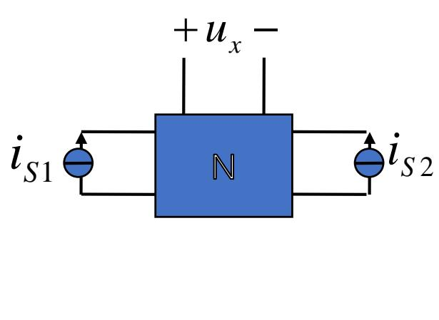

$$
u _ {x} = k _ {1} i _ {S 1} + k _ {2} i _ {S 2}
$$

代入已知条件，有：

$$
\left\{ \begin{array}{l l} 8 k _ {1} + 1 2 k _ {2} = 8 0 & \therefore k _ {1} = 2. 5, k _ {2} = 5 \\ - 8 k _ {1} + 4 k _ {2} = 0 \end{array} \right.
$$

当 $i_{S1} = i_{S2} = 20A$ 时， $u_{x} = 2.5 \times 20 + 5 \times 20 = 150V$

(2) 当网络N含有独立电源时, 设其所有独立电源的作用为 $\sum p_{n} e_{n}$ , 则:

$$
u _ {x} = p _ {1} i _ {S 1} + p _ {2} i _ {S 2} + \sum p _ {\mathrm{n}} e _ {\mathrm{n}}
$$

将 $i_{S1} = i_{S2} = 0A$ 时， $u_x = -40V$ 代入：

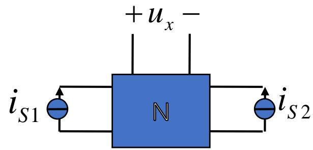

$$
\sum p _ {\mathrm{n}} e _ {n} = - 4 0
$$

再将（1）中的条件代入，有：

$$
\left\{ \begin{array}{l l} 8 p _ {1} + 1 2 p _ {2} - 4 0 = 8 0 \\ - 8 p _ {1} + 4 p _ {2} - 4 0 = 0 \end{array} \right. \quad \therefore p _ {1} = 0, p _ {2} = 1 0
$$

故，当 $i_{S1} = i_{S2} = 20A$

$$
u _ {x} = 0 \times 2 0 + 1 0 \times 2 0 - 4 0 = 1 6 0 V
$$

知识点：[基尔霍夫电流定律（KCL）及其应用](../../../topics/电路与电子技术/KCL.md)、[理想电压源与理想电流源的特性](../../../topics/电路与电子技术/独立电源.md)

### 习题 9

(a). 试求题图4-9所示二端网络的戴维南等效电路。

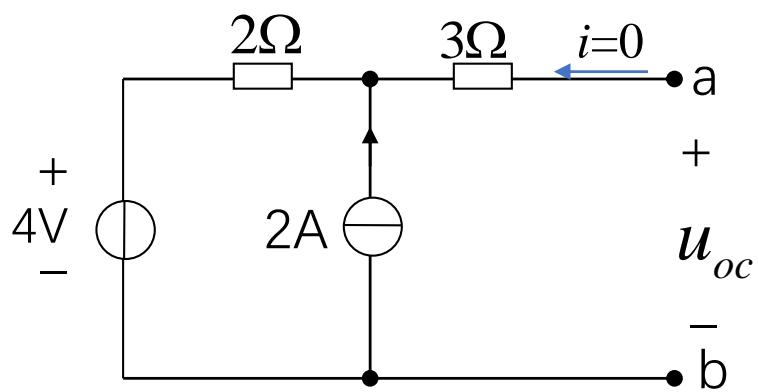

答案：
根据戴维南定理： $u_{oc}=2\times2+4=8V$

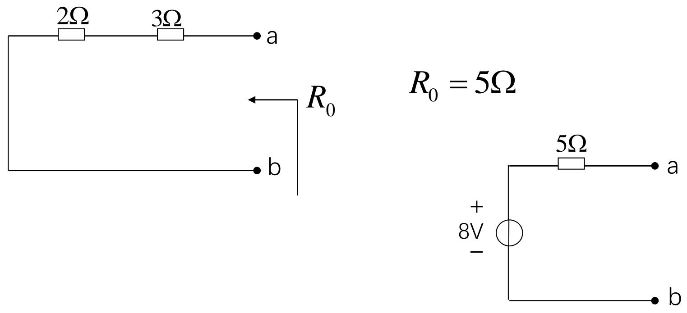

知识点：[理想电压源与理想电流源的特性](../../../topics/电路与电子技术/独立电源.md)、[线性时不变电阻的伏安关系（欧姆定律）](../../../topics/电路与电子技术/线性电阻VCR.md)

### 习题 10

(b)试求题图4-10所示二端网络诺顿等效电路。

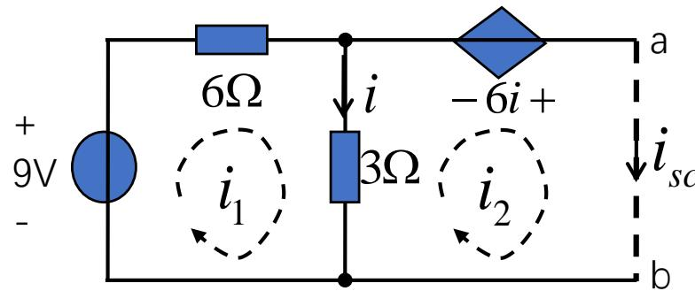

答案：
（1）先求短路电流 $i_{sc}$ ：令端口ab短路，网孔法有：

$$
\left\{ \begin{array}{l} 9 i _ {1} - 3 i _ {2} = 9 \\ - 3 i _ {1} + 3 i _ {2} = 6 i \\ i = i _ {1} - i _ {2} \end{array} \right.
$$

$$
\therefore i _ {s c} = i _ {2} = 1. 5 A
$$

另解：短路电流 $i_{sc}$ ：

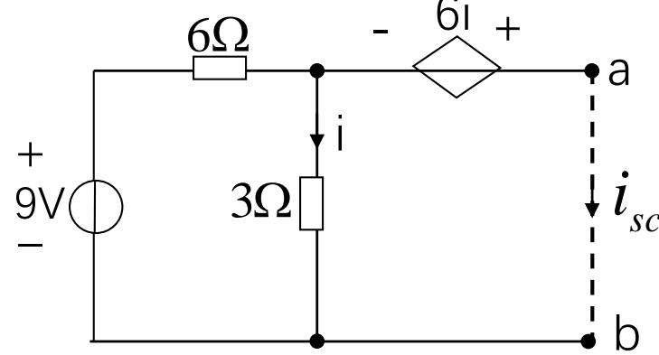

$$
\because 6 i = - 3 i \quad \therefore i = 0
$$

$$
\therefore i _ {s c} = \frac {9}{6} = 1. 5 A
$$

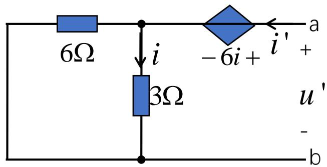

(2) 求输出电阻 $R_{0}$ : 令独立电压源短路: 加压求流法, 设端口电压为 $u'$ , 电流为 $i'$

(注：设的端口电流与受控源控制量i不能相同)

$$
\left\{ \begin{array}{l l} u ^ {\prime} = 6 i + 3 i = 9 i & \therefore u ^ {\prime} = 9 \times \frac {6}{6 + 3} i ^ {\prime} = 6 i ^ {\prime} \\ i = \frac {6}{6 + 3} i ^ {\prime} & R _ {0} = 6 \Omega \end{array} \right.
$$

另解开短路法，求开路电压 Uoc，方向为a→b:

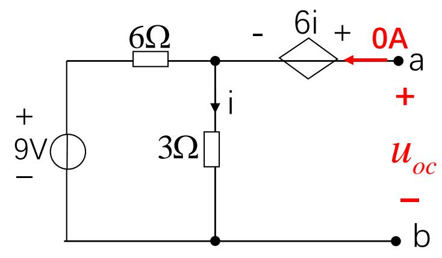

$$
\begin{array}{l} u _ {o c} = 6 i + 3 i = 9 i \\ i = \frac {9}{6 + 3} = 1 A \quad \therefore u _ {o c} = 9 V \\ \therefore R _ {0} = \frac {u _ {o c}}{i _ {s c}} = 6 \Omega \end{array}
$$

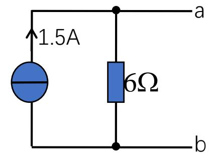

知识点：[四种受控电源（VCVS、VCCS、CCVS、CCCS）的特性](../../../topics/电路与电子技术/受控电源.md)、[线性时不变电阻的伏安关系（欧姆定律）](../../../topics/电路与电子技术/线性电阻VCR.md)、[基尔霍夫电压定律（KVL）及其应用](../../../topics/电路与电子技术/KVL.md)

### 习题 11

用戴维南定理求题图4-11电路的电压 $u$。

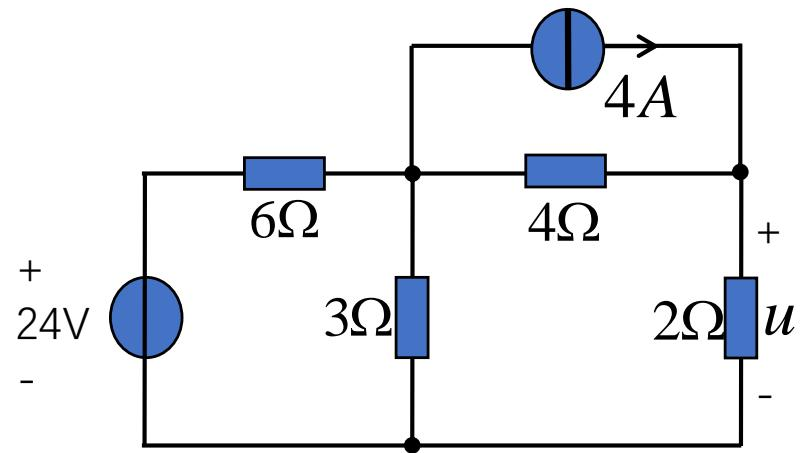

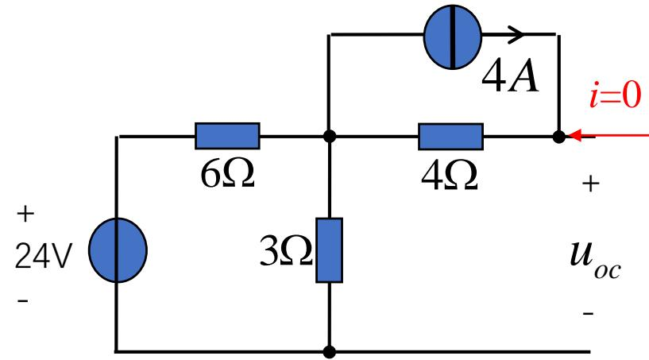

答案：
（1）求开路电压 $u_{oc}$

$$
u _ {o c} = 4 \times 4 + 2 4 \times \frac {3}{6 + 3} = 2 4 V
$$

(2) 求输出电阻 $R_{0}$

$$
R _ {0} = 6 / / 3 + 4 = 6 \Omega
$$

$$
\therefore u = 2 4 \times \frac {2}{6 + 2} = 6 V
$$

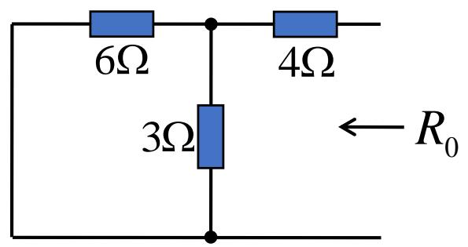

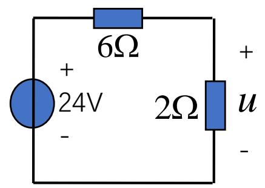

知识点：[基尔霍夫电压定律（KVL）及其应用](../../../topics/电路与电子技术/KVL.md)、[线性时不变电阻的伏安关系（欧姆定律）](../../../topics/电路与电子技术/线性电阻VCR.md)、[理想电压源与理想电流源的特性](../../../topics/电路与电子技术/独立电源.md)

### 习题 14

电路如题图 4-14 所示，其中电阻 $R_{L}$ 可调，试问 $R_{L}$ 为何值时能获得最大功率？最大功率为多少？

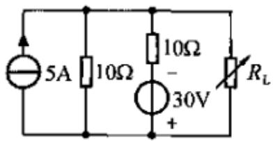

答案：
(a) 解：先求 $R_{\mathrm{L}}$ 以左部分电路的戴维南等效电路。首先求开路电压 $u_{\infty}$ ，如解图4-14(a)-(1)所示，有

$$
u _ {\mathrm{oc}} = 5 \times (1 0 / / 1 0) - 3 0 \times \frac {1 0}{1 0 + 1 0} = 1 0 \mathrm{V}
$$

再求等效电阻 $R_{0}$ ，如解图4-14（a）-（2）所示，有

$$
R _ {o} = 1 0 / / 1 0 = 5 \Omega
$$

题图 4-14（a）负载 $R_{L}$ 以左部分电路可用其对应的戴维南等效电路替代，如解图 4-14(a)-(3) 所示。因此，当 $R_{L}=R_{0}=5\Omega$ 时可获得最大功率，此最大功率为

$$
P _ {\max} = \frac {u _ {\mathrm{oc}} {} ^ {2}}{4 R _ {\mathrm{o}}} = \frac {1 0 ^ {2}}{4 \times 5} = 5 \mathrm{W}
$$

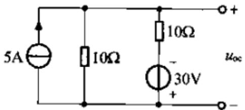

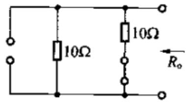

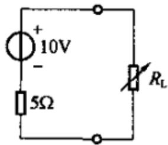

## 计算 4-14(b)

电路如题图4-14所示，其中电阻 $R_{L}$ 可调，试问 $R_{L}$ 为何值时能获得最大功率？最大功率为多少？

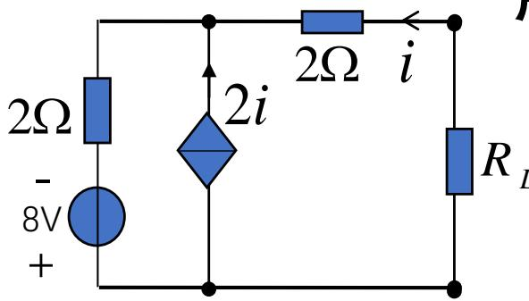

答案：
解：将 $R_{L}$ 左端电路化为戴维南等效电路：

(1) 先求开路电压 $u_{oc}$
$\because i=0$，2i的受控电流源为0相当于开路
$$ u_{oc} = -8V $$

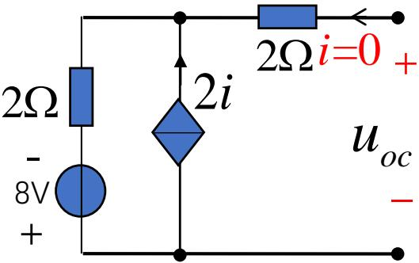

(2) 求输出电阻 $R_{0}$
令电压源短路，则:

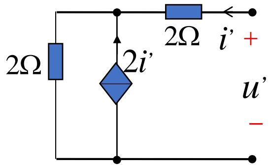

$$
\begin{array}{c} 
u ^ {\prime} = 2 i ^ {\prime} + (2 i ^ {\prime} + i ^ {\prime}) \times 2 = 8 i ^ {\prime} \\ 
\therefore R _ {0} = 8 \Omega 
\end{array}
$$

(3) 求最大功率:
当 $R_{L} = R_{0}$ 时有最大功率, 为:

$$
p _ {\mathrm{max}} = \frac {u _ {o c} ^ {2}}{4 R _ {0}} = \frac {(- 8) ^ {2}}{4 \times 8} = 2 W
$$

补充：没布置，可以看一下。

## 计算 4-19

在题图4-19电路中，已知 $i_{1} = 2A, i_{2} = 1A$。若把电路中间的 $R_{2}$ 支路断开，试问此时电流 $i_{1}$ 为多少？

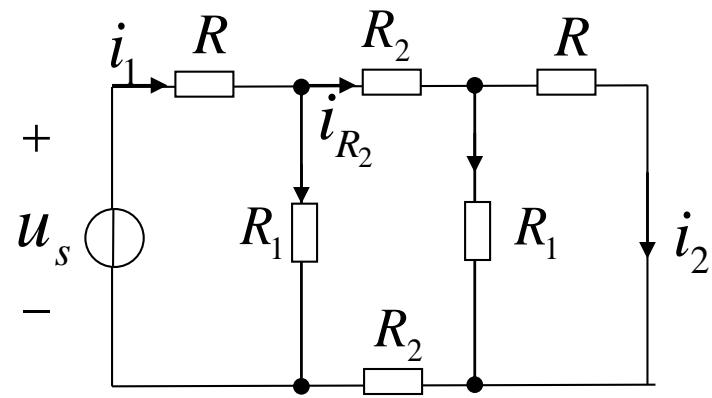

答案：
解一：
（1）断开前：

$$
i _ {1} - \frac {u _ {s} - i _ {1} R}{R _ {1}} = i _ {R _ {2}} = i _ {2} + \frac {i _ {2} R}{R _ {1}}
$$

$$
\therefore u _ {s} = R _ {1} + R
$$

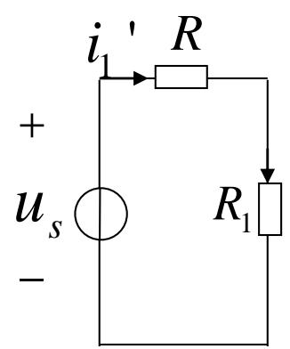

(2) 断开后:

$$
u _ {s} = i _ {1} ^ {\prime} (R _ {1} + R)
$$

$$
\therefore i _ {1} ^ {\prime} = 1 A
$$

## 计算 4-20

线性无源二端网络 $N_{0}$ 仅由电阻组成，如 4-20(a) 所示。当 $u_{s}=100$ 时， $u_{2}=20V$ ，求当电路改为图(b) 时的电流 i。

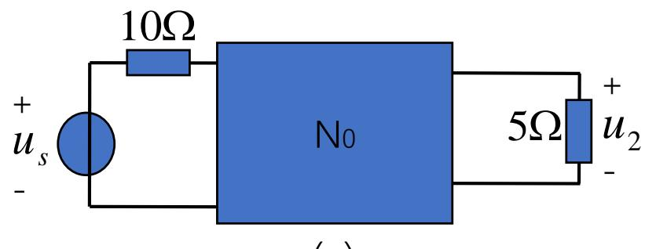

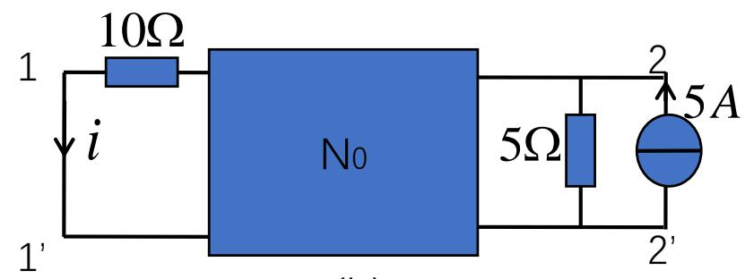

答案：
解：应用互易定理形式三+线性网络的齐次性，有：

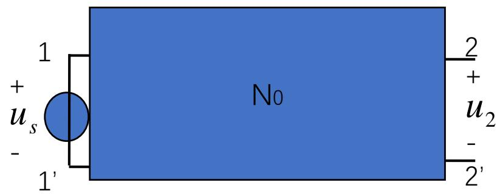

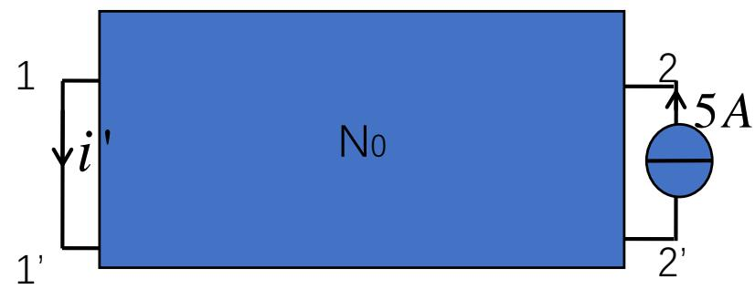

$$
\frac {u _ {2}}{u _ {s}} = \frac {i ^ {\prime}}{i _ {s} ^ {\prime}} \quad \therefore i = i ^ {\prime} = i _ {s} ^ {\prime} \cdot \frac {u _ {2}}{u _ {s}} = 1 A
$$

## 计算 4-21

题图4-21(a)中 $N_{0}$ 为仅由电阻组成的无源线性网络，当10V电压源与1,1'端相接，测得输入电流 $i_{1}=5A$ ，输出电流 $i_{2}=1A$ ；若把电压源移至2、2'端，且在1、1'跨接 2Ω电阻如图(b)所示，试求电阻上的电压 u。

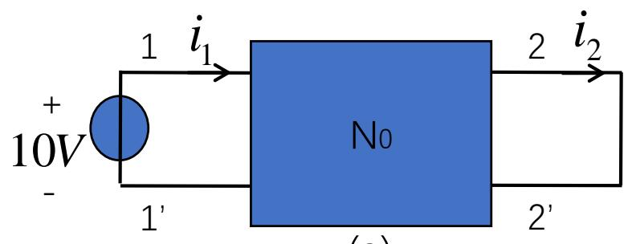

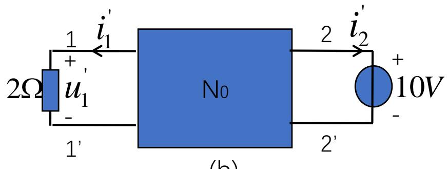

答案：
解：根据特勒根第二定理，有：

$$
\begin{array}{r l} 
& u _ {s} \dot {i} _ {1} ^ {\prime} + u _ {2} \dot {i} _ {2} ^ {\prime} = u _ {1} ^ {\prime} (- i _ {1}) + u _ {s} ^ {\prime} \dot {i} _ {2} \\ 
& \because u _ {2} = 0, u _ {1} ^ {\prime} = 2 \dot {i} _ {1}, u _ {s} = u _ {s} ^ {\prime} = 1 0, i _ {1} = 5 A, i _ {2} = 1 A \\ 
& \therefore 1 0 \dot {i} _ {1} ^ {\prime} = 2 \dot {i} _ {1} ^ {\prime} (- 5) + 1 0 \times 1 \\ 
& \therefore \dot {i} _ {1} ^ {\prime} = 0. 5 A \quad \text {则:} \quad u _ {1} ^ {\prime} = 1 V 
\end{array}
$$

知识点：[理想电压源与理想电流源的特性](../../../topics/电路与电子技术/独立电源.md)、[线性时不变电阻的伏安关系（欧姆定律）](../../../topics/电路与电子技术/线性电阻VCR.md)、[基尔霍夫电压定律（KVL）及其应用](../../../topics/电路与电子技术/KVL.md)
