# 《离散数学》第1章（课件）

原件的每一页，下面附识别出的文字。

### 《离散数学》

原文：

《离散数学》

南京邮电大学计算机学院 计算机科学与技术系

罗 卫兰

### 概述

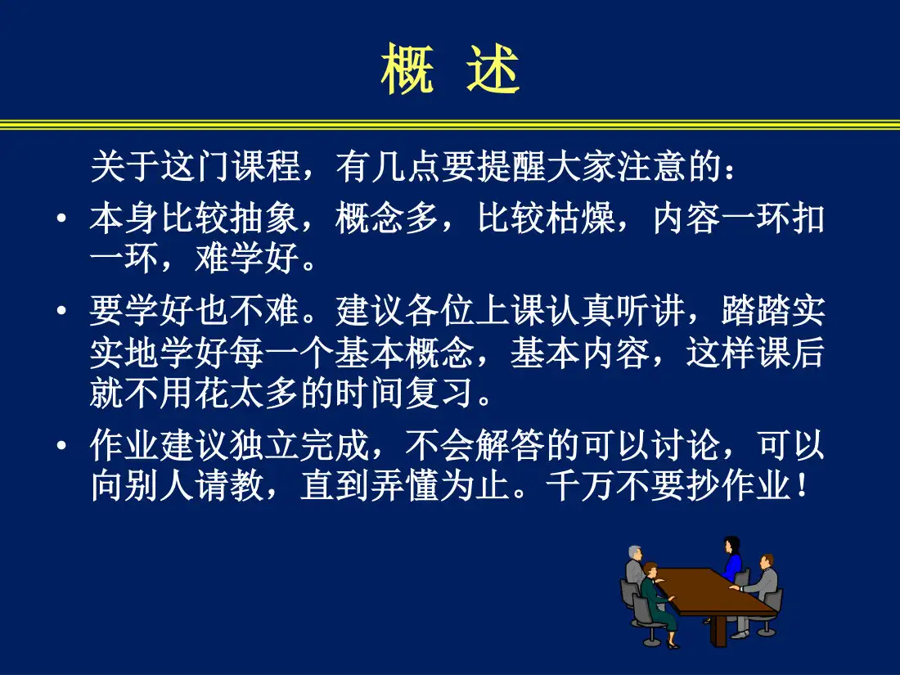

原文：

概述

关于这门课程，有几点要提醒大家注意的：

\- 本身比较抽象，概念多，比较枯燥，内容一环扣一环，难学好。

\- 要学好也不难。建议各位上课认真听讲，踏踏实实地学好每一个基本概念，基本内容，这样课后就不用花太多的时间复习。

\- 作业建议独立完成，不会解答的可以讨论，可以向别人请教，直到弄懂为止。千万不要抄作业！

### 说明

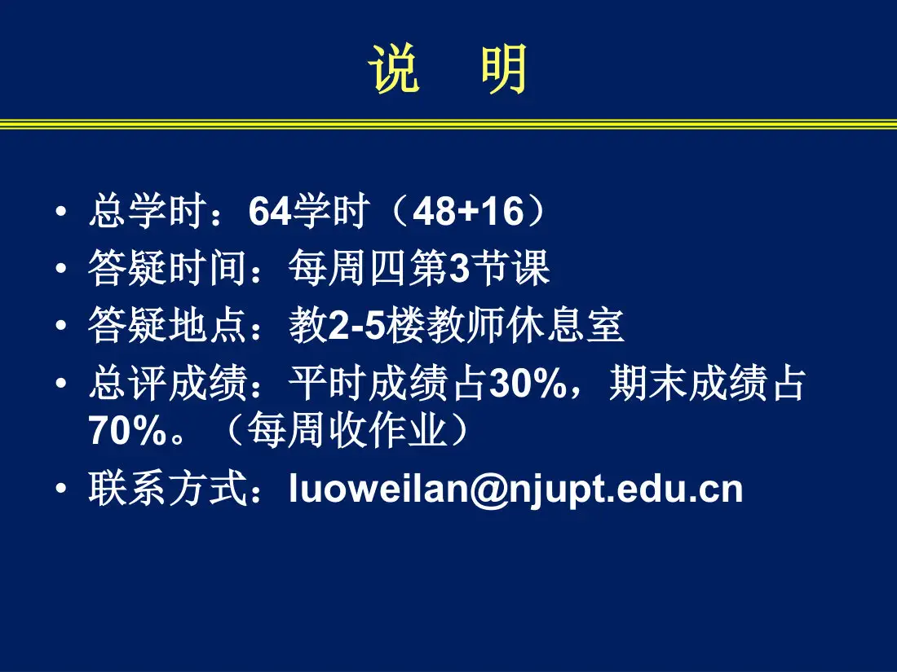

原文：

说明

\- 总学时：64学时（48+16）

\- 答疑时间：每周四第3节课

\- 答疑地点：教2-5楼教师休息室

\- 总评成绩：平时成绩占 $30\%$ ，期末成绩占 $70\%$ 。（每周收作业）

\- 联系方式：luoweilan@njupt.edu.cn

### 说明

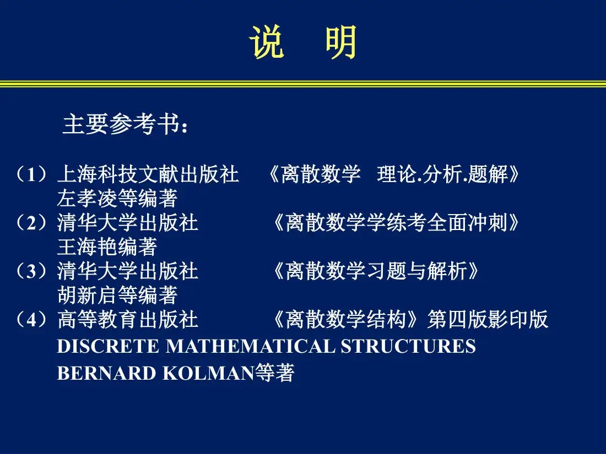

原文：

说明

主要参考书:

(1) 上海科技文献出版社
左孝凌等编著

(2) 清华大学出版社
王海艳编著

(3) 清华大学出版社
胡新启等编著

(4) 高等教育出版社

《离散数学 理论.分析.题解》

《离散数学学练考全面冲刺》

《离散数学习题与解析》

《离散数学结构》第四版影印版

DISCRETE MATHEMATICAL STRUCTURES

BERNARD KOLMAN等著

### 课程简介

原文：

课程简介

离散数学是现代数学的一个重要分支，是计算机科学中的基础课程，它具有两个特点：

(1)以离散量为研究对象，以讨论离散量的结构和相互之间的关系为主要目标，这些对象一般是有限个或可数个元素，充分描述了计算机科学离散性的特点，与我们以前学过的连续数学如高等数学、数学分析、函数论形成了鲜明对比。

(2)它是数学中的一个分支，因而它有数学的味道，比如用一些符号、引进一些定义、运用定理推导等等。因而学习离散数学，对提高我们的抽象能力，归纳能力、逻辑推理能力将有很大帮助。

### 应用

原文：

应用

Image segmentation

### 第一篇 数理逻辑

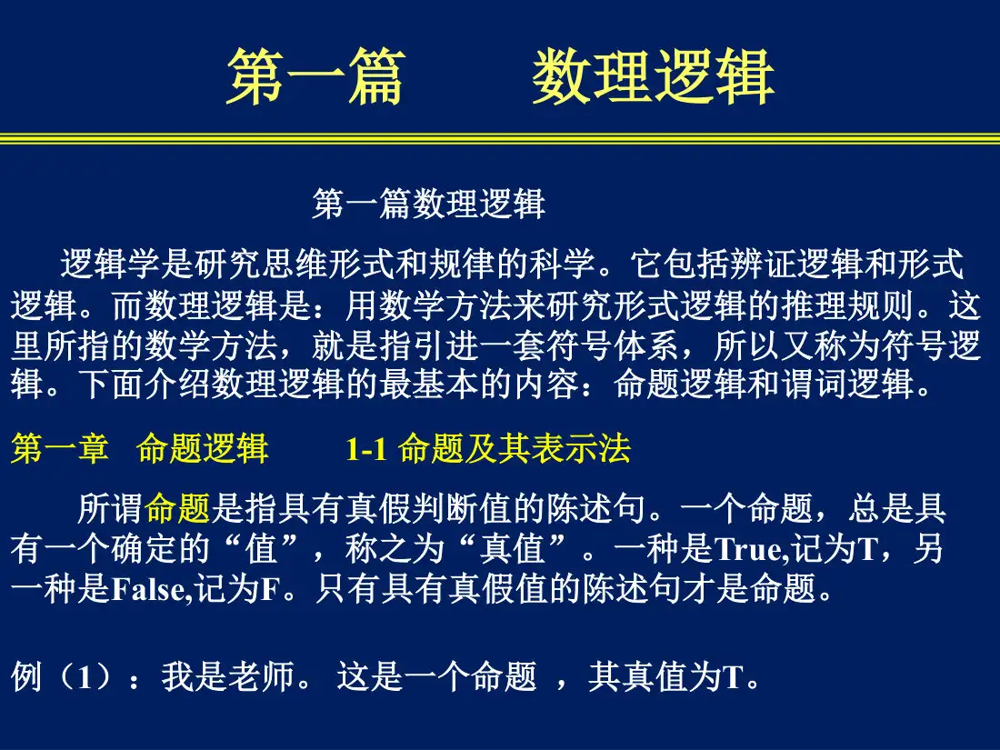

原文：

第一篇 数理逻辑

第一篇数理逻辑

逻辑学是研究思维形式和规律的科学。它包括辩证逻辑和形式逻辑。而数理逻辑是：用数学方法来研究形式逻辑的推理规则。这里所指的数学方法，就是指引进一套符号体系，所以又称为符号逻辑。下面介绍数理逻辑的最基本的内容：命题逻辑和谓词逻辑。

第一章 命题逻辑 1-1 命题及其表示法

所谓命题是指具有真假判断值的陈述句。一个命题，总是具有一个确定的“值”，称之为“真值”。一种是True,记为T，另一种是False,记为F。只有具有真假值的陈述句才是命题。

例（1）：我是老师。这是一个命题，其真值为T。

### 1-1 命题及其表示法

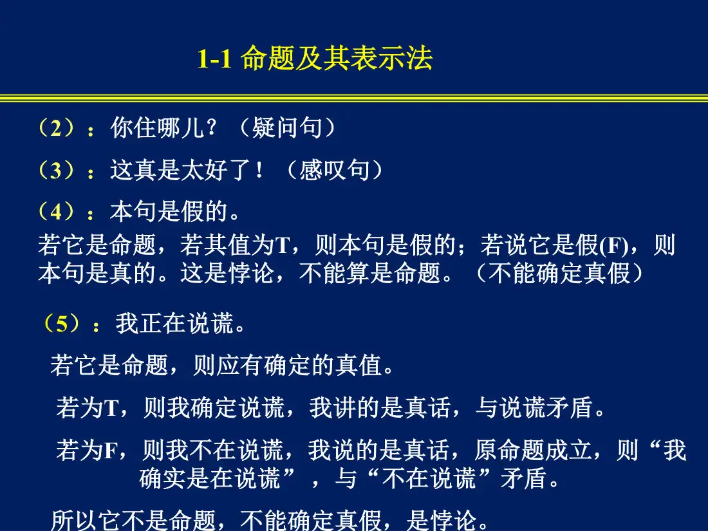

原文：

1-1 命题及其表示法

(2)：你住哪儿？（疑问句）

(3)：这真是太好了！（感叹句）

(4): 本句是假的。

若它是命题，若其值为T，则本句是假的；若说它是假(F)，则本句是真的。这是悖论，不能算是命题。（不能确定真假）

(5): 我正在说谎。

若它是命题，则应有确定的真值。

若为T，则我确定说谎，我讲的是真话，与说谎矛盾。

若为F，则我不在说谎，我说的是真话，原命题成立，则“我确实是在说谎”，与“不在说谎”矛盾。

所以它不是命题，不能确定真假，是悖论。

### 1-1 命题及其表示法

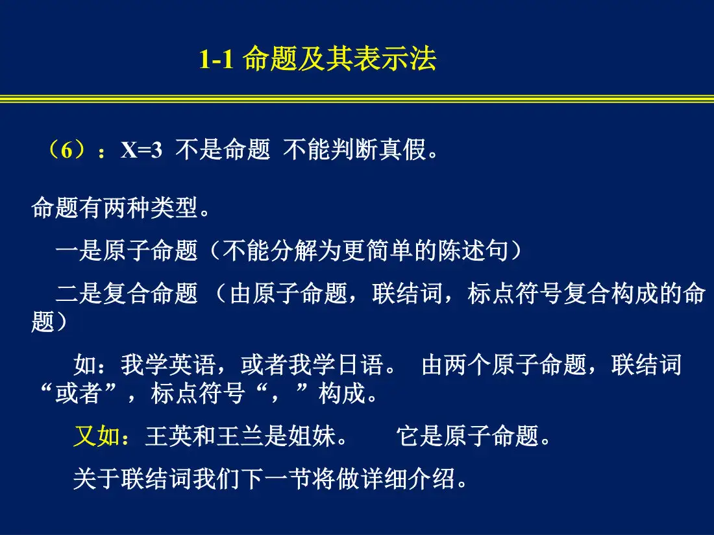

原文：

1-1 命题及其表示法

(6) : X=3 不是命题 不能判断真假。

命题有两种类型。

一是原子命题（不能分解为更简单的陈述句）

二是复合命题（由原子命题，联结词，标点符号复合构成的命题）

如：我学英语，或者我学日语。由两个原子命题，联结词“或者”，标点符号“，”构成。

又如：王英和王兰是姐妹。它是原子命题。

关于联结词我们下一节将做详细介绍。

### 1-1 命题及其表示法

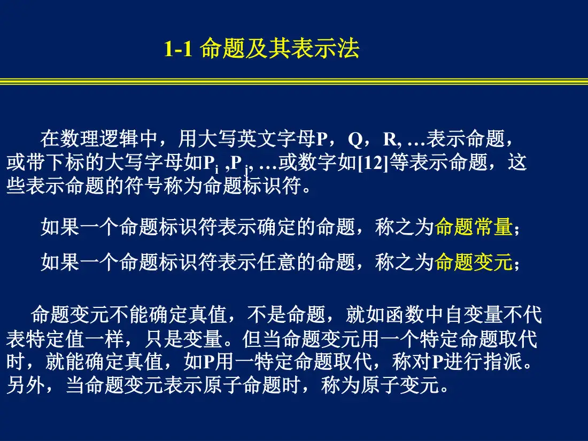

原文：

1-1 命题及其表示法

在数理逻辑中，用大写英文字母P，Q，R，…表示命题，或带下标的大写字母如 $P_{i}, P_{j}, \ldots$ 或数字如[12]等表示命题，这些表示命题的符号称为命题标识符。

如果一个命题标识符表示确定的命题，称之为命题常量；

如果一个命题标识符表示任意的命题，称之为命题变元；

命题变元不能确定真值，不是命题，就如函数中自变量不代表特定值一样，只是变量。但当命题变元用一个特定命题取代时，就能确定真值，如P用一特定命题取代，称对P进行指派。另外，当命题变元表示原子命题时，称为原子变元。

### 1-2 联结词

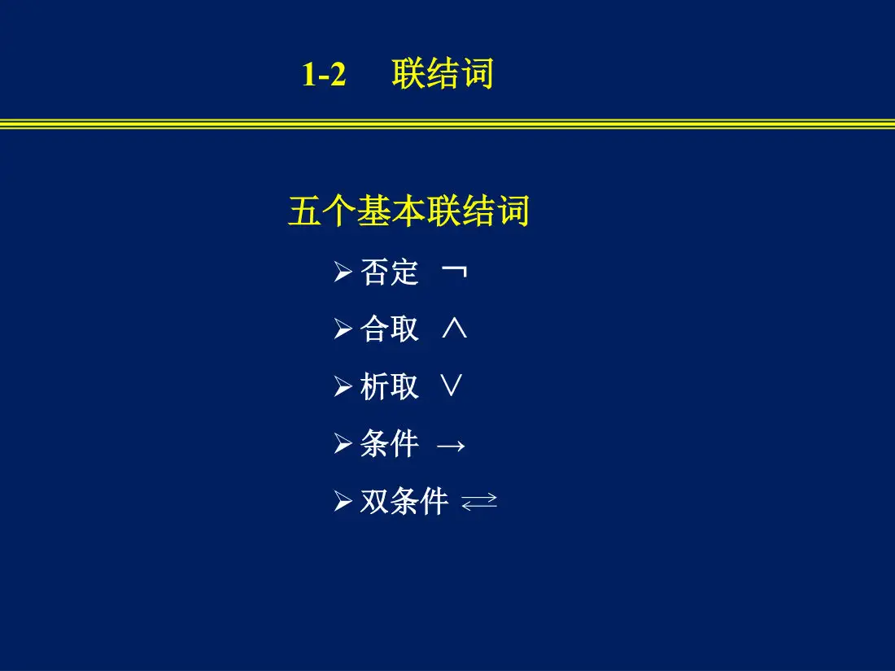

原文：

1-2 联结词

五个基本联结词

否定

合取 ^

析取 V

条件 →

双条件

### 1-2 联结词

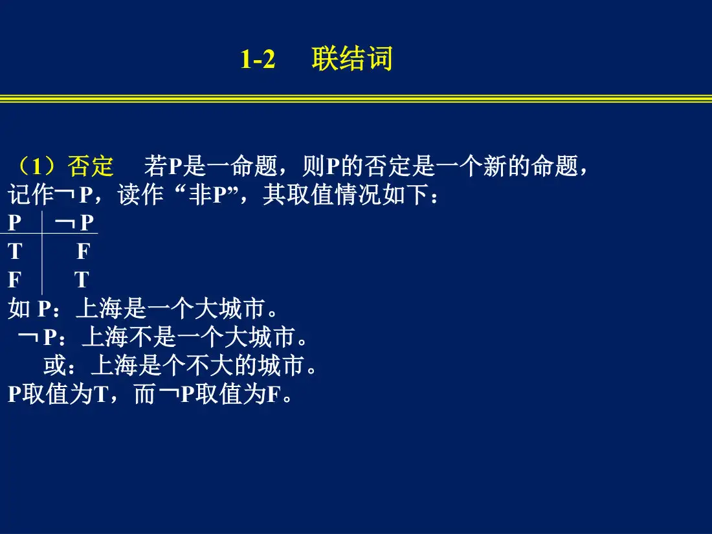

原文：

1-2 联结词

(1) 否定 若P是一命题, 则P的否定是一个新的命题,记作 $\neg P$ , 读作 “非P”, 其取值情况如下:

P | $\neg P$

T F

F T

如 P: 上海是一个大城市。

$\neg P$ : 上海不是一个大城市。

或：上海是个不大的城市。

P取值为T，而 $\neg P$ 取值为F。

### 1-2 联结词

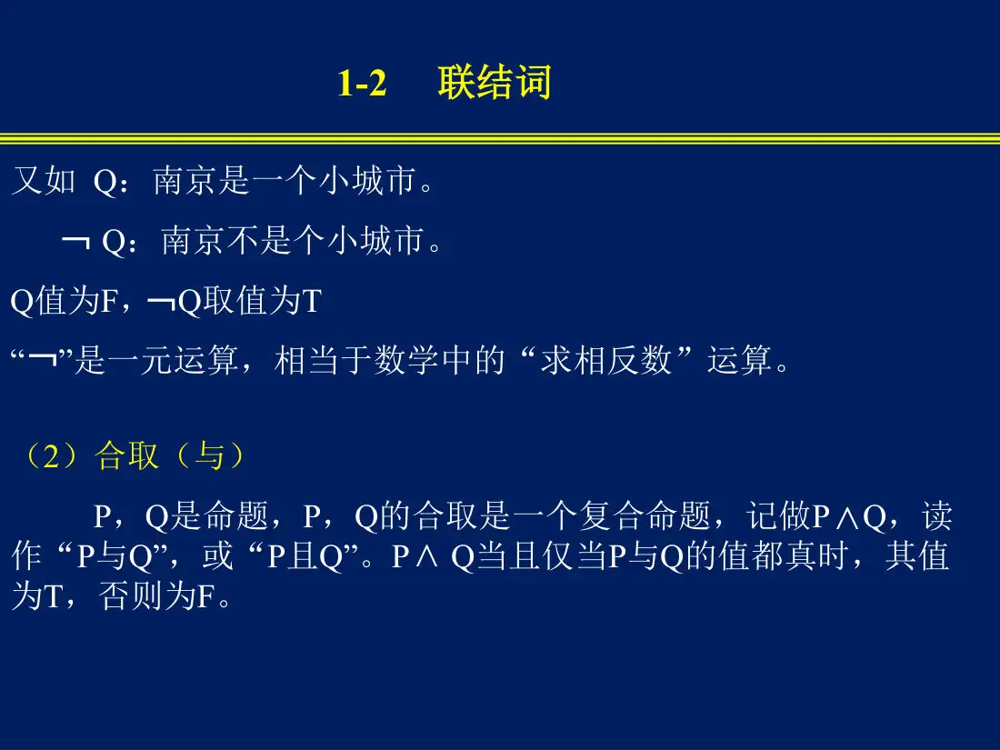

原文：

1-2 联结词

又如 Q: 南京是一个小城市。

¬ Q: 南京不是个小城市。

Q值为F，¬Q取值为T

“一”是一元运算，相当于数学中的“求相反数”运算。

(2) 合取（与）

P，Q是命题，P，Q的合取是一个复合命题，记做P∧Q，读作“P与Q”，或“P且Q”。P∧Q当且仅当P与Q的值都真时，其值为T，否则为F。

### 1-2 联结词

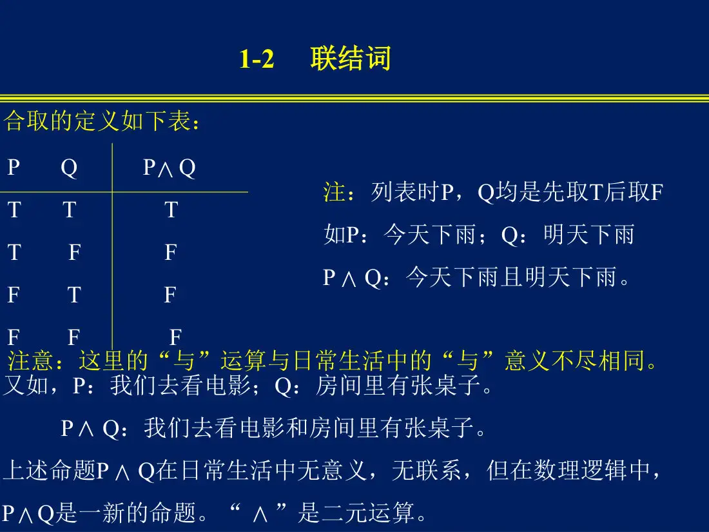

原文：

1-2 联结词

合取的定义如下表:

注: 列表时P, Q均是先取T后取F如P: 今天下雨; Q: 明天下雨 $\mathrm{P} \wedge \mathrm{Q}$ : 今天下雨且明天下雨。

注意：这里的“与”运算与日常生活中的“与”意义不尽相同。又如，P：我们去看电影；Q：房间里有张桌子。

P ∧ Q: 我们去看电影和房间里有张桌子。

上述命题P ∧ Q在日常生活中无意义，无联系，但在数理逻辑中，P ∧ Q是一新的命题。“∧”是二元运算。

### 1-2 联结词

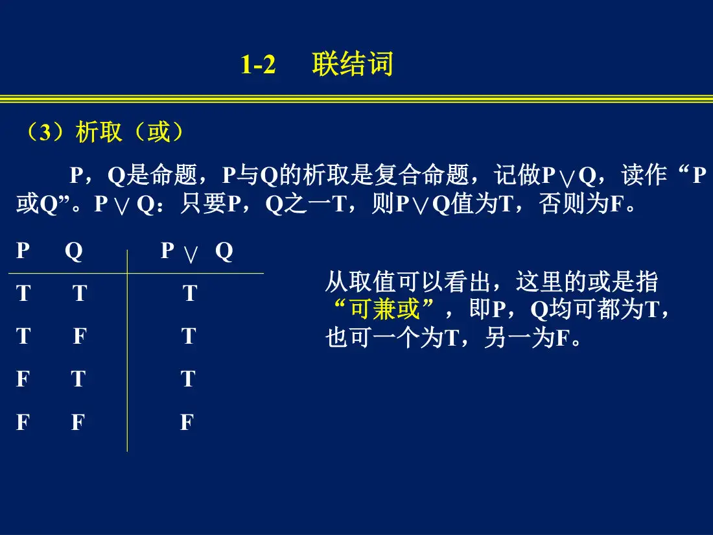

原文：

1-2 联结词

(3) 析取（或）

P，Q是命题，P与Q的析取是复合命题，记做P∨Q，读作“P或Q”。P∨Q：只要P，Q之一T，则P∨Q值为T，否则为F。

<table><tr><td>P</td><td>Q</td><td>P ∨ Q</td></tr><tr><td>T</td><td>T</td><td>T</td></tr><tr><td>T</td><td>F</td><td>T</td></tr><tr><td>F</td><td>T</td><td>T</td></tr><tr><td>F</td><td>F</td><td>F</td></tr></table>

从取值可以看出，这里的或是指“可兼或”，即P，Q均可都为T，也可一个为T，另一为F。

### 1-2 联结词

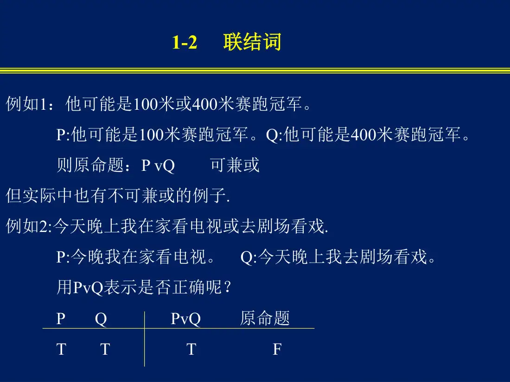

原文：

1-2 联结词

例如1：他可能是100米或400米赛跑冠军。

P:他可能是100米赛跑冠军。Q:他可能是400米赛跑冠军。

则原命题: $\mathrm{PvQ}$ 可兼或

但实际中也有不可兼或的例子.

例如2:今天晚上我在家看电视或去剧场看戏.

P:今晚我在家看电视。 Q:今天晚上我去剧场看戏。

用PvQ表示是否正确呢？

原命题

### 1-2 联结词

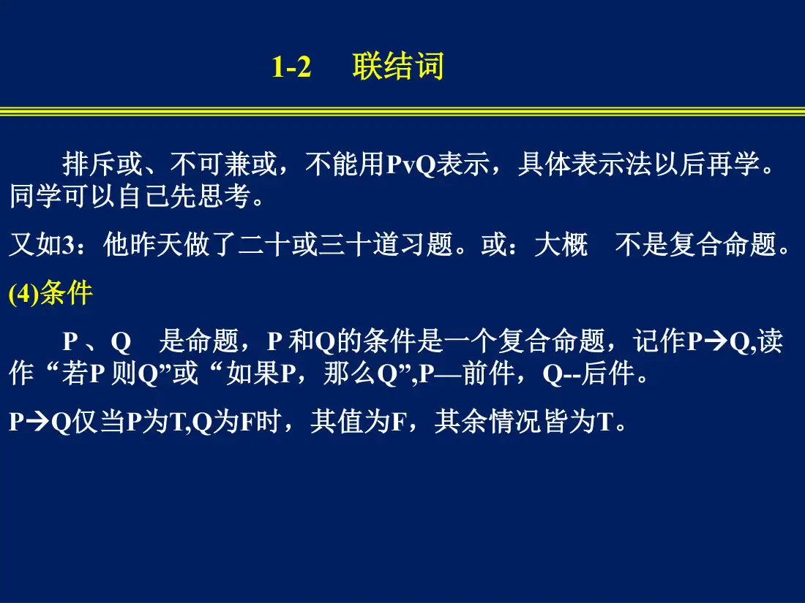

原文：

1-2 联结词

排斥或、不可兼或，不能用PvQ表示，具体表示法以后再学。同学可以自己先思考。

又如3：他昨天做了二十或三十道习题。或：大概不是复合命题。

(4)条件

P、Q 是命题，P 和 Q 的条件是一个复合命题，记作 P→Q, 读作 “若 P 则 Q” 或 “如果 P，那么 Q”, P—前件，Q--后件。

P→Q仅当P为T,Q为F时，其值为F，其余情况皆为T。

### PQP→QTTTTFFFTTFFT

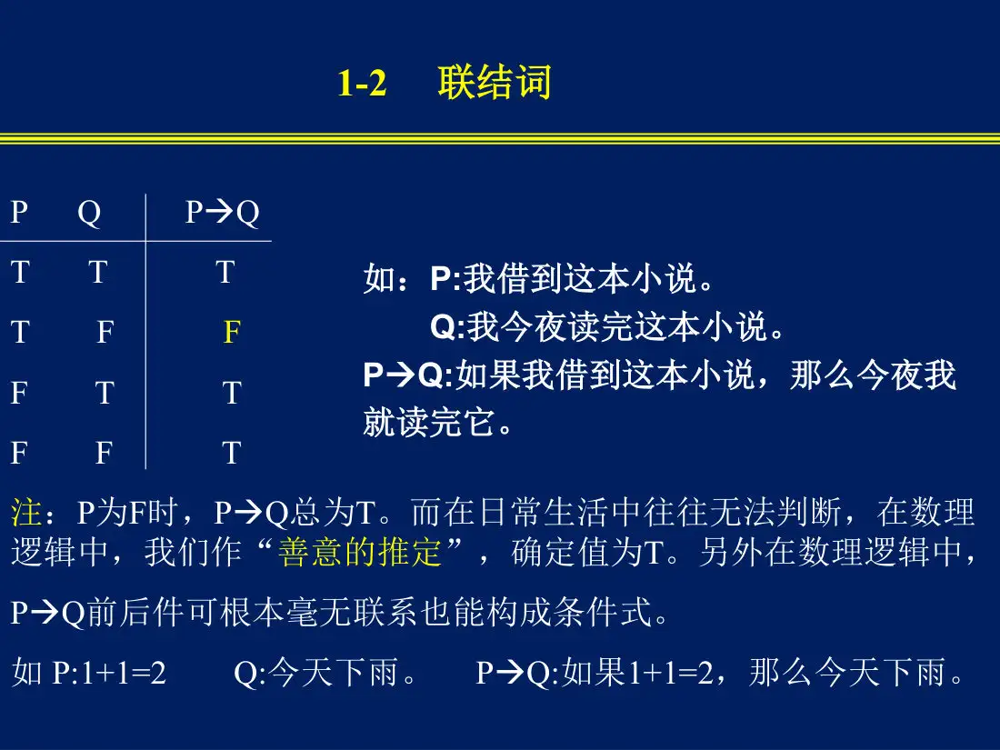

原文：

<table><tr><td>P</td><td>Q</td><td>P→Q</td></tr><tr><td>T</td><td>T</td><td>T</td></tr><tr><td>T</td><td>F</td><td>F</td></tr><tr><td>F</td><td>T</td><td>T</td></tr><tr><td>F</td><td>F</td><td>T</td></tr></table>

1-2 联结词

如：P:我借到这本小说。
Q:我今夜读完这本小说。
P→Q:如果我借到这本小说，那么今夜我就读完它。

注：P为F时，P→Q总为T。而在日常生活中往往无法判断，在数理逻辑中，我们作“善意的推定”，确定值为T。另外在数理逻辑中，P→Q前后件可根本毫无联系也能构成条件式。
如 P:1+1=2 Q:今天下雨。 P→Q:如果1+1=2，那么今天下雨。

### 1-2 联结词

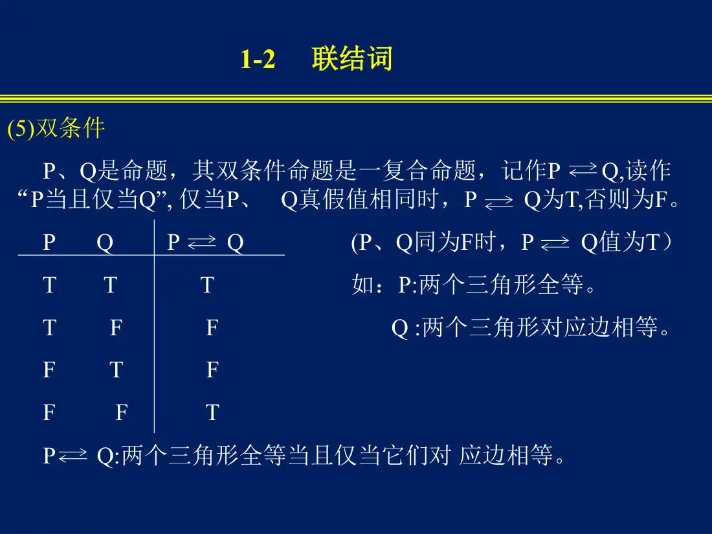

原文：

1-2 联结词

(5)双条件

P、Q是命题，其双条件命题是一复合命题，记作P ⇌ Q,读作“P当且仅当Q”,仅当P、Q真假值相同时，P ⇌ Q为T,否则为F。

$$
\mathrm{P} \rightleftharpoons \mathrm{Q}
$$

(P、Q同为F时，P ⇌ Q值为T)

如：P:两个三角形全等。

Q:两个三角形对应边相等。

P⇌ Q:两个三角形全等当且仅当它们对应边相等。

### 1-2 联结词

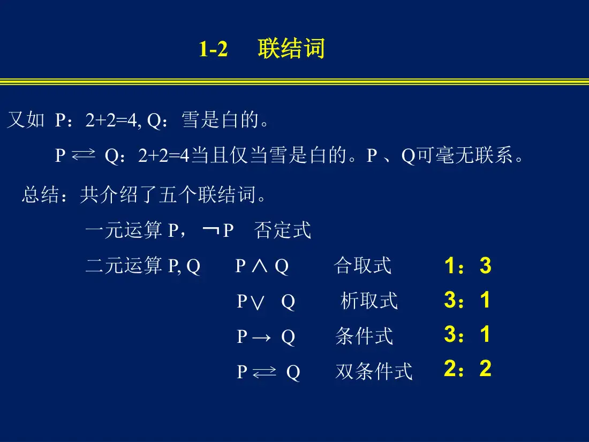

原文：

1-2 联结词

又如 P: 2+2=4, Q: 雪是白的。

P ⇌ Q: 2+2=4当且仅当雪是白的。P、Q可毫无联系。

总结：共介绍了五个联结词。

一元运算 P，¬P 否定式

二元运算 P, Q    P ∧ Q    合取式 1:3

PV Q 析取式 3:1

$\mathrm{P} \rightarrow \mathrm{Q}$ 条件式 3:1

P ⇌ Q 双条件式 2:2

### 1-3 命题公式与翻译

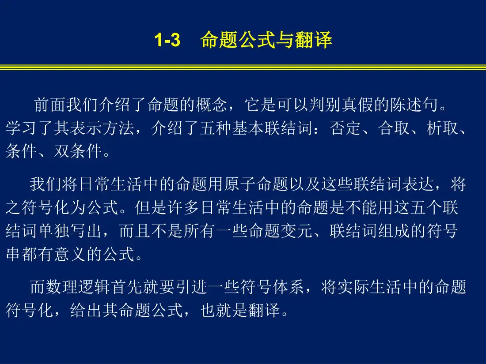

原文：

1-3 命题公式与翻译

前面我们介绍了命题的概念，它是可以判别真假的陈述句。学习了其表示方法，介绍了五种基本联结词：否定、合取、析取、条件、双条件。

我们将日常生活中的命题用原子命题以及这些联结词表达，将之符号化为公式。但是许多日常生活中的命题是不能用这五个联结词单独写出，而且不是所有一些命题变元、联结词组成的符号串都有意义的公式。

而数理逻辑首先就要引进一些符号体系，将实际生活中的命题符号化，给出其命题公式，也就是翻译。

### 1-3 命题公式与翻译

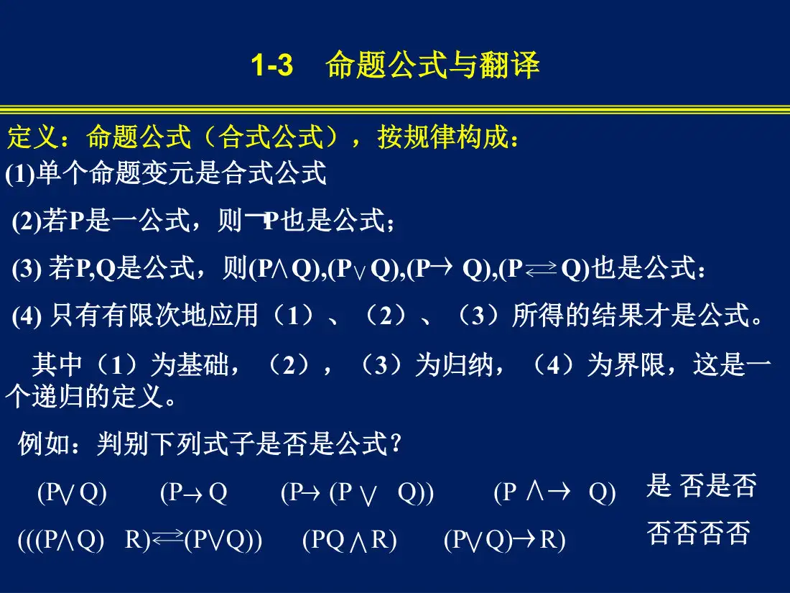

原文：

1-3 命题公式与翻译

定义：命题公式（合式公式），按规律构成：

(1)单个命题变元是合式公式

(2)若P是一公式，则¬P也是公式;

(3) 若P,Q是公式，则(P∧Q),(P∨Q),(P→Q),(P⇌Q)也是公式:

(4) 只有有限次地应用（1）、（2）、（3）所得的结果才是公式。

其中（1）为基础，（2），（3）为归纳，（4）为界限，这是一个递归的定义。

例如：判别下列式子是否是公式？

(PVQ)

(P→Q

$(P \to (P \lor Q))$

(P ∧ → Q)

是否是否

(((P∧Q)

R) $\Longleftrightarrow$ (PVQ))

(PQ ∧ R)

$(\mathrm{PV}\lor \mathrm{Q})\rightarrow \mathrm{R})$

否否否否

### 1-3 命题公式与翻译

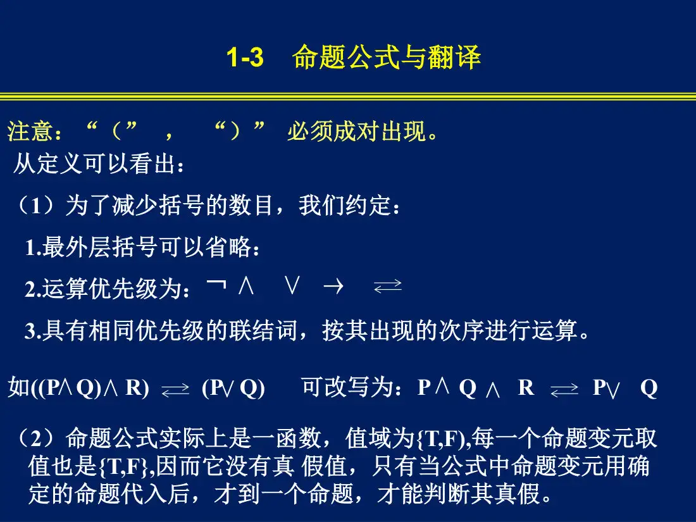

原文：

1-3 命题公式与翻译

注意：“（”，“）”必须成对出现。

从定义可以看出:

(1) 为了减少括号的数目, 我们约定:

1. 最外层括号可以省略:

2.运算优先级为： $\neg \land \lor \rightarrow \rightleftharpoons$

3.具有相同优先级的联结词，按其出现的次序进行运算。

如 $((P\land Q)\land R)\iff(P\lor Q)$ 可改写为： $P\land Q\land R\iff P\lor Q$

(2) 命题公式实际上是一函数，值域为{T,F),每一个命题变元取值也是{T,F},因而它没有真假值，只有当公式中命题变元用确定的命题代入后，才到一个命题，才能判断其真假。

### 1-3 命题公式与翻译

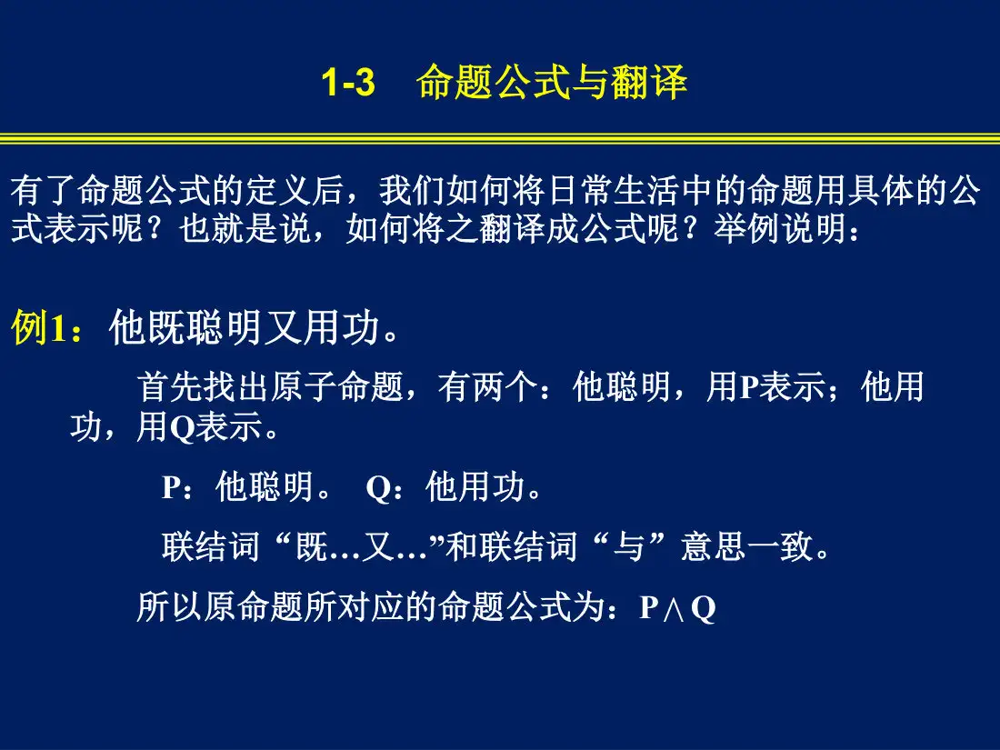

原文：

1-3 命题公式与翻译

有了命题公式的定义后，我们如何将日常生活中的命题用具体的公式表示呢？也就是说，如何将之翻译成公式呢？举例说明：

例1：他既聪明又用功。

首先找出原子命题，有两个：他聪明，用P表示；他用功，用Q表示。

P: 他聪明。Q: 他用功。

联结词“既...又...”和联结词“与”意思一致。

所以原命题所对应的命题公式为：P∧Q

### 1-3 命题公式与翻译

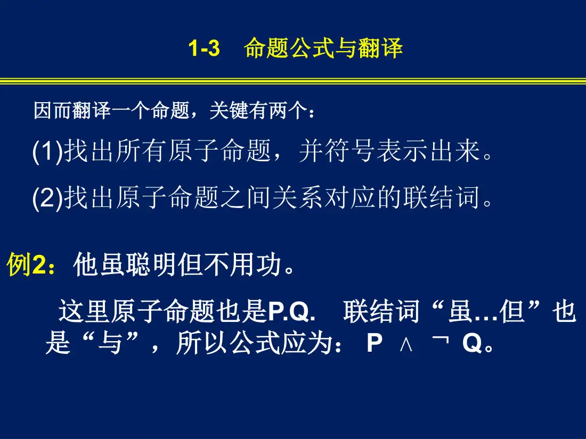

原文：

1-3 命题公式与翻译

因而翻译一个命题，关键有两个：

(1)找出所有原子命题，并符号表示出来。

(2)找出原子命题之间关系对应的联结词。

例2: 他虽聪明但不用功。

这里原子命题也是P.Q. 联结词“虽…但”也是“与”，所以公式应为：P ∧ ¬ Q。

### 1-3 命题公式与翻译

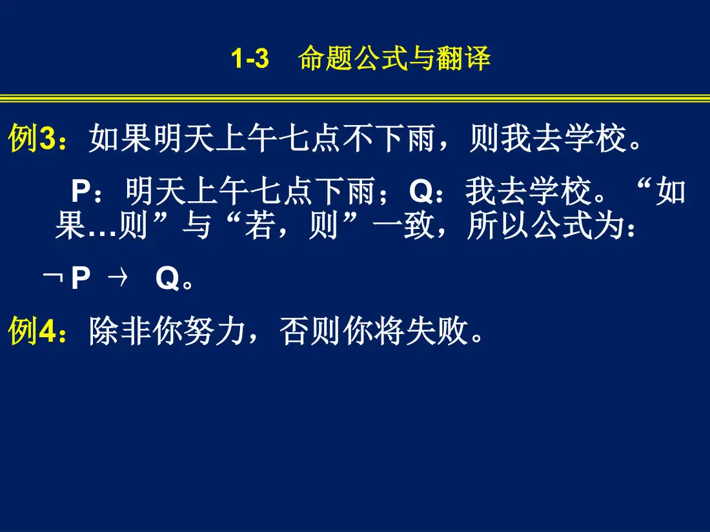

原文：

1-3 命题公式与翻译

例3: 如果明天上午七点不下雨，则我去学校。

P: 明天上午七点下雨; Q: 我去学校。“如果…则”与“若, 则”一致, 所以公式为: $\neg P \rightarrow Q$ 。

例4：除非你努力，否则你将失败。

### 1-3 命题公式与翻译

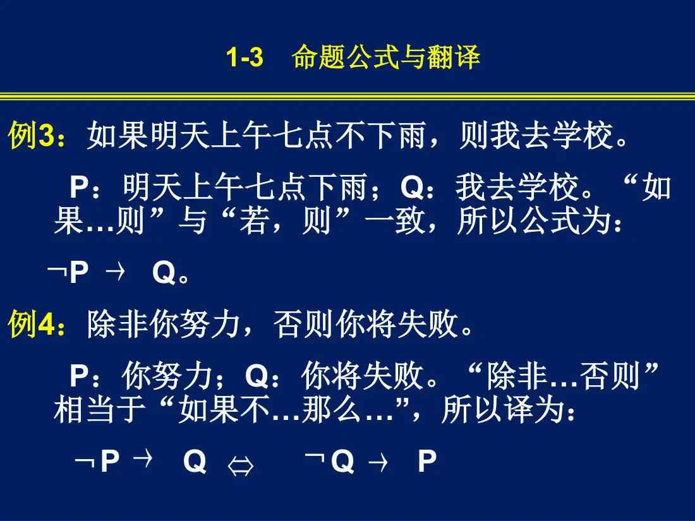

原文：

1-3 命题公式与翻译

例3: 如果明天上午七点不下雨，则我去学校。

P: 明天上午七点下雨; Q: 我去学校。“如果…则”与“若, 则”一致, 所以公式为: $\neg P \rightarrow Q$ 。

例4：除非你努力，否则你将失败。

P: 你努力; Q: 你将失败。“除非...否则”相当于“如果不...那么...”，所以译为:

$\neg P \rightarrow Q \Leftrightarrow \neg Q \rightarrow P$

### 1-3 命题公式与翻译

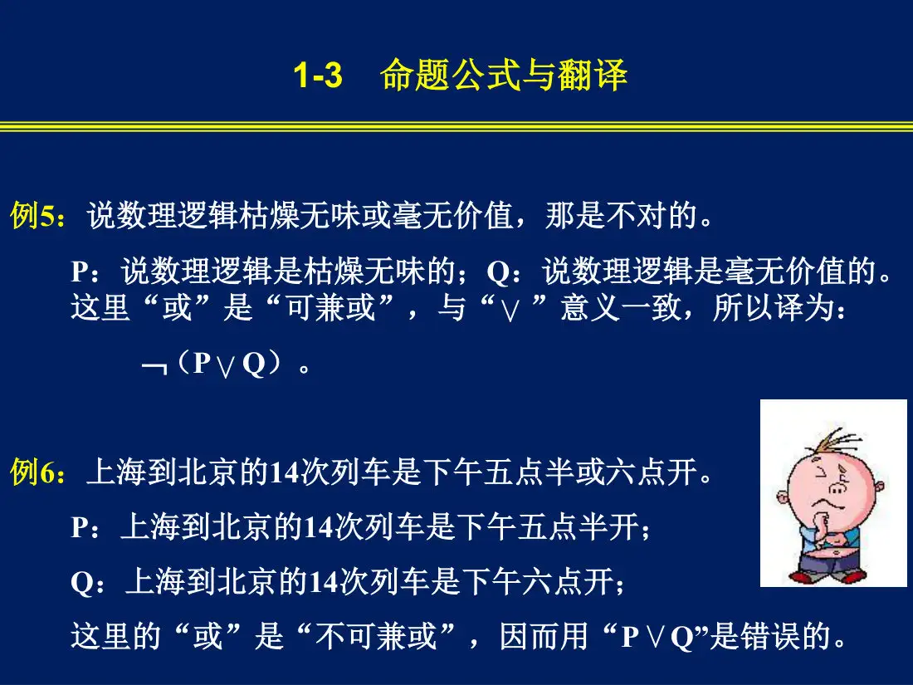

原文：

1-3 命题公式与翻译

例5: 说数理逻辑枯燥无味或毫无价值，那是不对的。

P: 说数理逻辑是枯燥无味的; Q: 说数理逻辑是毫无价值的。这里 “或” 是 “可兼或”, 与 “∨” 意义一致, 所以译为:

$$
\neg (\mathrm{P} \vee \mathrm{Q})
$$

例6: 上海到北京的14次列车是下午五点半或六点开。

P: 上海到北京的14次列车是下午五点半开;

Q: 上海到北京的14次列车是下午六点开;

这里的“或”是“不可兼或”，因而用“P∨Q”是错误的。

### 1-3 命题公式与翻译

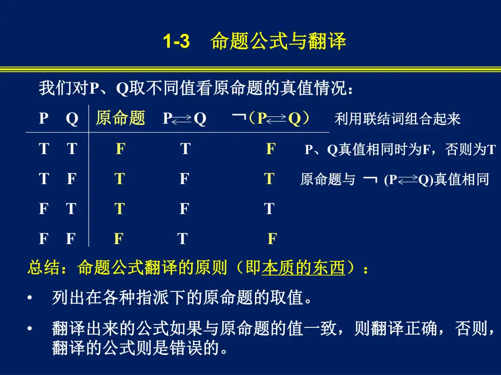

原文：

1-3 命题公式与翻译

我们对P、Q取不同值看原命题的真值情况:

总结：命题公式翻译的原则（即本质的东西）：

\- 列出在各种指派下的原命题的取值。

\- 翻译出来的公式如果与原命题的值一致，则翻译正确，否则，翻译的公式则是错误的。

### 1-3 命题公式与翻译

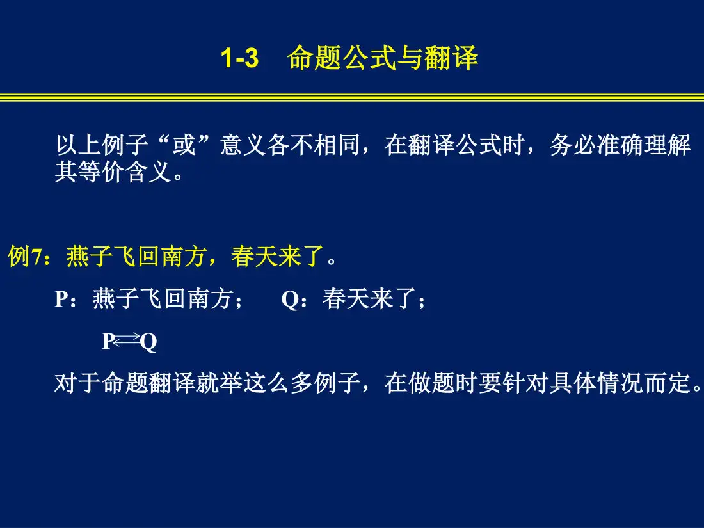

原文：

1-3 命题公式与翻译

以上例子“或”意义各不相同，在翻译公式时，务必准确理解其等价含义。

例7：燕子飞回南方，春天来了。

P: 燕子飞回南方; Q: 春天来了;

P↔Q

对于命题翻译就举这么多例子，在做题时要针对具体情况而定。

### 1-4 真值表与等价公式

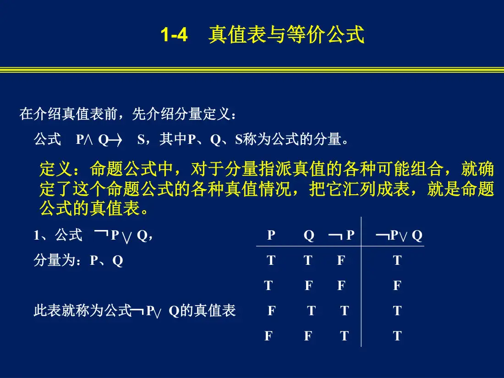

原文：

1-4 真值表与等价公式

在介绍真值表前，先介绍分量定义：

公式 $\mathrm{P} \wedge \mathrm{Q} \rightarrow \mathrm{S}$ , 其中 $\mathrm{P} 、 \mathrm{Q} 、 \mathrm{S}$ 称为公式的分量。

定义：命题公式中，对于分量指派真值的各种可能组合，就确定了这个命题公式的各种真值情况，把它汇列成表，就是命题公式的真值表。

1、公式 $\neg P \vee Q$ ,

分量为: P、Q

此表就称为公式 $\neg P \vee Q$ 的真值表

$$
\begin{array}{c c c c} \text {P} & \text {Q} & \neg \text {P} & \neg \text {P} \lor \text {Q} \\ \hline \text {T} & \text {T} & \text {F} & \text {T} \\ \text {T} & \text {F} & \text {F} & \text {F} \\ \text {F} & \text {T} & \text {T} & \text {T} \\ \text {F} & \text {F} & \text {T} & \text {T} \end{array}
$$

### 1-4 真值表与等价公式

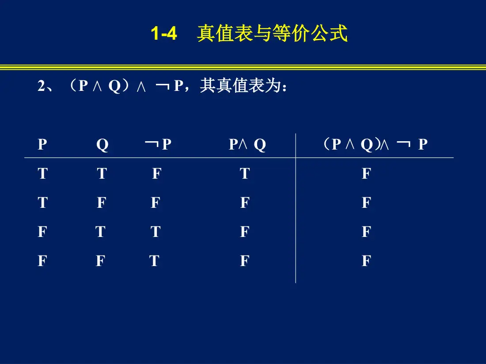

原文：

1-4 真值表与等价公式

2、 $(P \land Q) \land \neg P$ ，其真值表为：

<table><tr><td>P</td><td>Q</td><td> $\neg P$ </td><td>P ∧ Q</td><td>(P ∧ Q) ∧  $\neg P$ </td></tr><tr><td>T</td><td>T</td><td>F</td><td>T</td><td>F</td></tr><tr><td>T</td><td>F</td><td>F</td><td>F</td><td>F</td></tr><tr><td>F</td><td>T</td><td>T</td><td>F</td><td>F</td></tr><tr><td>F</td><td>F</td><td>T</td><td>F</td><td>F</td></tr></table>

### 1-4 真值表与等价公式

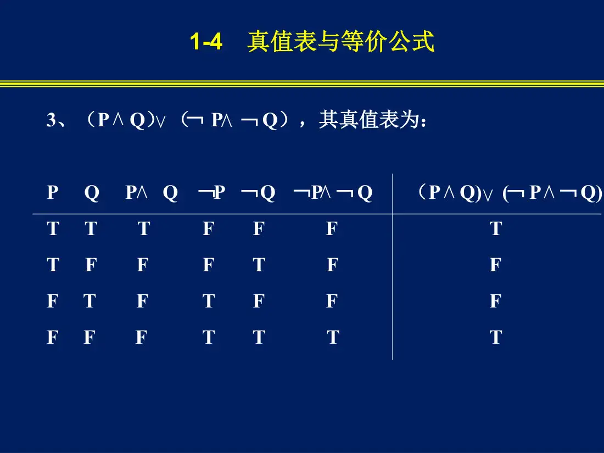

原文：

1-4 真值表与等价公式

3、 $(P \land Q) \lor (\neg P \land \neg Q)$ ，其真值表为：

<table><tr><td>P</td><td>Q</td><td>P∧</td><td>Q</td><td>¬P</td><td>¬Q</td><td>¬P∧¬Q</td><td>(P ∧ Q)∨ (¬P ∧ ¬Q)</td></tr><tr><td>T</td><td>T</td><td>T</td><td>F</td><td>F</td><td>F</td><td>F</td><td>T</td></tr><tr><td>T</td><td>F</td><td>F</td><td>F</td><td>T</td><td>F</td><td>F</td><td>F</td></tr><tr><td>F</td><td>T</td><td>F</td><td>T</td><td>F</td><td>F</td><td>F</td><td>F</td></tr><tr><td>F</td><td>F</td><td>F</td><td>T</td><td>T</td><td>T</td><td>T</td><td>T</td></tr></table>

### 1-4 真值表与等价公式

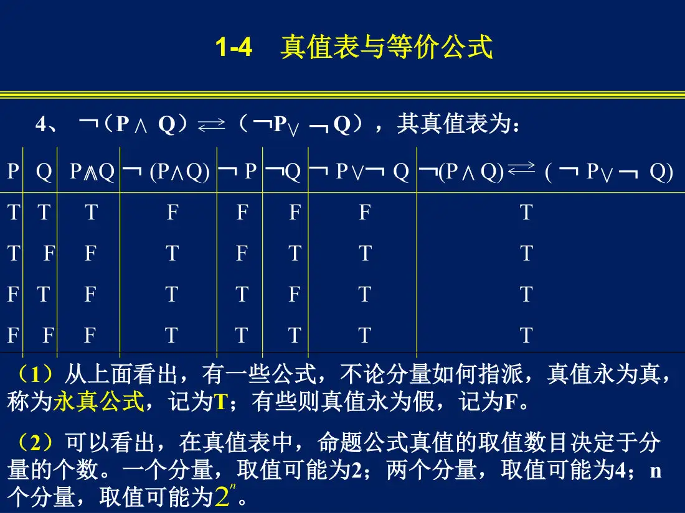

原文：

1-4 真值表与等价公式

4、 $\neg(P \land Q) \rightleftharpoons (\neg P_{V} \neg Q)$ ，其真值表为：

$$
\begin{array}{c c c c c c c c}\text {P}&\text {Q}&\text {P} \wedge \text {Q}&\neg (\text {P} \wedge \text {Q})&\neg \text {P}&\neg \text {Q}&\neg \text {P} \lor \neg \text {Q}&\neg (\text {P} \wedge \text {Q}) \rightleftharpoons (\neg \text {P} \lor \neg \text {Q})\\\hline \text {T}&\text {T}&\text {T}&\text {F}&\text {F}&\text {F}&\text {F}&\text {T}\\\text {T}&\text {F}&\text {F}&\text {T}&\text {F}&\text {T}&\text {T}&\text {T}\\\text {F}&\text {T}&\text {F}&\text {T}&\text {T}&\text {F}&\text {T}&\text {T}\\\text {F}&\text {F}&\text {F}&\text {T}&\text {T}&\text {T}&\text {T}&\text {T}\end{array}
$$

(1) 从上面看出, 有一些公式, 不论分量如何指派, 真值永为真, 称为永真公式, 记为 $\mathrm{T}$ ; 有些则真值永为假, 记为 $\mathrm{F}$ 。

(2) 可以看出, 在真值表中, 命题公式真值的取值数目决定于分量的个数。一个分量, 取值可能为 2; 两个分量, 取值可能为 4; n 个分量, 取值可能为 $2^{n}$ 。

### 1-4 真值表与等价公式

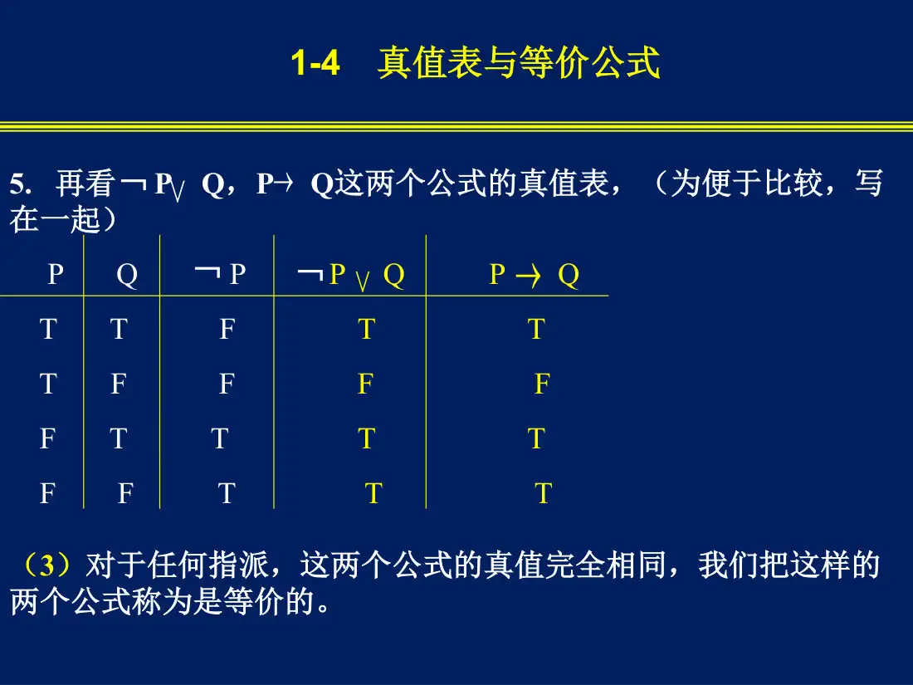

原文：

1-4 真值表与等价公式

5. 再看 $\neg \mathrm{P} \vee \mathrm{Q}, \mathrm{P} \rightarrow \mathrm{Q}$ 这两个公式的真值表，（为便于比较，写在一起）

$$
\begin{array}{c c c c c} \text {P} & \text {Q} & \neg \text {P} & \neg \text {P} \lor \text {Q} & \text {P} \to \text {Q} \\ \hline \text {T} & \text {T} & \text {F} & \text {T} & \text {T} \\ \text {T} & \text {F} & \text {F} & \text {F} & \text {F} \\ \text {F} & \text {T} & \text {T} & \text {T} & \text {T} \\ \text {F} & \text {F} & \text {T} & \text {T} & \text {T} \end{array}
$$

(3) 对于任何指派, 这两个公式的真值完全相同, 我们把这样的两个公式称为是等价的。

### 1-4 真值表与等价公式

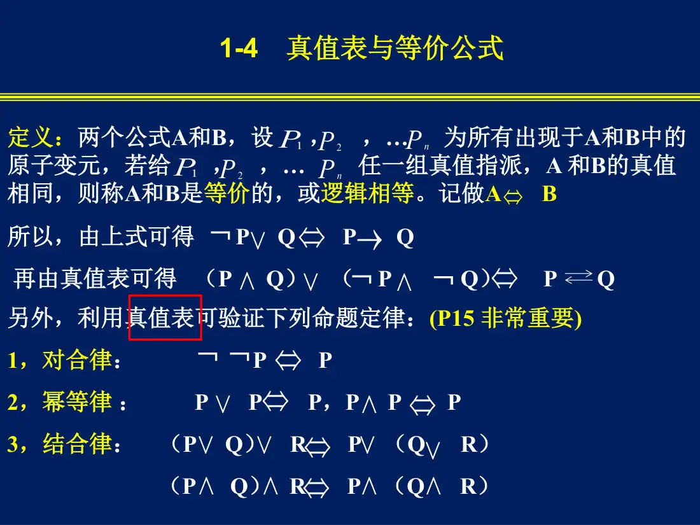

原文：

1-4 真值表与等价公式

定义: 两个公式A和B, 设 $P_{1}, P_{2}$ , $\ldots P_{n}$ 为所有出现于A和B中的原子变元, 若给 $P_{1}, P_{2}$ , $\ldots P_{n}$ 任一组真值指派, A 和 B 的真值相同, 则称A和B是等价的, 或逻辑相等。记做A $\Leftrightarrow$ B
所以, 由上式可得 $\neg P \lor Q \Leftrightarrow P \rightarrow Q$ 再由真值表可得 (P ∧ Q) ∨ ( $\neg$ P ∧ $\neg$ Q) ⇔ P ⇌ Q
另外, 利用真值表可验证下列命题定律: (P15 非常重要)
1, 对合律: $\neg \neg P \Leftrightarrow P$ 2, 幂等律: P ∨ P ⇔ P, P ∧ P ⇔ P
3, 结合律: (P ∨ Q) ∨ R ⇔ P ∨ (Q ∨ R)\nP ∧ Q) ∧ R ⇔ P ∧ (Q ∧ R)

### 1-4 真值表与等价公式

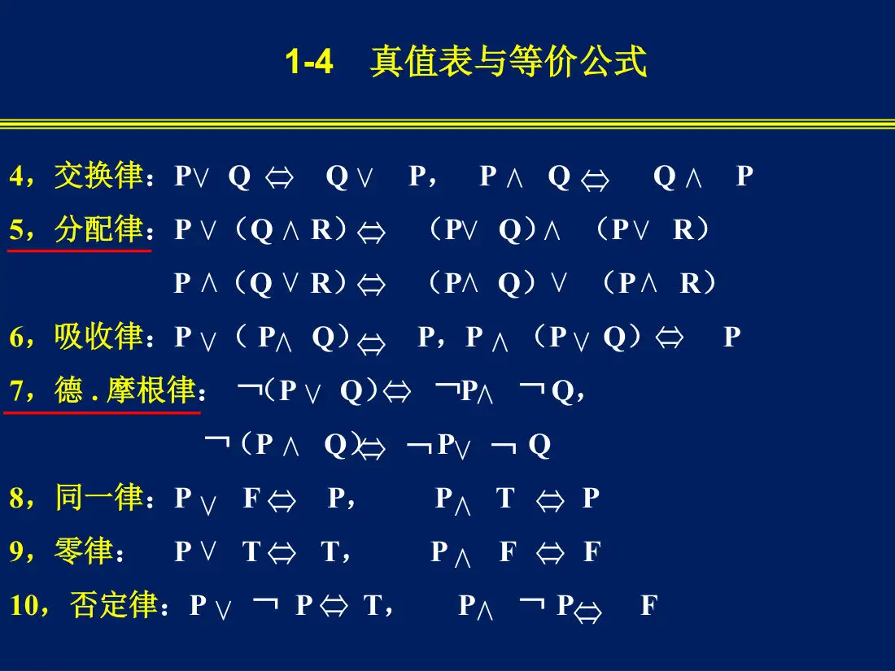

原文：

1-4 真值表与等价公式

4, 交换律: P∨ Q ⇔ Q ∨ P, P ∧ Q ⇔ Q ∧ P
5, 分配律: P ∨ (Q ∧ R) ⇔ (P∨ Q) ∧ (P∨ R)
    P ∧ (Q ∨ R) ⇔ (P ∧ Q) ∨ (P ∧ R)
6, 吸收律: P ∨ (P ∧ Q) ⇔ P, P ∧ (P ∨ Q) ⇔ P
7, 德. 摩根律: ¬(P ∨ Q) ⇔ ¬P ∧ ¬Q,
    ¬(P ∧ Q) ⇔ ¬P ∨ ¬Q
8, 同一律: P ∨ F ⇔ P,    P ∧ T ⇔ P
9, 零律:    P ∨ T ⇔ T,    P ∧ F ⇔ F
10, 否定律: P ∨ ¬P ⇔ T,    P ∧ ¬P ⇔ F

### 1-4 真值表与等价公式

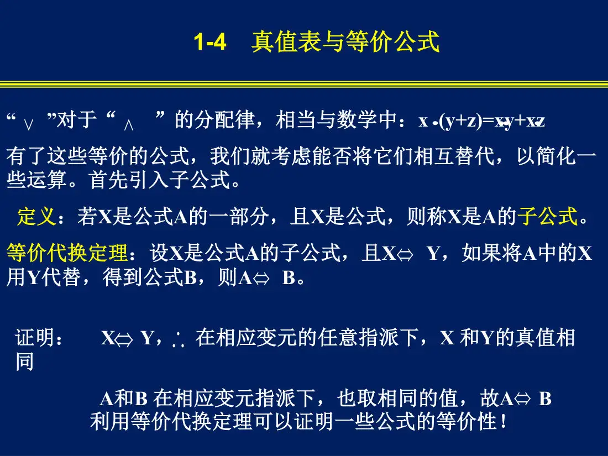

原文：

1-4 真值表与等价公式

“∨”对于“∧”的分配律，相当与数学中：x·(y+z)=xy+xz

有了这些等价的公式，我们就考虑能否将它们相互替代，以简化一些运算。首先引入子公式。

定义：若X是公式A的一部分，且X是公式，则称X是A的子公式。

等价代换定理：设X是公式A的子公式，且X⇔Y，如果将A中的X用Y代替，得到公式B，则A⇔B。

证明： $X \Leftrightarrow Y$ ，∴ 在相应变元的任意指派下，X 和 Y 的真值相同

A和B在相应变元指派下，也取相同的值，故 $\mathrm{A} \Leftrightarrow \mathrm{B}$ 利用等价代换定理可以证明一些公式的等价性！

### 1-4 真值表与等价公式

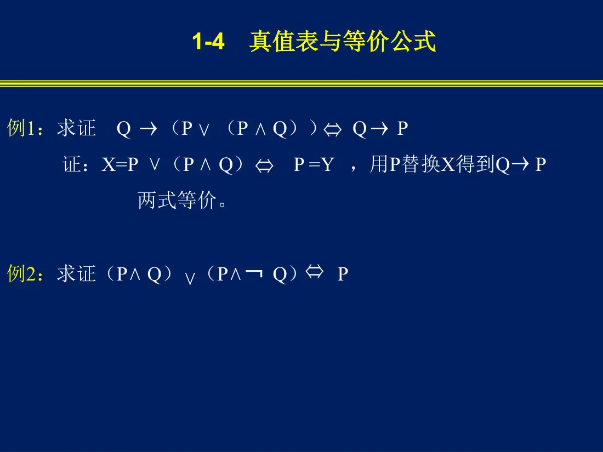

原文：

1-4 真值表与等价公式

例1: 求证 $Q \rightarrow (P \lor (P \land Q)) \Leftrightarrow Q \rightarrow P$

证：X=P ∨ (P ∧ Q) ⇔ P=Y ，用P替换X得到Q→P

两式等价。

例2: 求证 (P∧Q) ∨ (P∧¬Q) ⇔ P

### 1-4 真值表与等价公式

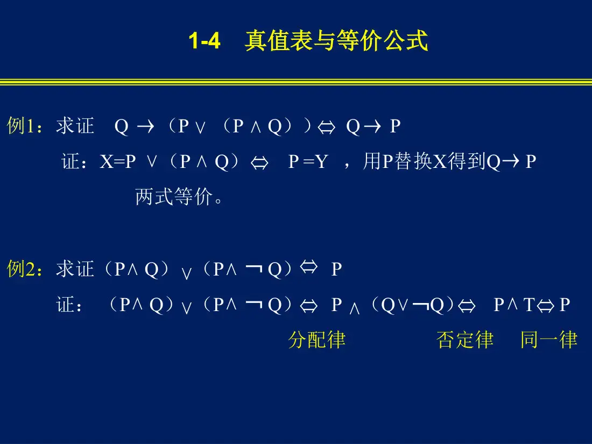

原文：

1-4 真值表与等价公式

例1: 求证 $Q \rightarrow (P \lor (P \land Q)) \Leftrightarrow Q \rightarrow P$

证：X=P ∨（P ∧ Q） ⇔ P=Y ，用P替换X得到Q→P

两式等价。

例2: 求证 (P∧Q) ∨ (P∧¬Q) ⇔ P

证： $(P \land Q) \lor (P \land \neg Q) \Leftrightarrow P \land (Q \lor \neg Q) \Leftrightarrow P \land T \Leftrightarrow P$

分配律 否定律 同一律

### 1-4 真值表与等价公式

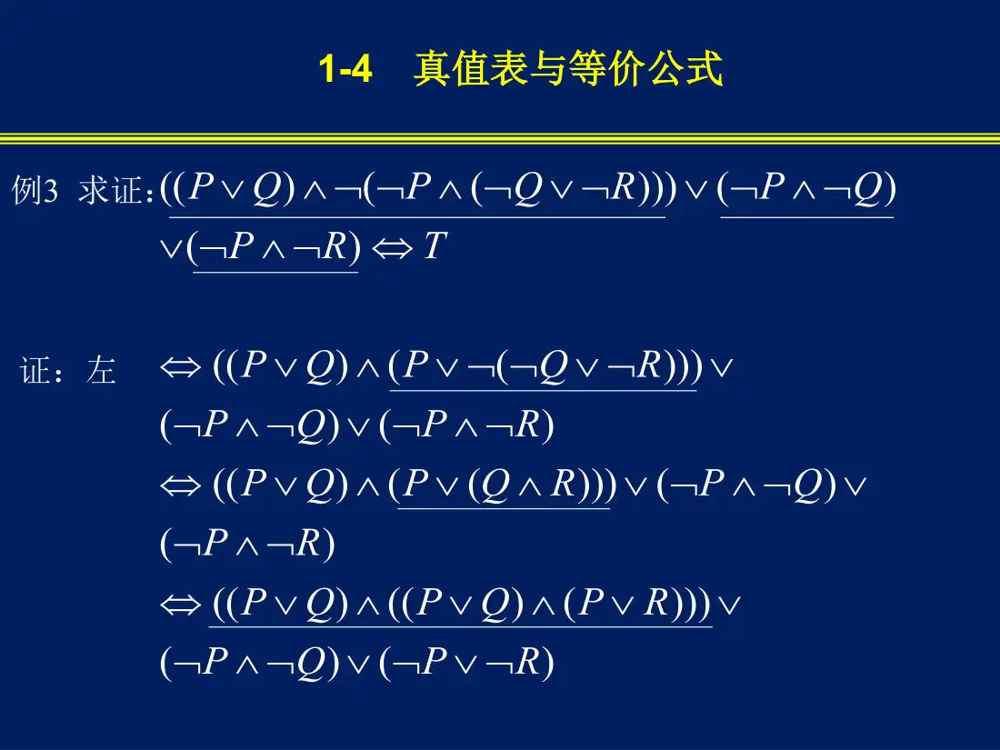

原文：

1-4 真值表与等价公式

例3 求证: $\frac{((P \lor Q) \land \neg(\neg P \land (\neg Q \lor \neg R))) \lor (\neg P \land \neg Q)}{\lor(\neg P \land \neg R) \Leftrightarrow T}$

证：左 $\Leftrightarrow ((P \lor Q) \land (P \lor \neg (\neg Q \lor \neg R))) \lor$ $(\neg P \land \neg Q) \lor (\neg P \land \neg R)$ $\Leftrightarrow ((P \lor Q) \land (P \lor (Q \land R))) \lor (\neg P \land \neg Q) \lor$ $(\neg P \land \neg R)$ $\Leftrightarrow ((P \lor Q) \land ((P \lor Q) \land (P \lor R))) \lor$ $(\neg P \land \neg Q) \lor (\neg P \lor \neg R)$

### 1-4 真值表与等价公式

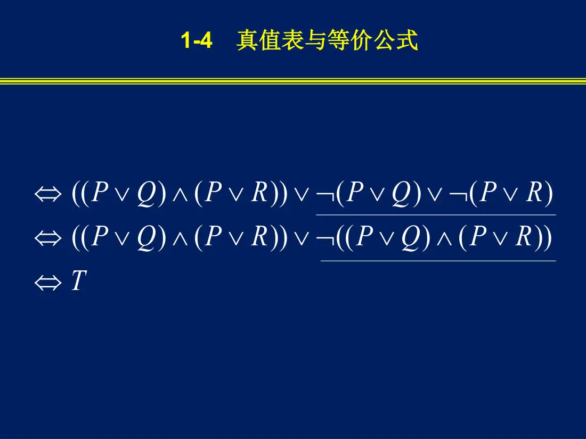

原文：

1-4 真值表与等价公式

$\Leftrightarrow ((P \lor Q) \land (P \lor R)) \lor \neg (P \lor Q) \lor \neg (P \lor R)$ $\Leftrightarrow ((P \lor Q) \land (P \lor R)) \lor \neg ((P \lor Q) \land (P \lor R))$ $\Leftrightarrow T$

### 复习

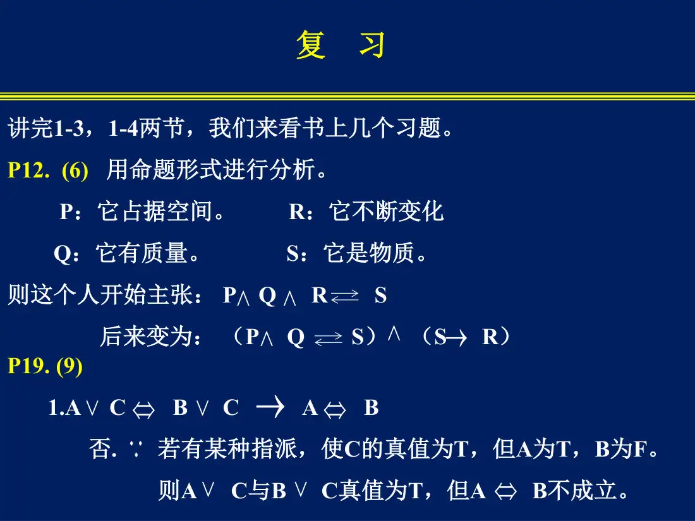

原文：

复习

讲完1- 3，1- 4两节，我们来看书上几个习题。

P12. (6) 用命题形式进行分析。

P: 它占据空间。 R: 它不断变化

Q: 它有质量。 S: 它是物质。

则这个人开始主张: $\mathrm{P} \wedge \mathrm{Q} \wedge \mathrm{R} \rightleftharpoons \mathrm{S}$

后来变为: $(\mathrm{P} \wedge \mathrm{Q} \rightleftharpoons \mathrm{S}) \wedge (\mathrm{S} \rightarrow \mathrm{R})$

P19. (9)

1.A ∨ C ⇔ B ∨ C → A ⇔ B

否. ∵ 若有某种指派，使C的真值为T，但A为T，B为F。

则A ∨ C与B ∨ C真值为T，但A ⇔ B不成立。

### 复习

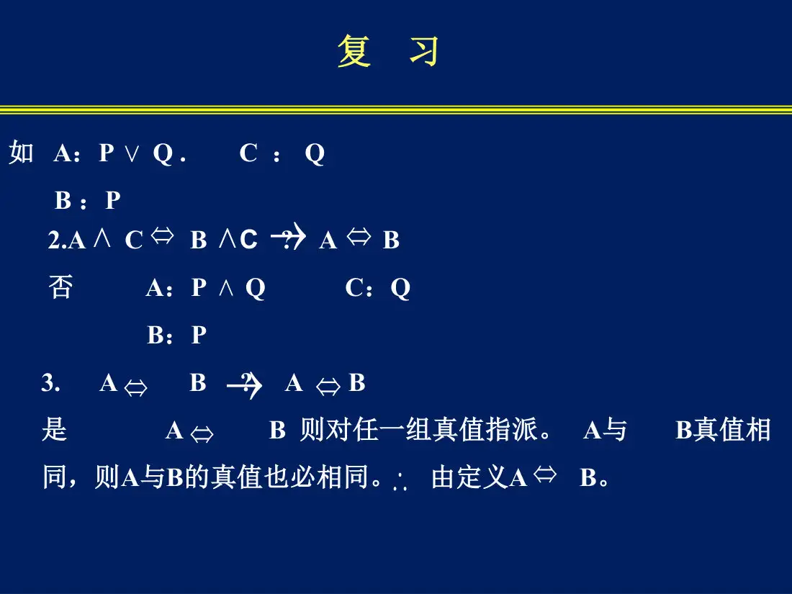

原文：

复习

如 A: P ∨ Q. C: Q
B: P
2.A ∧ C ⇔ B ∧ C →? A ⇔ B
否 A: P ∧ Q C: Q
B: P
3. A ⇔ B →? A ⇔ B
是 A ⇔ B 则对任一组真值指派。A与 B真值相同，则A与B的真值也必相同。∴ 由定义A ⇔ B。

### 1-5 重言式与蕴含式

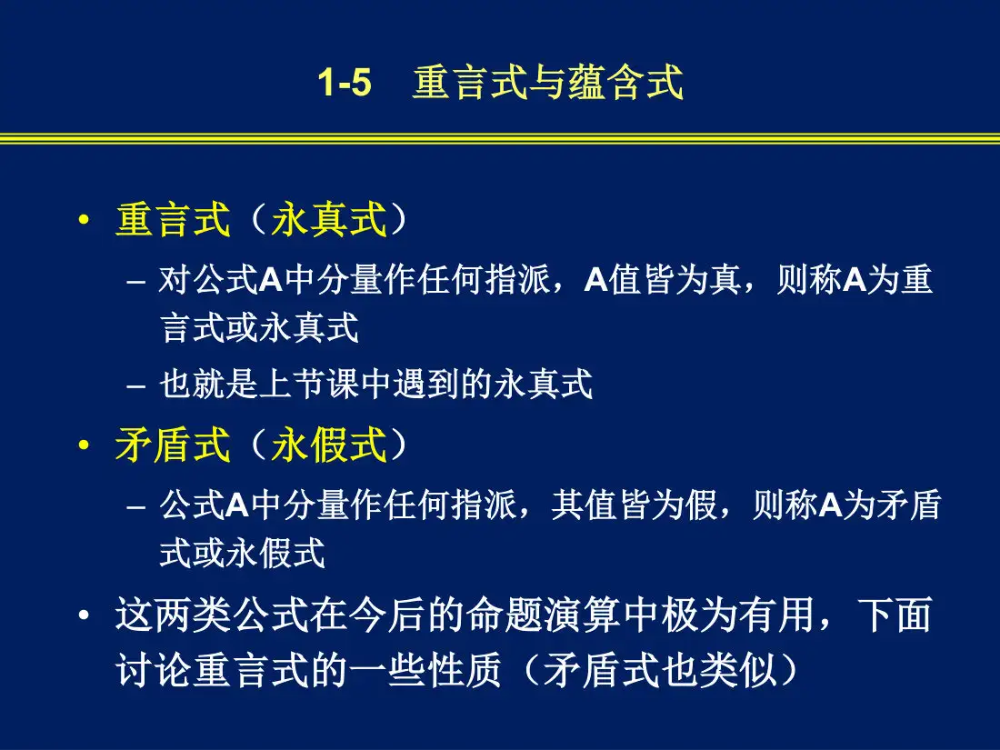

原文：

1-5 重言式与蕴含式

\- 重言式（永真式）

\- 对公式A中分量作任何指派，A值皆为真，则称A为重言式或永真式

\- 也就是上节课中遇到的永真式

\- 矛盾式（永假式）

\- 公式A中分量作任何指派，其值皆为假，则称A为矛盾式或永假式

\- 这两类公式在今后的命题演算中极为有用，下面讨论重言式的一些性质（矛盾式也类似）

### 1-5 重言式与蕴含式

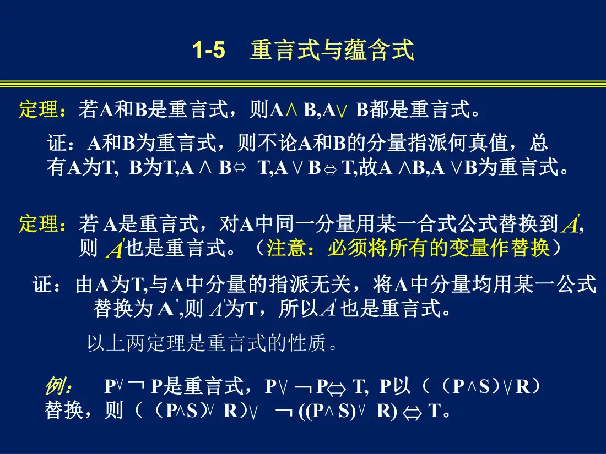

原文：

1-5 重言式与蕴含式

定理：若A和B是重言式，则A∧B,A∨B都是重言式。

证：A和B为重言式，则不论A和B的分量指派何真值，总有A为T，B为T,A∧B⇔T,A∨B⇔T,故A∧B,A∨B为重言式。

定理: 若 A 是重言式, 对 A 中同一分量用某一合式公式替换到 $A$ , 则 $A'$ 也是重言式。(注意: 必须将所有的变量作替换)

证: 由A为T,与A中分量的指派无关, 将A中分量均用某一公式替换为 $\mathbf{A}^{\prime}$ , 则 $A^{\prime}$ 为T, 所以 $A^{\prime}$ 也是重言式。

以上两定理是重言式的性质。

例: P∨¬P是重言式, P∨¬P⇔T, P以((P∧S)∨R)替换, 则((P∧S)∨R)∨¬((P∧S)∨R)⇔T。

### 1-5 重言式与蕴含式

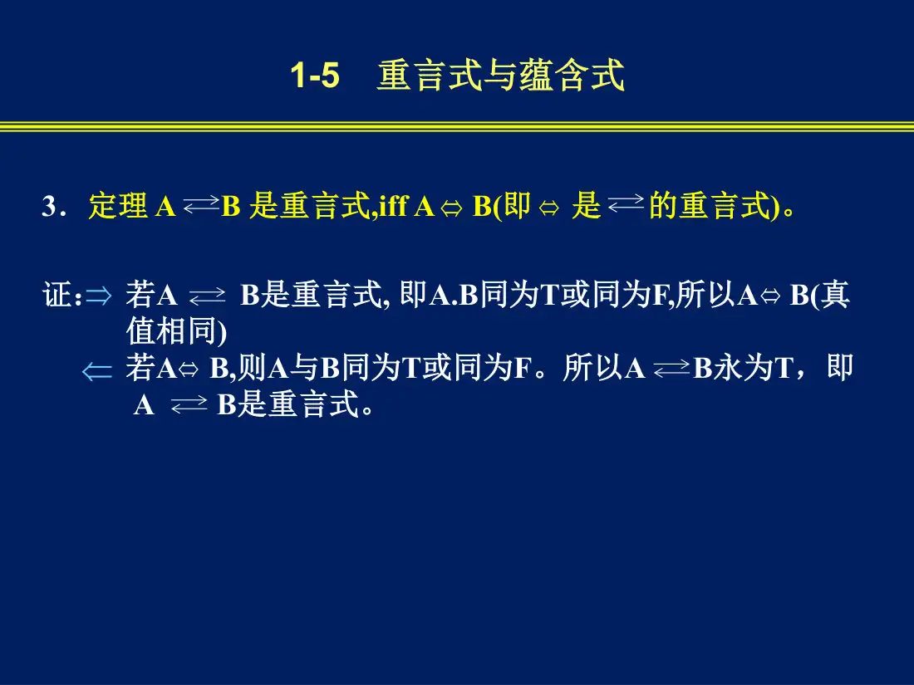

原文：

1-5 重言式与蕴含式

3. 定理 A ⇌ B 是重言式, iff A ⇌ B(即 ⇌ 是 ⇌ 的重言式)。

证:⇒ 若A ⇌ B是重言式, 即A.B同为T或同为F,所以A⇔B(真值相同)

$\Leftarrow$ 若A $\Leftrightarrow$ B,则A与B同为T或同为F。所以A $\rightleftharpoons$ B永为T，即A $\rightleftharpoons$ B是重言式。

### 1-5 重言式与蕴含式

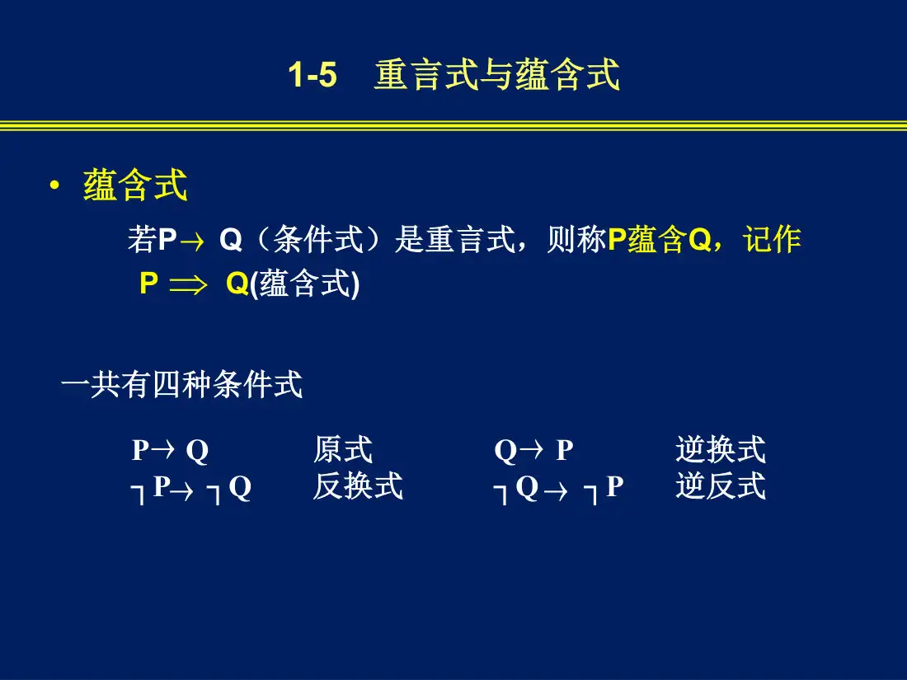

原文：

1-5 重言式与蕴含式

\- 蕴含式

若P→Q（条件式）是重言式，则称P蕴含Q，记作
P $\Rightarrow$ Q(蕴含式)

一共有四种条件式

P→Q

原式

Q→P

反换式

$\neg P \rightarrow \neg Q$

逆换式

$\neg Q \rightarrow \neg P$

逆反式

### 1-5 重言式与蕴含式

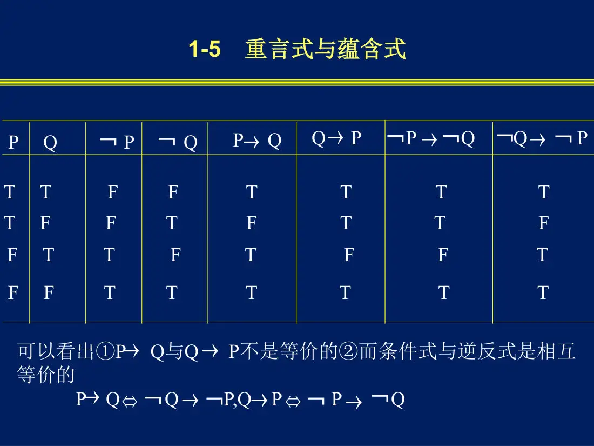

原文：

1-5 重言式与蕴含式

<table><tr><td>P</td><td>Q</td><td> $\neg P$ </td><td> $\neg Q$ </td><td>P $\rightarrow$ Q</td><td>Q $\rightarrow$ P</td><td> $\neg P$  $\rightarrow$  $\neg Q$ </td><td> $\neg Q$  $\rightarrow$  $\neg P$ </td></tr><tr><td>T</td><td>T</td><td>F</td><td>F</td><td>T</td><td>T</td><td>T</td><td>T</td></tr><tr><td>T</td><td>F</td><td>F</td><td>T</td><td>F</td><td>T</td><td>T</td><td>F</td></tr><tr><td>F</td><td>T</td><td>T</td><td>F</td><td>T</td><td>F</td><td>F</td><td>T</td></tr><tr><td>F</td><td>F</td><td>T</td><td>T</td><td>T</td><td>T</td><td>T</td><td>T</td></tr></table>

可以看出①P→Q与Q→P不是等价的②而条件式与逆反式是相互等价的

$\mathrm{P}\rightarrow \mathrm{Q}\Leftrightarrow \neg \mathrm{Q}\rightarrow \neg \mathrm{P},\mathrm{Q}\rightarrow \mathrm{P}\Leftrightarrow \neg \mathrm{P}\rightarrow \neg \mathrm{Q}$

### 1-5 重言式与蕴含式

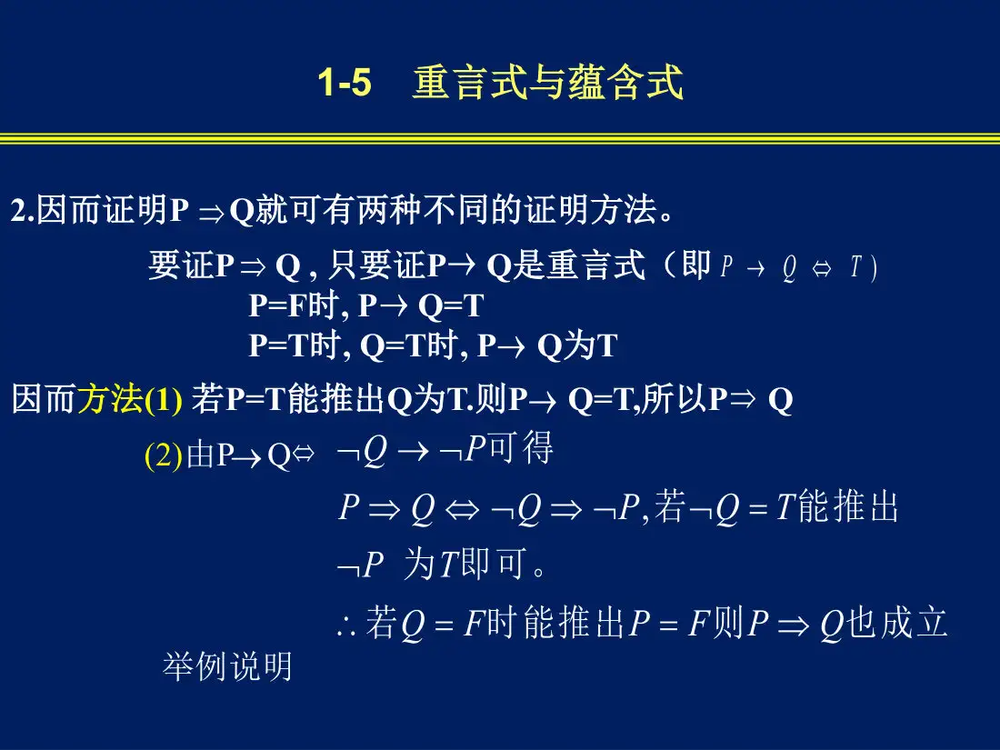

原文：

1-5 重言式与蕴含式

2. 因而证明 $\mathrm{P} \Rightarrow \mathrm{Q}$ 就可有两种不同的证明方法。
要证 $\mathrm{P} \Rightarrow \mathrm{Q}$ , 只要证 $\mathrm{P} \rightarrow \mathrm{Q}$ 是重言式（即 $P \rightarrow Q \Leftrightarrow T$ ) $\mathrm{P} = \mathrm{F}$ 时, $\mathrm{P} \rightarrow \mathrm{Q} = \mathrm{T}$ $\mathrm{P} = \mathrm{T}$ 时, $\mathrm{Q} = \mathrm{T}$ 时, $\mathrm{P} \rightarrow \mathrm{Q}$ 为 $\mathrm{T}$ 因而方法(1) 若 $\mathrm{P} = \mathrm{T}$ 能推出 $\mathrm{Q}$ 为 $\mathrm{T}$ . 则 $\mathrm{P} \rightarrow \mathrm{Q} = \mathrm{T}$ , 所以 $\mathrm{P} \Rightarrow \mathrm{Q}$ (2) 由 $\mathrm{P} \rightarrow \mathrm{Q} \Leftrightarrow \neg Q \rightarrow \neg P$ 可得 $P \Rightarrow Q \Leftrightarrow \neg Q \Rightarrow \neg P$ , 若 $\neg Q = T$ 能推出 $\neg P$ 为 $T$ 即可。 $\therefore$ 若 $Q = F$ 时能推出 $P = F$ 则 $P \Rightarrow Q$ 也成立
举例说明

### 1-5 重言式与蕴含式

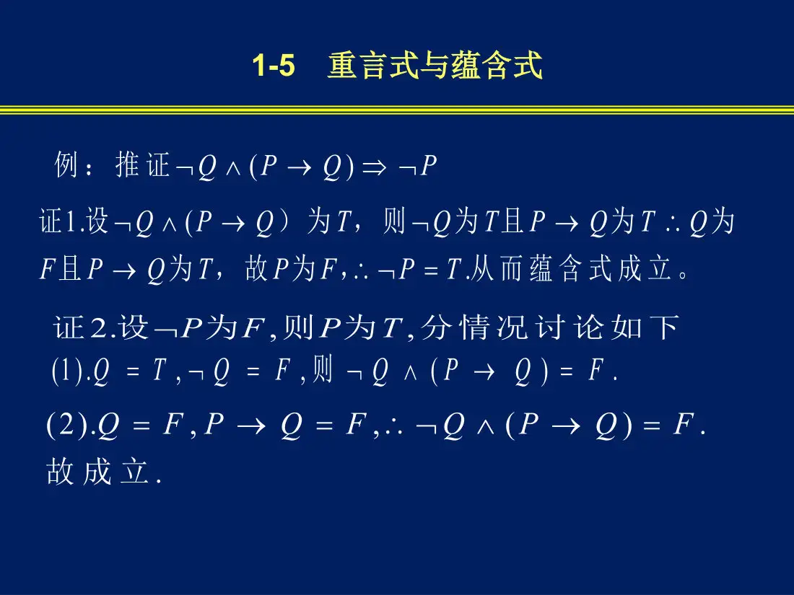

原文：

1-5 重言式与蕴含式

例：推证 $\neg Q \land (P \rightarrow Q) \Rightarrow \neg P$ 证1.设 $\neg Q \land (P \rightarrow Q)$ 为 T，则 $\neg Q$ 为 T 且 $P \rightarrow Q$ 为 T ∴ Q 为 F 且 $P \rightarrow Q$ 为 T，故 P 为 F，∴ $\neg P = T$ .从而蕴含式成立。

证2.设 $\neg P$ 为 F，则 P 为 T，分情况讨论如下

(1).Q = T, $\neg Q = F$ ，则 $\neg Q \land (P \rightarrow Q) = F$ .

(2).Q = F, $P \rightarrow Q = F$ , ∴ $\neg Q \land (P \rightarrow Q) = F$ .

故成立.

### 1-5 重言式与蕴含式

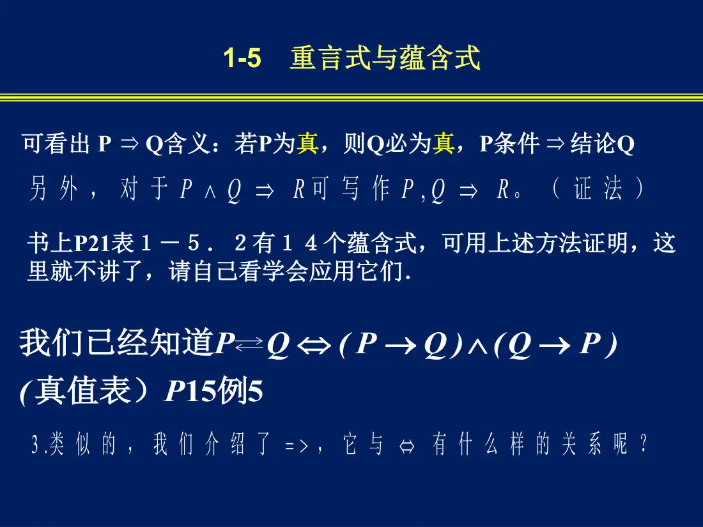

原文：

1-5 重言式与蕴含式

可看出 $\mathrm{P} \Rightarrow \mathrm{Q}$ 含义: 若 $\mathrm{P}$ 为真, 则 $\mathrm{Q}$ 必为真, $\mathrm{P}$ 条件 $\Rightarrow$ 结论 $\mathrm{Q}$ 另外, 对于 $P \wedge Q \Rightarrow R$ 可写作 $P, Q \Rightarrow R$ 。 (证法)

书上P21表 1 - 5 . 2有 1 4个蕴含式, 可用上述方法证明, 这里就不讲了, 请自己看学会应用它们.

我们已经知道 $P \Longleftrightarrow Q \Leftrightarrow (P \rightarrow Q) \land (Q \rightarrow P)$ (真值表) P15例5

3. 类似的，我们介绍了 =>，它与 $\Leftrightarrow$ 有什么样的关系呢？

### 1-5 重言式与蕴含式

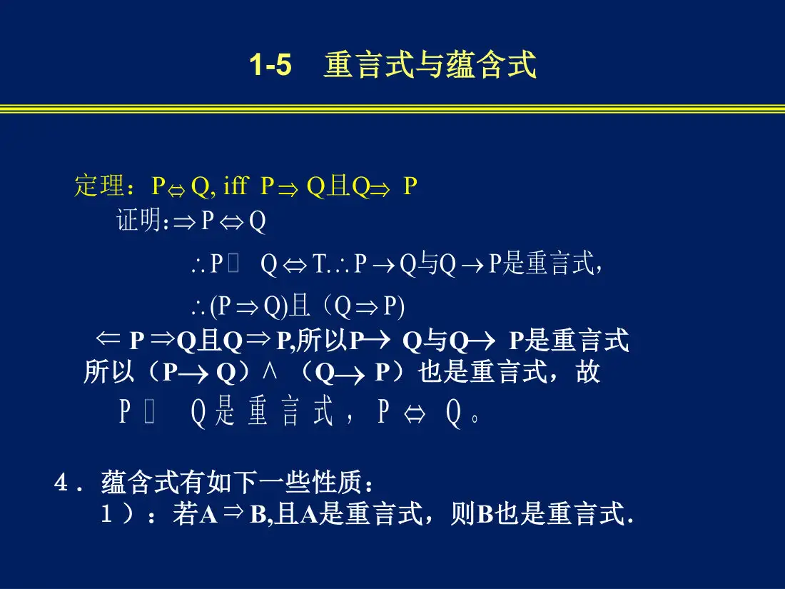

原文：

1-5 重言式与蕴含式

定理：P⇔Q, iff P⇒Q且Q⇒P
证明:⇒P⇔Q
∴P□ Q⇔T.∴P→Q与Q→P是重言式，
∴(P⇒Q)且（Q⇒P）
⇐P⇒Q且Q⇒P,所以P→Q与Q→P是重言式
所以（P→Q）∧（Q→P）也是重言式，故
P□ Q是重言式，P⇔Q。

4. 蕴含式有如下一些性质:
1): 若A⇒B,且A是重言式,则B也是重言式.

### 1-5 重言式与蕴含式

原文：

1-5 重言式与蕴含式

证：A→B ⇔ T,A=T,所以B=T 故B是重言式.

(2) 若 A⇒B, B⇒C, 则 A⇒C (传递性)
证: A→B=T, B→C=T, 所以 (A→B)∧(B→C)=T
又 (A→B)∧(B→C) ⇒ A→C, 所以 A→C=T
故 A⇒C.
(3) 若 A⇒B, 且 A⇒C, 则 A⇒B∧C
(4) 若 A⇒B, 且 C⇒B 则 A∨C⇒B.
这两个性质书上有证明, 不介绍了。

### 1-7 对偶与范式

原文：

1-7 对偶与范式

我们分两部分学习，先学习对偶式

一、1. 定义 在给定的命题公式中，将联结词 $\vee$ 换成 $\wedge$ ，将 $\wedge$ 换成 $\vee$ ，若有特殊变元F和T亦相互取代，所得公式 A\* 称为A的对偶式。显然A也是A\* 的对偶式

(必须将A先化为仅含有 $\neg$ , $\vee$ , $\wedge$ 形式后再变, 遇到其他联结词只能先化为 $\neg$ , $\vee$ , $\wedge$ )

A ∧ → ∨ A \*

A ∨ → ∧ A \*

A F → T A \*

A T → F A \*

### 1-7 对偶与范式

原文：

1-7 对偶与范式

例如： $A = ((P \vee Q) \wedge R) \vee T$

对偶 $A^{*} = ((P \wedge Q) \vee R) \wedge F$

### 1-7 对偶与范式

原文：

1-7 对偶与范式

- 对偶律:

\- 设A和A\*是对偶式, $P_{1}, P_{2}, \cdots, P_{n}$ 是出现在A和A\*中的原子变元, 则:

$$
\begin{array}{r l} & {\neg A (P _ {1}, P _ {2}, \dots , P _ {n}) \Leftrightarrow A ^ {*} (\neg P _ {1}, \neg P _ {2}, \dots , \neg P _ {n})} \\ & {A (\neg P _ {1}, \neg P _ {2}, \dots , \neg P _ {n}) \Leftrightarrow \neg A ^ {*} (P _ {1}, P _ {2}, \dots , P _ {n})} \end{array}
$$

\- 设 $P_{1}, P_{2}, \cdots, P_{n}$ 是出现在 A 和 A\* 中的所有原子变元，如果 A ⇔ B，则 A\* ⇔ B\*

### 1-7 对偶与范式

原文：

1-7 对偶与范式

- 范式:

\- 为什么引入范式：对于两个公式，我们一般很难看出它们是否等价，但可以将A、B两个公式转换为符合某种规范的特殊模式，然后比较两者是否一致即可判定A、B是否等价，这个所谓特殊的模式就是范式。

\- 要学习的概念：合取范式、析取范式、布尔合取/小项、布尔析取/大项、主合取范式、主析取范式。

### 1-7 对偶与范式

原文：

1-7 对偶与范式

\- 合取范式:

\- 若A具有下列形式: $A_{1} \wedge A_{2} \wedge \cdots \wedge A_{n} (n \geq 1)$ 且 $A_{i}$ 是命题变元或它的否定所组成的析取式, 则称A是一个合取范式

\- 析取范式:

\- 若A具有下列形式: $A_{1} \vee A_{2} \vee \cdots \vee A_{n} (n \geq 1)$ 且 $A_{i}$ 是命题变元或它的否定所组成的合取式, 则称A是一个析取范式

### 1-7 对偶与范式

原文：

如： $A = \frac{(P \lor \neg Q \lor R)}{A_1} \land \frac{(\neg P \lor Q)}{A_2} \land \frac{\neg Q}{A_3}$ $A$ 是一合取范式。又如 $\neg P \lor (P \land Q) \lor (P \land \neg Q \land R)$ 是一析取范式。

但若公式仅含有一项如 $P \land Q$ ，则既可看作析取式, 又可看作合取式。

任一公式 $A$ 可用 $\{\neg, \lor, \land\}$ 表示, 把一个公式化为合取式或析取范式是可行的

步骤：1. 将所有的联结词化归为 $\vee, \wedge$ 及 $\neg$ 。2. 利用德摩根律将否定移至各变元前面。3. 用分配律、结合律将之化为合取范式或析取范式。例1. $(P \wedge (Q \to R)) \to S$ 化为合取范式。原式 $\Leftrightarrow (P \wedge (\neg Q \vee R)) \to S \Leftrightarrow \neg (P \wedge (\neg Q \vee R)) \vee S \Leftrightarrow \neg P \vee \neg (\neg Q \vee R) \vee S$ $\Leftrightarrow \neg P \vee (Q \wedge \neg R) \vee S \Leftrightarrow (\neg P \vee S) \vee (Q \wedge \neg R) \Leftrightarrow (\neg P \vee S \vee Q) \wedge (\neg P \vee S \vee \neg R)$

1-7 对偶与范式

### 1-7 对偶与范式

原文：

1-7 对偶与范式

例2. $\neg(P\lor Q)$ □ $(P\land Q)$ 的析取范式。
∵ A □ B $\Leftrightarrow (A\land B)\lor(\neg A\land\neg B)$ 原式 $\Leftrightarrow (\neg(P\lor Q)\land(P\land Q))\lor((P\lor Q)\land\neg(P\land Q))$ $\Leftrightarrow (\neg P \land \neg Q \land P \land Q) \lor ((P \lor Q) \land (\neg P \lor \neg Q))$ $\Leftrightarrow (\neg P \land \neg Q \land P \land Q) \lor ((P \land \neg P) \lor (Q \land \neg P) \lor (P \land \neg Q) \lor (Q \land \neg Q))$ F F F $\Leftrightarrow (Q \land \neg P) \lor (P \land \neg Q)$

化时思想,明确目标,析取() ∨ ()... ∨ (),合取() ∧ ()... ∧ ()一个公式化成合取或析取范式不是唯一的。如

### 1-7 对偶与范式

原文：

1-7 对偶与范式

$$
P \land (Q \lor R) \Leftrightarrow (P \land Q) \lor (P \land R) \Leftrightarrow (P \lor P) \land (Q \lor P) \land (P \lor R) \land (Q \lor R)
$$

合取

析取

合取

所以不是唯一的

2. 为了使任一公式都有唯一的公式与之相对应，引进小项。我们下面讨论主范式。先讨论主析取范式。

### 1-7 对偶与范式

原文：

1-7 对偶与范式

小项/布尔合取:

n个命题变元，由变元和它的否定构成的一个合取式，要求每个变元和其否定不能同时出现，且两者之一必须出现且仅出现一次，这样的合取式称为小项或布尔合取。

两个命题变元 P，Q 有 $P \wedge Q, P \wedge \neg Q, \neg P \wedge Q, \neg P \wedge \neg Q$

三个命题变元P、Q、R 8个小项

$$
P \land Q \land R
$$

$$
P \land Q \land \lnot R
$$

$$
\lnot P \land Q \land R
$$

$$
\neg P \land Q \land \neg R
$$

$$
P \land \lnot Q \land R
$$

$$
\lnot P \land \lnot Q \land R
$$

$$
P \land \lnot Q \land \lnot R
$$

$$
\lnot P \land \lnot Q \land \lnot R
$$

### 1-7 对偶与范式

原文：

1-7 对偶与范式

n个变元有 $2^{n}$ 个小项。

对于两个命题元，列真值表看看，每个小项有何特点？

P Q P ∧ Q P ∧ ¬Q ¬P ∧ Q ¬P ∧ ¬Q

$$
T T
$$

$$
Ⓩ
$$

$$
F
$$

$$
F
$$

$$
F
$$

$$
T
$$

$$
F
$$

$$
F
$$

$$
ⓡ
$$

$$
F
$$

$$
F
$$

$$
\begin{array}{c c c} F & T & F \end{array}
$$

$$
F
$$

$$
T
$$

$$
F
$$

$$
F F F
$$

$$
F
$$

$$
F
$$

$$
ⓧ
$$

可以看出（1）各个小项不等价。

(2) 每个小项只有一组指派, 使它为 $\mathrm{T}$ , 其他均为 $\mathrm{F}$ 。且可由这组指派写出小项。

对三个变元的小项同样有上述性质 表1—7.2 1 → T,0 → F

### 对小项，我们可以用二进制进行编码：

原文：

对小项，我们可以用二进制进行编码：

$$
P \wedge Q = m _ {1 1} = m _ {3}
$$

$$
P \land Q \land R = m _ {1 1 1} = m _ {7}
$$

$$
P \land \lnot Q = m _ {1 0} = m _ {2}
$$

$$
P \land Q \land \lnot R = m _ {1 1 0} = m _ {6}
$$

$$
\neg P \land Q = m _ {0 1} = m _ {1}
$$

$$
P \land \lnot Q \land R = m _ {1 0 1} = m _ {5}
$$

$$
P \land \lnot Q \land \lnot R = m _ {1 0 0} = m _ {4}
$$

$$
\neg P \land \neg Q = m _ {0 0} = m _ {0}
$$

$$
\neg P \land Q \land R = m _ {0 1 1} = m _ {3}
$$

1—命题变元，0—命题否定
任给一个编号可写出对应小项： $\neg P \land Q \land \neg R = m_{010} = m_2$ $\neg P \land \neg Q \land R = m_{001} = m_1$

$$
\neg P \land \neg Q \land \neg R = m _ {0 0 0} = m _ {0}
$$

1-7 对偶与范式

### 1-7 对偶与范式

原文：

1-7 对偶与范式

小项有如下性质:

(1)每个小项当指派与下标编码相同时，其值为T，其余 $2^{n}$ ——1种指派为F。

(2)任意两个不同小项的合取式为F。

(3)全体小项的析取式为永真。

$$
\sum_ {i = 0} ^ {2 ^ {n} - 1} m _ {i} = m _ {0} \vee m _ {1} \vee \dots \vee m _ {2 ^ {n} - 1} \Leftrightarrow T
$$

主析取范式:

公式A，存在等价式，仅由小项的析取式构成，则该等价式称为A的主析取范式。

如 $(P \land Q) \lor (\neg P \land \neg Q)$ 是主析取范式。

### 1-7 对偶与范式

原文：

1-7 对偶与范式

如何将公式A化为主析取范式？

1. 用真值表法。有如下依据定理

定理 在真值表中，一个公式的真值为T的指派所对应的小项的析取，即为此公式的主析取范式。

如：求 $P \rightarrow Q, \neg(P \land Q)$ 的主析取范式。

### 1-7 对偶与范式

原文：

1-7 对偶与范式

$$
\begin{array}{c c c c} P & Q & P \to Q & \neg (P \land Q) \\ T & T & T & F \\ T & F & F & T \\ F & T & T & T \\ F & F & T & T \end{array}
$$

() ∨ () ∨ 主析取范式只要有一个为T，则其值为T。因而列出所有值为T的可能就行了。

$\therefore P \to Q$ 的主析取范式为:

$\neg(P \land Q)$ 的主析取范式为:

$$
\begin{array}{c c c} (P \land Q) \lor (\lnot P \land Q) \lor (\lnot P \land \lnot Q) \\ \uparrow & \uparrow & \uparrow \\ m _ {1 1} & m _ {0 1} & m _ {0 0} \end{array}
$$

$$
(P \land \lnot Q) \lor (\lnot P \land Q) \lor (\lnot P \land \lnot Q)
$$

### 1-7 对偶与范式

原文：

1-7 对偶与范式

证：A，其值为T的指派所对应的小项为， $m_{1}^{\prime}, m_{2}^{\prime}, \cdots, m_{k}^{\prime}$ 。 $B = m_{1}^{\prime} \vee m_{2}^{\prime} \vee \cdots \vee m_{k}^{\prime} B = \sum_{i=1}^{k} m_{i}^{\prime}$ 为此要证1).若某一指派使得A为T，则这一指派必是 $m_{1}^{\prime}, m_{2}^{\prime}, \cdots, m_{k}^{\prime}$ 中某一个。例如： $m_{i}$ 这时 $m_{i}^{\prime} = T \therefore B = T$ ， $(A \Rightarrow B)$

2). 若某一指派使得A为F，则这一指派对应的小项不在 $m_{1}^{'}$ , $m_{2}^{'}$ , $\cdots$ , $m_{k}^{'}$ 中，这时 $m_{i}^{'} = F$ . $i = 1, \cdots, k \therefore B = F$ 从而 $A \Leftrightarrow B$ ( $A \Leftarrow B$ )

### 1-7 对偶与范式

原文：

1-7 对偶与范式

例：设公式A真值表如下，求A的主析取范式。

<table><tr><td>P</td><td>Q</td><td>R</td><td>A</td></tr><tr><td>T</td><td>T</td><td>T</td><td>T</td></tr><tr><td>T</td><td>T</td><td>F</td><td>F</td></tr><tr><td>T</td><td>F</td><td>T</td><td>F</td></tr><tr><td>T</td><td>F</td><td>F</td><td>T</td></tr><tr><td>F</td><td>T</td><td>T</td><td>F</td></tr><tr><td>F</td><td>T</td><td>F</td><td>F</td></tr><tr><td>F</td><td>F</td><td>T</td><td>F</td></tr><tr><td>F</td><td>F</td><td>F</td><td>T</td></tr></table>

### 1-7 对偶与范式

原文：

1-7 对偶与范式

$$
\therefore A \Leftrightarrow (P \land Q \land R) \lor (P \land \lnot Q \land \lnot R) \lor (\lnot P \land \lnot Q \land \lnot R)
$$

### 1-7 对偶与范式

原文：

1-7 对偶与范式

2. 利用等价式求主析取范式

例： $(P \land Q) \lor (\neg P \land R) \lor (Q \land R)$

$$
\Leftrightarrow \quad (P \land Q \land (R \lor \lnot R)) \lor (\lnot P \land R \land (Q \lor \lnot Q)) \lor (Q \land R \land (P \lor \lnot P))
$$

$$
\Leftrightarrow \quad (P \land Q \land R) \lor (P \land Q \land \lnot R) \lor (\lnot P \land R \land Q) \lor (\lnot P \land R \land \lnot Q)
$$

$$
(P \land Q \land R) \lor (P \land Q \land \lnot R) \lor (\lnot P \land Q \land R) \lor (\lnot P \land \lnot Q \land R)
$$

化归方法步骤:

1. 化为析取范式。

2. 删去析取范式中永假的项。

3. 将式中重复的项合并。

4. 对合取项补入没有出现的变元，即添加 PV $\neg P$ 等。

5. 用分配律展开。

### 1-7 对偶与范式

原文：

1-7 对偶与范式

我们学习了析取范式，形式为：（）∨（）∨…∨（），合取范式，形式为：（）∧（）∧（）∧…∧（），引入了小项（它是变元或变元的否定式组成的合取式，但两者必须出现且仅出现一个）由小项的析取我们可以得到主析取范式；这样对于任一公式，我们都可求出其主析取范式，当其变元的个数、次序固定时，它是唯一的。下面我们主要介绍主合取范式。

大项/布尔析取：

n个命题变元的析取式，其中每个变元与它的否定不能同时存在，但两者必须出现且仅出现一次，称为大项，也称布尔析取。

例如:2个变元P、Q, 可生成 $2^{2}=4$ 个大项:P∨Q Pv¬Q ¬PvQ
¬PV¬Q
3个变元P, Q, R, 可以生成8个大项:P∨QVR PVQV¬R ...

### 1-7 对偶与范式

原文：

1-7 对偶与范式

n个变元对应着 $2^{\mathrm{n}}$ 个大项

小项用m编号，大项用M表示，两个变元用两位二进制编号

小项：0-变元之否定，1-命题变元。如 $m_{01}\rightarrow\neg P\land Q$

大项: 0-变元本身, 1-变元否定。如: $M_{00} \rightarrow P \vee Q$ 。如上面对应2个变元的4个大项: $P \vee Q, P \vee \neg Q, \neg P \vee Q, \neg P \vee \neg Q$

$$
\mathrm{M} _ {0 0} = \mathrm{M} _ {0}, \quad \mathrm{M} _ {0 1} = \mathrm{M} _ {1}, \quad \mathrm{M} _ {1 0} = \mathrm{M} _ {2}, \quad \mathrm{M} _ {1 1} = \mathrm{M} _ {3}
$$

对应于二进制，大项也可以用十进制编号

### 1-7 对偶与范式

原文：

1-7 对偶与范式

大项有如下性质:

1. 每个大项的指派与编号相同时，其值为F，而其余 $2^{n}-1$ 种指派情况下其值均为T。

2. 任意两个不同大项的析取式都为T。

3. 全体大项的合取式必为永假F。

$\Pi(0\longrightarrow2^{n}-1)\mathrm{M}_{i}=\mathrm{M}_{0}\wedge\mathrm{M}_{1}\wedge\mathrm{M}_{2}\wedge\cdots\cdots\wedge\mathrm{M}_{2}^{n}-1=\mathrm{F}$ 由大项，可以得到主合取范式。

对于一个公式若存在一个等价式，它由大项的合取所组成，则该等价式称为原式的主合取范式。

### 1-7 对偶与范式

原文：

1-7 对偶与范式

求主合取范式的方法:

1. 真值表法

定理: 在真值表中，一个公式的真值为F的指派所对应的大项的合取，即为此公式的主合取范式。

我们求主析取范式时是将所有值为T的指派对应的小项析取；这里求主合取范式是将所有取值为F的所有可能值列出来、取合取。（析取与合取对偶）

要注意大项的写法不同于小项，另外列真值表必须注意次序，先列T，后列F

### 1-7 对偶与范式

原文：

1-7 对偶与范式

<table><tr><td>P</td><td>Q</td><td>R</td><td>P ∧ Q</td><td>¬P ∧ Q</td><td>(P ∧ Q) ∨ (¬P ∧ R)</td></tr><tr><td>T</td><td>T</td><td>T</td><td>T</td><td>F</td><td>T</td></tr><tr><td>T</td><td>T</td><td>F</td><td>T</td><td>F</td><td>T</td></tr><tr><td>T</td><td>F</td><td>T</td><td>F</td><td>F</td><td>F</td></tr><tr><td>T</td><td>F</td><td>F</td><td>F</td><td>F</td><td>F</td></tr><tr><td>F</td><td>T</td><td>T</td><td>F</td><td>T</td><td>T</td></tr><tr><td>F</td><td>T</td><td>F</td><td>F</td><td>F</td><td>F</td></tr><tr><td>F</td><td>F</td><td>T</td><td>F</td><td>T</td><td>T</td></tr><tr><td>F</td><td>F</td><td>F</td><td>F</td><td>F</td><td>F</td></tr></table>

∴ 原式的主合取范式 $\Leftrightarrow (\neg P \lor Q \lor \neg R) \land (\neg P \lor Q \lor R)$

$\land (P \lor \neg Q \lor R) \land (P \lor Q \lor R)$

### 1-7 对偶与范式

原文：

1-7 对偶与范式

2. 用等价公式，其步骤为:

1) 划归为合取范式。

2) 删去合取范式中永真的式。

3) 合并相同的项。

4) 对析取项补入没有出现的变元，即补入形如： $(P \land \neg P)$ 式。

5) 应用分配律展开。

上述五个步骤与主析取范式类似。

例：化原式为主合取范式（上例）

### 1-7 对偶与范式

原文：

1-7 对偶与范式

$(P \land Q) \lor (\neg P \land R)$ $\Leftrightarrow ((P \land Q) \lor \neg P) \land ((P \land Q) \lor R)$ $\Leftrightarrow (P \lor \neg P) \land (Q \lor \neg P) \land (P \lor R) \land (Q \lor R)$ $\Leftrightarrow (Q \lor \neg P) \land (P \lor R) \land (Q \lor R)$ $\Leftrightarrow (Q \lor \neg P \lor (R \land \neg R)) \land (P \lor R \lor (Q \land \neg Q)) \land (Q \lor R \lor (P \land \neg P))$ $\Leftrightarrow (Q \lor \neg P \lor R) \land (Q \lor \neg P \lor \neg R) \land (P \lor R \lor Q) \land (P \lor R \lor \neg Q) \land$ $(Q \lor R \lor P) \land (Q \lor R \lor \neg P)$ $\Leftrightarrow (\neg P \lor Q \lor R) \land (\neg P \lor Q \lor \neg R) \land (P \lor Q \lor R) \land (P \lor \neg Q \lor R)$ 这样当变元次序一定时，每个公式都有唯一与之等价的主合取范式
一个公式，既有与之相等价的唯一的主析取范式，又有唯一的主合取范式，
它们之间有何关系呢？首先它们分别由小项、大项决定的，看看小项、大项
之间有何关系。

### 1-7 对偶与范式

原文：

1-7 对偶与范式

1）大项与小项有什么关系？ $\because \neg (P \lor Q) \Leftrightarrow \neg P \land \neg Q$ $\therefore \neg m_i \Leftrightarrow M_i$ $\neg M_i \Leftrightarrow m_i$ $\neg (P \land Q) \Leftrightarrow \neg P \lor \neg Q$

2) 主析取范式与主合取范式的关系？
首先为简洁，把 $m_{i1} \vee m_{i2} \vee \cdots \vee m_{ik} = \sum_{i1,i2,\cdots ik} M_{i1} \wedge M_{i2} \wedge \cdots \wedge M_{ik} = \Pi_{i1,i2,\cdots,ik}$ ∴ 公式 A 的主析取范式 = $\sum_{i1,i2,\cdots ik}$ 时，
则 A 的主合取范式 = $\Pi_{0,\cdots,i1-1,i1+1,\cdots,i2-1,i2+1,\cdots,ik-1,ik+!\cdots,2^{n}-1}$ 由上例可以看出： $(P \wedge Q) \vee (\neg P \wedge R) \Leftrightarrow M_{101} \wedge M_{100} \wedge M_{010} \wedge M_{000} = M_{5} \wedge M_{4} \wedge M_{2} \wedge M_{0}$ $\Leftrightarrow m_{111} \vee m_{110} \vee m_{011} \vee m_{001} = m_{7} \vee m_{6} \vee m_{3} \vee m_{1}$

### 1-8 推理理论

原文：

1-8 推理理论

总结：学习数理逻辑主要适用于推理，有了前面的这些基础知识，就可以进行推理1-8 推理理论 推理就是用一些已知的东西得出另外一些结论。而在推理过程中，常把一些定律、定理和条件，作为假设前提，使用一些公认的规则，得到另外的命题，形成结论，这种过程就是论证。

定义: 若 $P \Rightarrow C, C$ 成为条件 $\mathrm{P}$ 的有效结论。

即 $P \rightarrow C$ 为永真式、重言式。

推广到 n 个前提的情况： $H_{1} \wedge H_{2} \wedge \cdots \wedge H_{n} \Rightarrow C$ 则 C 是前提条件 $H_{1}, H_{2}, \cdots, H_{n}$ 的有效结论。

### 1-8 推理理论

原文：

1-8 推理理论

判别有效结论的过程就是论证过程，方法多种多样，但基本上有三种方法。

(1) 真值表法。要 $H_{1}\wedge H_{2}\wedge\cdots\wedge H_{n}\rightarrow C$ 永真式。假设 $P_{1},P_{2},\cdots,P_{m}$ 是 $H_{1},\cdots,H_{n},C$ 中出现的所有命题变元，前面已介绍过，

法① 从真值表上找出 $H_{1},\cdots,H_{n}$ 均为T的行，若对于这些行，C也为T，此时有 $H_{1}\wedge H_{2}\wedge\cdots\wedge H_{n}\Rightarrow C$ 。

法② 从真值表上找出C为F的若干行，若对于这些行， $H_{1}, H_{2}, \cdots, H_{n}$ 中至少有一个为F,则也有： $H_{1} \wedge H_{2} \wedge \cdots \wedge H_{n} \Rightarrow C$ 。

### 1-8 推理理论

原文：

1-8 推理理论

例如 P41. 例 1.

读题；首先找出命题变元，P:材料不可靠，Q:计算有错误。

论证： $(P \lor Q) \land \neg P \Rightarrow Q$

用法（1）只有第三行 $P \vee Q$ 与 $\neg P$ 均为 $T$ ， $Q$ 也为 $T$ 。 $\therefore$ 论证成立。

用法（2）第2,4行Q为F， $H_{1}$ 、 $H_{2}$ 至少有一个为F。∴结论成立。此方法比较简单,与前面介绍的判断“⇒”类似。

$$
\begin{array}{c c c c} P & Q & P \lor Q & \neg P \\ \hline \text {T} & \text {T} & \text {T} & \text {F} \\ \text {T} & \text {F} & \text {T} & \text {F} \\ \text {T} & \text {T} & \text {T} & \text {T} \\ \text {F} & \text {F} & \text {F} & \text {T} \end{array}
$$

### 1-8 推理理论

原文：

1-8 推理理论

(2) 直接证法

从已知前提出发，使用公认的推理规则，利用等价式或蕴含式，得到结论。

规则有 P规则 前提在论证过程中任何时候都可用。

T规则 在论证中，如果一个或多个公式蕴含公式S，则S可以引入推理中。

等价式与蕴含式在书 P43 表 1-8.3, 1-8.4 可见。

要证： $H_{1}\cdots,H_{n}\Rightarrow C$ ，找一序列 $B_{1},B_{2},\cdots,B_{m}$ 使得

(1) $B_{i}$ 是 $H_{j}$ 中某一个。 $P$ 规则

(2) $B_{i}$ 是前面公式的蕴含式或等价式。 $T$ 规则

(3) $B_{m} = C$ 最终证得。

### 1-8 推理理论

原文：

1-8 推理理论

例证： $(P\lor Q)\land (P\to R)\land (Q\to S)\Rightarrow S\lor R$

证明：

(1) $P \vee Q$ P

(2) $\neg P \to Q$ $T(1)E_{16}$ （为与其他一致“√”秘简）

(3) $Q \rightarrow S$ P

(4) $\neg P \to S$ $T(2)(3)I_{13}$ $\therefore$ 八个公式序列要么是 $P$ 规则

(5) $\neg S \to P$

$$
T (4) E _ {1 8}
$$

要么是T规则⇒结论。

(6) $P \rightarrow R$

(7) $\neg S \to R$

$$
T (5) (6) I _ {1 3}
$$

(8) $S \vee R$

$$
T (7) E _ {1 6}
$$

注意：必须将证明过程编号一一写出理由。这里须将每一步依次编号，得出理由；书上给了两种证明法，论证方法不唯一，但方向是明确的，最终能到达C，且步骤越少越好。

### 1-8 推理理论

原文：

1-8 推理理论

(3) 间接证法:

$H_{1} \wedge H_{2} \wedge \cdots \wedge H_{n} \Rightarrow C.$ 即 $H_{1} \wedge H_{2} \wedge \cdots \wedge H_{n} \rightarrow C$ 是永真式。 $\neg C \rightarrow \neg (H_{1} \wedge H_{2} \wedge \cdots \wedge H_{n})$ 为永真式。 $\neg (\neg C \rightarrow \neg (H_{1} \wedge H_{2} \wedge \cdots \wedge H_{n}))$ 为永假。 $\Leftrightarrow \neg (C \vee \neg (H_{1} \wedge H_{2} \wedge \cdots \wedge H_{n}))$ 为永假。 $\Leftrightarrow \neg C \wedge (H_{1} \wedge H_{2} \wedge \cdots \wedge H_{n})$ 为永假式 or 矛盾式。

这是反证法的思想依据

为表达方便，引进定义： $H_{1} \cdots H_{n}$ 中变元 $P_{1} \cdots P_{m}$ ，若存在一个 $P_{1} \cdots P_{m}$ 的指派，使的 $H_{1} \wedge \cdots \wedge H_{n}$ 为 $T$ ，则称 $H_{1} \cdots H_{n}$ 是相容的。

$H_{1}\cdots H_{n}$ 为不相容的，如何否定上定义？

若对于所有 $P_{1}\cdots P_{m}$ 的指派 $H_{1}\wedge\cdots\wedge H_{n}$ 为 $F\Leftrightarrow H_{1}\wedge\cdots\wedge H_{n}$ 为永假式，而不是某一个F，∴实际上只要论证 $H_{1}\cdots H_{n}$ 与 $\neg C$ 不相容。

### (1) A P(附加前提) 目的导出矛盾

原文：

例：证明 $A \rightarrow B$ ， $\neg (B \lor C) \Rightarrow \neg A$

(1) A P(附加前提) 目的导出矛盾

(2) $A \to B$ $P$

(3) B $T(1)(2)I$

(4) $\neg (B \lor C)$ $P$

(5) $\neg B \land \neg C$ $T(4)E$

(6) $\neg B$ $T(5)I$

(7) $B \wedge \neg B$ $T(3)(6)I$ （矛盾）得证补充：例 设 $A^{*}, B^{*}$ 分别是命题公式 $A$ 和 $B$ 的对偶式，则下列各式是否成立？(1) $A^{*} \Leftrightarrow A$ (2)若 $A \Leftrightarrow B$ 则 $A^{*} \Leftrightarrow B^{*}$ (3)若 $A \Rightarrow B$ 则 $A^{*} \Rightarrow B^{*}$ (4) $\left(A^{*}\right)^{*} \Leftrightarrow A$

1-8 推理理论

### (3)不成立，但 $B^{*}\Rightarrow A^{*}$ 成立。

原文：

(1)错（2）对（3）错（4）对 $P \land Q \Rightarrow Q$ 成立，但 $P \lor Q \Rightarrow Q$ 不成立；
(3)不成立，但 $B^{*}\Rightarrow A^{*}$ 成立。

1-8 推理理论

### 1-8 推理理论

原文：

1-8 推理理论

前面介绍了逻辑推理，所谓逻辑推理就是由一组前提，用一些公认的推理规则，利用等价或蕴含式，推出结论成立，就是论证。证明有三种方法。

1)真值表法：列出所有真值取值，看蕴含式是否成立，真值取值情况。

2）直接法：利用P规则和T规则，得到一组序列 $B_{1},B_{2},\cdots B_{n}=C$ 。

3）间接法：也就是证 $H_{1},H_{2},\cdots,H_{n},\neg C$ 是不相容的，即 $H_{1}\wedge H_{2}\wedge\cdots\wedge H_{n}\wedge\neg C$ 是永假的(这是反证法的依据)

间接法的另一种情况是： $H_{1} \wedge H_{2} \wedge \cdots \wedge H_{n} \Rightarrow R \rightarrow C$ (结论是一个条件式)

我们可以把条件式转化为非条件式 $\neg R \vee C$ 同样可

利用前面两种方法来证明几个前提是否能蕴含

$\neg R \lor C$ ，但我们这里介绍另一种方法。

### 1-8 推理理论

原文：

1-8 推理理论

即要证明 $\mathrm{H}_1\wedge \mathrm{H}_2\dots \wedge \mathrm{H}_{\mathrm{n}}$ （记为S） $\rightarrow (R\to C)$ 永真 $\Leftrightarrow S\to (R\to C)$ 为永真 $\Leftrightarrow \neg \mathrm{S}\lor (\neg \mathrm{R}\lor \mathrm{C})$ 永真 $\Leftrightarrow \neg (\mathrm{S}\land \mathrm{R})\lor \mathrm{C}$ 永真 $\Leftrightarrow \mathrm{S}\land \mathrm{R}\rightarrow \mathrm{C}$ 永真 $\Leftrightarrow \mathrm{H}_1\wedge \mathrm{H}_2\dots \wedge \mathrm{H}_{\mathrm{n}}\wedge \mathrm{R}\rightarrow \mathrm{C}$ 永真即要证明 $\mathrm{H}_1\wedge \mathrm{H}_2\dots \wedge \mathrm{H}_{\mathrm{n}}\wedge \mathrm{R}\Rightarrow \mathrm{C}$ 将R作为附加前提得到C，称为CP规则。

### 例1证明A→(B→C)，¬D∨A，B⇒D→C

原文：

例1证明A→(B→C)，¬D∨A，B⇒D→C

(1) $D$ $P$ (附加前提)

(2) $\neg D \lor A$ P

(3) $A$ $T(1)(2)I$

(4) $A \rightarrow (B \rightarrow C)$ P

(5) $B\to C$ $T(3)(4)I$

(6) $B$ $P$

(7)C $T(5)(6)I$

(8) $D \rightarrow C$ CP

1-8 推理理论

### 1-8 推理理论

原文：

1-8 推理理论

例2 P46例题6

(a) 或者是天晴，或者是下雨。

(b) 如果是天晴，我去看电影。

(c) 如果我去看电影，我就不看书。

结论：如果我在看书则天在下雨。

M: 天晴; Q: 下雨; S: 我看电影;

R: 我看书。

### 1-8 推理理论

原文：

1-8 推理理论

要证明： $M\neg Q,M\to S,S\to \neg R\Rightarrow R\to Q$

证明:(1) $R$

$P$ (附加前提)

(2) $S \to \neg R$

(3) $\neg S$

T(1)(2)

(4) $M \to S$

(5) $\neg M$

$T(3)(4)$

(6) $M \bar{\vee} Q$

(7) $\neg (M\leftrightarrow Q)$

T(6)

(8) $M \rightleftharpoons \neg Q$

T(7)

### T(8)

原文：

T(8)

1-8 推理理论

(9) $(M\to \neg Q)\land (\neg Q\to M)$

(10) $\neg Q\to M$

T(9)

(11) $Q$

$T(5)(10)$

(12) $R \to Q$
