# 《离散数学》第2章 谓词逻辑（课件）

原件的每一页，下面附识别出的文字。

### 第二章 谓词逻辑

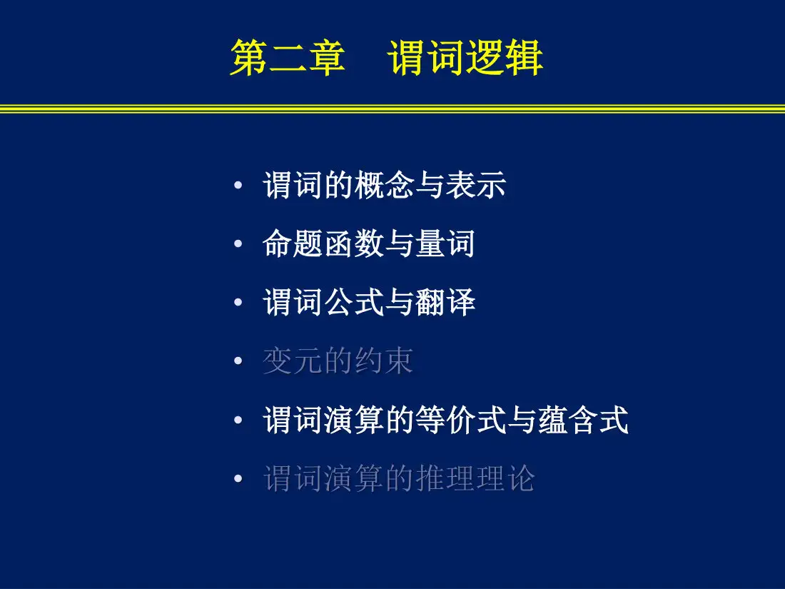

原文：

第二章 谓词逻辑

\- 谓词的概念与表示

\- 命题函数与量词

\- 谓词公式与翻译

\- 变元的约束

\- 谓词演算的等价式与蕴含式

\- 谓词演算的推理理论

### 第二章 谓词逻辑

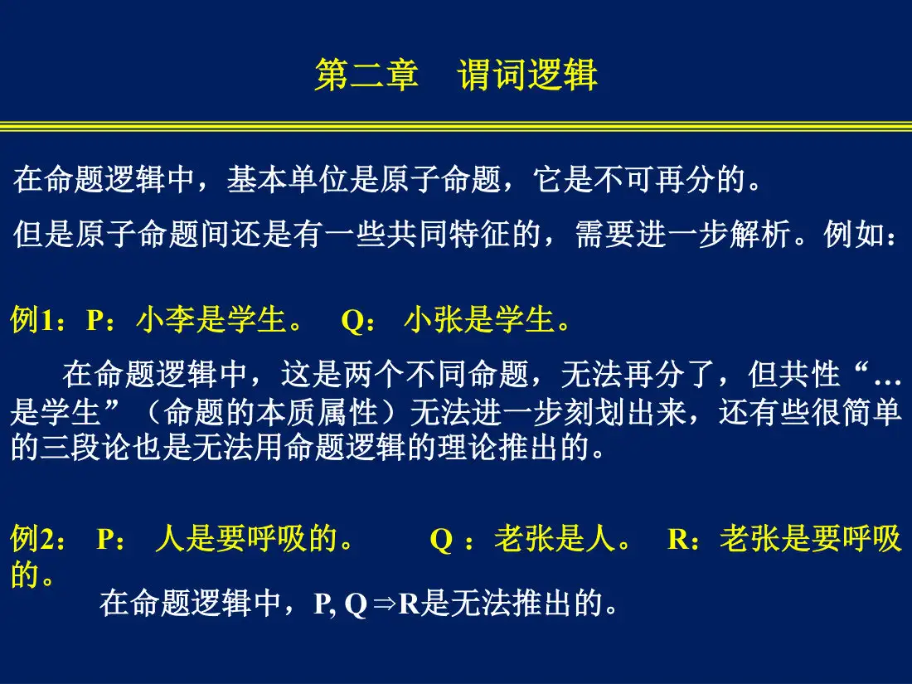

原文：

第二章 谓词逻辑

在命题逻辑中，基本单位是原子命题，它是不可再分的。

但是原子命题间还是有一些共同特征的，需要进一步解析。例如：

例1：P：小李是学生。Q：小张是学生。

在命题逻辑中，这是两个不同命题，无法再分了，但共性“...是学生”（命题的本质属性）无法进一步刻划出来，还有些很简单的三段论也是无法用命题逻辑的理论推出的。

例2: P: 人是要呼吸的。 Q: 老张是人。 R: 老张是要呼吸的。
在命题逻辑中，P, Q ⇒ R 是无法推出的。

### 2-1 谓词的概念与表示

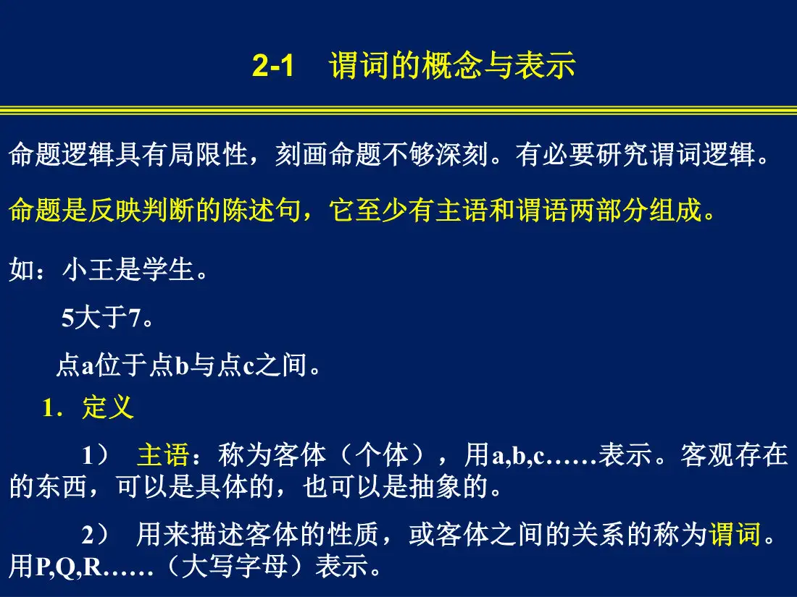

原文：

2-1 谓词的概念与表示

命题逻辑具有局限性，刻画命题不够深刻。有必要研究谓词逻辑。

命题是反映判断的陈述句，它至少有主语和谓语两部分组成。

如：小王是学生。

5大于7。

点a位于点b与点c之间。

1. 定义

1）主语：称为客体（个体），用a,b,c……表示。客观存在的东西，可以是具体的，也可以是抽象的。

2）用来描述客体的性质，或客体之间的关系的称为谓词。用P,Q,R……（大写字母）表示。

### 2-1 谓词的概念与表示

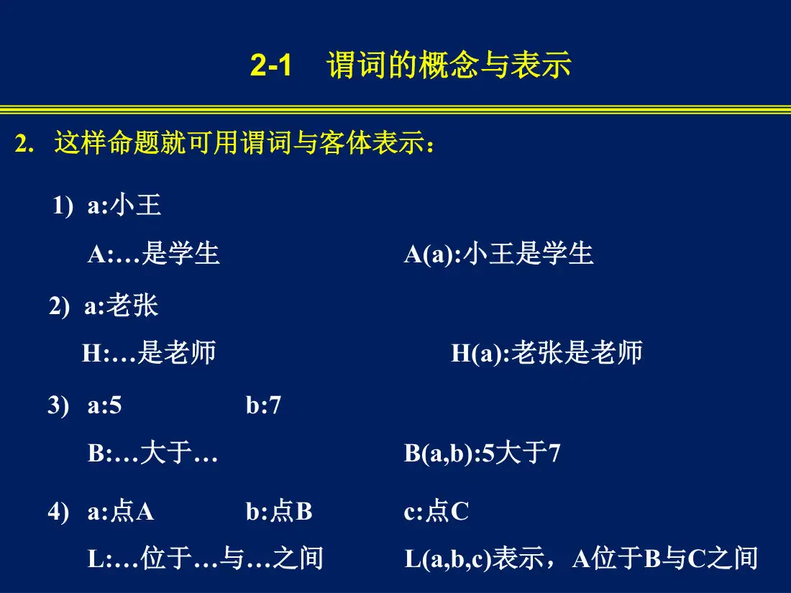

原文：

2-1 谓词的概念与表示

2. 这样命题就可用谓词与客体表示:

1) a: 小王

A:...是学生

A(a):小王是学生

2) a:老张

H:...是老师

H(a):老张是老师

3) a:5 b:7

B:...大于...

B(a,b):5大于7

4) a: 点A b: 点B c: 点C

L:...位于...与...之间

L(a,b,c)表示，A位于B与C之间

### 2-1 谓词的概念与表示

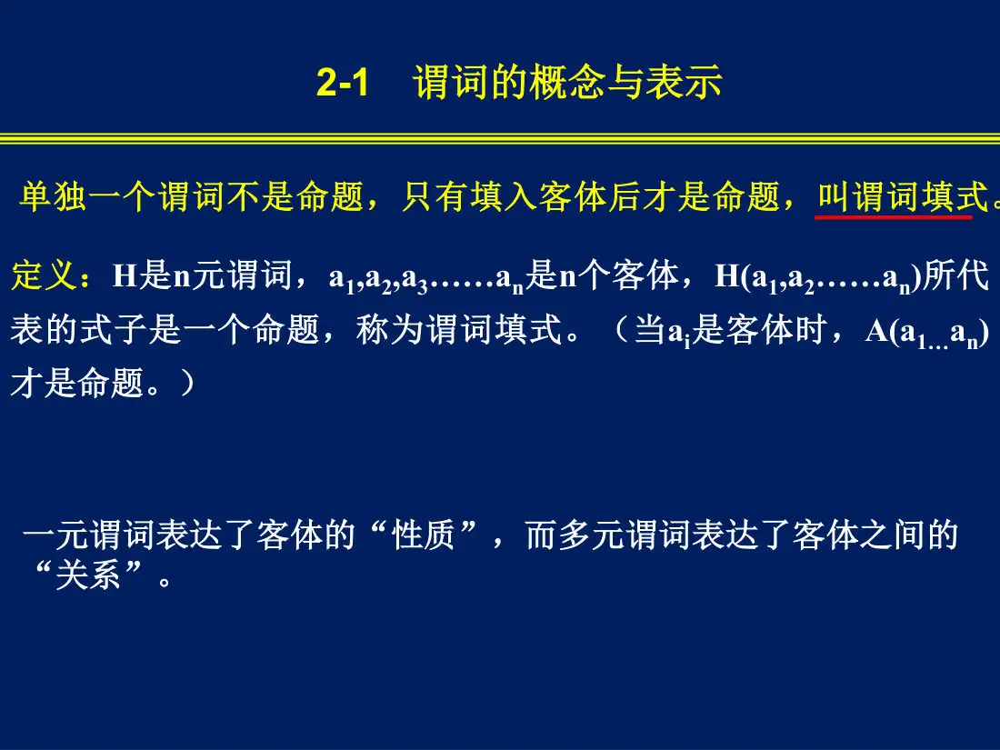

原文：

2-1 谓词的概念与表示

单独一个谓词不是命题，只有填入客体后才是命题，叫谓词填式。

定义: H是n元谓词, $a_{1}, a_{2}, a_{3} \ldots \ldots a_{n}$ 是n个客体, $H(a_{1}, a_{2} \ldots \ldots a_{n})$ 所代表的式子是一个命题, 称为谓词填式。(当 $a_{i}$ 是客体时, $A(a_{1} \ldots a_{n})$ 才是命题。)

一元谓词表达了客体的“性质”，而多元谓词表达了客体之间的“关系”。

### 2-2 命题函数与量词

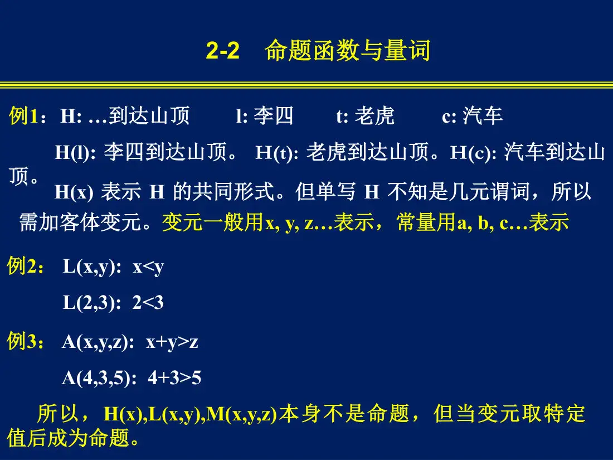

原文：

2-2 命题函数与量词

例1: H: ...到达山顶 l: 李四 t: 老虎 c: 汽车

H(l): 李四到达山顶。H(t): 老虎到达山顶。H(c): 汽车到达山顶。H(x) 表示 H 的共同形式。但单写 H 不知是几元谓词，所以需加客体变元。变元一般用 x, y, z... 表示，常量用 a, b, c... 表示

例2: L(x,y): x<y

L(2,3): 2<3

例3: A(x,y,z): x+y>z

A(4,3,5): 4+3>5

所以，H(x),L(x,y),M(x,y,z)本身不是命题，但当变元取特定值后成为命题。

### 2-1 谓词的概念与表示

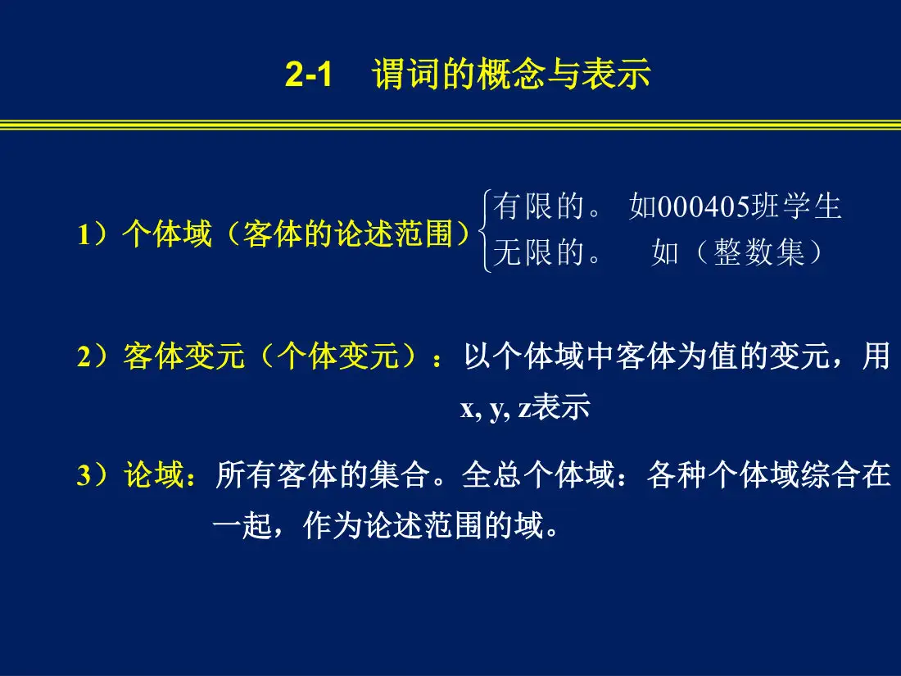

原文：

2-1 谓词的概念与表示

1）个体域（客体的论述范围） $\left\{\begin{array}{l} 有限的。 如000405班学生  \\  无限的。 如（整数集） \end{array}\right.$

2）客体变元（个体变元）：以个体域中客体为值的变元，用 x, y, z 表示

3）论域：所有客体的集合。全总个体域：各种个体域综合在一起，作为论述范围的域。

### 2-2 命题函数与量词

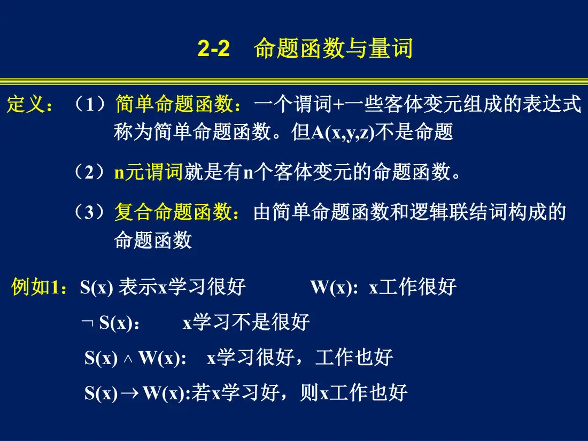

原文：

2-2 命题函数与量词

定义: (1) 简单命题函数: 一个谓词+一些客体变元组成的表达式称为简单命题函数。但A(x,y,z)不是命题

(2) n元谓词就是有n个客体变元的命题函数。

(3) 复合命题函数: 由简单命题函数和逻辑联结词构成的命题函数

例如1: S(x) 表示x学习很好 W(x): x工作很好

$\neg S(x)$ : x学习不是很好

S(x) ∧ W(x): x学习很好，工作也好

$\mathrm{S(x)} \rightarrow \mathrm{W(x)}$ : 若x学习好，则x工作也好

### 2-2 命题函数与量词

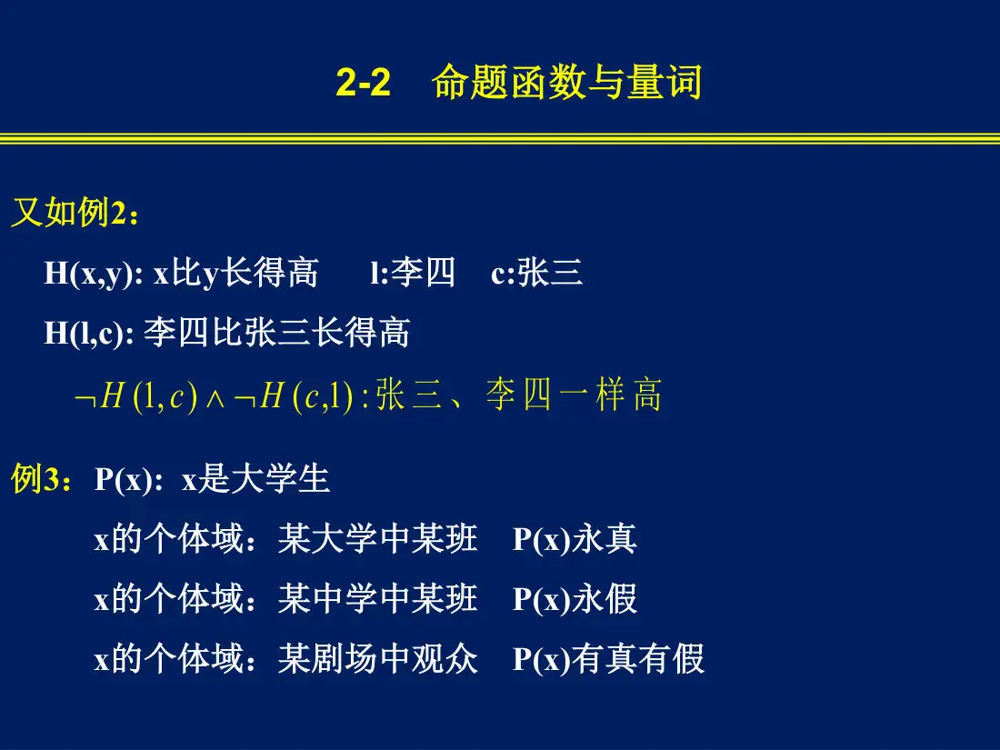

原文：

2-2 命题函数与量词

又如例2:

H(x,y): x比y长得高 l:李四 c:张三

H(l,c): 李四比张三长得高

$\neg H(1,c)\land\neg H(c,1)$ :张三、李四一样高

例3: P(x): x是大学生

x的个体域：某大学中某班 P(x)永真

x的个体域：某中学中某班 P(x)永假

x的个体域：某剧场中观众 P(x)有真有假

### 2-2 命题函数与量词

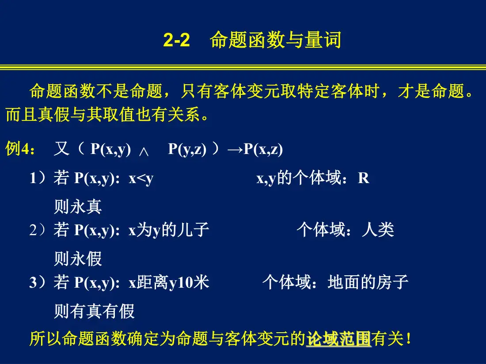

原文：

2-2 命题函数与量词

命题函数不是命题，只有客体变元取特定客体时，才是命题。而且真假与其取值也有关系。

例4: 又（P(x,y) ∧ P(y,z)）→P(x,z)

1) 若 $\mathrm{P}(\mathrm{x},\mathrm{y})$ ： $\mathrm{x} <   \mathrm{y}$ 则永真

x,y的个体域: R

2）若 $\mathrm{P}(\mathbf{x},\mathbf{y})$ ： $\mathbf{x}$ 为 $\mathbf{y}$ 的儿子则永假

个体域：人类

3) 若 $\mathrm{P}(\mathrm{x},\mathrm{y})$ : x距离y10米

个体域：地面的房子

则有真有假

所以命题函数确定为命题与客体变元的论域范围有关！

### 2-2 命题函数与量词

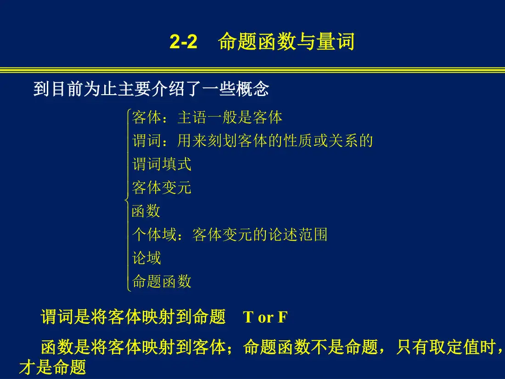

原文：

2-2 命题函数与量词

到目前为止主要介绍了一些概念

客体：主语一般是客体

谓词：用来刻划客体的性质或关系的

谓词填式

客体变元

函数

个体域：客体变元的论述范围

论域

命题函数

谓词是将客体映射到命题 T or F

函数是将客体映射到客体；命题函数不是命题，只有取定值时，才是命题

### 2-2 命题函数与量词

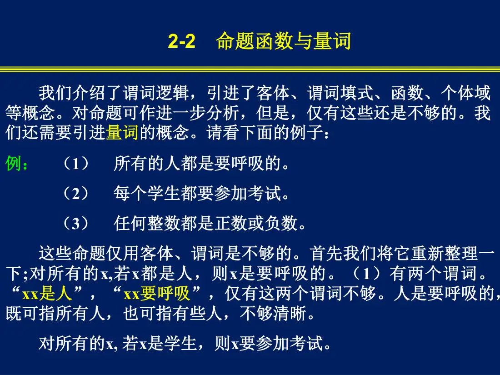

原文：

2-2 命题函数与量词

我们介绍了谓词逻辑，引进了客体、谓词填式、函数、个体域等概念。对命题可作进一步分析，但是，仅有这些还是不够的。我们还需要引进量词的概念。请看下面的例子：

例: (1) 所有的人都是要呼吸的。

(2) 每个学生都要参加考试。

(3) 任何整数都是正数或负数。

这些命题仅用客体、谓词是不够的。首先我们将它重新整理一下;对所有的x,若x都是人，则x是要呼吸的。（1）有两个谓词。“xx是人”，“xx要呼吸”，仅有这两个谓词不够。人是要呼吸的，既可指所有人，也可指有些人，不够清晰。

对所有的x, 若x是学生，则x要参加考试。

### 2-2 命题函数与量词

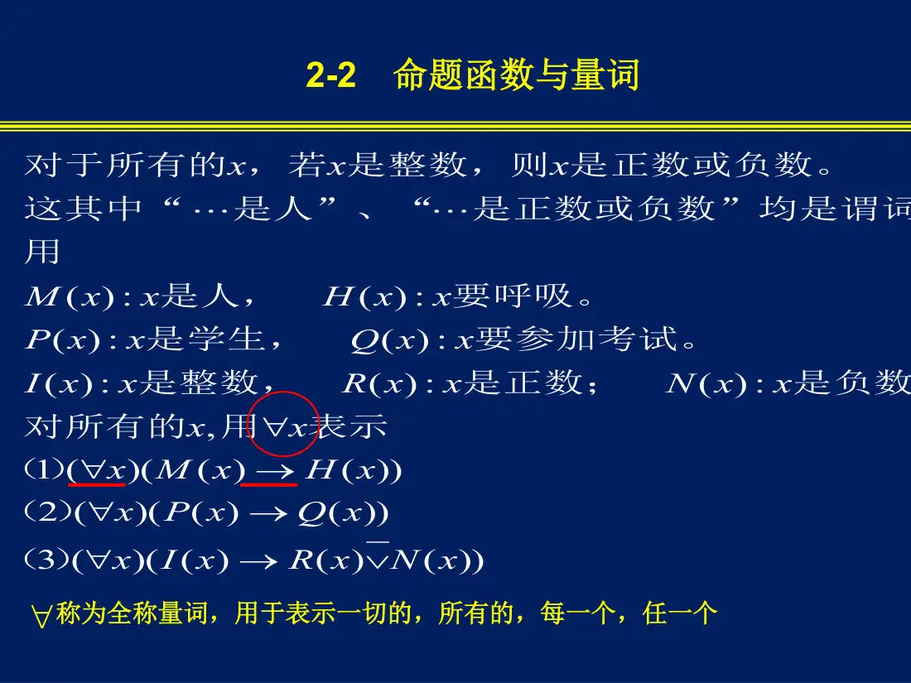

原文：

2-2 命题函数与量词

对于所有的x，若x是整数，则x是正数或负数。
这其中“…是人”、“…是正数或负数”均是谓词用
M(x): x 是人，H(x): x 要呼吸。
P(x): x 是学生，Q(x): x 要参加考试。
I(x): x 是整数，R(x): x 是正数；N(x): x 是负数
对所有的x, 用∀x表示
(1) (∀x)(M(x) → H(x))
(2) (∀x)(P(x) → Q(x))
(3) (∀x)(I(x) → R(x) ∨ N(x))
∀ 称为全称量词，用于表示一切的，所有的，每一个，任一个

### 2-2 命题函数与量词

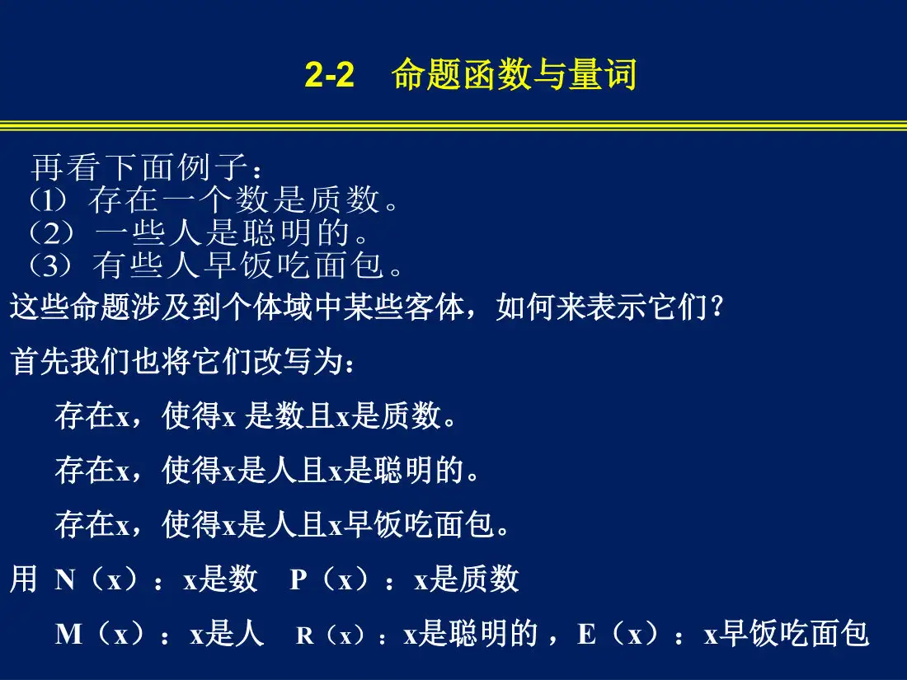

原文：

2-2 命题函数与量词

再看下面例子:

(1) 存在一个数是质数。

(2) 一些人是聪明的。

(3) 有些人早饭吃面包。

这些命题涉及到个体域中某些客体，如何来表示它们？

首先我们也将它们改写为:

存在x，使得x是数且x是质数。

存在x，使得x是人且x是聪明的。

存在x，使得x是人且x早饭吃面包。

用 N(x): x 是数 P(x): x 是质数

M (x): x是人 R (x): x是聪明的, E (x): x早饭吃面包这里有一些人，Exist x,用反写一存在变量词，
用于表示个体域中的某些客体
∴ (1) (∃x) (N(x)∧P(x))
(2)(∃x) (M(x)∧R(x))
(3)(∃x) (M(x)∧E(x))
全称量词与存在量词统称为量词，每个由量词确定的表达式，
都与个体域有关，如：
(∀x) (M(x)→H(x)) M(x) 是用于限定H(x) 中的个体域
M(x) 称为特性谓词，限定客体变元变化范围的谓词
当限定范围为M(x)中时，可简写为：(∀x) (H(x))
此命题对于论域为人类时，是正确的，而对于自然数则是FALSE，
因为我们是讨论带有量词的命题函数时，必须确定其个体域，把
特性谓词写出来。并且，为了方便，我们将所有命题函数的个体域
全都统一，使用全总个体域。对变化范围用特性谓词加以限制。
一般地，对全称量词，将特性谓词作为前提条件，命题通常写成
条件式，对存在量词，常将之作为合取项。

### 2-2 命题函数与量词

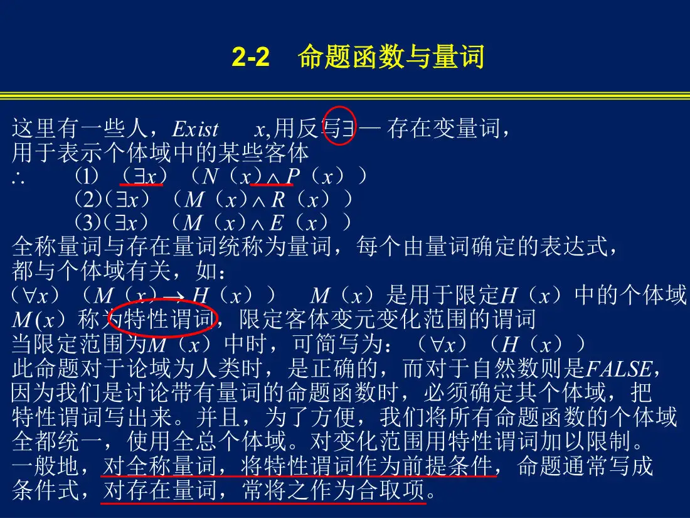

原文：

2-2 命题函数与量词

### 2-2 命题函数与量词

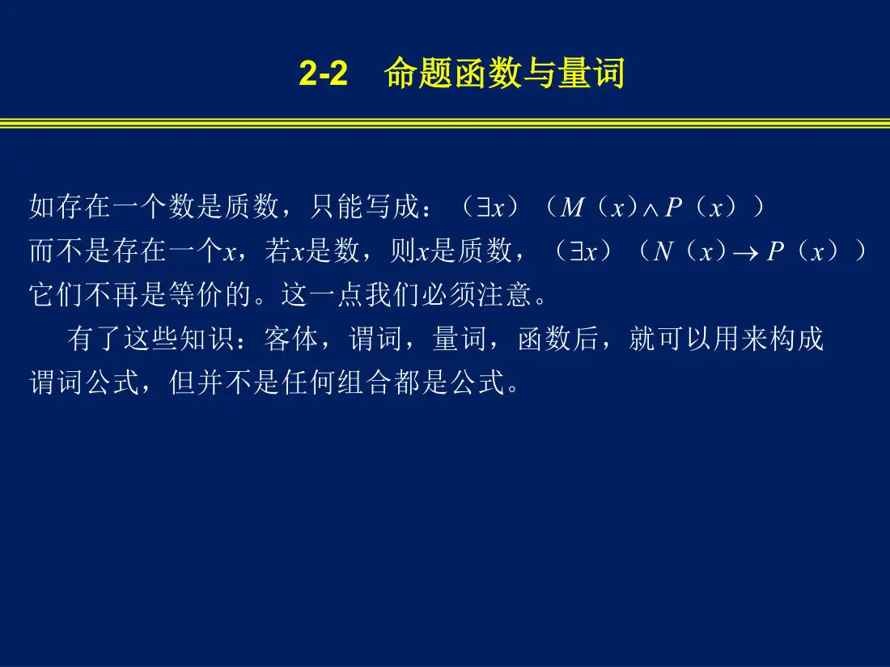

原文：

2-2 命题函数与量词

如存在一个数是质数，只能写成：（∃x）（M(x)∧P(x)）
而不是存在一个x，若x是数，则x是质数，（∃x）（N(x)→P(x)）
它们不再是等价的。这一点我们必须注意。

有了这些知识：客体，谓词，量词，函数后，就可以用来构成谓词公式，但并不是任何组合都是公式。

### 2-3 谓词公式与翻译

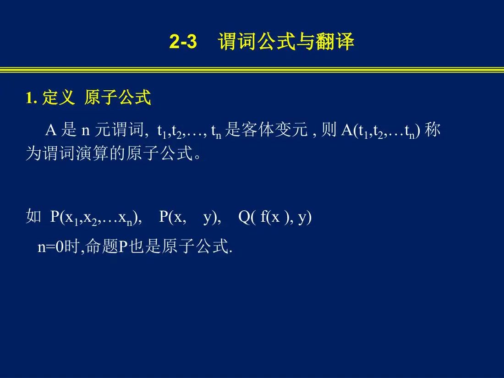

原文：

2-3 谓词公式与翻译

1. 定义 原子公式

A 是 n 元谓词, $t_1, t_2, \ldots, t_n$ 是客体变元, 则 A( $t_1, t_2, \ldots, t_n$ ) 称为谓词演算的原子公式。

如 $P(x_{1},x_{2},\ldots,x_{n}),\quad P(x,y),\quad Q(f(x),y)$ n=0时,命题P也是原子公式.

### 2-3 谓词公式与翻译

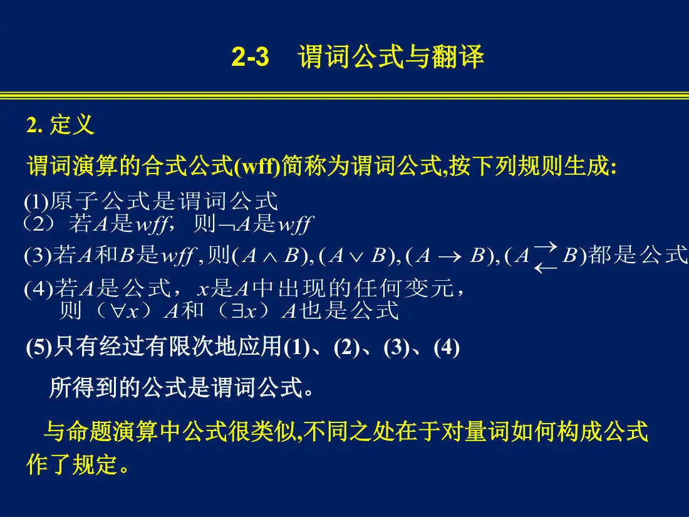

原文：

2-3 谓词公式与翻译

2. 定义

谓词演算的合式公式(wff)简称为谓词公式,按下列规则生成:

(1)原子公式是谓词公式

(2) 若 $A$ 是 $w f f$ , 则 $\neg A$ 是 $w f f$

(3)若A和B是wff,则 $(A\land B),(A\lor B),(A\rightarrow B),(A\stackrel{\rightarrow}{\leftarrow}B)$ 都是公式

(4)若A是公式，x是A中出现的任何变元，则（∀x）A和（∃x）A也是公式

(5)只有经过有限次地应用(1)、(2)、(3)、(4)所得到的公式是谓词公式。

与命题演算中公式很类似,不同之处在于对量词如何构成公式作了规定。

### 2-3 谓词公式与翻译

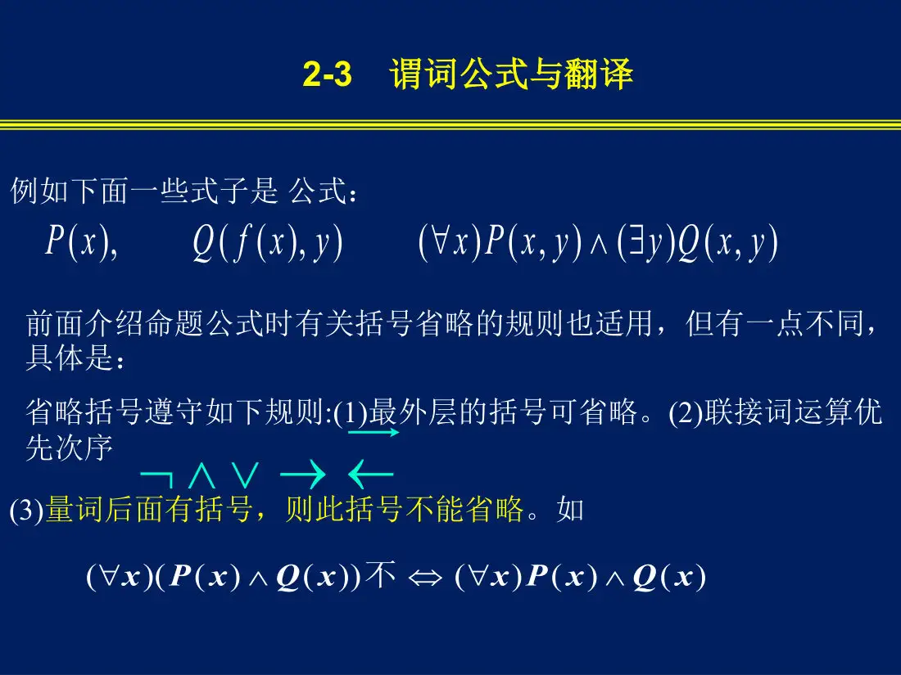

原文：

2-3 谓词公式与翻译

例如下面一些式子是 公式:

$P(x),\qquad Q(f(x),y)$

$(\forall x)P(x,y)\land (\exists y)Q(x,y)$

前面介绍命题公式时有关括号省略的规则也适用，但有一点不同，具体是：

省略括号遵守如下规则:(1)最外层的括号可省略。(2)联接词运算优先次序

$\neg \land \lor \rightarrow \leftarrow$

(3)量词后面有括号，则此括号不能省略。如

$(\forall x)(P(x)\land Q(x))$ 不 $\Leftrightarrow (\forall x)P(x)\land Q(x)$

### 2-3 谓词公式与翻译

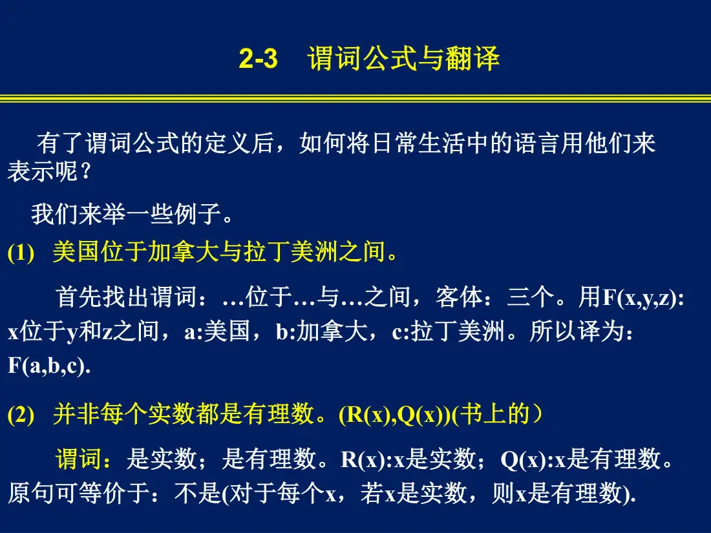

原文：

2-3 谓词公式与翻译

有了谓词公式的定义后，如何将日常生活中的语言用他们来表示呢？

我们来举一些例子。

(1) 美国位于加拿大与拉丁美洲之间。

首先找出谓词：…位于…与…之间，客体：三个。用F(x,y,z):x位于y和z之间，a:美国，b:加拿大，c:拉丁美洲。所以译为：F(a,b,c).

(2) 并非每个实数都是有理数。(R(x), Q(x))(书上的)

谓词: 是实数; 是有理数。R(x):x是实数; Q(x):x是有理数。原句可等价于: 不是(对于每个x, 若x是实数, 则x是有理数).

### 2-3 谓词公式与翻译

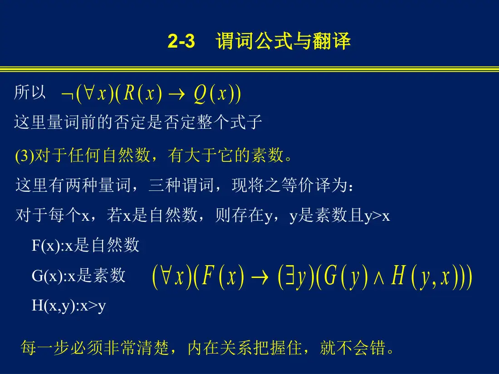

原文：

2-3 谓词公式与翻译

所以 $\neg(\forall x)(R(x)\rightarrow Q(x))$ 这里量词前的否定是否定整个式子

(3)对于任何自然数，有大于它的素数。

这里有两种量词，三种谓词，现将之等价译为：

对于每个x，若x是自然数，则存在y，y是素数且y>x

$F(x):x$ 是自然数

G(x):x是素数 $(\forall x)(F(x)\rightarrow(\exists y)(G(y)\land H(y,x)))$

H(x,y):x>y

每一步必须非常清楚，内在关系把握住，就不会错。

### 2-3 谓词公式与翻译

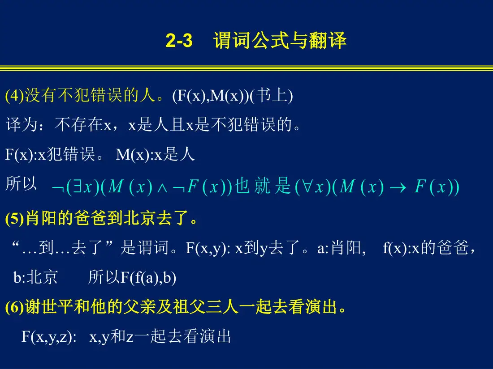

原文：

2-3 谓词公式与翻译

(4)没有不犯错误的人。(F(x),M(x))(书上)

译为：不存在x，x是人且x是不犯错误的。

F(x):x犯错误。M(x):x是人

所以 $\neg(\exists x)(M(x)\land\neg F(x))$ 也就是 $(\forall x)(M(x)\rightarrow F(x))$

(5)肖阳的爸爸到北京去了。

“…到…去了”是谓词。F(x,y): x到y去了。a:肖阳，f(x):x的爸爸，

b:北京 所以F(f(a),b)

(6)谢世平和他的父亲及祖父三人一起去看演出。

F(x,y,z): x,y和z一起去看演出

### 2-3 谓词公式与翻译

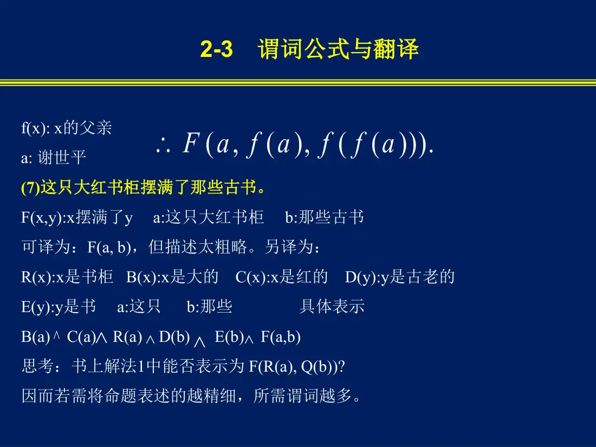

原文：

2-3 谓词公式与翻译

f(x): x 的父亲

a: 谢世平

∴ $F(a, f(a), f(f(a)))$ .

(7)这只大红书柜摆满了那些古书。

F(x,y):x摆满了y a:这只大红书柜 b:那些古书

可译为：F(a, b)，但描述太粗略。另译为：

R(x):x是书柜 B(x):x是大的 C(x):x是红的 D(y):y是古老的

E(y):y是书 a:这只 b:那些 具体表示

$\mathrm{B(a)}^{\wedge}\mathrm{C(a)}\wedge \mathrm{R(a)}\wedge \mathrm{D(b)}\wedge \mathrm{E(b)}\wedge \mathrm{F(a,b)}$

思考：书上解法1中能否表示为 F(R(a), Q(b))?

因而若需将命题表述的越精细，所需谓词越多。

### 2-3 谓词公式与翻译

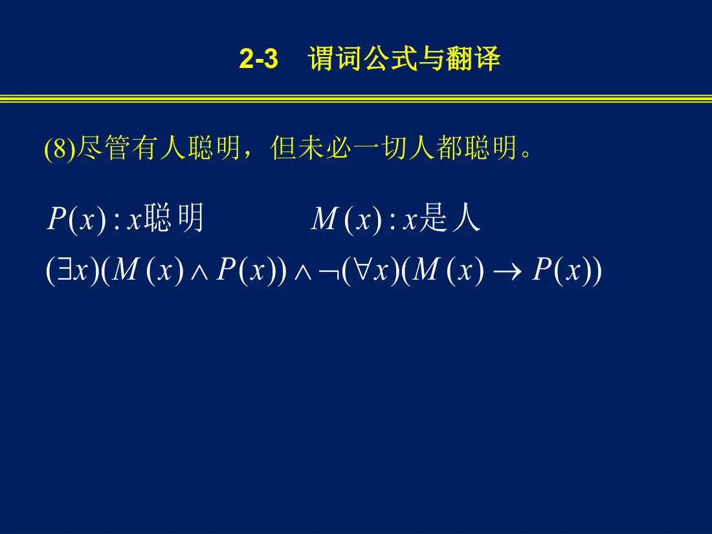

原文：

2-3 谓词公式与翻译

(8)尽管有人聪明，但未必一切人都聪明。

$P(x)$ : x聪明

$M(x)$ : x 是人

$$
(\exists x) (M (x) \land P (x)) \land \lnot (\forall x) (M (x) \to P (x))
$$

### 2-4 变元的约束

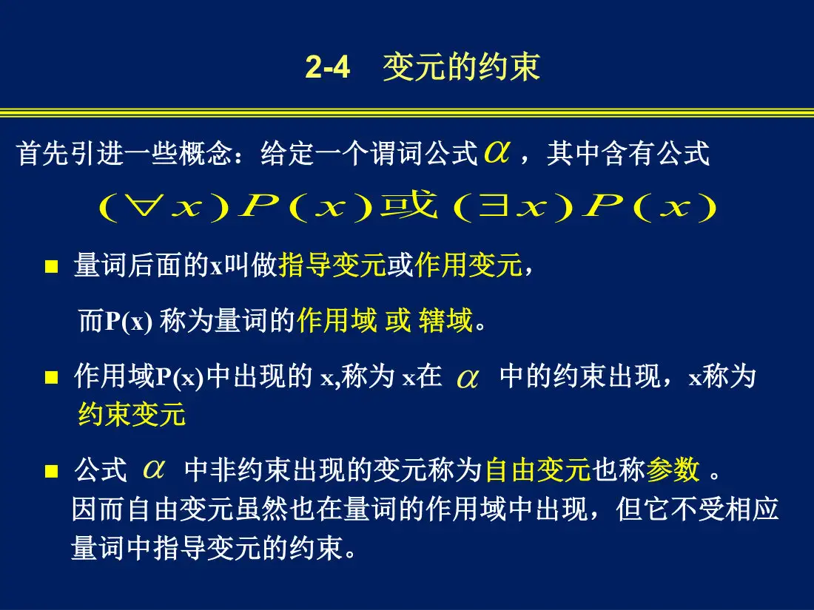

原文：

2-4 变元的约束

首先引进一些概念：给定一个谓词公式 $\alpha$ ，其中含有公式

$(\forall x)P(x)$ 或 $(\exists x)P(x)$

■ 量词后面的x叫做指导变元或作用变元，而P(x)称为量词的作用域或辖域。

■ 作用域P(x)中出现的 x, 称为 x 在 $\alpha$ 中的约束出现，x 称为约束变元

■ 公式 $\alpha$ 中非约束出现的变元称为自由变元也称参数。因而自由变元虽然也在量词的作用域中出现，但它不受相应量词中指导变元的约束。

### 2-4 变元的约束

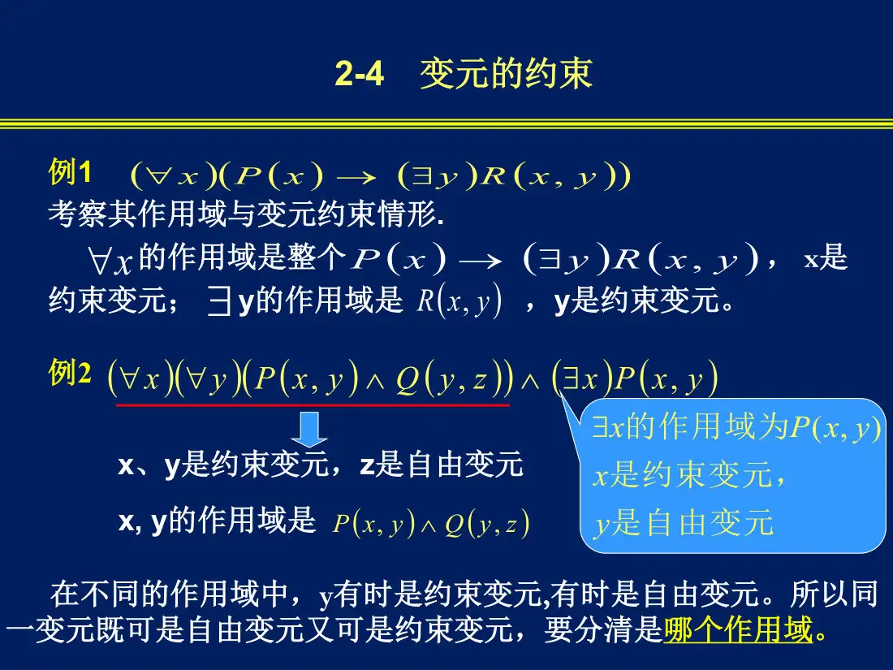

原文：

2-4 变元的约束

例1 $(\forall x)(P(x) \rightarrow (\exists y)R(x, y))$

考察其作用域与变元约束情形.

$\forall x$ 的作用域是整个 $P(x) \to (\exists y)R(x, y)$ ，x 是约束变元； $\exists y$ 的作用域是 $R(x, y)$ ，y 是约束变元。

例2 $(\forall x)(\forall y)(P(x,y)\land Q(y,z))\land (\exists x)P(x,y)$

x、y是约束变元，z是自由变元

x, y的作用域是 $P(x, y) \wedge Q(y, z)$

$\exists x$ 的作用域为 $P(x,y)$ x是约束变元，
y是自由变元

在不同的作用域中，y有时是约束变元,有时是自由变元。所以同一变元既可是自由变元又可是约束变元，要分清是哪个作用域。

### 2-4 变元的约束

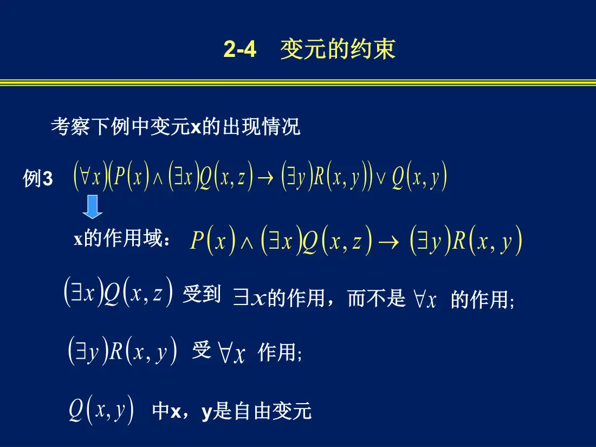

原文：

2-4 变元的约束

考察下例中变元x的出现情况

例3 $(\forall x)(P(x)\land (\exists x)Q(x,z)\to (\exists y)R(x,y))\lor Q(x,y)$

x的作用域: $P(x) \land (\exists x)Q(x, z) \rightarrow (\exists y)R(x, y)$

$(\exists x)Q(x,z)$ 受到 $\exists x$ 的作用，而不是 $\forall x$ 的作用；

$(\exists y)R(x,y)$ 受 $\forall x$ 作用;

$Q(x,y)$ 中x，y是自由变元

### 2-4 变元的约束

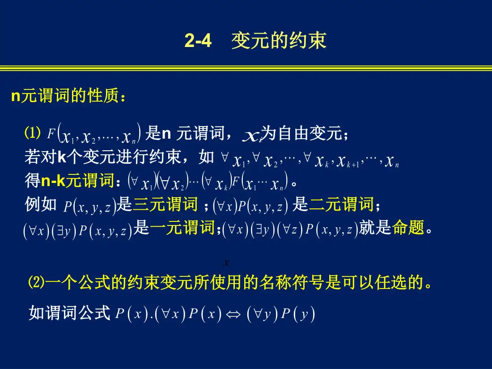

原文：

2-4 变元的约束

n元谓词的性质:

(1) $F(x_1, x_2, \ldots, x_n)$ 是n元谓词， $x_i$ 为自由变元；若对k个变元进行约束，如 $\forall x_1, \forall x_2, \ldots, \forall x_k, x_{k+1}, \ldots, x_n$ 得n-k元谓词： $(\forall x_1)(\forall x_2) \cdots (\forall x_k)F(x_1 \cdots x_n)$ 。例如 $P(x, y, z)$ 是三元谓词； $(\forall x)P(x, y, z)$ 是二元谓词； $(\forall x)(\exists y)P(x, y, z)$ 是一元谓词； $(\forall x)(\exists y)(\forall z)P(x, y, z)$ 就是命题。

(2)一个公式的约束变元所使用的名称符号是可以任选的。
如谓词公式 $P(x)$ . ( $\forall x$ ) $P(x) \Leftrightarrow (\forall y)P(y)$

### 2-4 变元的约束

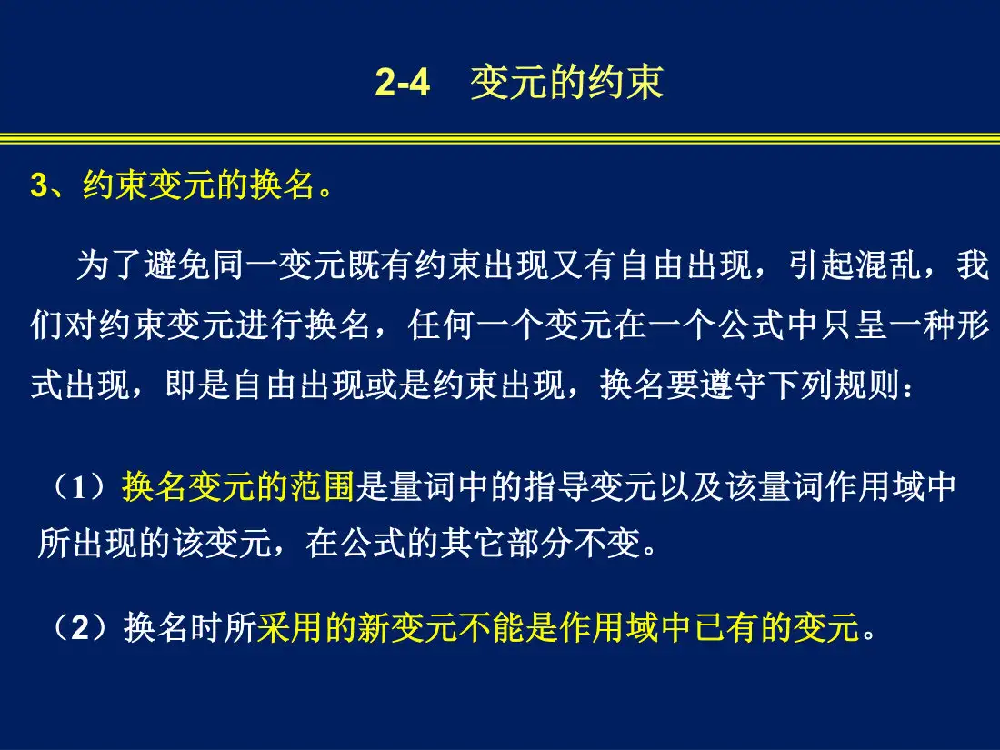

原文：

2-4 变元的约束

3、约束变元的换名。

为了避免同一变元既有约束出现又有自由出现，引起混乱，我们对约束变元进行换名，任何一个变元在一个公式中只呈一种形式出现，即是自由出现或是约束出现，换名要遵守下列规则：

(1) 换名变元的范围是量词中的指导变元以及该量词作用域中所出现的该变元，在公式的其它部分不变。

(2) 换名时所采用的新变元不能是作用域中已有的变元。

### $$

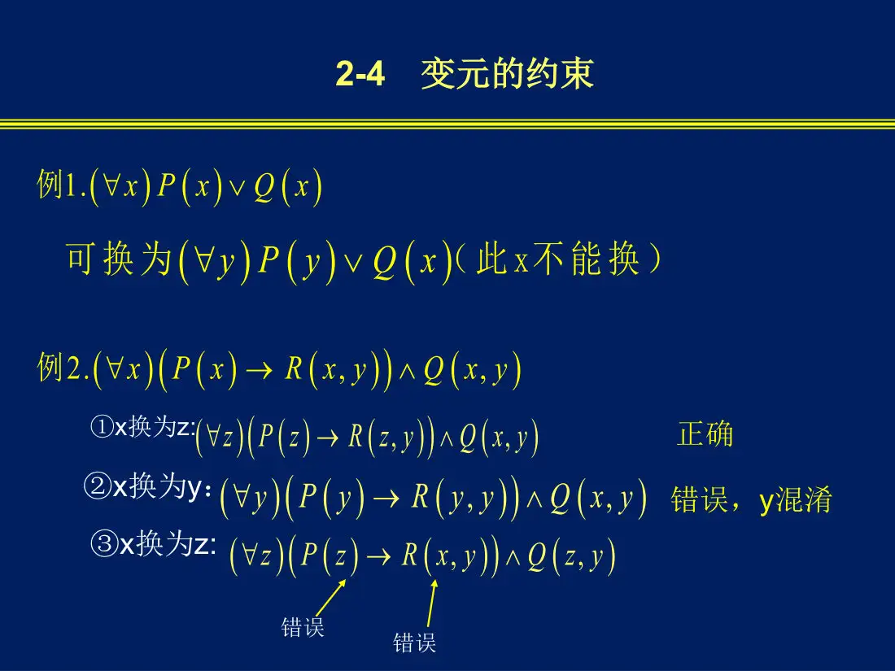

原文：

例1. $(\forall x)P(x)\lor Q(x)$ 可换为 $(\forall y)P(y)\lor Q(x)$ （此x不能换）

例2. $(\forall x)(P(x)\rightarrow R(x,y))\land Q(x,y)$

$$
\left(\forall z\right)\left(P (z) \rightarrow R (z, y)\right) \wedge Q (x, y)
$$

②x换为y: $(\forall y)(P(y) \rightarrow R(y, y)) \land Q(x, y)$ 错误，y混淆

$$
(\forall z) (P (z) \rightarrow R (x, y)) \wedge Q (z, y)
$$

错误

2-4 变元的约束

错误

### 2-4 变元的约束

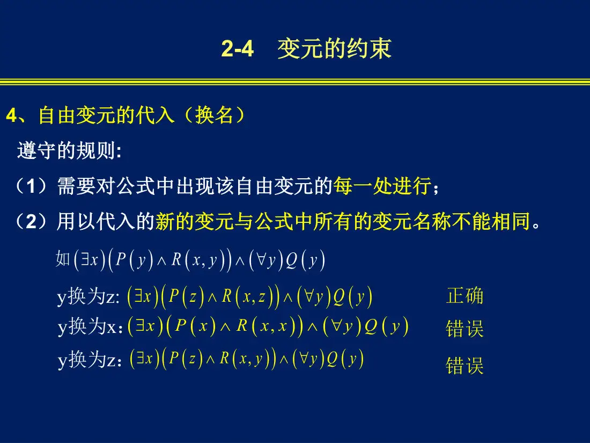

原文：

2-4 变元的约束

4、自由变元的代入（换名）
遵守的规则：

(1) 需要对公式中出现该自由变元的每一处进行;

(2) 用以代入的新的变元与公式中所有的变元名称不能相同。
如 $(\exists x)(P(y)\land R(x,y))\land(\forall y)Q(y)$ y换为z: $(\exists x)(P(z)\land R(x,z))\land(\forall y)Q(y)$ 正确
y换为x: $(\exists x)(P(x)\land R(x,x))\land(\forall y)Q(y)$ 错误
y换为z: $(\exists x)(P(z)\land R(x,y))\land(\forall y)Q(y)$ 错误

### 2-4 变元的约束

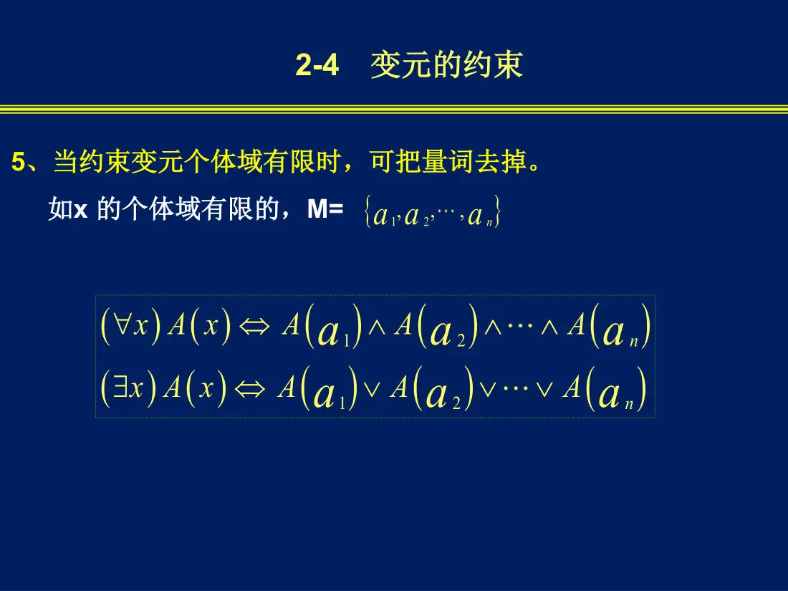

原文：

2-4 变元的约束

5、当约束变元个体域有限时，可把量词去掉。
如x的个体域有限的， $M=\left\{a_{1},a_{2},\cdots,a_{n}\right\}$

$$
(\forall x) A (x) \Leftrightarrow A (a _ {1}) \wedge A (a _ {2}) \wedge \dots \wedge A (a _ {n})
$$

$$
(\exists x) A (x) \Leftrightarrow A (a _ {1}) \vee A (a _ {2}) \vee \dots \vee A (a _ {n})
$$

### 2-4 变元的约束

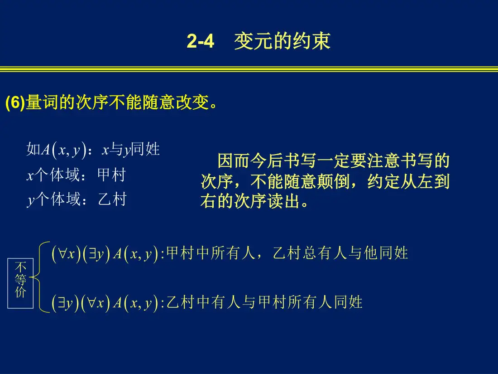

原文：

2-4 变元的约束

(6)量词的次序不能随意改变。

如 $A(x,y)$ : x与y同姓

x个体域：甲村

y个体域：乙村

因而今后书写一定要注意书写的次序，不能随意颠倒，约定从左到右的次序读出。

$(\forall x)(\exists y)A(x,y)$ :甲村中所有人，乙村总有人与他同姓

不等价

$(\exists y)(\forall x)A(x,y)$ : 乙村中有人与甲村所有人同姓

### 2-5 谓词演算的等价式与蕴含式

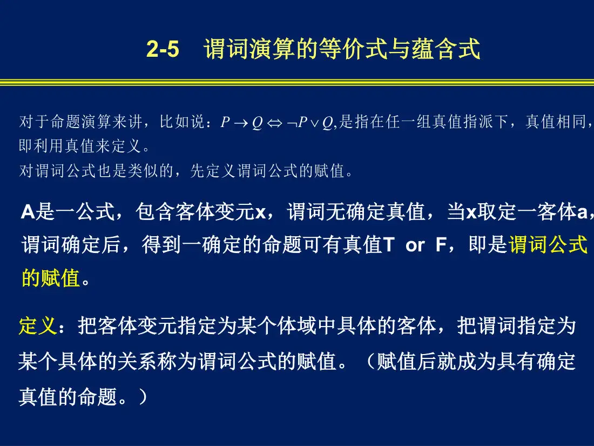

原文：

2-5 谓词演算的等价式与蕴含式

对于命题演算来讲，比如说： $P \rightarrow Q \Leftrightarrow \neg P \lor Q$ ，是指在任一组真值指派下，真值相同，即利用真值来定义。

对谓词公式也是类似的，先定义谓词公式的赋值。

A是一公式，包含客体变元x，谓词无确定真值，当x取定一客体a，谓词确定后，得到一确定的命题可有真值T or F，即是谓词公式的赋值。

定义：把客体变元指定为某个体域中具体的客体，把谓词指定为某个具体的关系称为谓词公式的赋值。（赋值后就成为具有确定真值的命题。）

### 2-5 谓词演算的等价式与蕴含式

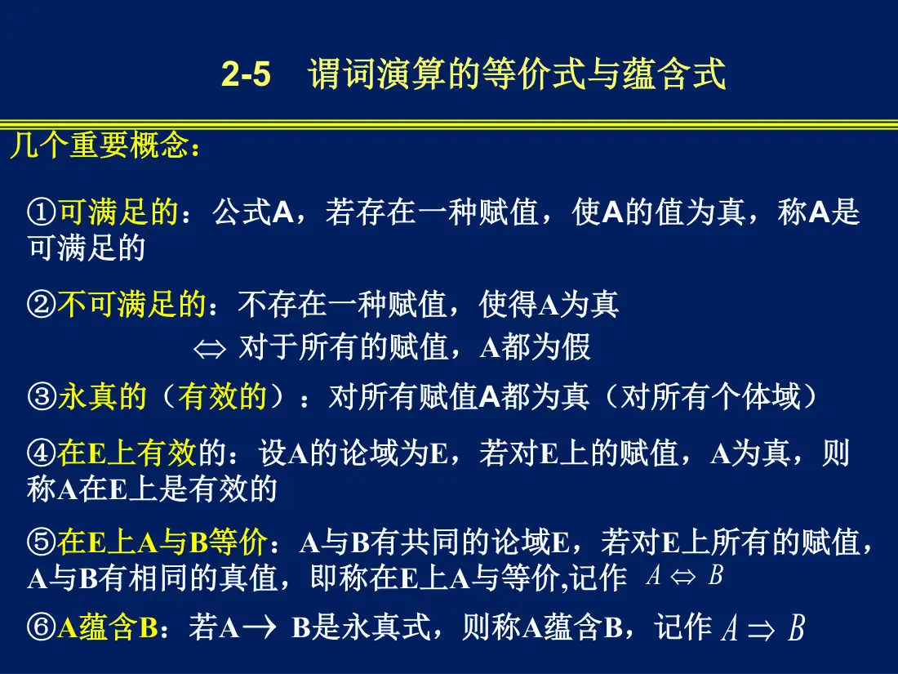

原文：

2-5 谓词演算的等价式与蕴含式

几个重要概念:

①可满足的：公式A，若存在一种赋值，使A的值为真，称A是可满足的

②不可满足的：不存在一种赋值，使得A为真

$\Leftrightarrow$ 对于所有的赋值，A都为假

③永真的（有效的）：对所有赋值A都为真（对所有个体域）

④在E上有效的：设A的论域为E，若对E上的赋值，A为真，则称A在E上是有效的

⑤在E上A与B等价：A与B有共同的论域E，若对E上所有的赋值，A与B有相同的真值，即称在E上A与等价,记作 $A \Leftrightarrow B$

⑥A蕴含B: 若A→B是永真式，则称A蕴含B，记作 A $\Rightarrow$ B

### 2-5 谓词演算的等价式与蕴含式

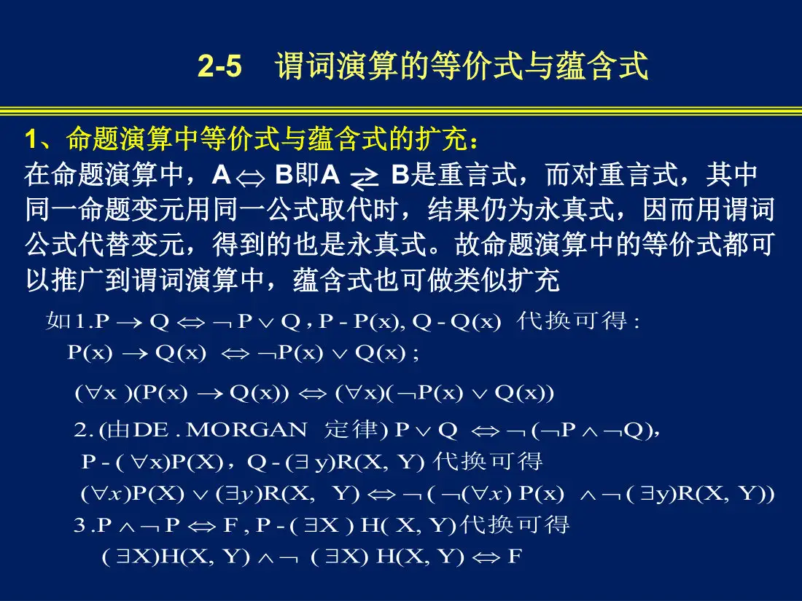

原文：

2-5 谓词演算的等价式与蕴含式

1、命题演算中等价式与蕴含式的扩充：在命题演算中，A ⇔ B 即 A ⇌ B 是重言式，而对重言式，其中同一命题变元用同一公式取代时，结果仍为永真式，因而用谓词公式代替变元，得到的也是永真式。故命题演算中的等价式都可以推广到谓词演算中，蕴含式也可做类似扩充

如1. $P \rightarrow Q \Leftrightarrow \neg P \lor Q, P - P(x), Q - Q(x)$ 代换可得： $P(x) \rightarrow Q(x) \Leftrightarrow \neg P(x) \lor Q(x);$ $(\forall x)(P(x) \rightarrow Q(x)) \Leftrightarrow (\forall x)(\neg P(x) \lor Q(x))$ 2. (由DE.MORGAN定律) $P \lor Q \Leftrightarrow \neg (\neg P \land \neg Q)$ , $P - (\forall x)P(X), Q - (\exists y)R(X, Y)$ 代换可得 $(\forall x)P(X) \lor (\exists y)R(X, Y) \Leftrightarrow \neg (\neg (\forall x)P(x) \land \neg (\exists y)R(X, Y))$ 3. $P \land \neg P \Leftrightarrow F, P - (\exists X)H(X, Y)$ 代换可得 $(\exists X)H(X, Y) \land \neg (\exists X)H(X, Y) \Leftrightarrow F$

### (2)量词与 $\neg$ 之间的关系

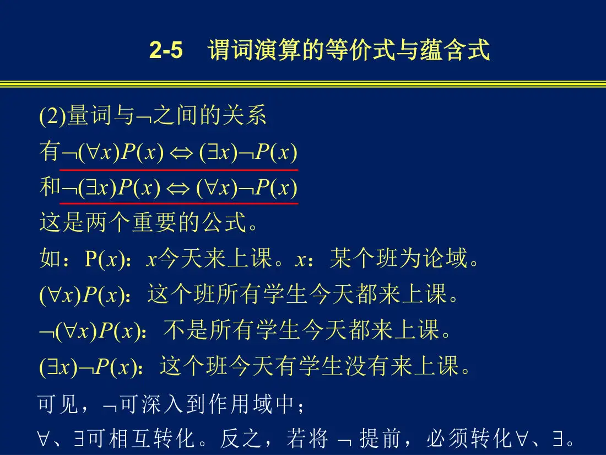

原文：

(2)量词与 $\neg$ 之间的关系  
有 $\neg (\forall x)P(x)\Leftrightarrow (\exists x)\neg P(x)$ 和 $\neg (\exists x)P(x)\Leftrightarrow (\forall x)\neg P(x)$ 这是两个重要的公式。如： $P(x)$ ： $x$ 今天来上课。 $x$ ：某个班为论域。 $(\forall x)P(x)$ ：这个班所有学生今天都来上课。 $\neg (\forall x)P(x)$ ：不是所有学生今天都来上课。 $(\exists x)\neg P(x)$ ：这个班今天有学生没有来上课。可见， $\neg$ 可深入到作用域中； $\forall$ 、 $\exists$ 可相互转化。反之，若将 $\neg$ 提前，必须转化 $\forall$ 、 $\exists$ 。

2-5 谓词演算的等价式与蕴含式

### 2-5 谓词演算的等价式与蕴含式

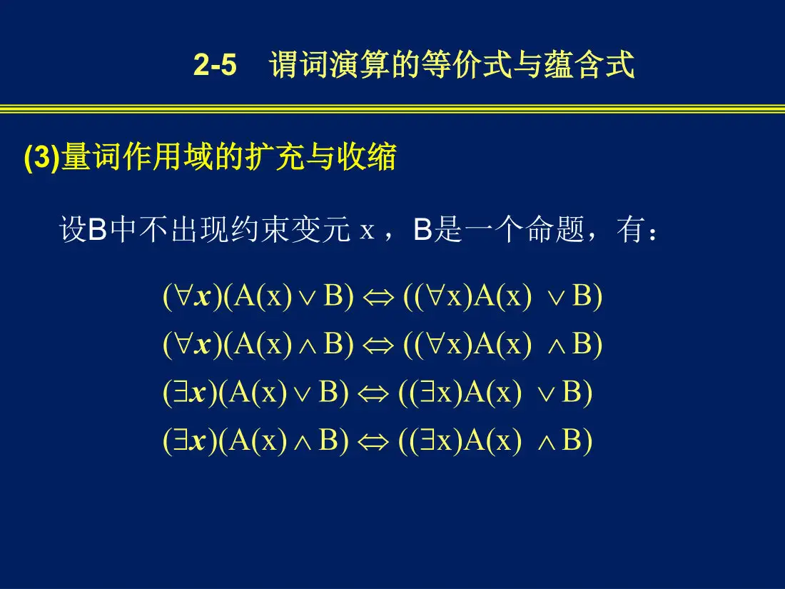

原文：

2-5 谓词演算的等价式与蕴含式

(3)量词作用域的扩充与收缩

设B中不出现约束变元 x，B是一个命题，有：

$$
(\forall x) (A (x) \lor B) \Leftrightarrow ((\forall x) A (x) \lor B)
$$

$(\forall x)(A(x) \land B) \Leftrightarrow ((\forall x)A(x) \land B)$

$$
(\exists x) (A (x) \lor B) \Leftrightarrow ((\exists x) A (x) \lor B)
$$

$$
(\exists x) (A (x) \land B) \Leftrightarrow ((\exists x) A (x) \land B)
$$

### 2-5 谓词演算的等价式与蕴含式

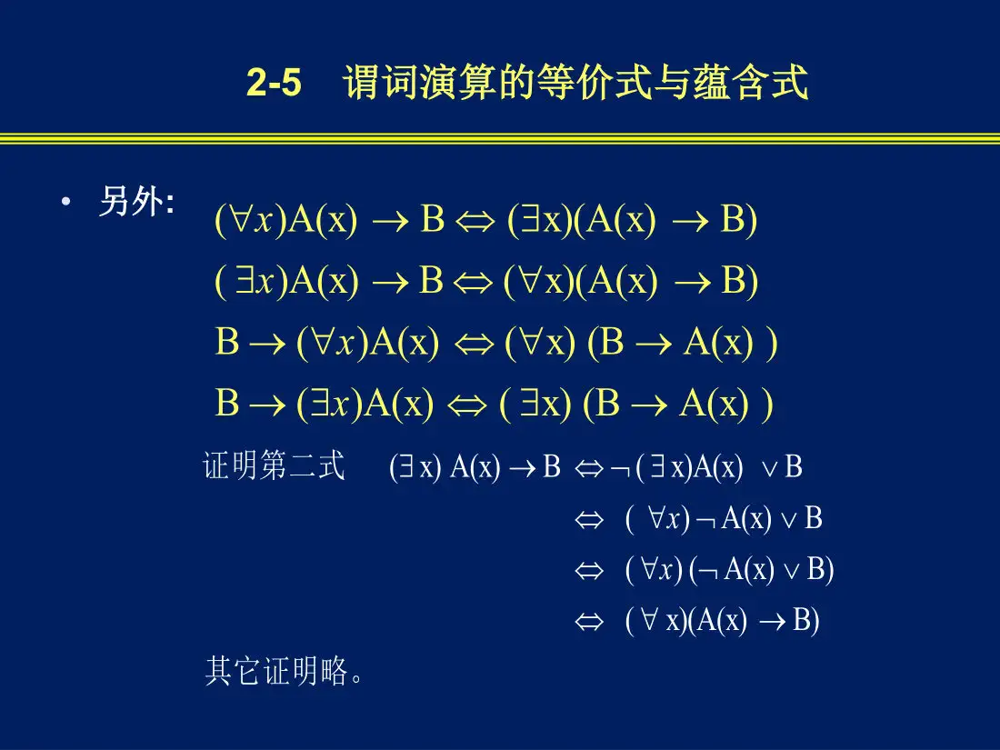

原文：

2-5 谓词演算的等价式与蕴含式

\- 另外:

$$
(\forall x) \mathrm{A} (\mathrm{x}) \rightarrow \mathrm{B} \Leftrightarrow (\exists \mathrm{x}) (\mathrm{A} (\mathrm{x}) \rightarrow \mathrm{B})
$$

$$
(\exists x) \mathrm{A} (\mathrm{x}) \rightarrow \mathrm{B} \Leftrightarrow (\forall \mathrm{x}) (\mathrm{A} (\mathrm{x}) \rightarrow \mathrm{B})
$$

$$
\mathrm{B} \rightarrow (\forall x) \mathrm{A} (\mathrm{x}) \Leftrightarrow (\forall \mathrm{x}) (\mathrm{B} \rightarrow \mathrm{A} (\mathrm{x}))
$$

$$
\mathrm{B} \rightarrow (\exists x) \mathrm{A} (\mathrm{x}) \Leftrightarrow (\exists \mathrm{x}) (\mathrm{B} \rightarrow \mathrm{A} (\mathrm{x}))
$$

$$
\Leftrightarrow (\forall x) \neg A (x) \lor B
$$

$$
\Leftrightarrow (\forall x) (\neg \mathrm{A} (\mathrm{x}) \lor \mathrm{B})
$$

$$
\Leftrightarrow (\forall x) (A (x) \rightarrow B)
$$

其它证明略。

### 另外，当B中不出现x，而包含y其他变元时，同样有：

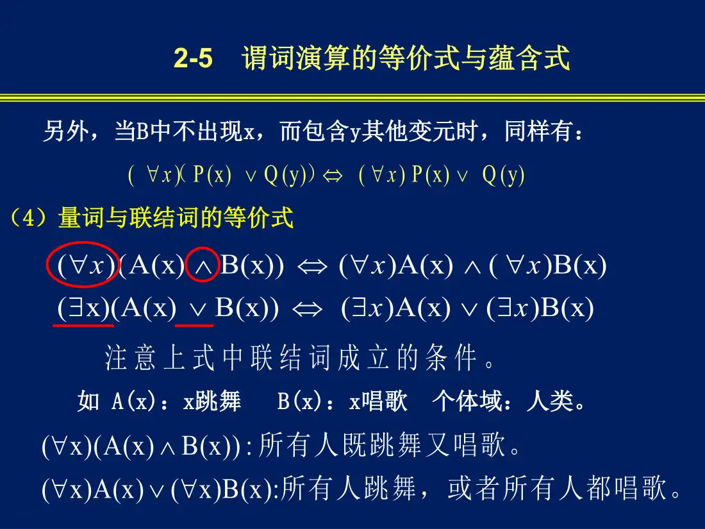

原文：

另外，当B中不出现x，而包含y其他变元时，同样有：

$(\forall x)(P(x) \lor Q(y)) \Leftrightarrow (\forall x) P(x) \lor Q(y)$

(4) 量词与联结词的等价式

$(\forall x)(A(x)\land B(x)) \Leftrightarrow (\forall x)A(x) \land (\forall x)B(x)$

$(\exists x)(A(x) \lor B(x)) \Leftrightarrow (\exists x)A(x) \lor (\exists x)B(x)$

注意上式中联结词成立的条件。

如 A(x): x 跳舞 B(x): x 唱歌 个体域: 人类。

$(\forall x)(A(x) \land B(x))$ :所有人既跳舞又唱歌。

$(\forall x)A(x)\lor (\forall x)B(x)$ :所有人跳舞，或者所有人都唱歌。

2-5 谓词演算的等价式与蕴含式

### (5)量词与联结词的蕴含式

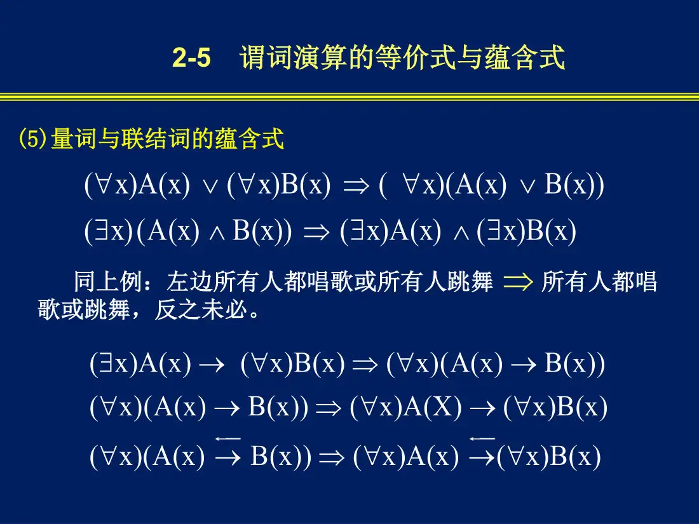

原文：

(5)量词与联结词的蕴含式

$$
(\forall \mathrm{x}) \mathrm{A} (\mathrm{x}) \lor (\forall \mathrm{x}) \mathrm{B} (\mathrm{x}) \Rightarrow (\forall \mathrm{x}) (\mathrm{A} (\mathrm{x}) \lor \mathrm{B} (\mathrm{x}))
$$

$$
(\exists x) (A (x) \land B (x)) \Rightarrow (\exists x) A (x) \land (\exists x) B (x)
$$

同上例：左边所有人都唱歌或所有人跳舞 $\Rightarrow$ 所有人都唱歌或跳舞，反之未必。

$$
(\exists x) A (x) \rightarrow (\forall x) B (x) \Rightarrow (\forall x) (A (x) \rightarrow B (x))
$$

$$
(\forall \mathrm{x}) (\mathrm{A} (\mathrm{x}) \rightarrow \mathrm{B} (\mathrm{x})) \Rightarrow (\forall \mathrm{x}) \mathrm{A} (\mathrm{X}) \rightarrow (\forall \mathrm{x}) \mathrm{B} (\mathrm{x})
$$

$$
(\forall x) (A (x) \rightarrow B (x)) \Rightarrow (\forall x) A (x) \rightarrow (\forall x) B (x)
$$

2-5 谓词演算的等价式与蕴含式

### 2-5 谓词演算的等价式与蕴含式

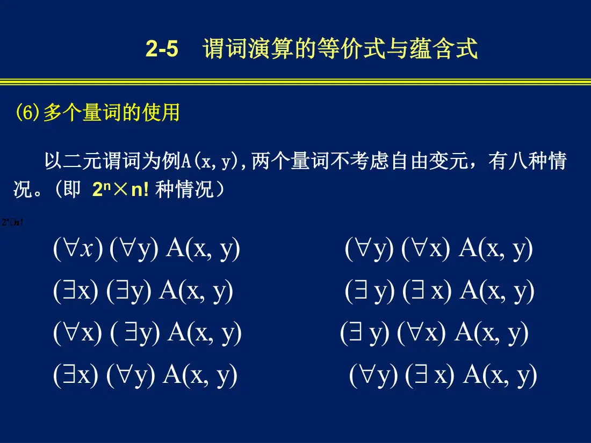

原文：

2-5 谓词演算的等价式与蕴含式

(6) 多个量词的使用

以二元谓词为例A(x, y), 两个量词不考虑自由变元, 有八种情况。(即 $2^{n} \times n!$ 种情况)

$(\forall x)(\forall y)A(x,y)$

(∃x) (∃y) A(x, y)

$(\forall x) (\exists y) A(x, y)$

(∃x) (∀y) A(x, y)

$(\forall y)(\forall x)A(x,y)$

(∃ y) (∃ x) A(x, y)

(∃ y) (∀x) A(x, y)

$(\forall y) (\exists x) A(x, y)$

### 2-5 谓词演算的等价式与蕴含式

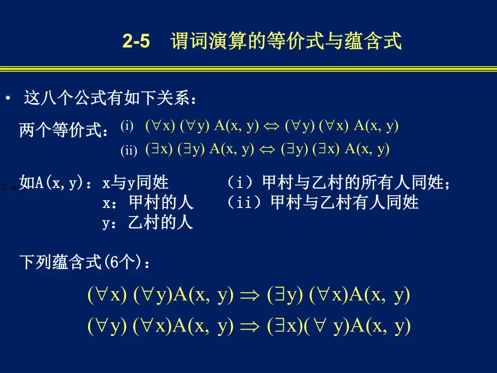

原文：

2-5 谓词演算的等价式与蕴含式

\- 这八个公式有如下关系:

两个等价式: (i) $(\forall x)(\forall y) A(x, y) \Leftrightarrow (\forall y)(\forall x) A(x, y)$

(ii) $(\exists x)(\exists y)A(x,y)\Leftrightarrow(\exists y)(\exists x)A(x,y)$

如A(x, y): x与y同姓
x: 甲村的人
y: 乙村的人(i) 甲村与乙村的所有人同姓;  
(ii) 甲村与乙村有人同姓

下列蕴含式(6个):

$$
(\forall x) (\forall y) A (x, y) \Rightarrow (\exists y) (\forall x) A (x, y)
$$

$$
(\forall \mathrm{y}) (\forall \mathrm{x}) \mathrm{A} (\mathrm{x}, \mathrm{y}) \Rightarrow (\exists \mathrm{x}) (\forall \mathrm{y}) \mathrm{A} (\mathrm{x}, \mathrm{y})
$$

### 2-5 谓词演算的等价式与蕴含式

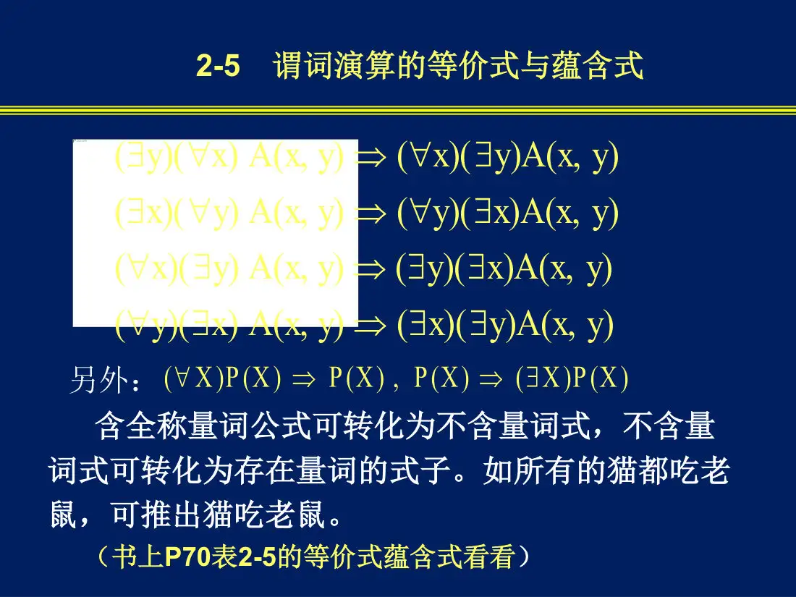

原文：

2-5 谓词演算的等价式与蕴含式

(∃y)(∀x) A(x, y) ⇒ (∀x)(∃y)A(x, y)
(∃x)(∀y) A(x, y) ⇒ (∀y)(∃x)A(x, y)
(∀x)(∃y) A(x, y) ⇒ (∃y)(∃x)A(x, y)
(∀y)(∃x) A(x, y) ⇒ (∃x)(∃y)A(x, y)

另外：(∀X)P(X) ⇒ P(X), P(X) ⇒ (∃X)P(X)

含全称量词公式可转化为不含量词式，不含量词式可转化为存在量词的式子。如所有的猫都吃老鼠，可推出猫吃老鼠。
（书上P70表2-5的等价式蕴含式看看）

### 2-6 前束范式

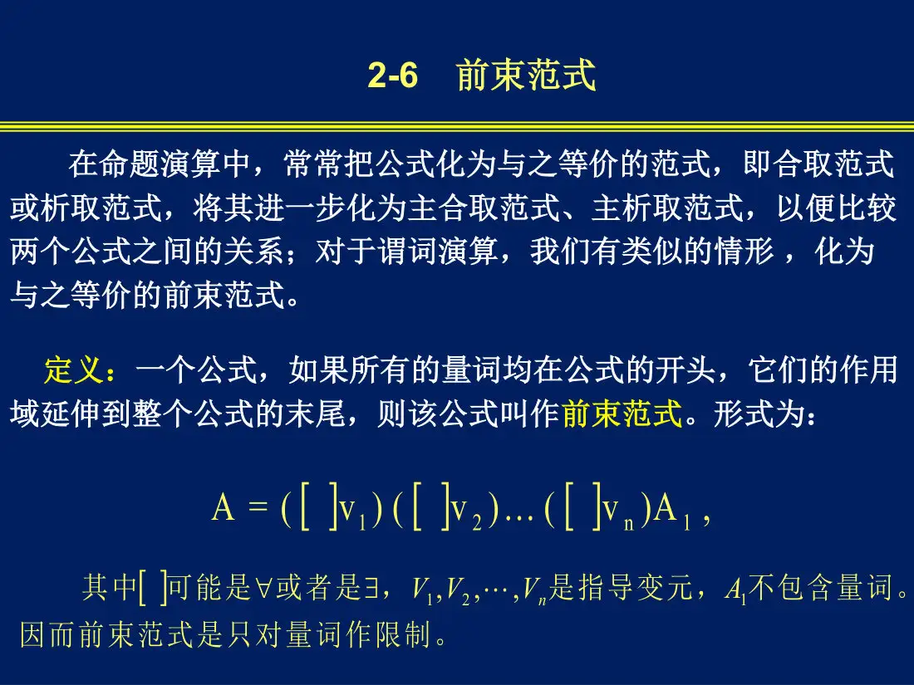

原文：

2-6 前束范式

在命题演算中，常常把公式化为与之等价的范式，即合取范式或析取范式，将其进一步化为主合取范式、主析取范式，以便比较两个公式之间的关系；对于谓词演算，我们有类似的情形，化为与之等价的前束范式。

定义：一个公式，如果所有的量词均在公式的开头，它们的作用域延伸到整个公式的末尾，则该公式叫作前束范式。形式为：

$$
\mathrm{A} = (\left[ \right] \mathrm{v} _ {1}) (\left[ \right] \mathrm{v} _ {2}) \dots (\left[ \right] \mathrm{v} _ {\mathrm{n}}) \mathrm{A} _ {1},
$$

其中[ ]可能是∀或者是∃， $V_{1}, V_{2}, \cdots, V_{n}$ 是指导变元， $A_{1}$ 不包含量词。因而前束范式是只对量词作限制。

### 2-6 前束范式

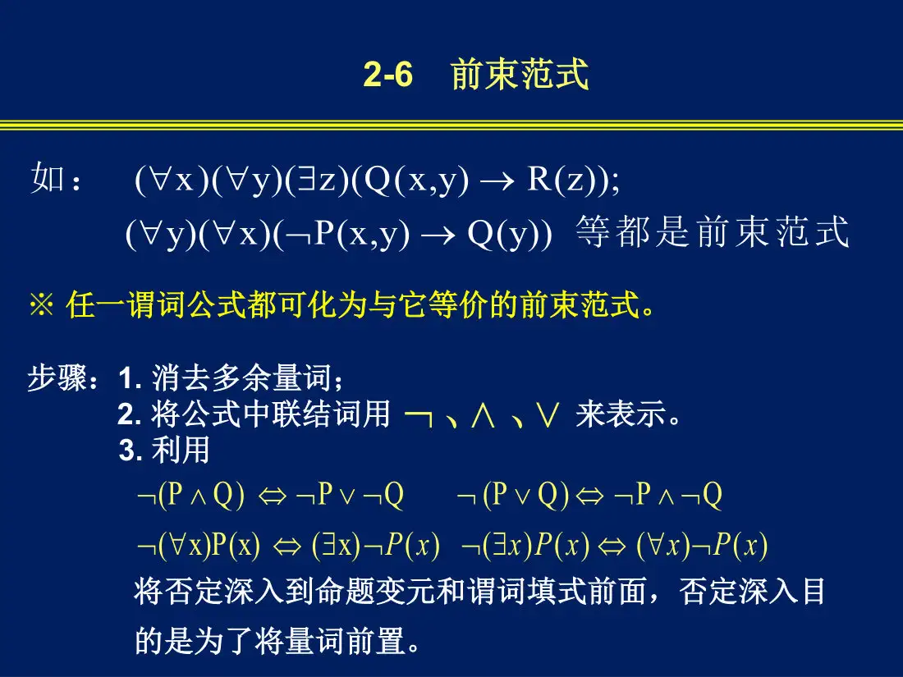

原文：

2-6 前束范式

如： $(\forall x)(\forall y)(\exists z)(Q(x,y) \to R(z));$ $(\forall y)(\forall x)(\neg P(x,y) \to Q(y))$ 等都是前束范式※任一谓词公式都可化为与它等价的前束范式。

步骤：1. 消去多余量词；
2. 将公式中联结词用 $\neg$ 、 $\land$ 、 $\lor$ 来表示。
3. 利用 $\neg(P \land Q) \Leftrightarrow \neg P \lor \neg Q$ $\neg(P \lor Q) \Leftrightarrow \neg P \land \neg Q$ $\neg(\forall x)P(x) \Leftrightarrow (\exists x) \neg P(x)$ $\neg(\exists x)P(x) \Leftrightarrow (\forall x) \neg P(x)$ 将否定深入到命题变元和谓词填式前面，否定深入目的是为了将量词前置。

### 2-6 前束范式

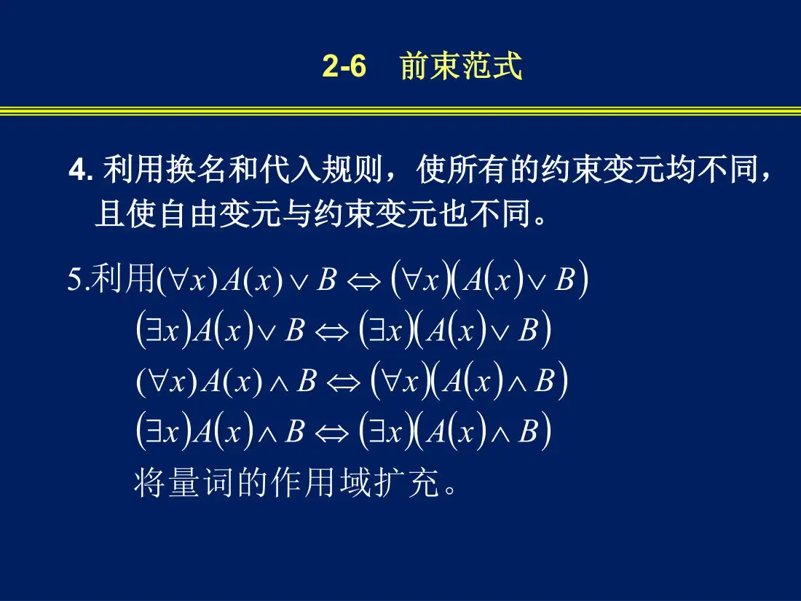

原文：

2-6 前束范式

4. 利用换名和代入规则，使所有的约束变元均不同，且使自由变元与约束变元也不同。

5.利用 $(\forall x)A(x)\lor B\Leftrightarrow (\forall x)(A(x)\lor B)$ $(\exists x)A(x)\lor B\Leftrightarrow (\exists x)(A(x)\lor B)$ $(\forall x)A(x)\land B\Leftrightarrow (\forall x)(A(x)\land B)$ $(\exists x)A(x)\land B\Leftrightarrow (\exists x)(A(x)\land B)$ 将量词的作用域扩充。

### 2-6 前束范式

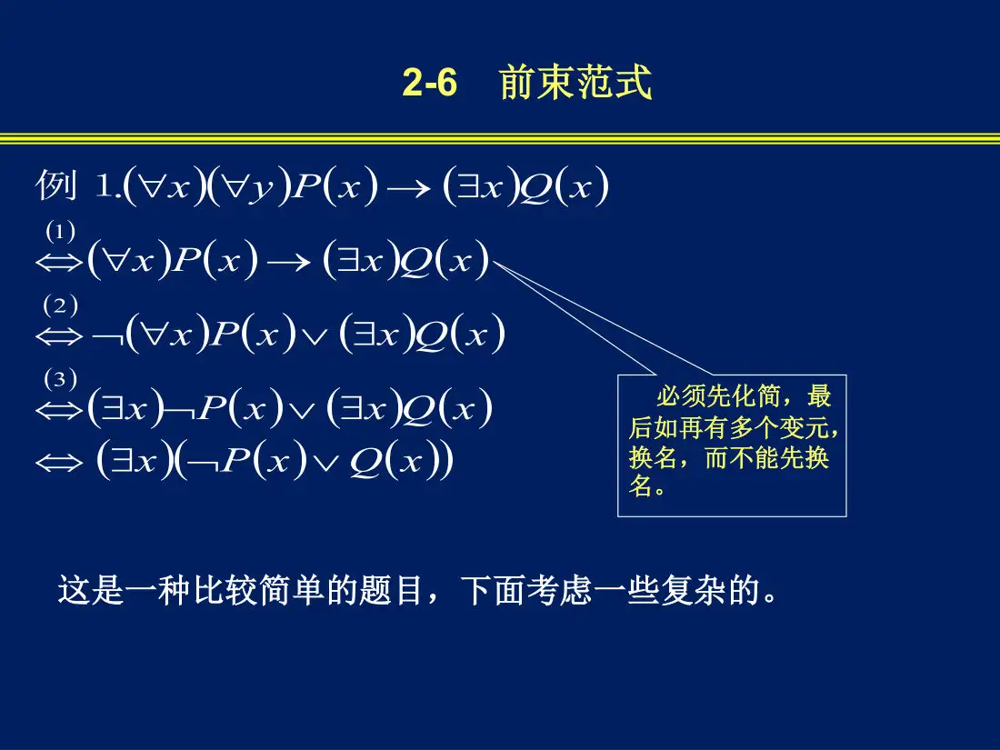

原文：

2-6 前束范式

例 1. $(\forall x)(\forall y)P(x)\rightarrow(\exists x)Q(x)$ (1) $\Leftrightarrow(\forall x)P(x)\rightarrow(\exists x)Q(x)$ (2) $\Leftrightarrow\neg(\forall x)P(x)\lor(\exists x)Q(x)$ (3) $\Leftrightarrow(\exists x)\neg P(x)\lor(\exists x)Q(x)$ $\Leftrightarrow(\exists x)(\neg P(x)\lor Q(x))$

必须先化简，最后如再有多个变元，换名，而不能先换名。

这是一种比较简单的题目，下面考虑一些复杂的。

### （2）换名代入时要分清楚作用域

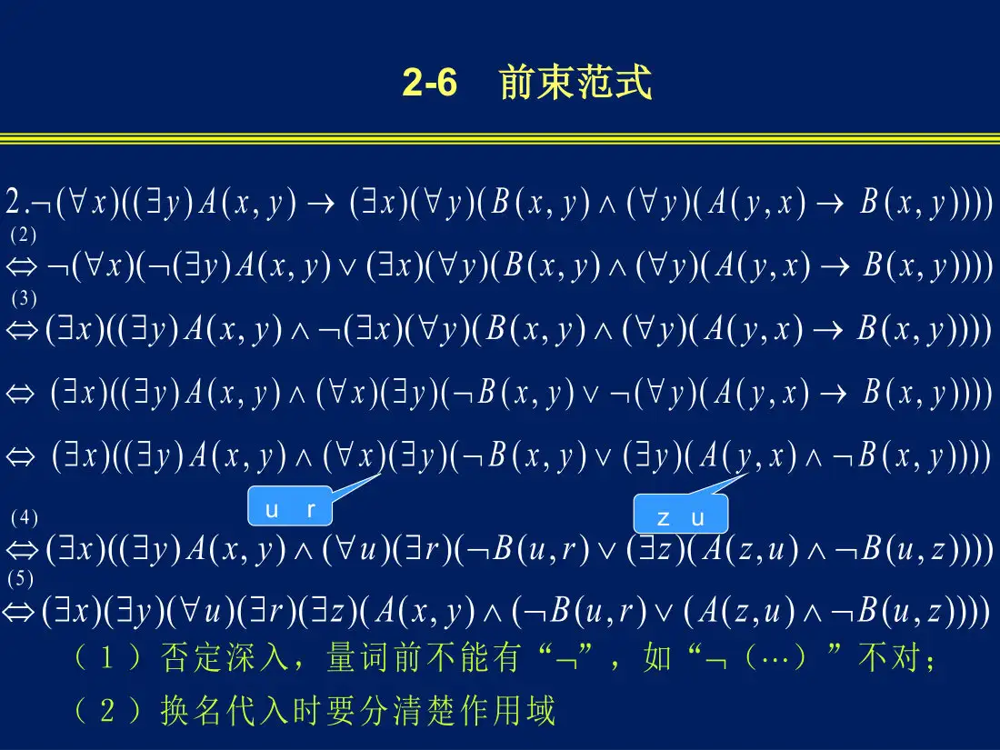

原文：

2. $\neg(\forall x)((\exists y)A(x,y)\to(\exists x)(\forall y)(B(x,y)\land(\forall y)(A(y,x)\to B(x,y))))$ (2) $\Leftrightarrow\neg(\forall x)(\neg(\exists y)A(x,y)\lor(\exists x)(\forall y)(B(x,y)\land(\forall y)(A(y,x)\to B(x,y))))$ (3) $\Leftrightarrow(\exists x)((\exists y)A(x,y)\land\neg(\exists x)(\forall y)(B(x,y)\land(\forall y)(A(y,x)\to B(x,y))))$ $\Leftrightarrow(\exists x)((\exists y)A(x,y)\land(\forall x)(\exists y)(\neg B(x,y)\lor\neg(\forall y)(A(y,x)\to B(x,y))))$ $\Leftrightarrow(\exists x)((\exists y)A(x,y)\land(\forall x)(\exists y)(\neg B(x,y)\lor(\exists y)(A(y,x)\land\neg B(x,y))))$ (4) $\Leftrightarrow(\exists x)((\exists y)A(x,y)\land(\forall u)(\exists r)(\neg B(u,r)\lor(\exists z)(A(z,u)\land\neg B(u,z))))$ (5) $\Leftrightarrow(\exists x)(\exists y)(\forall u)(\exists r)(\exists z)(A(x,y)\land(\neg B(u,r)\lor(A(z,u)\land\neg B(u,z))))$ （1）否定深入，量词前不能有“ $\neg$ ”，如“ $\neg(\cdots)$ ”不对；

（2）换名代入时要分清楚作用域

2-6 前束范式

### 2-6 前束范式

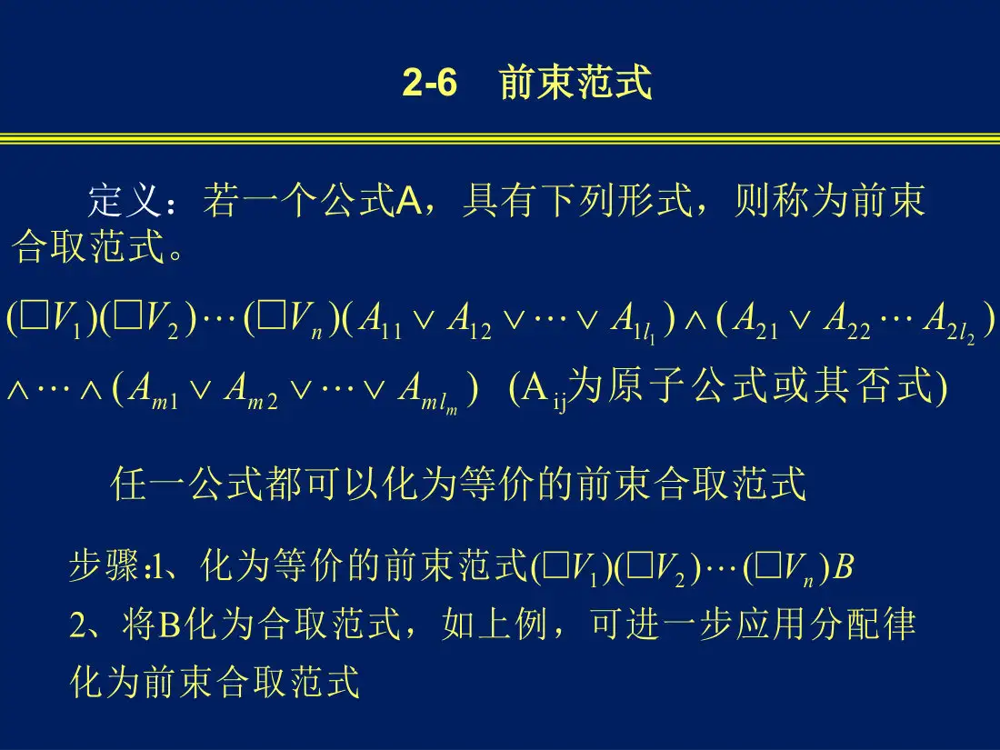

原文：

2-6 前束范式

定义：若一个公式A，具有下列形式，则称为前束合取范式。

$(\square V_{1})(\square V_{2}) \cdots (\square V_{n})(A_{11} \vee A_{12} \vee \cdots \vee A_{1l_{1}}) \wedge (A_{21} \vee A_{22} \cdots A_{2l_{2}})$ $\wedge \cdots \wedge (A_{m1} \vee A_{m2} \vee \cdots \vee A_{ml_{m}})$ (A $_{ij}$ 为原子公式或其否式)

任一公式都可以化为等价的前束合取范式

步骤:1、化为等价的前束范式(□ $V_{1}$ )(□ $V_{2}$ )…(□ $V_{n}$ )B

2、将B化为合取范式，如上例，可进一步应用分配律化为前束合取范式

### 2-6 前束范式

原文：

2-6 前束范式

定义: 若一个公式A, 具有下列形式, 则称为前束析取范式。

$(\square V_{1})(\square V_{2})\cdots (\square V_{n})(A_{11}\wedge A_{12}\wedge \dots \wedge A_{1l_{1}})\vee (A_{21}\wedge A_{22}\wedge \dots \wedge A_{2l_{2}})$ $\vee \dots \vee (A_{m_1}\wedge A_{m_2}\wedge \dots \wedge A_{ml_m})$

任一公式都可以化为等价的前束析取范式。
步骤:1、化为等价的前束范式(□ $V_{1}$ )(□ $V_{2}$ )…(□ $V_{n}$ )B

2、化B为析取范式（交换律、分配律）。对于谓词公式，不可能有主范式，因为不再含有最小的命题变元/原子变元。

### 2-7 谓词演算的推理理论

原文：

2-7 谓词演算的推理理论

对于谓词公式，不可能有主范式，因为不再含有最小的命题变元/原子变元。

在命题演算中，我们定义了推理。所谓推理，就是由一些前提利用书中给定的等价公式或蕴含式应用一定规则得到结论，就是推理；这一过程就是论证。

对命题演算、推理有三种方法：真值表法、直接证法、间接证法。而对于谓词演算，由于公式中可能有量词，当论域无限时，不可用真值表列出，因而真值表法是不可用的，所以它只有两种方法：

1. 直接法

P (1)

T (2)...(n)=结论

P、T规则仍适用。所谓直接法就是运用P、T规律，等价式，蕴含式的一序列推得结论。

由于量词的出现，另外还须增加关于量词的一些新的规则。

### 2-7 谓词演算的推理理论

原文：

2-7 谓词演算的推理理论

(1) US（全称指定规则）

$\frac{(\forall x)P(x)}{\therefore P(a)}$

,a是个体域中任一客体

$\bigl (\forall x\bigr)P(x)$ $\therefore P(c)$

如：P（x）：x是要呼吸的。

成立
T

x : 全人类。

c : 小张。

(2) UG(全称推广规则)

$\frac{P(x)}{\therefore (\forall x)P(x)},$ 对论域中每个客体都成立

(3) ES(存在指定规则)

$\frac{(\exists x)P(x)}{\therefore P(c)}$

$c$ 是论域中某一特定的客体

如 $(\exists x)P(x)$ 为T, $(\exists x)Q(x)$ 为T;
某a P(a)为T,
但 $P(a)\land Q(a)$ 未必为T;
另一Q(b)为T，而P(b)可以为T，可以为F

### 2-7 谓词演算的推理理论

原文：

2-7 谓词演算的推理理论

(4) EG（存在推广规则）

$\frac{P(c)}{\therefore(\exists x)P(x)},$ $c$ 是论域中某一客体

注意：四个规则可对照记忆，分清客体的任意性和特定性。

例1. 所有的人都是要死的。老张是人。因而老张是要死的。

用H（x）：x是要死的。M（x）：x是人。s：老张。

简单的三段论在命题演算中无法论证，在谓词演算中非常简单的加以证明。

### 2-7 谓词演算的推理理论

原文：

2-7 谓词演算的推理理论

$(\forall x)(M(x)\rightarrow H(x))$

即 $\frac{M(s)}{H(s)}$ ，(即要证明 $(\forall x)(M(x) \to H(x)) \land M(s) \Rightarrow H(s)$

(1) $\big(\forall x\big)(M(x)\rightarrow H(x)\big)$

(2) $M(s)\rightarrow H(s)$

(3) $M(s)$

(4) $H(s)$

P

U S (1)

P

T (2) (3) I但若先使用 $\forall$ 而不是 $\exists$ ，则  
(1) $(\forall x)(C(x) \to W(x) \land R(x))$ $P$ (2) $C(a) \to W(a) \land R(a)$ $US(1)$ (3) $(\exists x)(C(x) \land Q(x))$ $P$ (4) $C(a) \land Q(a)$ $ES(3)$

### 该处错！

原文：

该处错！

\*注意：∀、∃把特定任意标清楚！一般先使用∃量词，因为对有些条件成立后再用全称量词，仍能指定成立，反之未必。

2-7 谓词演算的推理理论

### 2-7 谓词演算的推理理论

原文：

2-7 谓词演算的推理理论

例3.用推理规则证明：

前提： $(\exists x)P(x)\to (\forall x)((P(x)\lor Q(x))\to R(x)),(\exists x)P(x),(\exists x)Q(x)$ 结论： $(\exists x)(\exists y)(R(x)\land R(y))$ 两次分别指定 $(\exists x)$ 中 $\mathbf{x}$ 中y

### 2-7 谓词演算的推理理论

原文：

2-7 谓词演算的推理理论

(1) $(\exists x)P(x)\to (\forall x)\bigl (\big(P(x)\lor Q(x)\bigr)\to R(X)\bigr)$ P

(2) $(\exists x)P(x)$ P

(3) $(\forall x)(P(x)\lor Q(x)\to R(x))$ T(1)(2)I

(4) $P(c)$ ES(2)

(5) $P(c)\vee Q(c)$ T(4)I

(6) $P(c)\lor Q(c)\to R(c)$

(7) $R(c)$

(8) $(\exists x)Q(x)$

(9) $Q(d)$

(10) $Q(d)\lor P(d)$

(11) $P(d) \vee Q(d) \rightarrow R(d)$

### 2-7 谓词演算的推理理论

原文：

2-7 谓词演算的推理理论

(12) $R(d)$ T(10)(11)I

(13)R(c) ∧ R(d) T(7)(12)I

(14) $\left(\exists y\right)\left(R(c)\land R(y)\right)$ EG(13)

(15) $\left(\exists x\right)\left(\exists y\right)\left(R(x)\land R(y)\right)$ EG(14)

### 2、间接证法（反证法）

原文：

2、间接证法（反证法）

(1) 否定结论, 证出与条件矛盾。如:

$(\forall x)(P(x)\lor Q(x))\Rightarrow (\forall x)P(x)\lor (\exists x)Q(x)$

证明:(用间接法证明)

(1) $\neg ((\forall x)P(x)\lor (\exists x)Q(x))$

$P$ (附加前提)

(2) $\neg(\forall x)P(x)\land\neg(\exists x)Q(x)$

(3) $\neg(\forall x)P(x)$

(4)(∃x)¬P(x)

(5) $\neg P(a)$

$ES(4)(a$ 特定 $)$

(6) $\neg(\exists x)Q(x)$

(7)(∀x)¬Q(x)

(8) $\neg Q(a)$

(9) $\neg P(a)\land\neg Q(a)$

(10) $\neg(P(a)\lor Q(a))$

(11)(∀x)(P(x) ∧ Q(x))

(12) $P(a) \vee Q(a)$

US(1 1)

(13)(P(a) ∨ Q(a)) ∧ ¬(P(a) ∨ Q(a)) 矛盾 T(10)(12) I

2-7 谓词演算的推理理论

### 2-7 谓词演算的推理理论

原文：

2-7 谓词演算的推理理论

(2) CP规则同样可用于谓词演算：证 $H_{1}, H_{2}, \cdots, H_{m} \Rightarrow P \rightarrow Q$ ，可改为证明 $H_{1}, H_{2}, \cdots, H_{m}, P \Rightarrow Q$

例：P78.4 任何人违反交通规则，则要受到处罚。因此，如果没有罚款，则没有人违反交通规则。

解：设 S(x,y)：“x 违反y“，x的论域为”人“

M (y) :

”y是交通规则。

P (z) :

”z是罚款。

R (x,z) :

”x受到z。

故假设与结论可符号化的表示为:

$H:(\forall x)((\exists y)(S(x,y)\land M(y))\to(\exists z)(P(Z)\land R(x,z)))$ $C:\neg (\exists z)P(z)\to (\forall x)(\forall y)(S(x,y)\to \neg M(y)))$

### 因为结论是条件式的，故我们可用CP规则进行推理，下面推导是否严格？

原文：

因为结论是条件式的，故我们可用CP规则进行推理，下面推导是否严格？

<table><tr><td>(1)(∀x)((∃y)(S(x,y)∧M(y))→(∃z)(P(z)∧R(x,z)))</td><td>P</td></tr><tr><td>(2)(∃y)(S(b,y)∧M(y))→(∃z)(P(z)∧R(b,z))</td><td>US(1)</td></tr><tr><td>(3)¬(∃z)P(z)</td><td>P(附加前提)</td></tr><tr><td>(4)(∀z)¬P(z)</td><td>T(3)E</td></tr><tr><td>(5)¬P(a)</td><td>US(4)</td></tr><tr><td>(6)¬P(a)∨¬R(b,a)</td><td>T(5)I</td></tr><tr><td>(7)(∀z)(¬P(z)∨¬R(b,z))</td><td>UG(6)</td></tr><tr><td>(8)¬(∃z)(P(z)∧R(b,z))</td><td>T(7)E</td></tr><tr><td>(9)¬(∃y)(S(b,y)∧M(y))</td><td>T(2)(8)I</td></tr><tr><td>(10)(∀y)(¬S(b,y)∨¬M(y))</td><td>T(2)E</td></tr><tr><td>(11)(∀y)(S(b,y)→¬M(y))</td><td>T(10)E</td></tr><tr><td>(12)(∀x)(∀y)(S(x,y)→¬M(y))</td><td>UG(11)</td></tr><tr><td>(13)¬(∃z)P(z)→(∀x)(∀y)(S(x,y→¬M(y))</td><td>CP</td></tr></table>

2-7 谓词演算的推理理论

### 2-7 谓词演算的推理理论

原文：

2-7 谓词演算的推理理论

书中错误在哪儿？
(7)⇒ (8)、(9)⇒ (10)、(10)⇒ (11)出错。
问题在于书中公式：

$$
(\forall z) (\neg P (z) \lor \neg R (b, z)) \Leftrightarrow (\forall z) \neg (P (z) \land R (b, z))
$$

虽然成立，但是在推理中不能作为公式引用。我们不能在量词后面的辖域内进行蕴含式的推证或等价变换，必须根据US或ES规则，先消除量词，再进行推证，然后利用UG和EG规则恢复量词的约束关系。

### 2-7 谓词演算的推理理论

原文：

2-7 谓词演算的推理理论

因而推理过程中，一般只能使用书中70页表2-5.1列的等价式或蕴含式，其余用法均是不合法的，不严格的。

正确做法如下:

(1) $(\forall x)((\exists y)(S(x,y)\land M(y))\rightarrow(\exists z)(P(z)\land R(x,z)))$ P

(2)(∃y)(S(b,y)∧M(y))→(∃z)(P(z)∧R(b,z)) US(1)

(3) $\neg(\exists z)P(z)$

$P$ (附加前提)

### 2-7 谓词演算的推理理论

原文：

2-7 谓词演算的推理理论

4. $(\forall z)\neg p(z)$ T(3)E
5. $\neg p(a)$ US(4)
6. $\neg p(a)\lor\neg R(b,a)$ T(5)I
7. $\neg(p(a)\land R(b,a))$ T(6)E
8. $(\forall z)\neg(P(z)\land R(b,z))$ UG(7)
9. $\neg(\exists z)(P(z)\land R(b,z))$ T(8)E
10. $\neg(\exists y)(S(b,y)\land M(y))$ T(2)(9)
11. $(\forall y)\neg(S(b,y)\land M(y))$ T(10)E
12. $\neg(S(b,c)\land M(c))$ US(11)
13. $\neg S(b,c)\lor\neg M(c)$ T(13)E
14. $S(b,c)\rightarrow\neg M(c)$ UG(14)
15. $(\forall y)(S(b,y)\rightarrow\neg M(y))$ UG15

### 2-7 谓词演算的推理理论

原文：

2-7 谓词演算的推理理论

16. $(\forall x)(\forall y)(S(x,y) \rightarrow \neg(M(y))$ 17. $\neg(\exists z)P(z) \rightarrow (\forall x)(\forall y)(S(x,y) \rightarrow \neg M(y)$ 谓词逻辑基本内容全部介绍完。数理逻辑这一篇的基本内容包括两大部分，自己复习。
