# 《离散数学》第3章 集合与关系（课件）

原件的每一页，下面附识别出的文字。

### 第三章 集合与关系

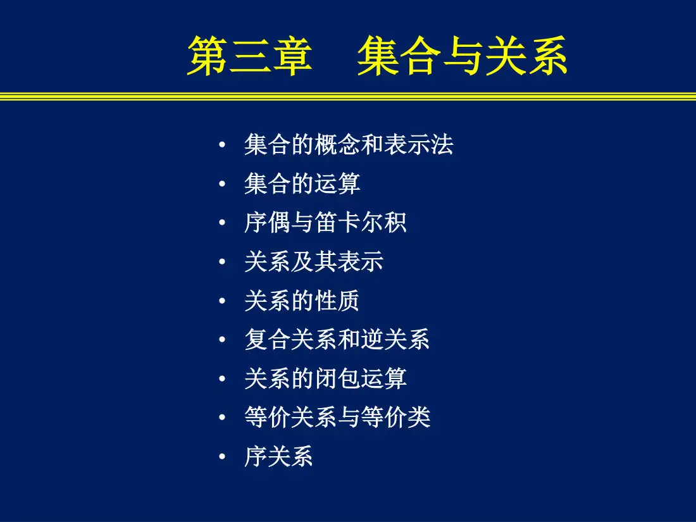

原文：

第三章 集合与关系

\- 集合的概念和表示法

\- 集合的运算

\- 序偶与笛卡尔积

\- 关系及其表示

\- 关系的性质

\- 复合关系和逆关系

\- 关系的闭包运算

\- 等价关系与等价类

\- 序关系

### 3-1 集合的概念和表示法

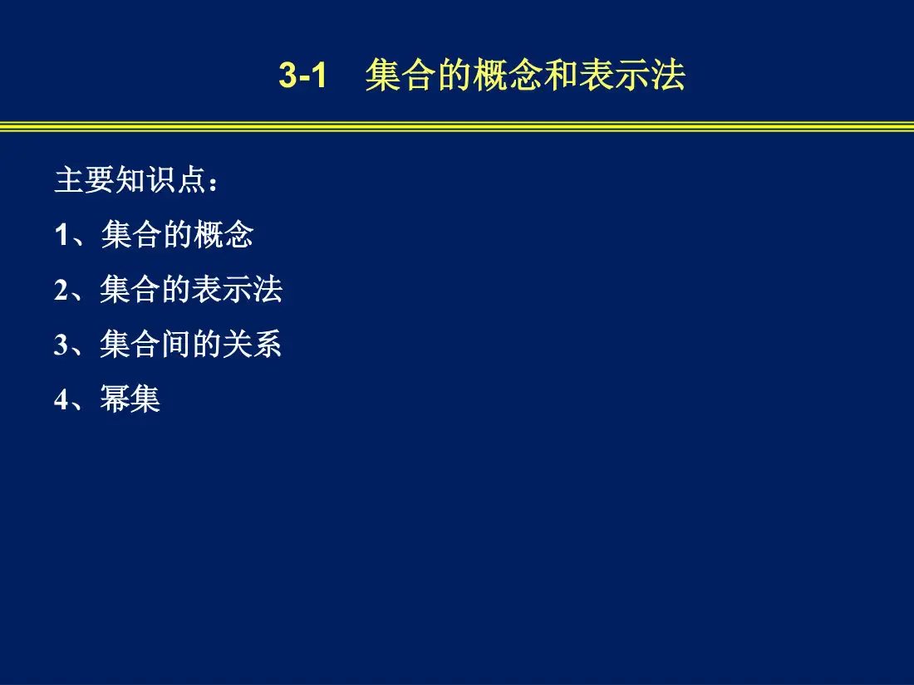

原文：

3-1 集合的概念和表示法

主要知识点:

1、集合的概念

2、集合的表示法

3、集合间的关系

4、幂集

### 3-1 集合的概念和表示法

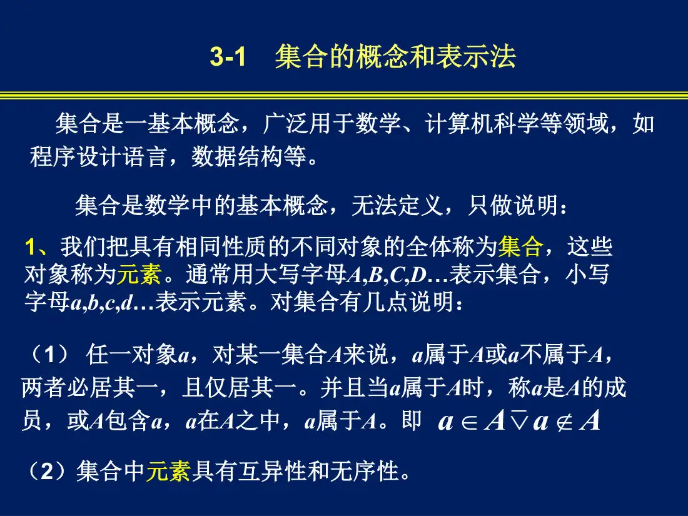

原文：

3-1 集合的概念和表示法

集合是一基本概念，广泛用于数学、计算机科学等领域，如程序设计语言，数据结构等。

集合是数学中的基本概念，无法定义，只做说明：

1、我们把具有相同性质的不同对象的全体称为集合，这些对象称为元素。通常用大写字母A,B,C,D...表示集合，小写字母a,b,c,d...表示元素。对集合有几点说明：

(1) 任一对象 $a$ , 对某一集合 $A$ 来说, $a$ 属于 $A$ 或 $a$ 不属于 $A$ , 两者必居其一, 且仅居其一。并且当 $a$ 属于 $A$ 时, 称 $a$ 是 $A$ 的成员, 或 $A$ 包含 $a$ , $a$ 在 $A$ 之中, $a$ 属于 $A$ 。即 $a \in A \vee a \notin A$

(2) 集合中元素具有互异性和无序性。

### 2、集合的表示法

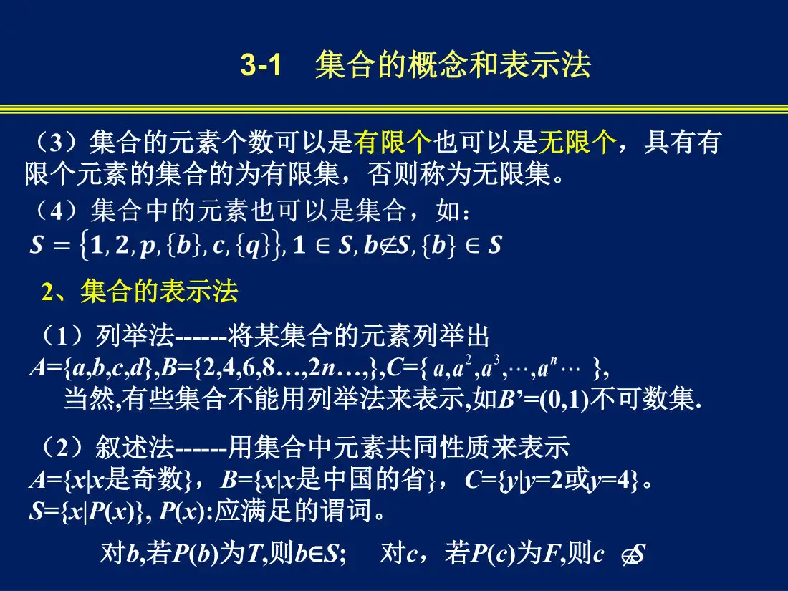

原文：

(3) 集合的元素个数可以是有限个也可以是无限个, 具有有限个元素的集合的为有限集, 否则称为无限集。

(4) 集合中的元素也可以是集合, 如: $S = \{1, 2, p, \{b\}, c, \{q\}\}, 1 \in S, b \notin S, \{b\} \in S$

2、集合的表示法

(1) 列举法----将某集合的元素列举出 $A = \{a, b, c, d\}, B = \{2, 4, 6, 8 \ldots, 2n \ldots\}, C = \{a, a^2, a^3, \cdots, a^n \cdots\}$ , 当然,有些集合不能用列举法来表示,如 $B' = (0,1)$ 不可数集.

(2) 叙述法----用集合中元素共同性质来表示 $A = \{x \mid x$ 是奇数\}, $B = \{x \mid x$ 是中国的省\}, $C = \{y \mid y = 2 \text{或} y = 4\}$ 。 $S = \{x \mid P(x)\}$ , $P(x)$ :应满足的谓词。对 $b$ ,若 $P(b)$ 为 $T$ ,则 $b \in S$ ; 对 $c$ , 若 $P(c)$ 为 $F$ ,则 $c \notin S$

3-1 集合的概念和表示法

### 3-1 集合的概念和表示法

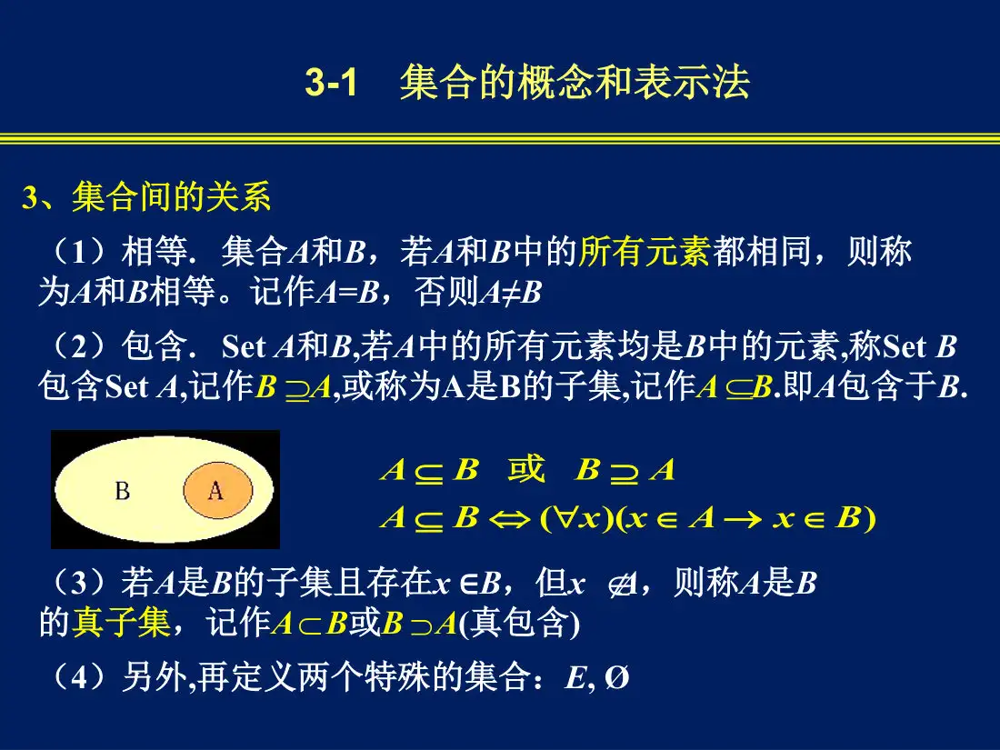

原文：

3-1 集合的概念和表示法

3、集合间的关系

(1) 相等。集合 $A$ 和 $B$ , 若 $A$ 和 $B$ 中的所有元素都相同, 则称为 $A$ 和 $B$ 相等。记作 $A = B$ , 否则 $A \neq B$

(2) 包含. Set $A$ 和 $B$ , 若 $A$ 中的所有元素均是 $B$ 中的元素, 称Set $B$ 包含Set $A$ , 记作 $B \supseteq A$ , 或称为A是B的子集, 记作 $A \subseteq B$ . 即 $A$ 包含于 $B$ .

$A \subseteq B$ 或 $B \supseteq A$

$$
A \subseteq B \Leftrightarrow (\forall x) (x \in A \rightarrow x \in B)
$$

(3) 若 $A$ 是 $B$ 的子集且存在 $x \in B$ , 但 $x \notin A$ , 则称 $A$ 是 $B$ 的真子集, 记作 $A \subset B$ 或 $B \supset A$ (真包含)

(4) 另外,再定义两个特殊的集合: $E, \emptyset$

### 3-1 集合的概念和表示法

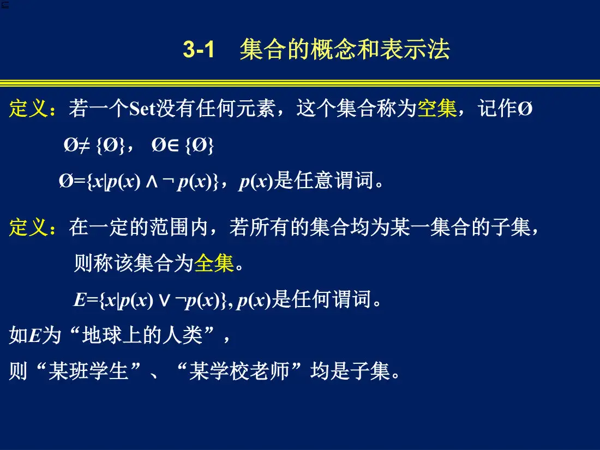

原文：

3-1 集合的概念和表示法

定义：若一个Set没有任何元素，这个集合称为空集，记作∅
∅≠{∅}, ∅∈{∅}
∅={x|p(x) ∧ ¬p(x)}, p(x)是任意谓词。
定义：在一定的范围内，若所有的集合均为某一集合的子集，
则称该集合为全集。
E={x|p(x) ∨ ¬p(x)}, p(x)是任何谓词。
如E为“地球上的人类”，
则“某班学生”、“某学校老师”均是子集。

### 3-1 集合的概念和表示法

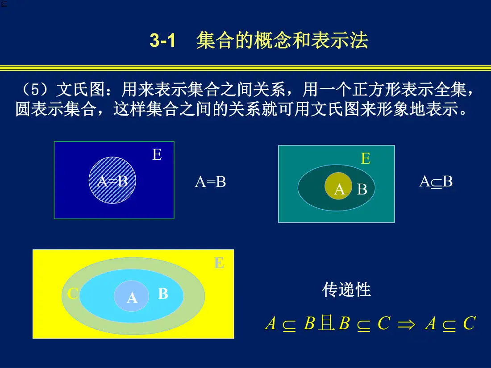

原文：

3-1 集合的概念和表示法

(5) 文氏图: 用来表示集合之间关系, 用一个正方形表示全集, 圆表示集合, 这样集合之间的关系就可用文氏图来形象地表示。

$$
\mathrm{A} = \mathrm{B}
$$

传递性 $A \subseteq B$ 且 $B \subseteq C \Rightarrow A \subseteq C$ (6) 定理: 集合A和集合B是相等的, iff $A \subseteq B$ 且 $B \subseteq A$ $A = B \Leftrightarrow A \subseteq B$ 且 $B \subseteq A$ 证: $\Rightarrow$ (必要性) 若 A = B，则 A 与 B 有相同元素。 $\therefore \forall x (x \in A \to x \in B)$ 为 T，即 $A \subseteq B$ 且 $\forall x (x \in B \to x \in A)$ 为 T，即 $B \subseteq A$ $\Leftarrow$ (充分性) 若 $A \subseteq B$ 且 $B \subseteq A, A = B$ 。

用反证法，假设 $A \neq B$ 则 $(\exists x)((x \in A) \land (x \notin B)), \therefore A \notin B$ 或 $(\exists x)((x \in B) \land (x \notin A)), \therefore B \notin A$ 矛盾, $\therefore A = B$ \* 以后判断两集合相等就主要用这一重要定理。

定理: 对任一Set A, $∅ \subseteq A$

### 3-1 集合的概念和表示法

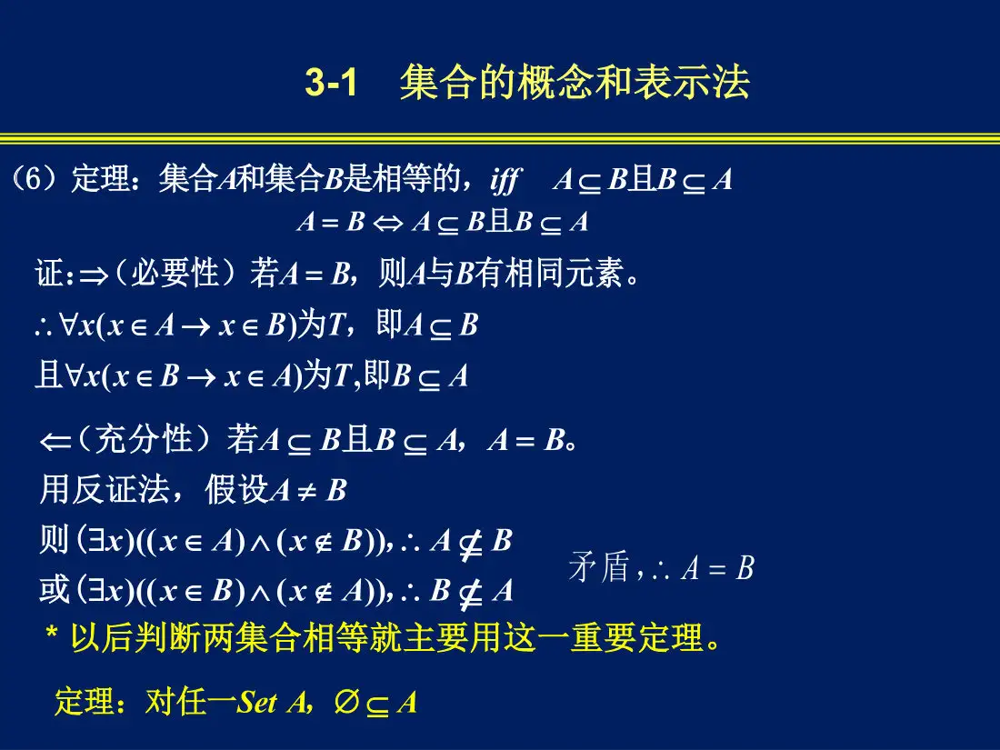

原文：

3-1 集合的概念和表示法

### 3-1 集合的概念和表示法

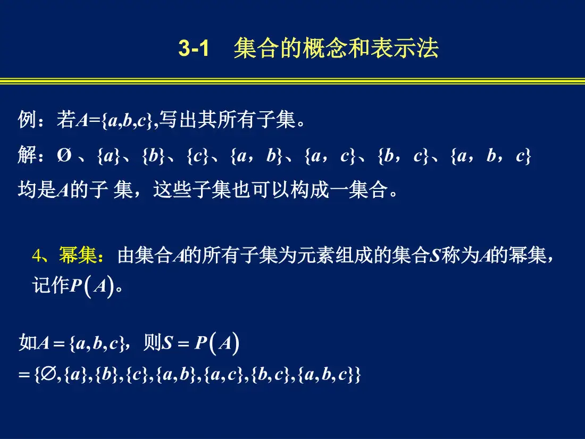

原文：

3-1 集合的概念和表示法

例：若 $A=\{a,b,c\}$ ，写出其所有子集。

解： $\varnothing$ 、 $\{a\}$ 、 $\{b\}$ 、 $\{c\}$ 、 $\{a, b\}$ 、 $\{a, c\}$ 、 $\{b, c\}$ 、 $\{a, b, c\}$ 均是 $A$ 的子集，这些子集也可以构成一集合。

4、幂集: 由集合 $A$ 的所有子集为元素组成的集合 $S$ 称为 $A$ 的幂集,记作 $P(A)$ 。

如 $A = \{a,b,c\}$ ，则 $S = P(A)$ $= \{\emptyset ,\{a\} ,\{b\} ,\{c\} ,\{a,b\} ,\{a,c\} ,\{b,c\} ,\{a,b,c\}\}$ 定理: $A$ 有 $n$ 个元素, $P(A)$ 有 $2^{n}$ 个元素, 即 $A$ 的子集数为 $2^{n}$ 个。

### $$

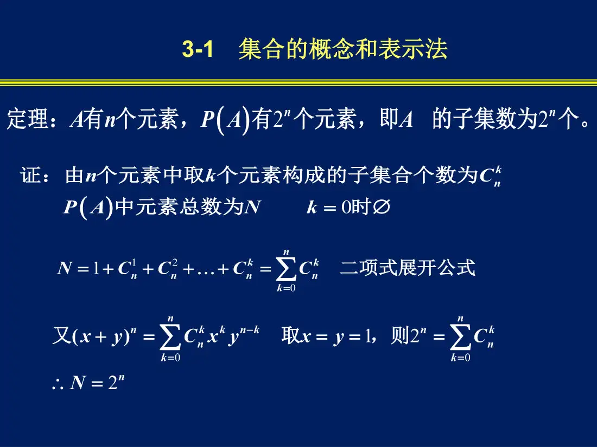

原文：

证: 由 $n$ 个元素中取 $k$ 个元素构成的子集合个数为 $C_{n}^{k}$ $P(A)$ 中元素总数为 $N \quad k = 0$ 时 $\varnothing$

$N = 1 + C_{n}^{1} + C_{n}^{2} + \ldots +C_{n}^{k} = \sum_{k = 0}^{n}C_{n}^{k}$ 二项式展开公式

又 $(x + y)^{n} = \sum_{k = 0}^{n}C_{n}^{k}x^{k}y^{n - k}$ 取 $x = y = 1$ ，则 $2^{n} = \sum_{k = 0}^{n}C_{n}^{k}$

$$
\therefore N = 2 ^ {n}
$$

3-1 集合的概念和表示法

### 3-1 集合的概念和表示法

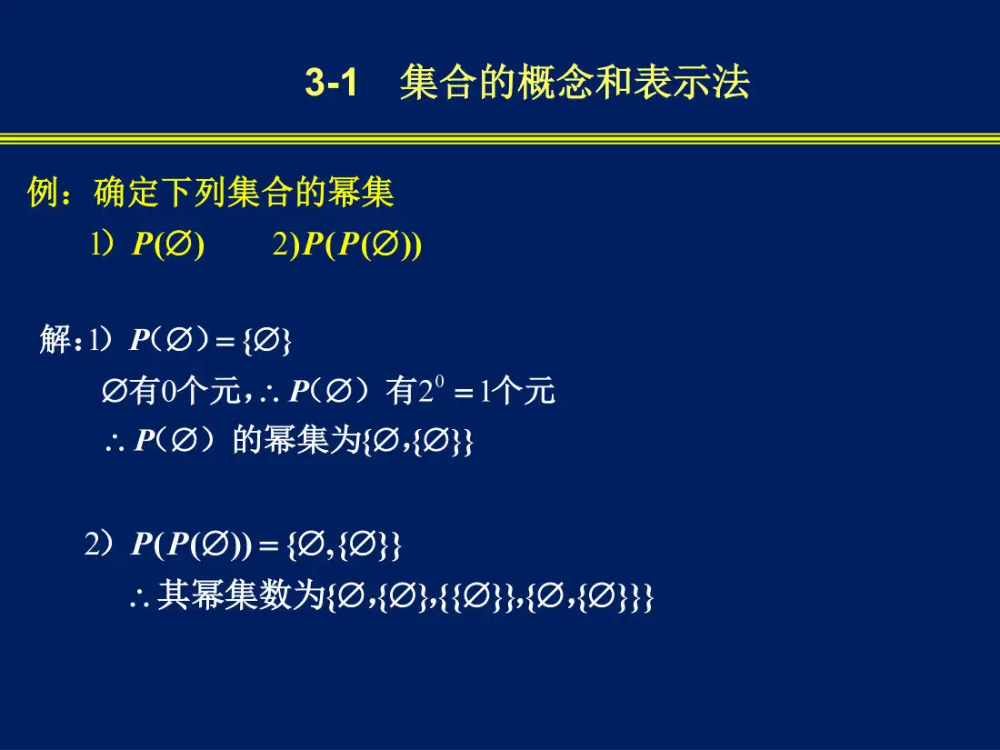

原文：

3-1 集合的概念和表示法

例：确定下列集合的幂集
1) $P(\varnothing)$ 2) $P(P(\varnothing))$

解:1) $P(\varnothing)=\{\varnothing\}$ ∅有0个元, ∴ $P(\varnothing)$ 有 $2^{0}=1$ 个元
∴ $P(\varnothing)$ 的幂集为 $\{\varnothing, \{\varnothing\}\}$

2) $P(P(\emptyset)) = \{\emptyset, \{\emptyset\}\}$ ∴其幂集数为 $\{\emptyset, \{\emptyset\}, \{\{\emptyset\}\}, \{\emptyset, \{\emptyset\}\}\}$

### 3-1 集合的概念和表示法

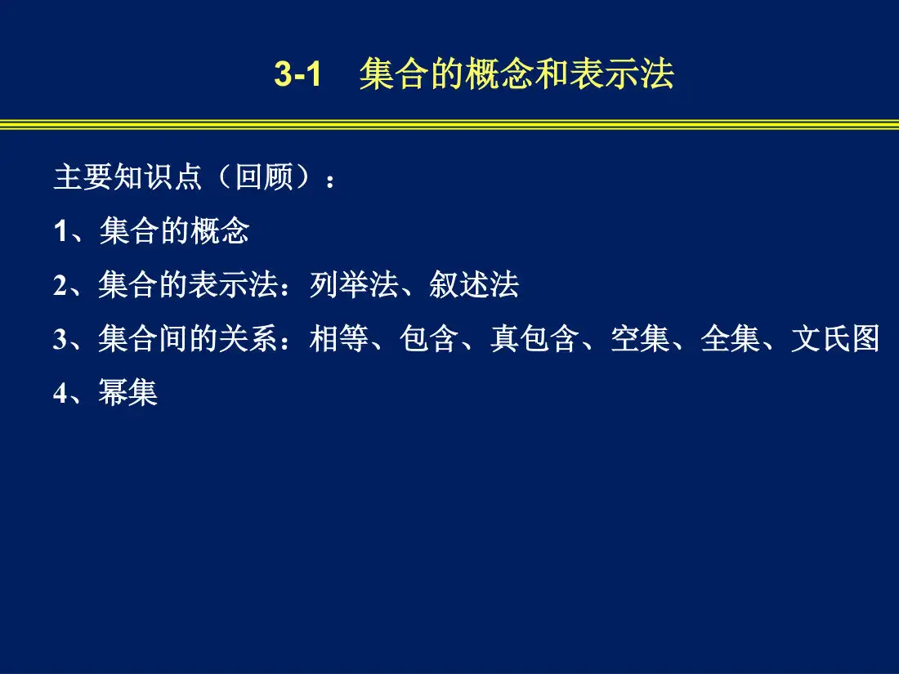

原文：

3-1 集合的概念和表示法

主要知识点（回顾）：

1、集合的概念

2、集合的表示法：列举法、叙述法

3、集合间的关系：相等、包含、真包含、空集、全集、文氏图

4、幂集

### 3-2 集合的运算

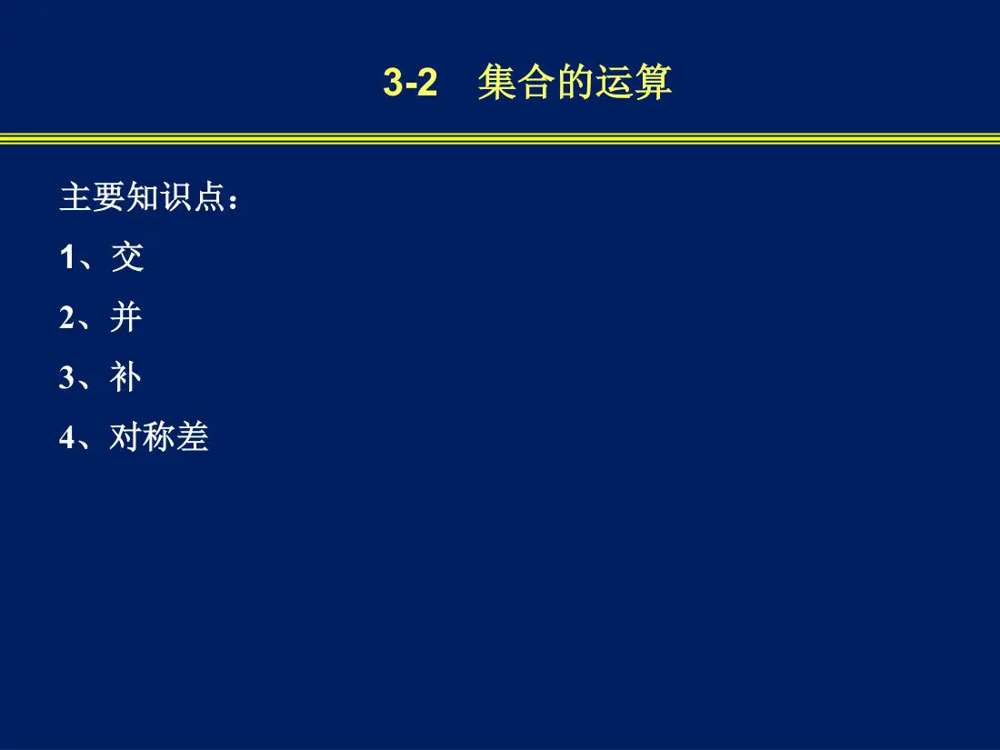

原文：

3-2 集合的运算

主要知识点:

1、交

2、并

3、补

4、对称差

### 3-2 集合的运算

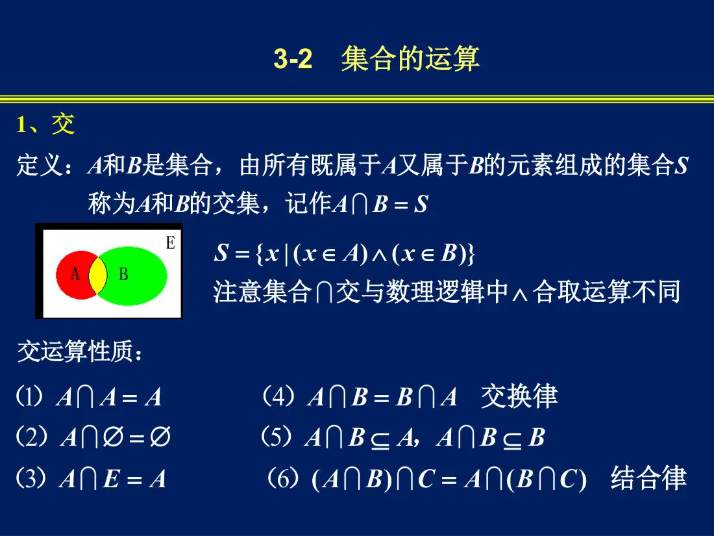

原文：

3-2 集合的运算

1、交

定义: $A$ 和 $B$ 是集合, 由所有既属于 $A$ 又属于 $B$ 的元素组成的集合 $S$ 称为 $A$ 和 $B$ 的交集, 记作 $A \cap B = S$

$$
S = \{x \mid (x \in A) \land (x \in B) \}
$$

注意集合 $\cap$ 交与数理逻辑中 $\wedge$ 合取运算不同

交运算性质:

(1) $A \cap A = A$

(2) $A \cap \varnothing = \varnothing$

(3) $A \cap E = A$

(4) $A \cap B = B \cap A$ 交换律

(5) $A \cap B \subseteq A, A \cap B \subseteq B$

(6) $(A \cap B) \cap C = A \cap (B \cap C)$ 结合律

### 3-2 集合的运算

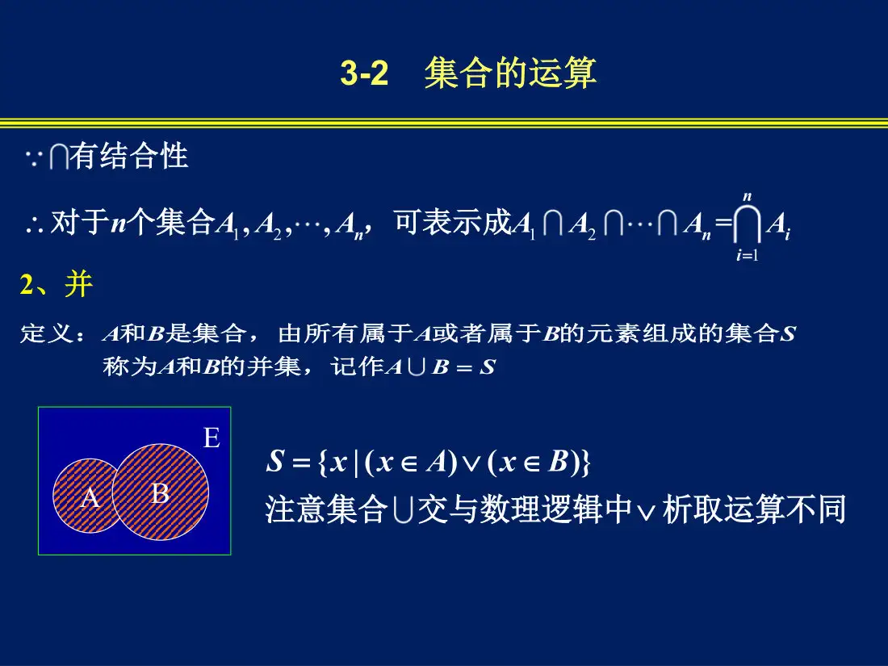

原文：

3-2 集合的运算

∵∩有结合性

∴对于n个集合 $A_{1},A_{2},\cdots,A_{n}$ ，可表示成 $A_{1}\cap A_{2}\cap\cdots\cap A_{n}=\bigcap_{i=1}^{n}A_{i}$

2、并

定义: $A$ 和 $B$ 是集合, 由所有属于 $A$ 或者属于 $B$ 的元素组成的集合 $S$ . 称为 $A$ 和 $B$ 的并集, 记作 $A \cup B = S$

$$
S = \{x \mid (x \in A) \lor (x \in B) \}
$$

注意集合U交与数理逻辑中v析取运算不同

### 3-2 集合的运算

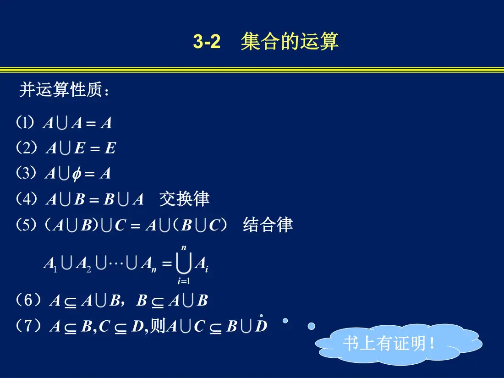

原文：

3-2 集合的运算

并运算性质:

(1) $A \cup A = A$ (2) $A \cup E = E$ (3) $A \cup \phi = A$ (4) $A \cup B = B \cup A$ 交换律
(5) $(A \cup B) \cup C = A \cup (B \cup C)$ 结合律 $A_{1} \cup A_{2} \cup \cdots \cup A_{n} = \bigcup_{i=1}^{n} A_{i}$ (6) $A \subseteq A \cup B, B \subseteq A \cup B$ (7) $A \subseteq B, C \subseteq D,$ 则 $A \cup C \subseteq B \cup \dot{D}$

书上有证明！

### 3-2 集合的运算

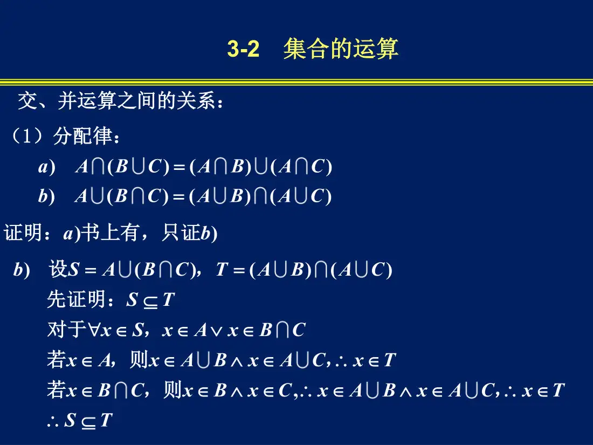

原文：

3-2 集合的运算

交、并运算之间的关系:

(1) 分配律:
a) $A \cap (B \cup C) = (A \cap B) \cup (A \cap C)$ b) $A \cup (B \cap C) = (A \cup B) \cap (A \cup C)$ 证明：a)书上有，只证b)
b) 设 $S=A\cup(B\cap C)$ ， $T=(A\cup B)\cap(A\cup C)$ 先证明： $S \subseteq T$ 对于 $\forall x \in S, x \in A \lor x \in B \cap C$ 若 $x \in A$ ，则 $x \in A \cup B \land x \in A \cup C, \therefore x \in T$ 若 $x \in B \cap C$ ，则 $x \in B \land x \in C, \therefore x \in A \cup B \land x \in A \cup C, \therefore x \in T$ ∴ $S \subseteq T$

### 3-2 集合的运算

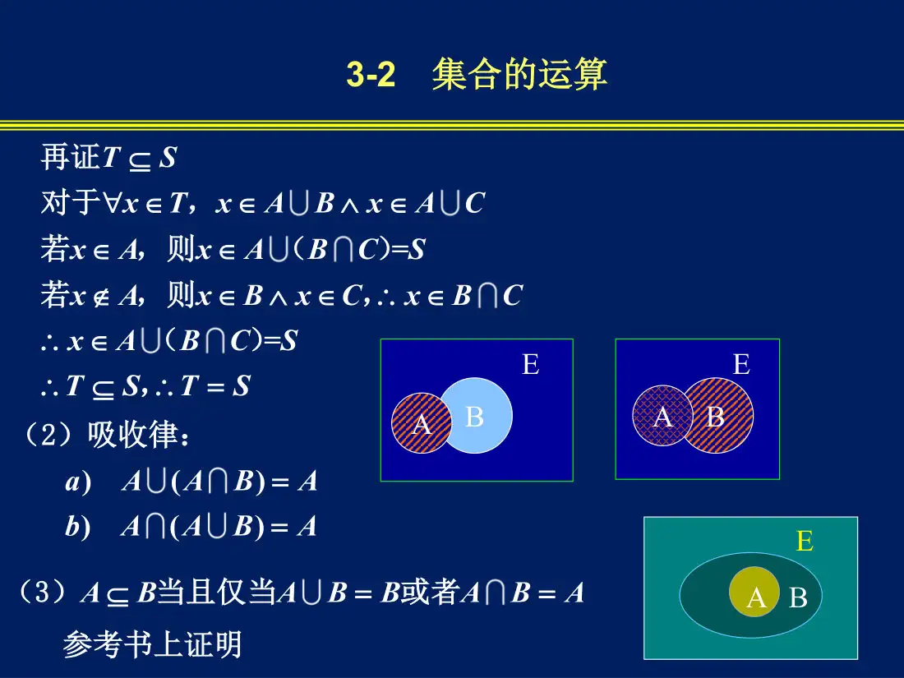

原文：

3-2 集合的运算

再证 $T \subseteq S$ 对于 $\forall x \in T, x \in A \cup B \land x \in A \cup C$ 若 $x \in A$ ，则 $x \in A \cup (B \cap C) = S$ 若 $x \notin A$ ，则 $x \in B \land x \in C, \therefore x \in B \cap C$ $\therefore x \in A \cup (B \cap C) = S$ $\therefore T \subseteq S, \therefore T = S$

(2) 吸收律:
a) $A \cup (A \cap B) = A$ b) $A \cap (A \cup B) = A$

(3) $A \subseteq B$ 当且仅当 $A \cup B = B$ 或者 $A \cap B = A$ 参考书上证明

### 3-2 集合的运算

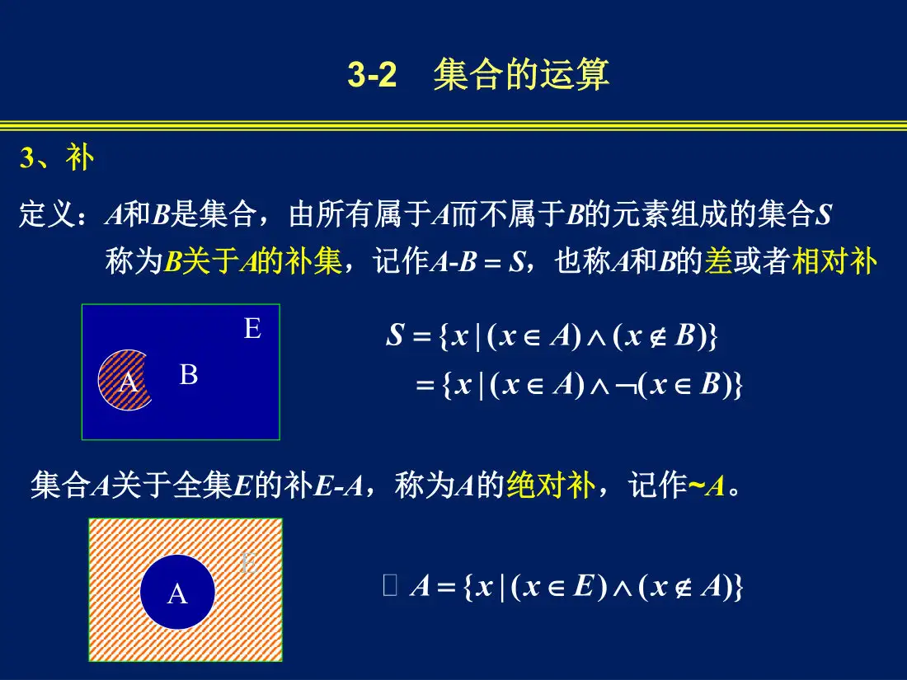

原文：

A

3-2 集合的运算

3、补

定义: $A$ 和 $B$ 是集合, 由所有属于 $A$ 而不属于 $B$ 的元素组成的集合 $S$ 称为 $B$ 关于 $A$ 的补集, 记作 $A - B = S$ , 也称 $A$ 和 $B$ 的差或者相对补

E

B

$S = \{x\mid (x\in A)\land (x\notin B)\}$ $= \{x\mid (x\in A)\land \neg (x\in B)\}$

集合A关于全集E的补E-A，称为A的绝对补，记作\~A。

A

$$
\square A = \{x \mid (x \in E) \land (x \notin A) \}
$$

### 3-2 集合的运算

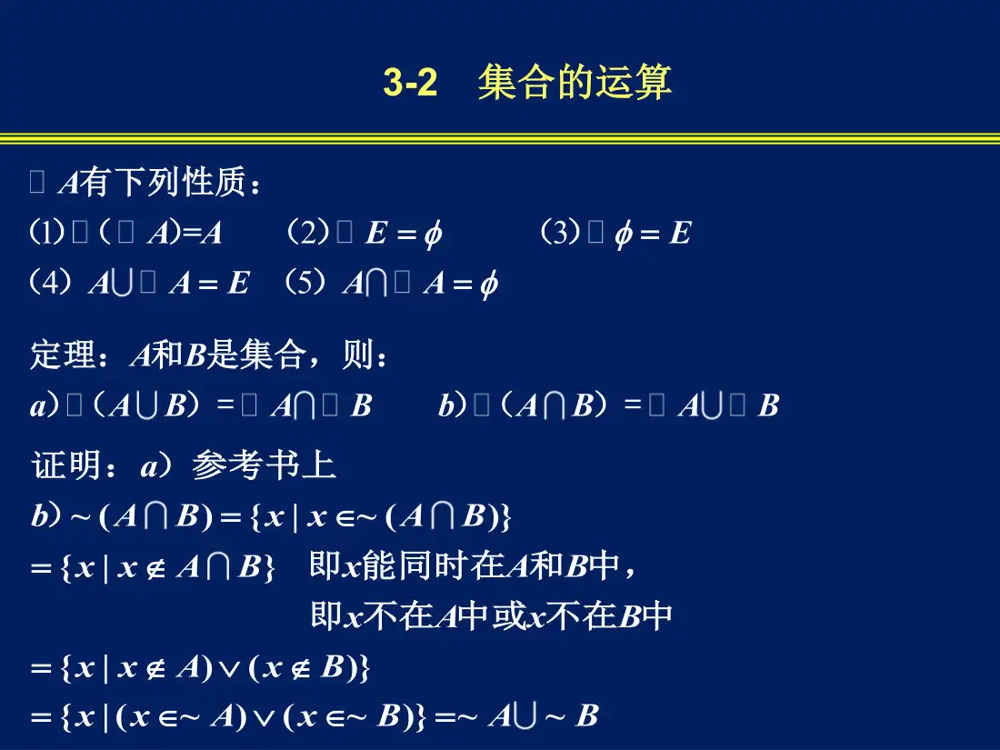

原文：

3-2 集合的运算

□ A有下列性质：
(1) □ (□ A)=A    (2) □ E = φ    (3) □ φ = E
(4) A∪□ A = E    (5) A∩□ A = φ

定理：A和B是集合，则：
a) □ (A ∪ B) = □ A∩□ B    b) □ (A ∩ B) = □ A∪□ B

证明：a）参考书上
b) \~ (A ∩ B) = {x | x ∈\~ (A ∩ B)}
= {x | x∉A∩B} 即x能同时在A和B中，
即x不在A中或x不在B中
= {x | x∉A) ∨ (x∉B)}
= {x | (x ∈\~ A) ∨ (x ∈\~ B)} = \~ A∪ \~ B

### 3-2 集合的运算

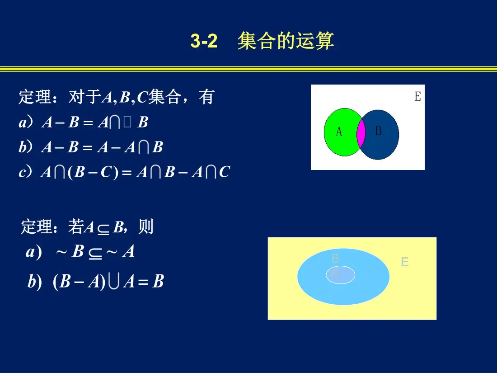

原文：

3-2 集合的运算

定理：对于A,B,C集合，有
a) $A - B = A \cap \square B$ b) $A - B = A - A \cap B$ c) $A \cap (B - C) = A \cap B - A \cap C$

定理：若 $A \subseteq B$ ，则
a) $\sim B \subseteq \sim A$ b) $(B - A) \cup A = B$

### 3-2 集合的运算

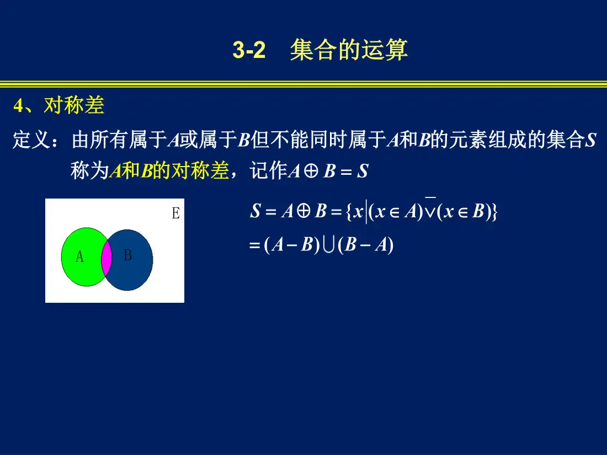

原文：

3-2 集合的运算

4、对称差

定义: 由所有属于 $A$ 或属于 $B$ 但不能同时属于 $A$ 和 $B$ 的元素组成的集合 $S$ 称为 $A$ 和 $B$ 的对称差, 记作 $A \oplus B = S$

$$
\begin{array}{l} S = A \oplus B = \{x | (x \in A) \overline {{\vee}} (x \in B) \} \\ = (A - B) \bigcup (B - A) \end{array}
$$

### 3-2 集合的运算

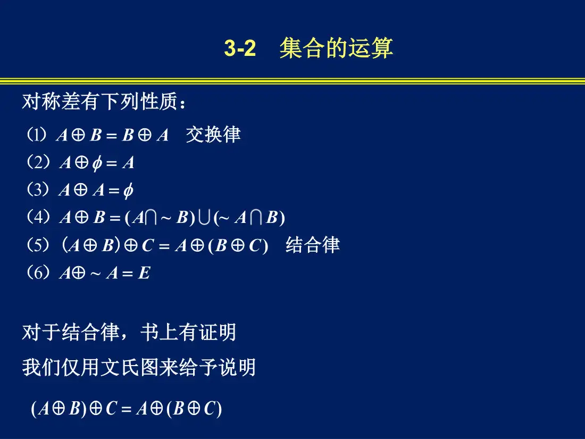

原文：

3-2 集合的运算

对称差有下列性质：

(1) $A \oplus B = B \oplus A$ 交换律
(2) $A \oplus \phi = A$ (3) $A \oplus A = \phi$ (4) $A \oplus B = (A \cap \sim B) \cup (\sim A \cap B)$ (5) $(A \oplus B) \oplus C = A \oplus (B \oplus C)$ 结合律
(6) $A \oplus \sim A = E$

对于结合律，书上有证明我们仅用文氏图来给予说明 $(A \oplus B) \oplus C = A \oplus (B \oplus C)$

### 3-2 集合的运算

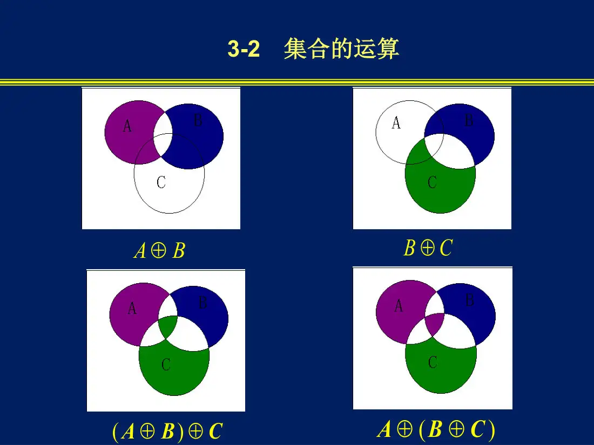

原文：

3-2 集合的运算

### 3-2 集合的运算

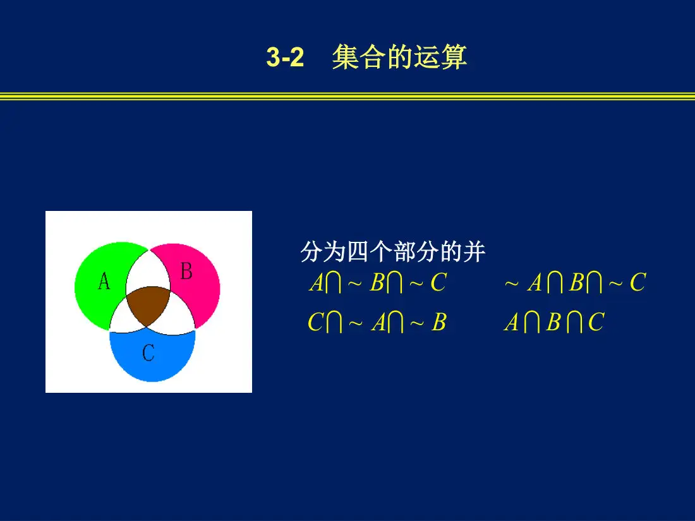

原文：

3-2 集合的运算

分为四个部分的并

$A \cap \sim B \cap \sim C$

$C \cap \sim A \cap \sim B$

$\sim A \cap B \cap \sim C$

$A \cap B \cap C$

### 3-2 集合的运算

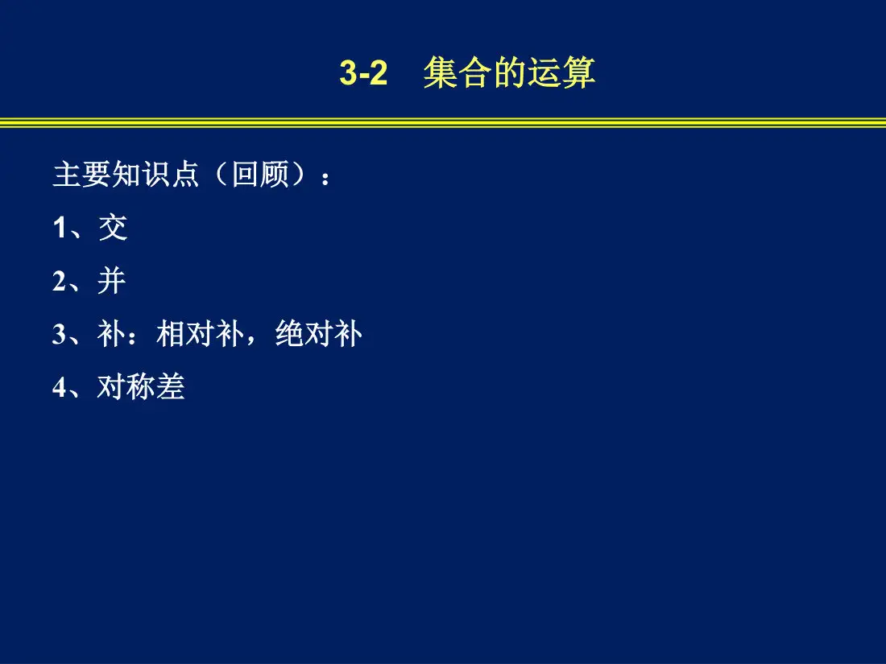

原文：

3-2 集合的运算

主要知识点（回顾）：

1、交

2、并

3、补：相对补，绝对补

4、对称差

### P95(6)确定以下各式

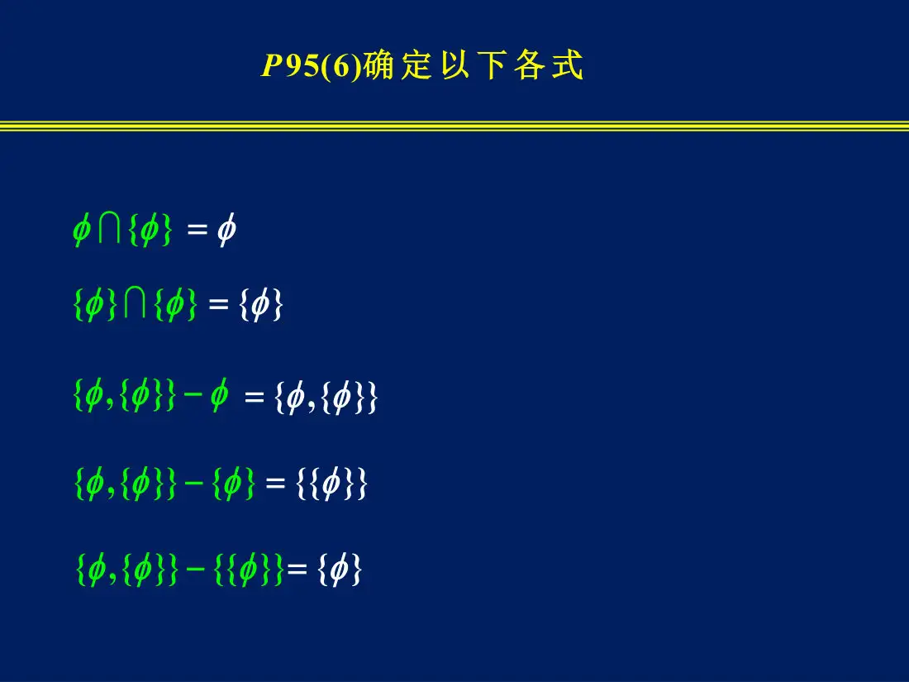

原文：

P95(6)确定以下各式

$\phi \cap \{\phi\} = \phi$ $\{\phi\} \cap \{\phi\} = \{\phi\}$ $\{\phi, \{\phi\}\} - \phi = \{\phi, \{\phi\}\}$ $\{\phi, \{\phi\}\} - \{\phi\} = \{\{\phi\}\}$ $\{\phi, \{\phi\}\} - \{\{\phi\}\} = \{\phi\}$

### 3-4 序偶和笛卡尔积

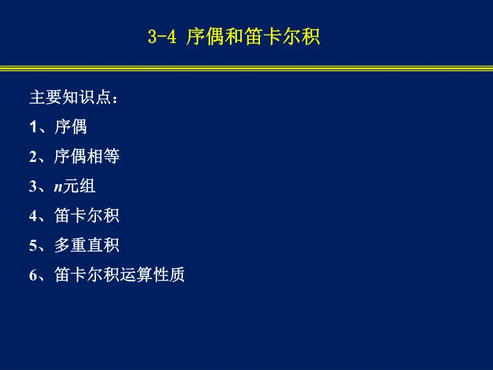

原文：

3-4 序偶和笛卡尔积

主要知识点:

1、序偶

2、序偶相等

3、n元组

4、笛卡尔积

5、多重直积

6、笛卡尔积运算性质

### 3-4 序偶和笛卡尔积

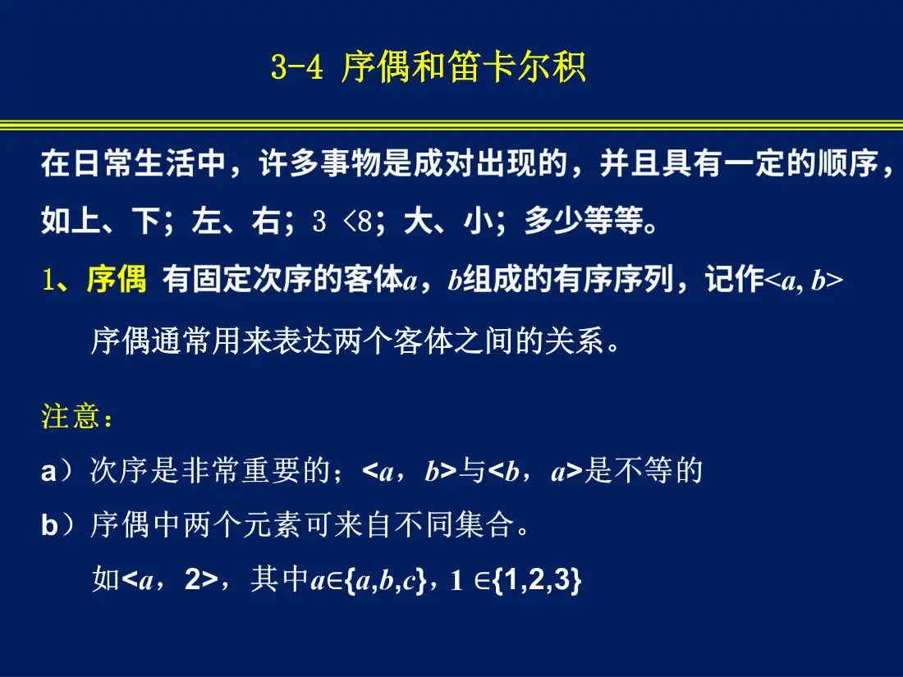

原文：

3-4 序偶和笛卡尔积

在日常生活中，许多事物是成对出现的，并且具有一定的顺序，如上、下；左、右；3 <8；大、小；多少等等。

1、序偶 有固定次序的客体 $a, b$ 组成的有序序列，记作 $\langle a, b \rangle$ 序偶通常用来表达两个客体之间的关系。

注意:

a）次序是非常重要的；<a，b>与<b，a>是不等的

b）序偶中两个元素可来自不同集合。

如 $<a, 2>$ ，其中 $a \in \{a, b, c\}$ ， $1 \in \{1, 2, 3\}$

### 3-4 序偶和笛卡尔积

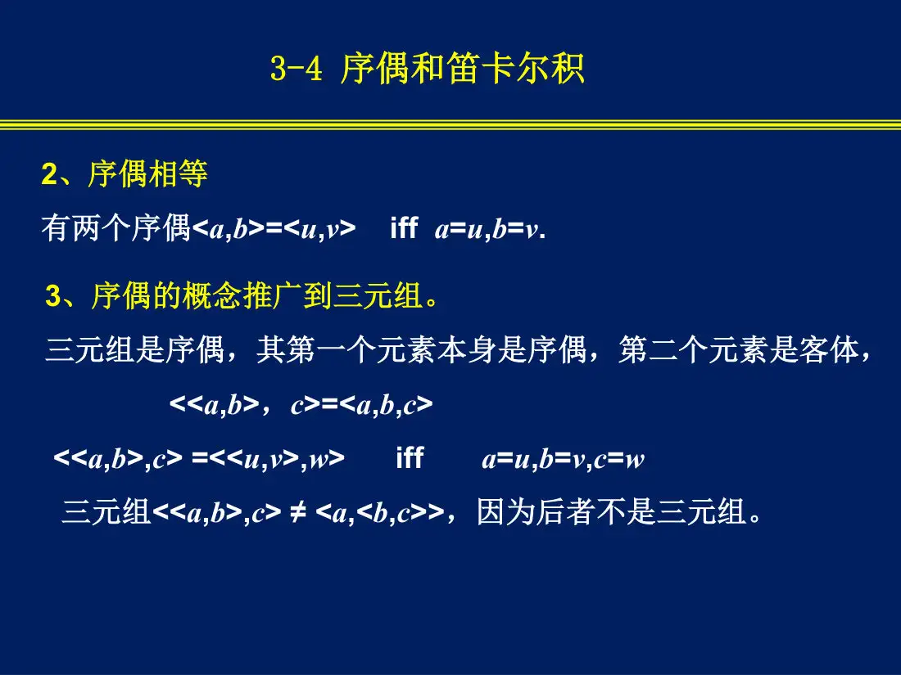

原文：

3-4 序偶和笛卡尔积

2、序偶相等

有两个序偶 $<a,b> = <u,v>$ iff $a=u,b=v$ .

3、序偶的概念推广到三元组。

三元组是序偶，其第一个元素本身是序偶，第二个元素是客体，

<<a,b>, c>=<a,b,c>

<<a,b>,c> =<<u,v>,w> iff a=u,b=v,c=w

三元组<<a,b>,c>≠<a,<b,c>>，因为后者不是三元组。

### 3-4 序偶和笛卡尔积

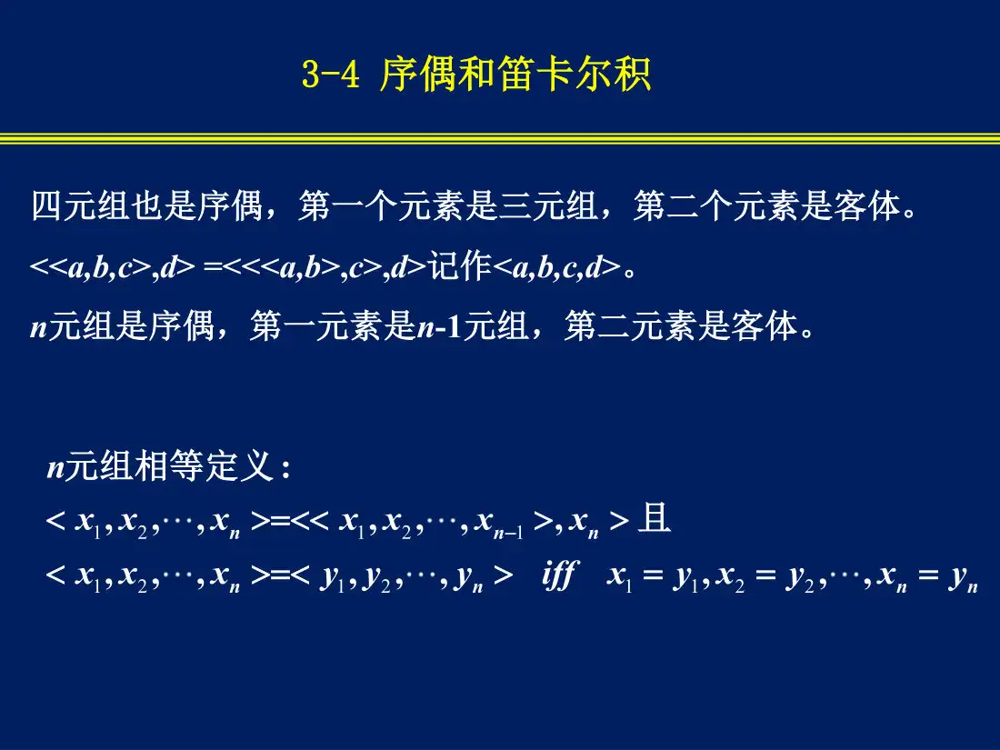

原文：

3-4 序偶和笛卡尔积

四元组也是序偶，第一个元素是三元组，第二个元素是客体。

<<a,b,c>,d> =<<<a,b>,c>,d>记作<a,b,c,d>。

n元组是序偶，第一元素是n-1元组，第二元素是客体。

n元组相等定义：

$$
<   x _ {1}, x _ {2}, \dots , x _ {n} > = <   <   x _ {1}, x _ {2}, \dots , x _ {n - 1} >, x _ {n} > \text {且}
$$

$$
<   x _ {1}, x _ {2}, \dots , x _ {n} > = <   y _ {1}, y _ {2}, \dots , y _ {n} > i f f x _ {1} = y _ {1}, x _ {2} = y _ {2}, \dots , x _ {n} = y _ {n}
$$

### 3-4 序偶和笛卡尔积

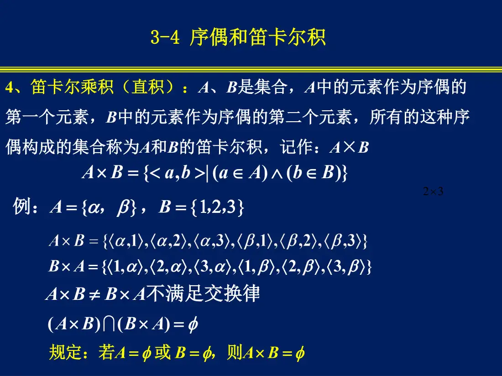

原文：

3-4 序偶和笛卡尔积

4、笛卡尔乘积（直积）：A、B是集合，A中的元素作为序偶的第一个元素，B中的元素作为序偶的第二个元素，所有的这种序偶构成的集合称为A和B的笛卡尔积，记作： $A \times B$ $A \times B = \{ < a, b > | (a \in A) \land (b \in B) \}$ 例： $A = \{\alpha, \beta\}$ ， $B = \{1, 2, 3\}$ $A \times B = \{\langle \alpha, 1 \rangle, \langle \alpha, 2 \rangle, \langle \alpha, 3 \rangle, \langle \beta, 1 \rangle, \langle \beta, 2 \rangle, \langle \beta, 3 \rangle\}$ $B \times A = \{\langle 1, \alpha \rangle, \langle 2, \alpha \rangle, \langle 3, \alpha \rangle, \langle 1, \beta \rangle, \langle 2, \beta \rangle, \langle 3, \beta \rangle\}$ $A \times B \neq B \times A$ 不满足交换律 $(A \times B) \cap (B \times A) = \phi$ 规定：若 $A = \phi$ 或 $B = \phi$ ，则 $A \times B = \phi$

### 3-4 序偶和笛卡尔积

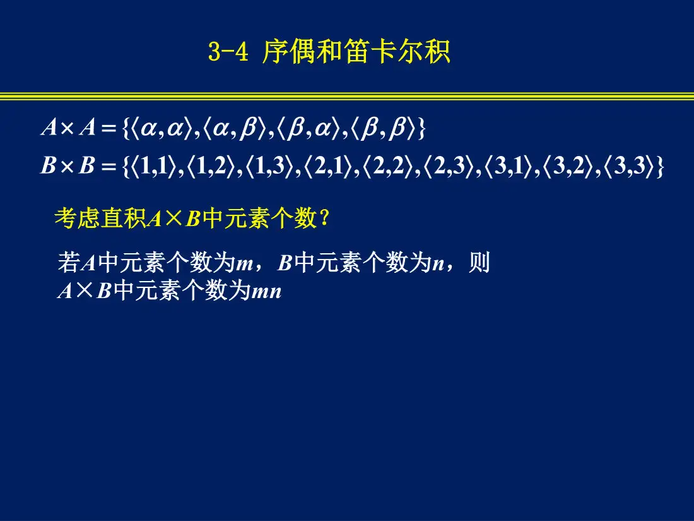

原文：

3-4 序偶和笛卡尔积

$A \times A = \{\langle \alpha, \alpha \rangle, \langle \alpha, \beta \rangle, \langle \beta, \alpha \rangle, \langle \beta, \beta \rangle\}$ $B \times B = \{\langle 1,1 \rangle, \langle 1,2 \rangle, \langle 1,3 \rangle, \langle 2,1 \rangle, \langle 2,2 \rangle, \langle 2,3 \rangle, \langle 3,1 \rangle, \langle 3,2 \rangle, \langle 3,3 \rangle\}$ 考虑直积 $A \times B$ 中元素个数？

若A中元素个数为m，B中元素个数为n，则 $A \times B$ 中元素个数为mn

### 3-4 序偶和笛卡尔积

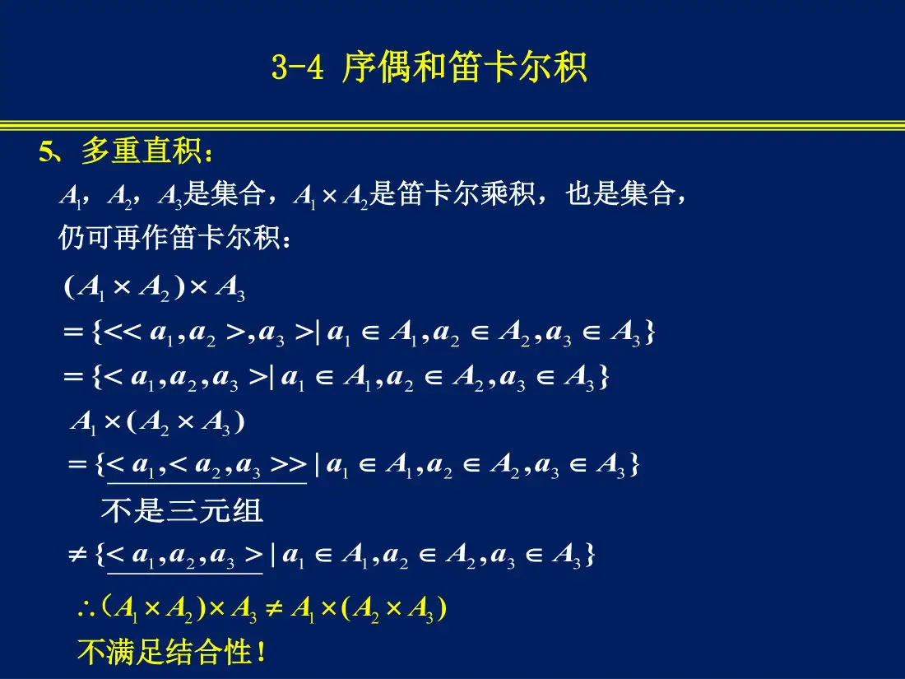

原文：

3-4 序偶和笛卡尔积

5、多重直积:

$A_{1}, A_{2}, A_{3}$ 是集合， $A_{1} \times A_{2}$ 是笛卡尔乘积，也是集合，仍可再作笛卡尔积： $(A_{1} \times A_{2}) \times A_{3}$ $= \{<< a_{1}, a_{2} >, a_{3} > | a_{1} \in A_{1}, a_{2} \in A_{2}, a_{3} \in A_{3} \}$ $= \{< a_{1}, a_{2}, a_{3} > | a_{1} \in A_{1}, a_{2} \in A_{2}, a_{3} \in A_{3} \}$ $A_{1} \times (A_{2} \times A_{3})$ $= \{\underline{< a_{1}, < a_{2}, a_{3} >>}|a_{1} \in A_{1}, a_{2} \in A_{2}, a_{3} \in A_{3}\}$ 不是三元组 $\neq \{\underline{< a_{1}, a_{2}, a_{3} >}|a_{1} \in A_{1}, a_{2} \in A_{2}, a_{3} \in A_{3}\}$ $\therefore (A_{1} \times A_{2}) \times A_{3} \neq A_{1} \times (A_{2} \times A_{3})$ 不满足结合性！

### 3-4 序偶和笛卡尔积

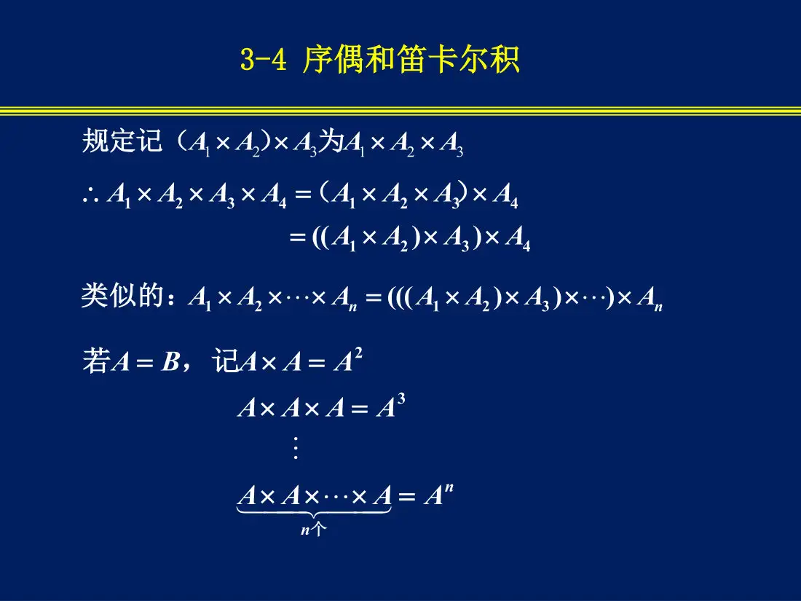

原文：

3-4 序偶和笛卡尔积

规定记 $(A_{1} \times A_{2}) \times A_{3}$ 为 $A_{1} \times A_{2} \times A_{3}$ $\therefore A_{1} \times A_{2} \times A_{3} \times A_{4} = (A_{1} \times A_{2} \times A_{3}) \times A_{4}$ $= ((A_{1} \times A_{2}) \times A_{3}) \times A_{4}$ 类似的： $A_{1} \times A_{2} \times \dots \times A_{n} = (((A_{1} \times A_{2}) \times A_{3}) \times \dots) \times A_{n}$ 若 $A = B$ ，记 $A \times A = A^{2}$ $A \times A \times A = A^{3}$ $\vdots$ $\underbrace{A \times A \times \cdots \times A}_{n\text{个}} = A^{n}$

### 3-4 序偶和笛卡尔积

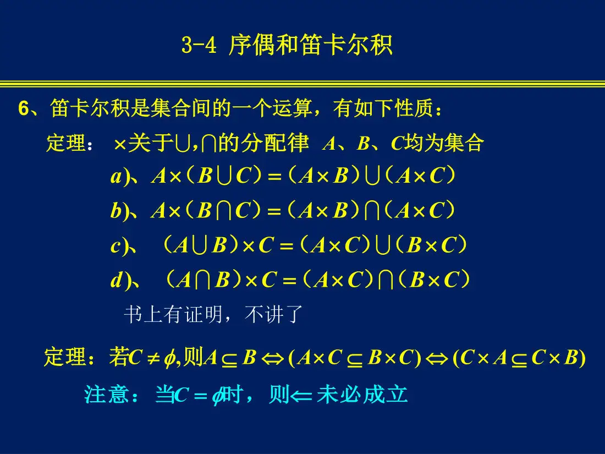

原文：

3-4 序偶和笛卡尔积

6、笛卡尔积是集合间的一个运算，有如下性质：
定理：×关于∪,∩的分配律 A、B、C均为集合
a)、A×(B∪C)=(A×B)∪(A×C)
b)、A×(B∩C)=(A×B)∩(A×C)
c)、(A∪B)×C=(A×C)∪(B×C)
d)、(A∩B)×C=(A×C)∩(B×C)
书上有证明，不讲了
定理：若C≠φ,则A⊆B⇔(A×C⊆B×C)⇔(C×A⊆C×B)
注意：当C=φ时，则←未必成立

### 3-4 序偶和笛卡尔积

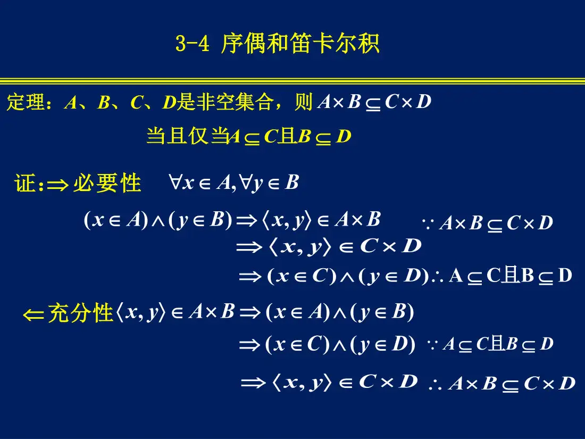

原文：

3-4 序偶和笛卡尔积

定理：A、B、C、D是非空集合，则 $A \times B \subseteq C \times D$ 当且仅当 $A \subseteq C$ 且 $B \subseteq D$

证:⇒必要性 $\forall x\in A,\forall y\in B$

$$
\begin{array}{r l} & {(x \in A) \land (y \in B) \Rightarrow \langle x, y \rangle \in A \times B \qquad \because A \times B \subseteq C \times D} \\ & {\qquad \Rightarrow \langle x, y \rangle \in C \times D} \\ & {\qquad \Rightarrow (x \in C) \land (y \in D) \therefore A \subseteq C \text {且} B \subseteq D} \end{array}
$$

$\Leftarrow$ 充分性 $\langle x,y\rangle \in A\times B\Rightarrow (x\in A)\land (y\in B)$ $\Rightarrow (x\in C)\land (y\in D)\because A\subseteq C$ 且 $B\subseteq D$ $\Rightarrow \langle x,y\rangle \in C\times D\therefore A\times B\subseteq C\times D$

### 3-4 序偶和笛卡尔积

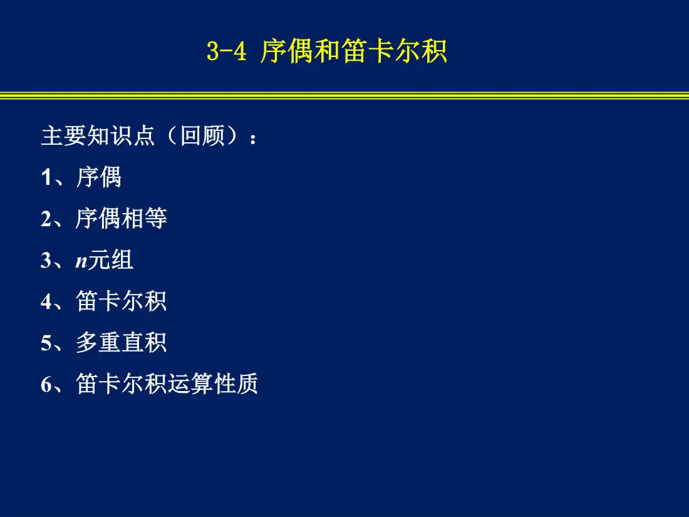

原文：

3-4 序偶和笛卡尔积

主要知识点（回顾）：

1、序偶

2、序偶相等

3、n元组

4、笛卡尔积

5、多重直积

6、笛卡尔积运算性质

### 3-5 关系及其表示

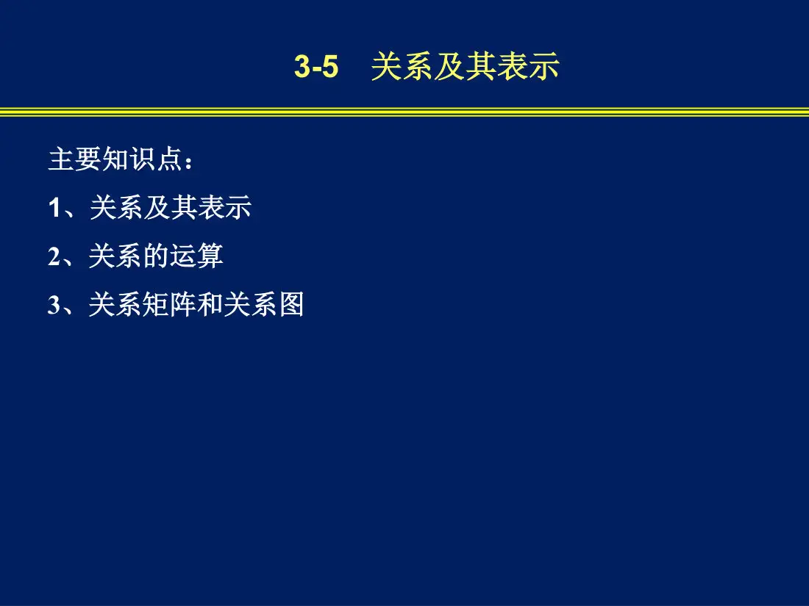

原文：

3-5 关系及其表示

主要知识点:

1、关系及其表示

2、关系的运算

3、关系矩阵和关系图

### 3-5 关系及其表示

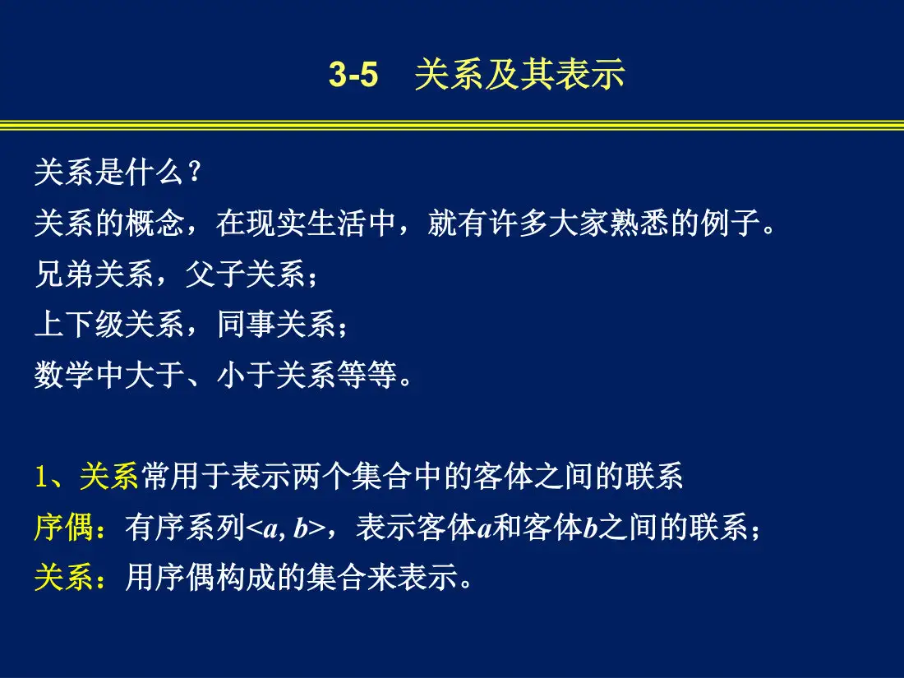

原文：

3-5 关系及其表示

关系是什么？

关系的概念，在现实生活中，就有许多大家熟悉的例子。

兄弟关系，父子关系；

上下级关系，同事关系；

数学中大于、小于关系等等。

1、关系常用于表示两个集合中的客体之间的联系

序偶: 有序系列 $<a, b>$ , 表示客体 $a$ 和客体 $b$ 之间的联系;

关系：用序偶构成的集合来表示。

### 3-5 关系及其表示

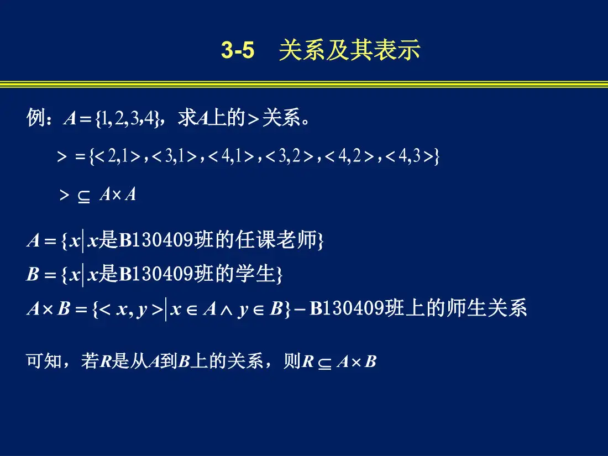

原文：

3-5 关系及其表示

例： $A=\{1,2,3,4\}$ ，求A上的＞关系。

$$
> = \{<   2, 1 >, <   3, 1 >, <   4, 1 >, <   3, 2 >, <   4, 2 >, <   4, 3 > \}
$$

$$
> \subseteq A \times A
$$

$A=\{x\mid x$ 是B130409班的任课老师\}

$B=\{x\mid x$ 是B130409班的学生 $\}$

$A \times B = \{< x, y> | x \in A \land y \in B\} - \mathrm{B}130409$ 班上的师生关系

可知，若 $R$ 是从 $A$ 到 $B$ 上的关系，则 $R \subseteq A \times B$

### 3-5 关系及其表示

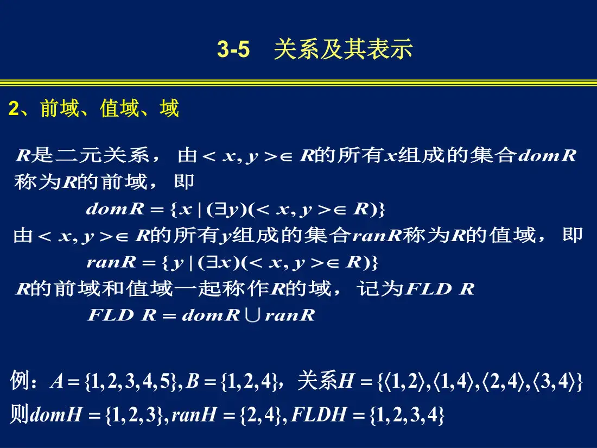

原文：

3-5 关系及其表示

2、前域、值域、域

R是二元关系，由 $< x, y > \in R$ 的所有x组成的集合domR称为R的前域，即 $\mathrm{dom}R = \{x \mid (\exists y) (< x, y > \in R)\}$ 由 $< x, y > \in R$ 的所有y组成的集合ranR称为R的值域，即 $\mathrm{ran}R = \{y \mid (\exists x) (< x, y > \in R)\}$ R的前域和值域一起称作R的域，记为FLDR $FLD R = domR \cup ranR$

例： $A = \{1,2,3,4,5\} ,B = \{1,2,4\}$ ，关系 $H = \{\langle 1,2\rangle ,\langle 1,4\rangle ,\langle 2,4\rangle ,\langle 3,4\rangle \}$ 则 $domH = \{1,2,3\} ,ranH = \{2,4\} ,FLDH = \{1,2,3,4\}$

### 3-5 关系及其表示

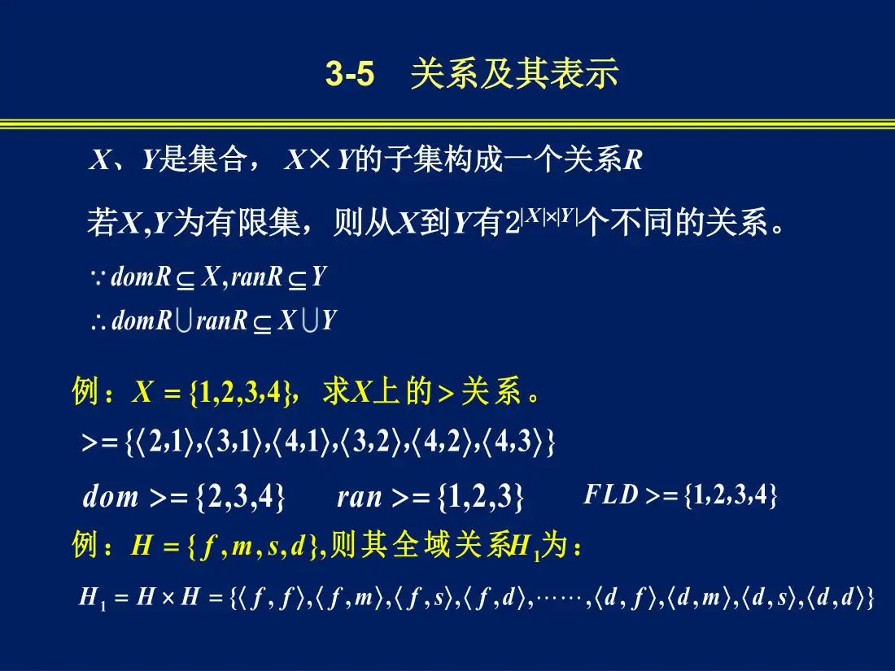

原文：

3-5 关系及其表示

X、Y是集合， $X \times Y$ 的子集构成一个关系R

若X,Y为有限集，则从X到Y有 $2^{|X|\times|Y|}$ 个不同的关系。

$$
\because d o m R \subseteq X, r a n R \subseteq Y
$$

$$
\therefore \operatorname{dom} R \cup \operatorname{ran} R \subseteq X \cup Y
$$

例： $X = \{1,2,3,4\}$ ，求 $X$ 上的 $>$ 关系。 $>= \{\langle 2,1\rangle ,\langle 3,1\rangle ,\langle 4,1\rangle ,\langle 3,2\rangle ,\langle 4,2\rangle ,\langle 4,3\rangle \}$ dom $>= \{2,3,4\}$ ran $>= \{1,2,3\}$ FLD $>= \{1,2,3,4\}$ 例： $H = \{f,m,s,d\}$ ，则其全域关系 $H_{1}$ 为： $H_{1} = H\times H = \{\langle f,f\rangle ,\langle f,m\rangle ,\langle f,s\rangle ,\langle f,d\rangle ,\dots\dots ,\langle d,f\rangle ,\langle d,m\rangle ,\langle d,s\rangle ,\langle d,d\rangle \}$

### 3-5 关系及其表示

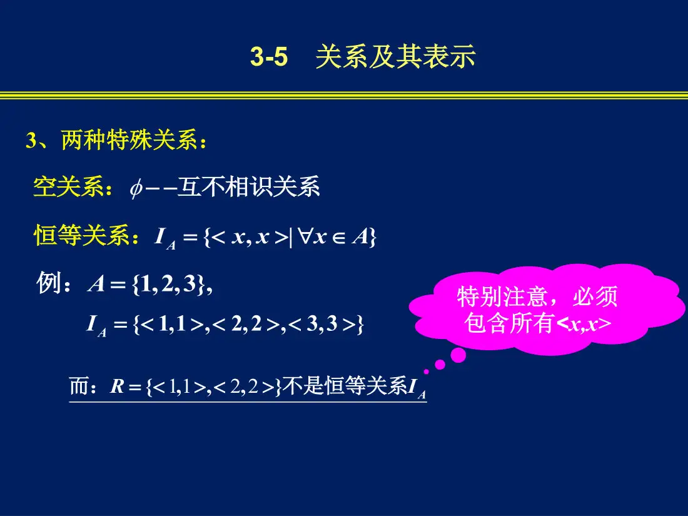

原文：

3-5 关系及其表示

3、两种特殊关系:

空关系: $\phi$ --互不相识关系

恒等关系: $I_{A} = \{< x, x > | \forall x \in A\}$

例： $A=\{1,2,3\}$ ,

$$
I _ {A} = \{<   1, 1 >, <   2, 2 >, <   3, 3 > \}
$$

特别注意，必须包含所有 $< x, x>$

而： $R=\{<1,1>,<2,2>\}$ 不是恒等关系 $I_{A}$

### 3-5 关系及其表示

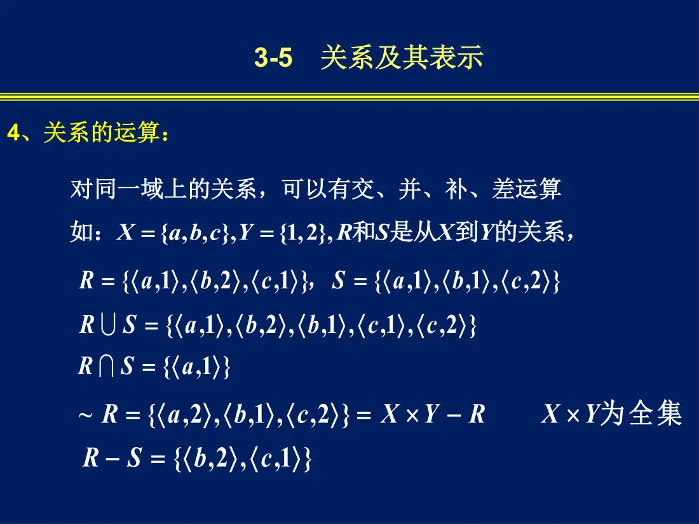

原文：

3-5 关系及其表示

4、关系的运算:

对同一域上的关系，可以有交、并、补、差运算如： $X = \{a, b, c\}, Y = \{1, 2\}$ , $R$ 和 $S$ 是从 $X$ 到 $Y$ 的关系，

$$
R = \{\langle a, 1 \rangle , \langle b, 2 \rangle , \langle c, 1 \rangle \}, S = \{\langle a, 1 \rangle , \langle b, 1 \rangle , \langle c, 2 \rangle \}
$$

$$
R \bigcup S = \{\langle a, 1 \rangle , \langle b, 2 \rangle , \langle b, 1 \rangle , \langle c, 1 \rangle , \langle c, 2 \rangle \}
$$

$$
R \cap S = \{\langle a, 1 \rangle \}
$$

$$
\sim R = \{\langle a, 2 \rangle , \langle b, 1 \rangle , \langle c, 2 \rangle \} = X \times Y - R
$$

$X \times Y$ 为全集

$$
R - S = \{\langle b, 2 \rangle , \langle c, 1 \rangle \}
$$

### 3-5 关系及其表示

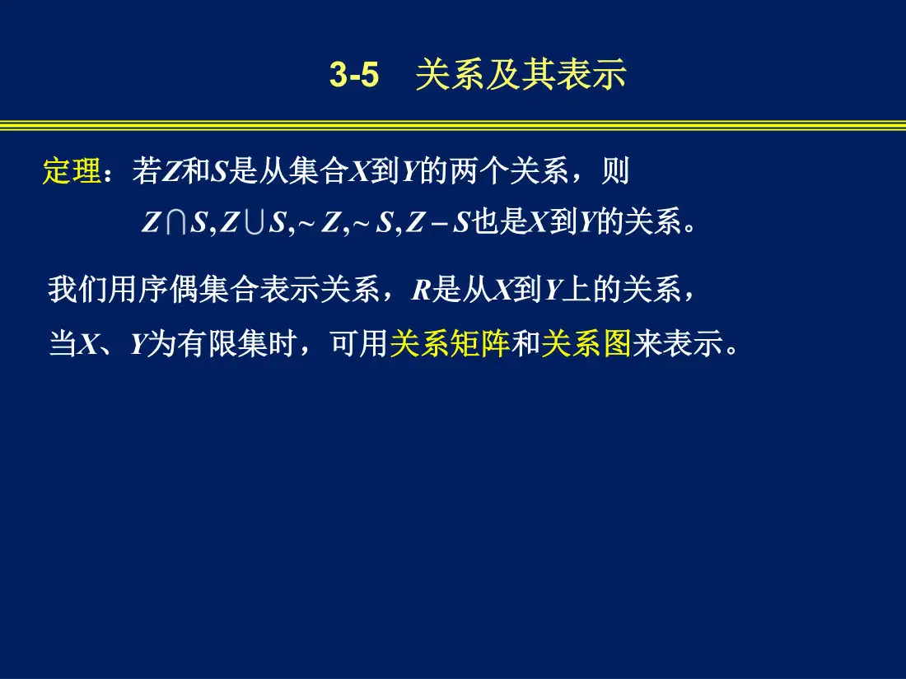

原文：

3-5 关系及其表示

定理：若Z和S是从集合X到Y的两个关系，则

$Z \cap S, Z \cup S, \sim Z, \sim S, Z - S$ 也是X到Y的关系。

我们用序偶集合表示关系， $R$ 是从 $X$ 到 $Y$ 上的关系，

当X、Y为有限集时，可用关系矩阵和关系图来表示。

### 3-5 关系及其表示

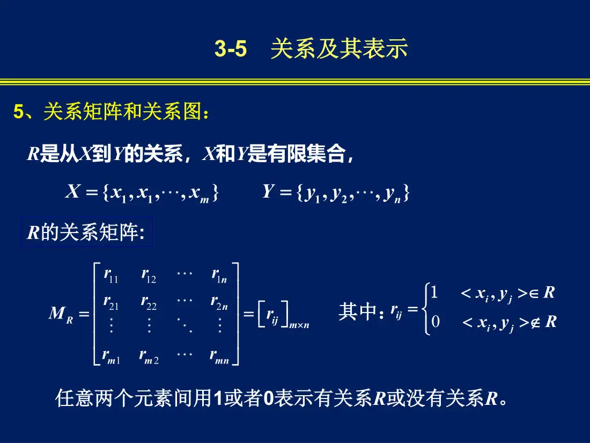

原文：

3-5 关系及其表示

5、关系矩阵和关系图：

$R$ 是从 $X$ 到 $Y$ 的关系， $X$ 和 $Y$ 是有限集合，

$$
X = \{x _ {1}, x _ {1}, \dots , x _ {m} \}
$$

$$
Y = \{y _ {1}, y _ {2}, \dots , y _ {n} \}
$$

$R$ 的关系矩阵:

$$
M _ {R} = \left[ \begin{array}{c c c c} r _ {1 1} & r _ {1 2} & \dots & r _ {1 n} \\ r _ {2 1} & r _ {2 2} & \dots & r _ {2 n} \\ \vdots & \vdots & \ddots & \vdots \\ r _ {m 1} & r _ {m 2} & \dots & r _ {m n} \end{array} \right] = \left[ r _ {i j} \right] _ {m \times n}
$$

其中：

$$
r _ {i j} = \left\{ \begin{array}{l l} 1 & <   x _ {i}, y _ {j} > \in R \\ 0 & <   x _ {i}, y _ {j} > \notin R \end{array} \right.
$$

任意两个元素间用1或者0表示有关系R或没有关系R。

### 3-5 关系及其表示

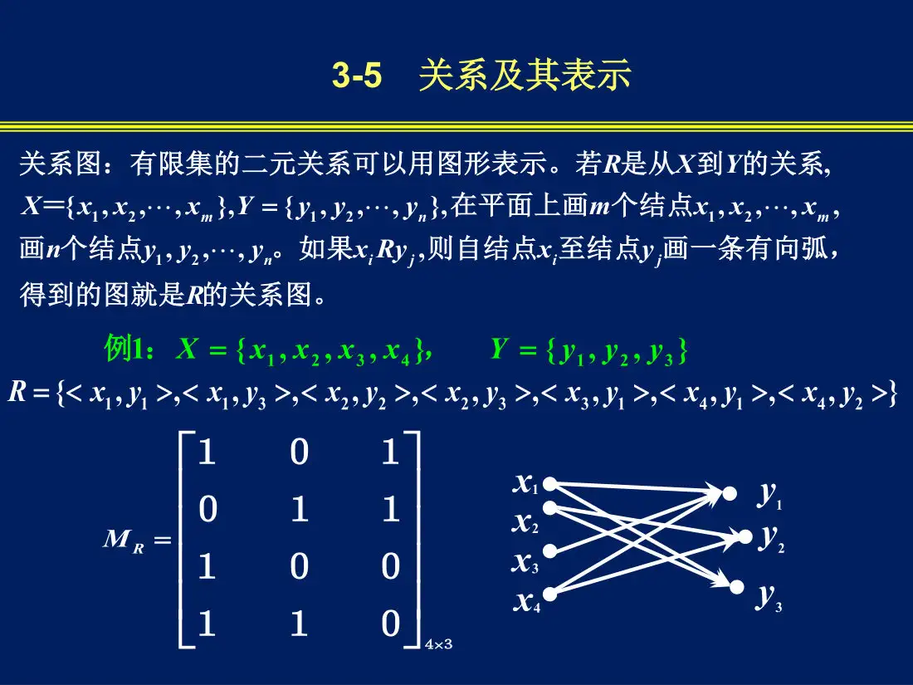

原文：

3-5 关系及其表示

关系图：有限集的二元关系可以用图形表示。若R是从X到Y的关系， $X=\{x_{1},x_{2},\cdots,x_{m}\},Y=\{y_{1},y_{2},\cdots,y_{n}\}$ ，在平面上画m个结点 $x_{1},x_{2},\cdots,x_{m}$ ，画n个结点 $y_{1},y_{2},\cdots,y_{n}$ 。如果 $x_{i}Ry_{j}$ ，则自结点 $x_{i}$ 至结点 $y_{j}$ 画一条有向弧，得到的图就是R的关系图。

例1: $X = \{x_{1}, x_{2}, x_{3}, x_{4}\}$ ,

$$
Y = \{y _ {1}, y _ {2}, y _ {3} \}
$$

$$
R = \{<   x _ {1}, y _ {1} >, <   x _ {1}, y _ {3} >, <   x _ {2}, y _ {2} >, <   x _ {2}, y _ {3} >, <   x _ {3}, y _ {1} >, <   x _ {4}, y _ {1} >, <   x _ {4}, y _ {2} > \}
$$

$$
M _ {R} = \left[ \begin{array}{c c c} 1 & 0 & 1 \\ 0 & 1 & 1 \\ 1 & 0 & 0 \\ 1 & 1 & 0 \end{array} \right] _ {4}
$$

### 3-5 关系及其表示

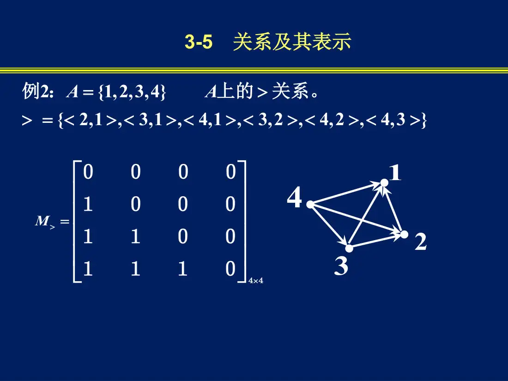

原文：

3-5 关系及其表示

例2: $A = \{1, 2, 3, 4\}$ A上的 $>$ 关系。

$$
> = \{<   2, 1 >, <   3, 1 >, <   4, 1 >, <   3, 2 >, <   4, 2 >, <   4, 3 > \}
$$

$$
M _ {>} = \left[ \begin{array}{l l l l} 0 & 0 & 0 & 0 \\ 1 & 0 & 0 & 0 \\ 1 & 1 & 0 & 0 \\ 1 & 1 & 1 & 0 \end{array} \right] _ {4 \times 4}
$$

### 但若求A上的>=关系，则≥===>∪I\_A

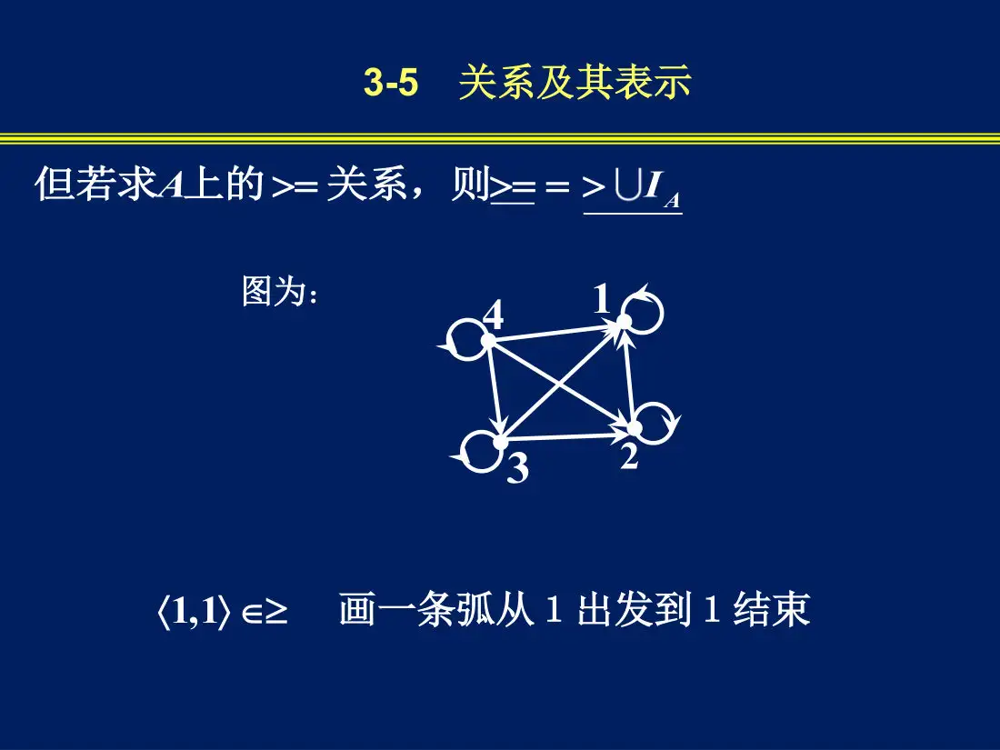

原文：

但若求A上的>=关系，则≥===>∪I\_A

图为:

$\langle 1,1\rangle \in \geq$ 画一条弧从1出发到1结束

3-5 关系及其表示

### 3-5 关系及其表示

原文：

3-5 关系及其表示

序偶

∴关系表示有三种方法

关系矩阵

关系图

要求 $X$ 、 $Y$ 有限集合

由于X到Y的关系 $R,R\subseteq X\times Y$ ，而 $X\times Y\subseteq(X\cup Y)\times(X\cup Y)$

∴ $R \subseteq (X \cup Y) \times (X \cup Y)$ 因而我们以后仅讨论同一集合上的关系。

### 3-5 关系及其表示

原文：

3-5 关系及其表示

主要知识点（回顾）：

1、关系及其表示

2、关系的运算

3、关系矩阵和关系图

### 3-6 关系的性质

原文：

3-6 关系的性质

主要知识点:

1、自反性

2、对称性

3、传递性

4、反自反性

5、反对称性

### 3-6 关系的性质

原文：

3-6 关系的性质

这里我们仅讨论在集合X上的二元关系。（对于X到Y的关系可以改为此类）。

$R$ 是 $X$ 上的二元关系

1、自反性 $R$ 在 $X$ 上自反 $\Leftrightarrow (\forall x)(x \in X \to \langle x, x \rangle \in R)$ 为真
如：实数域上的“ $\leq$ ”关系， $1 \leq 1, \langle 1, 1 \rangle \in “ \leq ”, 2 \leq 2, \langle 2, 2 \rangle \in “ \leq ”$ 三角形全等关系 $\cong$ ，三角形自身与自身全等。
（注：对 $X$ 上的所有元素而言， $\langle x, x \rangle \in R$ )也即 $I_x \subseteq R$

### 3-6 关系的性质

原文：

3-6 关系的性质

2、对称性：

$R$ 在 $X$ 上对称 $\Leftrightarrow (\forall x)(\forall y)(x\in X\land y\in Y\land xRy\to yRx)$ 为真

注: 若没有 $\langle x, y \rangle \in R$ , 则也称具有对称性。

如： $R=I_{X}$ ，R是对称的

如： $X = \{1,2,3\}, R = \{\langle 1,2\rangle ,\langle 2,1\rangle ,\langle 2,3\rangle ,\langle 3,2\rangle \}$ 则 $R$ 是对称的。

两个三角形的相似关系:～， $\Delta_{1} \sim \Delta_{2} \rightarrow \Delta_{2} \sim \Delta_{1}$

### $$

原文：

例： $A=\{2,3,5,7\}$ $R=\{\langle x,y\rangle|\frac{x-y}{2}$ 是整数。

$(\forall x)(x \in A \to \frac{x - x}{2} = 0$ 是整数)

$$
\therefore \langle x, x \rangle \in R
$$

∴ R 是自反的。

若 $\frac{x - y}{2}$ 是整数， $\langle x, y \rangle \in R$ 则 $\frac{y - x}{2}$ 也是整数 $\langle y, x \rangle \in R$

∴ R 是对称的。

$$
\langle 5, 3 \rangle \in R, \langle 3, 5 \rangle \in R 。
$$

3-6 关系的性质

### 3-6 关系的性质

原文：

3-6 关系的性质

3、传递性:

$R$ 在 $A$ 上传递 $\Leftrightarrow (\forall x)(\forall y)(\forall z)(x\in A\land y\in A\land z\in A\land$ $< x,y > \in R\land < y,z > \in R\to < x,z > \in R)$ 为真

注：若没有 $< x, y > \in R \wedge < y, z > \in R$ ，则也称具有传递性。

例1: $A = \{1,2,3\}$ , $R = \{<1,2>, <1,3>\}$

$$
1 \leq 2, 2 \leq 3 \rightarrow 1 \leq 3
$$

$$
x = y, y = z \rightarrow x = z
$$

$$
1 <   2, 2 <   3 \rightarrow 1 <   3
$$

又如：日常工作中，同乡关系：甲、乙是同乡，乙、丙是同乡，甲、丙是同乡，传递性成立。

### 3-6 关系的性质

原文：

3-6 关系的性质

4、反自反性:

R具有反自反性 $\Leftrightarrow (\forall x)(x\in X\to \langle x,x\rangle \notin R)$ 为真。

如：父子关系，自己与自己不能是父子；

>关系： $x \neq x_{0}$

提问：反自反是否就是自反的否定？

也即是否不是自反就一定是反自反的？

### 3-6 关系的性质

原文：

3-6 关系的性质

自反的否定:

$\neg (\forall x)(x\in X\to \langle x,x\rangle \in R)\Leftrightarrow (\exists x)(x\in X\land \langle x,x\rangle\notin R)$ $(\exists x)(x\in X\land \langle x,x\rangle \notin R)$ 和 $(\forall x)(x\in X\to \langle x,x\rangle \notin R)$ 不等价，所以自反的否定不同于反自反。

如： $A=\{1,2,3\}$ ， $R=\{\langle1,1\rangle,\langle1,2\rangle,\langle3,2\rangle,\langle2,3\rangle,\langle3,3\rangle\}$ $\because\langle2,2\rangle\notin R$ ∴R不是自反的，R也不是反自反的， $\langle1,1\rangle,\langle3,3\rangle\in R$ ∴不是自反的与反自反的不是等价的，不是同一回事。

### 3-6 关系的性质

原文：

3-6 关系的性质

5、反对称性：

若 $\langle x, y \rangle \in R, \langle y, x \rangle \in R$ , 必有: $x = y$ , 称 $R$ 为反对称的

$$
\text {如:} “ \leq ”, \left.\begin{array}{l}x \leq y\\y \leq x\end{array}\right\}\rightarrow x = y, \quad \subseteq \quad \left.\begin{array}{l}A \subseteq B\\B \subseteq A\end{array}\right\}\rightarrow A = B
$$

给出两个简单结论:

a、关系既可以对称的，又可以是反对称的。

如： $A = \{1,2,3\}, R = \{\langle 1,1\rangle ,\langle 2,2\rangle ,\langle 3,3\rangle \}$ 是对称的，也是反对称的。

b、关系可以既不是对称的，又不是反对称的。

如： $A = \{1,2,3\} ,R = \{\langle 1,2\rangle ,\langle 2,1\rangle ,\langle 3,3\rangle ,\langle 3,2\rangle \}$

### 3-6 关系的性质

原文：

3-6 关系的性质

反对称性
(∀x)(∀y)(x ∈ X ∧ y ∈ Y ∧ < x, y > ∈ R ∧ < y, x > ∈ R → x = y)
的另一种等价定义:
(∀x)(∀y)(x ∈ X ∧ y ∈ Y ∧ (x ≠ y) ∧ < x, y > ∈ R → < y, x > ∉ R)
∵< x, y > ∈ R ∧ < y, x > ∈ R → (x = y)
⇔ (x ≠ y) → ¬(< x, y > ∈ R ∧ < y, x > ∈ R)
⇔ ¬(x ≠ y) ∨ ¬(< x, y > ∈ R) ∨ (< y, x > ∉ R)
⇔ ¬((x ≠ y) ∧ < x, y > ∈ R) ∨ (< y, x > ∉ R)
⇔ (x ≠ y) ∧ < x, y > ∈ R → < y, x > ∉ R

### 3-6 关系的性质

原文：

3-6 关系的性质

举例： $A=\{1,2,3\}$ ， $R_{1}=\{<1,1>,<2,2>\}$ ， $R_{2}=\{<1,2>\}$ $R_{3}=\{<1,2>,<2,1>,<1,1>\}$ ， $R_{4}=\{<1,2>,<2,1>,<1,3>\}$ 试判断关系分别满足哪些性质？

<table><tr><td></td><td> $R_1$ </td><td> $R_2$ </td><td> $R_3$ </td><td> $R_4$ </td></tr><tr><td>自反性</td><td>×</td><td>×</td><td>×</td><td>×</td></tr><tr><td>反自反性</td><td>×</td><td>√</td><td>×</td><td>√</td></tr><tr><td>对称性</td><td>√</td><td>×</td><td>√</td><td>×</td></tr><tr><td>反对称性</td><td>√</td><td>√</td><td>×</td><td>×</td></tr><tr><td>传递性</td><td>√</td><td>√</td><td>×</td><td>×</td></tr></table>

### 这与空集的意思差不多.

原文：

这与空集的意思差不多.
集合A上的关系.是A的元的有序对的一个集合.
所谓关系R是传递的,是说,对于R的两个有序对:
<a,b>.<c,d>,只要b=c,则必有<a,d>∈R.
现在R= {<1,3>} .取“两个”有序对.只能是
<1,3>,<1,3>没有b=c者.所以它也看成满足
传递关系的条件,(一般地说,只要没有“相接”
的两个有序对[<1,2><2,3>叫“相接”],R总是
传递关系.)

### 3-6 关系的性质

原文：

3-6 关系的性质

$I = \{1,2,3,4\}, R = \{\langle 1,1\rangle ,\langle 1,3\rangle ,\langle 2,2\rangle ,\langle 3,3\rangle ,\langle 3,1\rangle ,\langle 3,4\rangle ,\langle 4,3\rangle ,\langle 4,4\rangle \}$ 讨论 $R$ 的性质。

$$
M _ {R} = \left[ \begin{array}{c c c c} 1 & 0 & 1 & 0 \\ 0 & 1 & 0 & 0 \\ 1 & 0 & 1 & 1 \\ 0 & 0 & 1 & 1 \end{array} \right] _ {4 \times 4}
$$

首先，R是自反的，R是对称的， $\langle1,3\rangle,\langle3,4\rangle\in R$ 但 $\langle1,4\rangle\notin R$ $\therefore R$ 不是传递的。
R不是反自反的，R不是反对称的， $\langle3,4\rangle$ 、 $\langle4,3\rangle\in R$

### 3-6 关系的性质

原文：

3-6 关系的性质

从关系矩阵、关系图来判断五个性质：

1、自反的：关系矩阵的对角线上元素全为1，关系图中每个结点均有自回路。

2、对称的：关系矩阵是对称矩阵，关系图中若两个结点之间有有向弧，则必成对出现

3、反自反的：关系矩阵中对角线元素全为0，关系图中每个结点都没有自回路。

4、反对称的：关系矩阵以对角线对称的元素不能同时为1，（但可为对称阵，同时为0），关系图中如果两个结点之间有有向弧，则不能成对出现。

5、传递性：不能明确判断，只能用定义。

### 3-6 关系的性质

原文：

3-6 关系的性质

主要知识点（回顾）：

1、自反性

2、对称性

3、传递性

4、反自反性

5、反对称性

### 3-7 复合关系和逆关系

原文：

3-7 复合关系和逆关系

主要知识点:

1、复合关系

2、逆关系

### 3-7 复合关系和逆关系

原文：

3-7 复合关系和逆关系

为了确切表示复合关系，我们举一实例： $a, b$ 是兄弟关系 $R, b, c$ 是父子关系 $S$ , 则 $a, c$ 是叔侄关系 $T, T$ 是 $R$ 和 $S$ 的复合关系。

1、复合关系：为了明确地表示复合关系，给出定义：
定义：R是X到Y的关系，S是Y到Z的关系，则R和S的复合关系 $R^{\circ}S$ 称为R和S的复合关系，表示为：

$R\circ S = \{\langle x,z\rangle |x\in X\land z\in Z\land (\exists y)(y\in Y\land \langle x,y\rangle \in R\land \langle y,z\rangle \in S)\}$ 如： $R = \{\langle 1,2\rangle ,\langle 3,4\rangle ,\langle 2,2\rangle \}$ $S = \{\langle 4,2\rangle ,\langle 2,5\rangle ,\langle 3,1\rangle ,\langle 1,3\rangle \}$ 则： $R\circ S = \{\langle 1,5\rangle ,\langle 3,2\rangle ,\langle 2,5\rangle \}$ 从左至右复合。如： $S^{\prime} = S\cup \{\langle 4,1\rangle \}$ ，则： $R\circ S^{\prime} = \{\langle 1,5\rangle ,\langle 3,2\rangle ,\langle 3,1\rangle ,\langle 2,5\rangle \}$

### 3-7 复合关系和逆关系

原文：

3-7 复合关系和逆关系

$S \circ R = \{\langle 4,2\rangle ,\langle 3,2\rangle ,\langle 1,4\rangle \} ,\quad R \circ S \neq S \circ R$ 不满足交换律求复合关系，也称为合成运算。

$(R \circ S) \circ R = \{\langle 3,2\rangle\} \quad R \circ (S \circ R) = \{\langle 3,2\rangle\}$ 合成运算具有结合律。又例： $X = \{x_{1}, x_{2}, x_{3}\} \quad Y = \{y_{1}, y_{2}, y_{3}\} \quad Z = \{z_{1}, z_{2}, z_{3}\}$ $R = \{< x_{1}, y_{1} >, < x_{1}, y_{2} >, < x_{2}, y_{2} >\}$ $S = \{< y_{1}, z_{2} >, < y_{2}, z_{3} >, < y_{3}, z_{3} >\}$ $R \circ S = \{< x_{1}, z_{2} >, < x_{1}, z_{3} >, < x_{2}, z_{3} >\}$ 通过关系图来求复合

### 3-7 复合关系和逆关系

原文：

3-7 复合关系和逆关系

$$
M _ {R} = \left[ \begin{array}{c c c} 1 & 1 & 0 \\ 0 & 1 & 0 \\ 0 & 0 & 0 \end{array} \right] \quad M _ {S} = \left[ \begin{array}{c c c} 0 & 1 & 0 \\ 0 & 0 & 1 \\ 0 & 0 & 1 \end{array} \right]
$$

通过关系矩阵求复合

$$
M _ {R \circ S} = \left[ \begin{array}{c c c} 0 & 1 & 1 \\ 0 & 0 & 1 \\ 0 & 0 & 0 \end{array} \right]
$$

有: $M_{R\circ S}=M_{R}\circ M_{S}$

$M_{R\circ S}$ 第一行第一列元素0是 $M_{R}$ 第一行元素与 $M_{S}$ 第一列元素相乘再逻辑相加得到。

$[M_{R \circ S}]_{ij}: M_R$ 第 $i$ 行元素与 $M_S$ 第 $j$ 列元素逻辑相乘再逻辑相加所得。

一般地： $M_{R\circ S}=M_{R}\circ M_{S}$

### 3-7 复合关系和逆关系

原文：

3-7 复合关系和逆关系

$$
M _ {R} = \left[ u _ {i j} \right]
$$

$$
u _ {i j} = \left\{ \begin{array}{l l} 1 & <   x _ {i}, y _ {j} > \in R \\ 0 & <   x _ {i}, y _ {j} > \notin R \end{array} \right.
$$

$$
M _ {s} = \left[ v _ {j k} \right]
$$

$$
\nu_ {j k} = \left\{ \begin{array}{l l} 1 & <   y _ {j}, z _ {k} > \in S \\ 0 & <   y _ {j}, z _ {k} > \notin S \end{array} \right.
$$

$$
\wedge : \left\{ \begin{array}{l} 0 \land 0 = 0 \\ 0 \land 1 = 0 \\ 1 \land 0 = 0 \\ 1 \land 1 = 1 \end{array} \right.
$$

$$
\vee : \left\{ \begin{array}{l} 0 \lor 0 = 0 \\ 0 \lor 1 = 1 \\ 1 \lor 0 = 1 \\ 1 \lor 1 = 1 \end{array} \right. \therefore M _ {R \circ S} = \left[ w _ {i k} \right]
$$

$$
w _ {i k} = \underset {j = 1} {\overset {n} {\vee}} \Big (u _ {i j} \wedge v _ {j k} \Big)
$$

### 3-7 复合关系和逆关系

原文：

3-7 复合关系和逆关系

如： $A = \{1,2,3,4,5\}$

$$
M _ {R} = \left[ \begin{array}{c c c c c} 0 & 1 & 0 & 0 & 0 \\ 0 & 1 & 0 & 0 & 0 \\ 0 & 0 & 0 & 1 & 0 \\ 0 & 0 & 0 & 0 & 0 \\ 0 & 0 & 0 & 0 & 0 \end{array} \right]
$$

$$
M _ {R} \circ M _ {S} = \left[ \begin{array}{l l l l l} 0 & 0 & 0 & 0 & 1 \\ 0 & 0 & 0 & 0 & 1 \\ 0 & 1 & 0 & 0 & 0 \\ 0 & 0 & 0 & 0 & 0 \\ 0 & 0 & 0 & 0 & 0 \end{array} \right]
$$

$$
M _ {s} = \left[ \begin{array}{l l l l l} 0 & 0 & 1 & 0 & 0 \\ 0 & 0 & 0 & 0 & 1 \\ 1 & 0 & 0 & 0 & 0 \\ 0 & 1 & 0 & 0 & 0 \\ 0 & 0 & 0 & 0 & 0 \end{array} \right]
$$

$R\circ S = \{<  1,5 > , <   2,5 > , <   3,2 > \}$

### 2、逆关系：

原文：

2、逆关系：

R是X到Y的二元关系，把R中每一序偶的元素次序颠倒，得到的关系称为R的逆关系，记作 $R^{c}$ ：

$$
R ^ {c} = \{<   y, x > | <   x, y > \in R \} 。
$$

如：“>”逆“<”

$$
3 > 2, \quad 2 <   3, \quad \langle 3, 2 \rangle \in >, \quad \langle 2, 3 \rangle \in <
$$

如： $X = \{x_{1},x_{2},x_{3}\} \quad Y = \{y_{1},y_{2},y_{3}\}$

$$
R = \{<   x _ {1}, y _ {2} >, <   x _ {2}, y _ {3} >, <   x _ {3}, y _ {1} > \}
$$

$$
R ^ {c} = \{<   y _ {2}, x _ {1} >, <   y _ {3}, x _ {2} >, <   y _ {1}, x _ {3} > \}
$$

3-7 复合关系和逆关系

### 3-7 复合关系和逆关系

原文：

3-7 复合关系和逆关系

关系矩阵

$M_{R} = \left[ \begin{array}{lll}0 & 1 & 0\\ 0 & 0 & 1\\ 1 & 0 & 0 \end{array} \right],$ 转置关系 $M_{R^c} = \left[ \begin{array}{lll}0 & 0 & 1\\ 1 & 0 & 0\\ 0 & 1 & 0 \end{array} \right],M_{R^c} = M_R^T$

下面讨论逆关系的一些性质：

### 3-7 复合关系和逆关系

原文：

(1) $\left(R^{c}\right)^{c}=R$ (2) $R, R_{1}, R_{2}$ 都是从A到B的关系，则：
a) $\left(R_{1} \cup R_{2}\right)^{c} = R_{1}^{c} \cup R_{2}^{c}$ b) $\left(R_{1} \cap R_{2}\right)^{c} = R_{1}^{c} \cap R_{2}^{c}$ c) $(A \times B)^{c} = B \times A$ $d)(\overline{R})^{c}=\overline{R^{c}}$ ,这里 $\overline{R}=A\times B-R$ $e)(R_{1}-R_{2})^{c}=R_{1}^{c}-R_{2}^{c}$ 书上对a),b),e)均有证明，这里我们证明b),d).

3-7 复合关系和逆关系

### 3-7 复合关系和逆关系

原文：

3-7 复合关系和逆关系

证：b)首先两端仍是序偶集合，要证相等即证两集合相等。 $<x,y>\in(R_{1}\cap R_{2})^{c}\Leftrightarrow<y,x>\in R_{1}\cap R_{2}\Leftrightarrow<y,x>\in R_{1}\land<y,x>\in R_{2},$ $\Leftrightarrow<x,y>\in R_{1}^{c}\land<x,y>\in R_{2}^{c}\Leftrightarrow<x,y>\in R_{1}^{c}\cap R_{2}^{c}$ $\therefore(R_{1}\cap R_{2})^{c}=R_{1}^{c}\cap R_{2}^{c}$ $d)<x,y>\in(\overline{R})^{c}\Leftrightarrow<y,x>\in\overline{R}\Leftrightarrow<y,x>\notin R\Leftrightarrow<x,y>\notin R^{c}。$ $\Leftrightarrow<x,y>\in\overline{R^{c}},\therefore(\overline{R})^{c}=\overline{R^{c}}。$ (3)T是X→Y关系，S:Y→Z关系，则 $(T\circ S)^{c}=S^{c}\circ T^{c}$ (4)R为X上的二元关系，则：
a)R是对称的 $\Leftrightarrow R=R^{c}$ .

### 除b)外其它书上都有证明：

原文：

b) R是反对称的 $\Leftrightarrow R\cap R^{c}\subseteq I_{X}$ ,
除b)外其它书上都有证明：
证b): $\Rightarrow R$ 是反对称的，即 $<x,y>\in R\land<y,x>\in R\Rightarrow x=y.$ 若 $<x,y>\in R\cap R^{c}$ ，则 $<x,y>\in R\land<x,y>\in R^{c}$ 即 $<x,y>\in R\land<y,x>\in R$ 根据R反对称性质：∴ $x = y, <x, y> = <x, x> \in I_{X}, \therefore R \cap R^{c} \subseteq I_{X}$ $\Leftarrow R \cap R^{c} \subseteq I_{X},$ $<x,y>\in R\cap R^{c}\Leftrightarrow<x,y>\in R\land<x,y>\in R^{c}$ $\Leftrightarrow<x,y>\in R\land<y,x>\in R$ 因为 $R \cap R^{c} \subseteq I_{X}, \therefore x = y.$ ∴ 对 $\forall <x,y>\in R$ 且 $<y,x>\in R$ 时有 x = y，故 R 是反对称的。

3-7 复合关系和逆关系

### 3-7 复合关系和逆关系

原文：

3-7 复合关系和逆关系

书P118. 3-7 (1)

$R_{1}, R_{2}$ 是 $A$ 上的关系，判断下列命题正确性：

a) 若 $R_{1}, R_{2}$ 是自反的，则 $R_{1} \circ R_{2}$ 是自反的

b) 若 $R_{1}, R_{2}$ 是反自反的，则 $R_{1} \circ R_{2}$ 是反自反的

c) 若 $R_{1}, R_{2}$ 是对称的，则 $R_{1} \circ R_{2}$ 是对称的

d) 若 $R_{1}, R_{2}$ 是传递的，则 $R_{1} \circ R_{2}$ 是传递的

a)√

b) X

c) X

d) ×

### 3-7 复合关系和逆关系

原文：

3-7 复合关系和逆关系

$$
a) \quad \forall x \in A, <   x, x > \in R _ {1}, <   x, x > \in R _ {2} \quad \therefore <   x, x > \in R _ {1} \circ R _ {2}
$$

b) 若 $A = \{a, b\} R_{1} = \{<a, b> \} R_{2} = \{<b, a>\}$ , 则 $R_{1} \circ R_{2} = \{<a, a>\}$

c) 若 $A = \{a,b,c\}, R_1 = \{<a,b>,<b,a>\}, R_2 = \{<b,c>,<c,b>\}$ 则 $R_{1} \circ R_{2} = \{<a,c>\}$

d) 若 $A = \{a,b,c\} ,R_{1} = \{< a,b > , < b,c > , < a,c > \} ,R_{2} = \{< b,c > , < c,a > , < b,a > \}$ 而 $R_{1}\circ R_{2} = \{< a,c > , < a,a > , < b,a > \} , < b,c > \notin R_{1}\circ R_{2}$

### 3-7 复合关系和逆关系

原文：

3-7 复合关系和逆关系

主要知识点（回顾）：

1、复合关系

2、逆关系

### 3-8 关系的闭包运算

原文：

3-8 关系的闭包运算

主要知识点:

1、自反闭包

2、对称闭包

3、传递闭包

### 3-8 关系的闭包运算

原文：

3-8 关系的闭包运算

上次课我们介绍了关系的两种运算：复合运算和求逆关系，今天我们介绍第三种运算：关系的闭包运算

例： $X = \{1,2,3\}, R = \{<1,1>,<2,3>,<1,3>\}$ 。显然 $R$ 不是自反的，但 $R' = \{<1,1>,<2,3>,<1,3>,<2,2>,<3,3>\}$ ，可知 $R'$ 是自反的。 $\text {R'} \supseteq R$ ，且若 $\forall R'' \supseteq R, R''$ 自反的，则 $R'' \supseteq R'$ ，即 $R'$ 是包含 $R$ 且是自反的最小关系， $R'$ 称为 $R$ 的自反闭包，这一过程叫做闭包运算。另外对于对称闭包，传递闭包也可类似求出。

### 3-8 关系的闭包运算

原文：

3-8 关系的闭包运算

定义: $R$ 是 $X$ 上的关系(一般不特指均是 $R$ 上的二元关系), 若有另一关系 $R'$ , 满足

a) $R'$ 是自反的(对称的，传递的)

$$
b) R ^ {\prime} \supseteq R.
$$

c)对任何自反的(对称的，传递的)

关系 $R''$ , 若 $R'' \supseteq R$ , 则 $R'' \supseteq R'$ , 则称 $R'$ 是 R 的自反(对称，传递)闭包。

分别记作： $r(R), s(R), t(R).$ (reflection, symmetry, transition)

例如 $>$ 关系, $\geq$ 是 $>$ 的自反闭包; $\neq$ 是对称闭包; $>$ 是传递闭包。如 $X: I_X = \{<x, x> | x \in X\}$ . $I_X$ 是自反的, 对称的, 传递的。 $\therefore r(I_X) = I_X, s(I_X) = I_X, t(I_X) = I_X.$ 因而当一个关系本身自反时 $r(R) = R$ , 且是充要的

### 3-8 关系的闭包运算

原文：

3-8 关系的闭包运算

定理：设 $R$ 是 $X$ 上的关系，则

a) R 是自反的 $\Leftrightarrow r(R) = R;$

b) R 是对称的 $\Leftrightarrow s(R) = R;$

c) R 是传递的 $\Leftrightarrow t(R) = R.$ (a 书上有证明，现证 b).

证： $b) \Leftarrow$ 已知 $s(R) = R$ . $s(R)$ 是对称的，∴ R 是对称的。

$\Rightarrow R$ 是对称的， $R \supseteq R$ ，任一 $R'', R'' \supseteq R, R''$ 是对称的，必有 $R'' \supseteq R$ . $\therefore R$ 是 $R$ 的对称闭包，即 $s(R) = R$ .

### 3-8 关系的闭包运算

原文：

3-8 关系的闭包运算

下面给出求关系 $R$ 的 $r(R), s(R), t(R)$ 的三个定理。

1）定理 R是X上的关系，则 $r(R)=R\cup I_{X}$ 证：令 $R'=R\cup I_{X}$ ，用定义证明，
a) $R'$ 是自反的， $(\forall x)(x\in X\to<x,x>\in I_{X})$ ∴ $(\forall x)(x\in X\to<x,x>\in R')$ . $R'$ 自反成立。
b) $R'\supseteq R$ .
c) $R''$ 是自反的：且 $R''\supseteq R$ ，则 $R''\supseteq I_{X}$ ,
∴ $R''\supseteq R\cup I_{X}=R'$ ，从而 $R'=r(R)$ .
这就给出求自反闭包的方法

2）定理 R 是 X 上的关系，则 $s(R) = R \cup R^{C}$ . 证明是由定义类似可证.

3）定理 R是X上的关系，则 $t(R)=R\cup R^{2}\cup\ldots\ldots=\bigcup_{i=1}^{\infty}R^{i}$ .
首先解释一下 $R^{i}$ 含义。∵○满足结合律， $(R\circ S)\circ T=R\circ(S\circ T)\therefore()$ 可省略。

### 3-8 关系的闭包运算

原文：

3-8 关系的闭包运算

$\therefore R^{2} = R \cdot R, R^{3} = R^{2} \cdot R = (R \cdot R) \cdot R, \cdots, R^{i} = R^{i-1} \cdot R = R \cdot R \cdot R \cdots R$ 复合。

对 $\bigcup_{i=1}^{\infty}R^{i}=R\cup R^{2}\cup\cdots$ 是无限 $R^{i}$ 关系的并(集合的并)。

证：∵ $\bigcup_{i=1}^{\infty}R^{i}$ 是一无穷序列。∴不好用定义证明。现用另一种方法证明之。

$t(R), \bigcup_{i=1}^{\infty} R^{i}$ 均是两个关系是两集合，证明这两个集合相等。(相互包含即可)。

a) $\bigcup_{i=1}^{\infty} R^{i} \subseteq t(R)$ . 即证对任意 $i \in N, R^{i} \subseteq t(R)$ 这是与自然数有关的定理。我们通常用数学归纳法证明，其步骤是：

基础: i=1 $R \subseteq t(R)$ , 根据定义显然成立。

假设： $i = n$ $R^n\subseteq t(R).$

归纳： $i = n + 1$ 证明 $R^{n + 1}\subseteq t(R)$

### 3-8 关系的闭包运算

原文：

3-8 关系的闭包运算

$$
\forall <   x, y > \in R ^ {n + 1} = R ^ {n} \circ R
$$

$$
\mathbb {1} z \in X
$$

$$
<   x, z > \in R ^ {n} \text {且} <   z, y > \in R.
$$

$$
<   x, z > \in t (R), <   z, y > \in t (R).
$$

$$
<   x, y > \in t (R).
$$

$$
\therefore R ^ {n + 1} \subseteq t (R)
$$

$$
\forall i \in N, R ^ {i} \subseteq t (R)
$$

$$
\bigcup_ {i = 1} ^ {\infty} R ^ {i} \subseteq t (R)
$$

$b)t(R) \subseteq \bigcup_{i=1}^{\infty} R^{i}$ . 直接证明比较困难，利用 $t(R)$ 定义， $t(R)$ 是包含R的最小传递关系。由 $t(R)$ 是传递闭包，对任意 $R''$ , $R''$ 是传递的，且 $R'' \supseteq R$ , 则 $t(R) \subseteq R''$ .

1. $\bigcup_{i=1}^{\infty} R^{i} \supseteq R$ 成立

2.要证 $\bigcup_{i=1}^{\infty} R^{i}$ 是传递的。

### 3-8 关系的闭包运算

原文：

3-8 关系的闭包运算

若 $< x, y >, < y, z > \in \bigcup_{i=1}^{\infty} R^{i}$ 是否有 $< x, z > \in \bigcup_{i=1}^{\infty} R^{i}$ .

由 $\bigcup_{i=1}^{\infty} R^{i} = R \bigcup R^{2} \bigcup R^{3} \bigcup \cdots$ .

则 $\exists t, t$ 是 $I_{+}$ 使得 $< x, y > \in R^{t}$ 和 $\exists s, s \in I_{+}$ 使得 $< y, z > \in R^{s}$ 。 $\therefore < x, z > \in R^{t+s}$ , 故 $< x, z > \in \bigcup_{i=1}^{\infty} R^{i}, \therefore \bigcup_{i=1}^{\infty} R^{i}$ 是传递的。 $\therefore t(R) \subseteq \bigcup_{i=1}^{\infty} R^{i}$ , 从而有 $t(R) = \bigcup_{i=1}^{\infty} R^{i}$ 有了这三个定理， $r(R), s(R), t(R)$ 可直接求出，

例： $A = \{a, b, c\}, R = \{< a, b >, < b, c >, < c, a >\}$ , 求 $r(R), s(R), t(R)$ 解： $r(R) = R \bigcup I_{A} = \{< a, b >, < b, c >, < c, a >, < a, a >, < b, b > < c, c >\}$

### 3-8 关系的闭包运算

原文：

3-8 关系的闭包运算

$s(R)=R\bigcup R^{C}=\{<a,b>,<b,c>,<c,a>,<b,a>,<c,b>,<a,c>\}$ $t(R)=\bigcup_{i=1}^{\infty}R^{t}=R\bigcup R^{2}\bigcup R^{3}\bigcup\cdots$ 我们用关系矩阵来求： $M_{R^{2}},M_{R^{3}}\cdots$

$$
M _ {R} = \left[ \begin{array}{l l l} 0 & 1 & 0 \\ 0 & 0 & 1 \\ 1 & 0 & 0 \end{array} \right], M _ {R ^ {2}} = M _ {R} \circ M _ {R} = \left[ \begin{array}{l l l} 0 & 1 & 0 \\ 0 & 0 & 1 \\ 1 & 0 & 0 \end{array} \right] \circ \left[ \begin{array}{l l l} 0 & 1 & 0 \\ 0 & 0 & 1 \\ 1 & 0 & 0 \end{array} \right] = \left[ \begin{array}{l l l} 0 & 0 & 1 \\ 1 & 0 & 0 \\ 0 & 1 & 0 \end{array} \right]
$$

$$
\therefore R ^ {2} = \{<   a, c >, <   b, a >, <   c, b > \}
$$

$$
M _ {R ^ {3}} = M _ {R ^ {2}} \circ M _ {R} = \left[ \begin{array}{l l l} 1 & 0 & 0 \\ 0 & 1 & 0 \\ 0 & 0 & 1 \end{array} \right] = E
$$

### 3-8 关系的闭包运算

原文：

3-8 关系的闭包运算

$\therefore R^{3} = \{<a, a>, <b, b>, <c, c>\}$ $M_{R^4} = M_{R^3} \circ M_R = \begin{bmatrix} 0 & 1 & 0 \\ 0 & 0 & 1 \\ 1 & 0 & 0 \end{bmatrix}$ $\therefore R^4 = \{<a, b>, <b, c>, <c, a>\} = R$ $\therefore R^4 = R, R^5 = R^4 \circ R = R^2, R^6 = R^3, R^7 = R^4 = R$ 故有： $R^1 = R^4 = \cdots = R^{3n+1}$ $R^2 = R^5 = \cdots = R^{3n+2}$ $R^3 = R^6 = \cdots = R^{3n+3}$ $\therefore t(R) = \bigcup_{i=1}^{\infty} R^i = R \bigcup R^2 \bigcup R^3$ $= \{<a, a>, <b, b>, <c, c>, <a, b>, <b, c>$ , $<c, a>, <a, c>, <b, a>, <c, b>\}$

### 3-8 关系的闭包运算

原文：

3-8 关系的闭包运算

$$
M _ {t (R)} = \left[ \begin{array}{l l l} 1 & 1 & 1 \\ 1 & 1 & 1 \\ 1 & 1 & 1 \end{array} \right]
$$

对 $t(R)=\bigcup_{i=1}^{\infty}R^{i}$ 可记作 $R^{+}$ 由上例可看出,有时不必求出每一个 $R^{i}$ ,我们至多只要求n次即可。
结论不是偶然的，有如下定理：

定理: X 是有 n 个元素的集合, R 是 X 上的关系, 则存在一个正整数 k ≤ n, 使得 $t(R) = R \cup R^{2} \cup \cdots \cup R^{k}. (k \text{与 } X \text{ 的个数有关})$

证: $R^{+}=t(R)$ , 首先 $R\cup R^{2}\cup\cdots\cup R^{k}\subseteq t(R)$ , 显然成立. $t(R)\subseteq R\cup R^{2}\cup\cdots\cup R^{k} \quad(k\leq n)$ 是否成立?

### 3-8 关系的闭包运算

原文：

只需证： $\forall < x, y > \in t(R)$ ，有 $< x, y > \in R^i, i \leq k \leq n$ 。设 $\forall < x, y > \in t(R) = R \cup R^2 \cup \cdots$ 知 $< x, y > \in R^p$ ，且取 $p$ 是使 $< x, y > \in R^k$ 的最小正整数，求证 $p \leq n$ 。用反证法：设有 $< x, y > \in t(R)$ ，而 $< x, y > \in R^p, p$ 是最小的假设 $p > n, < x, y > \in R^p = \underbrace{R \circ R \circ \cdots \circ R}_{p\text{个}}$ 则可找到序列 $e_1, e_2, \cdots, e_{p-1}$ 使得 $x\mathrm{Re}_1, e_1\mathrm{Re}_2, \cdots, e_{p-1}Ry$ ，经过这 $p$ 步 $x$ 对应到 $y$ 而 $x, e_1, e_2, \cdots, e_{p-1}$ 有 $p$ 个元素， $p > n$ ，而 $X$ 中有 $n$ 个元素，记 $e_0 = x$ $\therefore e_0, e_1, \cdots, e_{p-1}$ 中必有两个相同，记为 $e_t = e_q - 0 \leq t < q < p$ （抽屉原理） $\underbrace{x\mathrm{Re}_1, e_1\mathrm{Re}_2, \cdots, e_{t-1}\mathrm{Re}_t}_{t\text{个}}, \underbrace{e_q\mathrm{Re}_{q+1}, \cdots, e_{p-1}Ry}_{p-q\text{个}}$ 。这表明 $xR^k y$ 存在除去 $e_t$ 到 $e_q$ 中过程，经过 $R$ 的个数。（不是元素的个数，它比 $R$ 的个数多1）

3-8 关系的闭包运算

### 3-8 关系的闭包运算

原文：

3-8 关系的闭包运算

∴共有 $k=t+p-q=p-(q-t)<p$ 个

$\therefore < x, y > \in R^{k}, k < p$ 与 $p$ 是最小的正整数发生矛盾

∴ $p \leq n$ . 而 $1 \sim n$ 中可有最大的 $k \leq n$ .

$$
\therefore t (R) \subseteq R \bigcup R ^ {2} \bigcup \dots \bigcup R ^ {k} \quad (k \leq n)
$$

$$
\text { 故 } t (R) = R \bigcup R ^ {2} \bigcup \dots \bigcup R ^ {k} \quad (k \leq n)
$$

推论：

$$
t (R) = R \bigcup R ^ {2} \bigcup \dots \bigcup R ^ {n}
$$

例： $A = \{a,b,c,d\}$

$$
R = \{<   a, b >, <   b, a >, <   b, c >, <   c, c >, <   c, d > \}
$$

求 $t(R)$ . 虽有 $k \leq n$ 求n次即可：
注:至此我们介绍了两个有用的证明方法(数归法,反证法)

### 3-8 关系的闭包运算

原文：

3-8 关系的闭包运算

$$
M _ {R} = \left[ \begin{array}{c c c c} 0 & 1 & 0 & 0 \\ 1 & 0 & 1 & 0 \\ 0 & 0 & 1 & 1 \\ 0 & 0 & 0 & 0 \end{array} \right]
$$

$$
M _ {R ^ {2}} = M _ {R} \circ M _ {R} = \left[ \begin{array}{l l l l} 1 & 0 & 1 & 0 \\ 0 & 1 & 1 & 1 \\ 0 & 0 & 1 & 0 \\ 0 & 0 & 0 & 0 \end{array} \right]
$$

$$
M _ {R ^ {3}} = M _ {R ^ {2}} \circ M _ {R} = \left[ \begin{array}{l l l l} 0 & 1 & 1 & 1 \\ 1 & 0 & 1 & 0 \\ 0 & 0 & 1 & 0 \\ 0 & 0 & 0 & 0 \end{array} \right] M _ {R ^ {4}} = M _ {R ^ {3}} \circ M _ {R} = \left[ \begin{array}{l l l l} 1 & 0 & 1 & 0 \\ 0 & 1 & 1 & 1 \\ 0 & 0 & 1 & 0 \\ 0 & 0 & 0 & 0 \end{array} \right]
$$

### 3-8 关系的闭包运算

原文：

3-8 关系的闭包运算

$$
\therefore t (R) = R \bigcup R ^ {2} \bigcup R ^ {3} \bigcup R ^ {4}. \quad M _ {t (R)} = M _ {R} \vee M _ {R ^ {2}} \vee M _ {R ^ {3}} \vee M _ {R ^ {4}} =
$$

$\left[ \begin{array}{lll}1 & 1 & 1 & 1\\ 1 & 1 & 1 & 1\\ 0 & 0 & 1 & 1\\ 0 & 0 & 0 & 0 \end{array} \right],M_R$ 为高阶矩阵，求 $M_{R^i}$ .介绍Warshall计算 $R^{+}$ 的

一种简单算法.(其有效性，正确性不讲)。

设 $M$ 为 $R$ 的关系矩阵

(1)置A:=M.

(2)置i := 1.

(3)对每个j,若 $A[j,i]=1$ ,则对 $k=1,2\cdots,n$ 计算 $A[j,k]:=A[j,k]+A[i,k]$

### 3-8 关系的闭包运算

原文：

3-8 关系的闭包运算

(4) $i := i + 1$

(5)转 $i \leq n$ , 转(3), 否则停止. $M_{R^{+}} = A$

$$
M = M _ {R} = \left[ \begin{array}{c c c c c c c} 1 & 1 & 0 & 0 & 0 & 0 & 0 \\ 0 & 0 & 0 & 1 & 0 & 0 & 0 \\ 0 & 0 & 0 & 0 & 1 & 0 & 0 \\ 0 & 1 & 0 & 0 & 0 & 0 & 0 \\ 0 & 0 & 0 & 0 & 0 & 0 & 0 \\ 0 & 0 & 0 & 0 & 0 & 0 & 0 \\ 0 & 0 & 0 & 0 & 0 & 0 & 0 \end{array} \right],
$$

求 $t(R)$

解：A := M，

$i := 1$ , 第一列中只有 $A[1,1] = 1$ , 则第一行与第一列逻辑加， $A$ 不变

$i := 2$ , 第二列中 $A[1,2] = A[4,2] = 1$ . 将第二行加入到第一行，第四行中去。

### 3-8 关系的闭包运算

原文：

3-8 关系的闭包运算

$$
\therefore A = \left[ \begin{array}{c c c c c c c} 1 & 1 & 0 & 1 & 0 & 0 & 0 \\ 0 & 0 & 0 & 1 & 0 & 0 & 0 \\ 0 & 0 & 0 & 0 & 1 & 0 & 0 \\ 0 & 1 & 0 & 1 & 0 & 0 & 0 \\ 0 & 0 & 0 & 0 & 0 & 0 & 0 \\ 0 & 0 & 0 & 0 & 0 & 0 & 0 \\ 0 & 0 & 0 & 0 & 0 & 0 & 0 \end{array} \right],
$$

$i = 3$ ，第三列都为0， $A$ 不变。

i=4,第四列中A[1,4]=A[2,4]=A[4,4]=1,

第四行加到第1，第2，第4行中去。

$$
\therefore A = \left[ \begin{array}{c c c c c c c} 1 & 1 & 0 & 1 & 0 & 0 & 0 \\ 0 & 1 & 0 & 1 & 0 & 0 & 0 \\ 0 & 0 & 0 & 0 & 1 & 0 & 0 \\ 0 & 1 & 0 & 1 & 0 & 0 & 0 \\ 0 & 0 & 0 & 0 & 0 & 0 & 0 \\ 0 & 0 & 0 & 0 & 0 & 0 & 0 \\ 0 & 0 & 0 & 0 & 0 & 0 & 0 \end{array} \right],
$$

### 3-8 关系的闭包运算

原文：

3-8 关系的闭包运算

I=5 A中第5列，A[3, 5]=1，将第5列加入到第3列，不变
I=6,j=7，第6列，第7列全为0，∴A不变

$$
M _ {R ^ {+}} = A = \left[ \begin{array}{l} 1, 1, 0, 1, 0, 0, 0 \\ 0, 1, 0, 1, 0, 0, 0 \\ 0, 0, 0, 0, 1, 0, 0 \\ 0, 1, 0, 1, 0, 0, 0 \end{array} \right]
$$

这一算法只是用来求 $M_{R^{+}}$ ，不是重点。

$$
\therefore A = \left[ \begin{array}{c c c c c c c} 1 & 1 & 0 & 1 & 0 & 0 & 0 \\ 0 & 1 & 0 & 1 & 0 & 0 & 0 \\ 0 & 0 & 0 & 0 & 1 & 0 & 0 \\ 0 & 1 & 0 & 1 & 0 & 0 & 0 \\ 0 & 0 & 0 & 0 & 0 & 0 & 0 \\ 0 & 0 & 0 & 0 & 0 & 0 & 0 \\ 0 & 0 & 0 & 0 & 0 & 0 & 0 \end{array} \right]
$$

### 3-8 关系的闭包运算

原文：

3-8 关系的闭包运算

另外，对 $R$ 的自反闭包，对称闭包，传递闭包仍是关系，还可

相互复合。有如下定理：

定理 设 $X$ 是集合， $R$ 是 $X$ 上二元关系，则：

a) $rs(R) = sr(R)$

b) $rt(R) = tr(R)$

c) $ts(R) \supseteq st(R)$

### 3-8 关系的闭包运算

原文：

3-8 关系的闭包运算

主要知识点（回顾）：

1、自反闭包

2、对称闭包

3、传递闭包

### 3-9 集合的划分和覆盖

原文：

3-9 集合的划分和覆盖

定义：A是非空集合， $S=\left\{S_{1},S_{2},......,S_{m}\right\}$

$S_{i} \neq \phi, S_{i} \subseteq A, \bigcup_{i=1}^{m} S_{i} = A, S$ 称为 A 的覆盖，

又若 $S_{i}\cap S_{j}=\phi(i\neq j)$ ，则S称为A的划分。

如 $A = \{a, b, c\}$ 下列一些集合：

$$
S = \{\{a, b \}, \{a, c \} \}
$$

S是A的覆盖, S不是A的划分.

G= { {a, b, c} }

Q是A的覆盖, S不是A的划分.

$\mathrm{E} = \{\{a\}, \{b\}, \{c\}\}$

划分---最小划分

划分一最大划分

### 3-9 集合的划分和覆盖

原文：

3-9 集合的划分和覆盖

$F=\{\{a\},\{b,c\}\}$ 划分

H={{a}, {a, b}} 不是覆盖, 不是划分.
注意:对于覆盖而言,一个元素可以属于两个分块,而对于划分,一个元素仅属于且必属于一个分块, 划分一定是覆盖,但覆盖未必是划分.

2. 集合 $A, S = \{S_{1}, S_{2}, \ldots, S_{r}\}, T = \{T_{1}, T_{2}, \ldots, T_{k}\}$ 是 $A$ 的两个划分，把所有 $S_{i} \cap T_{j} \neq \emptyset$ 构成的集合称为 $S$ 和 $T$ 的对 $A$ 的交叉划分。

如A={a,b,c}, G={{a},{b, c}}, H={{a,b},{c}}, 则G和H的交叉划分是{{a},{b},{c}}, 同样也是A的划分

### 3-9 集合的划分和覆盖

原文：

3-9 集合的划分和覆盖

对交叉划分有如下定理

定理: 设 $\{A_{1}, A_{2}, \ldots, A_{r} \}$ 与 $\{B_{1}, B_{2}, \ldots, B_{s} \}$ 是 $A$ 的两种划分, 则它们的交叉划分也是 $A$ 的一种划分。

证: 要证明是划分必须证两点, (a) 覆盖; (b) 任两分块不交叉划分 $\{A_{1} \cap B_{1}, A_{1} \cap B_{2}, \ldots, A_{1} \cap B_{s}, A_{2} \cap B_{1}, A_{2} \cap B_{2}, \ldots, A_{2} \cap B_{s}, \ldots, A_{r} \cap B_{1}, A_{r} \cap B_{2}, \ldots, A_{r} \cap B_{s}\}$ 将其中空集去掉。

(1) $A$ 的覆盖 $(A_{1}\cap B_{1})\cup (A_{1}\cap B_{2})\cup \ldots \cup (A_{1}\cap B_{s})\cup (A_{2}\cap B_{1})\cup (A_{2}\cap B_{2})$ $\bigcup \ldots \bigcup (A_2\cap B_s)\bigcup \ldots \bigcup (A_r\cap B_1)\bigcup (A_r\cap B_2)\bigcup \ldots \bigcup (A_r\cap B_s)$ $= (A_{1}\cap (B_{1}\cup B_{2}\cup \ldots \cup B_{s}))\bigcup (A_{2}\cap (B_{1}\cup B_{2}\cup \ldots \cup B_{s}))\bigcup \ldots \bigcup (A_r\cap (B_1\cup B_2\cup \ldots \cup B_s))$ $= (A_{1}\cup A_{2}\cup \ldots \cup A_{r})\cap (B_{1}\cup B_{2}\cup \ldots \cup B_{s}) = A\cap A = A$

### 3-9 集合的划分和覆盖

原文：

3-9 集合的划分和覆盖

(2) $A_{i} \cap B_{h}, A_{j} \cap B_{k}$ 任两个分块，则有如下三种情况： $(a)i \neq j, h = k, A_{i} \cap A_{j} = \emptyset, A_{i} \cap B_{h} \cap A_{j} \cap B_{k} = \emptyset$ $(b)i \neq j, h \neq k, A_{i} \cap A_{j} = \emptyset, B_{h} \cap B_{k} = \emptyset \quad \therefore A_{i} \cap B_{h} \cap A_{j} \cap B_{k} = \emptyset$ $(c)i = j, h \neq k,$ 同(a) $\therefore (A_{i} \cap B_{h}) \cap (A_{j} \cap B_{k}) = \emptyset$ 故交叉划分也是 $A$ 的划分

3定义: 设 $\{A_{1}, A_{2}, \ldots, A_{r}\}$ 和 $\{B_{1}, B_{2}, \ldots, B_{s}\}$ 是 $A$ 的两种划分, 若对每一个 $A_{i}$ , 存在 $B_{j}$ 使得 $A_{i} \subseteq B_{j}$ , 则称 $\{A_{1}, A_{2}, \ldots, A_{r}\}$ 是 $\{B_{1}, B_{2}, \ldots, B_{s}\}$ 的加细。

$\{A_{1}, A_{2}, \ldots, A_{6}\}$ 是 $\{B_{1}, B_{2}, B_{3}, B_{4}\}$ 的加细（如图）。

### 3-9 集合的划分和覆盖

原文：

3-9 集合的划分和覆盖

对于交叉划分和加细有如下定理：

定理:任意两种划分的交叉划分必是原来划分的加细.

证明： $A_{i} \cap B_{j} \subseteq A_{i}, A_{i} \cap B_{j} \subseteq B_{j}$ 故交叉划分是 $S$ 的加细，也是 $T$ 的加细。

下面介绍集合中一个重要的关系：等价关系。

### 3-10 等价类与等价关系

原文：

3-10 等价类与等价关系

1、定义：若R为集合A上一个关系，满足R是自反的、对称的、传递的，则R称为等价关系。

如三角形的相似关系

$$
\begin{array}{l} \triangle \sim \triangle \\ \triangle 1 \sim \triangle 2 \Rightarrow \triangle 2 \sim \triangle 1 \\ \triangle 1 \sim \triangle 2, \triangle 2 \sim \triangle 3 \Rightarrow \triangle 1 \sim \triangle 3 \end{array}
$$

“=”为等价关系

$A = \{1,2,3,4\}$

$$
R = \{<   1, 1 >, <   1, 4 >, <   4, 1 >, <   4, 4 >, <   2, 2 > <   2, 3 >, <   3, 2 >, <   3, 3 > \},
$$

则 $R$ 是等价关系。

### $$

原文：

$$
R = \{<   1, 1 >, <   1, 4 >, <   4, 1 >, <   4, 4 >, <   2, 2 > <   2, 3 >, <   3, 2 > <   3, 3 > \}
$$

$R$ 的关系矩阵:

$$
M _ {R} = \left[ \begin{array}{l l l l} 1 & 0 & 0 & 1 \\ 0 & 1 & 1 & 0 \\ 0 & 1 & 1 & 0 \\ 1 & 0 & 0 & 1 \end{array} \right]
$$

关系图:

1 2 3 4

$M_{R}$ 的对角线元数全为1， $G_{R}$ 中每个结点有自回路
∴R是自反的

$M_{R}$ 是对称矩阵， $G_{R}$ 中每两个结点要么没有连线，要么有成对出现，∴R是对称的

传递性只能由序偶判断，逐一检查得 $R$ 是传递的。

∴由上所述可知R是等价关系

3-10 等价类与等价关系

### 2、xRy, x-y=kt, y-x=-kt=k(-t)

原文：

例：I:整数集 $R=\{\langle x,y\rangle|x\equiv y(\bmod k)\}$ 这里 $x\equiv y \pmod{k}$ 表示 x、y 被 k 除有相同的余数，叫做同余模 k 关系 $x=kt_{1}+a$ $x\equiv y(\bmod k)$ $t_{1}$ 、 $t_{2}$ 、 $t\in I$ $y=kt_{2}+a$ $0\leqslant a<k$ 即 $x-y=k(t_{1}-t_{2})$ 则 R 是一个等价关系。

证明：1、 $\forall x\in I,x-x=k\cdot0,xRx$ ∴ R 是自反的。

2、xRy, x-y=kt, y-x=-kt=k(-t)

∴ yRx, R 是对称的。

3、 $xRy, yRz$ . $x - y = kt_{1}, y - z = kt_{2} \quad \therefore x - z = x - y + y - z = kt_{1} + kt_{2} = kt$ $\therefore xRz, R$ 是传递的，因此 $R$ 是等价关系。

3-10 等价类与等价关系

### 3-10 等价类与等价关系

原文：

3-10 等价类与等价关系

2、定义: $\forall a \in A, [a]_R = \{x \mid < a, x > \in R\}$ 称为 $a$ 关于 $R$ 的等价类,或由 $a$ 形成的 $R$ 的等价类。

$R$ 是 $A$ 上等价关系, 若 $xRy$ , 则可知 $x$ 和 $y$ 是属于同一个等价类的

例： $A=\{1,2,3,4\}$ , $R=\{<1,1>,<1,4>,<4,1>,<4,4>,<2,2><2,3>,<3,2>,<3,3>\}$ ,
R是等价关系。

$$
[ 1 ] _ {R} = \{1, 4 \} = [ 4 ] _ {R},
$$

$$
[ 2 ] _ {R} = \{2, 3 \} = [ 3 ] _ {R}
$$

### 3-10 等价类与等价关系

原文：

3-10 等价类与等价关系

例：I: 整数集 $R=\{\langle x,y\rangle\mid x\equiv y(\mod k)\}$ 同余模k关系 R是一个等价关系。

取 $k=3,R=\{<x,y>|x\equiv y(\bmod3)\}$

则： $[0]_R = \{\dots , - 6, - 3,0,3,6,\dots \}$ 被3除余数为0的集合 $\{3n\mid n\in I\}$

$$
[ 1 ] _ {R} = \{\dots , - 5, - 2, 1, 4, 7, \dots \}
$$

被3除余数为1的集合

$$
\{3 n + 1 \mid n \in I \}
$$

$$
[ 2 ] _ {R} = \{\dots , - 4, - 1, 2, 5, 8 \dots \}
$$

被3除余数为2的集合

$$
\{3 n + 2 \mid n \in I \}
$$

### 3-10 等价类与等价关系

原文：

3-10 等价类与等价关系

$$
[ 0 ] _ {R} = [ 3 ] _ {R} = [ - 3 ] _ {R} = \dots
$$

$$
[ 1 ] _ {R} = [ 4 ] _ {R} = [ - 2 ] _ {R} = \dots
$$

$[2]_{R} = [5]_{R} = [-1]_{R} = \ldots$

全体整数集I被分成了三个等价类 $[0]_{R}$ 、 $[1]_{R}$ 、 $[2]_{R}$

### 证明：必要性：∈R,设c∈[a]R⇒aRc⇒cRa⇒cRb

原文：

3、定理：R是A上等价关系，对 $a,b\in A$ 有： $aRb\Leftrightarrow[a]_{R}=[b]_{R}$

证明：必要性：<a,b>∈R,设c∈[a]R⇒aRc⇒cRa⇒cRb
对称
⇒bRc⇒c∈[b]R
∴[a]R⊆[b]R
同理：[b]R⊆[a]R∴[a]R=[b]R
充分性：已知[a]R=[b]R
∵a∈[a]R=[b]R∴a∈[b]R∴bRa⇒aRb

对等价类来说，要么相等，要么交为空。

3-10 等价类与等价关系

### 3-10 等价类与等价关系

原文：

3-10 等价类与等价关系

4、定义：R是A上等价关系，其等价类集合 $\{[a]_{R} \mid a \in A\}$ 称为A关于R的商集。
记作: $A/R = \{[a]_{R} \mid a \in A\}$ 等价类: 元素的集合，A的子集；
商集: 集合的集合
例： $A=\{1,2,3,4\}$ , $R=\{<1,1>,<1,4>,<4,1>,<4,4>,<2,2><2,3>,<3,2>,<3,3>\}$ ,
R是等价关系。

$$
[ 1 ] _ {R} = \{1, 4 \} = [ 4 ] _ {R},
$$

$$
[ 2 ] _ {R} = \{2, 3 \} = [ 3 ] _ {R}
$$

$$
A / R = \{[ 1 ] _ {R}, [ 2 ] _ {R} \}
$$

### 3-10 等价类与等价关系

原文：

3-10 等价类与等价关系

例: $I$ : 整数集 $R = \{\langle x, y \rangle | x \equiv y (\mod k)\}$ 同余模 $k$ 关系 $R$ 是一个等价关系。

取 $k = 3, R = \{<x, y> | x \equiv y (\bmod 3)\}$ 全体整数集 $I$ 被分成了三个等价类 $[0]_R$ 、 $[1]_R$ 、 $[2]_R$ $I / R = \{[0]_R, [1]_R, [2]_R\}$

由等价关系可以得到商集，商集与A有何关系？

### 5.定理：R是A上等价关系，A/R是A的一个划分。

原文：

5.定理：R是A上等价关系，A/R是A的一个划分。
证明：（1）覆盖
∵ $A/R = \left\{ [a]_R | a \in A \right\}$ $\therefore \bigcup_{a \in A} [a]_R = A$ (2) 对于 $\forall [a]_{R} \neq [b]_{R}$ ，有 $[a]_{R} \cap [b]_{R} = \phi$ 反证法：假设 $[a]_{R} \cap [b]_{R} \neq \phi$ ，则 $\exists c,$ 使得 $c \in [a]_{R} \cap [b]_{R}$ ∴ $c \in [a]_{R}$ 并且 $c \in [b]_{R}$ ∴ <a, c> ∈ R 并且 <b, c> ∈ R
∴ <a, c> ∈ R 并且 <c, b> ∈ R
∴ <a, b> ∈ R ∴ $[a]_{R} = [b]_{R}$ 矛盾
∴ $[a]_{R} \cap [b]_{R} = \phi$ ∴ A/R 是 A 的一个划分
反之，有划分也可确定等价关系。

3-10 等价类与等价关系

### 作一关系R,若a,b在同一分块中，则 $\in R$ 。

原文：

6. 定理：集合 $A$ 的一个划分可以确定 $A$ 的一个等价关系。证明比较简单。

已知划分 $S=\left\{S_{1},S_{2},\cdots,S_{m}\right\}$ ,
作一关系R,若a,b在同一分块中，则 $<a,b>\in R$ 。
可以证明R是自反的、对称的、传递的（请自证），故R是等价关系。

$$
R = \bigcup_ {i = 1} ^ {m} \left(S _ {i} \times S _ {i}\right)
$$

R为每一分块取直积，做并。

3-10 等价类与等价关系

### 3-10 等价类与等价关系

原文：

例 $A = \{a, b, c, d\}$ ， $S = \{\{a, b\}, \{c\}, \{d\}\}$ 是划分。则确定的等价关系 $R$ 为 $\{<a, b>, <b, a>, <a, a>, <b, b>, <c, c>, <d, d>\}$ $R = (S_1 \times S_1) \cup (S_2 \times S_2) \cup (S_3 \times S_3)$ 7. 定理： $R_1$ 和 $R_2$ 是非空集合 $A$ 的两个等价关系，则 $R_1 = R_2 \Leftrightarrow A / R_1 = A / R_2$ 搞清楚 $R_1$ 、 $R_2$ 、 $A / R_1$ 、 $A / R_2$ 的实质

证明： $\Rightarrow$ （必要性） $\because R_1 = R_2$ $\therefore \forall a \in A, [a]_{R_1} = \{x | aR_1x \wedge x \in A\} = \{x | aR_2x \wedge x \in A\} = [a]_{R_2}$ $\therefore \left\{[a]_{R_1} | a \in A\right\} = \left\{[a]_{R_2} | a \in A\right\}$ $\therefore A / R_1 = A / R_2$

3-10 等价类与等价关系

### 3-10 等价类与等价关系

原文：

3-10 等价类与等价关系

$\Leftarrow$ （充分性）若 $A / R_{1} = A / R_{2}$ 两个集合相等， $\forall [a]_{R_1} \in A / R_1$ ， $\exists [c]_{R_2} \in A / R_2$ ， $st. [a]_{R_1} = [c]_{R_2}$ $\therefore \forall < a, b > \in R_1$ ，有 $a \in [a]_{R_1} \wedge b \in [a]_{R_1}$ $\therefore a \in [c]_{R_2} \wedge b \in [c]_{R_2}$ $\therefore < a, b > \in R_2$ $\therefore R_1 \subseteq R_2$ 反之同理可得 $R_2 \subseteq R_1$ $\therefore R_1 = R_2$

### 前面我们介绍了一个非常重要的关系——等价关系。

原文：

前面我们介绍了一个非常重要的关系——等价关系。

$R$ 是 $A$ 上的等价关系，将与 $a$ 等价的元素放在一起构成了 $a$ 的等价类

(1) 等价关系: 自反性、对称性、传递性

(2) 等价类: $[a]_R = \{x | x \in A \wedge aRx\}$

$$
<   a, b > \in R \Leftrightarrow [ a ] _ {R} = [ b ] _ {R}
$$

$$
<   a, b > \notin R \Leftrightarrow [ a ] _ {R} \cap [ b ] _ {R} = \phi
$$

(3) 商集 $A / R = \{[a]_R | a \in A\}$

等价关系 小结

### 3-12 序关系

原文：

3-12 序关系

主要知识点:

1、偏序关系、偏序集

2、y盖住x，覆盖集

3、哈斯图

4、链、反链

5、全（线）序集、良序集

6、极大元、极小元、最大元、最小元

7、上界、下界、上确界、下确界

### 3-12 序关系

原文：

3-12 序关系

1. 定义: $R$ 是 $A$ 上关系, 满足自反性, 反对称性, 传递性, 则称 $R$ 为偏序关系记作 “ $\prec$ ”。 序偶 $< A, \prec>$ 称为偏序集。

例： $\leq, \subseteq$ 等都是偏序关系， $<R, \leq>, <\rho(A), \subseteq>$ 都是偏序集。

例： $A = \{2,3,6,8\}$ . $R = \{< x,y > |x$ 整除 $y$ } $R = \{< 2,2>, < 2,6>, < 2,8>, < 3,3>, < 3,6>, < 6,6>, < 8,8>\}$

$$
M _ {R} = \left[ \begin{array}{c c c c} 1 & 0 & 1 & 1 \\ 0 & 1 & 1 & 0 \\ 0 & 0 & 1 & 0 \\ 0 & 0 & 0 & 1 \end{array} \right]
$$

易于验证，R满足自反性，反对称性，传递性
∴R是偏序关系，∴<A,R>是偏序集

### 3-12 序关系

原文：

3-12 序关系

偏序可以由A中元素按层次划分，为此先定义“盖住”。

2. 定义: 在 $<A, \preccurlyeq>$ 中, 若 $x, y \in A, x \preccurlyeq y$ , 但 $x \neq y$ 且不存在另外的 $z \in A$ , 使得 $x \preccurlyeq z, z \preccurlyeq y$ , 则称 $y$ 盖住 $x$ 。

并记COVA = {<x, y> | x, y ∈ A ∧ y 盖住 x}
(即x与y直接有 $\preccurlyeq$ ，中间不能再添加其他元素构成关系)

如上例中: $R = \{<2, 2>, <2, 6>, <2, 8>, <3, 3>, <3, 6>, <6, 6>, <8, 8>\}$ <2, 6>是满足条件的，6盖住2。
<2, 6>, <3, 6>, <2, 8>都是。 $\therefore COVA = \{<2, 6>, <3, 6>, <2, 8>\}$

### 3-12 序关系

原文：

3-12 序关系

例： $A=\{x \mid x$ 是12的因子 $\}=\{1,2,3,4,6,12\}$ 。 $R=\{<x,y> \mid x$ 整除y $\}$ 。 $R=\{<1,1>,<1,2>,<1,3>,<1,4>,<1,6>,<1,12>,<2,2>,<2,4>,<2,6>,<2,12>,<3,3>,<3,6>,<3,12>,<4,4>,<4,12>,<6,6>,<6,12>,<12,12>\}$ 可证R是偏序关系。

COVA = { < 1 , 2 > , < 1 , 3 > , < 2 , 4 > , < 2 , 6 > , < 3 , 6 > ,
< 4 , 12 > , < 6 , 12 > }

### 3-12 序关系

原文：

3-12 序关系

3. 偏序集 可用盖住的性质画出偏序集合中所有元素图形，称为哈斯图(Hasse)，其规则为：

(1) $A$ 中的元素用 1 个圆圈表示。

(2) 若 $x \leq y$ , 且 $x \neq y$ , 则将代表 $y$ 的圆圈画在代表 $x$ 的圆圈之上。

(3) 若 $<x, y > \in COVA$ ，则在 $x$ 与 $y$ 之间用直线连接。

这样得到的图形称为哈斯图。

由Hasse图，可以清楚地看出结点的层次关系。

### 3-12 序关系

原文：

3-12 序关系

如上例中，COVA = { < 1, 2 >, < 1, 3 >, < 2, 4 >, < 2, 6 >,
    < 3, 6 >, < 4, 12 >, < 6, 12 > }

其Hasse图为:

A中元素按层次排列

### 3-12 序关系

原文：

3-12 序关系

偏序集中并非所有元素之间都有偏序关系，如上例中 $< 2,3>$ 。

4. 链: 偏序集 $< A, \preccurlyeq>$ , $B \subseteq A$ , 若对于任意 $x$ , $y \in B$ 都有 $x \preccurlyeq y$ 或者 $y \preccurlyeq x$ , 则称子集 $B$ 是链。

若B中任意两个元素都不满足，则称B是反链。

即：链中任两个元素都是有关系的，反链中任两个元素无偏序关系。

约定：若B中只有一个元素，规定B既是链又是反链。

### 3-12 序关系

原文：

3-12 序关系

例： $A=\{a,b,c,d,e\}$ 其关系矩阵为：

$$
M _ {R} = \left[ \begin{array}{c c c c c} 1 & 1 & 1 & 1 & 1 \\ 0 & 1 & 1 & 0 & 1 \\ 0 & 0 & 1 & 0 & 1 \\ 0 & 0 & 0 & 1 & 1 \\ 0 & 0 & 0 & 0 & 1 \end{array} \right]
$$

可以证明 $R$ 是偏序关系

$$
\left\{ \begin{array}{c c c c c} <   a, a > & <   a, b > & <   a, c > & <   a, d > & <   a, e > \\ & <   b, b > & <   b, c > & & <   b, e > \\ & & <   c, c > & & <   c, e > \\ & & & <   d, d > & <   d, e > \\ & & & & <   e, e > \end{array} \right\}
$$

<A,R>是一偏序集。

### 3-12 序关系

原文：

3-12 序关系

$$
R = \left\{ \begin{array}{c c c c c} <   a, a > & <   a, b > & <   a, c > & <   a, d > & <   a, e > \\ & <   b, b > & <   b, c > & & <   b, e > \\ & & <   c, c > & & <   c, e > \\ & & & <   d, d > & <   d, e > \\ & & & & <   e, e > \end{array} \right\}
$$

关系图

COVA = { < a, b >, < a, d >, < b, c >,
    < d, e >, < c, e > }

### 3-12 序关系

原文：

3-12 序关系

COVA = { < a, b >, < a, d >, < b, c >, < d, e >, < c, e > }

链： $\{a\},\{b\},\{c\},\{d\},\{e\}$ $\{a,b\},\{b,c\},\{a,c\},\{a,b,c\}$ $\{a,d,e\},\{a,c,e\},\{a,b,c,e\}$ 等

反链： $\{a\},\{b\},\{c\},\{b,d\}$ ， $\{c,d\}$ 等。

哈斯图

### 3-12 序关系

原文：

3-12 序关系

5. 定义: 偏序集 $< A, \preccurlyeq>$ , 若 $A$ 是一个链, 则 $A$ 是全序集或线序集。(即 $A$ 中任何元素 $x$ , $y$ 有关系, 或 $x \preccurlyeq y$ 或 $y \preccurlyeq x$ )

例： $P=\left\{\phi,\{a\},\{a,b\},\{a,b,c\}\right\},<P,\subseteq>$ 是全序集。

例： $\rho\left(\{a,b,c\}\right),\subseteq>$ 不是全序集。

$\because \{a\}, \{b\}$ 无关， $\therefore \rho (\{a, b, c\})$ 不是全序关系

$$
\begin{array}{c} \{\text {a,b,c} \} \\ \{\text {a,b} \} \\ \{\text {a} \} \\ \phi \end{array}
$$

### 3-12 序关系

原文：

3-12 序关系

从哈斯图我们可以看出，A中各元素位于不同层次，有一些特殊位置的元素。下面将单独讨论这些元素。

6. 极大元，极小元
定义偏序集 $< A, \preccurlyeq >$ ， $B \subseteq A$ 。
（1） $b \in B$ ，若不存在 $x \in B$ 使得 $x \neq b$ 且 $b \preccurlyeq$ ，则称 $b$ 是 $B$ 的极大元。
（2） $b \in B$ ，若不存在 $x \in B$ 使得 $x \neq b$ 且 $x \preccurlyeq$ ，则称 $b$ 是 $B$ 的极小元。

如 $A = \{2,3,6,12,18,24,36\}$ 。 $\preccurlyeq = \{<x,y> | x\text{整除}y\}$ $<A, \preccurlyeq>$ 偏序集。Hasse图为：

### 3-12 序关系

原文：

3-12 序关系

$B = \{2, 3, 6, 12, 18\}$ COV B = { < 2, 6 >, < 3, 6 >,
< 6, 12 >, < 6, 18 > }
<B, $\preccurlyeq>$ HASSE 图为:

B极大元：12，18。极小元：2，3
∴Hasse图中最底层的元素是极小元
∴Hasse图中最顶层的元素是极大元

2，3无关，
并且不同的极大(小)元的之间是无关的。

### 3-12 序关系

原文：

3-12 序关系

7. 最大元, 最小元
定义: $<A, \preccurlyeq>$ 偏序集, $B \subseteq A$ (1) $b \in B$ , 对每个 $x \in B$ 都有 $x$ ，则称 $b$ 是 $B$ 的最大元。
(2) $b \in B$ , 对每个 $x \in B$ 都有 $b$ ，则称 $b$ 是 $B$ 的最小元。

如上例： $A=\{2,3,6,12,18,24,36\}$ 。 $\preccurlyeq=\{\langle x,y\rangle|x整除y\}$ $B=\{2,3,6,12,18\}$ B没有最大元、最小元。

### 3-12 序关系

原文：

3-12 序关系

例： $\langle\rho(\{a,b,c\}),\subseteq\rangle$ $B1=\{\emptyset,\{a\}\}$ 最大元： $\{a\}$ 。最小元： $\emptyset$ 。 $B2=\{\{a\},\{b\}\}$ 无最大最小元。 $B3=\{\{a\},\{b\},\{a,b\}\}$ 最大元： $\{a,b\}$ 。无最小元。

∴最大(小)元与极大(小)元不同。

(1) 是最大(小)元——极大(小)元，反之未必。

(2) 极大(小)元不是唯一的，最大(小)元是唯一的。

极大元是B中没有元素比它大，可以是所有元素比它小，也可以是不存在元素比它大，不好比较的也成立

### 3-12 序关系

原文：

3-12 序关系

(2) 最大元是唯一的。

证：反证法：
若a，b都是B的最大元， $a \neq b$ 由定义：a是B的最大元
∴b ≠1，
又b是B的最大元
∴a ≠0 而 是反对称的
∴a = b 矛盾。
∴最大元唯一，
最小元类似 可证

### 3-12 序关系

原文：

3-12 序关系

8. 上界，下界

定义：偏序集 $< A, \preccurlyeq >$ ， $B \subseteq A$

(a). 若 $a \in A$ ，对 $x \in B$ 都有 $x \notin \mathbb{Z}$ ，则称 $a$ 为 $B$ 的上界。

(b). 若 $a \in A$ ，对 $x \in B$ 都有 $a$ ，则称 $a$ 为 $B$ 的下界。

最大(小)元与上(下)界有区别的:

（1）最大元 $b \in B$ ，而上(下)界 $a \in A$

(2) 最大(小)元是上(下)界，反之未必

### 例：的 Hasse图为：

原文：

例：<A，<>的 Hasse图为：

$B1 = \{a,b,c,d,e,f,g\}$ 上界： $h,i,j,k$ 下界：无

$B2 = \{h,i,j,k\}$ 上界：无下界： $a,b,c,d,e,f,g$

$B3 = \{ h, i, f, g \}$ 上界：k
下界：a （不是b c d e）

3-12 序关系

### 3-12 序关系

原文：

3-12 序关系

9. 上确界, 下确界
定义: 偏序集 $< A, \preccurlyeq >$ , $B \subseteq A$

(1) $a$ 为 $B$ 的任一上界, 若对 $B$ 的所有上界 $y$ 均有 $a \preccurlyeq y$ , 则称 $a$ 为 $B$ 的最小上界 (上确界), 记作 LUB $B$ 。

(2) $b$ 为 $B$ 的任一下界, 若对 $B$ 的所有下界 $z$ 均有 $z \preccurlyeq b$ , 则称 $b$ 为 $B$ 的最大下界 (下确界), 记作 $\mathrm{GLB} B$ 。

### 3-12 序关系

原文：

3-12 序关系

例：<A，

$B1=\{2,3,6\}$ 上界：6, 12, 24, 36
上确界：6

B2 = {6, 12}
上界: 12, 24, 36
最小上界: 12
下界: 6, 2, 3
最大下界: 6

### 3-12 序关系

原文：

3-12 序关系

例：<A, $\preccurlyeq$ >的 Hasse图为:

$$
B 2 = \{h, i, j, k \}
$$

上界：无

下界: $a, b, c, d, e, f, g$

上确界：无

下确界：无

### 3-12 序关系

原文：

3-12 序关系

10. 良序集 定义: $< A, \preccurlyeq>$ 偏序集, 若 $A$ 的每个非空子集都有最小元, 则称 $< A, \preccurlyeq>$ 为良序集。

(1) 定理: 每个良序集必是全序集合

证：设 $< A, \preccurlyeq>$ 是一良序集，要证 $< A, \preccurlyeq>$ 是全序集，即证 $A$ 是一个链。 $x, y \in A, x, y$ 有关系  
而子集 $\{x, y\} \subseteq A, < A, \preccurlyeq>$ 良序 $\therefore \{x, y\}$ 必有最小元，不是 $x$ 就是 $y$ $\therefore x \preccurlyeq y$ 或 $y \preccurlyeq x$ 必有一个成立 $\therefore A$ 中任两元都有关系，即 $< A, \preccurlyeq>$ 全序。

### 3-12 序关系

原文：

3-12 序关系

(2) 定理: 每个有限的全序集合, 一定是良序集。

A无限时未必 如 $< A = (0, 1), \preccurlyeq >$ 全序集，但（0，1）无最小元，不是良序集。

对有限集而言，偏序集中，全序 ←→ 良序

证：设 $A=\left\{a_{1},a_{2},\cdots,a_{n}\right\}$ 是全序集，
要证 $<A,\preccurlyeq>$ 是良序集，（即任一非空子集有最小元）
反证：若 $B\neq\phi,\ B\subseteq A,\ B$ 中无最小元
而B是有限集，又是全序集的子集，必有最小元，矛盾 $\therefore<A,\preccurlyeq>$ 是良序。

### 3-12 序关系

原文：

3-12 序关系

全序
良序

偏序集

良序集

全序集

良序集

反之未必

全序集

(A为有限时成立)

### 序关系小结

原文：

序关系小结

主要知识点:

1、偏序关系、偏序集

2、y盖住x，覆盖集

3、哈斯图

4、链、反链

5、全（线）序集、良序集

6、极大元、极小元、最大元、最小元

7、上界、下界、上确界、下确界

### 本章课后作业

原文：

本章课后作业

P109(1)(2)

P127(2-a)

P130(1)

P134(3)

P145(1)(6)
