# 《离散数学》第5章 代数结构（课件）

原件的每一页，下面附识别出的文字。

### 第五章 代数结构

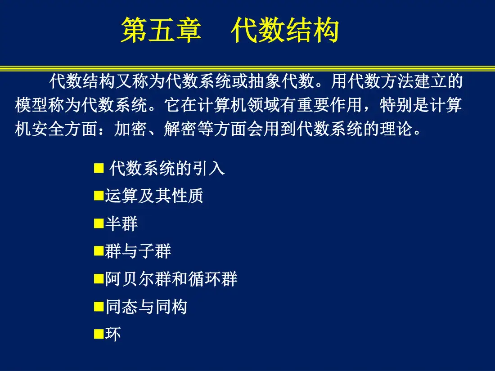

原文：

第五章 代数结构

代数结构又称为代数系统或抽象代数。用代数方法建立的模型称为代数系统。它在计算机领域有重要作用，特别是计算机安全方面：加密、解密等方面会用到代数系统的理论。

代数系统的引入

运算及其性质

半群

■群与子群

■阿贝尔群和循环群

■同态与同构

环

### 5-1 代数系统的引入

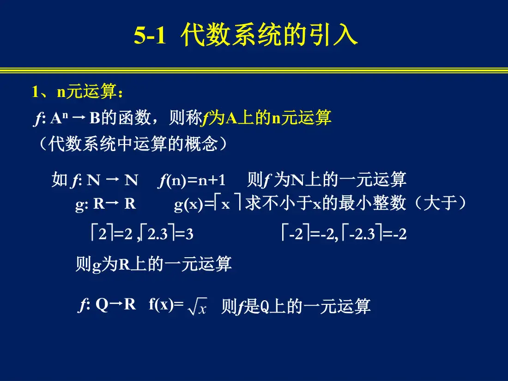

原文：

5-1 代数系统的引入

1、n元运算：

f: $A^{n} \rightarrow B$ 的函数，则称 f 为 A 上的 n 元运算

(代数系统中运算的概念)

如 $f: \mathrm{N} \rightarrow \mathrm{N}$ $f(\mathrm{n}) = \mathrm{n} + 1$ 则 $f$ 为 $\mathbf{N}$ 上的一元运算 $\mathrm{g}: \mathrm{R} \rightarrow \mathrm{R}$ $\mathrm{g}(\mathrm{x}) = \lceil \mathrm{x} \rceil$ 求不小于 $\mathrm{x}$ 的最小整数（大于）

$\lceil 2 \rceil = 2, \lceil 2.3 \rceil = 3$

$$
\lceil - 2 \rceil = - 2, \lceil - 2. 3 \rceil = - 2
$$

则g为R上的一元运算

$f: \mathrm{Q} \rightarrow \mathrm{R} \quad \mathrm{f(x)} = \sqrt{x}$ 则 $f$ 是Q上的一元运算

### 5-1 代数系统的引入

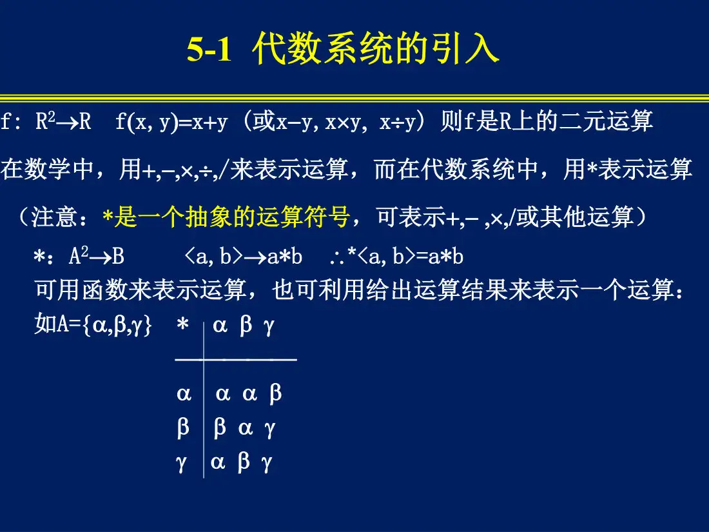

原文：

5-1 代数系统的引入

f: $R^{2} \rightarrow R$ $f(x, y) = x + y$ （或x - y, $x \times y$ , $x \div y$ ）则f是R上的二元运算

在数学中，用+,-,×,÷,/来表示运算，而在代数系统中，用\*表示运算

(注意：\*是一个抽象的运算符号，可表示+,-,x,/或其他运算)

可用函数来表示运算，也可利用给出运算结果来表示一个运算：

### 5-1 代数系统的引入

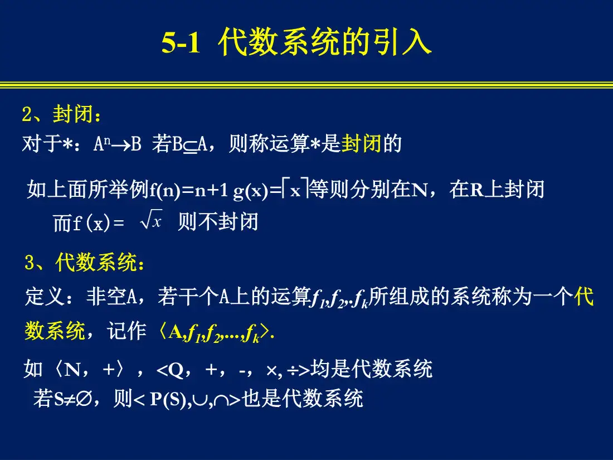

原文：

5-1 代数系统的引入

对于\*: $A^n \to B$ 若 $B \subseteq A$ , 则称运算\*是封闭的

如上面所举例 $f(n)=n+1g(x)=\lceil x\rceil$ 等则分别在N，在R上封闭而 $f(x)=\sqrt{x}$ 则不封闭

定义: 非空A, 若干个A上的运算 $f_{1}, f_{2}, \ldots, f_{k}$ 所组成的系统称为一个代数系统, 记作 $\langle A, f_{1}, f_{2}, \ldots, f_{k} \rangle$ .

如 $\langle N, + \rangle$ , $< Q, +, -, x, \div >$ 均是代数系统若 $S \neq \emptyset$ , 则 $< P(S), \cup, \cap >$ 也是代数系统

### 5-2 运算及其性质

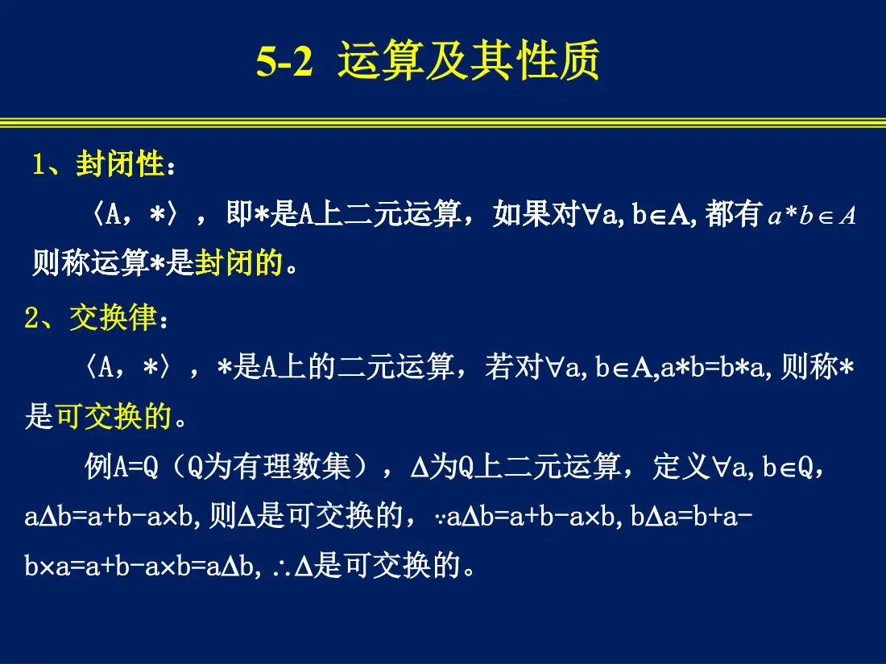

原文：

5-2 运算及其性质

1、封闭性：

〈A，\*〉，即\*是A上二元运算，如果对∀a, b∈A, 都有 a\*b∈A 则称运算\*是封闭的。

2、交换律：

〈A，\*〉，\*是A上的二元运算，若对∀a, b∈A,a\*b=b\*a, 则称\*是可交换的。

例A=Q（Q为有理数集），Δ为Q上二元运算，定义∀a, b∈Q, aΔb=a+b-a×b, 则Δ是可交换的，∵aΔb=a+b-a×b, bΔa=b+a-b×a=a+b-a×b=aΔb, ∴Δ是可交换的。

### 5-2 运算及其性质

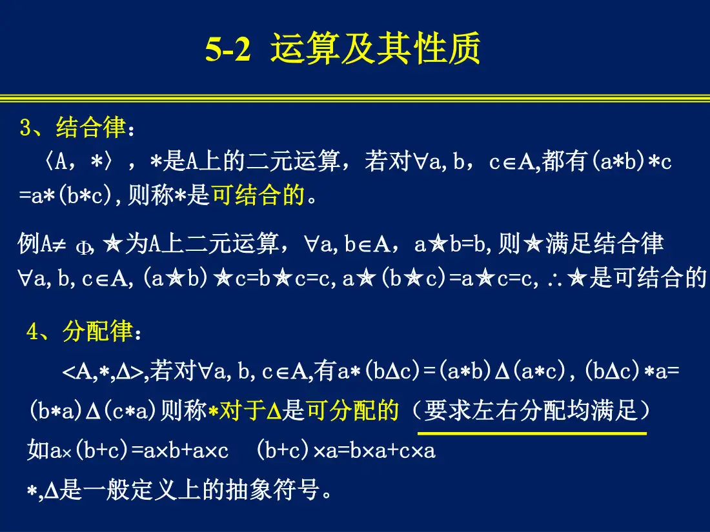

原文：

5-2 运算及其性质

3、结合律：

〈A，\*〉，\*是A上的二元运算，若对∀a, b, c∈A,都有(a\*b)\*c=a\*(b\*c)，则称\*是可结合的。

例A≠ Φ, ☆为A上二元运算，∀a, b∈A, a☆b=b, 则☆满足结合律
∀a, b, c∈A, (a☆b) ☆c=b☆c=c, a☆(b☆c)=a☆c=c, ∴☆是可结合的

4、分配律：

<A,\*,Δ>,若对∀a, b, c∈A,有a\*(bΔc)=(a\*b)Δ(a\*c), (bΔc)\*a=(b\*a)Δ(c\*a)则称\*对于Δ是可分配的（要求左右分配均满足）如a×(b+c)=a×b+a×c (b+c)×a=b×a+c×a\*,Δ是一般定义上的抽象符号。

### 5-2 运算及其性质

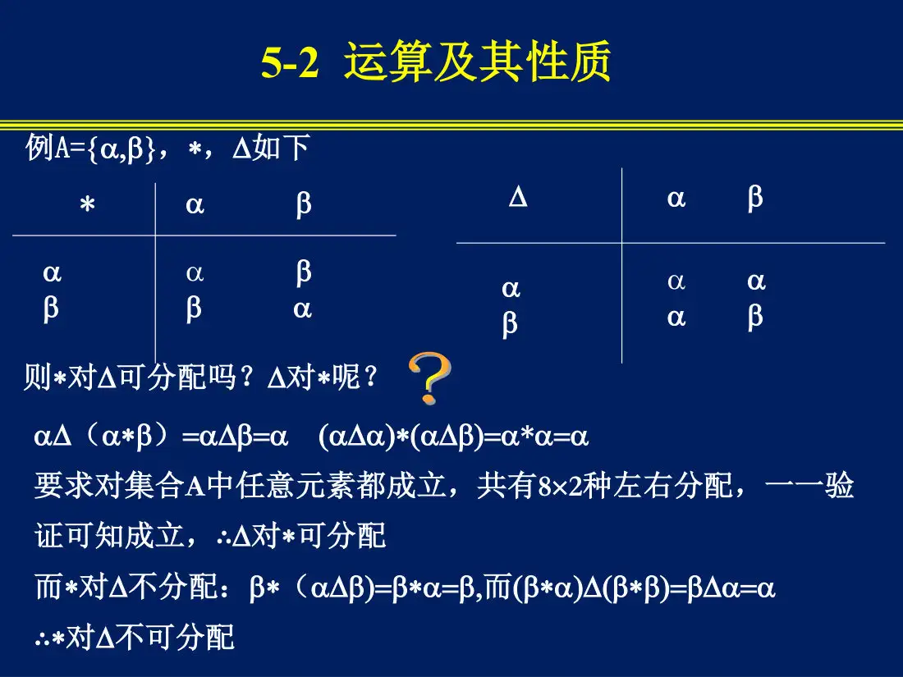

原文：

5-2 运算及其性质

<table><tr><td>*</td><td>α</td><td>β</td><td>Δ</td><td>α</td><td>β</td></tr><tr><td>α</td><td>α</td><td>β</td><td>α</td><td>α</td><td>α</td></tr><tr><td>β</td><td>β</td><td>α</td><td>β</td><td>α</td><td>β</td></tr></table>

则\*对Δ可分配吗？Δ对\*呢？
αΔ（α\*β）=αΔβ=α (αΔα)\*(αΔβ)=α\*α=α
要求对集合A中任意元素都成立，共有8×2种左右分配，一一验证可知成立，∴Δ对\*可分配
而\*对Δ不分配：β\*(αΔβ)=β\*α=β,而(β\*α)Δ(β\*β)=βΔα=α
∴\*对Δ不可分配

### 5-2 运算及其性质

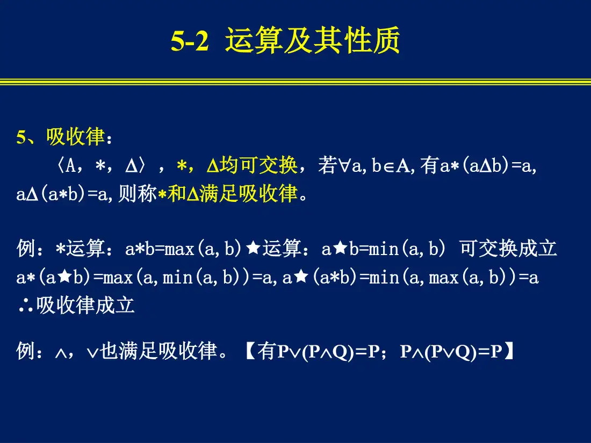

原文：

5-2 运算及其性质

5、吸收律：

〈A, \*, Δ〉，\*, Δ均可交换，若∀a, b∈A, 有a\*(aΔb)=a, aΔ(a\*b)=a, 则称\*和Δ满足吸收律。

例：\*运算：a\*b=max(a, b)★运算：a★b=min(a, b) 可交换成立
a\*(a★b)=max(a, min(a, b))=a, a★(a\*b)=min(a, max(a, b))=a
∴吸收律成立

例：∧，∨也满足吸收律。【有P∨(P∧Q)=P；P∧(P∨Q)=P】

### 5-2 运算及其性质

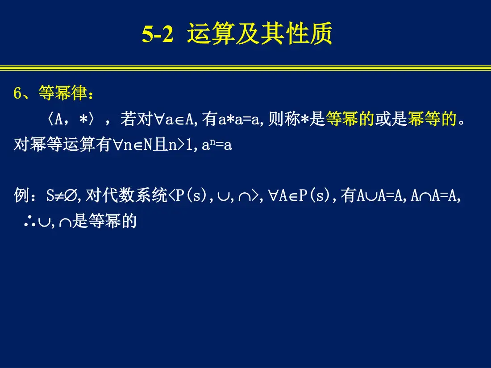

原文：

5-2 运算及其性质

6、等幂律:

〈A, \*〉，若对 $\forall a\in A$ ，有 $a*a=a$ ，则称\*是等幂的或是幂等的。对幂等运算有 $\forall n\in N$ 且 $n>1,a^{n}=a$

例: $S \neq \emptyset$ , 对代数系统 $\langle P(s), \cup, \cap \rangle$ , $\forall A \in P(s)$ , 有 $A \cup A = A$ , $A \cap A = A$ , $\therefore \cup, \cap$ 是等幂的

### 5-2 运算及其性质

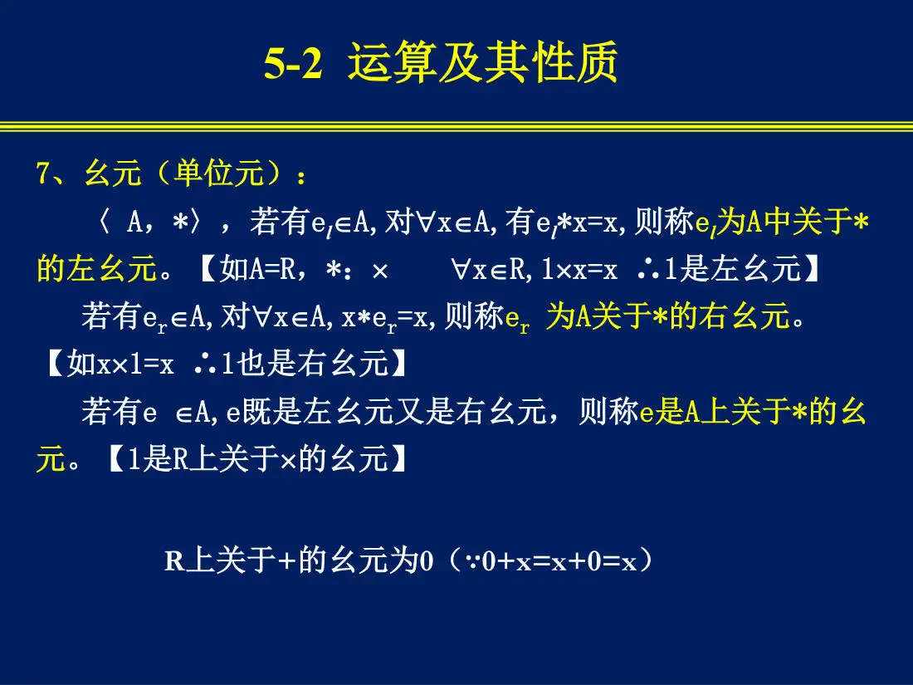

原文：

5-2 运算及其性质

7、幺元（单位元）：

〈A, \*〉，若有 $e_l \in A$ ，对 $\forall x \in A$ ，有 $e_l * x = x$ ，则称 $e_l$ 为A中关于\*的左幺元。【如A=R，\*: × ∴ $x \in R, 1 \times x = x \therefore 1$ 是左幺元】若有 $e_r \in A$ ，对 $\forall x \in A, x * e_r = x$ ，则称 $e_r$ 为A关于\*的右幺元。

【如x×1=x ∴1也是右幺元】

若有e ∈A, e既是左幺元又是右幺元，则称e是A上关于\*的幺元。【1是R上关于×的幺元】

R上关于+的幺元为0（∵0+x=x+0=x）

### 5-2 运算及其性质

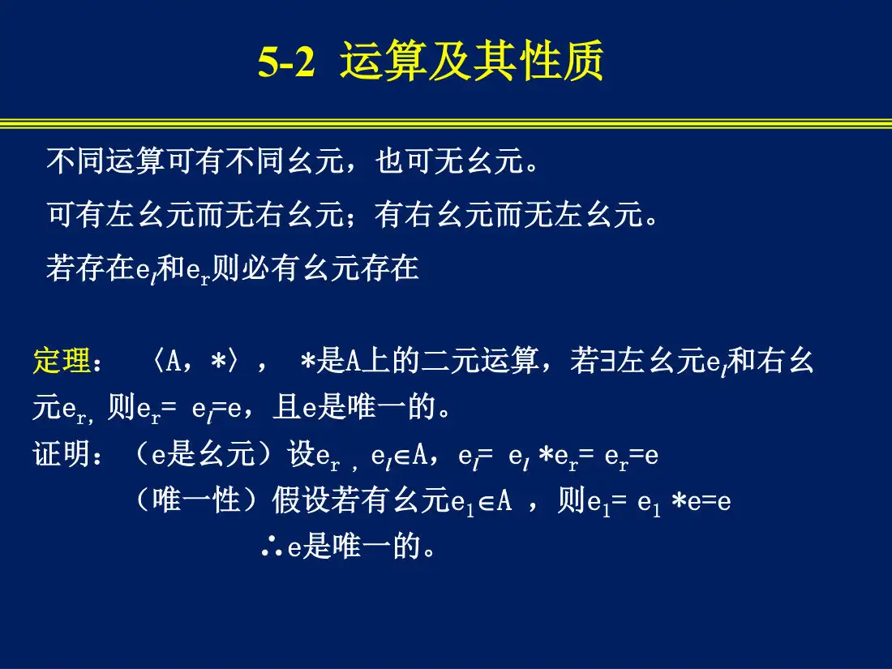

原文：

5-2 运算及其性质

不同运算可有不同幺元，也可无幺元。  
可有左幺元而无右幺元；有右幺元而无左幺元。  
若存在 $\mathbf{e}_l$ 和 $\mathrm{e_r}$ 则必有幺元存在

定理：〈A，\*〉，\*是A上的二元运算，若∃左幺元e $_{l}$ 和右幺元e $_{r}$ ，则e $_{r}$ =e $_{l}$ =e，且e是唯一的。
证明：（e是幺元）设e $_{r}$ ，e $_{l}$ ∈A，e $_{l}$ =e $_{l}$ \*e $_{r}$ =e $_{r}$ =e
（唯一性）假设若有幺元e $_{1}$ ∈A，则e $_{1}$ =e $_{1}$ \*e=e
∴e是唯一的。

### 5-2 运算及其性质

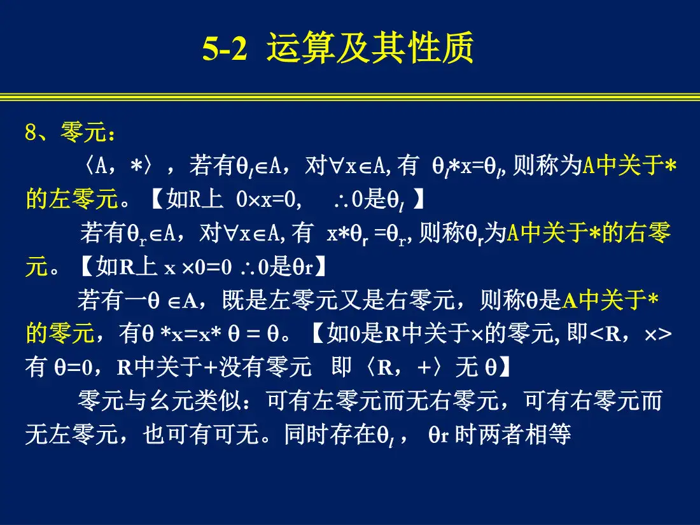

原文：

5-2 运算及其性质

8、零元:

〈A, \*〉，若有 $\theta_{l} \in A$ ，对 $\forall x \in A$ ，有 $\theta_{l} * x = \theta_{l}$ ，则称为 $A$ 中关于\*的左零元。【如R上 $0 \times x = 0$ ，∴0是 $\theta_{l}$ 】

若有 $\theta_{\mathrm{r}} \in \mathrm{A}$ , 对 $\forall x \in \mathrm{A}$ , 有 $x * \theta_{\mathrm{r}} = \theta_{\mathrm{r}}$ , 则称 $\theta_{\mathrm{r}}$ 为 A 中关于 \* 的右零元。【如 R 上 $x \times 0 = 0 \therefore 0$ 是 $\theta_{\mathrm{r}}$ 】

若有一 $\theta \in A$ ，既是左零元又是右零元，则称 $\theta$ 是 $A$ 中关于\*的零元，有 $\theta * x = x * \theta = \theta$ 。【如0是R中关于×的零元, 即<R，×>有 $\theta = 0$ ，R中关于+没有零元 即 $\langle R, + \rangle$ 无 $\theta$ 】

零元与幺元类似：可有左零元而无右零元，可有右零元而无左零元，也可有可无。同时存在 $\theta_{l}$ ， $\theta_{r}$ 时两者相等

### 5-2 运算及其性质

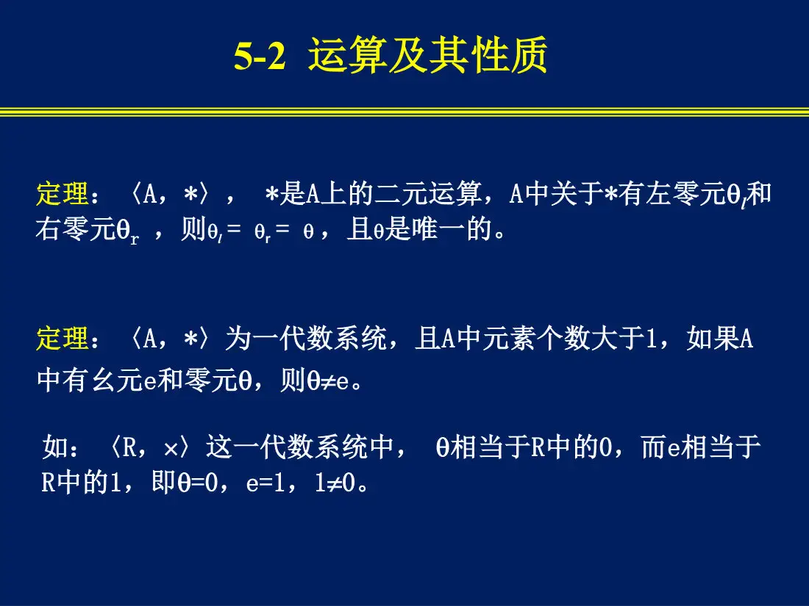

原文：

5-2 运算及其性质

定理: $\langle A, * \rangle$ , \*是A上的二元运算, A中关于\*有左零元θ $_{l}$ 和右零元θ $_{r}$ , 则θ $_{l}$ = θ $_{r}$ = θ, 且θ是唯一的。

定理: $\langle A, * \rangle$ 为一代数系统, 且A中元素个数大于1, 如果A中有幺元e和零元θ, 则θ≠e。

如: $\langle R, x \rangle$ 这一代数系统中, $\theta$ 相当于 $R$ 中的 0 , 而 e 相当于 $R$ 中的 1 , 即 $\theta = 0$ , $e = 1$ , $1 \neq 0$ 。

### 5-2 运算及其性质

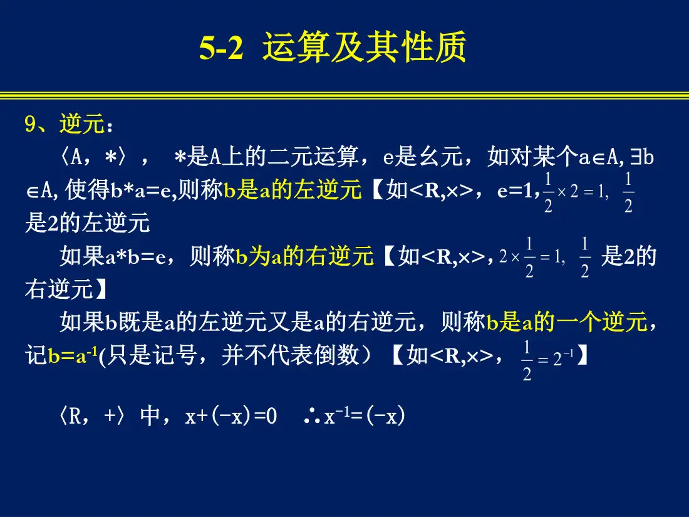

原文：

5-2 运算及其性质

9、逆元:

〈A, \*〉，\*是A上的二元运算，e是幺元，如对某个a∈A, ∃b∈A, 使得b\*a=e,则称b是a的左逆元【如<R,x>，e=1, $\frac{1}{2}\times2=1,\frac{1}{2}$ 是2的左逆元

如果 $a * b = e$ ，则称 $b$ 为 $a$ 的右逆元【如 $\langle R, x \rangle, 2 \times \frac{1}{2} = 1, \frac{1}{2}$ 是 2 的右逆元】

如果b既是a的左逆元又是a的右逆元，则称b是a的一个逆元，记 $b=a^{-1}$ （只是记号，并不代表倒数）【如<R,x>， $\frac{1}{2}=2^{-1}$ 】

$\langle \mathrm{R}, + \rangle$ 中， $\mathbf{x} + (-\mathbf{x}) = 0$ $\therefore \mathbf{x}^{-1} = (-\mathbf{x})$

### 5-2 运算及其性质

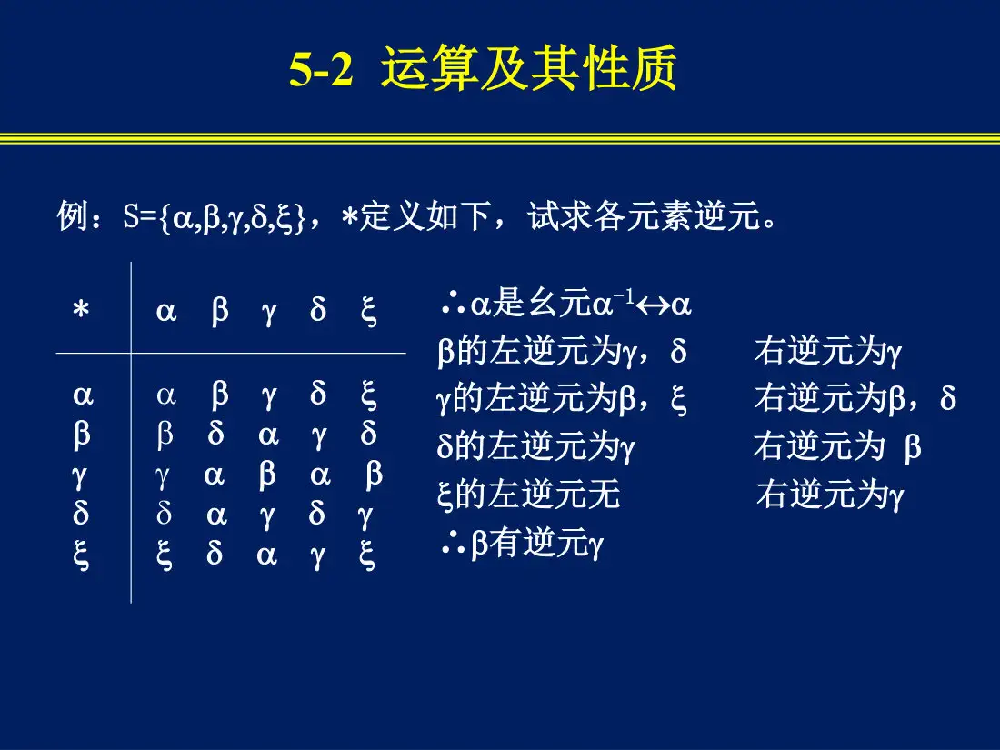

原文：

5-2 运算及其性质

例： $S=\{\alpha,\beta,\gamma,\delta,\xi\}$ ，\*定义如下，试求各元素逆元。

α β γ δ ξ
β δ α γ δ
γ α β α β
δ α γ δ γ
ξ δ α γ ξ

\* α β γ δ ξ

∴α是幺元α $^{-1}$ ↔α

$\beta$ 的左逆元为 $\gamma, \delta$

γ的左逆元为β，ξ

δ的左逆元为γ

ξ的左逆元无

∴β有逆元γ

右逆元为 $\gamma$

右逆元为 $\beta, \delta$

右逆元为 $\beta$

右逆元为γ

### 5-2 运算及其性质

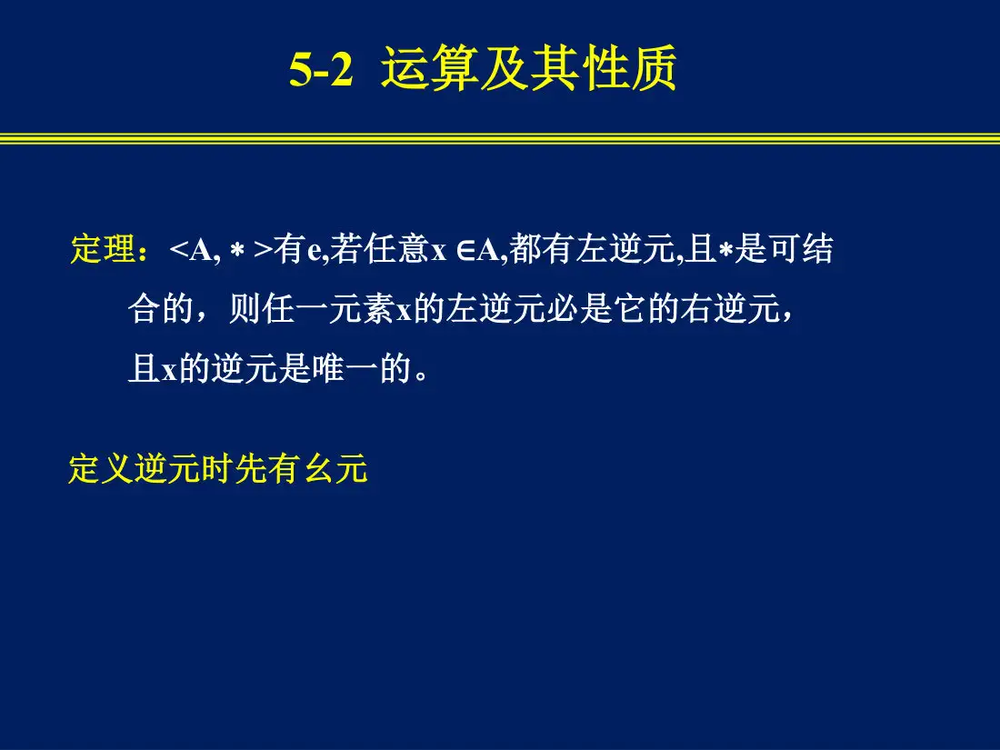

原文：

5-2 运算及其性质

定理: $<\mathrm{A}, *>$ 有e,若任意x∈A,都有左逆元,且\*是可结合的,则任一元素x的左逆元必是它的右逆元,且x的逆元是唯一的。

定义逆元时先有幺元

### 5-2 运算及其性质

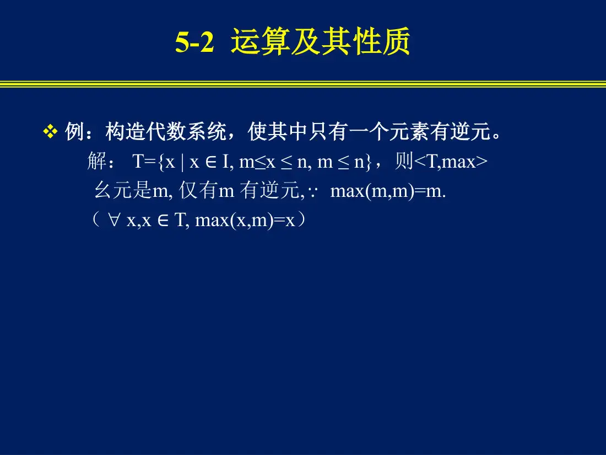

原文：

5-2 运算及其性质

例：构造代数系统，使其中只有一个元素有逆元。
解： $T=\{x \mid x \in I, m \leq x \leq n, m \leq n\}$ ，则<T,max>
幺元是m, 仅有m有逆元, ∴ $\max(m,m)=m.$ ( $\forall x,x\in T,\max(x,m)=x$ )

### 5-2 运算及其性质

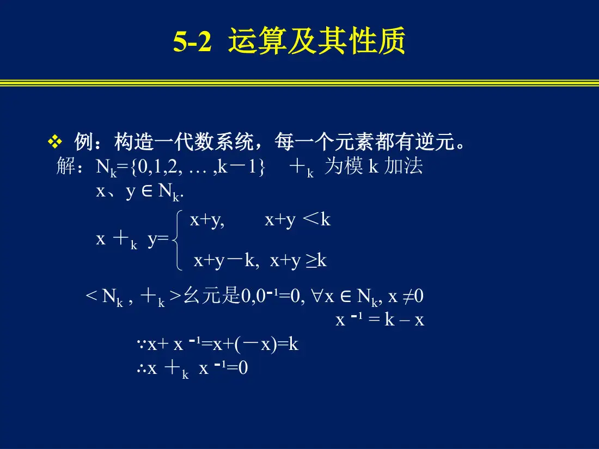

原文：

5-2 运算及其性质

例：构造一代数系统，每一个元素都有逆元。
解： $N_{k}=\{0,1,2,\ldots,k-1\}$ $+_{k}$ 为模 k 加法 $x, y \in N_{k}.$ $x + _{k} y = \left\{\begin{aligned}x+y,&\quad x+y < k\\x+y - k,&\quad x+y \geq k\end{aligned}\right.$ $<N_{k}, +_{k}>$ 幺元是 $0,0^{-1}=0,\forall x\in N_{k},x\neq0$ $x^{-1}=k-x$ $\therefore x+x^{-1}=x+(-x)=k$ $\therefore x+\_{k}x^{-1}=0$

### 5-2 运算及其性质

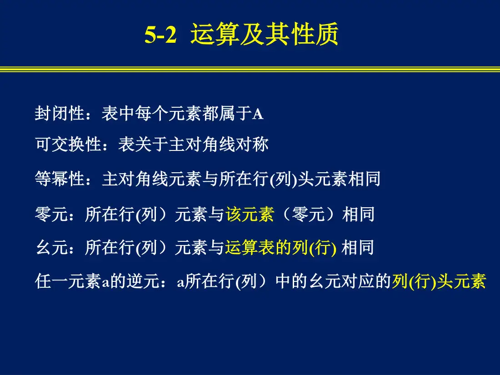

原文：

5-2 运算及其性质

封闭性：表中每个元素都属于A

可交换性：表关于主对角线对称

等幂性：主对角线元素与所在行(列)头元素相同

零元：所在行(列)元素与该元素（零元）相同

幺元：所在行(列) 元素与运算表的列(行) 相同

任一元素a的逆元：a所在行(列)中的幺元对应的列(行)头元素

### 5-3 半群

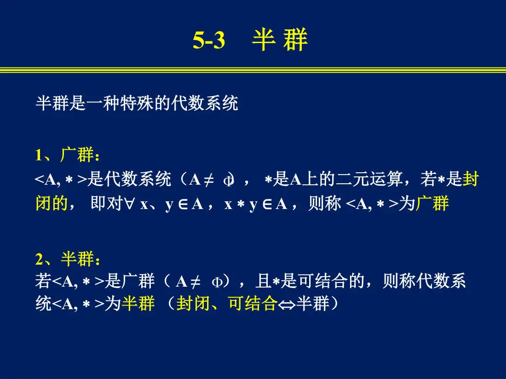

原文：

5-3 半群

半群是一种特殊的代数系统

1、广群:

<A,\*>是代数系统（A≠φ），\*是A上的二元运算，若\*是封闭的，即对∀x、y∈A，x\*y∈A，则称<A,\*>为广群

2、半群：

若<A,\*>是广群（A≠Φ），且\*是可结合的，则称代数系

统<A,\*>为半群（封闭、可结合⇔半群）

### 5-3 半群

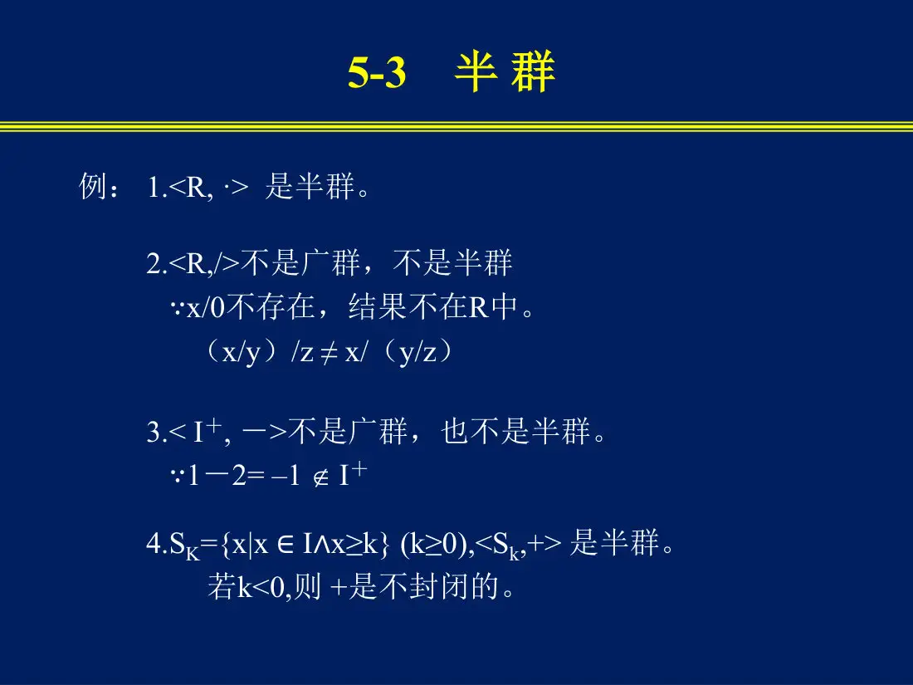

原文：

5-3 半群

例：1.<R,·> 是半群。

2.<R,/>不是广群，不是半群
∵x/0不存在，结果不在R中。
(x/y) /z ≠ x/ (y/z)

3. $<I^{+}$ ，一>不是广群，也不是半群。 $\because 1-2=-1\notin I^{+}$

4. $S_{K}=\{x|x\in I\land x\geq k\}(k\geq0),<S_{k},+>$ 是半群。
若k<0,则 +是不封闭的。

### 5-3 半群

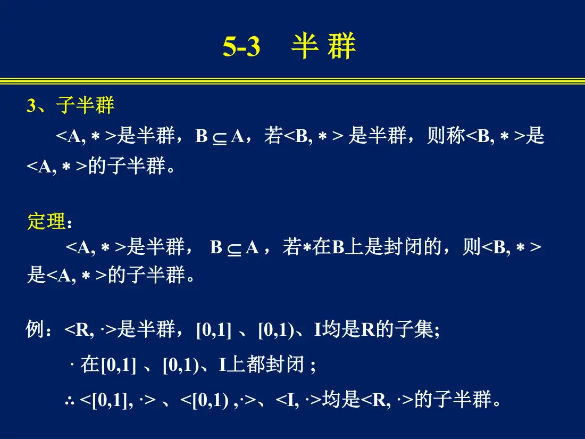

原文：

5-3 半群

3、子半群

<A,\*>是半群，B ⊆ A，若<B,\*>是半群，则称<B,\*>是<A,\*>的子半群。

定理：

<A,\*>是半群，B ⊆ A，若\*在B上是封闭的，则<B,\*>是<A,\*>的子半群。

例：<R,·>是半群，[0,1]、[0,1)、I均是R的子集;

· 在[0,1]、[0,1)、I上都封闭；

∴ <[0,1], ·>、<[0,1), ·>、<I, ·>均是<R, ·>的子半群。

### 5-3 半群

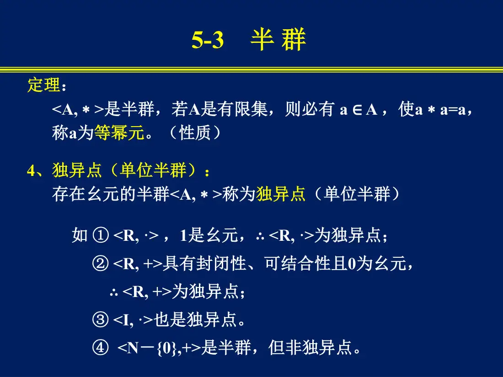

原文：

5-3 半群

定理：

<A,\*>是半群，若A是有限集，则必有 a ∈ A，使a \* a = a，称a为等幂元。（性质）

4、独异点（单位半群）：
存在幺元的半群<A,\*>称为独异点（单位半群）

如 ① <R, ·>，1是幺元，∴ <R, ·>为独异点；

② <R, +>具有封闭性、可结合性且0为幺元，

∴ <R, +>为独异点;

③ <I, ·>也是独异点。

④ <N−{0},+>是半群，但非独异点。

### 5-3 半群

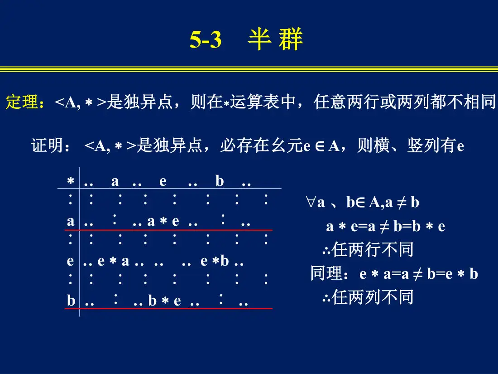

原文：

5-3 半群

定理：<A,\*>是独异点，则在\*运算表中，任意两行或两列都不相同

证明：<A,\*>是独异点，必存在幺元e∈A，则横、竖列有e

$$
\begin{array}{c c c c c c c c} * & \ldots & a & \ldots & e & \ldots & b & \ldots \\ \vdots & \vdots & \vdots & \vdots & \vdots & \vdots & \vdots & \vdots \\ a & \ldots & \vdots & \ldots & a * e & \ldots & \vdots & \ldots \\ \hline \vdots & \vdots & \vdots & \vdots & \vdots & \vdots & \vdots & \vdots \\ e & \ldots & e * a & \ldots & \ldots & \ldots & e * b & \ldots \\ \vdots & \vdots & \vdots & \vdots & \vdots & \vdots & \vdots & \vdots \\ b & \ldots & \vdots & \ldots & b * e & \ldots & \vdots & \ldots \\ \hline \end{array}
$$

∀a、b∈A,a≠b

a \* e=a ≠ b=b \* e

∴任两行不同

同理： $e * a = a \neq b = e * b$

∴任两列不同

### 5-3 半群

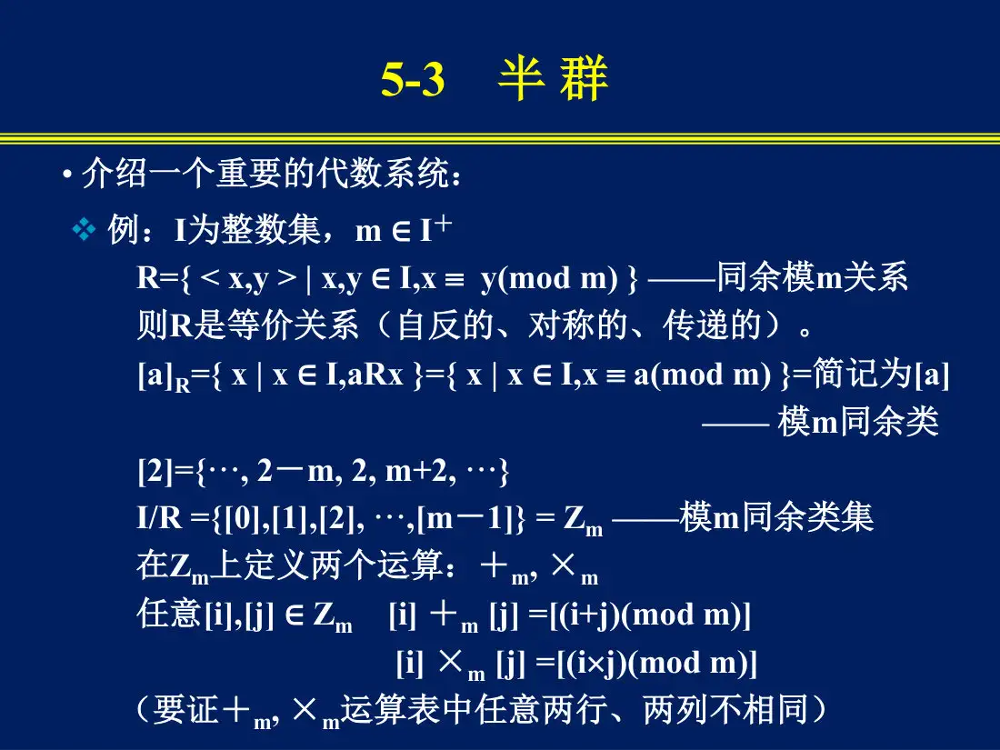

原文：

5-3 半群

· 介绍一个重要的代数系统:

例：I为整数集， $m \in I^{+}$ $R = \{ < x, y > | x, y \in I, x \equiv y (\bmod m) \}$ ——同余模m关系

则R是等价关系（自反的、对称的、传递的）。 $[a]_{R} = \{ x \mid x \in I, aRx \} = \{ x \mid x \in I, x \equiv a (\bmod m) \} = \text{简记为}[a]_{R}$ ——模m同余类 $[2] = \{\cdots, 2 - m, 2, m + 2, \cdots\}$ $I/R = \{[0], [1], [2], \cdots, [m - 1]\} = Z_{m}$ ——模m同余类

在 $Z_{m}$ 上定义两个运算： $+_{m}, \times_{m}$ 任意 $[i], [j] \in Z_{m}$ $[i] +_{m} [j] = [(i + j) (\bmod m)]$ $[i] \times_{m} [j] = [(i \times j) (\bmod m)]$ （要证 $+_{m}, \times_{m}$ 运算表中任意两行、两列不相同）

### 5-3 半群

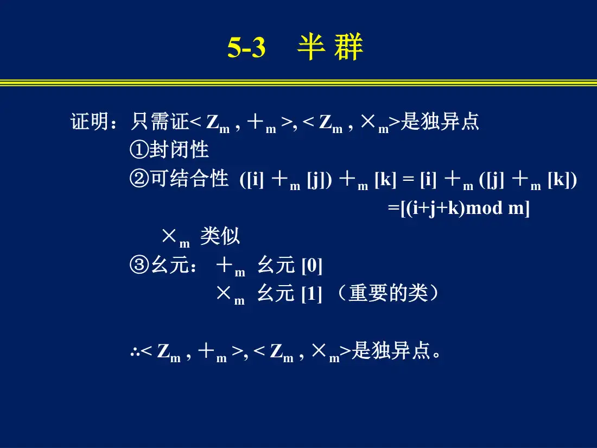

原文：

5-3 半群

证明：只需证 $< Z_{m}, + _{m} >, < Z_{m}, \times_{m}>$ 是独异点

①封闭性

②可结合性 $([\mathrm{i}] + _{\mathrm{m}}[\mathrm{j}]) + _{\mathrm{m}}[\mathrm{k}] = [\mathrm{i}] + _{\mathrm{m}}([\mathrm{j}] + _{\mathrm{m}}[\mathrm{k}])$ $= [(i + j + k)\bmod m]$

$\times_{\mathrm{m}}$ 类似

③幺元： $+_{m}$ 幺元 [0]

$\times_{m}$ 幺元 [1] （重要的类）

$\therefore <  \mathrm{Z}_{\mathrm{m}}, + _{\mathrm{m}} > , <   \mathrm{Z}_{\mathrm{m}},\times_{\mathrm{m}}>$ 是独异点。

### 5-3 半群

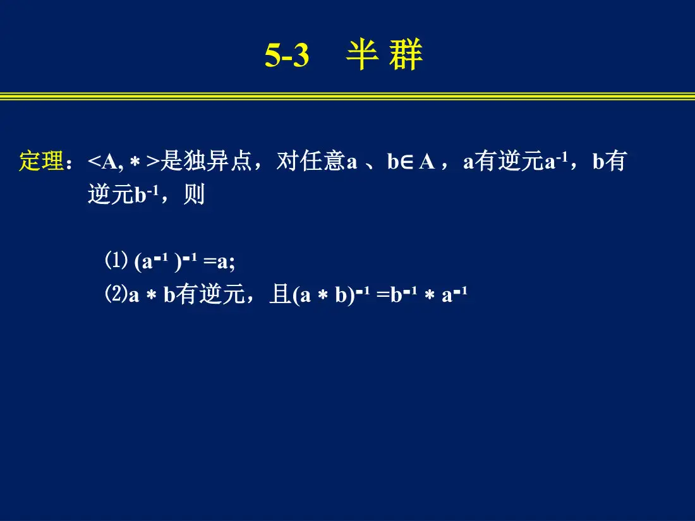

原文：

5-3 半群

定理: $<\mathrm{A}, *>$ 是独异点, 对任意a、b∈A, a有逆元a-1, b有逆元b-1, 则

(1) $(a^{-1})^{-1}=a;$

(2) $a*b$ 有逆元，且 $(a*b)^{-1}=b^{-1}*a^{-1}$

### 5-3 半群

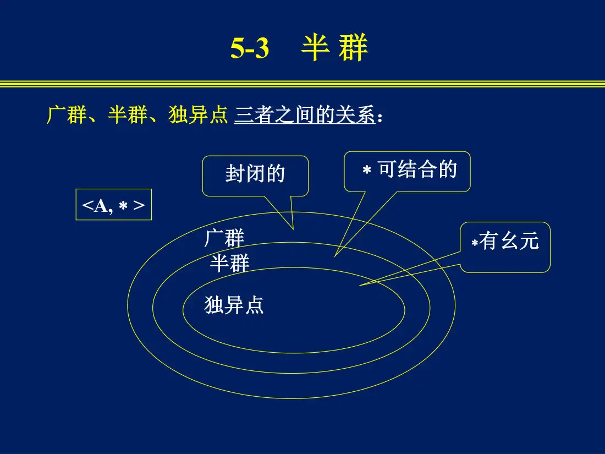

原文：

5-3 半群

广群、半群、独异点 三者之间的关系:

封闭的

\* 可结合的

广群
半群

独异点

\*有幺元

### 5-4 群与子群

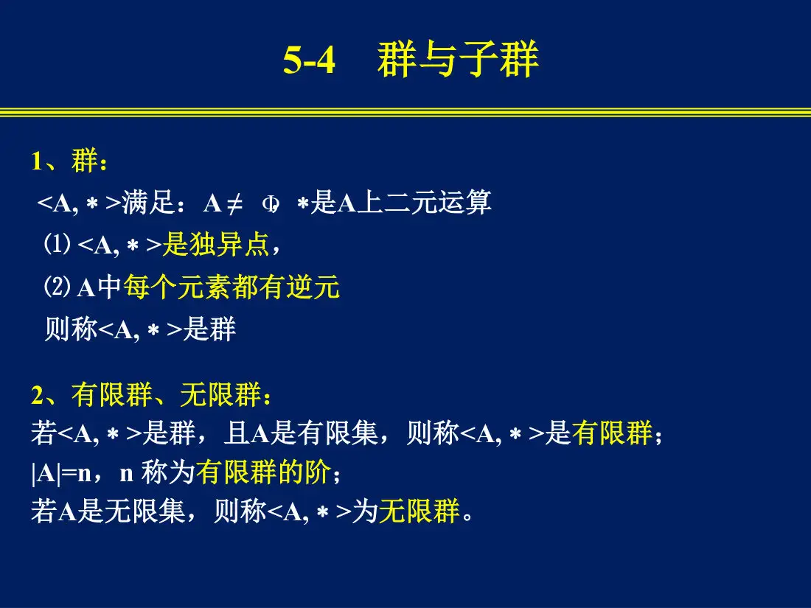

原文：

5-4 群与子群

1、群:

<A,\*>满足：A≠Φ\*是A上二元运算

(1) $< \mathrm{A}, * >$ 是独异点，

(2) A中每个元素都有逆元

则称<A,\*>是群

2、有限群、无限群:
若<A,\*>是群, 且A是有限集, 则称<A,\*>是有限群; |A|=n, n 称为有限群的阶;
若A是无限集, 则称<A,\*>为无限群。

### 5-4 群与子群

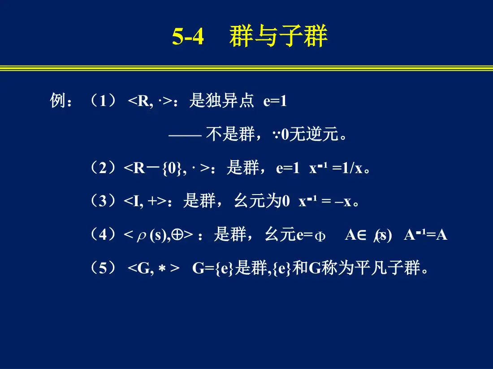

原文：

5-4 群与子群

例：（1）<R,·>：是独异点 e=1

——不是群，∵0无逆元。

(2) $<\mathrm{R}-\{0\}, \cdot>$ : 是群, $\mathrm{e}=1 \mathrm{x}^{-1}=1/\mathrm{x}$ 。

(3) $<\mathrm{I}, +>$ : 是群, 幺元为0 $\mathbf{x}^{-1} = -\mathbf{x}$ 。

(4) $< \rho (\mathrm{s}),\oplus >$ ：是群，幺元 $\mathrm{e} = \Phi$ $\mathrm{A}\in (\mathrm{s})\mathrm{A}^{-1} = \mathrm{A}$

(5) $<\mathrm{G},*> \mathrm{G}=\{\mathrm{e}\}$ 是群, $\{\mathrm{e}\}$ 和 $\mathrm{G}$ 称为平凡子群。

### 5-4 群与子群

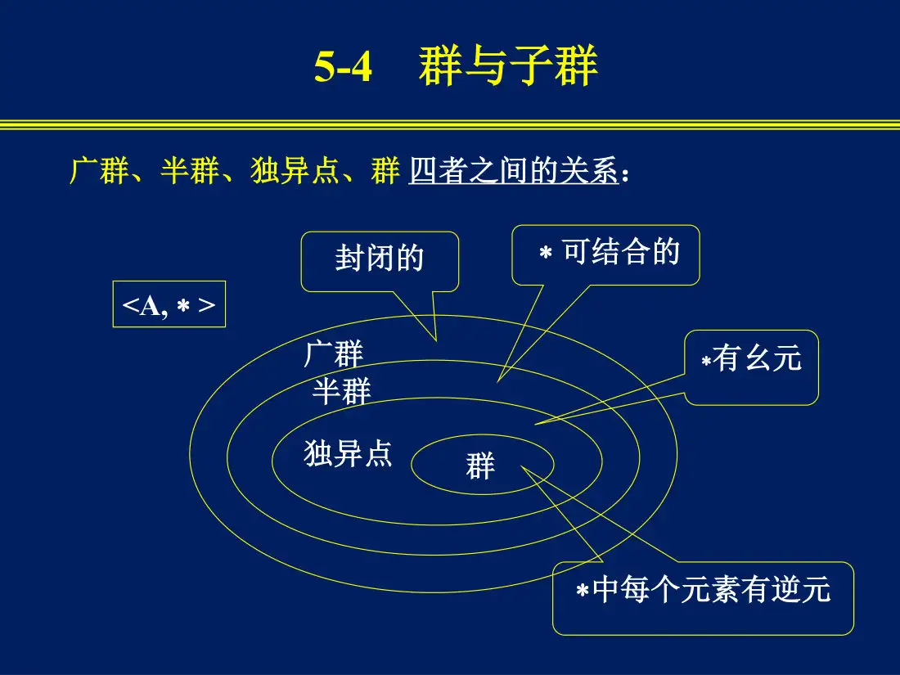

原文：

5-4 群与子群

广群、半群、独异点、群四者之间的关系：

封闭的

\* 可结合的

广群
半群\*有幺元

独异点

群

\*中每个元素有逆元

### 5-4 群与子群

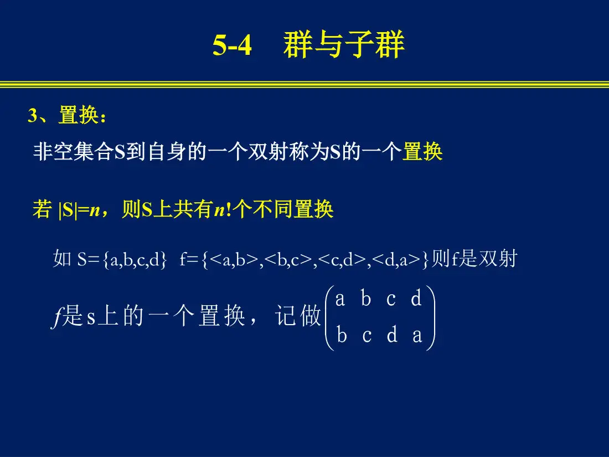

原文：

5-4 群与子群

3、置换:

非空集合S到自身的一个双射称为S的一个置换

若 $|\mathrm{S}| = n$ ，则S上共有 $n!$ 个不同置换

如 $S = \{a, b, c, d\}$ $f = \{<a, b>, <b, c>, <c, d>, <d, a>\}$ 则 $f$ 是双射

$f$ 是s上的一个置换，记做 $\begin{pmatrix} a & b & c & d \\ b & c & d & a \end{pmatrix}$

### 5-4 群与子群

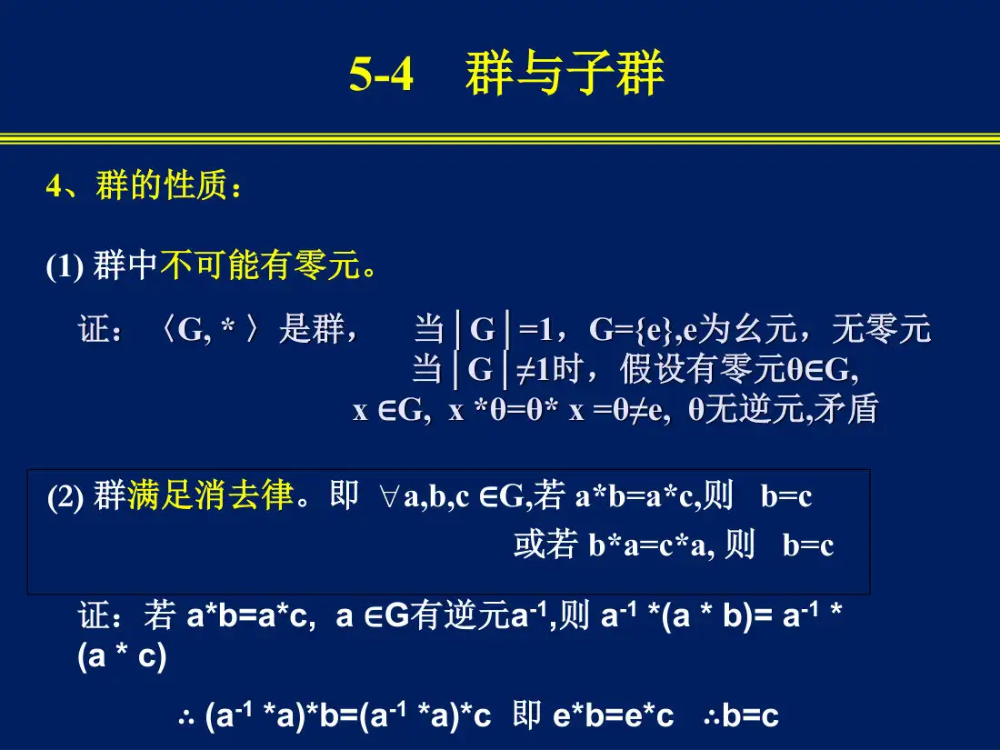

原文：

5-4 群与子群

4、群的性质：

(1) 群中不可能有零元。

证：〈G, \*〉是群，当 $|G|=1$ ，G={e}, e为幺元，无零元当 $|G|\neq1$ 时，假设有零元θ∈G，x∈G，x\*θ=θ\*x=θ≠e，θ无逆元,矛盾

(2) 群满足消去律。即 $\forall a, b, c \in G$ , 若 $a * b = a * c$ , 则 $b = c$ 或若 $b * a = c * a$ , 则 $b = c$

证: 若 $a * b = a * c$ , $a \in G$ 有逆元 $a^{-1}$ , 则 $a^{-1} * (a * b) = a^{-1} * (a * c)$

∴ $(a^{-1} * a) * b = (a^{-1} * a) * c$ 即 $e * b = e * c$ ∴ b = c

### 5-4 群与子群

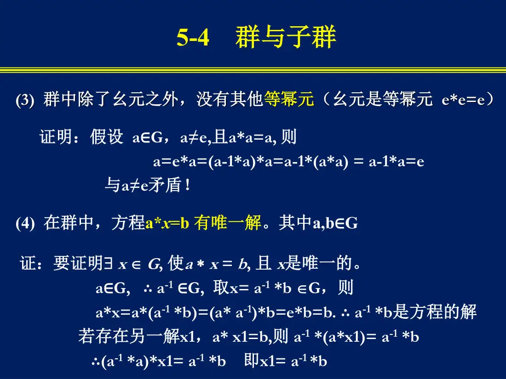

原文：

5-4 群与子群

(3) 群中除了幺元之外，没有其他等幂元（幺元是等幂元 $e*e=e$ ）

证明：假设 $a \in G$ ， $a \neq e$ ，且 $a * a = a$ ，则 $a = e * a = (a - 1 * a) * a = a - 1 * (a * a) = a - 1 * a = e$ 与 $a \neq e$ 矛盾！

(4) 在群中，方程 $a * x = b$ 有唯一解。其中 $a, b \in G$

证：要证明 $\exists x \in G$ ，使 $a * x = b$ ，且 $x$ 是唯一的。 $a \in G, \therefore a^{-1} \in G,$ 取 $x = a^{-1} * b \in G$ ，则 $a * x = a * (a^{-1} * b) = (a * a^{-1}) * b = e * b = b.$ $\therefore a^{-1} * b$ 是方程的解
若存在另一解 $x1, a * x1 = b,$ 则 $a^{-1} * (a * x1) = a^{-1} * b$ $\therefore (a^{-1} * a) * x1 = a^{-1} * b$ 即 $x1 = a^{-1} * b$

### 5-4 群与子群

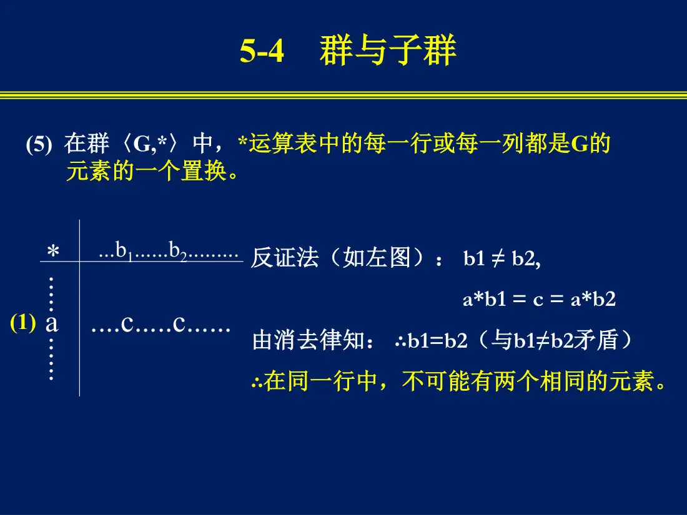

原文：

5-4 群与子群

(5) 在群 $\langle G, * \rangle$ 中，\*运算表中的每一行或每一列都是G的元素的一个置换。

\* ...b $_{1}$ ......b $_{2}$ ...... 反证法（如左图）： b1 ≠ b2,

$$
a ^ {*} b 1 = c = a ^ {*} b 2\tag{1}
$$

$$
\dots \mathbb {C} \dots \mathbb {C} \dots
$$

由消去律知：∴b1=b2（与b1≠b2矛盾）

∴在同一行中，不可能有两个相同的元素。

### 5-4 群与子群

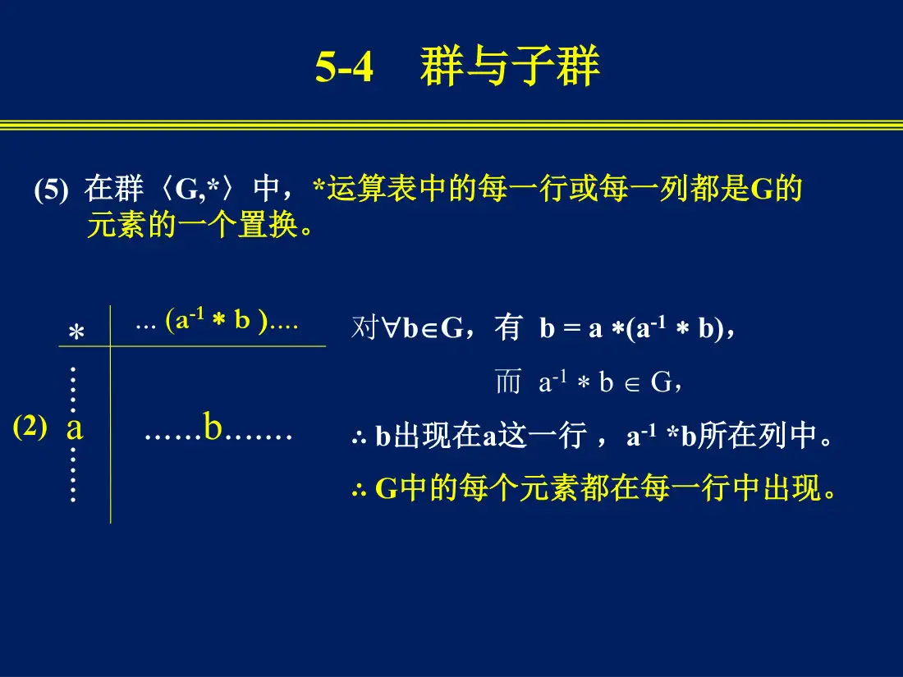

原文：

5-4 群与子群

(5) 在群 $\langle G, * \rangle$ 中，\*运算表中的每一行或每一列都是G的元素的一个置换。

\* | ... (a $^{-1}$ \* b).... 对∀b∈G，有 b = a \* (a $^{-1}$ \* b),

而 $a^{-1} * b \in G,$

......b...... ∴ b 出现在 a 这一行， $a^{-1}$ \*b 所在列中。

∴ G中的每个元素都在每一行中出现。

### 5-4 群与子群

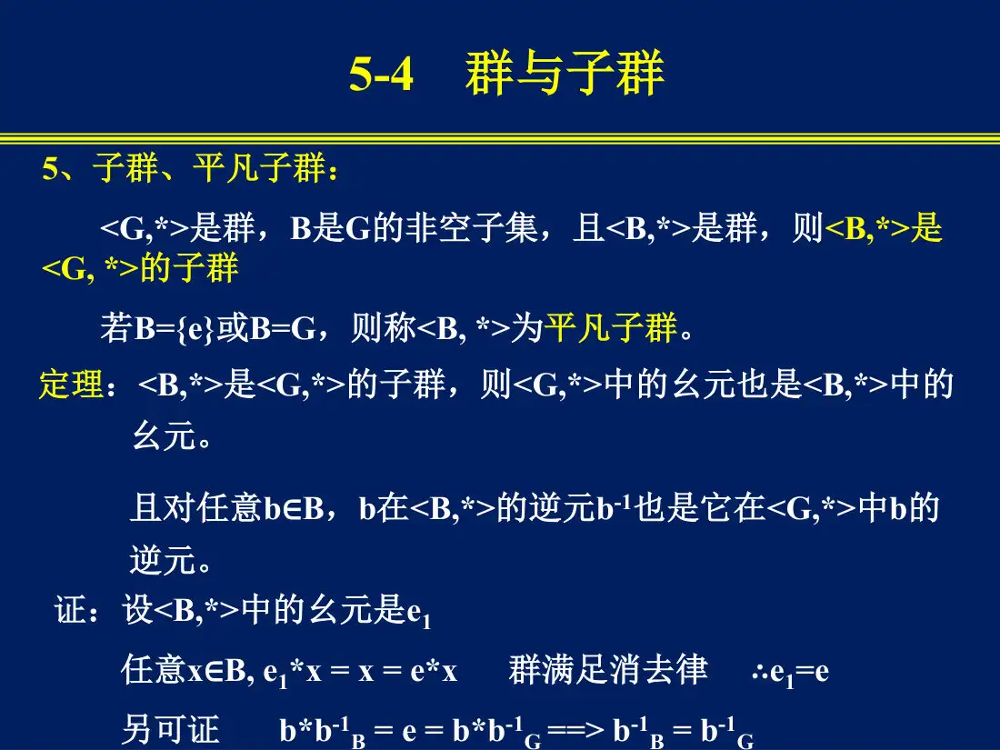

原文：

5-4 群与子群

5、子群、平凡子群:

<G,\*>是群，B是G的非空子集，且<B,\*>是群，则<B,\*>是<G,\*>的子群

若B={e}或B=G，则称<B,\*>为平凡子群。

定理: $< \mathrm{B},*>$ 是 $< \mathrm{G},*>$ 的子群, 则 $< \mathrm{G},*>$ 中的幺元也是 $< \mathrm{B},*>$ 中的幺元。

且对任意 $b \in B$ ，b在 $<B,*>$ 的逆元 $b^{-1}$ 也是它在 $<G,*>$ 中b的逆元。

证: 设 $< \mathrm{B},^{*}>$ 中的幺元是 $\mathbf{e}_1$

任意 $x\in B,e_{1}*x=x=e*x$ 群满足消去律 $\therefore e_{1}=e$

另可证 $\mathbf{b}^{*}\mathbf{b}^{-1}_{\mathrm{B}} = \mathbf{e} = \mathbf{b}^{*}\mathbf{b}^{-1}_{\mathrm{G}} = = >\mathbf{b}^{-1}_{\mathrm{B}} = \mathbf{b}^{-1}_{\mathrm{G}}$

### 5-4 群与子群

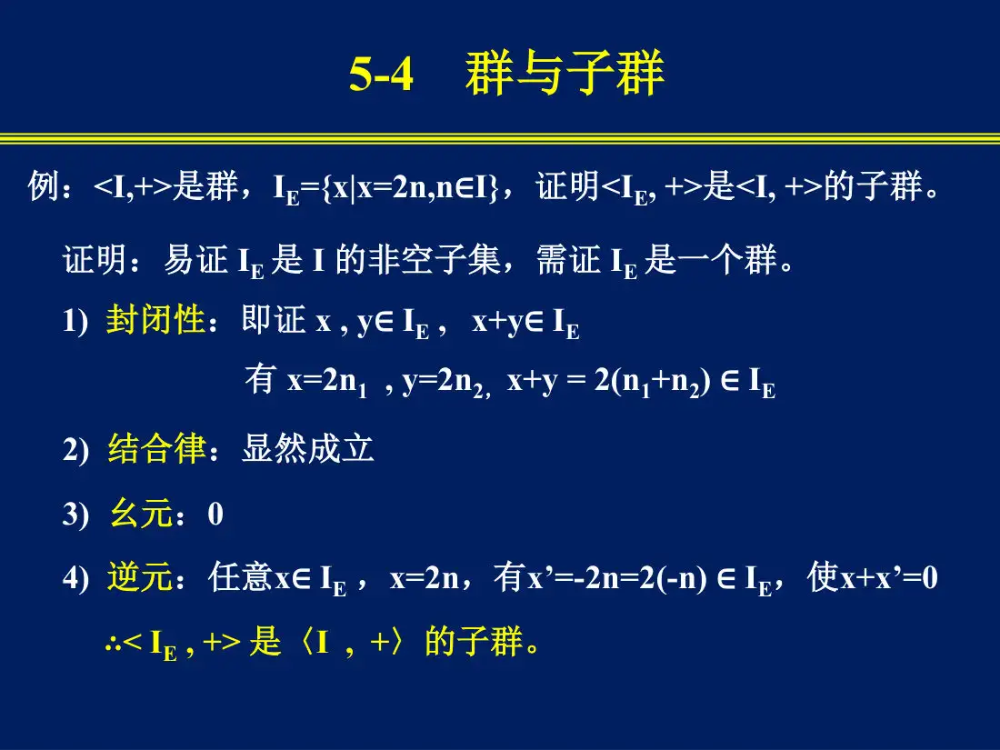

原文：

5-4 群与子群

例：<I, +>是群， $I_E = \{x | x = 2n, n \in I\}$ ，证明 $<I_E, +>$ 是 $<I, +>$ 的子群。

证明：易证 $\mathrm{I_E}$ 是I的非空子集，需证 $\mathrm{I_E}$ 是一个群。

1) 封闭性: 即证 $x, y \in I_{E}, x + y \in I_{E}$ 有 $x = 2n_{1}, y = 2n_{2}, x + y = 2(n_{1} + n_{2}) \in I_{E}$

2) 结合律：显然成立

3) 幺元: 0

4) 逆元: 任意 $x \in I_{E}$ , $x = 2n$ , 有 $x' = -2n = 2(-n) \in I_{E}$ , 使 $x + x' = 0$ $\therefore <I_{E}, +>$ 是 $\langle I, + \rangle$ 的子群。

### 5-4 群与子群

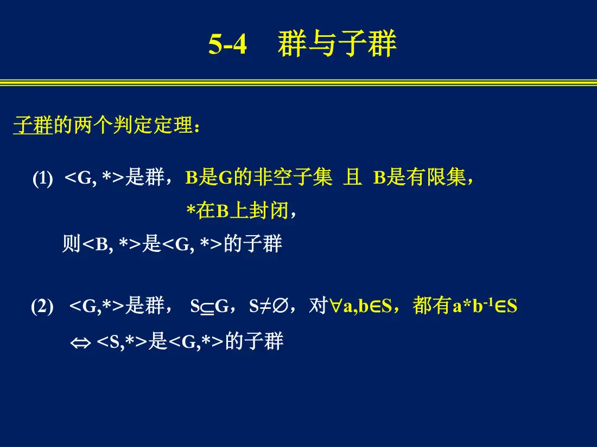

原文：

5-4 群与子群

子群的两个判定定理:

(1) $< \mathrm{G}, * >$ 是群，B是G的非空子集且B是有限集，

\*在B上封闭，

则<B,\*>是<G,\*>的子群

(2) $<G,*>$ 是群， $S \subseteq G$ ， $S \neq \emptyset$ ，对 $\forall a, b \in S$ ，都有 $a*b^{-1} \in S$ $\Leftrightarrow <S,*>$ 是 $<G,*>$ 的子群

### 5-4 群与子群

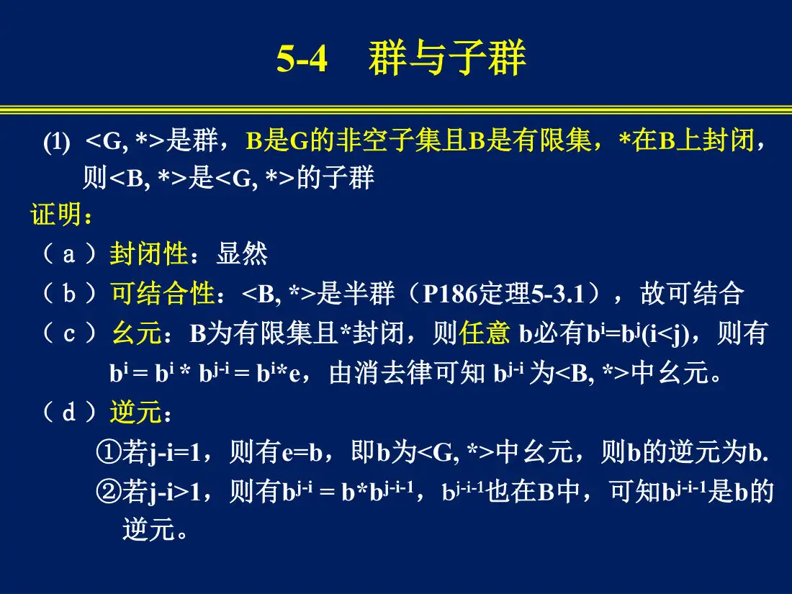

原文：

5-4 群与子群

(1) $< \mathrm{G}, * >$ 是群, B是G的非空子集且B是有限集, \*在B上封闭,则 $< \mathrm{B}, * >$ 是 $< \mathrm{G}, * >$ 的子群

证明：

(a) 封闭性: 显然

（b）可结合性：<B,\*>是半群（P186定理5-3.1），故可结合

(c) 幺元: B为有限集且\*封闭, 则任意 b必有 $b^{i} = b^{j} (i < j)$ , 则有 $b^{i} = b^{i} * b^{j-i} = b^{i} * e$ , 由消去律可知 $b^{j-i}$ 为 $<B, *>$ 中幺元。

(d) 逆元:

①若j-i=1，则有e=b，即b为<G,\*>中幺元，则b的逆元为b.

②若j-i>1，则有 $b^{j-i}=b*b^{j-i-1}$ ， $b^{j-i-1}$ 也在B中，可知 $b^{j-i-1}$ 是b的逆元。

### 5-4 群与子群

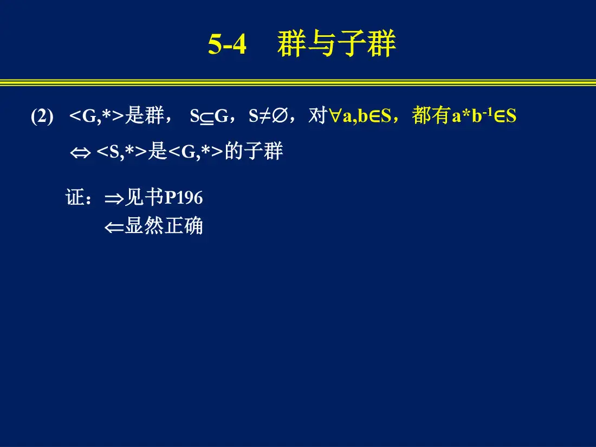

原文：

5-4 群与子群

(2) $<G,*>$ 是群， $S \subseteq G$ ， $S \neq \emptyset$ ，对 $\forall a, b \in S$ ，都有 $a*b^{-1} \in S$ $\Leftrightarrow <S,*>$ 是 $<G,*>$ 的子群

证： $\Rightarrow$ 见书P196

⇐显然正确

### 5-4 群与子群

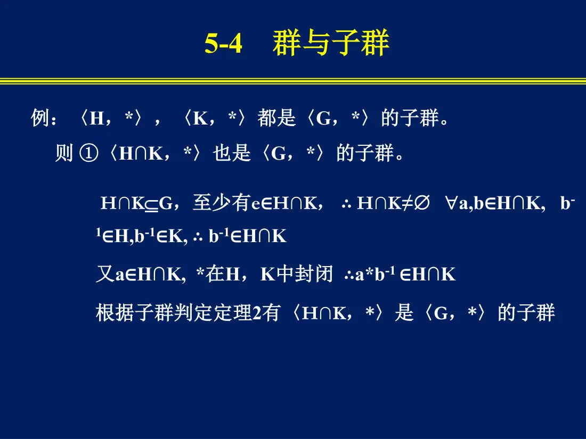

原文：

5-4 群与子群

例：〈H，\*〉，〈K，\*〉都是〈G，\*〉的子群。

则 ① $\langle \mathrm{H} \cap \mathrm{K}, * \rangle$ 也是 $\langle \mathrm{G}, * \rangle$ 的子群。

$H \cap K \subseteq G$ ，至少有 $e \in H \cap K$ ，∴ $H \cap K \neq \emptyset$ $\forall a, b \in H \cap K, b^{-}$

又 $a \in H \cap K$ ，\*在H，K中封闭 $\therefore a*b^{-1} \in H \cap K$

根据子群判定定理2有〈H∩K，\*〉是〈G，\*〉的子群

### 5-4 群与子群

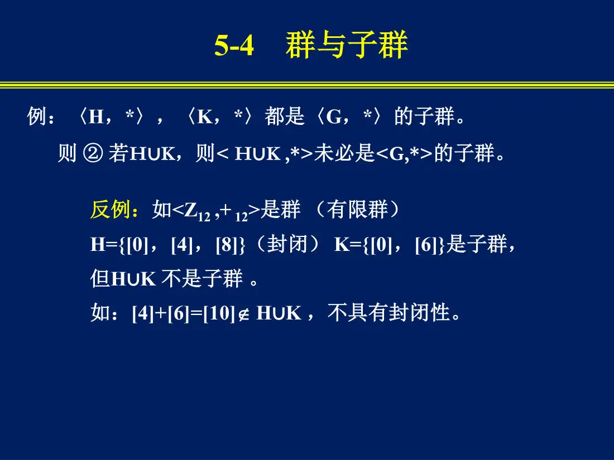

原文：

5-4 群与子群

例：〈H，\*〉，〈K，\*〉都是〈G，\*〉的子群。

则 ② 若HUK，则<HUK,\*>未必是<G,\*>的子群。

反例：如 $<Z_{12}, +12>$ 是群（有限群） $\mathrm{H} = \{[0], [4], [8]\}$ （封闭） $\mathrm{K} = \{[0], [6]\}$ 是子群，但HUK不是子群。如： $[4] + [6] = [10] \notin \mathrm{HUK}$ ，不具有封闭性。

### 5-5 阿贝尔群和循环群

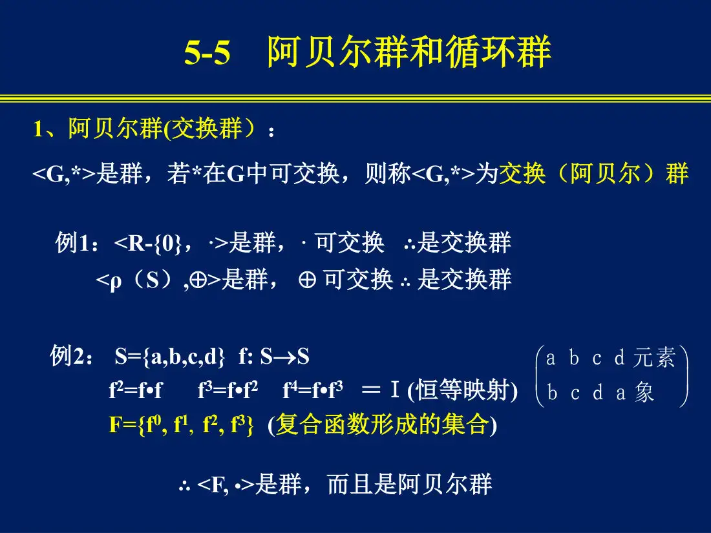

原文：

5-5 阿贝尔群和循环群

1、阿贝尔群(交换群)：

<G,\*>是群，若\*在G中可交换，则称<G,\*>为交换（阿贝尔）群

例1: <R-{0}, •>是群，·可交换 ∴是交换群

<ρ（S），⊕>是群，⊕可交换：是交换群

例2: S={a,b,c,d} f: S→S

a b c d 元素

$f^{2}=f\cdot f$ $f^{3}=f\cdot f^{2}$ $f^{4}=f\cdot f^{3}=I$ (恒等映射) b c d a 象

$F=\{f^{0}, f^{1}, f^{2}, f^{3}\}$ (复合函数形成的集合)

∴ <F, •>是群，而且是阿贝尔群

### 5-5 阿贝尔群和循环群

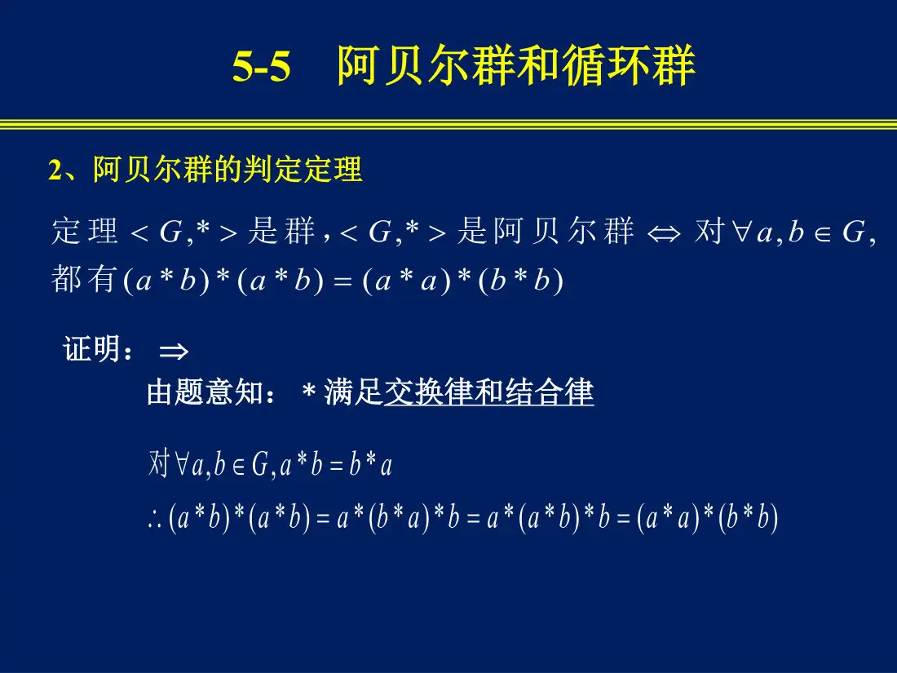

原文：

5-5 阿贝尔群和循环群

2、阿贝尔群的判定定理

定理 $< G,^{*}>$ 是群， $< G,^{*}>$ 是阿贝尔群 $\Leftrightarrow$ 对 $\forall a,b\in G,$ 都有 $(a*b)*(a*b)=(a*a)*(b*b)$

证明： $\Rightarrow$

由题意知：\* 满足交换律和结合律

对 $\forall a, b \in G, a^{*}b = b^{*}a$

$$
\therefore (a ^ {*} b) ^ {*} (a ^ {*} b) = a ^ {*} (b ^ {*} a) ^ {*} b = a ^ {*} (a ^ {*} b) ^ {*} b = (a ^ {*} a) ^ {*} (b ^ {*} b)
$$

### 5-5 阿贝尔群和循环群

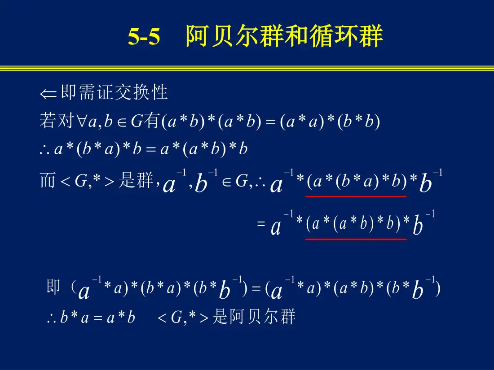

原文：

5-5 阿贝尔群和循环群

$\Leftarrow$ 即需证交换性

若对 $\forall a, b \in G$ 有 $(a*b)*(a*b)=(a*a)*(b*b)$ $\therefore a*(b*a)*b=a*(a*b)*b$ 而 $<G,*>$ 是群， $a^{-1},b^{-1}\in G,\therefore a^{-1*}(a*(b*a)*b)*b^{-1}$ $=a^{-1*}(a*(a*b)*b)*b^{-1}$

即 $(a^{-1} * a) * (b * a) * (b * b^{-1}) = (a^{-1} * a) * (a * b) * (b * b^{-1})$ $\therefore b * a = a * b < G, * >$ 是阿贝尔群

### 5-5 阿贝尔群和循环群

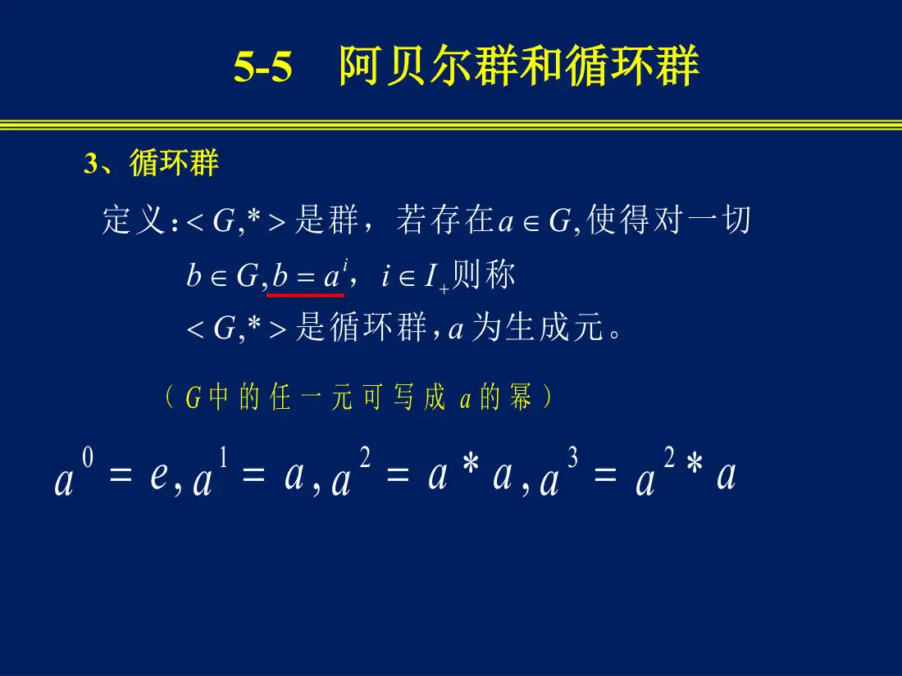

原文：

5-5 阿贝尔群和循环群

3、循环群

定义：<G,\*>是群，若存在a∈G,使得对一切 $b \in G, b = a^{i}, i \in I_{+}$ 则称
<G,\*>是循环群,a为生成元。

( G 中的任一元可写成 a 的幂 )

$$
a ^ {0} = e, a ^ {1} = a, a ^ {2} = a * a, a ^ {3} = a ^ {2} * a
$$

### 5-5 阿贝尔群和循环群

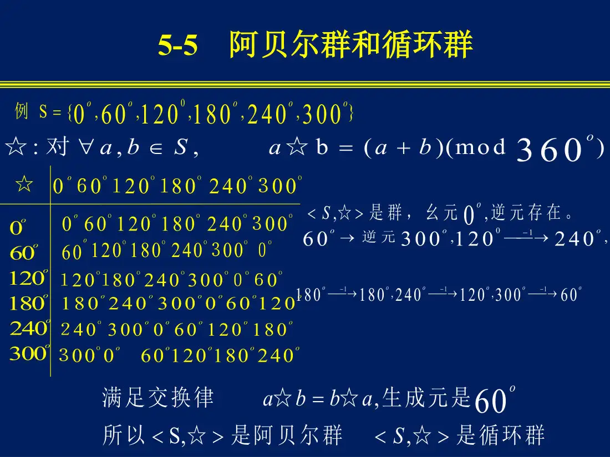

原文：

5-5 阿贝尔群和循环群

例 $S = \{0^{\circ}, 60^{\circ}, 120^{\circ}, 180^{\circ}, 240^{\circ}, 300^{\circ}\}$ ☆: 对 $\forall a, b \in S$ , $a \star b = (a + b) (\bmod 360^{\circ})$ ☆ $0^{\circ} 60^{\circ} 120^{\circ} 180^{\circ} 240^{\circ} 300^{\circ}$ < $S$ , ☆>是群, 幺元 $0^{\circ}$ , 逆元存在。 $60^{\circ} \to$ 逆元 $300^{\circ}, 120^{\circ} \xrightarrow{-1} 240^{\circ}$ , $120^{\circ} 180^{\circ} 240^{\circ} 300^{\circ} 0^{\circ} 60^{\circ}$ $180^{\circ} \xrightarrow{-1} 180^{\circ}, 240^{\circ} \xrightarrow{-1} 120^{\circ}, 300^{\circ} \xrightarrow{-1} 60^{\circ}$ $240^{\circ} 300^{\circ} 0^{\circ} 60^{\circ} 120^{\circ} 180^{\circ}$ $300^{\circ} 0^{\circ} 60^{\circ} 120^{\circ} 180^{\circ} 240^{\circ}$

满足交换律 $a \star b = b \star a$ , 生成元是 $60^{\circ}$ 所以 $< S, \star >$ 是阿贝尔群 $< S, \star >$ 是循环群

### 4、定理：是循环群，则必是阿贝尔群

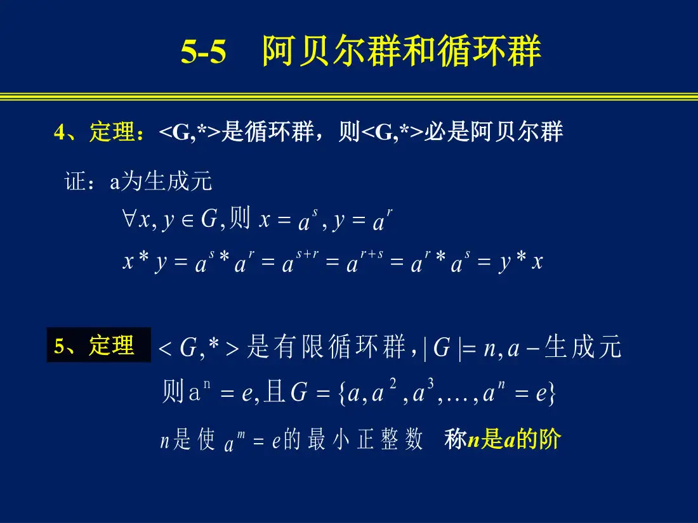

原文：

4、定理：<G,\*>是循环群，则<G,\*>必是阿贝尔群

证：a为生成元

$\forall x, y \in G$ ，则 $x = a^s, y = a^r$

$$
x ^ {*} y = a ^ {s} * a ^ {r} = a ^ {s + r} = a ^ {r + s} = a ^ {r} * a ^ {s} = y ^ {*} x
$$

5、定理 $< G, ^{*}>$ 是有限循环群， $|G| = n, a - \text{生成元}$

则 $a^{n}=e$ ，且 $G=\{a,a^{2},a^{3},\ldots,a^{n}=e\}$

n 是使 $a^{m} = e$ 的最小正整数 称 n 是 a 的阶

5-5 阿贝尔群和循环群

### 5-5 阿贝尔群和循环群

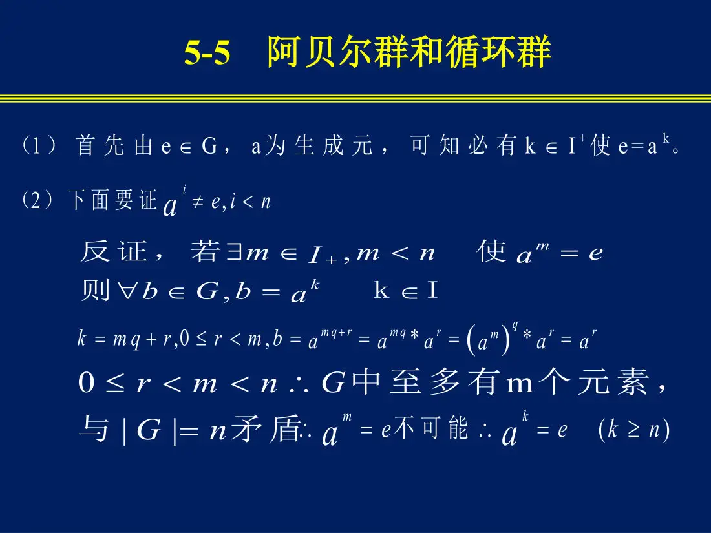

原文：

(1) 首先由 $e \in G$ ，a为生成元，可知必有 $k \in I^{+}$ 使 $e = a^{k}$ 。

(2) 下面要证 $a^i \neq e, i < n$ 反证，若 $\exists m \in I_+, m < n$ 使 $a^m = e$ 则 $\forall b \in G, b = a^k \quad k \in I$ $k = mq + r, 0 \leq r < m, b = a^{mq + r} = a^{mq} * a^r = (a^m)^q * a^r = a^r$ $0 \leq r < m < n \therefore G$ 中至多有 $m$ 个元素，与 $|G| = n$ 矛盾： $a^m = e$ 不可能 $\therefore a^k = e \quad (k \geq n)$

5-5 阿贝尔群和循环群

### 5-5 阿贝尔群和循环群

原文：

5-5 阿贝尔群和循环群

(3)证明： $a, a^2, \ldots, a^n$ 都不同

$\forall i, j, i \neq j, (0 \leq i < j \leq n, \text{要证} a^i \neq a^j)$ 反证 假设 $a^i = a^j$ ，则 $a^j * a^{j-i} = a^i$ $\therefore a^{j-i} = e$ （消去律） $j - i < n$ 不可能

(4) 由G有n元素，而 $a,a^{2},\ldots,a^{n}$ 互异 $k \geq n, a^{k} = e$

∴ 必有取 n 时， $a^{n}=e$ ，故 n 是使 $a^{k}=e$ 成立的最小正整数

### 5-5 阿贝尔群和循环群

原文：

5-5 阿贝尔群和循环群

例： $G=\{\alpha,\beta,\gamma,\delta\}$

$$
\begin{array}{c c c c c} * & \alpha & \beta & \gamma & \delta \\ \hline \alpha & \alpha & \beta & \gamma & \delta \\ \beta & \beta & \alpha & \delta & \gamma \\ \gamma & \gamma & \delta & \beta & \alpha \\ \delta & \delta & \gamma & \alpha & \beta \end{array}
$$

①封闭 ②可结合 ③α幺元

④逆元存在α—α β—β γ—δ

$$
\begin{array}{l} \gamma^ {2} = \beta \\ \gamma^ {3} = \delta \\ \gamma^ {4} = \alpha \end{array}
$$

有生成元γ，δ

<G,\*>是循环群，生成元未必唯一。

### 5-8 同态与同构

原文：

5-8 同态与同构

讨论两代数系统之间的关系

代数系统 $< \{0,1\}, V> < \{a,b\},*> a---0,b---1,$ 他们是同构的，本质上是一样的。

$$
\begin{array}{c c c} \text {V} & 0 & 1 \\ \hline 0 & 0 & 1 \\ 1 & 1 & 1 \end{array}
$$

$$
\begin{array}{c c c} * & a & b \\ \hline a & a & b \\ b & b & b \end{array}
$$

1. 同构

<A, $\alpha>$ 和<B, $*>$ 是两个代数系统， $\alpha,*$ 分别是A,B上二元运算。
若 ∃ 双射 f:A→B 使得 a,b ∈ A
f(a $\alpha$ b)=f(a) \* f(b) 则称 f 是从 <A, $\alpha>$ 到 <B, $*>$ 的一个同构映射。
<A, $\alpha>$ 和<B, $*>$ 是同构的，记作 <A, $\alpha>$ ≅<B, $*>$ .
上例中：{a,b} → {0,1}    f(a)=0 ， f(b)=1.

### 5-8 同态与同构

原文：

5-8 同态与同构

$\langle \mathrm{A},*\rangle$

$\langle B, *\rangle$

f(a\*b) 是否等于f(a)Vf(b)
f(b)=0V1=1
∴f是{a,b}→{0,1}的同构映射。
<{a,b},\*>≥<{0,1},V>
虽然符号不同，但本质上是完全一样的。

### 5-8 同态与同构

原文：

5-8 同态与同构

例： $<R,+\geq\leq<R_{+,\circ}>$ f:R→R+. 满足运算 $f(x)=e^{x}$ $f(x+y)=e^{x+y}$ $f(x)f(y)=e^{x}e^{y}=e^{x+y}$ $\therefore<R,+\geq<R_{+,\circ}>$ f未必唯一。

2）定理：G是代数系统的集合，则G中代数系统之间的同构关系是等价关系。

证：自反性： $<\mathrm{A},*>\in\mathrm{G},\langle\mathrm{A},*>\cong\langle\mathrm{A},*> \mathrm{I}_{\mathrm{A}}:\mathrm{A}\rightarrow\mathrm{A}$ 满足运算。对称性： $<\mathrm{A},*>,\langle\mathrm{B},*>\in\mathrm{G},\langle\mathrm{A},*>\cong\langle\mathrm{B},*>,$ ，则有f:A→B双射f-1:B→A也满足双射。传递性： $\langle\mathrm{A},*>\cong^{\mathrm{f}}\langle\mathrm{B},*> \quad \langle\mathrm{B},*>\cong^{\mathrm{g}}\langle\mathrm{C},+>$ ∴ $\langle\mathrm{A},*>\cong^{\mathrm{g}\cdot\mathrm{f}}\langle\mathrm{C},+\rangle$ 同构映射。

### 5-8 同态与同构

原文：

$\begin{array}{l}\mathrm{f(a) = f(c)}\\ \mathrm{f(b)} \end{array}$

5-8 同态与同构

∴可将G分类，同一类中只是形式不同。
若f是映射，则为同态，条件放宽。
2. 同态 $\langle A, * \rangle$ $\langle B, * \rangle$ 同上。若存在映射f:A→B使 $\forall a, b \in A$ $f(a * b)=f(a)*f(b)$ 则称f是 $\langle A, * \rangle\rightarrow\langle B, * \rangle$ 的同态映射。 $\langle A, * \rangle$ 同态于 $\langle B, * \rangle$ ，运算的象=象的运算。

A

B

### 5-8 同态与同构

原文：

5-8 同态与同构

例：<I，. >,<B,\*>,B={正，负，零}

\*
正负零

正负0负正0

对 $\forall a, b \in I$ $f(a. b)=f(a)*f(b)$

∴<I, . >\~<B,\*> 只研究系统中某些性质（本质的问题）是共同的

### 5-8 同态与同构

原文：

5-8 同态与同构

2) 定义: f 是 <A,\*> 到 <B, △> 的同态映射, 若: f 是 A 到 B 的满射, 则称 f 是满同态; f 是 A 到 B 的入射, 则称 f 是单一同态; f 是 A 到 B 的双射, 则称 f 是 A → B 的同构。若 f 是 <A,\*> 到 <A,\*> 的同态（构）映射, 则称是自同态（构）。

3) 性质: 若 $< \mathrm{A}, * > \sim^{\mathrm{f}} < \mathrm{B}, \Delta >$ , 则 1. 若\*在 $< \mathrm{A}, * >$ 中封闭, 则 $\Delta$ 在 $< \mathrm{f(A)}, \Delta >$ 中也是封闭的。

2. 若\*在<A,\*>中满足结合律，则△在<f(A),△>中也满足结合律。

3. 若\*在<A,\*>中满足交换律，则△在<f(A),△>中也满足交换律。

4. 若 $< \mathrm{A},^{*}>$ 中有幺元，则 $\mathrm{f(e)}$ 是 $< \mathrm{f(A)},_{\Delta}>$ 的幺元。

### 5-8 同态与同构

原文：

5-8 同态与同构

5. 若 $< \mathrm{A},*>$ 中有零元 $\mathcal{G}$ , 则 $\mathrm{f}(\mathcal{G})$ 也是 $< \mathrm{f(A)},\Delta>$ 的零元。  
6. 若对每个 $\mathrm{x}$ 有逆元, 则 $\mathrm{f(x^{-1})}$ 是 $\mathrm{f(x)}$ 的逆元。

证：4.e是<A,\*>的幺元，证f(e)是<f(A),Δ>的幺元。
∀x ∈ f(A), x Δf(e) 是否等于f(e) Δ x=x ?
存在a ∈ A使x=f(a). x Δf(e)=f(a) Δf(e)=f(a\* e)=f(a)=x.
f(e) Δx=f(e) Δ f(a)=f(e\* a)=f(a)=x.
∴f(e)是<f(A)，Δ>的幺元。

4).推论:f:A→B的同态映射。
1).若<A,\*>是半群，则<f(A),\*>是半群。
2).若<A,\*>是独异点，则<f(A),\*>是独异点。
3).若<A,\*>是群，则<f(A),\*>是群。

### 5-8 同态与同构

原文：

5-8 同态与同构

5).若f:A→B的同构映射。
1). <A,\*>是半群 ⇌ <B,\*>是半群。
2).<A,\*>是独异点 ⇌ <B,\*>是独异点。
3).<A,\*>是群 ⇌ <B,\*>是群。
4).<A,\*>的阶=<B,\*>的阶。 |A|=|B|

<A,\*><B,++)
同态 f:A→B映射,f(a\*b)=f(a)+f(b) <A,\*>\~<B,++)
同构 f:A→B双射,f(a\*b)=f(a)+f(b) <A,\*>≌<B,++)
存在两个群 f:<A,\*>→<B,\*>同态,A中幺元e,B中幺元e'

同态核:
1) 定义: $\text{Ker}(f)=\{x|x \in A, f(x)=e'\}$ 称为 f 的同态核.
其中 e' 是 <B,\*> 的幺元

### 5-8 同态与同构

原文：

5-8 同态与同构

2)定理： $\ker (f)$ 是 $< A,*>$ 的子群。证： $k \subseteq A, k \neq \Phi, \forall a, b \in k,$ 只要证 $a*b^{-1} \in k$ 即可。1) $e \in A, f(e)$ 是B中幺元 $f(e) = e'$ ，所以 $e \in k$ 。2) $f(a*b^{-1}) = f(a)*f(b^{-1}) = e, *f(b)^{-1} = e, *e,^{-1} = e,$

2. 同余关系 （比等价关系强）讨论一种与同态有关的非常重要的关系。

1）定义：代数系统 $\langle A,*>R$ 是A上的等价关系
若 $\forall\langle a_{1},b_{1}\rangle\in R,\langle a_{2},b_{2}\rangle\in R$ 有 $\langle a_{1}*a_{2},b_{1}*b_{2}\rangle\in R$ ，则称R是关于运算\*的同余关系。

### 5-8 同态与同构

原文：

5-8 同态与同构

所以同余关系是一种特殊的等价关系，它与代数系统的运算有关。

例：<I, + > , R = { <x, y > | x ≡ y (mod3) y, R 是同余关系。
因为 <x₁, y₁> ∈ R, <x₂, y₂> ∈ R，则 x₁ ≡ y₁ (mod3), x₂ ≡ y₂ (mod3)
所以 x₁ + x₂ ≡ y₁ + y₂ (mod3) <x₁ + x₂, y₁ + y₂> ∈ R    R 是同余关系。

2） $B_{=}^{\triangle}A/R=\{[x_{1}]_{R},[x_{2}]_{R},\ldots,[x_{r}]_{R}\}=\{A_{1},A_{2},\ldots,A_{R}\}$ （R是等价关系）
B中定义的运算\*

### 5-8 同态与同构

原文：

5-8 同态与同构

$x_i \in [x_i]_R, x_j \in [x_j]_R,$ 若 $x_i * x_j \in [x_k]_R.$ 则 $[x_i]_R * [x_j]_R \in [x_k]_R$ 即 $A_i * A_j = A_k.$ 称 $B = \{A_1, A_2, ..., A_r\}$ 为 $A$ 关于 $R$ 的同余类，<B,\*>=<A/R,\*>为<A,\*>的商代数。定理：<A,\*>的商代数是<A,\*>的同态象。证：f:A⇒A/R. $a_i$ 所在的分块当 $a_i \in A_i$ $f(a_i) = A_i$ f是A⇒A/R的满射。注意：要证明<B,\*>\*是否确实是B上的一个运算与代表元选取无关，即 $a_i \in [a_i]_R, a_i' \in [a_i]_R, a_j \in [a_j]_R, a_j' \in [a_j]_R, a_i * a_j \in A_k. f(a_i * a_j) = A_k. a_i' * a_j' \in A_k?$ 即要证 $a_i * a_j$ 与 $a_i' * a_j$ ，在同一分块中这是因为R是同余关系

### 5-8 同态与同构

原文：

5-8 同态与同构

$\langle a_{i},a_{i}^{\prime}\rangle \in R$ $\langle a_{j},a_{j}^{\prime}\rangle \in R$ 在同一分块中。所以 $\langle a_{i}*a_{j},a_{i}^{\prime}*a_{j}^{\prime}\rangle \in R$ 即 $a_{i}*a_{j}$ 与 $a_{i}^{\prime}*a_{j}^{\prime}$ 在同一分块中 $\in A_{k}\ldots$

$$
\mathrm{f} (\mathrm{a} ^ {*} \mathrm{b}) = \mathrm{A} _ {\mathrm{k}} = \mathrm{A} _ {\mathrm{i}} ^ {*} \mathrm{Aj} = \mathrm{f} (\mathrm{a}) ^ {*} \mathrm{f} (\mathrm{b})
$$

$$
a \in A _ {i}, b \in A _ {j}, a ^ {*} b \in A _ {k}
$$

3)定理: f<A;☆>→<B,\*>的同态映射, 则作关系
R:<a,b>∈R⇔f(a)=f(b)
则R是A上的同余关系。

证：R是等价关系

1）自反性 $f(a) = f(a)$ 所以 $< a, a> \in R$ 2) 对称性 $< a, b> \in R => f(a) = f(b) => f(a) = f(b)$ 所以 $< b, a> \in R$

### 5-8 同态与同构

原文：

5-8 同态与同构

3)传递性<a,b>∈R,<b,c>∈R $\Rightarrow$ f(a)=f(b),f(b)=f(c)

所以 $f(a)=f(c)\Rightarrow<a,c>\in R$

设<a1,b1>∈R,<a2,b2>∈R则f(a1)=f(b1) f(a2)=f(b2)
f(a1☆a2)=f(a1)\*f(a2)=f(b1)\*f(b2)=f(b1☆b2)
所以<a1☆a2, b1☆b2>∈R

同构：A有性质 $P \rightarrow B$ 也有，B有 $P \rightarrow A$ 也有

同态：单向 $A - B, A$ 有 $\rightarrow f(A)$ 有

### 5-9 环

原文：

5-9 环

研究两个运算的代数系统 $< A, \Delta, *>$ 同一集合上含有两个运算系统， $\Delta, *$ 有联系， $\Delta$ 称为加法， $*$ 称为乘法如 $< I, +, \cdot >, < Q, +, \cdot > < R, +, \cdot >$

一、环

1. 定义: $< A, \Delta, *>$ 满足:
1) $< A, \Delta>$ 是阿贝尔群, 2) $< A, *>$ 是半群, 3) \*对 $\Delta$ 是可分配的则称 $< A, \Delta, *>$ 是环。 $< I, +, \cdot >, < Q, +, \cdot >, < R, +, \cdot >$ 均是环。 $< (R)_n, +, \cdot > (R)_n: n$ 阶实矩阵集合，也是环

### 5-9 环

原文：

5-9 环

2.定理 $\langle A, +, \bullet \rangle$ 是环， $\forall a, b, c \in A$ ，则有
(1) $a \cdot \theta = \theta \cdot a = \theta$ 其中 $\theta$ 是加法幺元，
(2) $a \cdot (-b) = (-a) \cdot b = -(a \cdot b)$ 正负得负
(3) $(-a) \cdot (-b) = a \cdot b$ 负负得正
(4) $a \cdot (b - c) = a \cdot b - a \cdot c$ 其中-b是b的加法逆元
(5) $(b - c) \cdot a = b \cdot a - c \cdot a$ $a - b = a + (-b)$ 证：(1)，(3) $a \cdot \theta = a \cdot (\theta + \theta) = a \cdot \theta + a \cdot \theta$ a·θ是等幂元，而群中只有幺元是等幂元，
∴a·θ=θ。加法幺元是乘法中的零元

### 5-9 环

原文：

5-9 环

(3) $a \bullet (-b) + a \bullet b = a \bullet (-b + b) = a \bullet \theta = \theta$ $\therefore a \bullet (-b)$ 的逆元是 $a \bullet b$ 即 $-(a \bullet (-b)) = a \bullet b$ $a \bullet (-b) + (-a) \bullet (-b)$ $= (a + (-a)) \bullet (-b) = \theta \bullet (-b) = \theta$ $a \bullet (-b)$ 的逆元是 $(-a) \bullet (-b)$ 即 $-(a \bullet (-b)) = (-a) \bullet (-b)$ $\therefore (-a) \bullet (-b) = a \bullet b$

### 5-9 环

原文：

5-9 环

对于 $< A, +, \cdot >$

环:1) <A, +>是阿贝尔群；2) <A,·>是半群；3) 对+可分配。
