# 《离散数学》第6章 格与布尔代数（课件）

原件的每一页，下面附识别出的文字。

### 第六章 格与布尔代数

原文：

第六章 格与布尔代数

格论是近代数学的一个重要分支，由它所引出的布尔代数在计算机科学中有很多直接应用。

格的概念

◼分配格

◼有补格

◼布尔代数

◼布尔表达式

### 6-1 格的概念

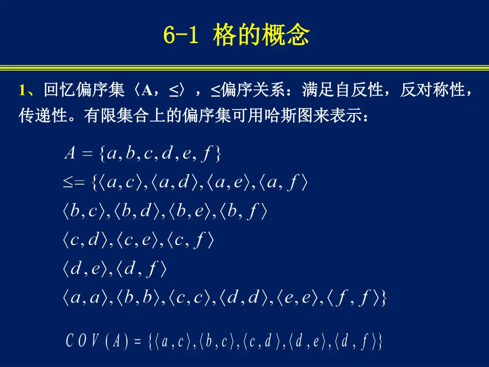

原文：

6-1 格的概念

1、回忆偏序集〈A，≤〉，≤偏序关系：满足自反性，反对称性，传递性。有限集合上的偏序集可用哈斯图来表示：

A = {a, b, c, d, e, f } $= 1 8 ( c m ) 3 ( c m ) 3 ( c m )$ $( 1 ) ( 2 ) ( 1 2 ) ( 1 2 ) ( 2 ) ( 2 ) ( 1 2 ) ( 2 2 )$ $\because \angle C D A = \angle C A B = 9 0 ^ { \circ }$ $\textcircled { 1 } \textcircled { 2 } \times \textcircled { 1 } \textcircled { 2 } \textcircled { 3 }$ $( 2 ) ( 2 7 ) \times ( 2 0 \times 1 0 0 ) = ( 2 0 \times 1 0 0 ) ( 2 0 \times 1 0 0 )$ C O V (A) = {(a,c),〈b,c},〈c, d 〉,〈d , e),(d , f }

### 6-1 格的概念

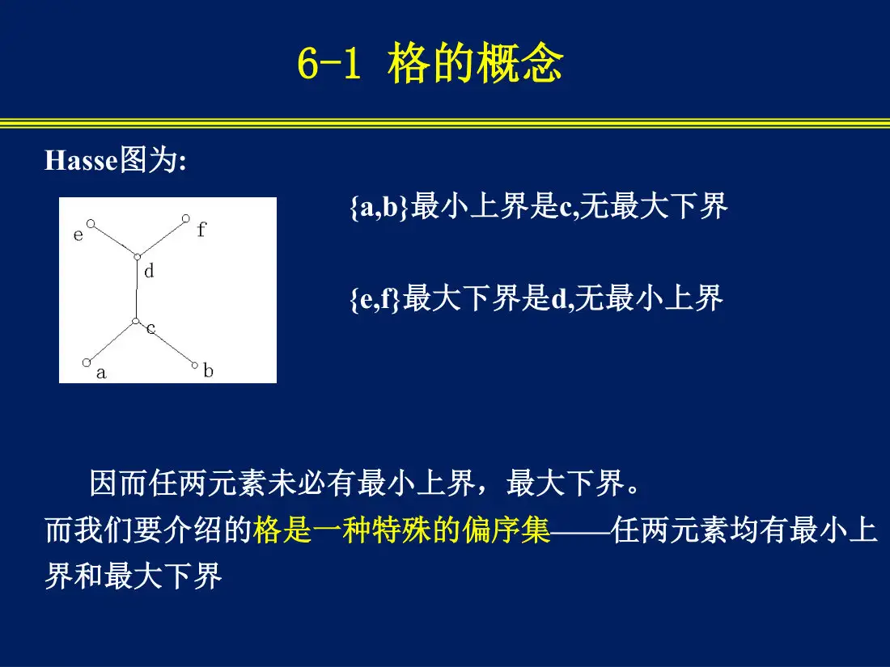

原文：

6-1 格的概念

Hasse图为:

{a,b}最小上界是c,无最大下界

{e,f}最大下界是d,无最小上界

因而任两元素未必有最小上界，最大下界。而我们要介绍的格是一种特殊的偏序集——任两元素均有最小上界和最大下界

### 6-1 格的概念

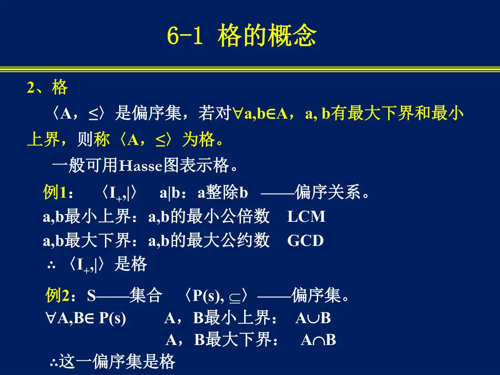

原文：

6-1 格的概念

2、格

〈A，≤〉是偏序集，若对 $\mathrm { \text{®} } \mathrm { \mu } \mathrm { \mu } = \mathrm { \mu } \mathrm { \mu }$ ，a, b有最大下界和最小上界，则称〈A，≤〉为格。

一般可用 $1 0 0 - 1 = 1 0$ 图表示格。

例1： $\langle \langle | | \rangle | \rangle$ a|b：a整除b 偏序关系。

a,b最小上界： $\mathbf { \mathrm { { \widehat { e } m } } }$ 的最小公倍数 LCM

a,b最大下界： $\mathbf { \mathrm { \widehat { e } m } }$ 的最大公约数 GCD

$( 4 1 , 5 2 )$ 是格

例2：S——集合 $\langle \langle \mathbf { \nabla } | \mathbf { \ V } ( \mathbf { \nabla } \mathbf { S } ) | \mathbf { \nabla } \rangle = \langle \mathbf { \nabla } |$ ——偏序集。

$\boxed { 7 } \times \boxed { 6 } \boxed { 1 } \boxed { 3 } \boxed { = } \boxed { 1 } \boxed { 2 } \boxed { 6 }$ A，B最小上界： AB

A，B最大下界： AB

∴这一偏序集是格

### 6-1 格的概念

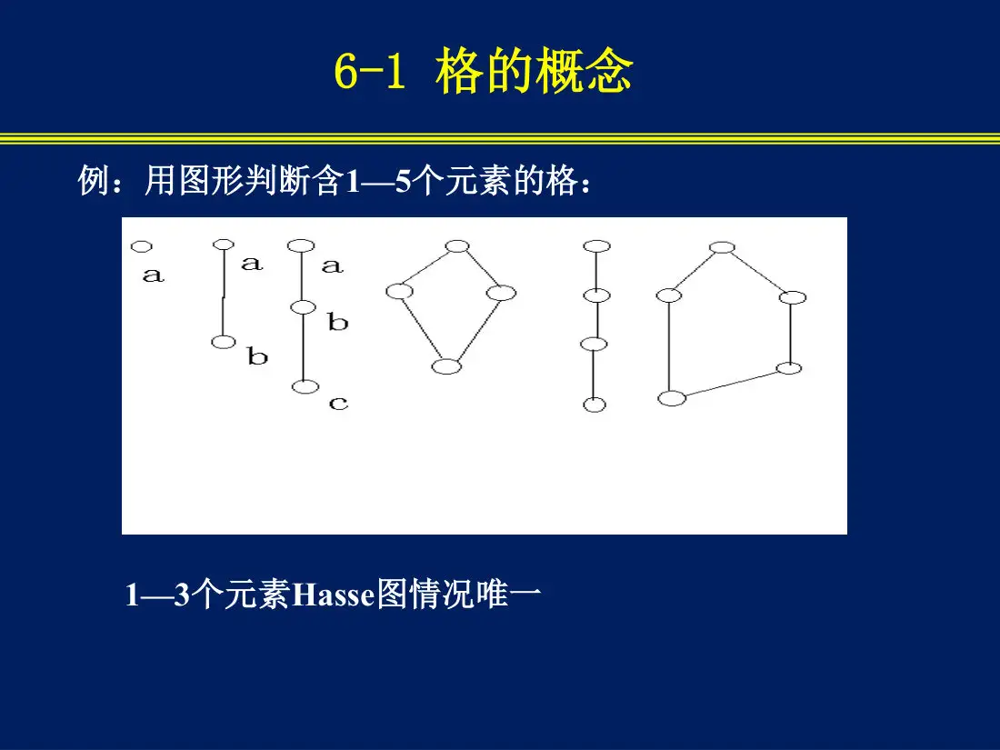

原文：

6-1 格的概念

例：用图形判断含1—5个元素的格：

1—3个元素Hasse图情况唯一

### 6-1 格的概念

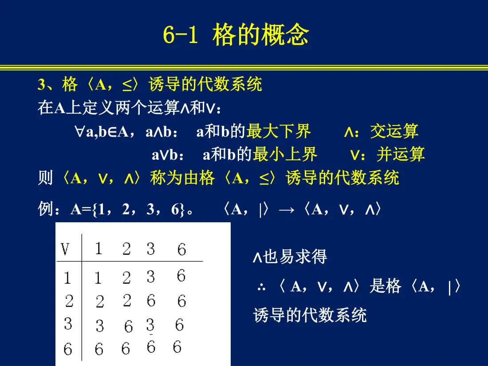

原文：

6-1 格的概念

3、格〈A，≤〉诱导的代数系统在A上定义两个运算∧和∨：

$\forall e \Pi \equiv \Pi _ { 4 }$ ，a∧b： a和b的最大下界 ∧：交运算

a∨b： a和b的最小上界 ∨：并运算

则〈A，∨，∧〉称为由格〈A，≤〉诱导的代数系统

例：A={1，2，3，6}。 $( 1 0 - 2 ) \times ( 2 - 2 ) \times ( 2 - 2 ) \times ( 2 - 2 ) \times ( 2 - 2 )$

$$
\begin{array}{c c c c c} \text {V} & 1 & 2 & 3 & 6 \\ \hline 1 & 1 & 2 & 3 & 6 \\ 2 & 2 & 2 & 6 & 6 \\ 3 & 3 & 6 & \underline {{3}} & 6 \\ 6 & 6 & 6 & \bar {6} & 6 \end{array}
$$

∧也易求得

∴ 〈 A，∨，∧〉是格〈A，|〉

诱导的代数系统

### 6-1 格的概念

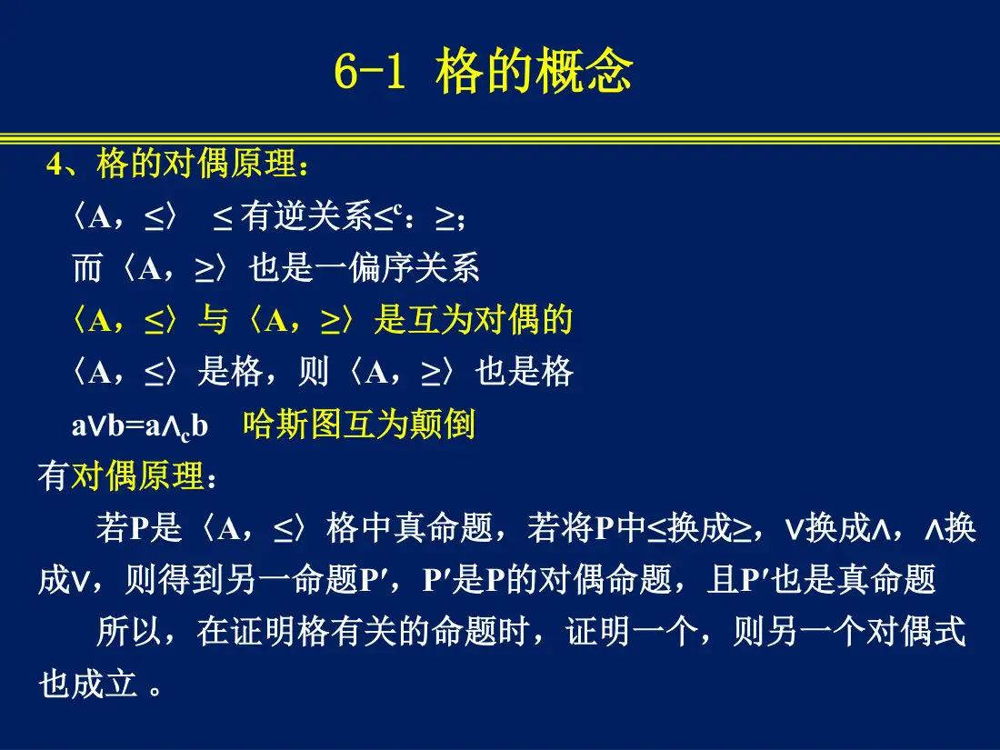

原文：

6-1 格的概念

4、格的对偶原理：

〈A，≤〉 ≤ 有逆关系≤c：≥；

而〈A，≥〉也是一偏序关系

〈A，≤〉与〈A，≥〉是互为对偶的

〈A，≤〉是格，则〈A，≥〉也是格

$g ( \eta ) = 0 . 0 0 0$ 哈斯图互为颠倒

有对偶原理：

若P是〈A，≤〉格中真命题，若将P中≤换成≥，∨换成∧，∧换成∨，则得到另一命题P′，P′是P的对偶命题，且P′也是真命题所以，在证明格有关的命题时，证明一个，则另一个对偶式也成立 。

### 6-1 格的概念

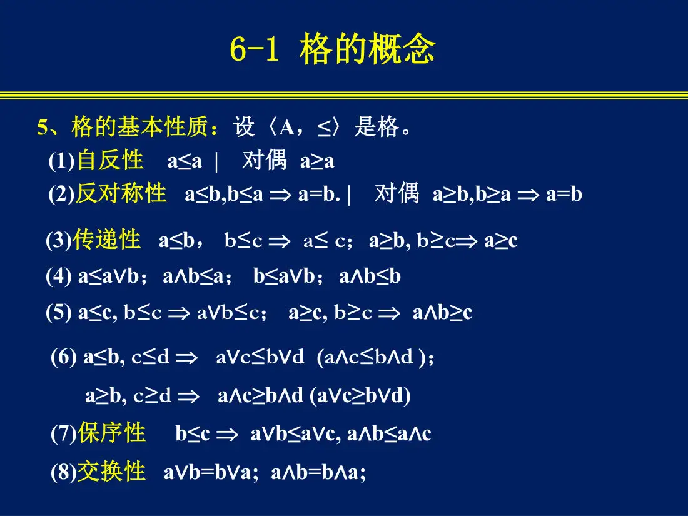

原文：

6-1 格的概念

5、格的基本性质：设〈A，≤〉是格。

(1)自反性 a≤a | 对偶 a≥a

(2)反对称性 $: ( 1 ) ( 1 ) \angle 1 = \angle 2 = 1 2$ | 对偶 $: 2 ( 1 \times 1 ) \div 2 : 1 = 2 : 1 = 1 :$

(3)传递性 $( 1 5 , 1 ) : 1 0 : ( 1 0 , 1 0 ) : 1 0 : 1 0 : 1 0 : 1 0 : 1 0 : 1 0 : 1 0 : 1 0 : 1 0 : 1 0 : 1 0 : 1 0 : 1 0$

(4) a≤a∨b；a∧b≤a； b≤a∨b；a∧b≤b

(5) a≤c, b≤c ⇒ aVb≤c; a≥c, b≥c ⇒ a∆b≥c

(6) a≤b, c≤d  a∨c≤b∨d (a∧c≤b∧d )；

a≥b, c≥d  a∧c≥b∧d (a∨c≥b∨d)

(7)保序性 $( 1 ) ( 1 - \frac { 1 } { 2 } + 1 ) ( 1 - \frac { 1 } { 2 } + 1 ) ( 1 - \frac { 1 } { 2 } + 1 ) ( 1 - \frac { 1 } { 2 } + 1 ) ( 1 - \frac { 1 } { 2 } + 1 )$

(8)交换性 a∨b=b∨a; a∧b=b∧a;

### 6-1 格的概念

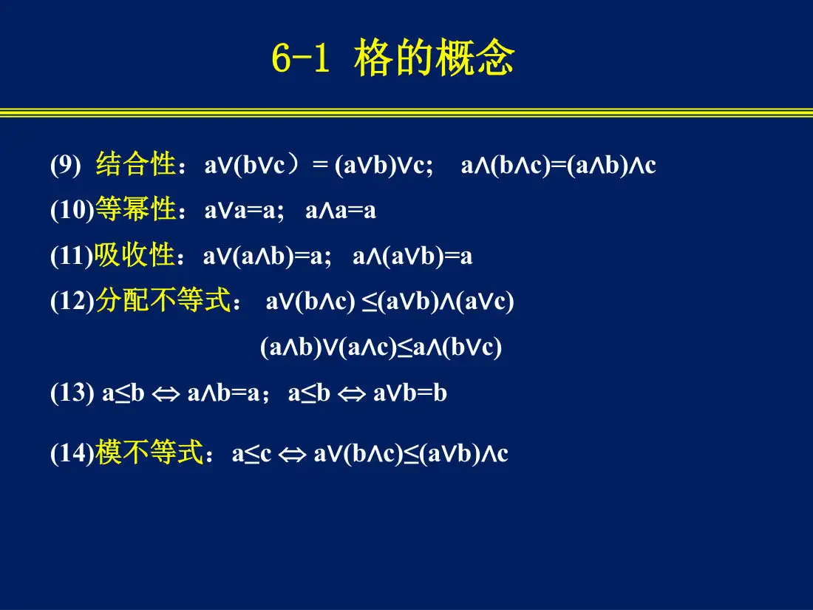

原文：

6-1 格的概念

(9) 结合性： $\mathrm  { R M } ( 0 ) ( 0 ) = ( 0 , 0 ) ( 0 , 0 ) = ( 0 , 0 ) ( 0 , 0 ) = ( 0 , 0 ) ( 0 , 0 ) = ( 0 , 0 ) ( 0 , 0 ) = ( 0 , 0 ) ( 0 , 0 ) = ( 0 , 0 ) ( 0 , 0 ) = ( 0 , 0 ) ( 0 , 0 ) = ( 0 , 0 ) ( 0 , 0 ) = ( 0 , 0 ) ( 0 , 0 ) = ( 0 , 0 ) ( 0 , 0 ) = ( 0 , 0 ) ( 0 , 0 ) = ( 0 , 0 ) ( 0 , 0 ) = ( 0 , 0 ) ( 0 , 0 ) = ( 0 , 0 ) ( 0 , 0 ) = ( 0 , 0 ) ( 0 , 0 ) = ( 0 , 0 ) ( 0 , 0 ) = ( 0 , 0 ) ( 0 , 0 ) = ( 0 , 0 ) ( 0 , 0 ) = ( 0 , 0 ) ( 0 , 0 ) = ( 0 , 0 ) ( 0 , 0 ) = ( 0 , 0 ) ( 0 , 0 ) = ( 0 , 0 ) ( 0 , 0 ) = ( 0 , 0 ) ( 0 , 0 ) = ( 0 , 0 ) ( 0 , 0 ) = ( 0 , 0 ) ( 0 , 0 ) = ( 0 , 0 ) ( 0 , 0 ) = ( 0 , 0 ) ( 0 , 0 ) = ( 0 , 0 ) ( 0 , 0 ) = ( 0 , 0 ) ( 0 , 0 ) = ( 0 , 0 ) ( 0 , 0 ) = ( 0 , 0 ) ( 0 , 0 ) = ( 0 , 0 ) ( 0 , 0 ) = ( 0 , 0 ) ( 0 , 0 ) = ( 0 , 0 ) ( 0 , 0 ) = ( 0 , 0 ) \quad 0 \quad ) = 0$

(10)等幂性： $\scriptstyle ( 1 , 1 , 2 , 3 , 4 , 5 , 5 , 7 , 4 , 5 , 7 )$

(11)吸收性： $\mathrm { R T } ( \mathrm { F T _ { \Omega } ( D ) } ) = \mathrm { P _ { \Omega } ( F T _ { \Omega } ( D ) ) = 0 . }$

(12)分配不等式： $\mathrm { R P } ( 0 ) \mathrm { A C } ( 9 ) = ( \mathrm { R P } ( 0 ) ) \mathrm { A C } ( 0 . 7 0 )$

$$
(a \land b) V (a \land c) \leq a \land (b \lor c)
$$

(13) $\therefore \angle A = \angle M + \angle D A D = \angle A = \angle D A D = \angle A C D = 1 2 0 ^ { \circ }$

(14)模不等式： $\angle A = ( y - 1 ) ( 1 + y ) = ( 1 + y ) ( 1 + y )$

### 6-1 格的概念

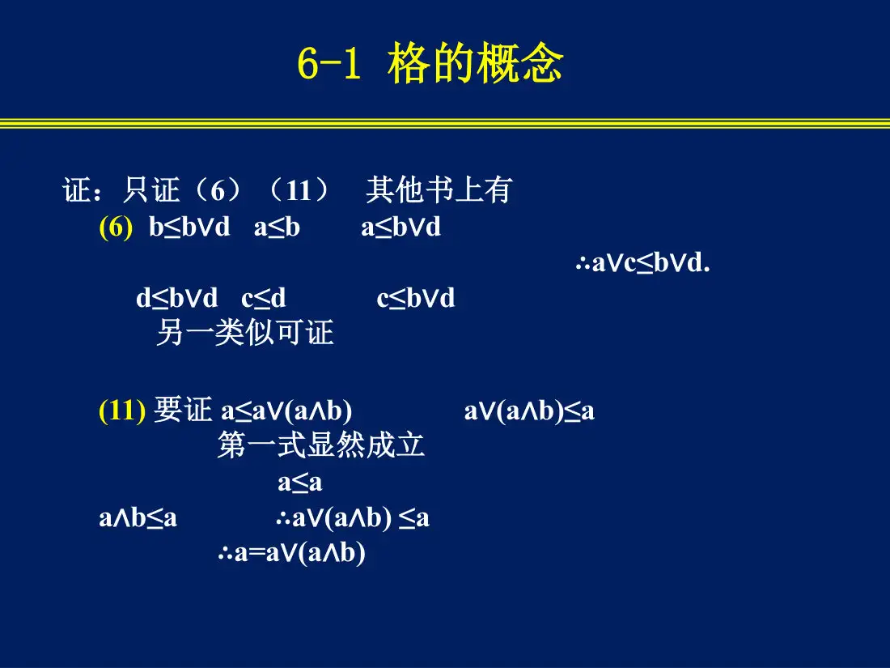

原文：

6-1 格的概念

证：只证（6）（11） 其他书上有(6) b≤b∨d a≤b a≤b∨d

∴a∨c≤b∨d.

d≤b∨d c≤d c≤b∨d 另一类似可证

(11) 要证 a≤a∨(a∧b)第一式显然成立

a∨(a∧b)≤a

a≤a

a∧b≤a ∴a∨(a∧b) ≤a

∴a=a∨(a∧b)

### 6-1 格的概念

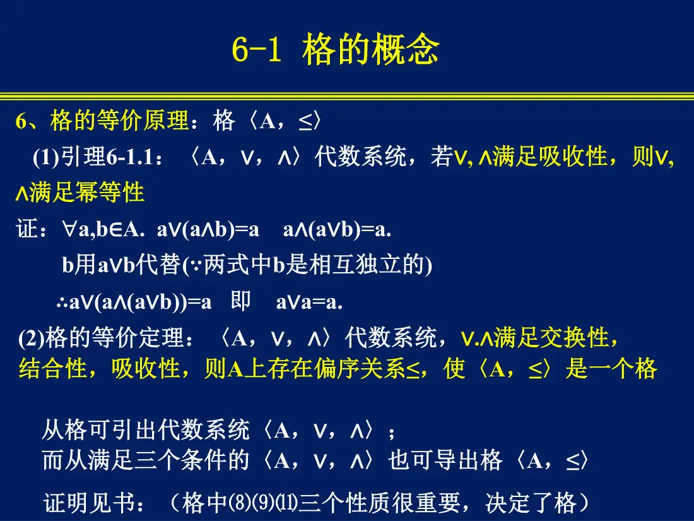

原文：

6-1 格的概念

6、格的等价原理：格〈A，≤

(1)引理6-1.1：〈A，∨，∧〉代数系统，若∨, ∧满足吸收性，则∨,∧满足幂等性

证： $\forall e \in [ \mathbf { i } ] = \mathbf { \Gamma } _ { 4 } ^ { \prime }$ $\mathrm { \Delta E M P , ( H M D ) = \mathrm { \Delta g } }$ $\mathrm { B A } ( \mathrm { e m } , \mathrm { 0 } ) = \mathrm { 0 }$ b用a∨b代替(∵两式中b是相互独立的)$\scriptstyle \mathrm { G P - M P } ( \mathrm { E P } ( \mathrm { D } ( \mathrm { D } ) ) ) = 0$ 即 $\mathbf { \hat { e } } \mathbf { M } \mathbf { \hat { e } } \mathbf { \Theta } \mathbf { \tilde { e } } \mathbf { \Psi }$

(2)格的等价定理：〈A，∨，∧〉代数系统，∨.∧满足交换性，结合性，吸收性，则A上存在偏序关系≤，使〈A，≤〉是一个格

从格可引出代数系统〈A，∨，∧〉

而从满足三个条件的〈A，∨，∧〉也可导出格〈A，≤〉

证明见书：（格中⑻⑼⑾三个性质很重要，决定了格）

### 6-1 格的概念

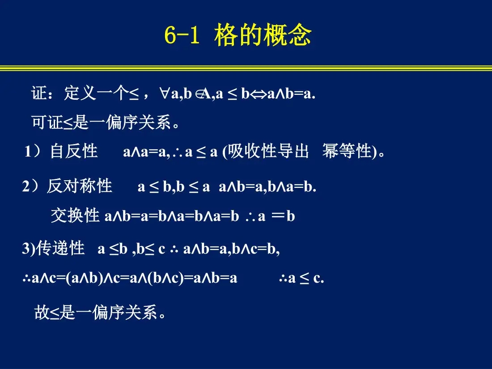

原文：

6-1 格的概念

证：定义一个≤ ， $\because \angle A C E = \angle C A E = \angle B = \angle C A E = \angle A C E$ 可证≤是一偏序关系。

1）自反性 $9 7 \times 9 = 9 7 8 0 ( c m ^ { 3 } )$ (吸收性导出 幂等性)。

2）反对称性 $\mathrm { R e } = \mathrm { ( D A ) } = \mathrm { R e } \cdot \mathrm { ( P A ) } = \mathrm { R e } \cdot \mathrm { ( D A ) } = \mathrm { ( D A ) }$ 交换性 $m _ { i } = m _ { i } = m _ { i } = m _ { i } = m _ { i } = m _ { i } = 1$ 3)传递性 $( 1 5 - 3 ) ( 1 0 - 1 ) \div ( 1 0 - 2 ) ( 1 0 - 1 ) = ( 1 0 - 1 ) ( 1 0 - 1 )$ $\mathrm { S e } \mu _ { 1 } ( 0 ) = ( \mathrm { P a } ( 0 ) ) \mu ( 0 ) = \mathrm { P a } ( 0 ) \mu ( 0 ) = ( \mathrm { P a } ( 0 ) ) = ( \mathrm { P a } ( 0 ) )$ $\mathtt { a m } \mathtt { s m } \mathtt { s m }$ 故≤是一偏序关系。

### 6-1 格的概念

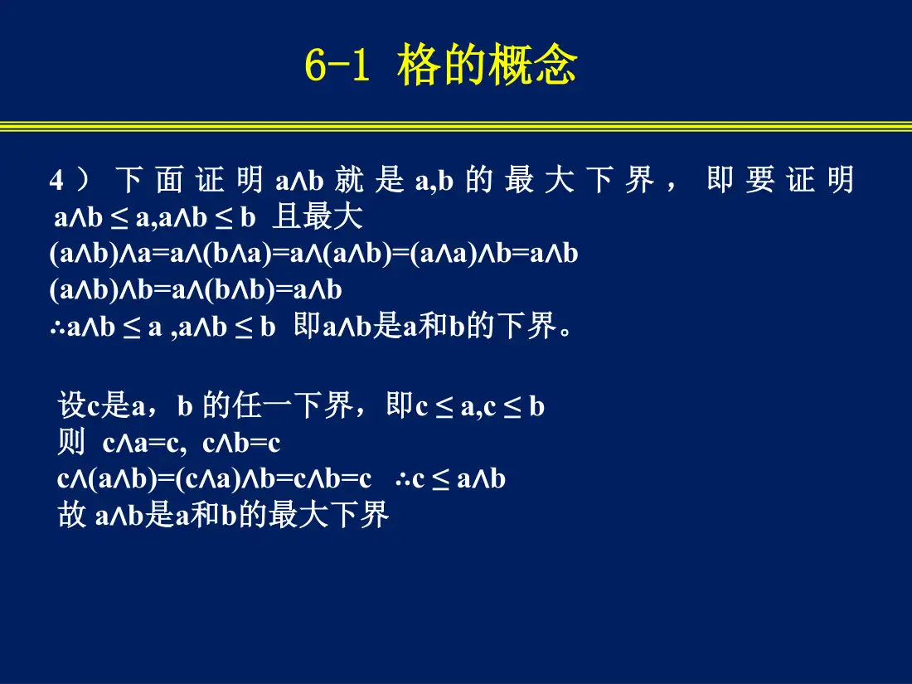

原文：

6-1 格的概念

4 ） 下 面 证 明 a∧b 就 是 $\mathrm { \bf G D }$ 的 最 大 下 界 ， 即 要 证 明$9 0 0 - 4 0 0 0 0 = 9 0$ 且最大$( \mathrm { e r f _ { 4 } ( 1 ) } ) / \mathrm { e } = \mathrm { P a } ( 0 ) \mathrm { e } ( 0 ) = \mathrm { P a } ( \mathrm { e } ( \mathrm { e } ( 1 0 ) ) = ( \mathrm { e } ( \mathrm { e } ( 0 ) ) \mathrm { e } ( 1 ) = \mathrm { e } ( \mathrm { e } ( 1 0 ) )$ $( \mathrm { e } \eta _ { \mathrm { A D } } ) _ { \mathrm { A U } } = \mathrm { e } \eta _ { \mathrm { A U } } ( | \eta _ { \mathrm { A U } } ) _ { \mathrm { E } } \eta _ { \mathrm { A U } } )$ $( \frac { 1 } { 2 } + \frac { 1 } { 3 } ) ( 1 ) = ( \frac { 1 } { 2 } + \frac { 1 } { 3 } ) ( 1 ) = ( \frac { 1 } { 2 } - \frac { 1 } { 3 } )$ 即a∧b是a和b的下界。

设c是a，b的任一下界，即 $( 4 8 - 9 ) ( 9 8 - 1 )$ 则 $\scriptstyle ( 9 \land 1 ) = ( 5 \lor 1 ) = ( 0 \land 1 ) = ( 0$ $( y _ { A } ( e y _ { A } 1 ) ) = ( y _ { A } ( 0 ) ) / ( 1 ) = ( y _ { A } 1 ) = ( y _ { A } 1 ) = ( y _ { A } 1 ) = ( y _ { A } 1 ) ( 1 )$ 故 a∧b是a和b的最大下界

### 6-1 格的概念

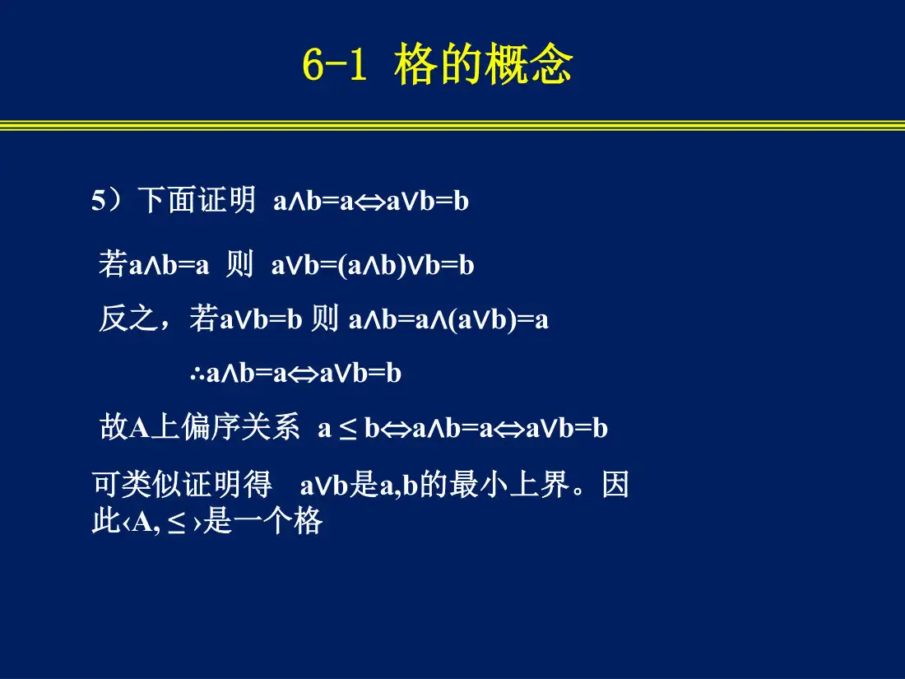

原文：

6-1 格的概念

5）下面证明 $9 0 0 - 0 . 5 = 2 0 0 0 0 ( m )$ 若 $\mathbf { \nabla } \cdot \mathbf { D } \mathbf { \vec { A } } \mathbf { \vec { D } } = \mathbf { \vec { Q } }$ 则 $\scriptstyle { ( 1 , 1 ) ( 1 ) } = ( ( { \mathrm { e } } , { \mathrm { A D } } ) , { \mathrm { i } } = { \mathrm { i } }$ 反之，若 $\mathbf { M } \mathbf { i } = \mathbf { \mathbf { \mathbf { \mathbf { \mathbf { \mathbf { \mathbf { \mathbf { \mathbf { \delta \mathbf } } } } } } } } }$ 则 $9 0 ( 0 ) = 9 0 ( 0 0 0 ) = 9 0$ $( 2 0 0 \times 1 0 ) \times 1 0 = 2 0 0 ( 1 0 ) = 1 0$ 故A上偏序关系 $\angle A = 1 1 0 ^ { \circ } = \angle A ( 1 ) = \angle 3 = \angle A ( 1 ) = 1 2$ 可类似证明得 a∨b是a,b的最小上界。因此‹A, ≤ ›是一个格

### 6-1 格的概念

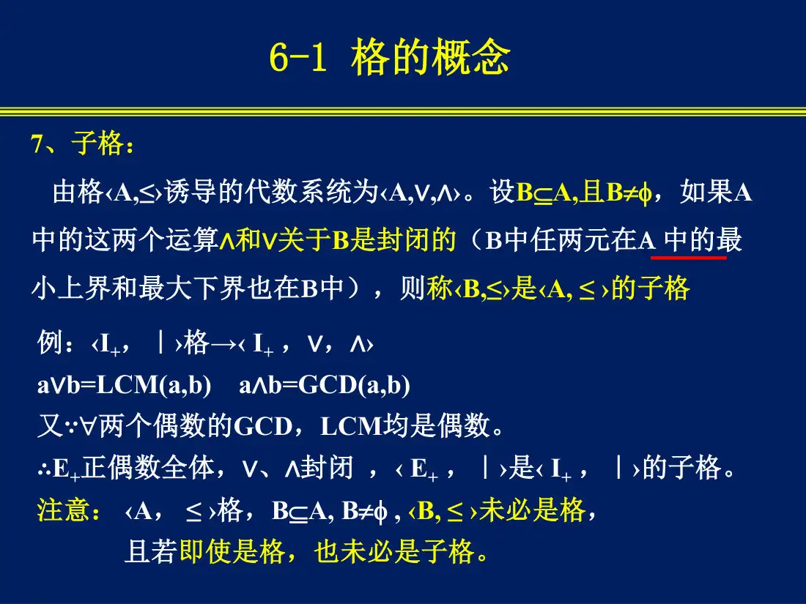

原文：

6-1 格的概念

7、子格：

由格<A,≤诱导的代数系统为<A,V,Λ>。设B⊂A,且B≠φ，如果A中的这两个运算∧和∨关于B是封闭的（B中任两元在A 中的最小上界和最大下界也在B中），则称‹B,≤›是‹A, ≤ ›的子格

例： $\textcircled { 1 } \textcircled { 1 }$ ｜›格→‹ I ，∨，∧›$9 7 0 0 \equiv 1 0 0 0 ( c m )$ $9 \times 1 0 = ( 9 ( 9 0 ) ) ( 9 0 ) )$ 又∵两个偶数的GCD，LCM均是偶数。∴E 正偶数全体，∨、∧封闭 ， $\textcircled { < } \textcircled { > }$ ，｜›是‹I ，｜›的子格。注意： ‹A， ≤ ›格，BA, $\frac { 1 } { 6 } : = ( 1 )$ , ‹B, ≤ ›未必是格，且若即使是格，也未必是子格。

### 5:

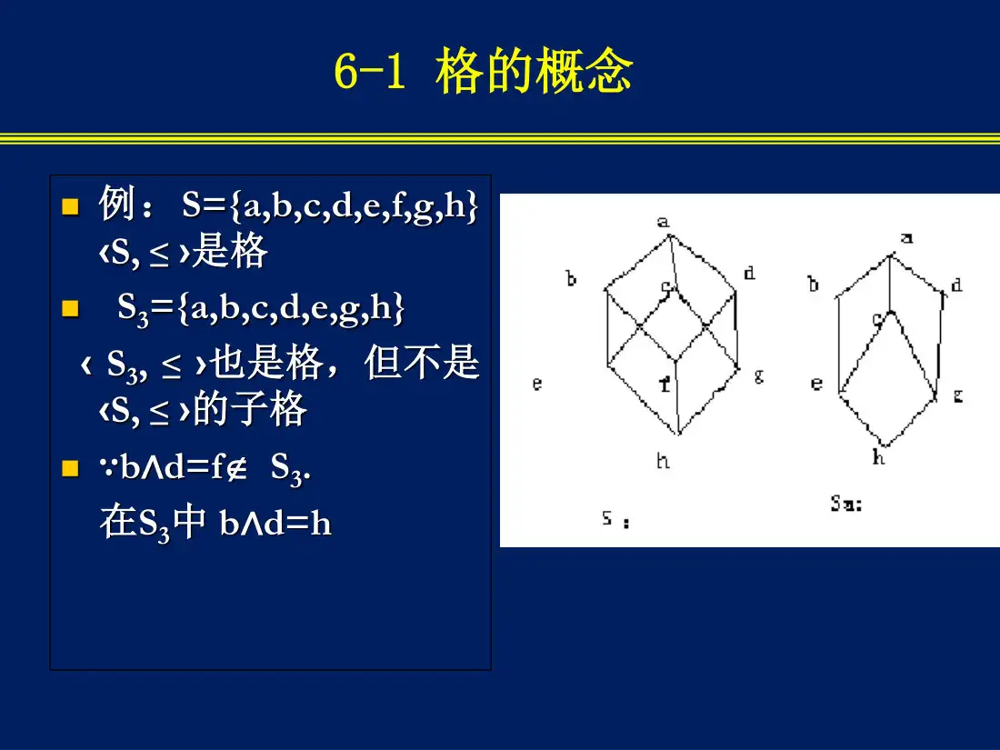

原文：

5:

6-1 格的概念

例： $( 3 ) ( 2 5 \div 2 ) ( 2 5 \div 2 ) ( 2 5 \div 2 ) = ( 2 5 \div 2 )$ $\textcircled { 4 }$ 是格

$\frac { 1 } { 2 } \times ( \frac { 1 } { 2 } \times \frac { 1 } { 2 } \times \frac { 1 } { 2 } \times \frac { 1 } { 2 } \times \frac { 1 } { 2 } \times \frac { 1 } { 2 } \times \frac { 1 } { 2 } \times \frac { 1 } { 2 } \times \frac { 1 } { 2 } \times \frac { 1 } { 2 } \times \frac { 1 } { 2 } \times \frac { 1 } { 2 } \times \frac { 1 } { 2 } \times \frac { 1 } { 2 } \times \frac { 1 } { 2 } \times \frac { 1 } { 2 } \times \frac { 1 } { 2 } \times \frac { 1 } { 2 } \times \frac { 1 } { 2 } \times \frac { 1 } { 2 } \times \frac { 1 } { 2 } \times \frac { 1 } { 2 } \times \frac { 1 } { 2 } \times \frac { 1 } { 2 } \times \frac { 1 } { 2 } \times \frac { 1 } { 2 } \times \frac { 1 } { 2 } \times \frac { 1 } { 2 } \times \frac { 1 } { 2 } \times \frac { 1 } { 2 } \times \frac { 1 } { 2 } \times \frac { 1 } { 2 } \times \frac { 1 } { 2 } \times \frac { 1 } { 2 } \times \frac { 1 } { 2 } \times \frac { 1 } { 2 } \times \frac { 1 } { 2 } \times \frac { 1 } { 2 } \times \frac { 1 } { 2 } \times \frac { 1 } { 2 } \times \frac { 1 } { 2 } \times \frac { 1 } { 2 } \times \frac { 1 } \times \frac { 1 } { 2 } \times \frac { 1 } \times \frac { 1 } { 2 } \times \frac { 1 } \times \frac { 1 } { 2 } \times \times \frac { 1 } \times \frac { 1 } \times \frac { 1 } \times \frac { 1 } \times \frac { } { 2 } \times \frac { 1 } \times \times \frac { 1 } \times \frac { } \frac { 1 } \times \times \frac { 1 } \times \frac { } \frac { 1 } \times \times \frac { } \frac \frac { 1 } \times \times \frac { } \frac { 1 } \times \times \frac \frac { } \frac { \frac 1 } \times \times \frac { \frac \frac 1 } \times \times \frac { \frac }  \frac \frac { 1 } \times \frac \times \frac \frac $ ‹ $\textcircled { < } \textcircled { < } \textcircled { < } \textcircled { < }$ 也是格，但不是$\textcircled { 4 }$ 的子格

$\angle A ^ { \prime } D A ^ { \prime } C = 1 8 0 ^ { \circ }$ 在 1.11 $\textcircled { < }$ 中 $| { \bf \Delta } | | \bf { \dot { o } } | | { \bf \Delta } | | { \bf \Delta } | | { \bf \Delta } |$

### 6-1 格的概念

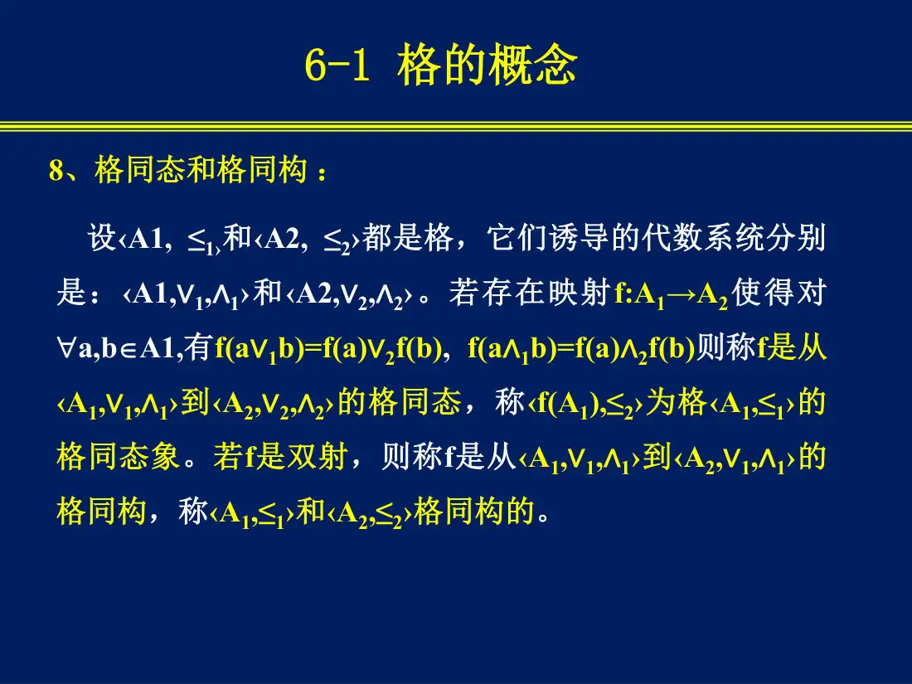

原文：

6-1 格的概念

8、格同态和格同构 ：

设 $\pmb { \bigtriangledown } _ { \mathbf { A } } \mathbf { M }$ $\boxtimes$ 和‹A2, ≤ ›都是格，它们诱导的代数系统分别是： $\angle A = 1 \angle A = \angle A = 1 8$ 和 $\angle A = 9 \angle A = 9 \angle A = 9 \angle C$ 。若存在映射f: $1 4 - 5 = 1 4$ 使得对$\yen 123,456$ ,有f $\mathrm { { e x } } \mathrm { { < } } \mathrm { { ( D ) } = } \mathrm { { i ( e ) } } \mathrm { { / } } \mathrm { { / } } \mathrm { { ( 0 ) } }$ $1 1 ( 1 9 \times 1 0 ) = 1 1 ( 1 ) \times 1 0 ( 1 0 )$ 则称f是从$\angle A = 9 0 ^ { \circ } - \angle C = 9 0 ^ { \circ }$ 到 $\textcircled { 4 } \textcircled { > } \textcircled { > } \textcircled { > } \textcircled { < } \textcircled { > }$ 的格同态，称 $\Delta B C D \cong \Delta D C D$ 为格 $0 . 5 \times 1 0 = 1 0$ ›的

›的格同态象。若f是双射，则称f是从 $\angle A = 9 0 ^ { \circ } - \angle C = 9 0 ^ { \circ }$ 到 $\angle A = \angle A = \angle C = \angle A = 1 8$ 格同构，称 $\textcircled { 1 } \frac { 1 } { 2 } \textcircled { 1 } \frac { 1 } { 2 }$ ›和 $\textcircled { 4 } \textcircled { > } \textcircled { < } \textcircled { < } \textcircled { < } \textcircled { < } \textcircled { < } \textcircled { < } \textcircled { < } \textcircled { < } \textcircled { < } \textcircled { < } \textcircled { < } \textcircled { < } \textcircled { < } \textcircled { < } \textcircled { < } \textcircled { < } \textcircled { < } $ 格同构的。

### 6-1 格的概念

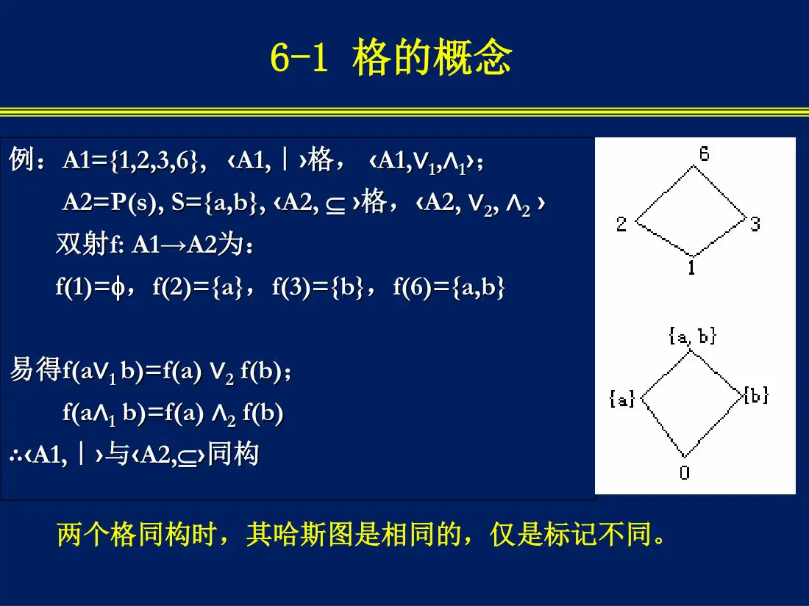

原文：

6-1 格的概念

例： $0 . 5 6 \times ( 0 . 5 6 \times 0 . 5 6 \times 0 . 5 6 \times 0 . 5 6 \times 0 . 5 6 \times 0 . 5 6 \times 0 . 5 6 \times 0 . 5 6 \times 0 . 5 6 \times 0 . 5 6 \times 0 . 5 6 \times 0 . 5 6 \times 0 . 5 6 \times 0 . 5 6 \times 0 . 5 6 \times 0 . 5 6 \times 0 . 5 6 \times 0 . 5 6 \times 0 . 5 6 \times 0 . 5 6 \times 0 . 5 6 \times 0 . 5 6 \times 0 . 5 6 \times 0 . 5 6 \times 0 . 5 6 \times 0 . 5 6 \times 0 . 5 6 \times 0 . 5 6 \times 0 . 5 6 \times 0 . 5 6 \times 0 . 5 6 \times 0 . 5 6 \times 0 . 5 6 \times 0 . 5 6 \times 0 . 5 6 \times 0 . 5 6 \times 0 . 5 6 \times 0 .$ ›格， $\angle A = 1 5 ^ { \circ } , \angle B = \angle A C B$ $\therefore V = V ( 0 , V ) = ( \frac { V } { 1 . } ) = ( \frac { V } { 1 . } ) = V ( 0 , V ) = 0$ 格， $\textcircled { 1 } 、 \textcircled { 6 } 、 \textcircled { 7 } 、 \textcircled { 7 } 、 \textcircled { 1 } 、 \textcircled { 7 }$ 双射f: $\Delta q C l \Delta q C l _ { 2 } ( C O _ { 3 } ) _ { 2 }$ 为：$( 0 ) = ( 0 . 0 7 \times ( 0 . 0 7 \times 0 . 0 7 \times 0 . 0 7 \times 0 . 0 7 \times 0 . 0 7 \times 0 . 0 7 \times 0 . 0 7 \times 0 . 0 7 \times 0 . 0 7 \times 0 . 0 7 \times 0 . 0 7 \times 0 . 0 7 \times 0 . 0 7 \times 0 . 0 7 \times 0 . 0 7 \times 0 . 0 7 \times 0 . 0 7 \times 0 . 0 7 \times 0 . 0 7 \times 0 . 0 7 \times 0 . 0 7 \times 0 . 0 7 \times 0 . 0 7 \times 0 . 0 7 \times 0 . 0 7 \times 0 . 0 7 \times 0 . 0 7 \times 0 . 0 7 \times 0 . 0 7 \times 0 . 0 7 \times 0 . 0 7 \times 0 . 0 7 \times 0 . 0 7 \times 0 . 0 7 \times 0 . 0 7 \times 0 . 0 7 \times 0 . 0 7 \times 0 . 0 7 \times 0 . 0 7 \times 0 . 0 7 \times 0 . 0 7 \times 0 . 0 7 \times 0 . 0 7 \times 0 . 0 7 \times 0 . 0 7 \times 0 .$

易得 $( \mathrm { C D } ^ { \prime } ( 0 ) ) = ( \textcircled { < } ) \because ( 0 ) = ( 0 )$ $( ( 0 , 1 5 , 1 0 ) ) = ( 0 , 1 5 , 1 0 )$ $\mathbb { B } \mathbb { B } \mathbb { B } \mathbb { B } \mathbb { B }$ 与 $\textcircled { 4 } \textcircled { 6 } \textcircled { 2 } \textcircled { < } \textcircled { 2 }$ 同构

两个格同构时，其哈斯图是相同的，仅是标记不同。

### 6-1 格的概念

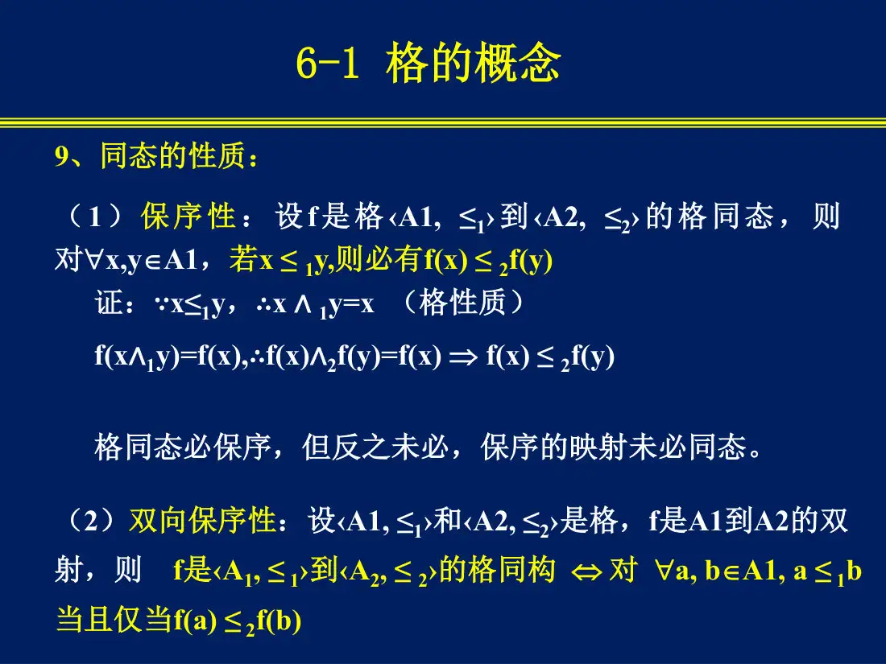

原文：

6-1 格的概念

9、同态的性质：

（1）保序性：设f是格‹A1, ≤ ›到‹A2, ≤ ›的格同态，则对 $\forall x \bullet \bullet \bullet \bullet \bullet \bullet$ 若 $\Delta B A C \cong \Delta B C$ 则必有 $( 1 0 3 ) \leq 1 1 0$ 证： $\angle B = \angle A ^ { \prime } D = \angle B = \angle A ^ { \prime } D ^ { \prime } = 9 0 ^ { \circ }$ （格性质）$[ ( 0 , 0 , 0 ) ] = ( 0 , 0 , 0 , 0 , 0 ) = ( 0 , 0 , 0 , 0 ) = ( 0 , 0 , 0 , 0 )$ 格同态必保序，但反之未必，保序的映射未必同态。

（2）双向保序性：设 $\angle A = 1 5 ^ { \circ }$ ›和 $\textcircled { 4 } \textcircled { > } \textcircled { > } \textcircled { > } \textcircled { > }$ 是格，f是A1到A2的双射，则 f是 $\textcircled { 4 } \textcircled { 1 } \textcircled { 2 } \textcircled { 2 } \textcircled { 1 }$ ›到 $\textcircled { 4 } \textcircled { > } \textcircled { < } \textcircled { > } \textcircled { = } \textcircled { > }$ 的格同构 对 $V _ { 1 } = \frac { 1 } { 2 } \times ( 1 2 - \frac { 1 } { 2 } ) \times ( 1 2 - \frac { 1 } { 2 } ) = \frac { 1 } { 2 } ( 1 2 - \frac { 1 } { 2 } )$ 当且仅当 $1 0 0 \times 1 0 0$

### 6-1 格的概念

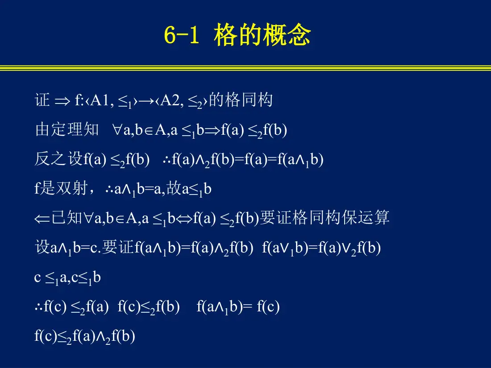

原文：

6-1 格的概念

$n _ { 1 } = 1 2 . 5 \times 1 . 5 = 1 2 . 5 ( c m ^ { 3 } )$ 的格同构由定理知 $7 0 0 1 0 1 0 0 \times 1 0 0 = 7 0 0 0 0 0 ( c m )$ 反之设f $( \Theta ) = \operatorname { v } ( 0 ) \operatorname { v o r } ( \Theta / \operatorname { R P } ( 0 ) ) = \operatorname { v } ( \Theta ) = \operatorname { v } ( \Theta / \operatorname { R P } ( 0 ) )$ f是双射， $g ( 0 ) \lambda ( 0 ) = 0$ $\mathrm { e } \leq | \mathrm { \overrightarrow { \mathbf { \sigma } } } | =$ 已知 $\because ( - 1 ) ( - 1 + 1 ) \times ( - 1 + 1 ) = - 1 ( - 1 ) ( - 1 + 1 )$ 要证格同构保运算设 $( 2 ) A ( 1 ) = 0$ .要证f $\langle \langle \langle \langle \langle \mathbf { \delta } | \mathbf { \delta } | \mathbf { \delta } | \mathbf { \delta } \rangle | = | \langle \langle \langle \mathbf { \delta } | \rangle | \mathbf { \delta } | \mathbf { \delta } \rangle | \langle \mathbf { \delta } | \mathbf { \delta } \rangle$ $1 1 ( 1 0 \% 0 ) = 1 1 ( 0 ) 1 ( 0 )$ $0 \leq x _ { 2 } \leq 0 \leq x _ { 2 } \leq 0$ $\operatorname { d e a l f } ( \mathbf { \{ 0 \} } ) \leq \operatorname { d i f } ( \mathbf { \{ 0 \} } )$ $i i ( 0 ) \leq 2 i ( 0 )$ $1 1 ( 1 0 \times 1 0 ) = 1 1 ( 1 0 )$ $1 1 ( 9 ) - 1 1 ( 9 ) / \cdots ( 1 0 )$

### 6-1 格的概念

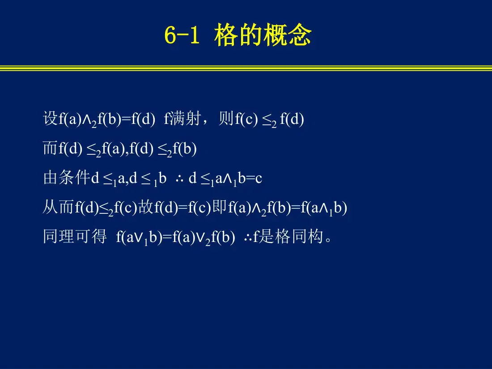

原文：

6-1 格的概念

设f(a) $2 5 2 ( 0 ) = 1 1 ( 0 )$ f满射，则f $( \bullet ) \leq m ( \bullet )$ 而f(d) $\Rightarrow [ ( 0 ) ] \times [ ( 0 ) ] = \int [ 0 ] \times [ ( 0 ) ] = \int [ 0 ] \times [ ( 0 ) ] = \int [ 0 ] \times [ ( 0 ) ] = \int [ 0 ] \times [ ( 0 ) ] = \int [ 0 ] \times [ ( 0 ) ] = \int [ 0 ] \times [ 0 ] \times [ ( 0 ) ] = \int [ 0 ] \times [ 0 ] \times [ 0 ]$ 由条件 $\because \frac { 1 } { 2 } ( 2 \sqrt { 2 } - 1 ) \sqrt { 2 } \sqrt { 2 } \sqrt { 2 } \sqrt { 2 } \sqrt { 2 } \sqrt { 2 } \sqrt { 2 } \sqrt { 2 } \sqrt { 2 } \sqrt { 2 }$ 从而f $\textcircled { 6 } \times \textcircled { 1 } \textcircled { 9 }$ 故 $1 1 ( 0 ) = 1 1 ( 0 )$ 即f(a $2 5 \times ( 0 ) = 1 ( c m )$ 同理可得 $( ( \cdot ) , \because , 0 ) = ( \cdot , 0 ) , ( \cdot , 0 )$ ∴f是格同构。

### 6-2 分配格

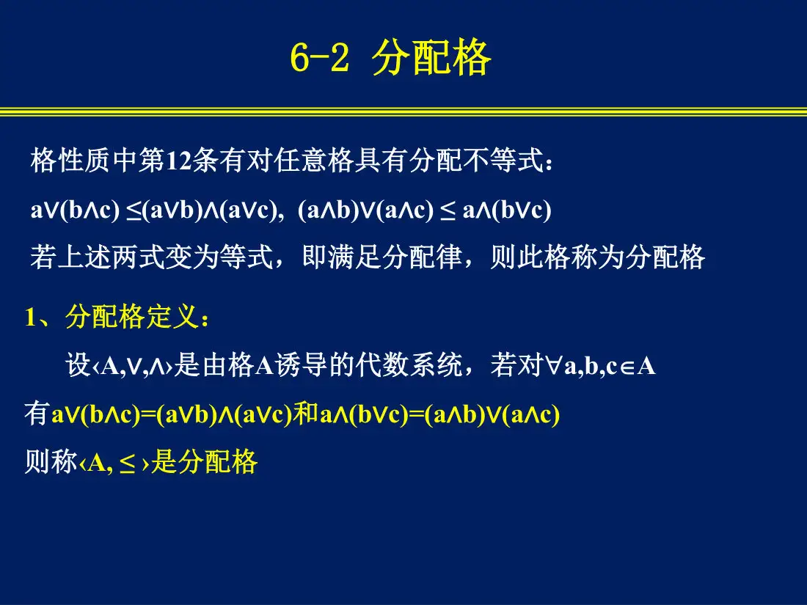

原文：

6-2 分配格

格性质中第12条有对任意格具有分配不等式：$\mathrm { R V } ( 0 ) \mathrm { A U } ( 0 ) = ( \mathrm { R V } / 0 ) \mathrm { A U } ( \mathrm { R V } / 0 ) \mathrm { R } ( \mathrm { R V } / 0 ) \mathrm { V } ( \mathrm { R V } / 0 ) \mathrm { B P } ( \mathrm { R V } / 0 ) .$ 若上述两式变为等式，即满足分配律，则此格称为分配格

1、分配格定义：设 $\angle A = \angle C = \angle C$ 是由格A诱导的代数系统，若对 $v \angle B A C = \angle A$ 有 $\mathrm { R P } ( 0 ) \mathrm { A C Q } = ( \mathrm { R P } ( 0 ) ) \mathrm { A P Q } ( 0 )$ 和 $\mathrm { P a } \mathrm { C } ( \mathrm { D } ^ { \prime } \mathrm { C } ^ { 0 } ) = \mathrm { ( e f f u b ) } \mathrm { P a } \mathrm { C } ( \mathrm { C } ^ { 0 } \mathrm { A C } ^ { 0 } )$ 则称‹A, ≤ ›是分配格

### 6-2 分配格

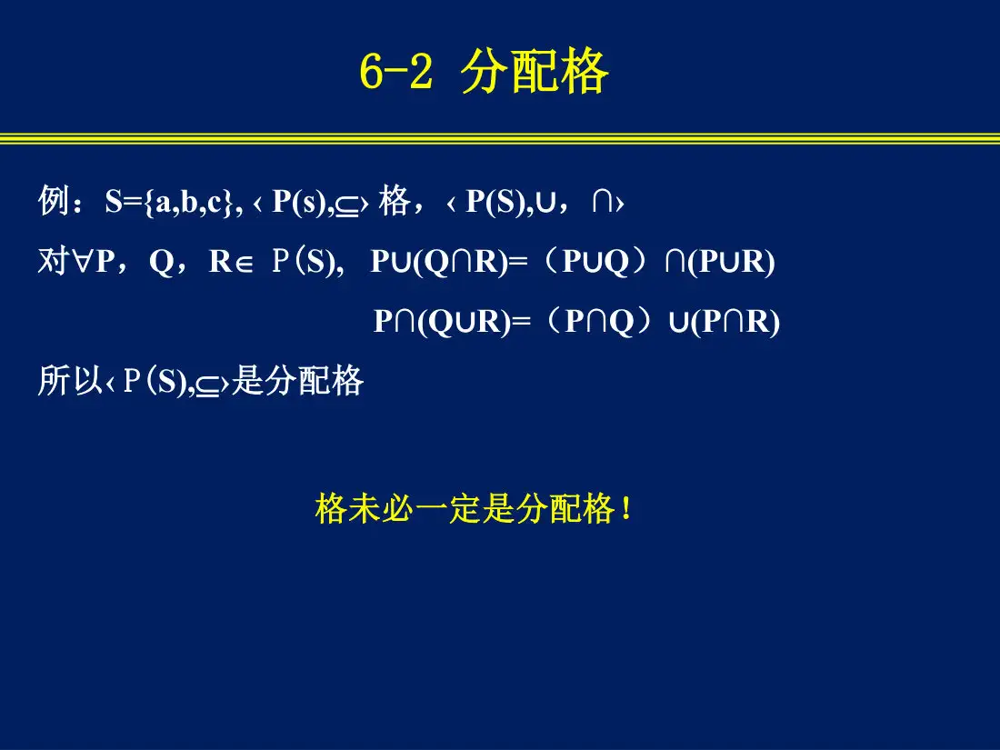

原文：

6-2 分配格

例： $\therefore \angle B = \angle B = \angle C = 9 0 ^ { \circ }$ 格， $1 2 \times ( 5 ) \times 1 0 = 1 0 0$ 对∀P，Q，R∈ P(S)，PU(Q∩R)=(PUQ)∩(PUR)P∩(Q∪R)=（P∩Q）∪(P∩R)所以‹ P(S),›是分配格

格未必一定是分配格！

### 6-2 分配格

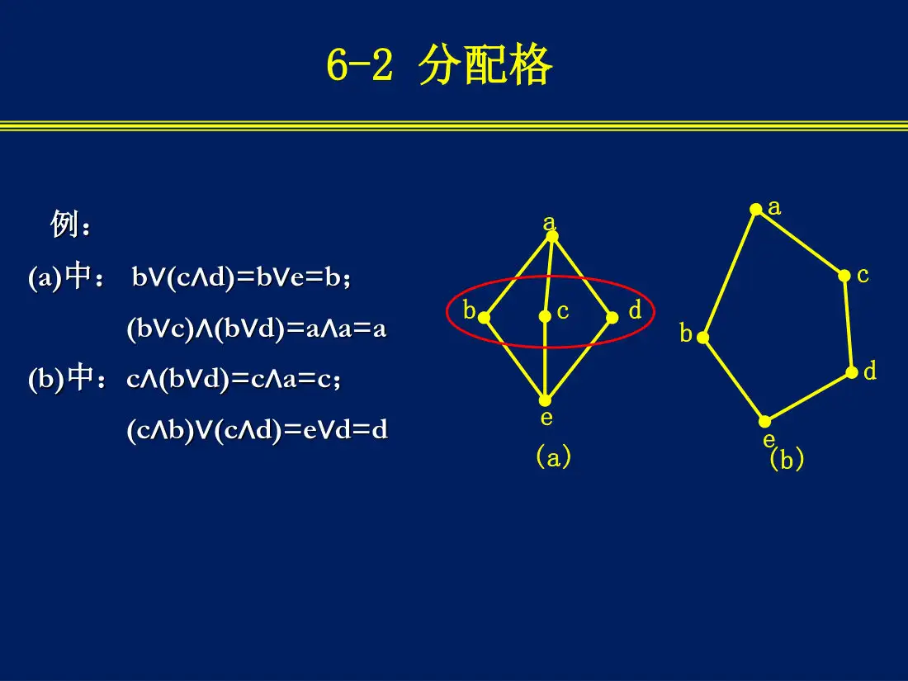

原文：

6-2 分配格

例：

(a)中： $\textcircled { 2 } \because ( \textcircled { 2 } \times \textcircled { 6 } ) = \textcircled { 2 } \times \textcircled { 2 } = \textcircled { 2 }$ $( ( \mathrm { { a } } \mathrm { { y } } / \Theta ) / \mathrm { { A } } ( 0 ) \mathrm { { y } } / \Theta ) = \mathrm { { q } } / \mathrm { { A } } \mathrm { { \varphi } } = \mathrm { { q } } / \mathrm { { q } }$

(b)中： $\mathrm { ( 9 A ( 1 0 ) , 7 0 ) } = \mathrm { ( 9 A 4 ) } = \mathrm { ( 9 }$ $( \mathrm { e } / \mathrm { A D } ) \chi ( \mathrm { e } / \mathrm { A C } ) = \mathrm { e } / \mathrm { C e } = 0$

### 6-2 分配格

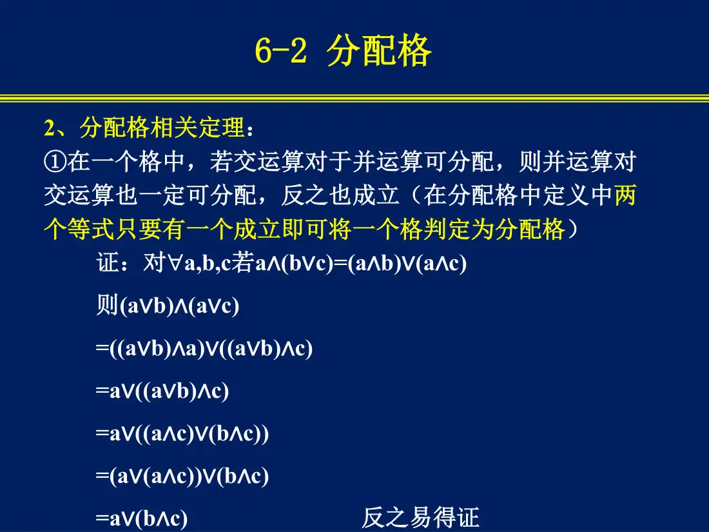

原文：

6-2 分配格

2、分配格相关定理：

①在一个格中，若交运算对于并运算可分配，则并运算对交运算也一定可分配，反之也成立（在分配格中定义中两个等式只要有一个成立即可将一个格判定为分配格）

证：对 $\yen 123,456$ c若 $9 \times ( 1 2 \times 9 ) = ( 9 \times 1 2 ) \times ( 9 \times 9 )$

则 $\left( \mathbf { e m } \mathbf { \ n u m } \mathbf { a m } \mathbf { e m } \mathbf { \ n u m } \right)$

=((a∨b)∧a)∨((a∨b)∧c)

=a∨((a∨b)∧c)

=a∨((a∧c)∨(b∧c))

=(a∨(a∧c))∨(b∧c)

=a∨(b∧c)

反之易得证

### 6-2 分配格

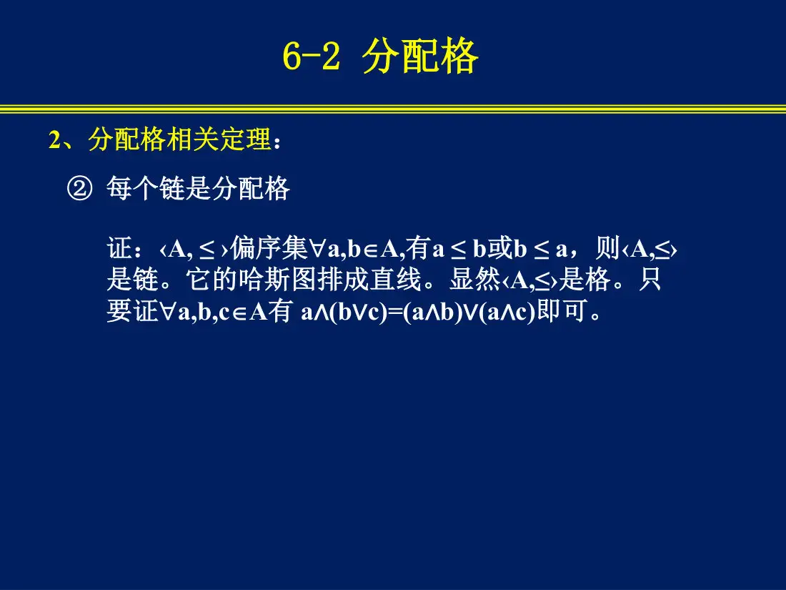

原文：

6-2 分配格

2、分配格相关定理：

② 每个链是分配格

证： $\textcircled { 4 } \textcircled { = } \textcircled { = } \textcircled { = } \textcircled { = }$ 偏序集 $\forall k \operatorname { l i m } \equiv \operatorname { l a }$ ,有 $\bf \delta Q$ 或 $\bf \delta m \leq \bf \delta Q$ 则 $\angle B = \angle C$ 是链。它的哈斯图排成直线。显然 $0 . 5 \dot { 2 } < 0 . 5 \dot { 2 }$ 是格。只 要证 $v \angle B D C = \angle A$ 有 $g _ { \mathrm { A } } ( 0 ) ^ { \prime } ( 9 ) = ( 9 \mathrm { A D } ) ^ { \prime } / ( 9 ) ^ { \prime }$ 即可。

### 6-2 分配格

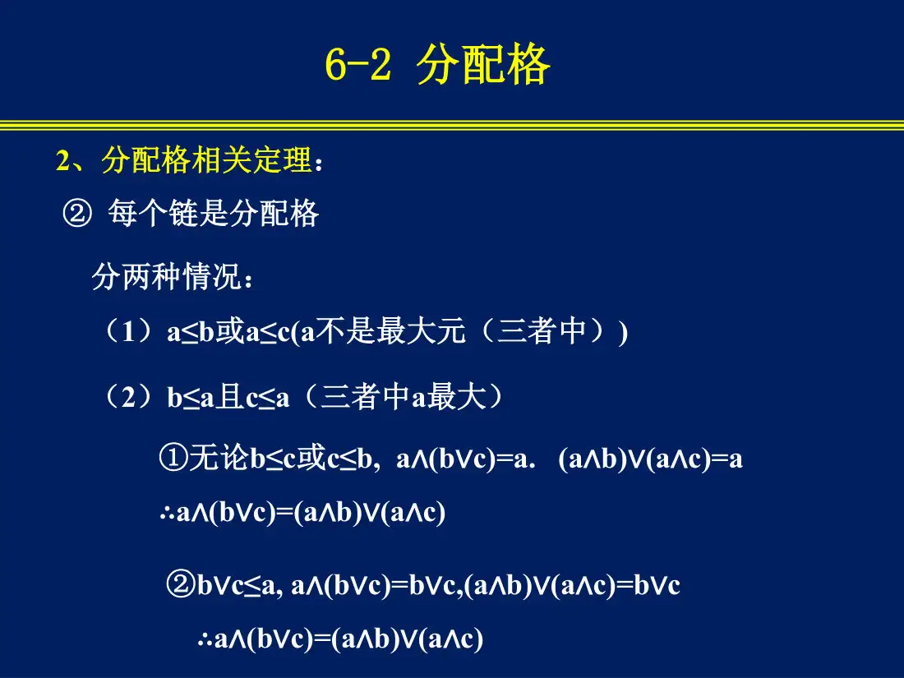

原文：

6-2 分配格

2、分配格相关定理：

② 每个链是分配格

分两种情况：

（1） $\mathrm { \underline { { \ell } } \underline { { \ l } } \underline { { \ell } } }$ 或 $\bf \delta Q E \cong \bf \delta Q ( \bf \delta Q )$ 不是最大元（三者中）)

（2）b≤a且c≤a（三者中a最大）

①无论b≤c或c≤b, $9 \times ( 1 0 \times 1 0 ) = 9 . 7 6 ( c m )$ $( \mathrm { g } \mathbf { \eta } _ { \mathrm { A D } } ) \mathbf { \eta } _ { \mathrm { A } } ( \mathrm { e } \mathbf { \eta } _ { \mathrm { A } } ( \mathbf { \eta } _ { \mathrm { g } } ) = \mathbf { \eta } _ { \mathrm { i } } )$ $\mathrm { S i g / A ( 1 ) , } \mathrm { ( g / a / ) = ( g / a / ) / ( e / a / ) }$

② $1 ) V _ { 1 } ( 5 - 5 ) = V _ { 2 } ( 1 0 ^ { 3 } / 6 ) = 1 2 V _ { 1 } ( 9 - 6 V _ { 1 } ) ) V _ { 2 } ( 9 / 6 ) = 1 2 V _ { 2 } ( 9 \times 1 0 ^ { 3 } ) = 1 2 V _ { 2 } ( 9 0 \Omega )$

∴a∧(b∨c)=(a∧b)∨(a∧c)

### 6-2 分配格

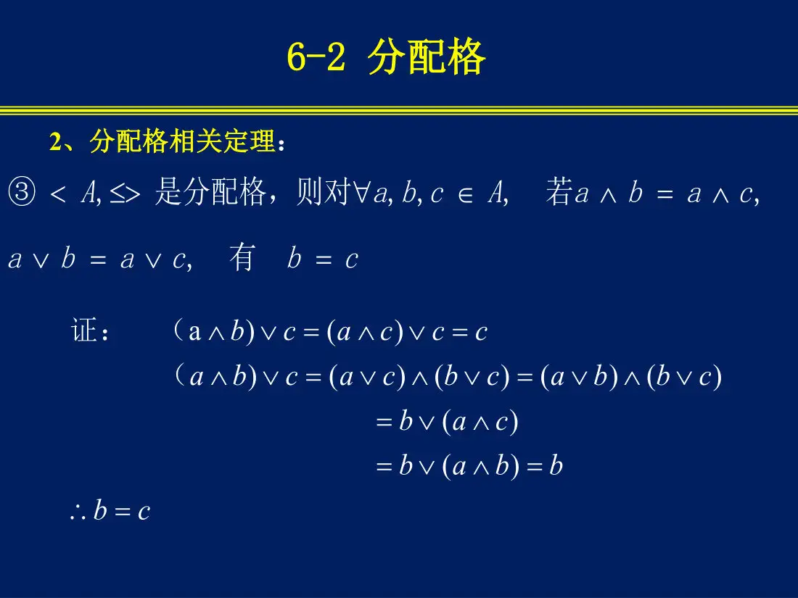

原文：

6-2 分配格

2、分配格相关定理：

$\textcircled { 6 }$ 是分配格，则对∀ $\textcircled { 2 } \textcircled { 2 } \textcircled { 4 } \textcircled { 4 } \textcircled { 2 } \textcircled { 2 } \textcircled { 2 } \textcircled { 2 } \textcircled { 2 }$ 若 $\textcircled { 2 } A _ { 1 } : ( 0 ) = \textcircled { 2 } A _ { 2 } : ( 0 )$

$\textcircled { 2 } N a O _ { 3 } = N a O _ { 3 } = N a O _ { 3 } = N a O _ { 3 }$ 有 $[ \pmb { \bar { \theta } } ] = \pmb { \bar { \theta } }$

证：

$$
(a \wedge b) \vee c = (a \wedge c) \vee c = c
$$

$$
\begin{array}{r l} (a \land b) \lor c & = (a \lor c) \land (b \lor c) = (a \lor b) \land (b \lor c) \\ & = b \lor (a \land c) \\ & = b \lor (a \land b) = b \end{array}
$$

$$
\therefore b = c
$$

### 6-2 分配格

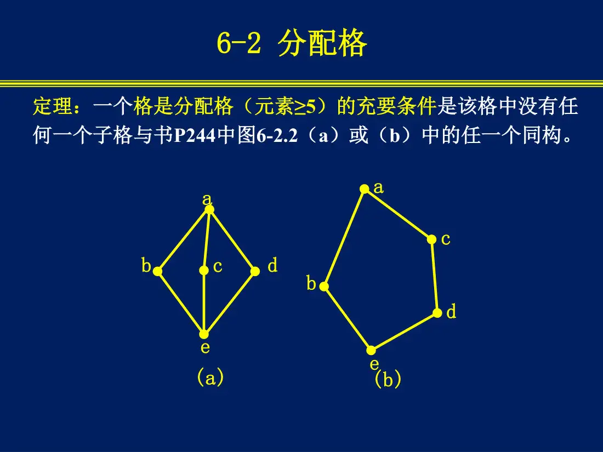

原文：

6-2 分配格

定理：一个格是分配格（元素≥5）的充要条件是该格中没有任何一个子格与书P244中图6-2.2（a）或（b）中的任一个同构。

### 6-2 分配格

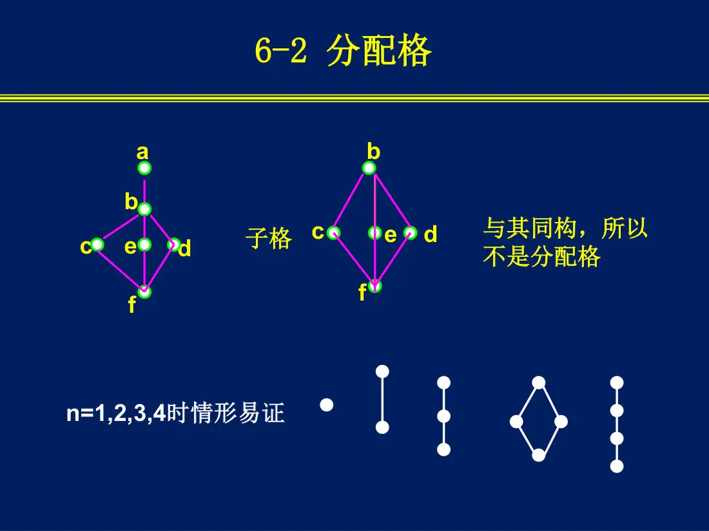

原文：

6-2 分配格

子格

与其同构，所以不是分配格

n=1,2,3,4时情形易证

### 6-2 分配格

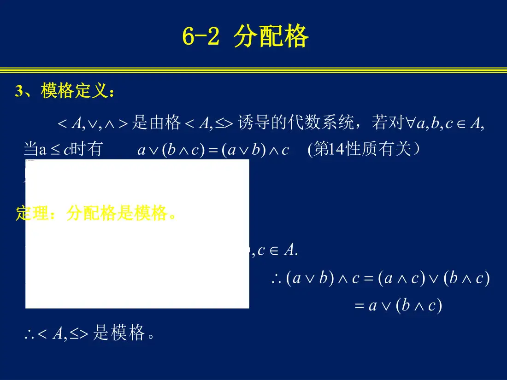

原文：

6-2 分配格

3、模格定义：

$\angle C = \angle C = \angle C = \angle C$ 是由格 $\angle A = \angle C = 9 0 ^ { \circ }$ 诱导的代数系统，若对 $V _ { 1 } ( 0 ) _ { 5 } ( 0 ) _ { 5 } ( 0 ) = V _ { 2 } ( 0 ) _ { 5 }$ 当 $\boxed { 1 } \boxed { 2 } \boxed { 1 }$ 时有 $( 1 ) ( 1 0 \times 9 ) = ( 1 0 \times 1 0 ) ( 1 0 \times 1 0 )$ (第14性质有关)

定理：分配格是模格。

$$
, c \in A.
$$

$$
\begin{array}{c} \therefore (a \lor b) \land c = (a \land c) \lor (b \land c) \\ = a \lor (b \land c) \end{array}
$$

$a _ { 0 } = - \frac { 1 } { 2 } \sqrt { 2 } = - \frac { 1 } { 2 }$ 是模格。

### 6-2 分配格

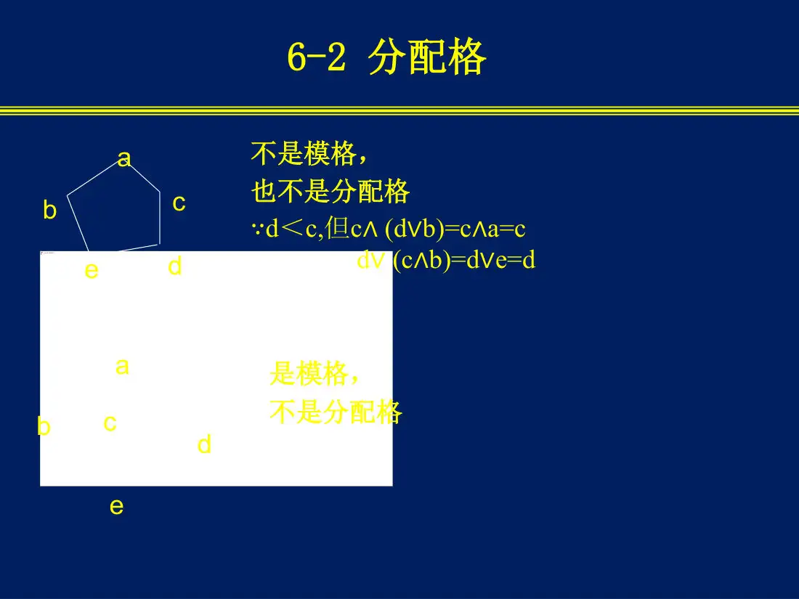

原文：

6-2 分配格

不是模格，也不是分配格$0 . 0 1 \dot { 0 } < 0 . 0 1 \dot { 0 }$ 但c∧ $\langle \langle \langle \langle \nabla / \cdot ( ) \rangle = \langle \langle \nabla / \cdot ( ) \rangle = 0$ d∨ (c∧b)=d∨e=d

是模格，不是分配格

### 6-2 分配格

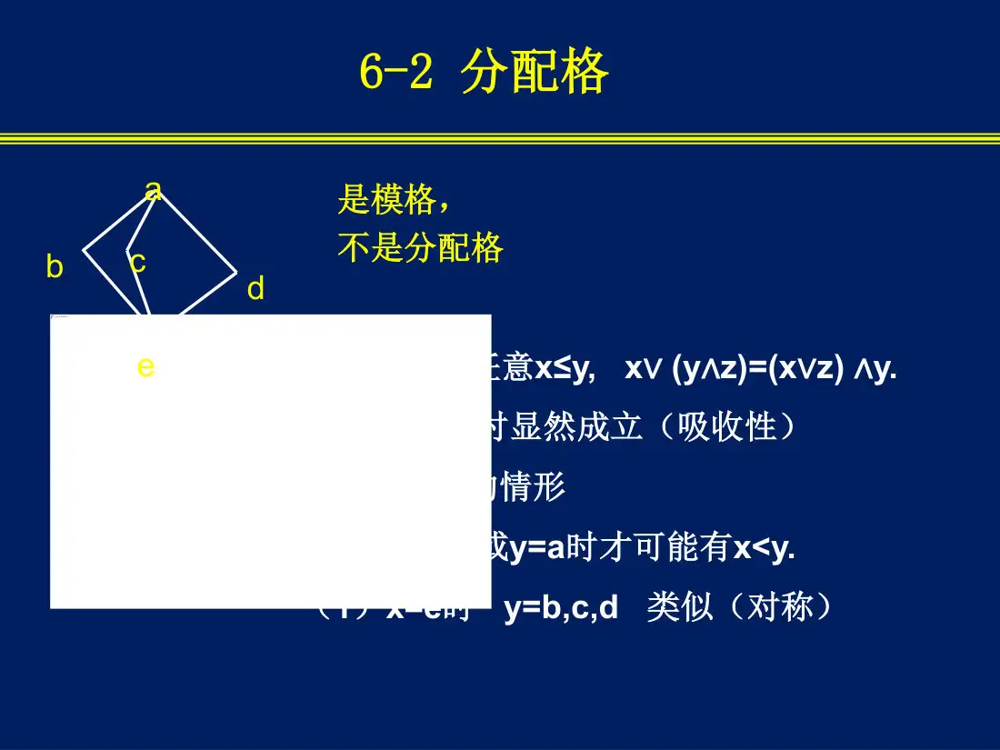

原文：

6-2 分配格

是模格，不是分配格

意x≤y, $\Delta A C B \cong \Delta C B C ( A A ) \Delta B$

时显然成立（吸收性）

情形

或y=a时才可能有x<y.

$\mathbb { V } \mathbb { = } \mathbb { 0 } \mathbb { \odot } \mathbb { 0 }$ 类似（对称）

### 6-2 分配格

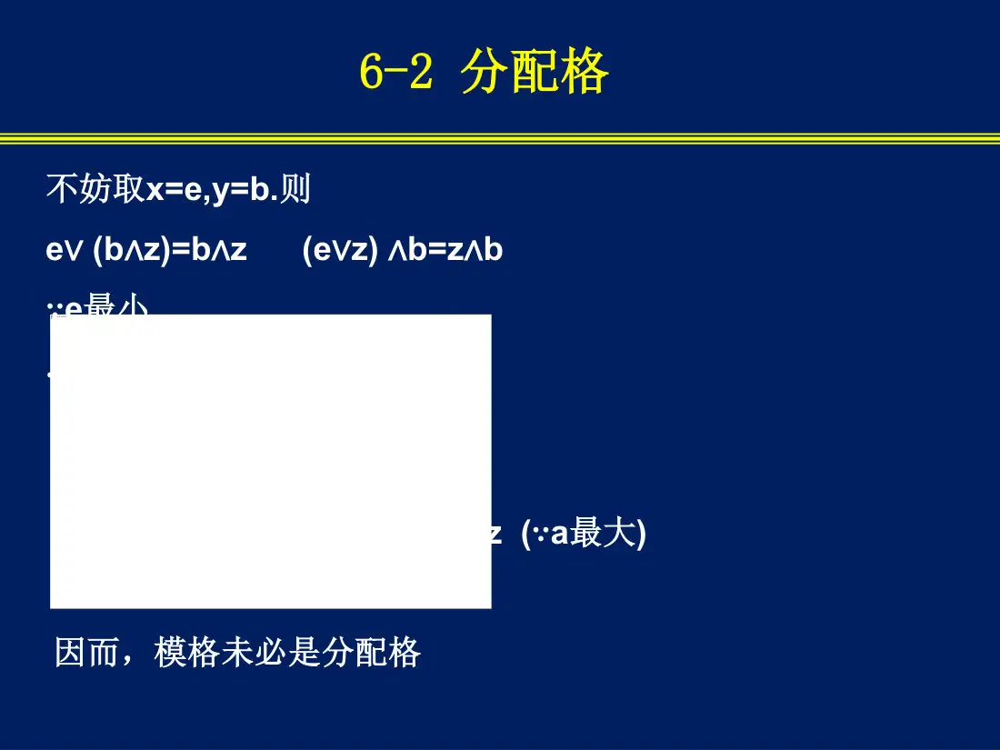

原文：

6-2 分配格

不妨取 $\pmb { \mathrm { v } } \pmb { \mathrm { = } } \pmb { \mathrm { = } } \pmb { \mathrm { v } } \pmb { \mathrm { = } } \pmb { \mathrm { 0 } }$ .则

$$
\mathrm{eV} (\mathrm{b} \wedge \mathrm{z}) = \mathrm{b} \wedge \mathrm{z}
$$

$$
(e \vee z) \wedge b = z \wedge b
$$

∵e最小

(∵a最大)

因而，模格未必是分配格

### 前情回顾

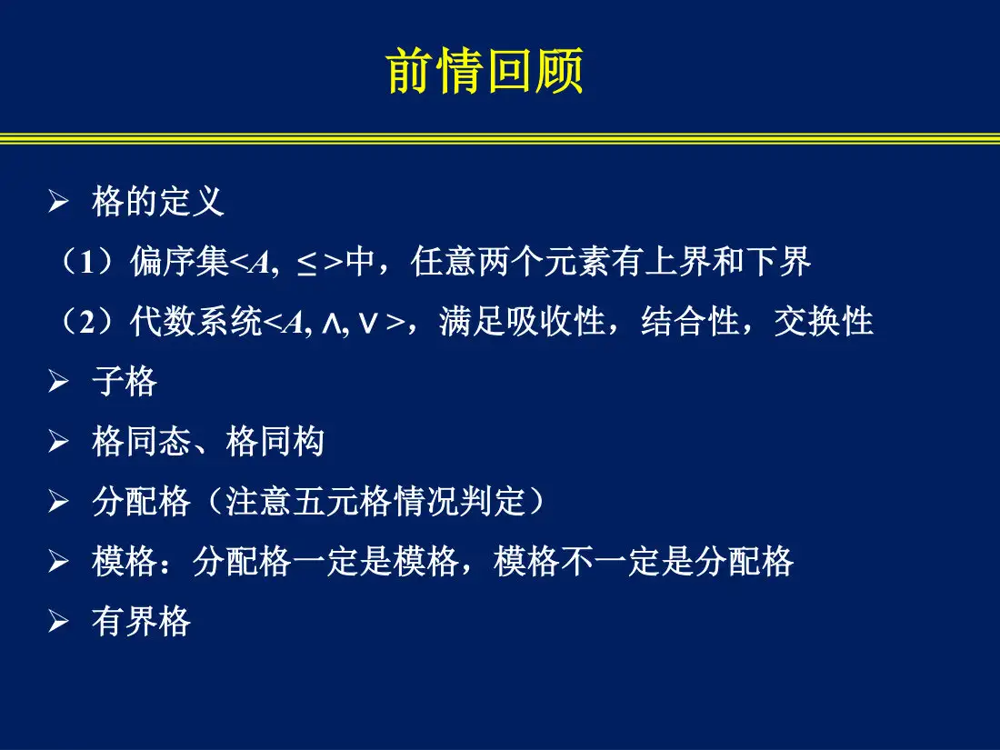

原文：

前情回顾

格的定义

（1）偏序集<A, ≤ >中，任意两个元素有上界和下界

（2）代数系统<A, ∧, ∨>，满足吸收性，结合性，交换性

子格

格同态、格同构

➢ 分配格（注意五元格情况判定）

➢ 模格：分配格一定是模格，模格不一定是分配格

有界格

### 6-3 有补格

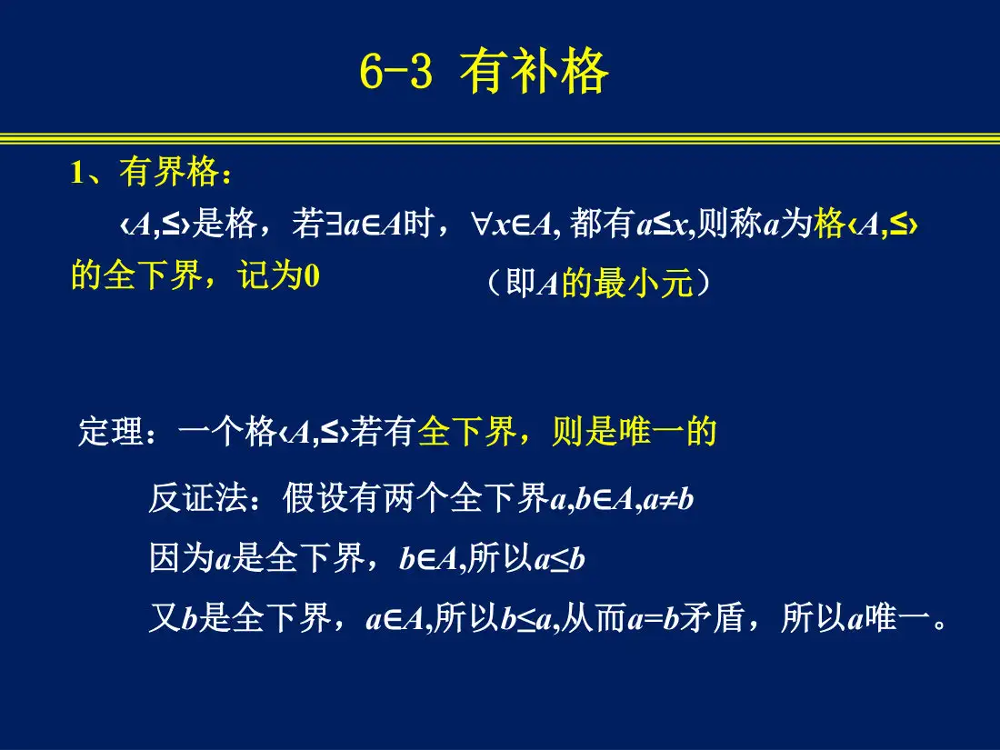

原文：

6-3 有补格

1、有界格：

<A,≤>是格，若∃a∈A时，∀x∈A,都有 $\angle B = \angle B$ 则称a为格 $\yen 1$ 的全下界，记为0 （即A的最小元）

定理：一个格‹A,≤›若有全下界，则是唯一的

反证法：假设有两个全下界 $\because \angle B C D = \angle C E = 1 0$

因为a是全下界， $l n \equiv r _ { 4 }$ ,所以 $\textcircled { 1 } \cong \textcircled { 1 }$

又b是全下界， $U _ { 1 } = U _ { 2 } ( \Omega )$ 所以 $1 0 2 \%$ 从而a=b矛盾，所以a唯一。

### 6-3 有补格

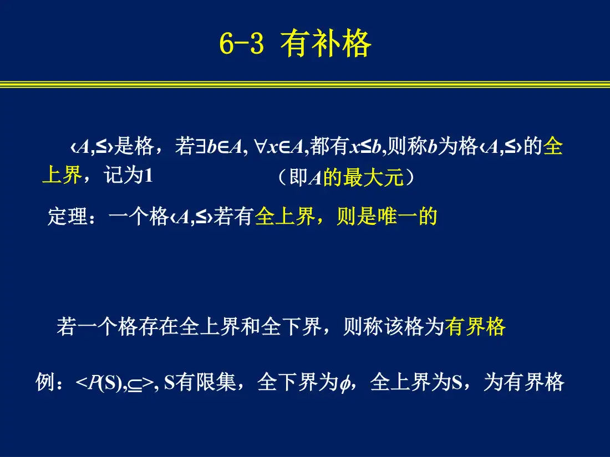

原文：

6-3 有补格

A,≤>是格，若∃b∈A,∀x∈A,都有x≤b,则称b为格<A,≤>的全上界，记为1 （即A的最大元）

定理：一个格‹A,≤›若有全上界，则是唯一的

若一个格存在全上界和全下界，则称该格为有界格

例：<P(S),⊆>,S有限集，全下界为φ，全上界为S，为有界格

### 6-3 有补格

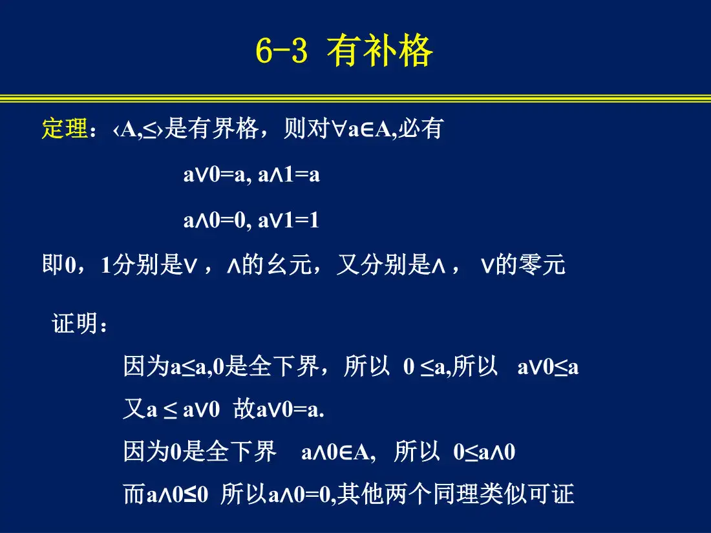

原文：

6-3 有补格

定理： $\Delta A$ 是有界格，则对 $\mathbf { w e t = } \mathbf { w } _ { \mathbf { a } }$ 必有

$$
\mathrm{a} \vee 0 = \mathrm{a}, \mathrm{a} \wedge 1 = \mathrm{a}
$$

$$
\mathrm{a} \wedge 0 = 0, \mathrm{a} \vee 1 = 1
$$

即0，1分别是∨ ，∧的幺元，又分别是∧ ， ∨的零元

证明：

因为 $\mathrm { e s e n }$ 是全下界，所以 $0 . 8 9$ 所以 $\bf { 9 0 0 }$

又 $\bf { Q } \breve { \bf { E } } \breve { \bf { e } } \bf { M } \bar { \bf { U } }$ 故 $\bf { \delta E M } \delta \bf { \equiv } \bf { \otimes }$ .

因为0是全下界 $\mathrm { \Delta P A ( I I ) = } \mathrm { \Delta }$ , 所以 $\mathbb { D } \mathbb { \breve { s o m } }$

而 $9 \times 0 . 5 = 0$ 所以 $\mathfrak { P } \mathfrak { M } \mathfrak { V } \equiv \mathfrak { V }$ ,其他两个同理类似可证

### 6-3 有补格

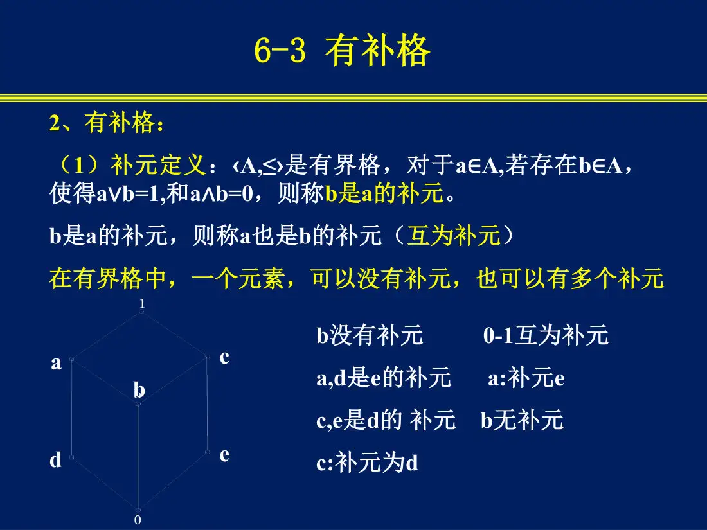

原文：

6-3 有补格

2、有补格：

（1）补元定义：‹A,≤›是有界格，对于a∈A,若存在b∈A，使得a∨b=1,和a∧b=0，则称b是a的补元。

b是a的补元，则称a也是b的补元（互为补元）

在有界格中，一个元素，可以没有补元，也可以有多个补元

b没有补元 0-1互为补元

a,d是e的补元 a:补元e

c,e是d的 补元 b无补元

c:补元为d

### 6-3 有补格

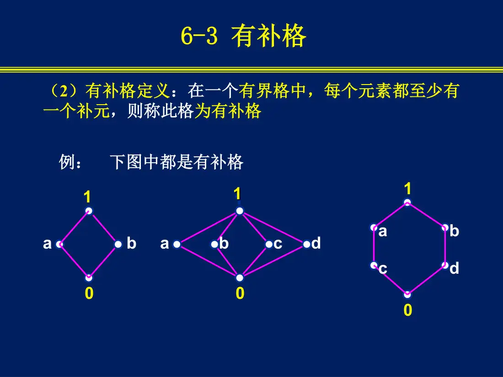

原文：

6-3 有补格

（2）有补格定义：在一个有界格中，每个元素都至少有个补元，则称此格为有补格

例： 下图中都是有补格

### 6-3 有补格

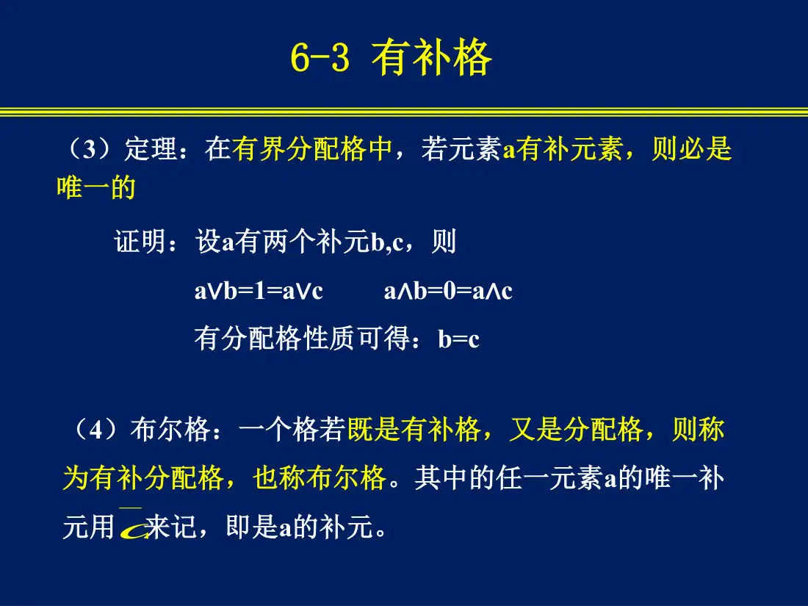

原文：

6-3 有补格

（3）定理：在有界分配格中，若元素a有补元素，则必是唯一的

证明：设a有两个补元b,c，则

$$
\mathrm{aVb=1=aVc}
$$

$$
\mathrm{a} \wedge \mathrm{b} = 0 = \mathrm{a} \wedge \mathrm{c}
$$

有分配格性质可得：b=c

（4）布尔格：一个格若既是有补格，又是分配格，则称为有补分配格，也称布尔格。其中的任一元素a的唯一补元用 a来记，即是a的补元。

### 小 结

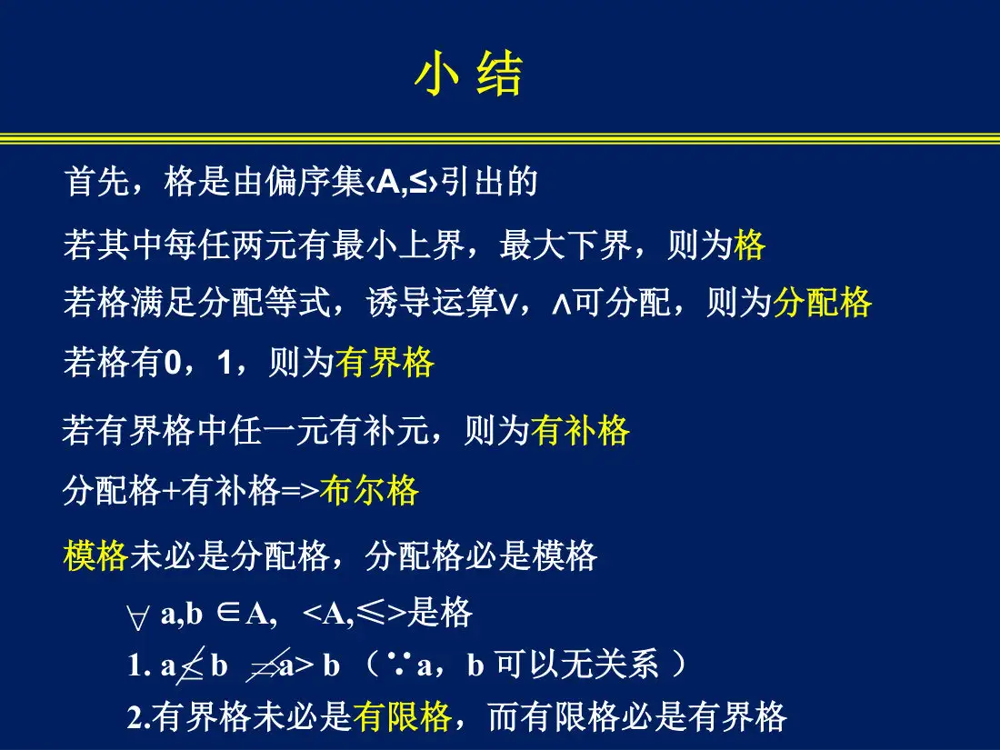

原文：

小 结

首先，格是由偏序集‹A,≤›引出的

若其中每任两元有最小上界，最大下界，则为格

若格满足分配等式，诱导运算∨，∧可分配，则为分配格

若格有0，1，则为有界格

若有界格中任一元有补元，则为有补格

分配格+有补格=>布尔格

模格未必是分配格，分配格必是模格

a,b ∈A, <A,≤>是格

1. a b a> b （∵a，b 可以无关系 ）

2.有界格未必是有限格，而有限格必是有界格

### 小 结

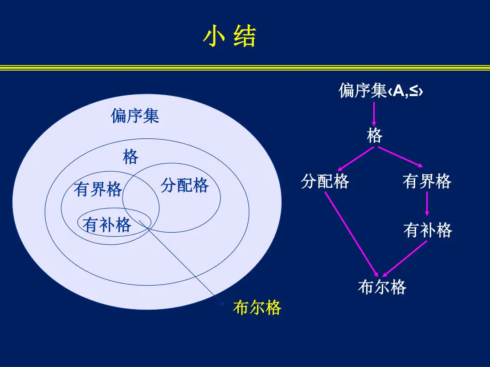

原文：

小 结

偏序集‹A,≤›

偏序集

格

格

有界格

分配格

分配格

有界格

有补格

有补格

布尔格

布尔格

### 6-4 布尔代数

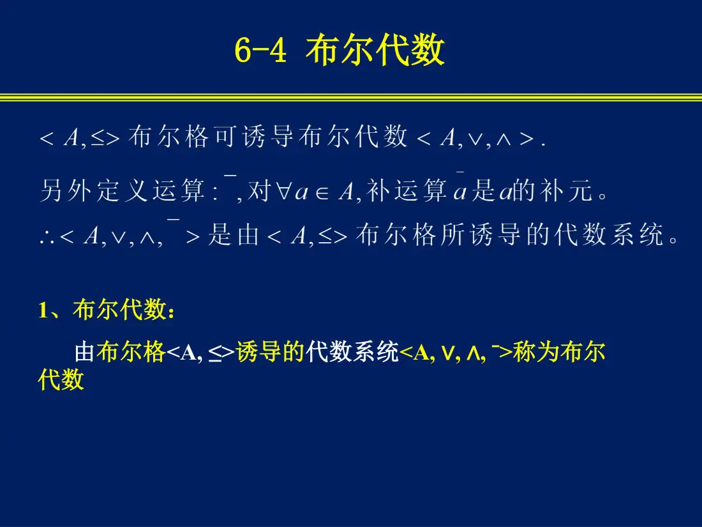

原文：

6-4 布尔代数

< A,≤> 布尔格可诱导布尔代数 < A, ∨, ∧ >.

另外定义运算：¯,对∀a∈A,补运算α是a的补元。

∴< A,∨,^,> 是由 < A,≤> 布尔格所诱导的代数系统。

1、布尔代数：

由布尔格<A, ≤>诱导的代数系统<A, ∨, ∧, ˉ>称为布尔代数

### 6-4 布尔代数

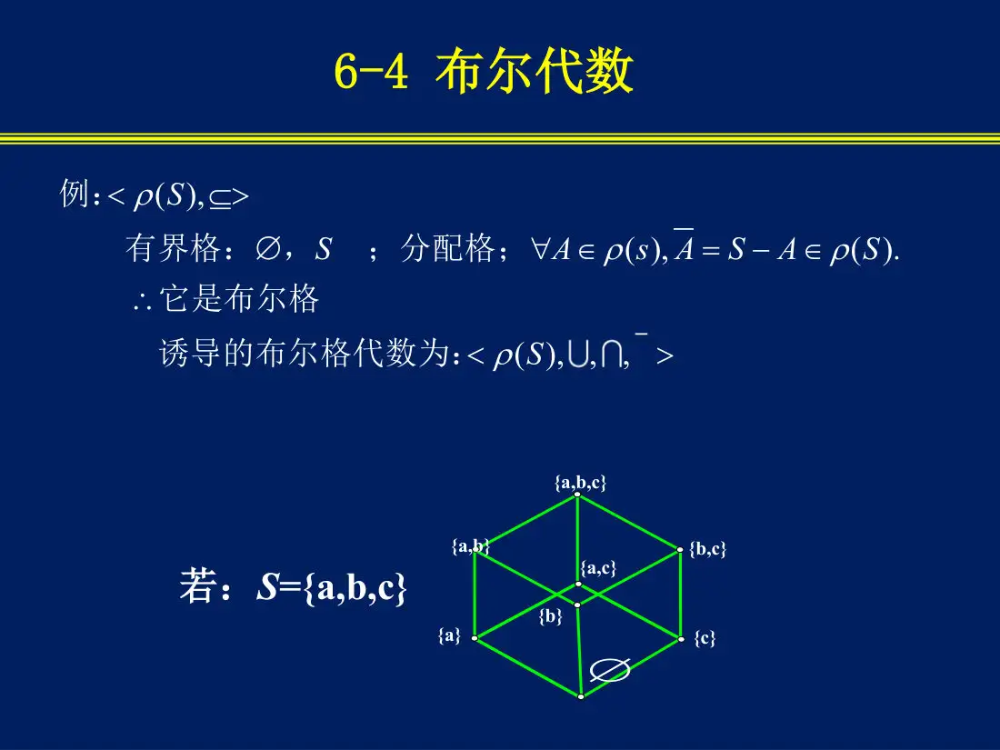

原文：

6-4 布尔代数

例： $\angle C D E = \angle C A E = 9 0 ^ { \circ }$

有界格： $\bigcirc$ ；分配格； $\because . ( - \sqrt { 2 } \textcircled { < } ) ^ { 2 } \times ( - \sqrt { 2 } - 1 ) ^ { 2 } \times ( - \sqrt { 2 } \times 2 )$

$\mathbf { a }$ 它是布尔格

诱导的布尔格代数为 $\angle C A B = \angle C A B = 9 0 ^ { \circ }$

若： $S = \Re \Re \Re ( \Psi )$

### 6-4 布尔代数

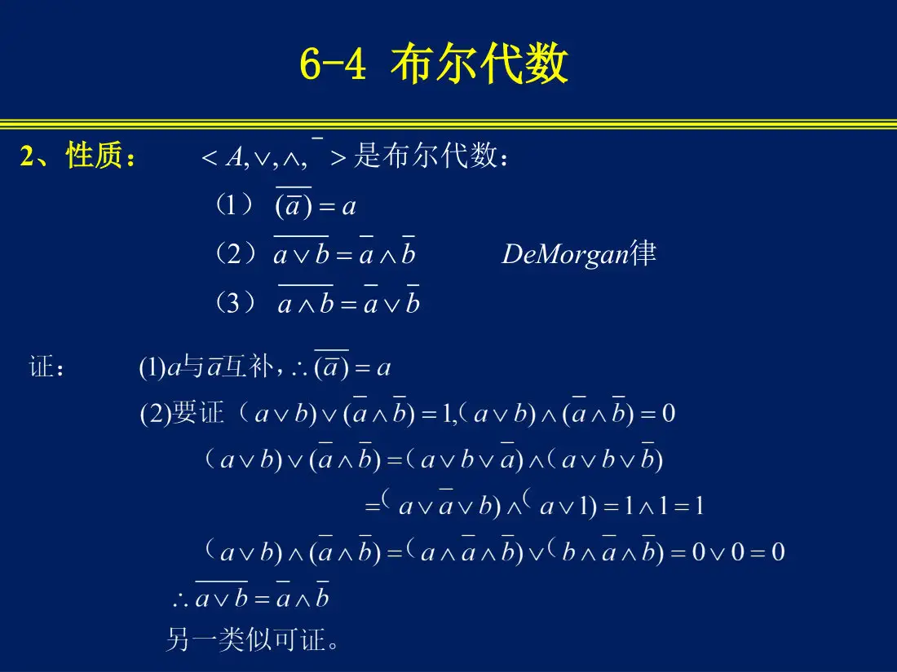

原文：

6-4 布尔代数

2、性质： $\angle A = \angle C = \angle C$ > 是布尔代数：(1) $( \pmb { \mathscr { m } } ) = \pmb { \mathscr { m } }$ (2) $\textcircled { 1 } A ^ { \prime } ( 0 ) = \textcircled { 1 } A ^ { \prime } ( 0 )$ DeMorgan律(3) $\textcircled { 1 } \times \textcircled { 2 } \times \textcircled { 2 } \times \textcircled { 2 }$

证： (1)a与ā互补， $\therefore \angle C A E = \angle C$

(2)要证 $( 1 ) ( 1 0 0 0 0 0 0 0 0 0 0 0 0 0 0 0 0 0 0 0 0 0 0 0 0 0 0 0 0 0 0 0 0 0 0 0 0 0 0 0 0 0 0 0 0 0 0 0 0 0 0 0 0 0 0 0 0 0 0 0 0 0 0 0 0 0 0 0 0 0 0 0 0 0 0 0 0 0 0 0 0 0 0 0 0 0 0 0 0 0 0 0 0 0 0 0 0 0 0 0 0 0 0 0 0 0 0 0 0 0 0 0 0 0 0 0 0 0 0 0 0 0 0 0 0 0 0 0 0 0 0 0 0 0 0 0 0 0 0 0 0 0 0 0 0 0 0 0 0 0 0 0 0 0 0 0 0 0 0 0 0 0 0 0 0 0 0 0 0 0 0 0 0 0 0 0 0 0 0 0 0 0 0 0 0 0 0 0 0 0 0 0 0 0 0 0 0 0 0 0 0 0 0 0 0 0 0 0 0 0 0 0 0 0 0 0 0 0 0 0 0 0 0 0 0 0 0 0 0 0 0 0 0 0 0 0 0 0 0 0 0 0 0 0 0 0 0 0 0 0 0 0 0 0 0 0 0 0 0 0 0 0 0 0 0$ $( 1 . 1 2 ) \times ( 1 . 1 2 ) = ( 1 . 1 2 ) ( 1 . 1 2 ) ( 1 . 1 2 ) ( 1 . 1 2 ) ( 1 . 1 2 )$ $= ( a \times ( a + b ) ) ( a \times b ) = ( b \times b ) ( b = 1 )$ $( 1 , 1 ) ( 1 , 1 , 1 ) = ( 1 , 1 , 1 , 1 ) ( 1 , 1 , 1 , 1 ) = ( 1 , 1 , 1 , 1 , 1 ) = ( 1 , 1 , 1 , 1 , 1 )$ $\frac { 1 } { 2 } ( \textcircled { 1 } \times \textcircled { 1 } \times \textcircled { 2 } \times \textcircled { 2 } \times \textcircled { 2 }$ 另一类似可证。

### 6-4 布尔代数

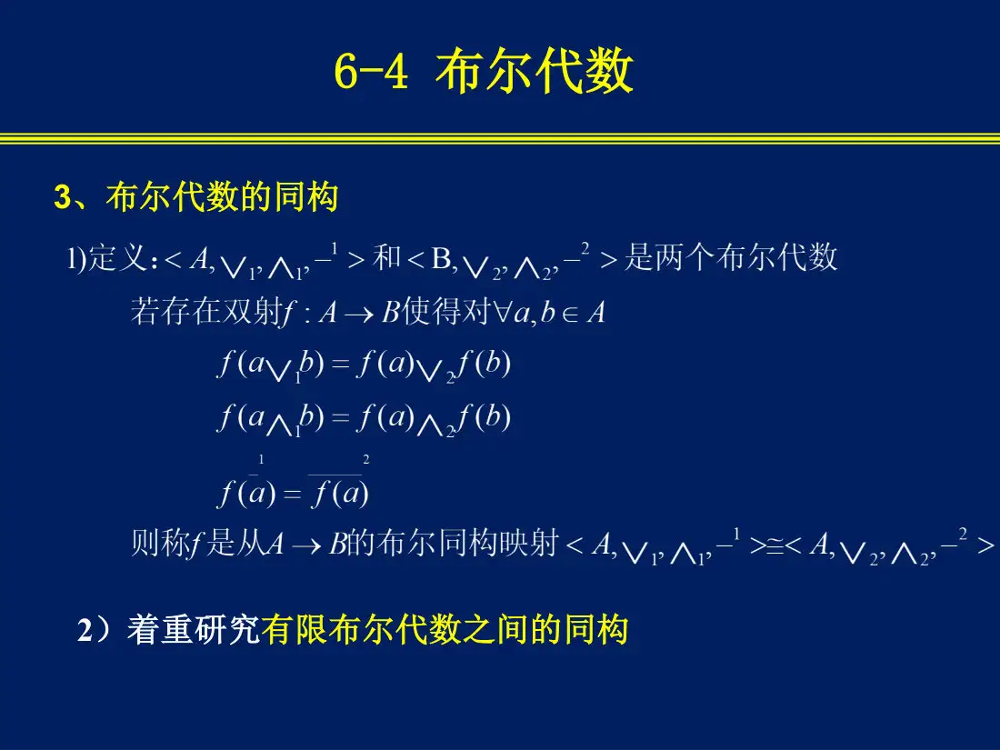

原文：

6-4 布尔代数

3、布尔代数的同构

1)定义 $\angle A C E = \angle B A C = \angle C A B = \angle C A B = 9 0 ^ { \circ }$ >是两个布尔代数 若存在双射f: A→ B使得对 $\langle \langle \langle \pmb { \mathscr { q } } | \pmb { \mathscr { b } } | \leq \rangle _ { \pmb { \mathscr { a } } } |$ $1 \times ( 1 0 \times 1 0 ) = 1 \times ( 1 0 ) = 1 \times ( 1 0 )$ f(a∧b) = f(a)∧₂f (b) 2 f (a) = f (a) 则称f是从A → B的布尔同构映射 $3 . 1 \times 1 0 ^ { 3 } k g \times 2 = 3 . 1 5 ( c m ^ { 3 } )$

2）着重研究有限布尔代数之间的同构

### 6-4 布尔代数

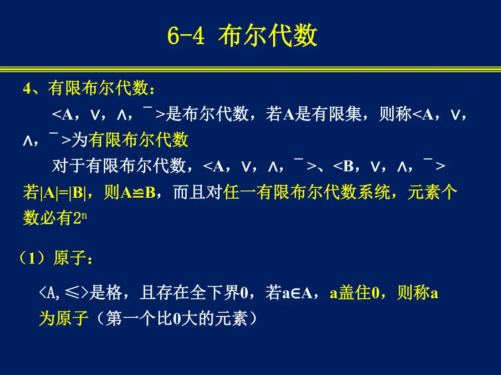

原文：

6-4 布尔代数

4、有限布尔代数：

$\mathbf { \nabla } \psi _ { 4 } ( \mathbf { \vec { a } } ) = \mathbf { \nabla } \psi _ { 4 } ( \mathbf { \vec { a } } )$ ¯ >是布尔代数，若A是有限集，则称<A，∨，

∧，¯ >为有限布尔代数

对于有限布尔代数， $\angle B A C = \angle C A B = \angle C A B = \angle C A B = \angle C$ 若|A|=|B|，则 $\pmb { \bigtriangledown } \equiv \pmb { \bigtriangledown } \ b$ 而且对任一有限布尔代数系统，元素个 数必有2n

（1）原子：

<A,≤>是格，且存在全下界0，若a∈A，a盖住0，则称a为原子（第一个比0大的元素）

### 6-4 布尔代数

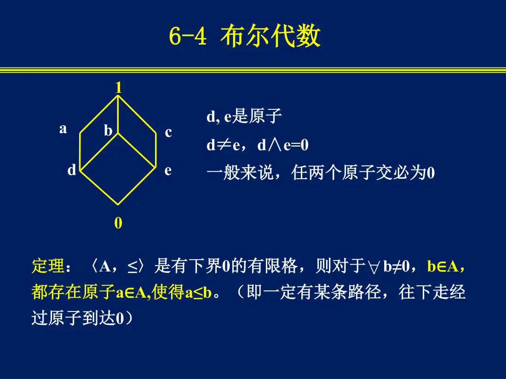

原文：

6-4 布尔代数

d, e是原子$\angle D E = \angle A D A = 1 2$ 一般来说，任两个原子交必为0

定理：〈A，≤〉是有下界0的有限格，则对于 $\overline { { \overline { { \mathbf { v } } } } } \mathbf { \widetilde { \mathbf { \Gamma } } } [ \mathbf { | \widetilde { \mathbf { v } } _ { \overline { { \mathbf { v } } } } ^ { 2 } } \mathbf { \widetilde { \mathbf { \Gamma } } } ]$ $\lvert \mathbf { \overline { { I } } } \mathbf { \equiv } \mathbf { \overline { { I } } } \mathbf { \bar { \Delta } }$ 都存在原子 $\mathrm { P I } \equiv \mathrm { P A }$ ,使得a≤b。（即一定有某条路径，往下走经过原子到达0）

### 6-4 布尔代数

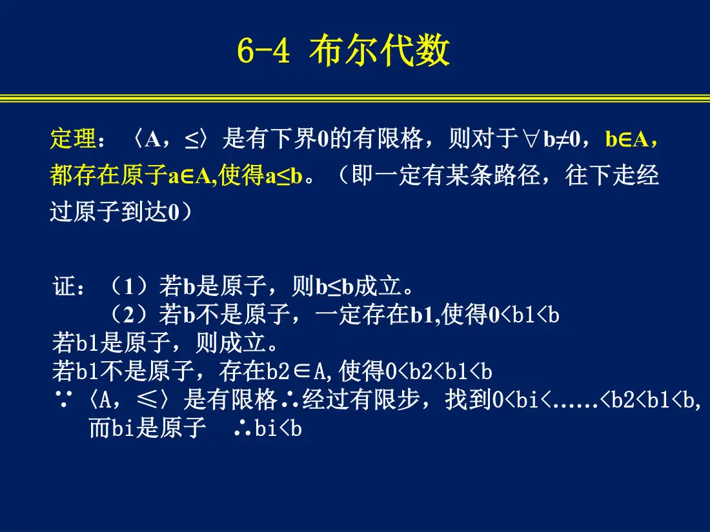

原文：

6-4 布尔代数

定理：〈A，≤〉是有下界0的有限格，则对于 b≠0，b∈A，都存在原子a∈A,使得a≤b。（即一定有某条路径，往下走经过原子到达0）

证：（1）若b是原子，则b≤b成立。

（2）若b不是原子，一定存在b1,使得0<b1<b若b1是原子，则成立。若b1不是原子，存在b2∈A,使得0<b2<b1<b∵〈A，≤〉是有限格∴经过有限步，找到 $( 0 ) 2 ( 0 ) ( - 1 0 ) ( - 1 0 ) ( - 1 0 ) ( - 1 0 ) ( - 1 0 )$ 而bi是原子 ∴bi<b

### 6-4 布尔代数

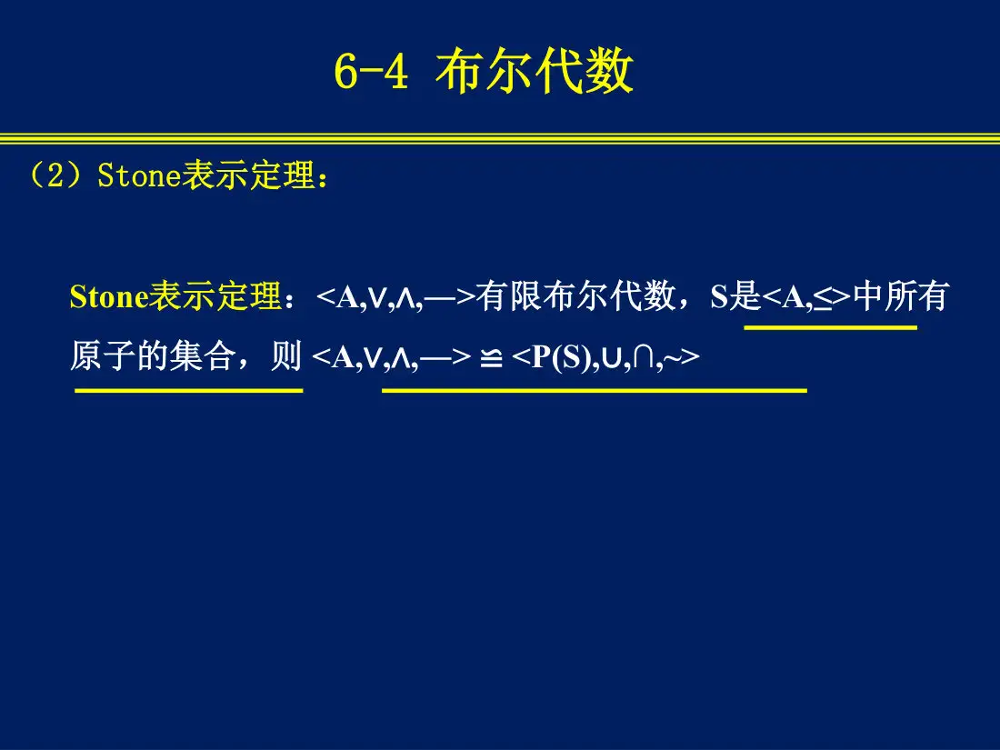

原文：

6-4 布尔代数

（2）Stone表示定理：

令 $S$ 为 $\langle A,\le\rangle$ 中全部原子的集合，则有限布尔代数满足 $\langle A,\vee,\wedge,\neg\rangle\cong\langle\mathcal P(S),\cup,\cap,\sim\rangle$。

### 6-4 布尔代数

原文：

6-4 布尔代数

（3）Stone表示定理的推论：

①有限布尔格元素个数必定等于2n ，n 是原子个数，即

$$
\left| A \right| = 2 ^ {n} = \left| P (s) \right|
$$

②任何两个具有相同元素个数的有限次布尔代数是同构的

|P(S)|= |P(Q)

$$
| S | = | Q |
$$

### 6-4 布尔代数

原文：

6-4 布尔代数

（2）Stone表示定理：引理1：布尔格中，b∧ =0 b≤c(或 ∨c=1(对偶))

证：要证b≤c,只须证b∨c=c$( 2 ) ( 1 0 - 1 ) \times ( - 1 0 - 2 ) \times ( - 1 0 - 2 ) \times ( - 1 0 - 2 ) \times ( - 1 0 - 2 )$ $1 1 1 7 \div 1 5 = ( 1 0 \times 0 ) ( - 1 0 \times 0 ) ( - 1 0 \times 0 ) ( - 1 ) = ( 1 0 \times 0 ) ( - 1 ) = ( 1 0 \times 0 ) ( - 1 )$ ∴b∨c=c从而b≤c⇐ 若b≤c 则b∧ ≤c∧ =0而0是全下界 ，0≤b∧∴b∧ =0

### 6-4 布尔代数

原文：

6-4 布尔代数

（2）Stone表示定理：引理2： $1 0 0 - 1 0 0 = 1 0 0$ ‐>有限布尔代数中， $\textcircled { 1 } z \mathbf { \equiv } \mathbf { | \vec { \mu } \mathbf { = } } \mathbf { \pmb { \mu } }$ $\mathrm { \bullet } \mathrm { \bullet } \mathrm { \bullet } \mathrm { \bullet } \mathrm { \bullet } \mathrm { \bullet } \mathrm { \bullet } \mathrm { \bullet } \mathrm { \bullet }$ 是所有满足 $9 7 \div 9 = 9$ 的原子，则$| \ r | = | \ r | | \ r | | \ r | | \ r | | \ r | | \ r | | \ r | | \ r | | \ r | | \ r | | \ r | | \ r | | \ r | | \ r | | \ r | | \ r | | \ r | | \ r | | \ r | | \ r | | \ r | | \ r | | \ r | | \ r | | \ r | | \ r | | \ r | | \ r | | \ r | | \ r | | \ r | | \ r | | \ r | | \ r | | \ r | | \ r | | \ r | | \ r | | \ r | | \ r | | \ r | | \ r | | \ r | | \ r | | \ r | | \ r | | \ r | | \ r | | \ r | | \ r | | \ r | | \ r | | \ r | | \ r | | \ r | | \ r | | \ r | | \ r | | \ r | | \ r | | \ r | | \ r | | \ r | | \ r | | \ r | | \ r | | \ r | | \ r | | \ r | | \ r | | \ r | | \ r | | \ r | | \ r | | \ r | | \ r | | \ r | | \ r | | \ r | | \ r | | \ r | | \ r | | \ r | | \ r | | \ r | | \ r | | \ r | | \ r | | \ r | | \ r | | \ r | | \ r | | \ r | | \ r | | \ r | | \ r | | \ r | | \ r | | \ r | | \ r | | \ r | | \ r | | \ r | | \ r | | \ r | | \ r | | \ r | | \ r | | \ r | | \ r | | \ r | | \ r | \ r | | \ r | | \ r | | \ r | | \ r | | \ r | \ r | | \ r | | \ r | | \ r | | \ r | \ r | | \ r | | \ r | | \ r | | \ r | \ r | | \ r | | \ r | \ r | | \ r | | r | \ r | | \ r | | r \ r | | \ r | | \ r | \ r | | r | \ r | | r | \ r | | r | \ r | \ r | | r | \ r | | r | \ r | \ r | | r | \ r | r | | r | \ r | r | \ r | | r | r | \ r | | r | r | r | \ r | \ r | r | | r | r | r | \ r | r | r | r | | r \ r | r | | r | r | r | r |$ 并且这种表示是唯一的

（也就是说，任一非零元，我们可用原子来唯一表示它。）

分两部分证明：

1）引理： $( 4 ) \times ( 4 \times 2 ) \times ( 2 \times 2 )$ 有限布尔代数， $\textcircled { 1 } E \equiv \mathbf { | \vec { \omega } \vec { u } | } \equiv \mathbf { | \vec { \omega } _ { \Delta } }$ $\mathbf { \rho } _ { \mathrm { { e f f } } } ^ { \mathrm { { e f f } } } ( \mathbf { \rho } _ { \mathrm { { e f f } } } ^ { \mathrm { { e f f } } } - \mathbf { \rho } _ { \mathrm { { e f f } } } ^ { \mathrm { { e f f } } } ) ,$ k是所有满足ai≤b的原子，则 $\begin{array} { r } { \boxed { 1 } = \boxed { 1 } \boxed { 1 } \boxed { 2 } \boxed { 3 } \boxed { 2 } \boxed { 1 } \boxed { 2 } \boxed { 1 } \boxed { 2 } \boxed { 1 } \boxed { 2 } \boxed { 3 } \boxed { 2 } \boxed { 1 } \boxed { 2 } } \end{array}$

### 6-4 布尔代数

原文：

6-4 布尔代数

（2）Stone表示定理：

证：记 $0 . 0 3 \times ( - \frac { 1 } { 2 } ) \times ( - \frac { 1 } { 2 } ) \times ( - \frac { 1 } { 2 } ) \times ( - \frac { 1 } { 2 } )$ 要证b=c∵ai≤b ∴b是 $\mathbf { \dot { \varrho } }$ 的上界而c是 $\mathbf { 0 . 0 0 2 0 0 0 0 } \mathbf { 0 . 0 0 0 0 0 } \mathbf { 0 . 0 0 0 0 0 }$ 的最小上界 ∴c≤b

下证b≤c用上述引理只要证b∧ =0反证：设b∧ ≠0，则存在原子a，使得 $( 1 ) \approx 1 0$ C而b∧ ≤ b ∴a≤b,a≤而a1,a2,……ak是 ai≤b的所有原子 ∴a∈ $\textcircled { 1 } \textcircled { 1 } \textcircled { \cdot } \textcircled { 2 } \textcircled { 2 } \textcircled { \times } \textcircled { 2 } \textcircled { \times } \textcircled { 2 } \textcircled { \times } \textcircled { 2 }$ ∴a≤c而a≤ 故 $: \angle A C O = \angle D B O = \angle O$ 与a是原子矛盾 故b∧ =0 b≤c 从而b=c

### 6-4 布尔代数

原文：

6-4 布尔代数

（2）Stone表示定理：2) 表示法是唯一的b=a1∨a2∨……∨ak，假设b=b1∨b2∨……∨bt，bi（i=1……t）是原子∵bi≤b ∴bi∈ $\textcircled { 2 } \textcircled { 1 } \textcircled { \cdot } \textcircled { 2 } \textcircled { 2 } \textcircled { \cdot } \textcircled { 2 } \textcircled { \cdot } \textcircled { \cdot } \textcircled { 2 }$ $( 1 ) ( 1 2 ) \times ( 2 0 - 1 ) ( 2 1 ) = ( 1 2 ) ( 2 0 - 1 ) ( 2 0 - 1 ) ( 2 0 - 1 )$ t≤k要证 t=k 反证法假设t<k 至少存在aiai∧ =ai∧ $( 0 . 1 8 , 0 . 0 2 , 0 . 0 2 , 0 . 1 3 )$ 分配展开 (ai∧b1)∨（ai∧b2）∨……∨（ai∧bt）=（ai∧a1）∨（ai∧a2）∨……∨（ai∧ai）∨……∨（ai∧ak）∵a,b 是原子，a ≠b时，a∧b =0。∴左边=0，右边=ai，ai=0矛盾，∴t=k

### 6-4 布尔代数

原文：

6-4 布尔代数

（2）Stone表示定理：

引理3：布尔格<A,≤>中，对于任意原子 $\bf \delta Q \equiv \delta L$ C 另一个元素$1 2 \div 0 . 0 = 0 . 0$ ，则 $9 \times 9 = 9$ ,和a≤ 中有且仅有一个成立。

证：（1）假设 $0 . 1 2 \times 1 0 ^ { 3 } k g = 1 0 ^ { 3 } k g$ ，则 $( 1 ) A ( 0 ) = ( 1 ) A ( 0 ) = ( 1 ) = ( 1 ) = ( 1 )$ 是原子矛盾∴两式不可能同时成立。

（2）至少有一个成立。 $\cos \angle A = \frac { 1 } { 2 } \cos \angle B$ a 是原子 。$\mathrm { c o e s m a n } = 0$ 或a $\mathbb { A } \mathbb { m } \mathbb { = } \mathbb { Q }$ o

若a $\mathbb { A } \mathbb { D } \mathbb { = } \mathbb { I }$ ，则a ∧ $( 9 0 ^ { \circ } ) = ( 1 ) \times ( 9 0 ^ { \circ } - 1 0 ^ { \circ } )$ 若a ∧b=a，则 $\mathrm { \Delta \Omega }$

### 6-5 布尔表达式

原文：

6-5 布尔表达式

1、布尔表达式：

（1）布尔变元：取值为A中元素的变元（< A,∨,∧,ˉ>布尔代数)

（2）布尔常元：A中元素

（3）布尔表达式按下列规则定义：

① 单个布尔常元是布尔表达式

单个布尔变元是布尔表达式

③如果e1,e2是布尔表达式，则 ,(e1∨e2)，（e1∧e2）e1是布尔表达式

④只有有限次使用（1）～（3）后得到的符号串是布尔表达式

### 6-5 布尔表达式

原文：

6-5 布尔表达式

布尔表达式的定义类似于以前所介绍的命题逻辑中的命题公式，谓词逻辑中的谓词公式。它们之间有一定的联系，以后我们就可以看出，命题逻辑是一种特殊的布尔代数（取值T或F）。因而研究布尔代数很有意义。

例：< $\pmb { \mathbb { H } } \pmb { \mathbb { H } } \pmb { \mathbb { H } } \pmb { \mathbb { H } }$ ，∨，∧，ˉ>布尔代数

a∨x1 ——一元布尔表达式

b∧ ——二元布尔表达式

### 6-5 布尔表达式

原文：

6-5 布尔表达式

2、 n元布尔表达式：

含有n个不同的布尔变元的表达式，记为E $\left( 6 , 5 , 7 \right) = \left( 7 , 7 \right) = \left( 3 , 7 \right)$ 布尔表达式的值：将A中的元素代入表达式中变元,所得到的值，也称对表达式赋值.

例： < $1 5 0 0 0 0 0 0 0 0 0 0 0 0 0 0 0 0 0 0 0 0 0 0 0 0 0 0 0 0 0 0 0 0 0 0 0 0 0 0 0 0 0 0 0 0 0 0 0 0 0 0 0 0 0 0 0 0 0 0 0 0 0 0 0 0 0 0 0 0 0 0 0 0 0 0 0 0 0 0 0 0 0 0 0 0 0 0 0 0 0 0 0 0 0 0 0 0 0 0 0 0 0 0 0 0 0 0 0 0 0 0 0 0 0 0 0 0 0 0 0 0 0 0 0 0 0 0 0 0 0 0 0 0 0 0 0 0 0 0 0 0 0 0 0 0 0 0 0 0 0 0 0 0 0 0 0 0 0 0 0 0 0 0 0 0 0 0 0 0 0 0 0 0 0 0 0 0 0 0 0 0 0 0 0 0 0 0 0 0 0 0 0 0 0 0 0 0 0 0 0 0 0 0 0 0 0 0 0 0 0 0 0 0 0 0 0 0 0 0 0 0 0 0 0 0 0 0 0 0 0 0 0 0 0 0 0 0 0 0 0 0 0 0 0 0 0 0 0 0 0 0 0 0 0 0 0 0 0 0 0 0 0 0 0 0 0 0 0 0 0 0 0 0 0 0 0 0 0 0 0 0 0 0 0 0 0 0 0 0 0 0 0 0 0 0 0 0 0 0 0 0 0 0 0 0 0 0 0 0 0 0 0 0 0 0 0 0 0 0 0 0 0 0 0 0 0 0 0 0 0 0 0 0 0 0 0 0 0 0 0 0 0 0 0 0 0 0 0 0 0 0 0 0 0 0 0 0 0 0 0 0 0 0 0 0 0 0 0 0 0 0 0 0 0 0 0 0 0 0 0 0 0 0 0 0 0 0 0 0 0 0 0 0 0 0 0 0 0 0 0 0 0 0 0 0 0 0 0 0 0 0 0 0 0 0 0 0 0 0 0 0 0 0 0 0 0 0 0 0 0 0 0 0 0 0 0 0 0 0 0 0 0 0 0 0 0 0 0 0 0 0 0 0 0 0 0 0 0 0 0 0 0 0 0 0 0 0 0 0 0 0 0 0 0 0 0 0 0 0 0 0 0 0 0 0 0 0 0 0 0 0 0 0 0 0 0 0 0 0 0 0 0 0 0 0 0 0 0 0 0 0 0 0 0 0 0 0 0 0 0 0 0 0 0 0 0 0 0 0 0 0 0 0 0 0 0 0 0 0 0 0 0 0 0 0 0 0 0 0 0 0 0 0 0 0 0 0 0 0 0 0 0 0 0 0 0 0 0 0 0 0 0 0 0 0$ ˉ>布尔代数

含四个元素的布尔格一定是此形状：0是全下界，1是全上界；而a、b必无关系，否则a无补元，不是布尔格

$1 0 ( 0 . 0 6 0 0 ) = ( 1 0 0 0 0 ) ( 0 . 0 2 0 0 )$ 二元布尔表达式取 $) ( 1 0 0 , 0 0 0 0 ) \times ( 1 0 0 0 ) = ( 1 0 0 0 ) \times 1 0 = ( 1 0 0 0 )$

### 6-5 布尔表达式

原文：

6-5 布尔表达式

3、 n元布尔表达式的等价（相等）：

$| \Xi | ( \bar { \rho } _ { \mathrm { e } } \circ \bar { \rho } _ { \mathrm { e } } \circ - \bar { \rho } _ { \mathrm { e } } \circ - \bar { \rho } _ { \mathrm { e } } \circ - \bar { \rho } _ { \mathrm { e } } \circ - \bar { \rho } _ { \mathrm { e } } \circ \bar { \rho } ) )$ 和 $1 0 0 \times ( 0 . 0 1 5 - 0 . 0 2 5 - 0 . 0 2 5 - 0 . 0 1 )$ 若 对 任 意 的$- \frac { 1 } { 2 } \times ( - \frac { 1 } { 2 } \times 2 ) \times ( - \frac { 1 } { 2 } \times 2 ) = 1 . 8 ( - 1 )$ 两布尔表达式的值相等，则称E1和E2等价，记 E1 $( 5 . 7 5 , 7 . 7 5 , 7 . 7 5 , 9 . 1 1 ) = 1 5 . 7 5 , 9 . 1 5 , 9 . 1 5 , 9 . 1 5 , 9 . 1 5 , 9 . 1 1 )$ （即任意赋值相等则等价）

例： $- 3 \sqrt { 1 2 - 1 6 } = - \sqrt { 6 }$ ˉ>布尔代数

$$
\mathrm{E} 1 (\mathrm{x} 1, \mathrm{x} 2, \mathrm{x} 3) = (\mathrm{x} 1 \wedge \mathrm{x} 2) \vee (x 1 \wedge x 3)
$$

$$
\mathrm{E} 2 (\mathrm{x} 1, \mathrm{x} 2, \mathrm{x} 3) = \mathrm{x} 1 \wedge (\mathrm{x} 2 \vee \overline {{\mathrm{x} 3}})
$$

由<A,≤>布尔格，可直接利用其性质化简得E1=E2（分配性）

### 6-5 布尔表达式

原文：

6-5 布尔表达式

列出所有可能的值：

<table><tr><td>x1 x2 x3</td><td>E1(x1,x2,x3)</td><td>E2(x1,x2,x3)</td></tr><tr><td>0 0 0</td><td>0</td><td>0</td></tr><tr><td>0 0 1</td><td>0</td><td>0</td></tr><tr><td>0 1 0</td><td>0</td><td>0</td></tr><tr><td>0 1 1</td><td>0</td><td>0</td></tr><tr><td>1 0 0</td><td>1</td><td>1</td></tr><tr><td>1 0 1</td><td>0</td><td>0</td></tr><tr><td>1 1 0</td><td>1</td><td>1</td></tr><tr><td>1 1 1</td><td>1</td><td>1</td></tr></table>

$$
\therefore \mathrm{E} 1 = \mathrm{E} 2
$$

### 6-5 布尔表达式

原文：

6-5 布尔表达式

4、 布尔函数

在<A，∨，∧，ˉ>布尔代数中， $\mathrm { \Delta \mathcal { E } _ { 2 } ( \cdot \vec { n } ) = \vec { n } _ { \Delta } }$ $| \mathbf { \overrightarrow { a } } ( \mathbf { \overrightarrow { e } } \mathbf { \cdot } \mathbf { \overrightarrow { e } } ) \mathbf { \overrightarrow { a } } \mathbf { \cdot } \mathbf { \overrightarrow { e } } \mathbf { \cdot } \mathbf { \overrightarrow { e } } \mathbf { \cdot } \mathbf { \overrightarrow { e } } \mathbf { \cdot } \mathbf { \overrightarrow { e } } \mathbf { \cdot } \mathbf { \overrightarrow { e } } \mathbf { \cdot } \mathbf { \overrightarrow { e } } \mathbf { \cdot } \mathbf { \overrightarrow { e } } \mathbf { \cdot } \mathbf { \overrightarrow { e } } \mathbf { \cdot } \mathbf { \overrightarrow { e } } \mathbf { \cdot } \mathbf { \overrightarrow { e } } \mathbf { \cdot } \mathbf { \overrightarrow { e } } \mathbf { \cdot } \mathbf { \overrightarrow { e } } \mathbf { \cdot } \mathbf { \overrightarrow { e } } \mathbf { \cdot } \mathbf { \overrightarrow { e } } \mathbf { \cdot } \mathbf { \overrightarrow { e } } \mathbf { \cdot } \mathbf { \overrightarrow { e } } \mathbf { \cdot } \mathbf { \overrightarrow { e } } \mathbf { \cdot } \mathbf { \overrightarrow { e } } \mathbf { \cdot } \mathbf { \overrightarrow { e } } \mathbf { \cdot } \mathbf { \overrightarrow { e } } \mathbf { \cdot } \mathbf { \overrightarrow { e } } \mathbf { \cdot } \mathbf { \overrightarrow { e } } \mathbf { \cdot } \mathbf { \overrightarrow { e } } \mathbf { \cdot } \mathbf { \overrightarrow { e } } \mathbf { \cdot } \mathbf { \overrightarrow { e } } \mathbf { \cdot } \mathbf { \overrightarrow { e } } \mathbf { \cdot } \mathbf { \overrightarrow { e } } \mathbf { \cdot \overrightarrow { e } } \mathbf { \Bigg \cdot } \mathbf { \overrightarrow { e } } \mathbf { \cdot \overrightarrow { e } } \mathbf { \Bigg \cdot } \mathbf { \overrightarrow { \Bigg \Bigg } } \mathbf { \cdot }$ ∵ a∨b∈A；a∧b∈A； ∈A

∴E<x1,x2,…xn>∈A

∴n元布尔表达式是An→A的函数

若函数An →A是n元布尔表达式 则为布尔函数.

对<A，∨，∧，ˉ>，是否任一An→A的函数都是布尔表达式？

不一定！

### 6-5 布尔表达式

原文：

6-5 布尔表达式

5、布尔表达式的析取，合取范式：

在命题逻辑中，我们讨论了任一命题公式的主析取，主合取范式。主析取范式是小项的并，主合取范式是大项的交，即将命题公式规范化；类似地，我们引进布尔小项布尔大项。

（1）布尔小项： 其中 是xi或

（2）布尔大项： 其中 是xi或

大项，小项各有2n个，用m0，m1， $\angle A = \angle C = \angle C = \angle C = \angle C = \angle C$ 表示小项用M0，M1， $\angle B A C = \angle C A E = \angle A B C = \angle B A C = 1$ 表示大项

mi∧ mj = 0

(i≠j)

{m0∨m1∨……∨m2”\_1=1

Mi∨ Mj = 1  (i≠j)

M0∧M1∧……∧M = 0 2ⁿ−1

### 6-5 布尔表达式

原文：

6-5 布尔表达式

（3）析取范式：是形如下列的布尔表达式

$$
(\alpha 0 \land \mathrm{m} 0) \lor (\alpha 1 \land \mathrm{m} 1) \lor \dots \lor (\alpha_ {2 ^ {n} - 1} \land \mathrm{m} _ {2 ^ {n} - 1})
$$

$$
\mathbf {m 0} = \overline {{x 1}} \wedge \overline {{x 2}} \wedge \dots \wedge \overline {{x n}}
$$

$$
\mathrm{m1} = \overline {{x 1}} \wedge \overline {{x 2}} \wedge \dots \wedge \mathrm{xn}
$$

$$
m _ {2 ^ {n} - 1} = x 1 \wedge x 2 \wedge \dots \wedge x n
$$

其中 $\scriptstyle ( 4 \leq 1 ) ( 4 \leq 2 )$ ∈A，mi为布尔小项（类似于命题逻辑中的主析取范式）

### 6-5 布尔表达式

原文：

6-5 布尔表达式

（4）合取范式：是形如下列的布尔表达式，其中Mi为布尔大项$\mathrm { ( 0 . 0 2 5 0 ) . 4 0 2 . 5 0 2 4 . 5 0 2 5 0 2 . 5 0 2 4 . 5 0 2 5 0 2 . 5 0 2 5 0 2 }$ ∵ ∈A ∴ 有|A|种取法因而共有 $\boxed { 1 } \boxed { 4 }$ 个不同的析取范式和合取范式而f：A→B有 个不同函数∴f： →A 有 $1 1 2 1$ 个不同函数

### 6-5 布尔表达式

原文：

6-5 布尔表达式

定理：布尔代数< A，∨，∧，ˉ>上的任一布尔表达式$| \overrightarrow { a } ( \cdot + | \overrightarrow { b } | \cdot \overrightarrow { a } ) \vert \overrightarrow { a } ( \cdot - | \overrightarrow { b } | \cdot \overrightarrow { a } ( \cdot ) )$ 都唯一地等价于某个析取范式，或者唯一地等价于某个合取范式因而由此定理，我们已知共有 个不同的析取范式。∴共有 $\boxed { \pm }$ 个不同的布尔表达式 /布尔函数。$\mathrm { \Delta \underline { { 8 0 } } _ { 4 } \underline { { 6 0 } } = \underline { { 8 } } _ { 4 } }$ 的布尔函数只有 $\boxed { \pm }$ 个。而函数有 $1 2 \times 1 2 = 1 4$ 个不同函数。

故只有当 $- 1 0 \div 5 = 2$ 时，从An→A的任一函数是布尔函数。$] \Delta V E P _ { 2 } \Delta Q$ 时，并非任一An→A的函数都是布尔函数。$2 1 1 0 \div b = \square 2 = 0$

### 6-5 布尔表达式

原文：

6-5 布尔表达式

由上述定理可有如下结论：定理：布尔代数<{0，1}，∨，∧，ˉ>上的任一 → {0,1}的函数是布尔函数

此时，不同布尔表达式有 $\textcircled { 1 2 } \textcircled { 2 4 }$ 个 ， →{0,1}函数有 $\textcircled { 1 } 2 4$ 个而|A|>2时，有些函数不是布尔函数！

例： $0 . 5 = 0 . 5 ( m )$ 3}布尔代数<A，∨，∧，g： $\mathbb { A } \mathbb { Q } \mathbb { \bar { \Lambda } } = \mathbb { \tilde { \Lambda } } \mathbb { \Lambda }$ 的函数， $1 1 \% \times 1 0 \%$ 表6－5.2。证明g不是布尔函数。

证： $y = y _ { 2 } = - \frac { 1 } { 2 }$ g： $1 2 - 1 2 = 1 2$ 假设g是布尔函数。

### 6-5 布尔表达式

原文：

6-5 布尔表达式

∴g一定可写作某个析取范式。 g是A² → A的函数，二元表达式

$$
g \left(x _ {1}, x _ {2}\right) = \left(\alpha_ {0} \wedge \overline {{x}} _ {1} \wedge \overline {{x}} _ {2}\right) \vee \left(\alpha_ {1} \wedge \overline {{x}} _ {1} \wedge x _ {2}\right) \vee \left(\alpha_ {2} \wedge x _ {1} \wedge \overline {{x}} _ {2}\right) \vee \left(\alpha_ {3} \wedge x _ {1} \wedge x _ {2}\right)
$$

根据条件

g(0,0) = α₀ = 1, g(0,1) = α₁ = 0, g(1,0) = α₂ = 1, g(1,1) = α₃ = 1. ∴g(x1,x₂)=(x1∧x2)∨(x1∧x2)∨(x1∧x₂). 而g(3,3)=(3∧3)ν(3∧3)∨(3,3)=3∨0ν3=2∨3=1 与g(3,3)=2矛盾。∴g不是布尔函数

### 6-5 布尔表达式

原文：

6-5 布尔表达式

应用1：命题逻辑可用布尔函数<{F,T}, ∨ ,∧,- >来表示，含两个元素。命题变元 ––布尔变元，复合命题––布尔表达式

应用2：线路设计中，开关代数<{断,合},并,串,反向>也是布尔代数，含两个元素，因而任一复合命题均可用<{F,T}, ∨ ,∧,- >上的布尔函数来表示

任一开关线路均可用<{断,合},并,串,反向>上的布尔函数来表示。这些均是布尔函数的特例。

### 6-5 布尔表达式

原文：

6-5 布尔表达式

将布尔表达式化为析取范式的方法：

1) 首先利用 ＝ ，将求补运算深入到每个布尔变元或布尔常元

2) 利用可交换性，结合性，分配性，化原式为( ) ∨( )$\pmb { \bigtriangledown } = \pmb { \bigtriangledown } = \pmb { \bigtriangledown } = \pmb { \bigtriangledown } = \pmb { \bigtriangledown }$ )，其中（）是 ， 是xi或形式（p≤n）

3)将某个（）中没有出现的布尔变元xi，用 补足，再用分配律，使之化为所需析取范式

合取范式类似

### 6-5 布尔表达式

原文：

6-5 布尔表达式

例： $3 . 1 2 \times 3 . 1 2 \times 1 2 = 1 2 . 2 8 ( m ^ { 2 } )$ $( 1 0 , 1 0 ) = ( 1 0 , 1 0 , 1 ) = ( 1 0 , 1 0 , 1 0 ) = ( 1 0 , 1 0 , 1 0 )$ 求f $( 5 . 7 1 , 7 . 7 1 )$ 的析取范式。

解： $( \frac { 1 } { 1 0 0 0 0 } , \frac { 1 } { 2 } ) = ( \frac { 1 } { 1 0 0 0 0 } , \frac { 1 } { 1 0 0 0 0 } , \frac { 1 } { 2 } ) ( \frac { 1 } { 1 0 0 0 0 } , \frac { 1 } { 2 } )$ $= ( \frac { 1 } { 1 1 } \times 1 1 0 - 2 ) \times ( \frac { 1 } { 1 1 } \times 1 1 0 - 2 ) \times ( \frac { 1 } { 1 1 } \times 1 1 0 - 2 )$ $= ( \frac { 1 } { 4 } \times ( \frac { 1 } { 5 } + \frac { 1 } { 5 } + 2 ) \times ( \frac { 1 } { 5 } + \frac { 1 } { 5 } + 2 )$ ＝（a∧x1∧x2）∨（b∧x2∧（ ））＝（a∧x1∧x2）∨（b∧x2∧x1）∨（b∧x2∧ ） x 1

注：合并相同小项＝（（a∨b）∧（x1∧x2））∨ （b∧x2∧ ） x 1$= ( - \frac { 1 } { 2 } + \sqrt { 2 } + 2 ) \times ( - \frac { 1 } { 2 } + 2 \sqrt { 2 } + 2 \sqrt { 2 } + 2 \sqrt { 2 } + 2 \sqrt { 2 } + 2 \sqrt { 2 } + 2 \sqrt { 2 } + 2 \sqrt { 2 } + 2 \sqrt { 2 } + 2 \sqrt { 2 } + 2 \sqrt { 2 } )$ 常数合并运算，每一个小项前一个系数

### 第六章 格与布尔代数

原文：

第六章 格与布尔代数

◼ 格、子格、对偶原理、格同态、格同构、格的性质

◼分配格、模格、链是分配格、分配格是模格

◼全/上下界，有界格、补元、有补格、有补分配格

◼布尔格、布尔代数、有限布尔代数、同构、原子、Stone

◼布尔表达式、布尔表达式的值、等价、布尔函数、析取

范式、合取范式
