# 《离散数学》第7章 图论（课件）

原件的每一页，下面附识别出的文字。

### 第七章 图论

原文：

第七章 图论

图论中有许多现代应用的古老题目。瑞士数学家欧拉在18世纪引进了图论的基本思想。利用图解决了哥尼斯堡七桥问题。

图可以用来解决许多领域的问题。例如：用图来确定能否在平面电路板上实现电路。用图来区分分子式相同但结构不同的两种化学物。用边上带权值的图来解决诸如寻找交通网络里两个城市间最短通路的问题。用图来安排考试等等。

随着科技的发展，图论在解决运筹学、网络理论、信息论、控制论、博弈论等问题时，发挥了巨大的作用。

### 第七章 图论

原文：

第七章 图论

\- 图的基本概念

\- 路与回路

\- 图的矩阵表示

\- 欧拉图与哈密尔顿图

### 7-1 图的基本概念

原文：

7-1 图的基本概念

1、图的定义及表示

图由结点和连接两个结点之间的连线组成。连线的长度和结点的位置是无关紧要的。

几乎每一门可以想象的学科里都有问题可以用图模型来解决。例如：可以用图来表示生态环境里不同物种的竞争；可以用图来表示在组织里谁影响谁，以及用图来表示比赛结果；旅行商问题；地球着色问题等。

一个简单的例子：大城市之间的高速公路系统建模：

可以把各个城市看成结点，城市之间存在高速公路，则认为这两个城市之间有连线，这样可以构成一个简单的图

### 7-1 图的基本概念

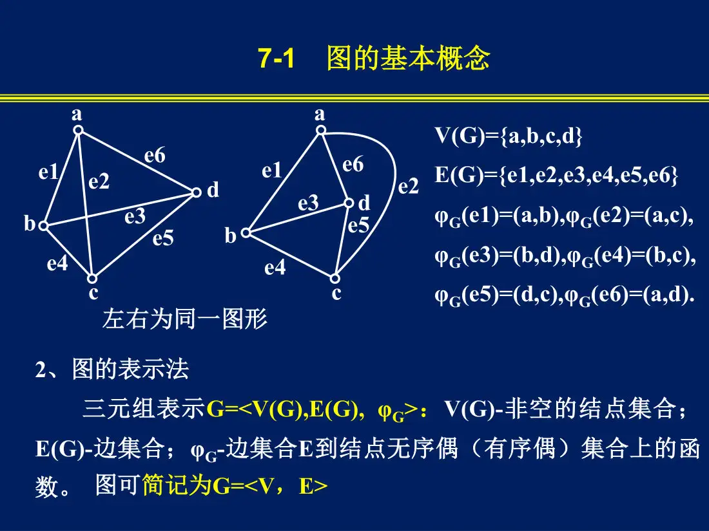

原文：

7-1 图的基本概念

左右为同一图形$\mathrm{V(G) = \{a,b,c,d\}}$ $\operatorname {E}(\operatorname {G}) = \{\mathrm{e1},\mathrm{e2},\mathrm{e3},\mathrm{e4},\mathrm{e5},\mathrm{e6}\}$ $\varphi_{\mathrm{G}}(\mathrm{e1}) = (\mathrm{a},\mathrm{b}),\varphi_{\mathrm{G}}(\mathrm{e2}) = (\mathrm{a},\mathrm{c}),$ $\varphi_{\mathrm{G}}(\mathrm{e3}) = (\mathrm{b},\mathrm{d}),\varphi_{\mathrm{G}}(\mathrm{e4}) = (\mathrm{b},\mathrm{c}),$ $\varphi_{\mathrm{G}}(\mathrm{e5}) = (\mathrm{d},\mathrm{c}),\varphi_{\mathrm{G}}(\mathrm{e6}) = (\mathrm{a},\mathrm{d}).$

2、图的表示法

三元组表示G=<V(G),E(G), $\varphi_{G}>$ : V(G)-非空的结点集合; E(G)-边集合; $\varphi_{G}$ -边集合E到结点无序偶（有序偶）集合上的函数。图可简记为G=<V, E>

### 7-1 图的基本概念

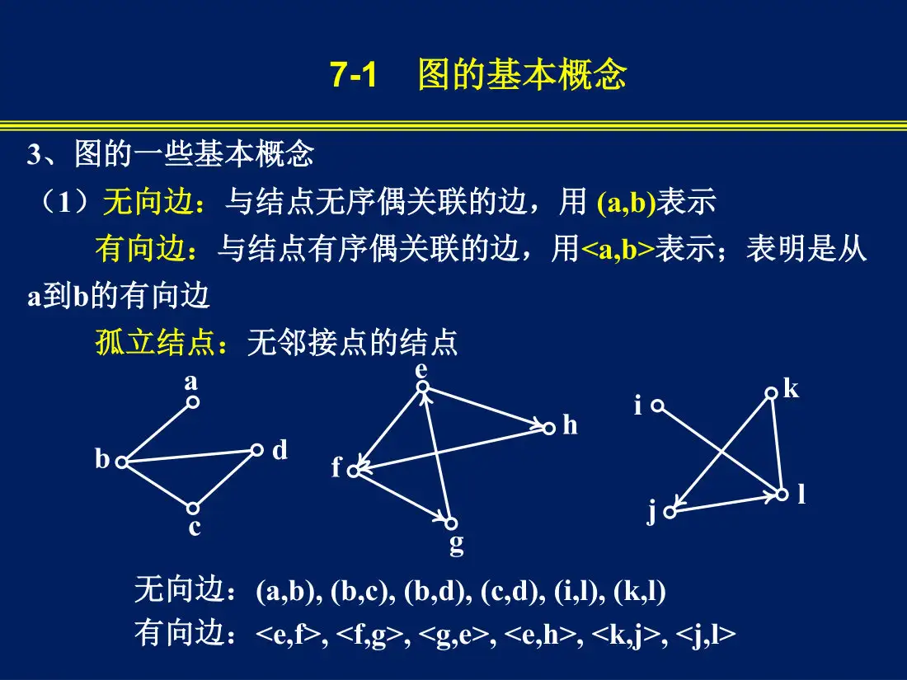

原文：

7-1 图的基本概念

3、图的一些基本概念

(1) 无向边: 与结点无序偶关联的边, 用 (a,b) 表示

有向边：与结点有序偶关联的边，用 $<a, b>$ 表示；表明是从

a到b的有向边

孤立结点：无邻接点的结点

无向边：(a,b), (b,c), (b,d), (c,d), (i,l), (k,l)

有向边：<e,f>, <f,g>, <g,e>, <e,h>, <k,j>, <j,l>

### 7-1 图的基本概念

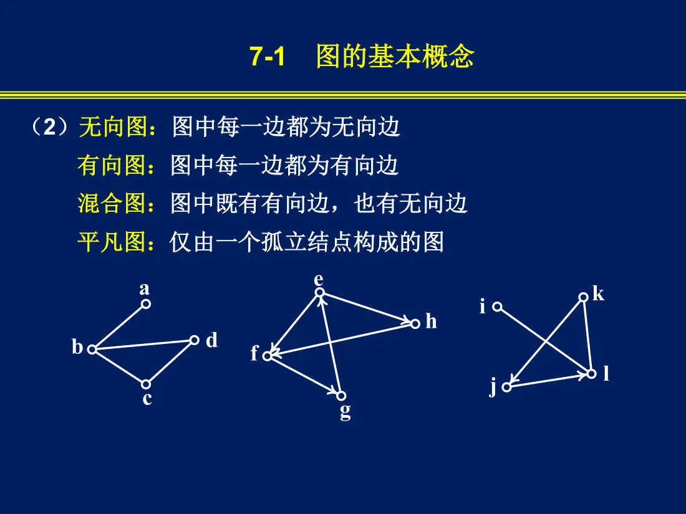

原文：

7-1 图的基本概念

(2) 无向图: 图中每一边都为无向边

有向图：图中每一边都为有向边

混合图：图中既有有向边，也有无向边

平凡图：仅由一个孤立结点构成的图

### 7-1 图的基本概念

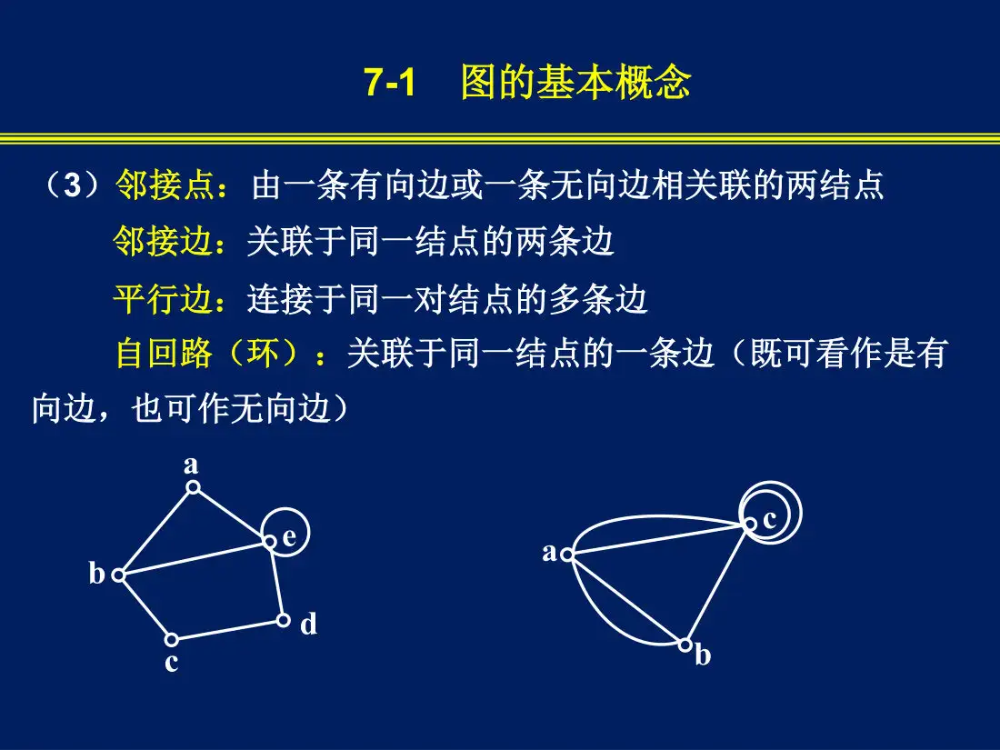

原文：

7-1 图的基本概念

(3) 邻接点: 由一条有向边或一条无向边相关联的两结点

邻接边：关联于同一结点的两条边

平行边：连接于同一对结点的多条边

自回路（环）：关联于同一结点的一条边（既可看作是有向边，也可作无向边）

### 7-1 图的基本概念

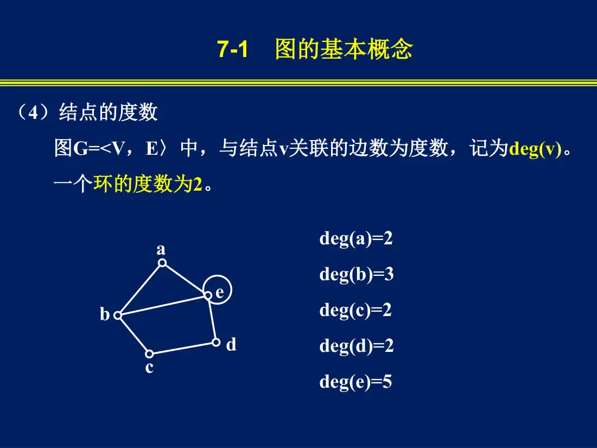

原文：

7-1 图的基本概念

(4) 结点的度数

图G=<V，E> 中，与结点v关联的边数为度数，记为deg(v)。一个环的度数为2。

deg(a)=2

deg(b)=3

$$
\deg (c) = 2
$$

$$
\deg (d) = 2
$$

$$
\deg (e) = 5
$$

### 7-1 图的基本概念

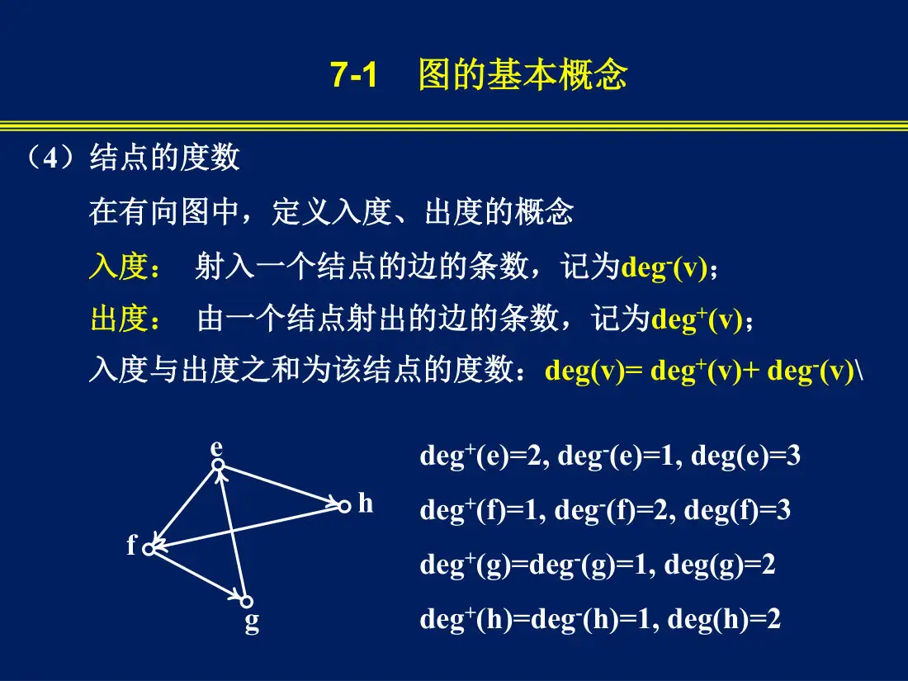

原文：

7-1 图的基本概念

(4) 结点的度数

在有向图中，定义入度、出度的概念

入度: 射入一个结点的边的条数, 记为 $\mathrm{deg}^{-}(v)$ ;

出度: 由一个结点射出的边的条数, 记为 $\mathrm{deg}^{+}(\mathrm{v})$ ;

入度与出度之和为该结点的度数： $\deg(v)=\deg^{+}(v)+\deg^{-}(v)$

$$
\deg^ {+} (\mathrm{e}) = 2, \deg^ {-} (\mathrm{e}) = 1, \deg (\mathrm{e}) = 3
$$

$$
\deg^ {+} (f) = 1, \deg^ {-} (f) = 2, \deg (f) = 3
$$

$$
\deg^ {+} (\mathrm{g}) = \deg^ {-} (\mathrm{g}) = 1, \deg (\mathrm{g}) = 2
$$

$$
\deg^ {+} (\mathrm{h}) = \deg^ {-} (\mathrm{h}) = 1, \deg (\mathrm{h}) = 2
$$

### 7-1 图的基本概念

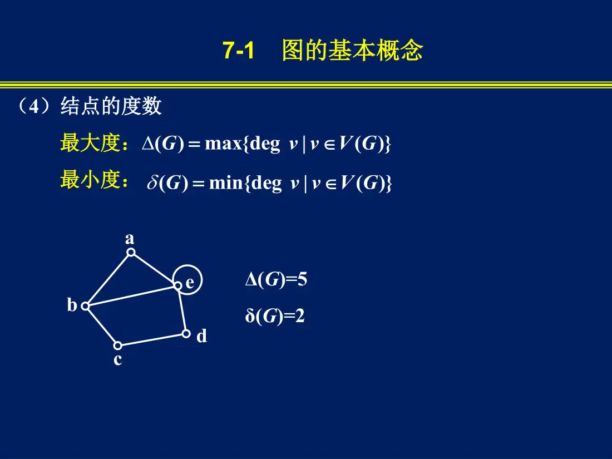

原文：

7-1 图的基本概念

(4) 结点的度数

最大度： $\Delta(G)=\max\{\deg v\mid v\in V(G)\}$

最小度: $\delta(G) = \min\{\deg v \mid v \in V(G)\}$

$$
\Delta (G) = 5
$$

$$
\delta (G) = 2
$$

### 7-1 图的基本概念

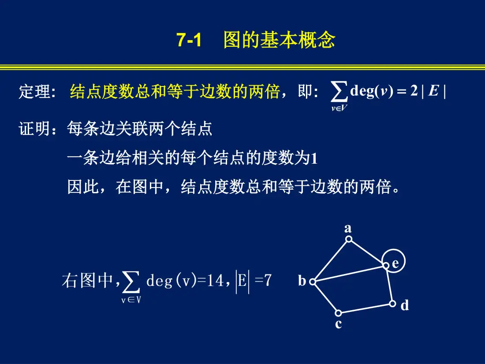

原文：

7-1 图的基本概念

定理: 结点度数总和等于边数的两倍, 即: $\sum \deg(v) = 2 |E|$

$$
\sum_ {v \in V} \deg (v) = 2 | E |
$$

证明：每条边关联两个结点

一条边给相关的每个结点的度数为1

因此，在图中，结点度数总和等于边数的两倍。

右图中, $\sum_{v\in V}\deg(v)=14,\left|E\right|=7$

### 7-1 图的基本概念

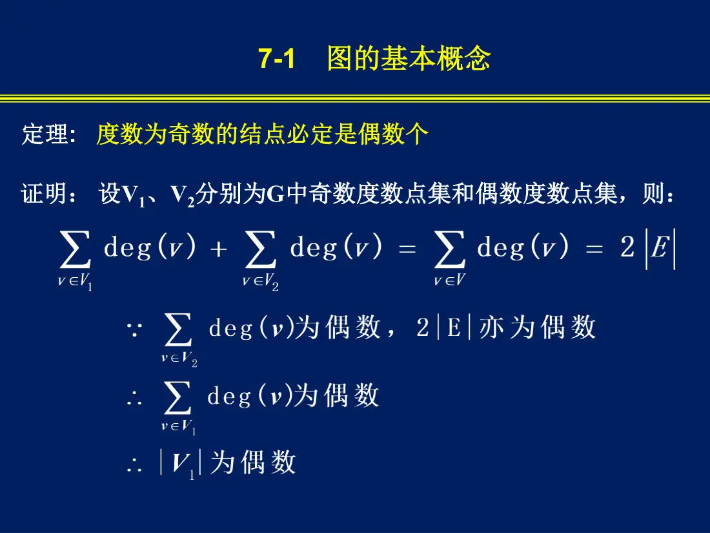

原文：

7-1 图的基本概念

定理：度数为奇数的结点必定是偶数个

证明：设 $\mathrm{V}_{1} 、 \mathrm{V}_{2}$ 分别为G中奇数度数点集和偶数度数点集，则：

$$
\sum_ {v \in V _ {1}} \deg (v) + \sum_ {v \in V _ {2}} \deg (v) = \sum_ {v \in V} \deg (v) = 2 | E |
$$

$\because \sum_{v\in V_{2}}\deg(v)$ 为偶数， $2|E|$ 亦为偶数

∴ $\sum_{v\in V_{1}}\deg(v)$ 为偶数

∴ $\left|V_{1}\right|$ 为偶数

### 7-1 图的基本概念

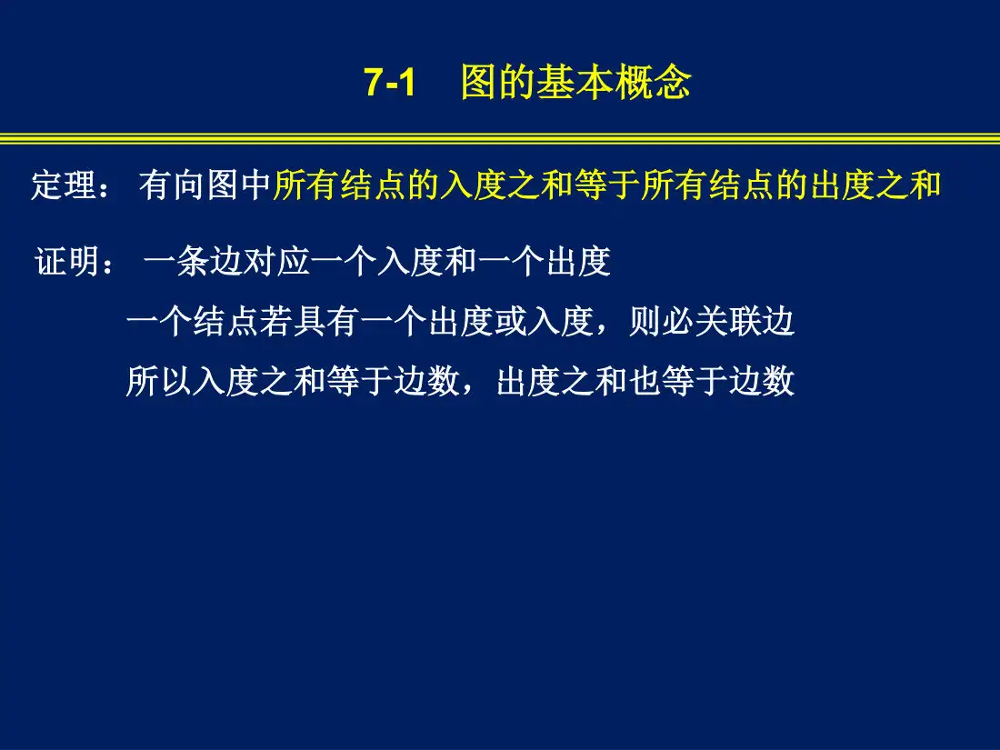

原文：

7-1 图的基本概念

定理：有向图中所有结点的入度之和等于所有结点的出度之和

证明：一条边对应一个入度和一个出度

一个结点若具有一个出度或入度，则必关联边

所以入度之和等于边数，出度之和也等于边数

### 7-1 图的基本概念

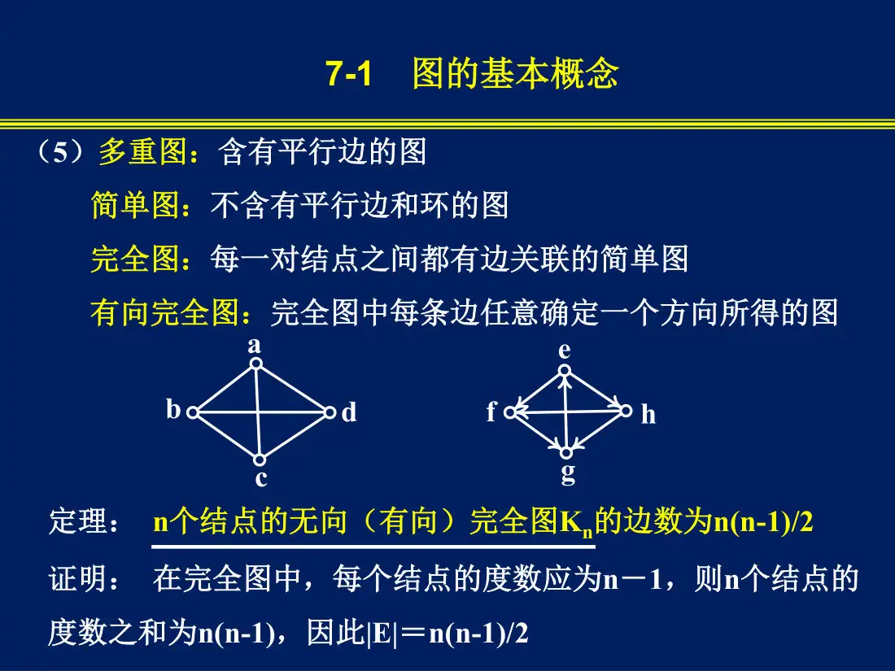

原文：

7-1 图的基本概念

(5) 多重图: 含有平行边的图

简单图：不含有平行边和环的图

完全图：每一对结点之间都有边关联的简单图

有向完全图：完全图中每条边任意确定一个方向所得的图

定理: n个结点的无向（有向）完全图 $K_{n}$ 的边数为 $n(n-1)/2$

证明：在完全图中，每个结点的度数应为n-1，则n个结点的

度数之和为 $n(n-1)$ ，因此 $|E|=n(n-1)/2$

### 7-1 图的基本概念

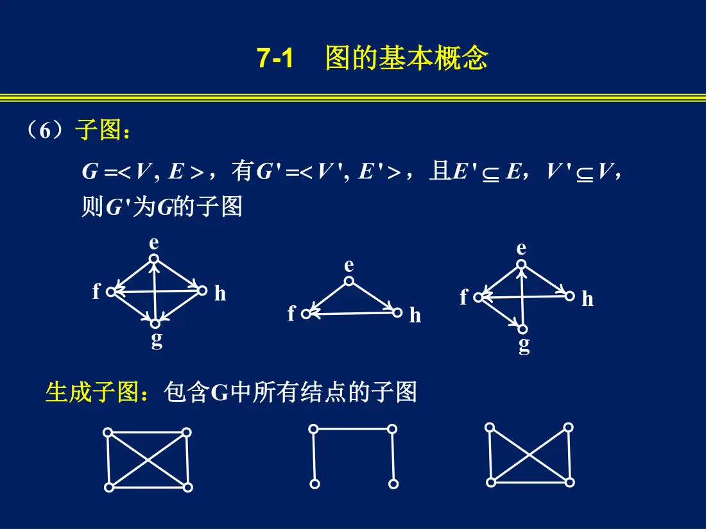

原文：

7-1 图的基本概念

(6) 子图:

$G = < V, E>$ ，有 $G' = < V', E'>$ ，且 $E' \subseteq E, V' \subseteq V,$ 则 $G'$ 为 $G$ 的子图

生成子图：包含G中所有结点的子图

### 7-1 图的基本概念

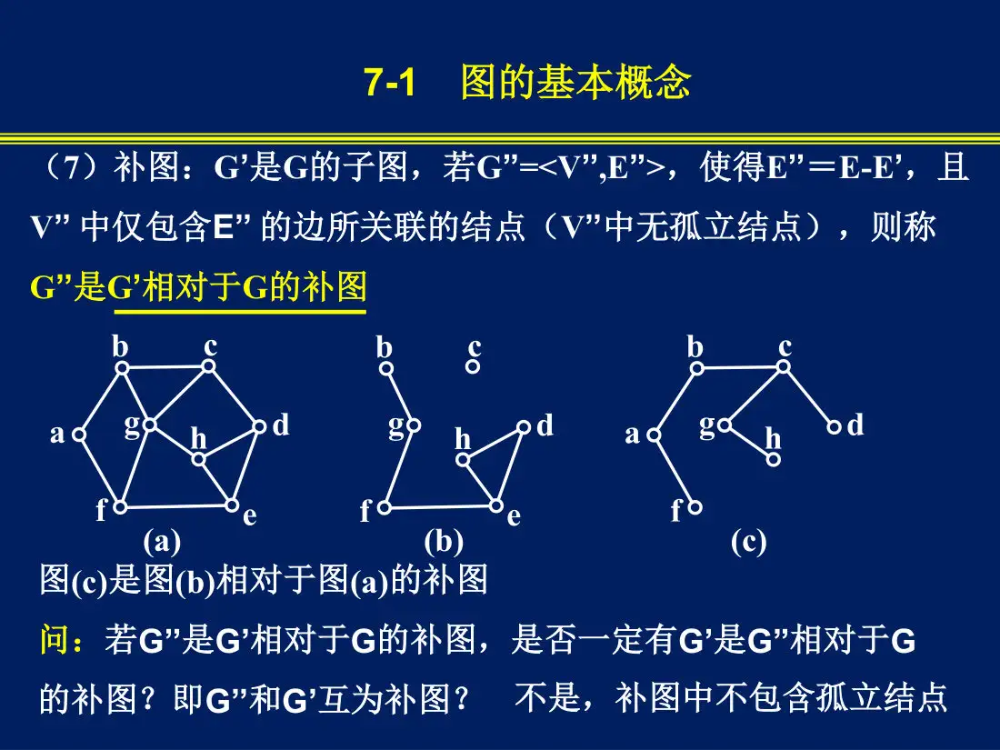

原文：

7-1 图的基本概念

(7) 补图: G'是G的子图, 若G"=<V",E">，使得E"=E-E', 且V"中仅包含E"的边所关联的结点（V"中无孤立结点），则称G"是G'相对于G的补图

图(c)是图(b)相对于图(a)的补图
问：若G”是G’相对于G的补图，是否一定有G’是G”相对于G的补图？即G”和G’互为补图？不是，补图中不包含孤立结点

### 7-1 图的基本概念

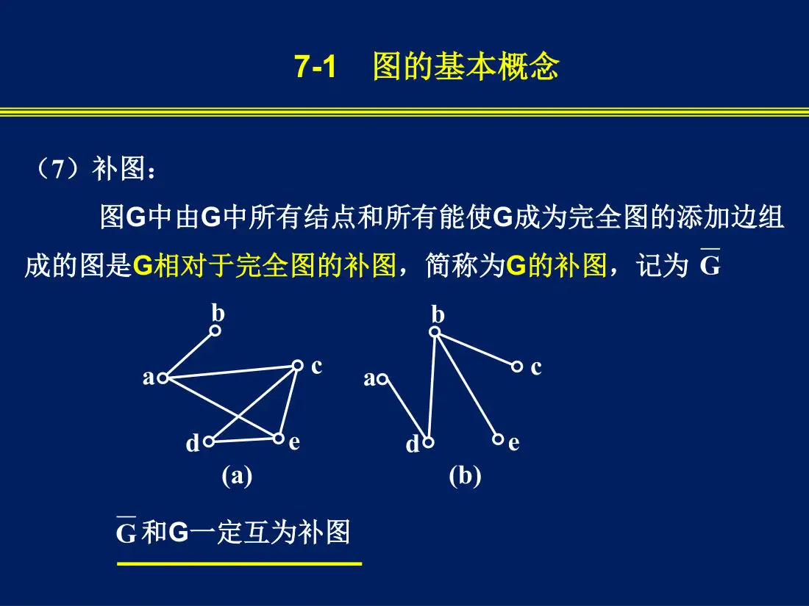

原文：

7-1 图的基本概念

(7) 补图:

图G中由G中所有结点和所有能使G成为完全图的添加边组成的图是G相对于完全图的补图，简称为G的补图，记为 $\overline{\mathbf{G}}$

G和G一定互为补图

### (b)

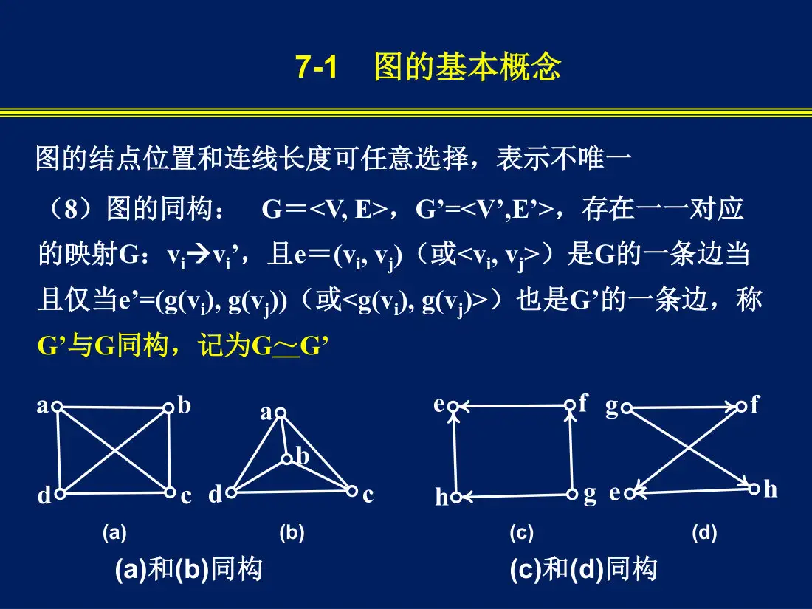

原文：

(b)

7-1 图的基本概念

图的结点位置和连线长度可任意选择，表示不唯一

(8) 图的同构: $G = < V, E>$ , $G' = < V', E'>$ , 存在一对应的映射 $G: v_i \rightarrow v_i'$ , 且 $e = (v_i, v_j)$ (或 $< v_i, v_j>$ ) 是 $G$ 的一条边当且仅当 $e' = (g(v_i), g(v_j))$ (或 $< g(v_i), g(v_j)>$ ) 也是 $G'$ 的一条边, 称 $G'$ 与 $G$ 同构, 记为 $G \sim G'$

### 7-1 图的基本概念

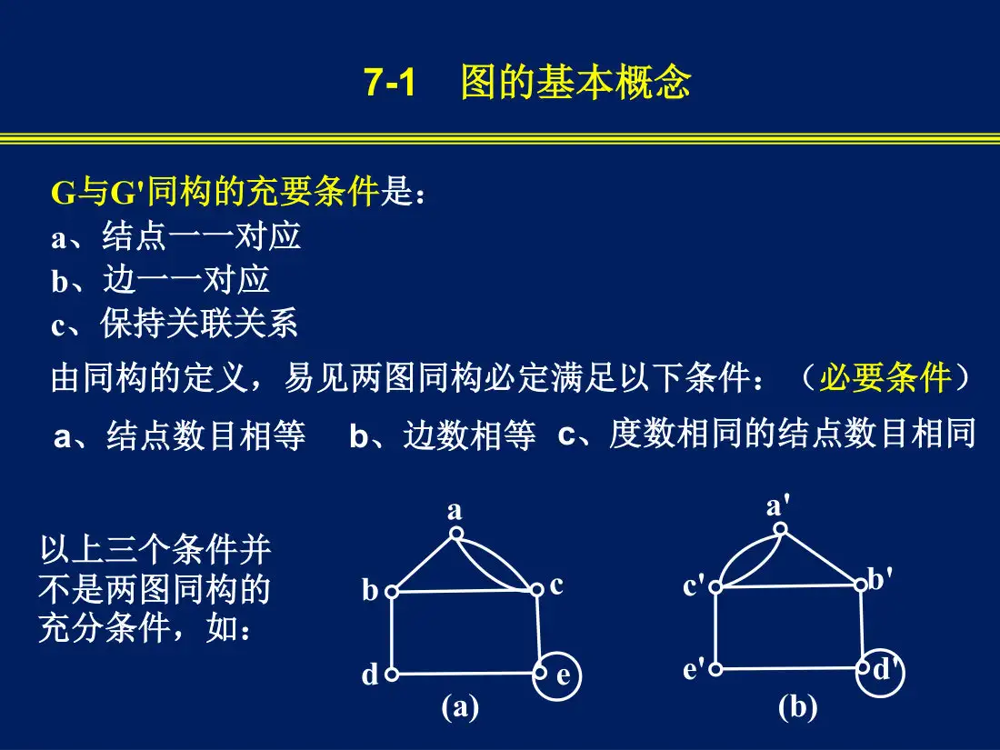

原文：

7-1 图的基本概念

G与G'同构的充要条件是:

a、结点一一对应

b、边一一对应

c、保持关联关系

由同构的定义，易见两图同构必定满足以下条件：（必要条件）

a、结点数目相等 b、边数相等 c、度数相同的结点数目相同

以上三个条件并不是两图同构的充分条件，如：

### 第七章 图论

原文：

第七章 图论

\- 图的基本概念

\- 路与回路

\- 图的矩阵表示

\- 欧拉图与哈密尔顿图

### 7-2 路与回路

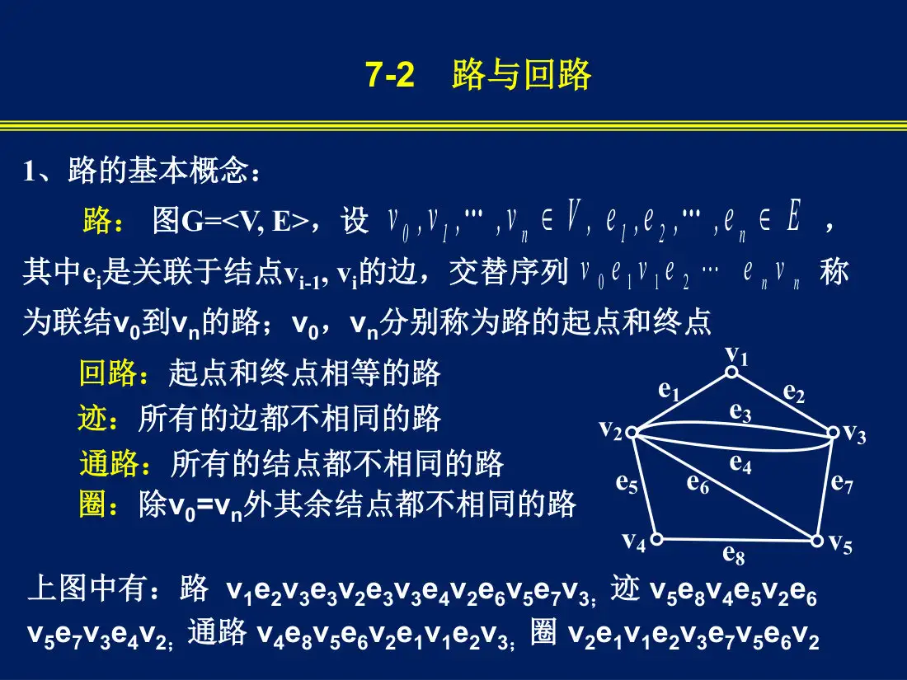

原文：

7-2 路与回路

1、路的基本概念:

路：图G=<V, E>，设 $v_{0}, v_{1}, \cdots, v_{n} \in V, e_{1}, e_{2}, \cdots, e_{n} \in E$ ，其中 $e_{i}$ 是关联于结点 $v_{i-1}, v_{i}$ 的边，交替序列 $v_{0}e_{1}v_{1}e_{2}\cdots e_{n}v_{n}$ 称为联结 $v_{0}$ 到 $v_{n}$ 的路； $v_{0}, v_{n}$ 分别称为路的起点和终点

回路：起点和终点相等的路  
迹：所有的边都不相同的路  
通路：所有的结点都不相同的路  
圈：除 $\mathbf{v}_0 = \mathbf{v}_n$ 外其余结点都不相同的路

上图中有：路 $\mathbf{v}_1\mathbf{e}_2\mathbf{v}_3\mathbf{e}_3\mathbf{v}_2\mathbf{e}_3\mathbf{v}_3\mathbf{e}_4\mathbf{v}_2\mathbf{e}_6\mathbf{v}_5\mathbf{e}_7\mathbf{v}_3$ ；迹 $\mathbf{v}_5\mathbf{e}_8\mathbf{v}_4\mathbf{e}_5\mathbf{v}_2\mathbf{e}_6$ $\mathbf{v}_5\mathbf{e}_7\mathbf{v}_3\mathbf{e}_4\mathbf{v}_2$ ；通路 $\mathbf{v}_4\mathbf{e}_8\mathbf{v}_5\mathbf{e}_6\mathbf{v}_2\mathbf{e}_1\mathbf{v}_1\mathbf{e}_2\mathbf{v}_3$ ；圈 $\mathbf{v}_2\mathbf{e}_1\mathbf{v}_1\mathbf{e}_2\mathbf{v}_3\mathbf{e}_7\mathbf{v}_5\mathbf{e}_6\mathbf{v}_2$

### 7-2 路与回路

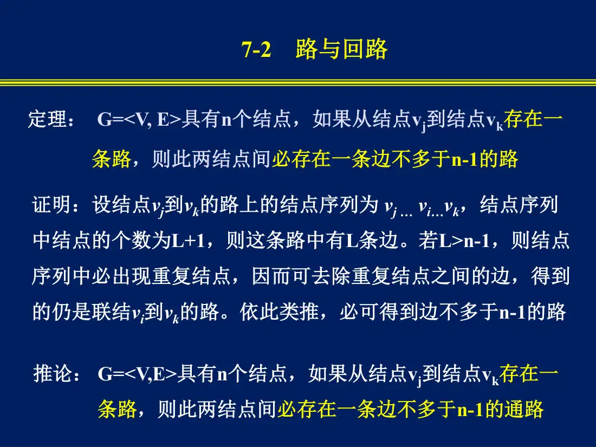

原文：

7-2 路与回路

定理: $G = < V, E>$ 具有n个结点, 如果从结点 $v_{j}$ 到结点 $v_{k}$ 存在一条路, 则此两结点间必存在一条边不多于n-1的路

证明：设结点 $v_{j}$ 到 $v_{k}$ 的路上的结点序列为 $v_{j} \ldots v_{i} \ldots v_{k}$ ，结点序列中结点的个数为L+1，则这条路中有L条边。若L>n-1，则结点序列中必出现重复结点，因而可去除重复结点之间的边，得到的仍是联结 $v_{i}$ 到 $v_{k}$ 的路。依此类推，必可得到边不多于n-1的路

推论: $G = < V, E>$ 具有 n 个结点, 如果从结点 $v_{j}$ 到结点 $v_{k}$ 存在一条路, 则此两结点间必存在一条边不多于 n-1 的通路

### 7-2 路与回路

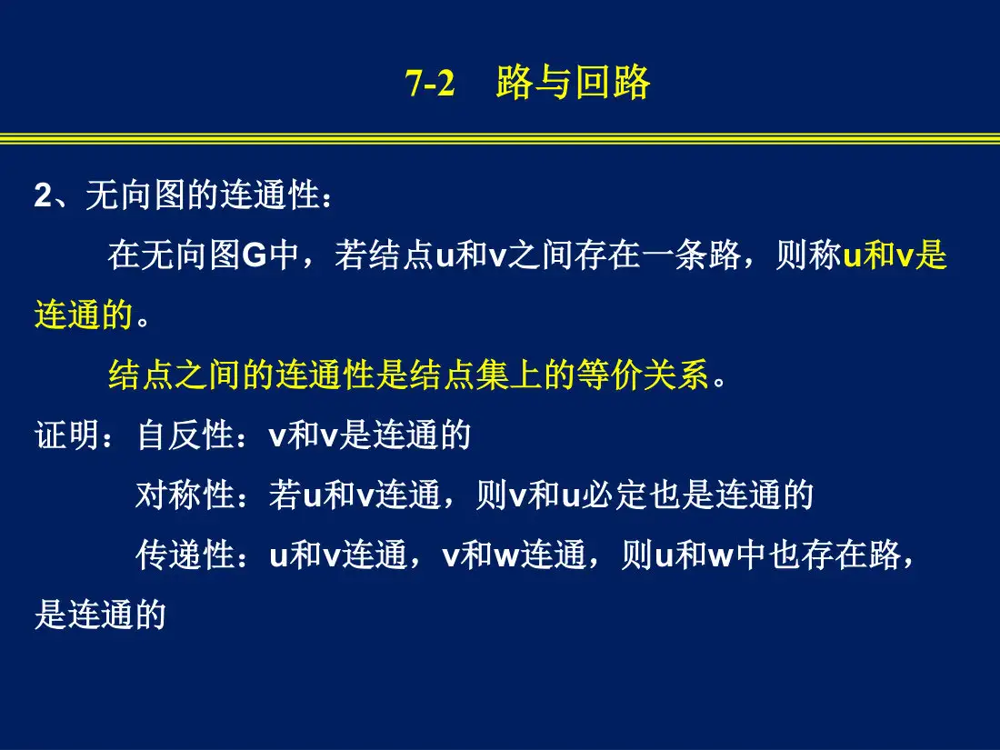

原文：

7-2 路与回路

2、无向图的连通性:

在无向图G中，若结点u和v之间存在一条路，则称u和v是连通的。

结点之间的连通性是结点集上的等价关系。

证明：自反性：v和v是连通的

对称性：若u和v连通，则v和u必定也是连通的

传递性：u和v连通，v和w连通，则u和w中也存在路，

是连通的

### 7-2 路与回路

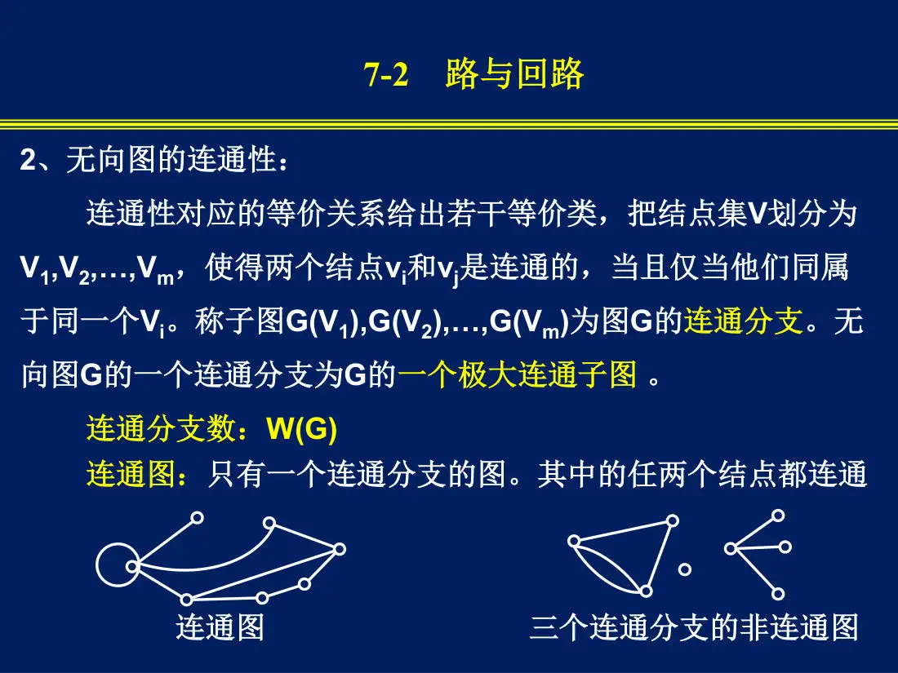

原文：

7-2 路与回路

2、无向图的连通性:

连通性对应的等价关系给出若干等价类，把结点集V划分为 $V_{1}, V_{2}, \ldots, V_{m}$ ，使得两个结点 $v_{i}$ 和 $v_{j}$ 是连通的，当且仅当他们同属于同一个 $V_{i}$ 。称子图 $G(V_{1}), G(V_{2}), \ldots, G(V_{m})$ 为图G的连通分支。无向图G的一个连通分支为G的一个极大连通子图。

连通分支数: W(G)

连通图：只有一个连通分支的图。其中的任两个结点都连通

三个连通分支的非连通图

### 7-2 路与回路

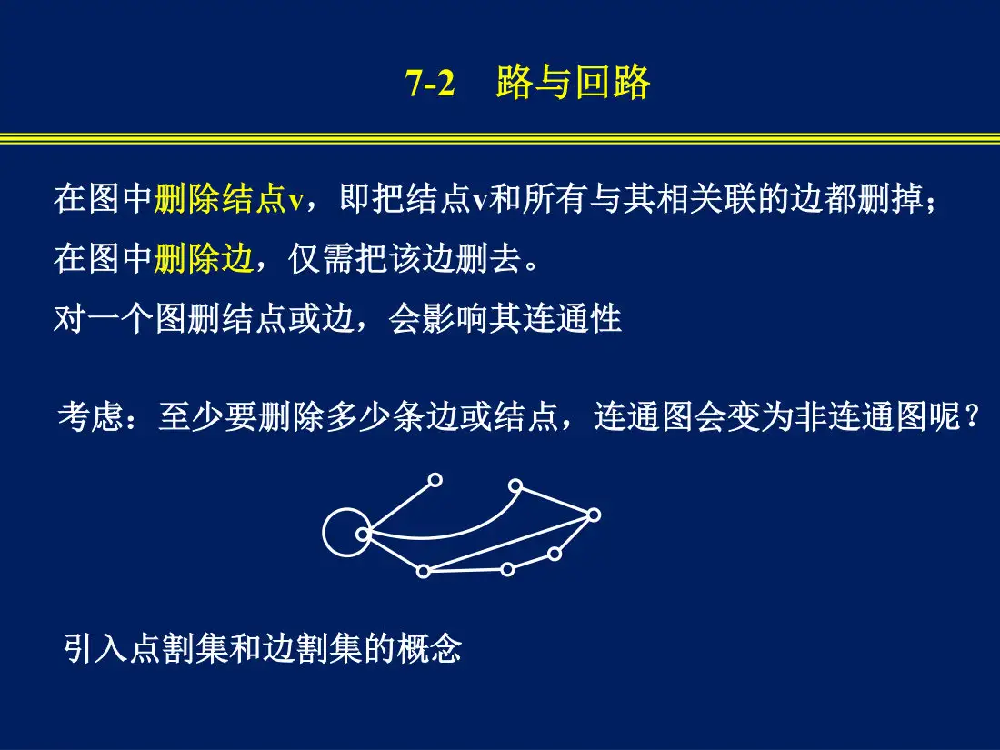

原文：

7-2 路与回路

在图中删除结点v，即把结点v和所有与其相关联的边都删掉；

在图中删除边，仅需把该边删去。

对一个图删结点或边，会影响其连通性

考虑：至少要删除多少条边或结点，连通图会变为非连通图呢？

引入点割集和边割集的概念

### 7-2 路与回路

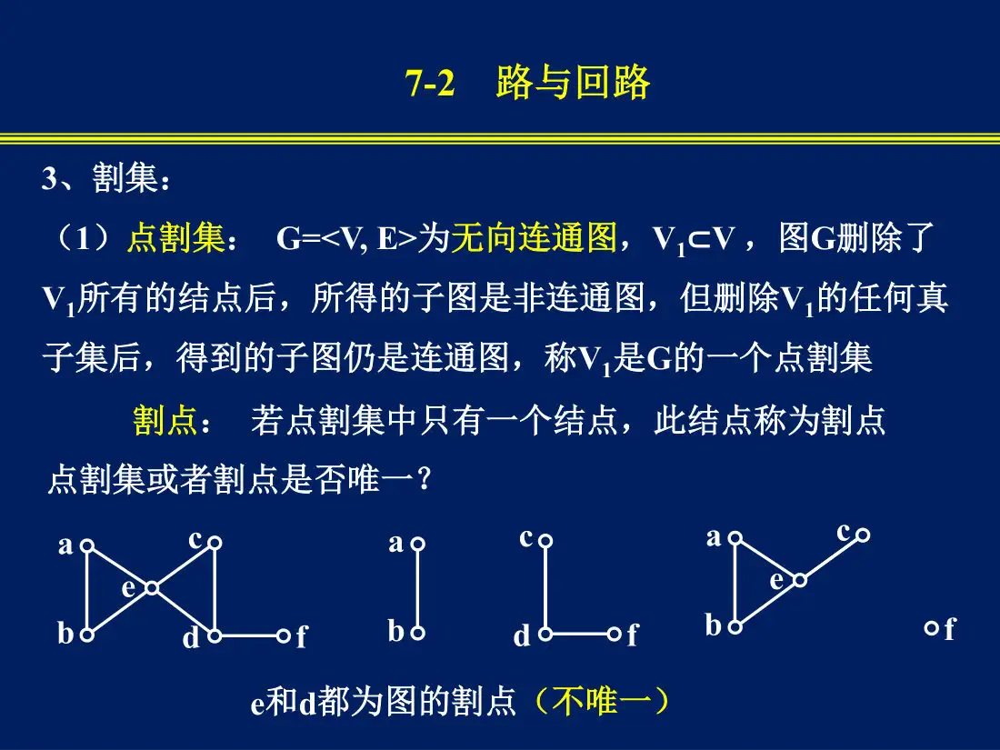

原文：

7-2 路与回路

3、割集:

(1) 点割集: $G = < V, E>$ 为无向连通图, $V_{1} \subset V$ , 图G删除了 $V_{1}$ 所有的结点后, 所得的子图是非连通图, 但删除 $V_{1}$ 的任何真子集后, 得到的子图仍是连通图, 称 $V_{1}$ 是G的一个点割集

割点：若点割集中只有一个结点，此结点称为割点点割集或者割点是否唯一？

$$
\begin{array}{c} \text {a} \\ \text {b} \end{array}
$$

e和d都为图的割点（不唯一）

### 7-2 路与回路

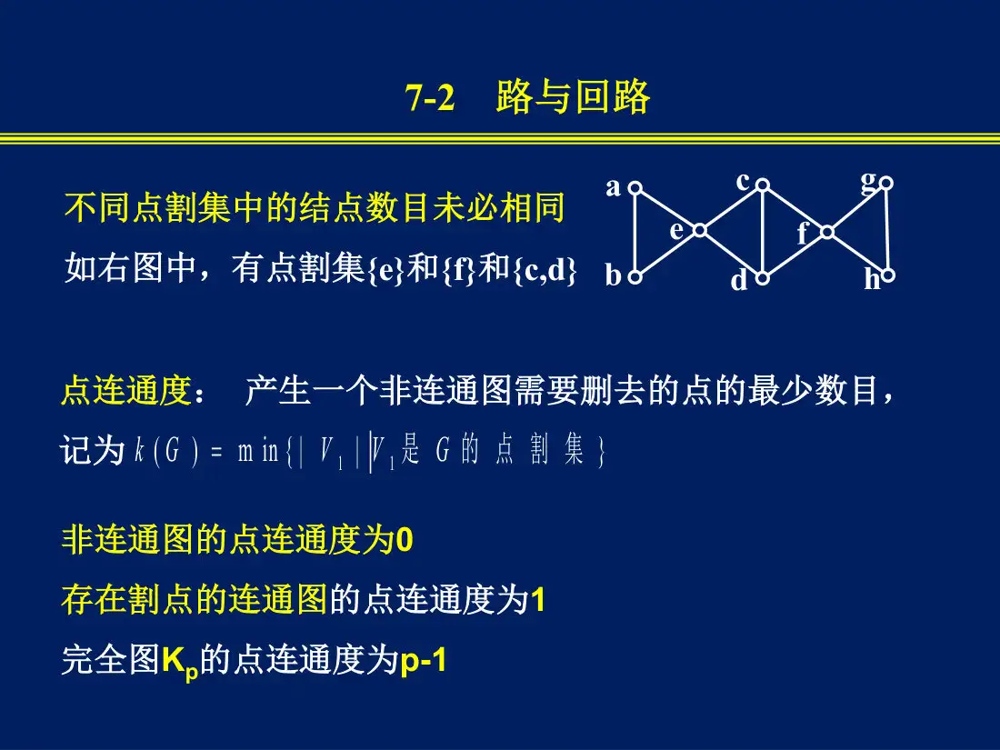

原文：

7-2 路与回路

不同点割集中的结点数目未必相同如右图中，有点割集{e}和{f}和{c,d}

点连通度: 产生一个非连通图需要删去的点的最少数目,记为 $k(G) = \min \{|V_1| | V_1$ 是 $G$ 的点割集 $\}$

非连通图的点连通度为0

存在割点的连通图的点连通度为1

完全图 $K_{p}$ 的点连通度为p-1

### 7-2 路与回路

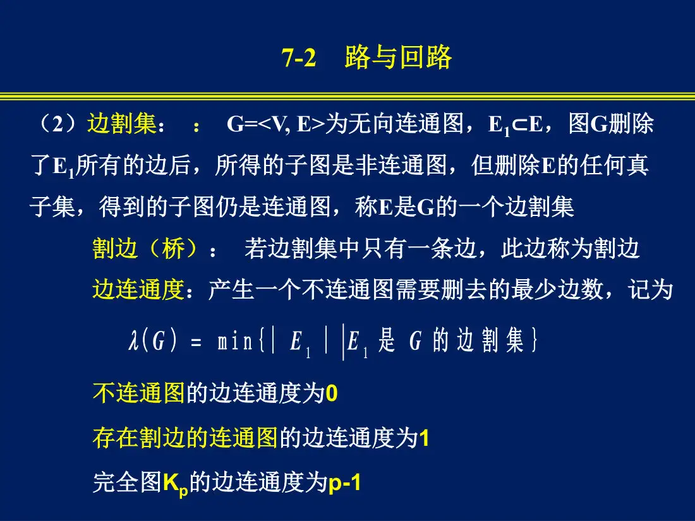

原文：

7-2 路与回路

(2) 边割集: : G=<V, E>为无向连通图, $E_1 \subset E$ , 图G删除了 $E_1$ 所有的边后, 所得的子图是非连通图, 但删除E的任何真子集, 得到的子图仍是连通图, 称E是G的一个边割集
割边 (桥): 若边割集中只有一条边, 此边称为割边
边连通度: 产生一个不连通图需要删去的最少边数, 记为

$\lambda (G) = \min \left\{\mid E_1\mid \mid E_1\text{是} G\right.$ 的边割集

不连通图的边连通度为0

存在割边的连通图的边连通度为1

完全图 $K_{p}$ 的边连通度为p-1

### 7-2 路与回路

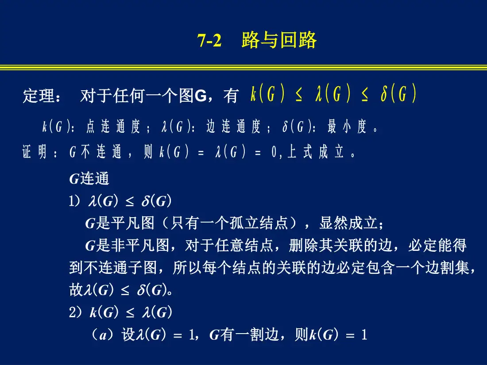

原文：

7-2 路与回路

定理：对于任何一个图G，有 $k(G) \leq \lambda(G) \leq \delta(G)$

$k(G)$ ：点连通度； $\lambda(G)$ ：边连通度； $\delta(G)$ ：最小度。证明：G不连通，则 $k(G)=\lambda(G)=0$ ，上式成立。

G连通

1) $\lambda (G)\leq \delta (G)$

G是平凡图（只有一个孤立结点），显然成立；

G是非平凡图，对于任意结点，删除其关联的边，必定能得到不连通子图，所以每个结点的关联的边必定包含一个边割集，故 $\lambda(G) \leq \delta(G)$ 。

2) $k(G) \leq \lambda (G)$ (a) 设 $\lambda (G) = 1$ ， $G$ 有一割边，则 $k(G) = 1$

### 7-2 路与回路

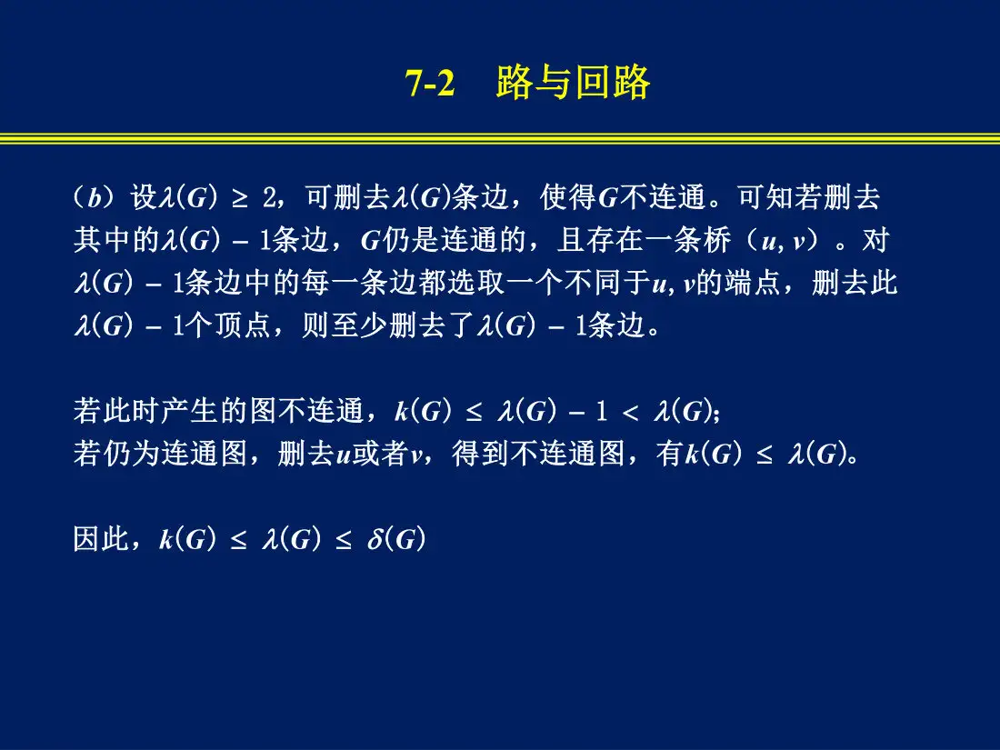

原文：

7-2 路与回路

(b) 设 $\lambda(G) \geq 2$ ，可删去 $\lambda(G)$ 条边，使得 $G$ 不连通。可知若删去其中的 $\lambda(G) - 1$ 条边， $G$ 仍是连通的，且存在一条桥（ $u, v$ ）。对 $\lambda(G) - 1$ 条边中的每一条边都选取一个不同于 $u, v$ 的端点，删去此 $\lambda(G) - 1$ 个顶点，则至少删去了 $\lambda(G) - 1$ 条边。

若此时产生的图不连通， $k(G) \leq \lambda(G) - 1 < \lambda(G)$ ;  
若仍为连通图，删去 $u$ 或者 $v$ ，得到不连通图，有 $k(G) \leq \lambda(G)$ 。

因此， $k(G)\leq \lambda (G)\leq \delta (G)$

### 7-2 路与回路

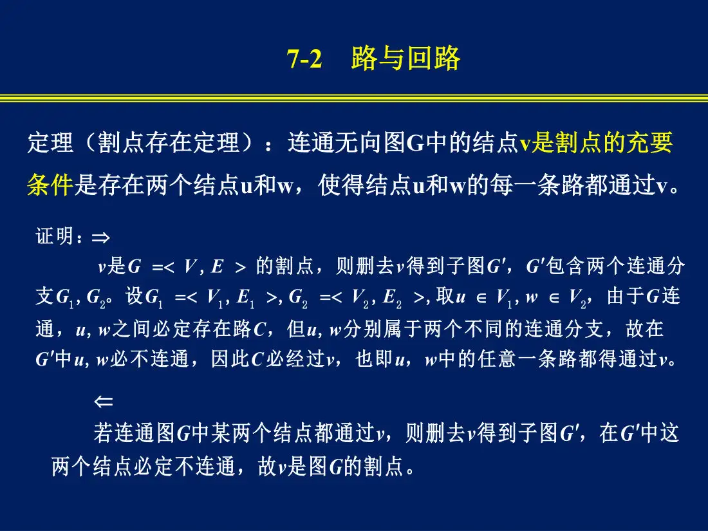

原文：

7-2 路与回路

定理（割点存在定理）：连通无向图G中的结点v是割点的充要条件是存在两个结点u和w，使得结点u和w的每一条路都通过v。

证明： $\Rightarrow$

v是G=<V,E>的割点，则删去v得到子图G′，G′包含两个连通分支G₁,G₂。设G₁=<V₁,E₁>,G₂=<V₂,E₂>,取u∈V₁,w∈V₂，由于G连通，u,w之间必定存在路C，但u,w分别属于两个不同的连通分支，故在G′中u,w必不连通，因此C必经过v，也即u,w中的任意一条路都得通过v。

←

若连通图G中某两个结点都通过v，则删去v得到子图 $G'$ ，在 $G'$ 中这两个结点必定不连通，故v是图G的割点。

### 7-2 路与回路

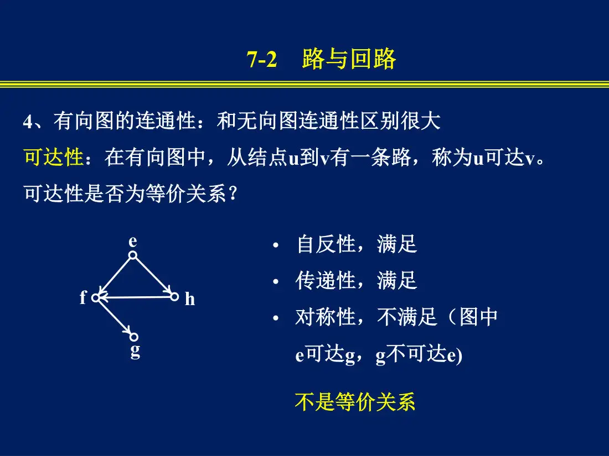

原文：

7-2 路与回路

4、有向图的连通性：和无向图连通性区别很大
可达性：在有向图中，从结点u到v有一条路，称为u可达v。
可达性是否为等价关系？

\- 自反性，满足

\- 传递性，满足

\- 对称性，不满足（图中

e可达g，g不可达e)

不是等价关系

### 7-2 路与回路

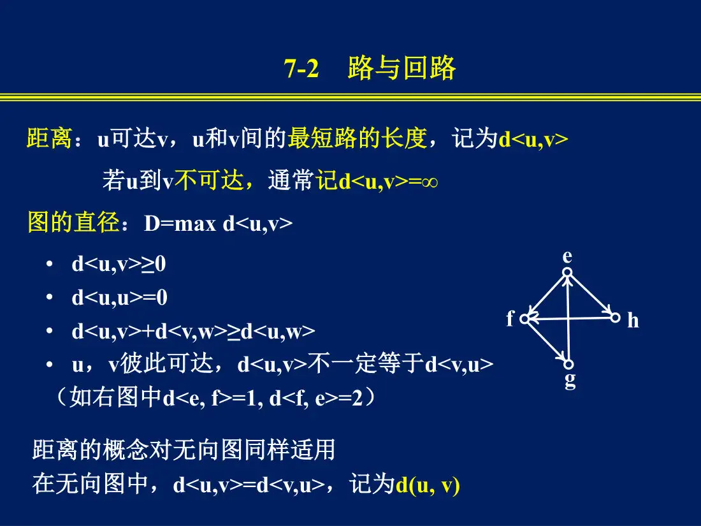

原文：

7-2 路与回路

距离: u可达v, u和v间的最短路的长度, 记为d<u,v>若u到v不可达, 通常记d<u,v>=∞

图的直径: D=max d<u,v>

• d<u,v>≥0

• d<u,u>=0

• d<u,v>+d<v,w>≥d<u,w>

• u, v彼此可达, d<u,v>不一定等于d<v,u>
(如右图中d<e, f>=1, d<f, e>=2)

距离的概念对无向图同样适用
在无向图中，d<u,v>=d<v,u>，记为d(u,v)

### 7-2 路与回路

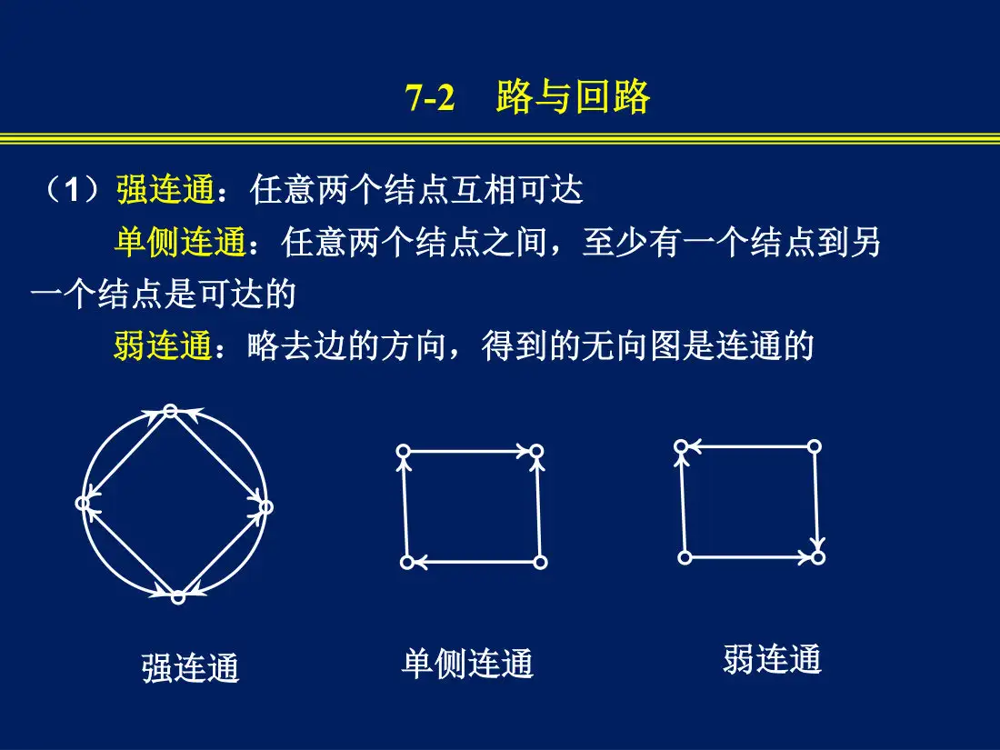

原文：

7-2 路与回路

(1) 强连通: 任意两个结点互相可达单侧连通: 任意两个结点之间, 至少有一个结点到另一个结点是可达的弱连通: 略去边的方向, 得到的无向图是连通的

强连通

单侧连通

弱连通

### 7-2 路与回路

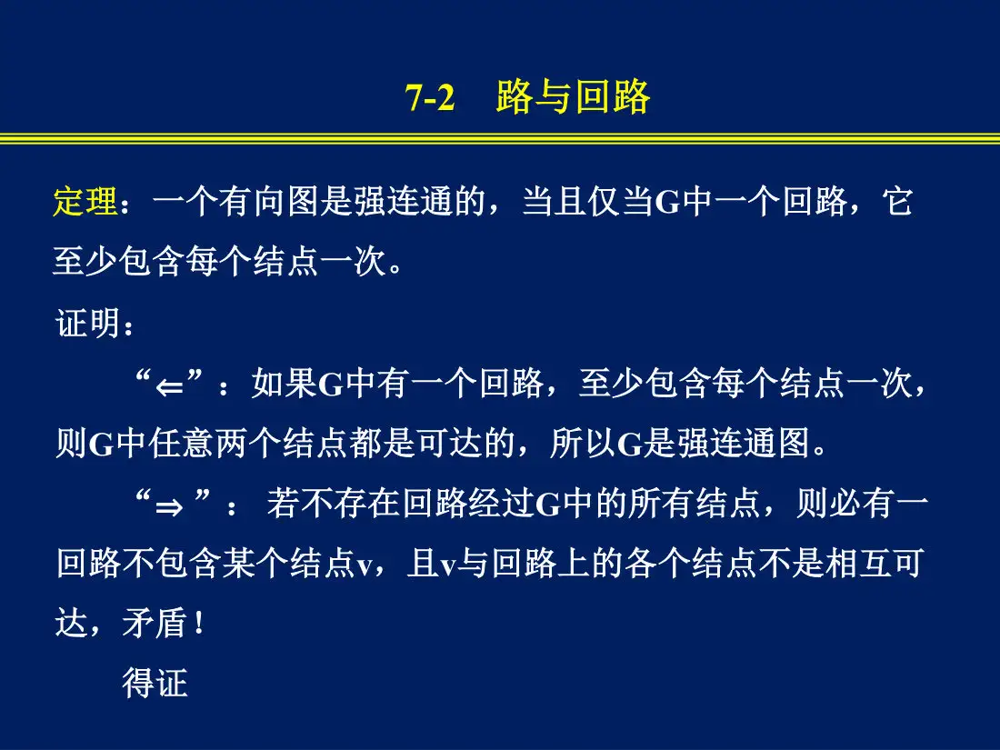

原文：

7-2 路与回路

定理：一个有向图是强连通的，当且仅当G中一个回路，它至少包含每个结点一次。

证明：

“⇐”：如果G中有一个回路，至少包含每个结点一次，则G中任意两个结点都是可达的，所以G是强连通图。

“⇒”：若不存在回路经过G中的所有结点，则必有一回路不包含某个结点v，且v与回路上的各个结点不是相互可达，矛盾！

得证

### 7-2 路与回路

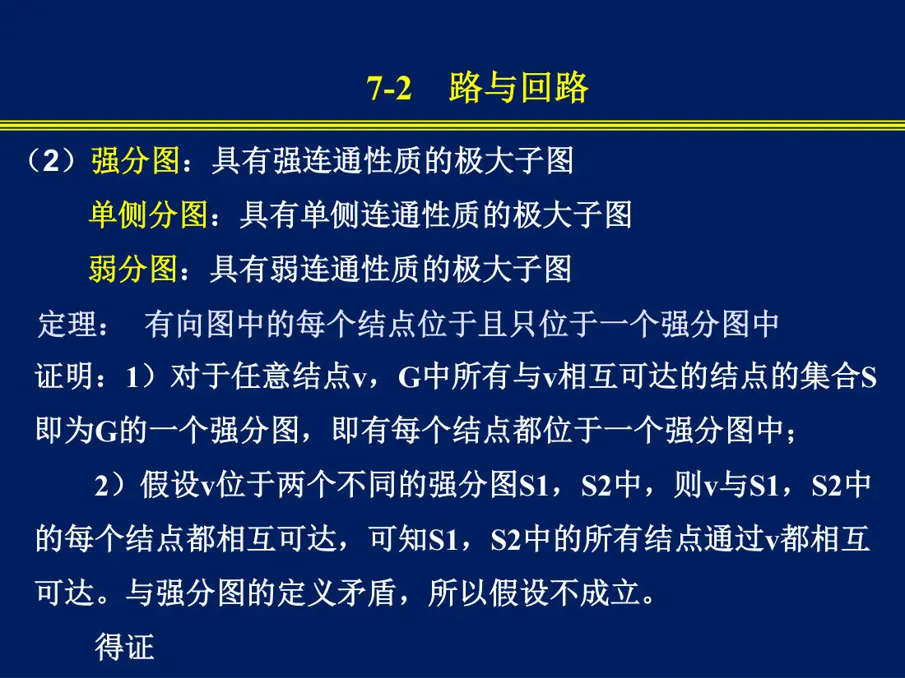

原文：

7-2 路与回路

(2) 强分图: 具有强连通性质的极大子图

单侧分图：具有单侧连通性质的极大子图

弱分图：具有弱连通性质的极大子图

定理：有向图中的每个结点位于且只位于一个强分图中

证明：1）对于任意结点v，G中所有与v相互可达的结点的集合S即为G的一个强分图，即有每个结点都位于一个强分图中；

2）假设v位于两个不同的强分图S1，S2中，则v与S1，S2中的每个结点都相互可达，可知S1，S2中的所有结点通过v都相互可达。与强分图的定义矛盾，所以假设不成立。

得证

### 第七章 图论

原文：

第七章 图论

\- 图的基本概念

\- 路与回路

\- 图的矩阵表示

\- 欧拉图与哈密尔顿图

### 7-3 图的矩阵表示

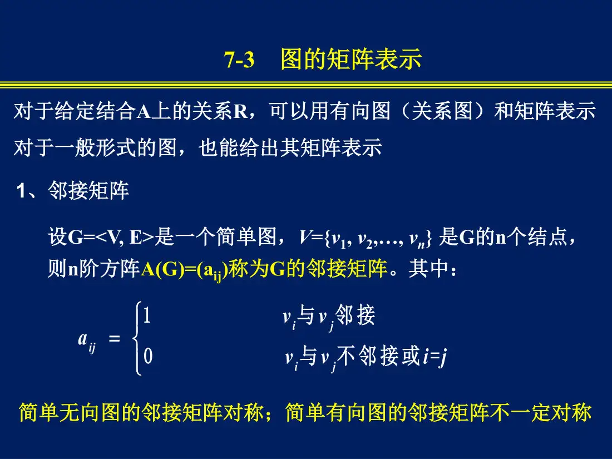

原文：

7-3 图的矩阵表示

对于给定结合A上的关系R，可以用有向图（关系图）和矩阵表示对于一般形式的图，也能给出其矩阵表示

1、邻接矩阵

设G=<V, E>是一个简单图， $V=\{v_{1}, v_{2}, \ldots, v_{n}\}$ 是G的n个结点，则n阶方阵A(G)=(a\_ij)称为G的邻接矩阵。其中：

$$
a _ {i j} = \left\{ \begin{array}{l} 1 \\ 0 \end{array} \right.
$$

$v_{i}$ 与 $v_{j}$ 邻接

$v_{i}$ 与 $v_{j}$ 不邻接或i=j

简单无向图的邻接矩阵对称；简单有向图的邻接矩阵不一定对称

### 7-3 图的矩阵表示

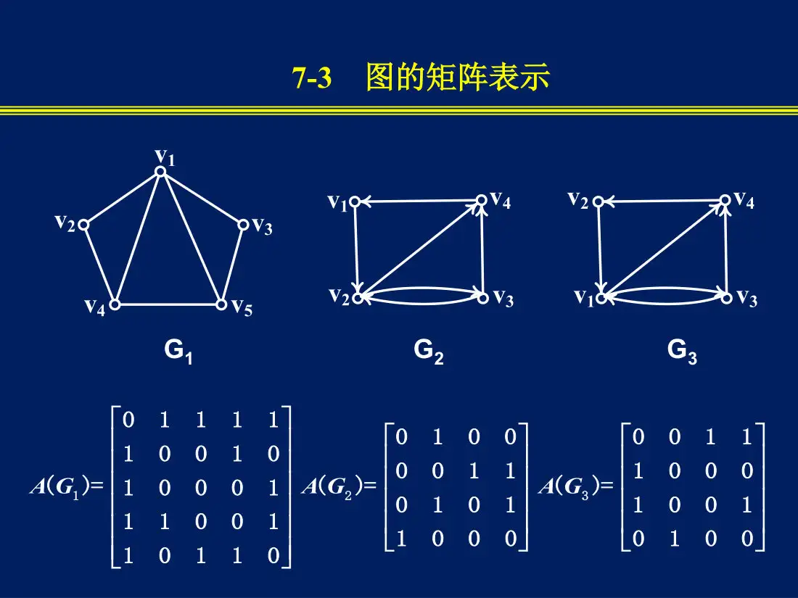

原文：

7-3 图的矩阵表示

$$
A (G _ {1}) = \left[ \begin{array}{l l l l l} 0 & 1 & 1 & 1 & 1 \\ 1 & 0 & 0 & 1 & 0 \\ 1 & 0 & 0 & 0 & 1 \\ 1 & 1 & 0 & 0 & 1 \\ 1 & 0 & 1 & 1 & 0 \end{array} \right] A (G _ {2}) = \left[ \begin{array}{l l l l} 0 & 1 & 0 & 0 \\ 0 & 0 & 1 & 1 \\ 0 & 1 & 0 & 1 \\ 1 & 0 & 0 & 0 \end{array} \right] A (G _ {3}) = \left[ \begin{array}{l l l l} 0 & 0 & 1 & 1 \\ 1 & 0 & 0 & 0 \\ 1 & 0 & 0 & 1 \\ 0 & 1 & 0 & 0 \end{array} \right]
$$

### 7-3 图的矩阵表示

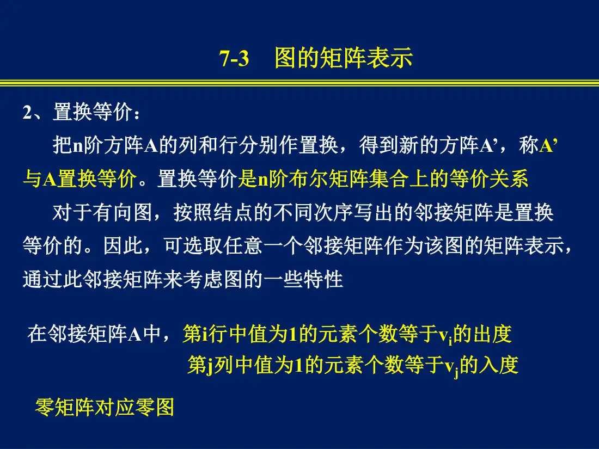

原文：

7-3 图的矩阵表示

2、置换等价：

把n阶方阵A的列和行分别作置换，得到新的方阵A’，称A’与A置换等价。置换等价是n阶布尔矩阵集合上的等价关系

对于有向图，按照结点的不同次序写出的邻接矩阵是置换等价的。因此，可选取任意一个邻接矩阵作为该图的矩阵表示，通过此邻接矩阵来考虑图的一些特性

在邻接矩阵A中，第i行中值为1的元素个数等于 $v_{i}$ 的出度  
第j列中值为1的元素个数等于 $v_{j}$ 的入度

零矩阵对应零图

### 7-3 图的矩阵表示

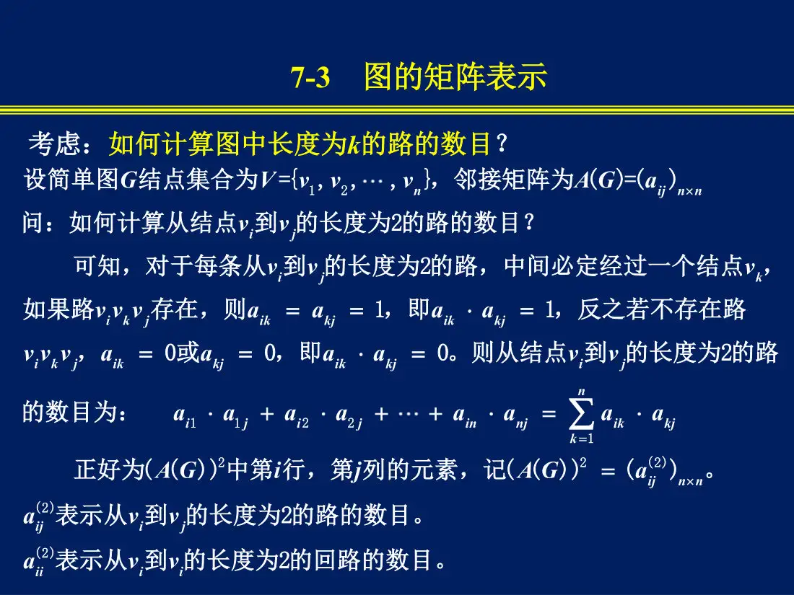

原文：

7-3 图的矩阵表示

考虑：如何计算图中长度为k的路的数目？

设简单图G结点集合为 $V=\{v_{1},v_{2},\cdots,v_{n}\}$ ，邻接矩阵为 $A(G)=(a_{ij})_{n\times n}$ 问：如何计算从结点 $v_{i}$ 到 $v_{j}$ 的长度为2的路的数目？

可知，对于每条从 $v_{i}$ 到 $v_{j}$ 的长度为2的路，中间必定经过一个结点 $v_{k}$ ，如果路 $v_{i}v_{k}v_{j}$ 存在，则 $a_{ik}=a_{kj}=1$ ，即 $a_{ik}\cdot a_{kj}=1$ ，反之若不存在路 $v_{i}v_{k}v_{j}$ ， $a_{ik}=0$ 或 $a_{kj}=0$ ，即 $a_{ik}\cdot a_{kj}=0$ 。则从结点 $v_{i}$ 到 $v_{j}$ 的长度为2的路的数目为： $a_{i1}\cdot a_{1j}+a_{i2}\cdot a_{2j}+\cdots+a_{in}\cdot a_{nj}=\sum_{k=1}^{n}a_{ik}\cdot a_{kj}$ 正好为 $(A(G))^{2}$ 中第i行，第j列的元素，记 $(A(G))^{2}=(a_{ij}^{(2)})_{n\times n}$ 。 $a_{ij}^{(2)}$ 表示从 $v_{i}$ 到 $v_{j}$ 的长度为2的路的数目。 $a_{ii}^{(2)}$ 表示从 $v_{i}$ 到 $v_{j}$ 的长度为2的回路的数目。

### 7-3 图的矩阵表示

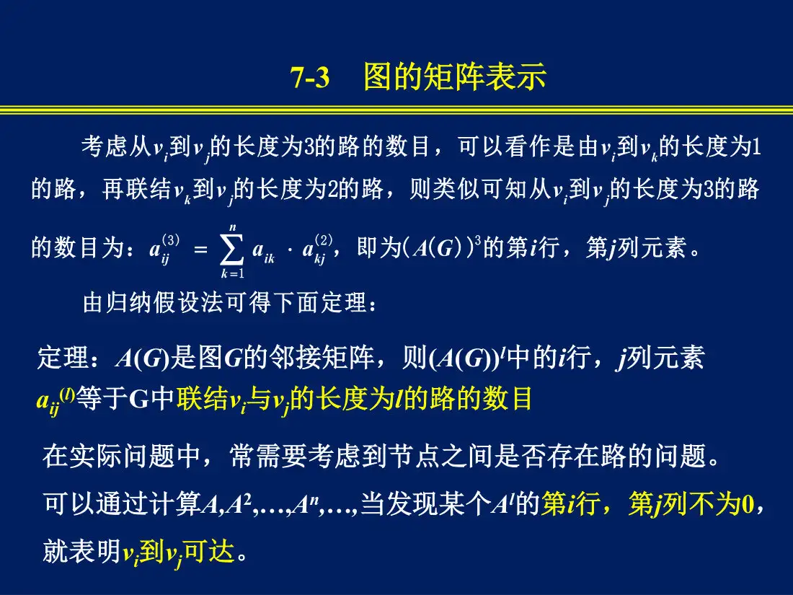

原文：

7-3 图的矩阵表示

考虑从 $v_{i}$ 到 $v_{j}$ 的长度为3的路的数目，可以看作是由 $v_{i}$ 到 $v_{k}$ 的长度为1的路，再联结 $v_{k}$ 到 $v_{j}$ 的长度为2的路，则类似可知从 $v_{i}$ 到 $v_{j}$ 的长度为3的路的数目为： $a_{ij}^{(3)} = \sum_{k=1}^{n} a_{ik} \cdot a_{kj}^{(2)}$ ，即为 $(A(G))^3$ 的第i行，第j列元素。由归纳假设法可得下面定理：定理： $A(G)$ 是图G的邻接矩阵，则 $(A(G))^l$ 中的i行，j列元素 $a_{ij}^{(l)}$ 等于G中联结 $v_{i}$ 与 $v_{j}$ 的长度为l的路的数目在实际问题中，常需要考虑到节点之间是否存在路的问题。可以通过计算 $A, A^2, \ldots, A^n, \ldots$ ，当发现某个 $A^l$ 的第i行，第j列不为0，就表明 $v_{i}$ 到 $v_{j}$ 可达。

### 7-3 图的矩阵表示

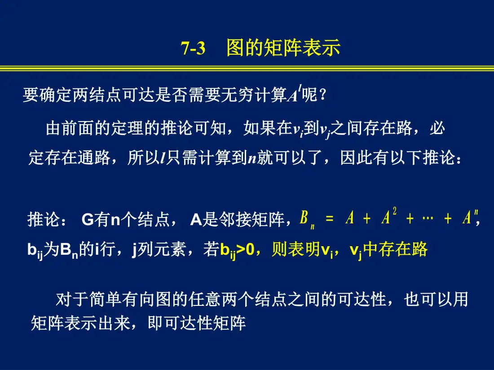

原文：

7-3 图的矩阵表示

要确定两结点可达是否需要无穷计算 $A^{l}$ 呢？

由前面的定理的推论可知，如果在 $v_{i}$ 到 $v_{j}$ 之间存在路，必定存在通路，所以l只需计算到n就可以了，因此有以下推论：

推论：G有n个结点，A是邻接矩阵， $B_{n} = A + A^{2} + \cdots + A^{n}$ ， $b_{ij}$ 为 $B_{n}$ 的i行，j列元素，若 $b_{ij}>0$ ，则表明 $v_{i}$ ， $v_{j}$ 中存在路

对于简单有向图的任意两个结点之间的可达性，也可以用矩阵表示出来，即可达性矩阵

### 7-3 图的矩阵表示

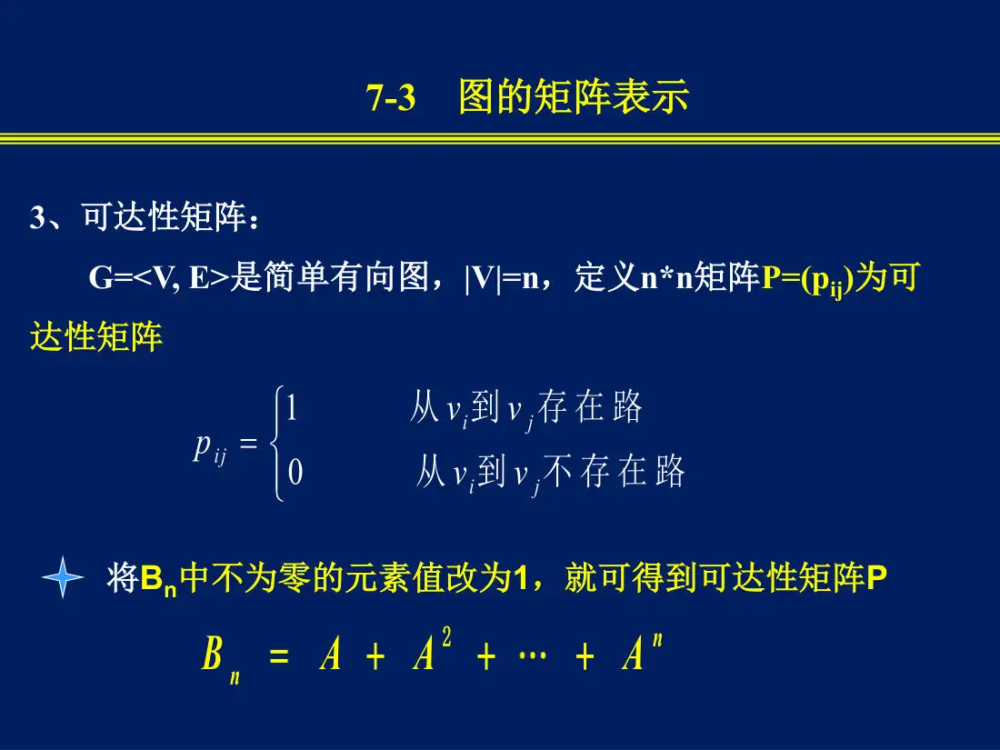

原文：

7-3 图的矩阵表示

3、可达性矩阵:

G=<V, E>是简单有向图，|V|=n，定义n\*n矩阵P=(p $_{ij}$ )为可达性矩阵

$$
p _ {i j} = \left\{ \begin{array}{l} 1 \\ 0 \end{array} \right.
$$

从 $v_{i}$ 到 $v_{j}$ 存在路

从 $v_{i}$ 到 $v_{j}$ 不存在路

将 $B_{n}$ 中不为零的元素值改为1，就可得到可达性矩阵P

$$
B _ {n} = A + A ^ {2} + \dots + A ^ {n}
$$

### 7-3 图的矩阵表示

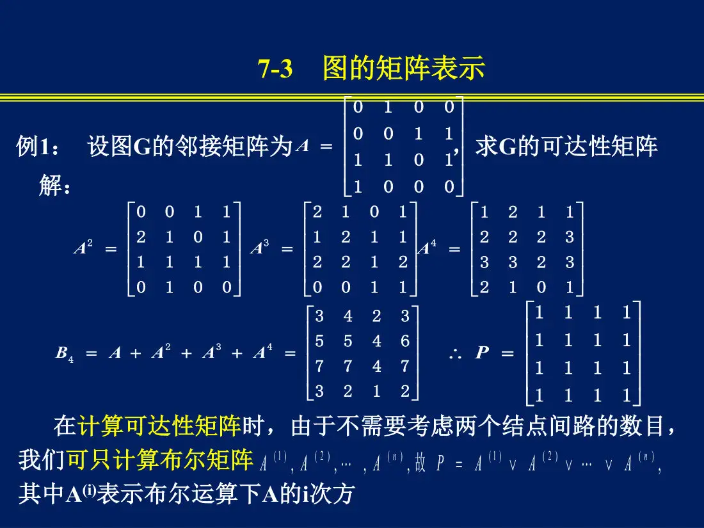

原文：

7-3 图的矩阵表示

例1: 设图G的邻接矩阵为 $A =$

解:

$$
A = \left[ \begin{array}{c c c c} 0 & 1 & 0 & 0 \\ 0 & 0 & 1 & 1 \\ 1 & 1 & 0 & 1 \\ 1 & 0 & 0 & 0 \end{array} \right],
$$

求G的可达性矩阵

$$
A ^ {2} = \left[ \begin{array}{l l l l} 0 & 0 & 1 & 1 \\ 2 & 1 & 0 & 1 \\ 1 & 1 & 1 & 1 \\ 0 & 1 & 0 & 0 \end{array} \right] A ^ {3} = \left[ \begin{array}{l l l l} 2 & 1 & 0 & 1 \\ 1 & 2 & 1 & 1 \\ 2 & 2 & 1 & 2 \\ 0 & 0 & 1 & 1 \end{array} \right] A ^ {4} = \left[ \begin{array}{l l l l} 1 & 2 & 1 & 1 \\ 2 & 2 & 2 & 3 \\ 3 & 3 & 2 & 3 \\ 2 & 1 & 0 & 1 \end{array} \right]
$$

$$
B _ {4} = A + A ^ {2} + A ^ {3} + A ^ {4} = \left[ \begin{array}{l l l l} 3 & 4 & 2 & 3 \\ 5 & 5 & 4 & 6 \\ 7 & 7 & 4 & 7 \\ 3 & 2 & 1 & 2 \end{array} \right]
$$

$$
\therefore P = \left[ \begin{array}{l l l l} 1 & 1 & 1 & 1 \\ 1 & 1 & 1 & 1 \\ 1 & 1 & 1 & 1 \\ 1 & 1 & 1 & 1 \end{array} \right]
$$

在计算可达性矩阵时，由于不需要考虑两个结点间路的数目，我们可只计算布尔矩阵 $A^{(1)}, A^{(2)}, \cdots, A^{(n)}$ ，故 $P = A^{(1)} \vee A^{(2)} \vee \cdots \vee A^{(n)}$ ，其中 $\mathbf{A}^{(\mathrm{i})}$ 表示布尔运算下 $\mathbf{A}$ 的i次方

### 7-3 图的矩阵表示

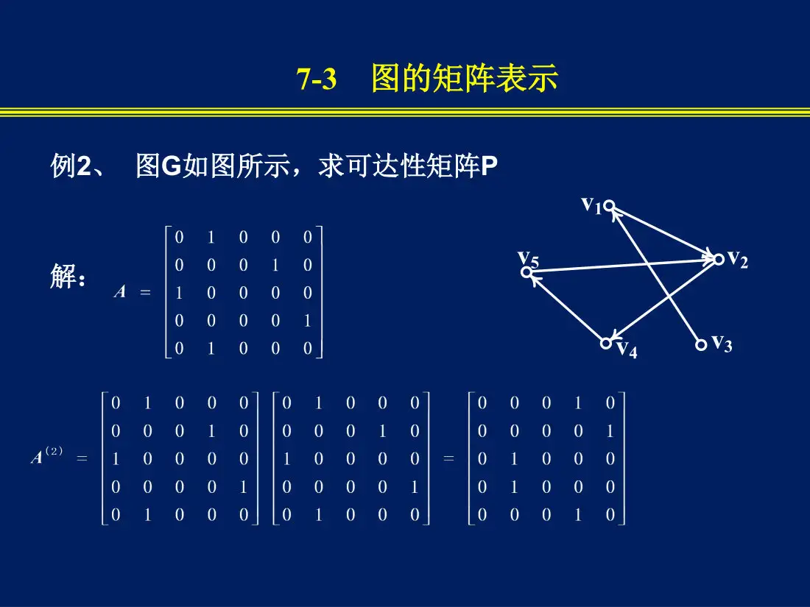

原文：

7-3 图的矩阵表示

例2、图G如图所示，求可达性矩阵P

解:

$$
A = \left[ \begin{array}{l l l l l} 0 & 1 & 0 & 0 & 0 \\ 0 & 0 & 0 & 1 & 0 \\ 1 & 0 & 0 & 0 & 0 \\ 0 & 0 & 0 & 0 & 1 \\ 0 & 1 & 0 & 0 & 0 \end{array} \right]
$$

$$
A ^ {(2)} = \left[ \begin{array}{l l l l l} 0 & 1 & 0 & 0 & 0 \\ 0 & 0 & 0 & 1 & 0 \\ 1 & 0 & 0 & 0 & 0 \\ 0 & 0 & 0 & 0 & 1 \\ 0 & 1 & 0 & 0 & 0 \end{array} \right] \left[ \begin{array}{l l l l l} 0 & 1 & 0 & 0 & 0 \\ 0 & 0 & 0 & 1 & 0 \\ 1 & 0 & 0 & 0 & 0 \\ 0 & 0 & 0 & 0 & 1 \\ 0 & 1 & 0 & 0 & 0 \end{array} \right] = \left[ \begin{array}{l l l l l} 0 & 0 & 0 & 1 & 0 \\ 0 & 0 & 0 & 0 & 1 \\ 0 & 1 & 0 & 0 & 0 \\ 0 & 1 & 0 & 0 & 0 \\ 0 & 0 & 0 & 1 & 0 \end{array} \right]
$$

### 7-3 图的矩阵表示

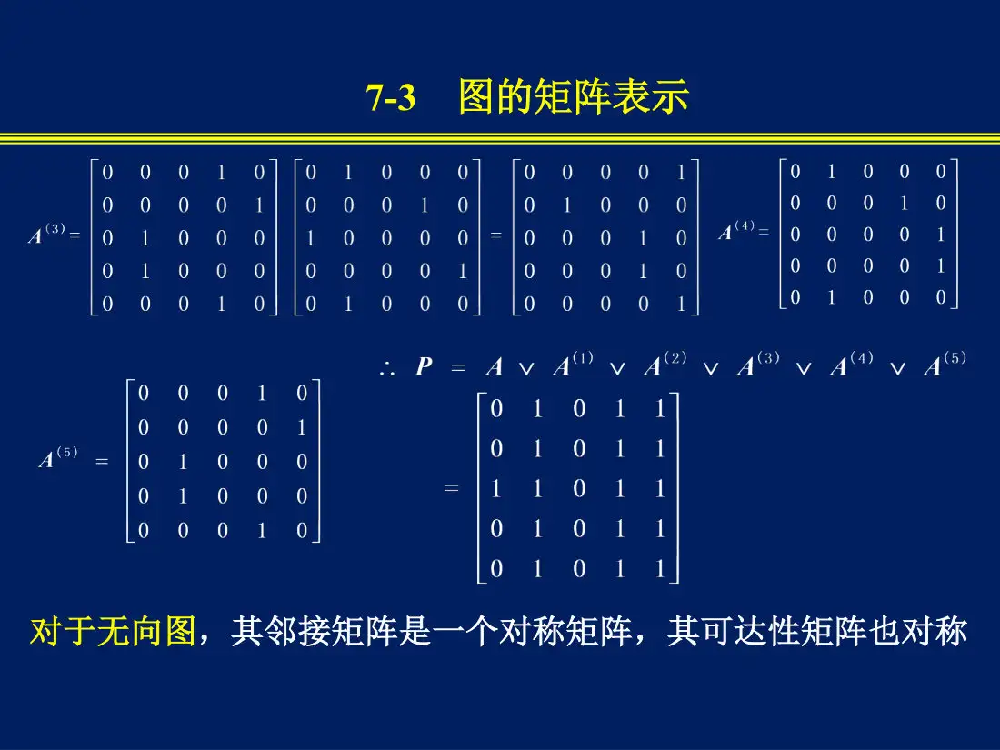

原文：

7-3 图的矩阵表示

$$
\boldsymbol {A} ^ {(3)} = \left[ \begin{array}{l l l l l} 0 & 0 & 0 & 1 & 0 \\ 0 & 0 & 0 & 0 & 1 \\ 0 & 1 & 0 & 0 & 0 \\ 0 & 1 & 0 & 0 & 0 \\ 0 & 0 & 0 & 1 & 0 \end{array} \right] \left[ \begin{array}{l l l l l} 0 & 1 & 0 & 0 & 0 \\ 0 & 0 & 0 & 1 & 0 \\ 1 & 0 & 0 & 0 & 0 \\ 0 & 0 & 0 & 0 & 1 \\ 0 & 1 & 0 & 0 & 0 \end{array} \right] = \left[ \begin{array}{l l l l l} 0 & 0 & 0 & 0 & 1 \\ 0 & 1 & 0 & 0 & 0 \\ 0 & 0 & 0 & 1 & 0 \\ 0 & 0 & 0 & 1 & 0 \\ 0 & 0 & 0 & 0 & 1 \end{array} \right] \quad \boldsymbol {A} ^ {(4)} = \left[ \begin{array}{l l l l l} 0 & 1 & 0 & 0 & 0 \\ 0 & 0 & 0 & 1 & 0 \\ 0 & 0 & 0 & 0 & 1 \\ 0 & 0 & 0 & 0 & 1 \\ 0 & 1 & 0 & 0 & 0 \end{array} \right]
$$

$$
A ^ {(5)} = \left[ \begin{array}{l l l l l} 0 & 0 & 0 & 1 & 0 \\ 0 & 0 & 0 & 0 & 1 \\ 0 & 1 & 0 & 0 & 0 \\ 0 & 1 & 0 & 0 & 0 \\ 0 & 0 & 0 & 1 & 0 \end{array} \right]
$$

$$
\therefore P = A \vee A ^ {(1)} \vee A ^ {(2)} \vee A ^ {(3)} \vee A ^ {(4)} \vee A ^ {(5)}
$$

$$
= \left[ \begin{array}{c c c c c} 0 & 1 & 0 & 1 & 1 \\ 0 & 1 & 0 & 1 & 1 \\ 1 & 1 & 0 & 1 & 1 \\ 0 & 1 & 0 & 1 & 1 \\ 0 & 1 & 0 & 1 & 1 \end{array} \right]
$$

对于无向图，其邻接矩阵是一个对称矩阵，其可达性矩阵也对称

### 7-3 图的矩阵表示

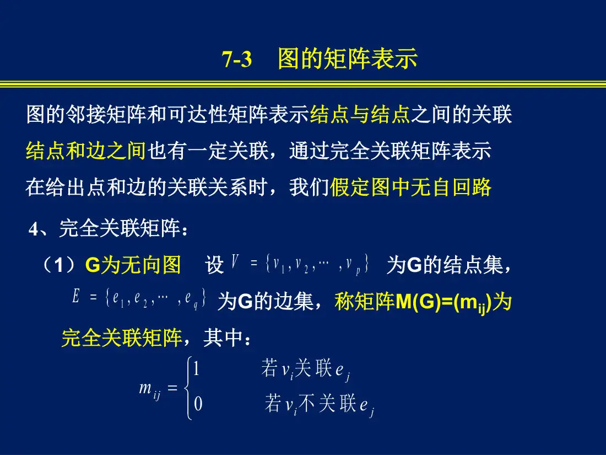

原文：

7-3 图的矩阵表示

图的邻接矩阵和可达性矩阵表示结点与结点之间的关联结点和边之间也有一定关联，通过完全关联矩阵表示在给出点和边的关联关系时，我们假定图中无自回路

4、完全关联矩阵:

(1) G为无向图 设 $V = \{v_{1}, v_{2}, \cdots, v_{p}\}$ 为G的结点集， $E = \{e_{1}, e_{2}, \cdots, e_{q}\}$ 为G的边集，称矩阵 $M(G) = (m_{ij})$ 为完全关联矩阵，其中：

$m_{ij} = \left\{ \begin{array}{ll}1 & \text{若} v_i \text{关联} e_j\\ 0 & \text{若} v_i \text{不关联} e_j \end{array} \right.$

### 7-3 图的矩阵表示

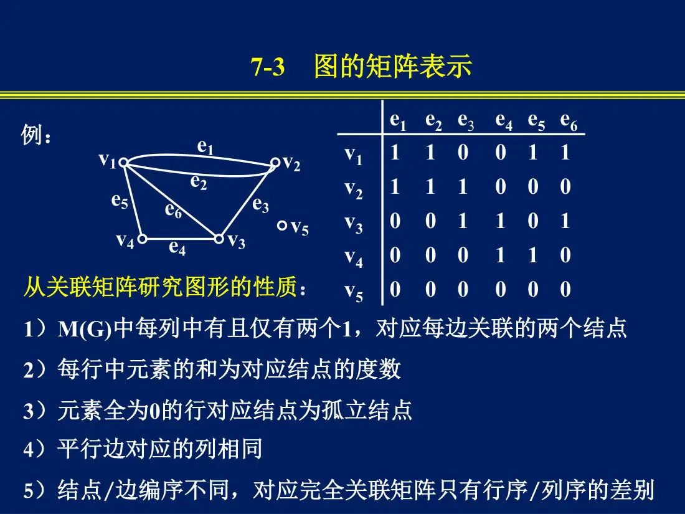

原文：

7-3 图的矩阵表示

例：

从关联矩阵研究图形的性质：

$$
\begin{array}{c c c c c c c} & \mathrm{e} _ {1} & \mathrm{e} _ {2} & \mathrm{e} _ {3} & \mathrm{e} _ {4} & \mathrm{e} _ {5} & \mathrm{e} _ {6} \\ \hline \mathrm{v} _ {1} & 1 & 1 & 0 & 0 & 1 & 1 \\ \mathrm{v} _ {2} & 1 & 1 & 1 & 0 & 0 & 0 \\ \mathrm{v} _ {3} & 0 & 0 & 1 & 1 & 0 & 1 \\ \mathrm{v} _ {4} & 0 & 0 & 0 & 1 & 1 & 0 \\ \mathrm{v} _ {5} & 0 & 0 & 0 & 0 & 0 & 0 \end{array}
$$

1）M(G)中每列中有且仅有两个1，对应每边关联的两个结点

2）每行中元素的和为对应结点的度数

3）元素全为0的行对应结点为孤立结点

4）平行边对应的列相同

5）结点/边编序不同，对应完全关联矩阵只有行序/列序的差别

### 7-3 图的矩阵表示

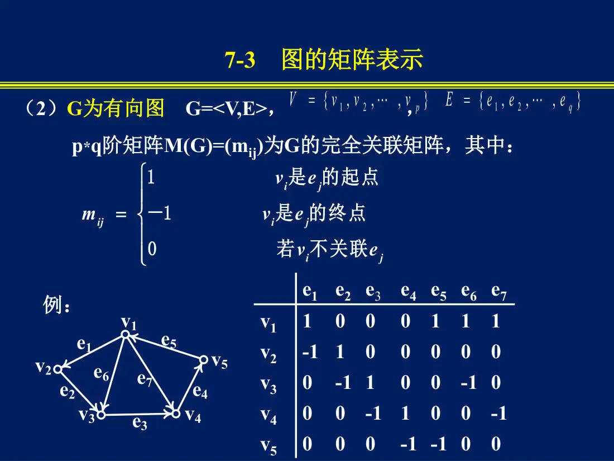

原文：

7-3 图的矩阵表示

(2) G为有向图 $G=<V,E>$ , $V=\{v_{1},v_{2},\cdots,v_{p}\}$ $E=\{e_{1},e_{2},\cdots,e_{q}\}$

p\*q阶矩阵M(G)=(m $_{ij}$ )为G的完全关联矩阵，其中：

$$
m _ {i j} = \left\{ \begin{array}{l} 1 \\ - 1 \\ 0 \end{array} \right.
$$

例：

$v_{i}$ 是 $e_{j}$ 的起点

$v_{i}$ 是 $e_j$ 的终点

若 $v_{i}$ 不关联 $e_{j}$

$$
\begin{array}{c c c c c c c c} & \mathrm{e} _ {1} & \mathrm{e} _ {2} & \mathrm{e} _ {3} & \mathrm{e} _ {4} & \mathrm{e} _ {5} & \mathrm{e} _ {6} & \mathrm{e} _ {7} \\ \hline \mathrm{v} _ {1} & 1 & 0 & 0 & 0 & 1 & 1 & 1 \\ \mathrm{v} _ {2} & - 1 & 1 & 0 & 0 & 0 & 0 & 0 \\ \mathrm{v} _ {3} & 0 & - 1 & 1 & 0 & 0 & - 1 & 0 \\ \mathrm{v} _ {4} & 0 & 0 & - 1 & 1 & 0 & 0 & - 1 \\ \mathrm{v} _ {5} & 0 & 0 & 0 & - 1 & - 1 & 0 & 0 \end{array}
$$

### 7-3 图的矩阵表示

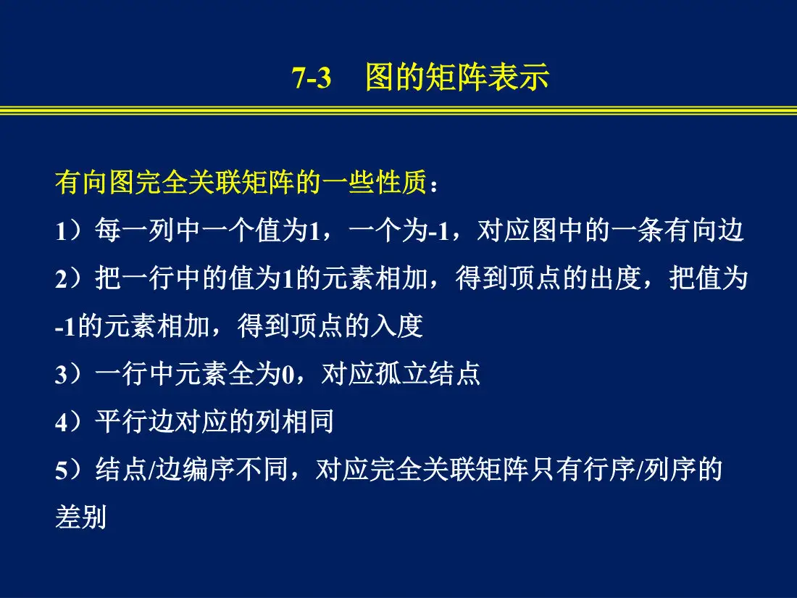

原文：

7-3 图的矩阵表示

有向图完全关联矩阵的一些性质：

1）每一列中一个值为1，一个为-1，对应图中的一条有向边

2）把一行中的值为1的元素相加，得到顶点的出度，把值为

-1的元素相加，得到顶点的入度

3）一行中元素全为0，对应孤立结点

4）平行边对应的列相同

5）结点/边编序不同，对应完全关联矩阵只有行序/列序的差别

### 7-3 图的矩阵表示

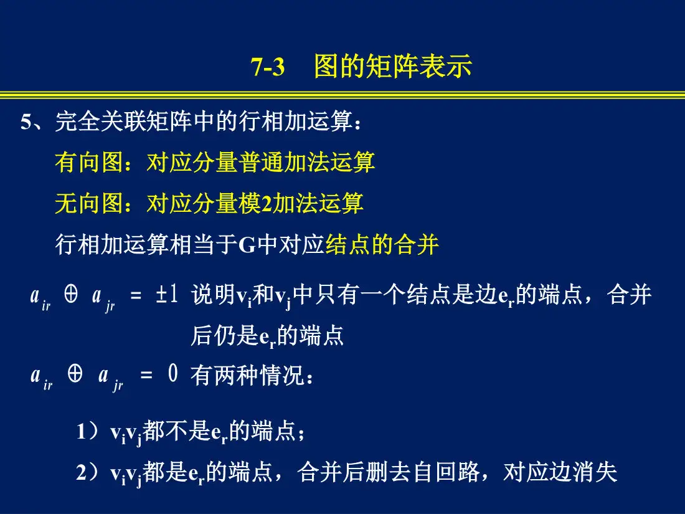

原文：

7-3 图的矩阵表示

5、完全关联矩阵中的行相加运算：

有向图：对应分量普通加法运算

无向图：对应分量模2加法运算

行相加运算相当于G中对应结点的合并

$a_{ir} \oplus a_{jr} = \pm 1$ 说明 $\mathbf{v}_{\mathrm{i}}$ 和 $\mathbf{v}_{\mathrm{j}}$ 中只有一个结点是边 $\mathbf{e}_{\mathrm{r}}$ 的端点，合并后仍是 $\mathbf{e}_{\mathrm{r}}$ 的端点

$a_{ir} \oplus a_{jr} = 0$ 有两种情况：

1） $\mathrm{v_i v_j}$ 都不是 $\mathrm{e_r}$ 的端点；

2） $\mathrm{v_i v_j}$ 都是 $\mathbf{e_r}$ 的端点，合并后删去自回路，对应边消失

### 7-3 图的矩阵表示

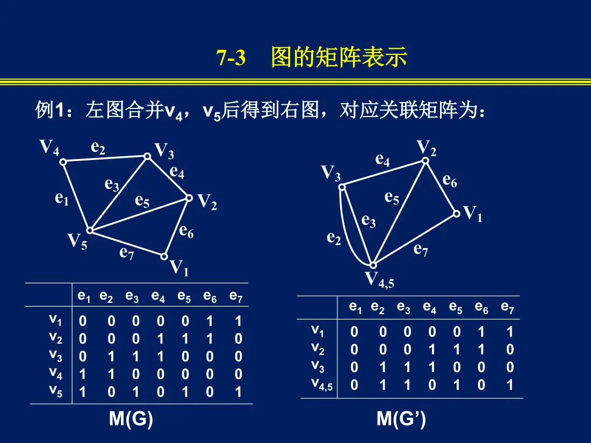

原文：

7-3 图的矩阵表示

例1：左图合并 $v_{4}$ ， $v_{5}$ 后得到右图，对应关联矩阵为：

### 7-3 图的矩阵表示

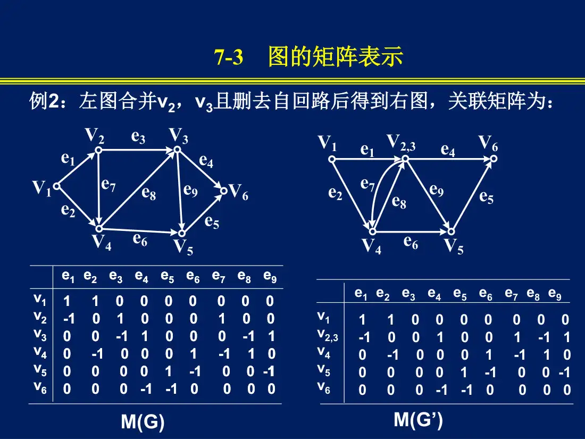

原文：

7-3 图的矩阵表示

例2：左图合并 $v_{2}$ ， $v_{3}$ 且删去自回路后得到右图，关联矩阵为：

<table><tr><td></td><td> $e_1$ </td><td> $e_2$ </td><td> $e_3$ </td><td> $e_4$ </td><td> $e_5$ </td><td> $e_6$ </td><td> $e_7$ </td><td> $e_8$ </td><td> $e_9$ </td></tr><tr><td> $V_1$ </td><td>1</td><td>1</td><td>0</td><td>0</td><td>0</td><td>0</td><td>0</td><td>0</td><td>0</td></tr><tr><td> $V_{2,3}$ </td><td>-1</td><td>0</td><td>0</td><td>1</td><td>0</td><td>0</td><td>1</td><td>-1</td><td>1</td></tr><tr><td> $V_4$ </td><td>0</td><td>-1</td><td>0</td><td>0</td><td>0</td><td>1</td><td>-1</td><td>1</td><td>0</td></tr><tr><td> $V_5$ </td><td>0</td><td>0</td><td>0</td><td>0</td><td>1</td><td>-1</td><td>0</td><td>0</td><td>-1</td></tr><tr><td> $V_6$ </td><td>0</td><td>0</td><td>0</td><td>-1</td><td>-1</td><td>0</td><td>0</td><td>0</td><td>0</td></tr></table>
M(G')

### 7-3 图的矩阵表示

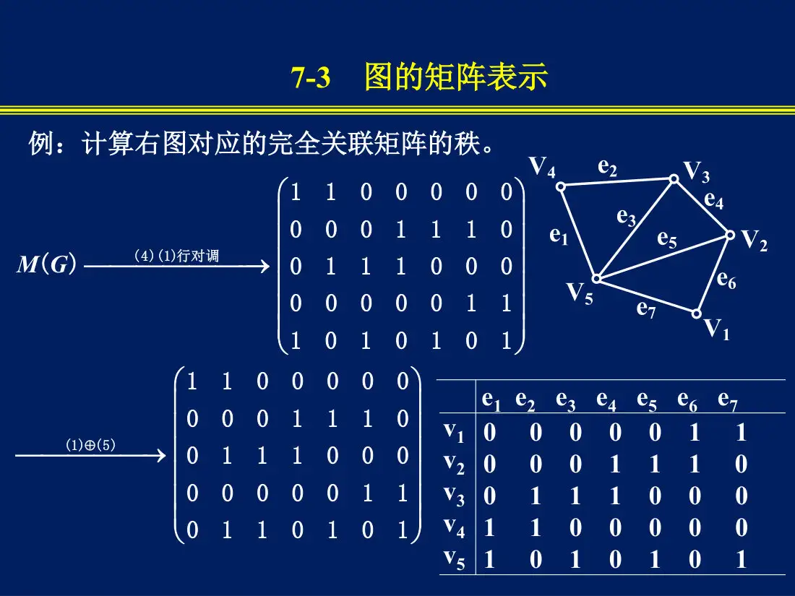

原文：

7-3 图的矩阵表示

例：计算右图对应的完全关联矩阵的秩。

M(G)

(4)(1)行对调

$$
\left( \begin{array}{c c c c c c c} 1 & 1 & 0 & 0 & 0 & 0 & 0 \\ 0 & 0 & 0 & 1 & 1 & 1 & 0 \\ 0 & 1 & 1 & 1 & 0 & 0 & 0 \\ 0 & 0 & 0 & 0 & 0 & 1 & 1 \\ 1 & 0 & 1 & 0 & 1 & 0 & 1 \end{array} \right)
$$

$$
\begin{array}{c} V _ {4} \quad e _ {2} \\ V _ {3} \quad e _ {4} \\ V _ {2} \quad e _ {5} \\ V _ {1} \quad e _ {6} \\ V _ {5} \quad e _ {7} \end{array}
$$

(1)⊕(5)

$$
\left( \begin{array}{c c c c c c c} 1 & 1 & 0 & 0 & 0 & 0 & 0 \\ 0 & 0 & 0 & 1 & 1 & 1 & 0 \\ 0 & 1 & 1 & 1 & 0 & 0 & 0 \\ 0 & 0 & 0 & 0 & 0 & 1 & 1 \\ 0 & 1 & 1 & 0 & 1 & 0 & 1 \end{array} \right)
$$

$$
\begin{array}{c c c c c c c c} & \mathrm{e} _ {1} & \mathrm{e} _ {2} & \mathrm{e} _ {3} & \mathrm{e} _ {4} & \mathrm{e} _ {5} & \mathrm{e} _ {6} & \mathrm{e} _ {7} \\ \hline \mathrm{v} _ {1} & 0 & 0 & 0 & 0 & 0 & 1 & 1 \\ \mathrm{v} _ {2} & 0 & 0 & 0 & 1 & 1 & 1 & 0 \\ \mathrm{v} _ {3} & 0 & 1 & 1 & 1 & 0 & 0 & 0 \\ \mathrm{v} _ {4} & 1 & 1 & 0 & 0 & 0 & 0 & 0 \\ \mathrm{v} _ {5} & 1 & 0 & 1 & 0 & 1 & 0 & 1 \end{array}
$$

### 7-3 图的矩阵表示

原文：

7-3 图的矩阵表示

$$
\begin{array}{r l} & \xrightarrow {(2) (3) \text {行对调}} \left( \begin{array}{c c c c c c c} 1 & 1 & 0 & 0 & 0 & 0 & 0 \\ 0 & 1 & 1 & 1 & 0 & 0 & 0 \\ 0 & 0 & 0 & 1 & 1 & 1 & 0 \\ 0 & 0 & 0 & 0 & 0 & 1 & 1 \\ 0 & 1 & 1 & 0 & 1 & 0 & 1 \end{array} \right) \xrightarrow {(2) \oplus (5)} \left( \begin{array}{c c c c c c c} 1 & 1 & 0 & 0 & 0 & 0 & 0 \\ 0 & 1 & 1 & 1 & 0 & 0 & 0 \\ 0 & 0 & 0 & 1 & 1 & 1 & 0 \\ 0 & 0 & 0 & 0 & 0 & 1 & 1 \nonumber \\ 0 & 0 & 0 & 1 & 1 & 0 & 1 \end{array} \right) \\ & \xrightarrow {(3) (4) \text {列对调}} \left( \begin{array}{c c c c c c c} 1 & 1 & 0 & 0 & 0 & 0 & 0 \\ 0 & 1 & 1 & 1 & 0 & 0 & 0 \\ 0 & 0 & 1 & 0 & 1 & 1 & 0 \\ 0 & 0 & 0 & 0 & 0 & 1 & 1 \\ 0 & 0 & 1 & 0 & 1 & 0 & 1 \end{array} \right) \xrightarrow {(3) \oplus (5)} \left( \begin{array}{c c c c c c c} 1 & 1 & 0 & 0 & 0 & 0 & 0 \\ 0 & 1 & 1 & 1 & 0 & 0 & 0 \\ 0 & 0 & 1 & 0 & 1 & 1 & 0 \\ 0 & 0 & 0 & 0 & 0 & 1 & 1 \nonumber \\ 0 & 0 & 0 & 0 & 0 & 1 & 1 \end{array} \right) \end{array}
$$

### 7-3 图的矩阵表示

原文：

7-3 图的矩阵表示

(4)(6)列对调

$$
\left( \begin{array}{c c c c c c c} 1 & 1 & 0 & 0 & 0 & 0 & 0 \\ 0 & 1 & 1 & 0 & 0 & 1 & 0 \\ 0 & 0 & 1 & 1 & 1 & 0 & 0 \\ 0 & 0 & 0 & 1 & 0 & 0 & 1 \\ 0 & 0 & 0 & 1 & 0 & 0 & 1 \end{array} \right) \xrightarrow {(4) \oplus (5)} \left( \begin{array}{c c c c c c c} 1 & 1 & 0 & 0 & 0 & 0 & 0 \\ 0 & 1 & 1 & 0 & 0 & 1 & 0 \\ 0 & 0 & 1 & 1 & 1 & 0 & 0 \\ 0 & 0 & 0 & 1 & 0 & 0 & 1 \\ \hline \end{array} \right)
$$

$\therefore \operatorname{rank} M(G) = 5 - 1 = 4$

### 7-3 图的矩阵表示

原文：

7-3 图的矩阵表示

定理: G为连通图, 有r个结点, 则其完全关联矩阵M(G)的秩为r-1, 即 $\text{rank } M(G)=r-1$ 证明: 对无向图, 用数学归纳法

(1) r = 1,2, 显然;

(2) 假设r - 1时成立。即连通图G有r - 1个结点, 则 $\text{rank } M(G) = r - 2$ (3) 证明结点数为r时成立

设M(G)的第一列对应边e, e的端点为v\_i和v\_j, 调整行使得第i行成为第一行, 则M(G)首列仅第一行和第j行为1, 将第一行加到第j行, 得

### 7-3 图的矩阵表示

原文：

7-3 图的矩阵表示

$$
M ^ {\prime} (G) = \left[ \begin{array}{l l l l} 1 & \dots & \dots & \dots \\ 0 & & & \\ \vdots & & M ^ {\prime} (G _ {1}) & \\ 0 & & & \end{array} \right]
$$

$M'(G_{1})$ 是 $G_{1}$ 的完全关联矩阵，而 $G_{1}$ 是G合

并 $v_{i}$ 和 $v_{j}$ 得到的，G是连通图，则 $G_{1}$ 也是连通图，故 $rank M(G_{1}) = r - 2$ $\therefore rank M(G) = rank M'(G) = 1 + rank M(G_{1}) = r - 1$

(可以应用行相加运算求秩)

推论：G有r个结点，w个极大连通子图，则图G的完全关联矩阵的秩为r-w

### 第七章 图论

原文：

第七章 图论

\- 图的基本概念

\- 路与回路

\- 图的矩阵表示

\- 欧拉图与哈密尔顿图

### 7-4 欧拉图与汉密尔顿图

原文：

7-4 欧拉图与汉密尔顿图

欧拉提出著名的哥尼斯堡七桥问题：环城“遍游”，即从某地出发，每座桥都仅走一遍，最后回到起点。

欧拉给出一个简单的准则说明哥尼斯堡七桥问题是不能解的。

下面给出欧拉路，欧拉回路，欧拉图，半欧拉图的概念。

### 7-4 欧拉图与汉密尔顿图

原文：

7-4 欧拉图与汉密尔顿图

1、欧拉图

(1) 定义: 给定无孤立结点图G,

欧拉路：通过图中每边一次且仅一次的路

欧拉回路：通过图中每边一次且仅一次的回路

半欧拉图：存在欧拉路的图

欧拉图：具有欧拉回路的图

对于半欧拉图或者欧拉图，由于其经过每条边，必定会

经过所有的点，因此必定是一个连通图，此外，关于图中

的结点的度数，也有相关定理及推论

### 7-4 欧拉图与汉密尔顿图

原文：

7-4 欧拉图与汉密尔顿图

(2) （半）欧拉图的判定方法
定理：无向图G具有一条欧拉路，当且仅当G是连通的，且有零个或两个奇数度结点

证明：

必要性：G具有欧拉路，设为 $v_{0}e_{1}v_{1}e_{2}v_{2}\cdots e_{i}v_{i}e_{i+1}\cdots e_{k}v_{k}$ ，结点可以重复出现，但是边不重复。

假设 $v_{i}$ 不是端点，在欧拉路中， $v_{i}$ 出现一次，关联两条边，度数必定为偶数。对于端点，若 $v_{0}=v_{k}$ ，则 $d(v_{0})$ 为偶数，若 $v_{0}\neq v_{k}$ ，则 $d(v_{0}),d(v_{k})$ 都为奇数。

所以 $G$ 中有零个或者两个奇数度结点。

### 7-4 欧拉图与汉密尔顿图

原文：

7-4 欧拉图与汉密尔顿图

充分性:

若 $G$ 连通，有零个或两个奇数度结点，构造欧拉路：

(1) 有两个奇数度结点, 从其中一个结点开始构造一条迹, 从 $v_{0}$ 出发经过关联边 $e_{1}$ 进入 $v_{1}$ , 若 $\deg (v_{1})$ 为偶数, 可由 $v_{1}$ 再经关联边 $e_{2}$ 到 $v_{2}$ , 如此下去, 每边仅取一次。由于 $G$ 连通, 必定可以到达另一个奇数度结点停下, 得到一条迹 $L$ 。

### 7-4 欧拉图与汉密尔顿图

原文：

7-4 欧拉图与汉密尔顿图

(2) 若 $G$ 中没有奇数度结点, 则从任一结点出发, 用上述方法必定可以回到此结点, 得到一条闭迹 $L_{1}$ 。

若 $L_{1}$ 包含了 $G$ 中的所有边，则 $L_{1}$ 就是欧拉路。

否则，去掉 $L_{1}$ 得到子图 $G'$ ，则 $G'$ 中每个结点的度数仍为偶数，且 $G'$ 中至少有一个结点与 $L_{1}$ 中某个结点重合，重复前面方法，得到闭迹 $L_{2}$ 。如果 $L_{1}$ 和 $L_{2}$ 合起来为图G，则得到欧拉路，否则继续。

### 7-4 欧拉图与汉密尔顿图

原文：

7-4 欧拉图与汉密尔顿图

推论：无向图G具有一条欧拉回路，当且仅当G是连通的，且所有结点的度数全为偶数

### 7-4 欧拉图与汉密尔顿图

原文：

7-4 欧拉图与汉密尔顿图

可见 $\deg(A) = 5$ ， $\deg(B) = \deg(C) = \deg(D) = 3$ ，故在图中不存在欧拉回路，哥尼斯堡七桥问题有了确切的否定答案

思考：无向完全图 $K_{p}$ 当 $p$ 取何值时为欧拉图？

奇数

### 7-4 欧拉图与汉密尔顿图

原文：

7-4 欧拉图与汉密尔顿图

(3) 一笔画问题:

1）从图G中某个结点出发，经过G中的每一边一次且仅一次到达另一个结点（半欧拉图）

2) 从图G中某个结点出发, 经过G中的每一边一次且仅一次回到该结点 (欧拉图)

### 7-4 欧拉图与汉密尔顿图

原文：

7-4 欧拉图与汉密尔顿图

(4) G为有向图: 单向欧拉路: 通过有向图G中每边一次且仅一次的单向路单向欧拉回路: 通过有向图G中每边一次且仅一次的单向回路定理:

有向图G具有一条单向欧拉回路，当且仅当G是连通的，且每个结点的入度等于出度

有向图G具有单向欧拉路，当且仅当G是连通的，且除两个结点外（一个结点的入度比出度大1，另一个结点的入度比出度小1），每个结点的入度等于出度

### 7-4 欧拉图与汉密尔顿图

原文：

7-4 欧拉图与汉密尔顿图

欧拉回路是边的遍历问题，而汉密尔顿回路则是点的遍历问题，即能否找到一条经过每个点一次且仅一次最终回到起点的回路。经典问题：十二面体问题

2、汉密尔顿图

(1) 定义: 给定图G,

汉密尔顿路：经过图中每个结点恰好一次的路

汉密尔顿回路：经过图中每个结点恰好一次的回路

半汉密尔顿图：具有汉密尔顿路的图

汉密尔顿图：具有汉密尔顿回路的图

### 7-4 欧拉图与汉密尔顿图

原文：

7-4 欧拉图与汉密尔顿图

(2) 必要条件的判定:

定理: 图G=<V,E>具有汉密尔顿回路, 则对于V的任何非空子集S, W(G-S)≤|S|成立, 其中W(G-S)是G-S的连通分支数。证明: 设C是G的一条汉密尔顿回路, 则对于V的任意非空子集S, 在C中删去S的任意一个结点a₁, 则C-a₁是连通的非回路。若再删去S中的另一结点a₂, 则W(C-a₁-a₂)≤2, 归纳可

得: W(C-S)≤|S|

而C-S是G-S的一个生成子图，有

W(G-S) ≤ W(C-S) ≤ |S|

### 7-4 欧拉图与汉密尔顿图

原文：

由此定理的结论，我们可以证明某些图是非汉密尔顿图下图中，选取 $S=\{v_{1},v_{4}\}$ ，则G-S中有三个分图，因此G不是汉

考虑：用上面定理能证明某个特定的图不是汉密尔顿图，那是否对于任意的非汉密尔顿图，都能用上面方法证明呢？如果不行，该如何处理？

7-4 欧拉图与汉密尔顿图

### 7-4 欧拉图与汉密尔顿图

原文：

7-4 欧拉图与汉密尔顿图

考虑彼得森图（不是汉密尔顿图）：

删去一个或两个结点，不能使图变为不连通图；删去三个结点，最多得到两个连通分支的子图；删去四个结点，最多得到三个连通分支的子图；删去五个或者五个以上的结点，剩余的结点个数不会超过五个，故子图的连通分支数也不会超过五

因而无法根据上述定理判定彼

得森图不是汉密尔顿图

### 7-4 欧拉图与汉密尔顿图

原文：

7-4 欧拉图与汉密尔顿图

另一个能判定非半汉密尔顿图的方法:

如果一个图中存在汉密尔顿路，我们用A标记图中的任意一个结点，所有与其相邻的结点标记为B，再标记所有邻接于B的结点为A，邻接于A的结点为B，直到所有的结点都有标记结束。如果出现相邻结点的标记相同时，在对应边上增加一个结点，加上相异标记。

如果图中存在汉密尔顿路，则必定交替通过结点A和B，所以A和B的个数必定相同。

如果A和B的个数不同，表明此图中肯定不会存在汉密尔顿路，不是半汉密尔顿图，更不是汉密尔顿图。

### 7-4 欧拉图与汉密尔顿图

原文：

7-4 欧拉图与汉密尔顿图

以此法标记彼得森图，得7个A9个B，可知不是汉密尔顿图。

### 7-4 欧拉图与汉密尔顿图

原文：

7-4 欧拉图与汉密尔顿图

不是汉密尔顿图

### 7-4 欧拉图与汉密尔顿图

原文：

7-4 欧拉图与汉密尔顿图

考虑：是否标上标记后，如果A和B的个数相等，图中就一定有汉密尔顿回路？

不是

例如下图3A3B，但仍不存在汉密尔顿路。

### 7-4 欧拉图与汉密尔顿图

原文：

7-4 欧拉图与汉密尔顿图

(3) 充分条件的判定:

1) 定理: 简单图G具有n个结点, G中每一对结点度数之和大于等于n-1, 则G中存在汉密尔顿路。

证明：

I. G是连通图：若G有两个或多个不连通的分图，设一个分图中有 $n_{1}$ 个结点，另一个分图中有 $n_{2}$ 个结点，分别在两个分图中选取两个结点 $v_{1}$ 和 $v_{2}$ ，可知 $d(v_{1}) \leq n_{1}-1$ ， $d(v_{2}) \leq n_{2}-1$ ， $d(v_{1}) + d(v_{2}) \leq n_{1} + n_{2}-2 < n-1$ ，与已知条件矛盾，所以G是连通图。

### 7-4 欧拉图与汉密尔顿图

原文：

7-4 欧拉图与汉密尔顿图

II. 构造汉密尔顿路:

设在G中有p-1条边的通路，p<n，其结点序列为 $v_{1},v_{2},\ldots,v_{p}$ 。

i) $v_{1}$ 或 $v_{p}$ 邻接于不在这条路上的一个结点: 加入这个结点, 扩展路, 得到 $p$ 条边的通路;

ii) $v_{1}$ 和 $v_{p}$ 只邻接于这条路上的结点，则需证明存在回路包含这 $p$ 个结点：

a) $v_{1}$ 邻接于 $v_{p}$ ，显然成立

### 7-4 欧拉图与汉密尔顿图

原文：

b) 假设 $v_{1}$ 的邻接点集是 $\{v_{l}, v_{m}, \ldots, v_{t}\}$ ， $2 \leq l, m, \ldots, t \leq p-1$ 。若 $v_{p}$ 邻接于 $v_{l-1}, v_{m-1}, \ldots, v_{t-1}$ 中的任意一个 $v_{j-1}$ ，则 $v_{1}v_{2} \ldots v_{j-1}v_{p}v_{p-1} \ldots v_{j}v_{1}$ 即为所求回路。若 $v_{p}$ 不邻接于 $v_{l-1}, v_{m-1}, \ldots, v_{t-1}$ 中的任意一个，则 $v_{p}$ 至多邻接于 $p-k-1$ 个结点， $deg(v_{p}) \leq p-k-1$ ， $deg(v_{1}) = k$ ，有 $deg(v_{1}) + deg(v_{p}) \leq p-1 < n-1$ ，与已知条件矛盾。由于G是连通图，所以必定存在不属于该回路的结点与回路中某个结点邻接，加入这个顶点，可以得到一个边为p的通路iii) 重复上面方法，可得到有n-1条边的通路

7-4 欧拉图与汉密尔顿图

### 7-4 欧拉图与汉密尔顿图

原文：

7-4 欧拉图与汉密尔顿图

只是充分条件而非必要
例如右图，n=6，任何两个结点之和为4<6-1<6，但G中存在汉密尔顿（回）路。

2) 定理: 简单图G具有n个结点, 如果G中每一对结点度数之和大于等于n, 则G中存在一条汉密尔顿回路。

同样的，这只是汉密尔顿回路存在的充分而非必要条件，从上例中类似可以推出。

### 7-4 欧拉图与汉密尔顿图

原文：

7-4 欧拉图与汉密尔顿图

(4) G的闭包
G=<V,E>有n个结点，将G中度数之和大于等于n的非邻接点连接起来得到图G'，对G'重复以上步骤，直到不再存在这样的结点对而得到的图，即为G的闭包，记为C(G)
例：

定理：G为汉密尔顿图，当且仅当其闭包是汉密尔顿图。

### 第七章 图论小结

原文：

第七章 图论小结

图、有/无向边、有/无向图、邻接点/边、孤立结点、零图、平凡图、自回路、结点度数、出/入度、多重图、完全图、补图、子图、生成子图、子图的补图、图的同构

路、迹、通路、圈、结点连通、连通分支、连通图、点/边割集、割点/边、连通度、边连通度、可达性、图的直径、单侧/强/弱连通、单侧/强/弱分图

邻接矩阵、可达性矩阵、完全关联矩阵

■ 欧拉（回）路、（半）欧拉图、汉密尔顿（回)路、（半）
汉密尔顿图、图的闭包
