# 《离散数学》第一章 命题逻辑（各章典型习题）

原件的每一页，下面附识别出的文字。

### 第一章 命题逻辑

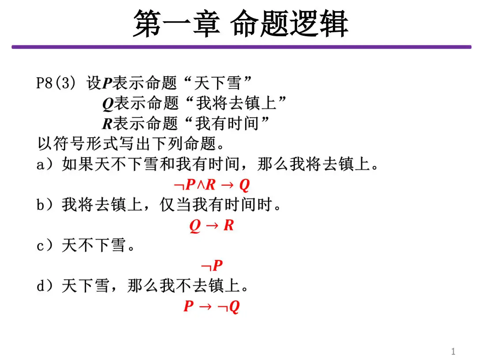

原文：

第一章 命题逻辑

P8(3) 设 $P$ 表示命题“天下雪”

Q表示命题“我将去镇上”

R表示命题“我有时间”

以符号形式写出下列命题。

a）如果天不下雪和我有时间，那么我将去镇上。

$$
\neg P \land R \rightarrow Q
$$

b）我将去镇上，仅当我有时间时。

$$
Q \rightarrow R
$$

c）天不下雪。

$$
\neg P
$$

d）天下雪，那么我不去镇上。

$$
P \rightarrow \neg Q
$$

1

### 第一章 命题逻辑

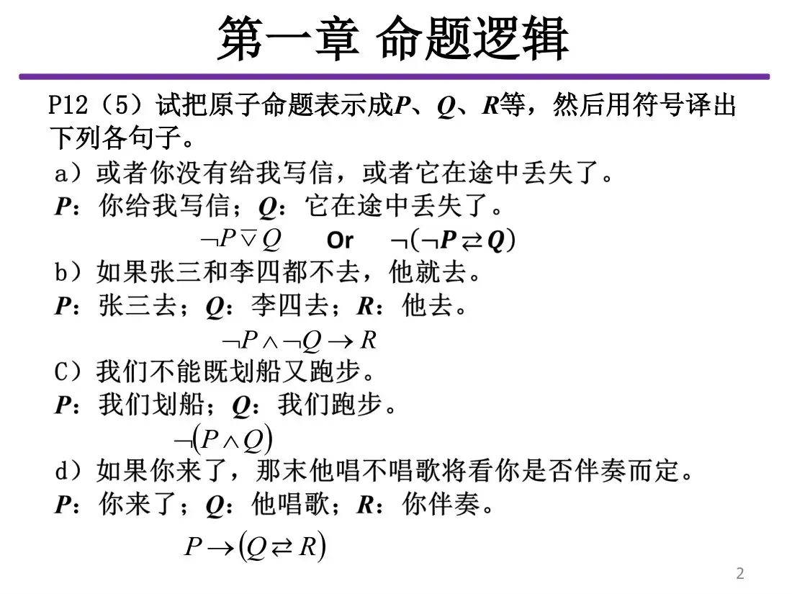

原文：

第一章 命题逻辑

P12（5）试把原子命题表示成 $P$ 、 $Q$ 、 $R$ 等，然后用符号译出下列各句子。

a）或者你没有给我写信，或者它在途中丢失了。

P: 你给我写信；Q：它在途中丢失了。

$$
\neg P \bar {\vee} Q \quad \mathbf {O r} \quad \neg (\neg P \rightleftarrows Q)
$$

b）如果张三和李四都不去，他就去。

P: 张三去; Q: 李四去; R: 他去。

$$
\neg P \land \neg Q \rightarrow R
$$

C）我们不能既划船又跑步。

P: 我们划船；Q：我们跑步。

$$
\neg (P \land Q)
$$

d）如果你来了，那末他唱不唱歌将看你是否伴奏而定。

P: 你来了；Q：他唱歌；R：你伴奏。

$$
P \rightarrow (Q \rightleftarrows R)
$$

2

### 第一章 命题逻辑

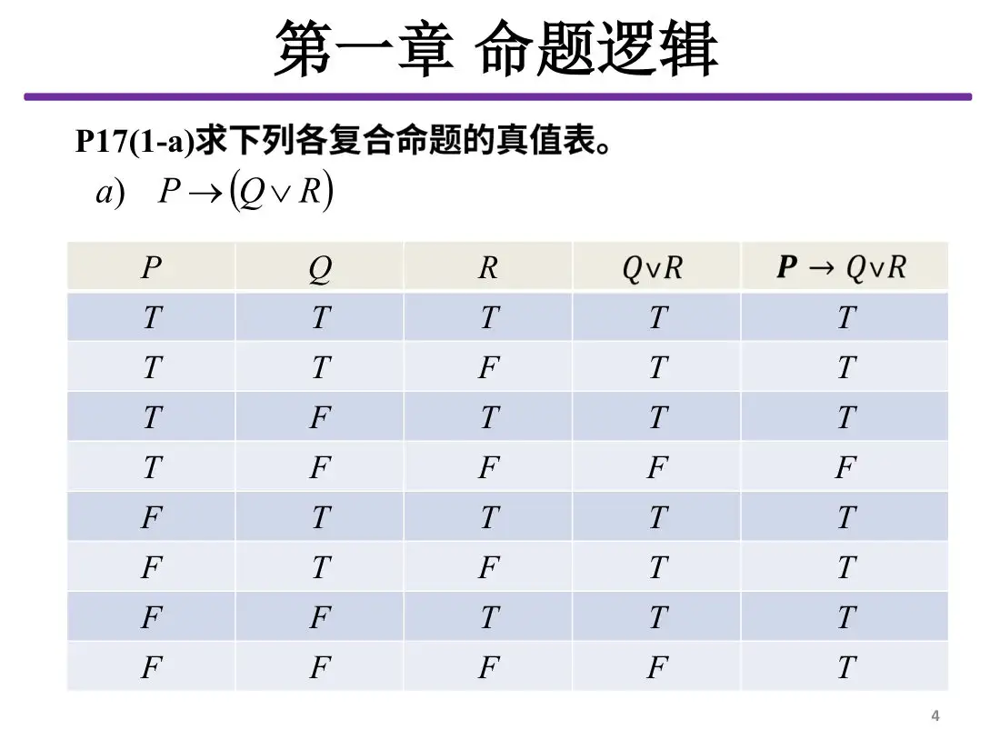

原文：

第一章 命题逻辑

P17(1-a)求下列各复合命题的真值表。

a) $P \rightarrow (Q \lor R)$

<table><tr><td>P</td><td>Q</td><td>R</td><td>QvR</td><td>P → QvR</td></tr><tr><td>T</td><td>T</td><td>T</td><td>T</td><td>T</td></tr><tr><td>T</td><td>T</td><td>F</td><td>T</td><td>T</td></tr><tr><td>T</td><td>F</td><td>T</td><td>T</td><td>T</td></tr><tr><td>T</td><td>F</td><td>F</td><td>F</td><td>F</td></tr><tr><td>F</td><td>T</td><td>T</td><td>T</td><td>T</td></tr><tr><td>F</td><td>T</td><td>F</td><td>T</td><td>T</td></tr><tr><td>F</td><td>F</td><td>T</td><td>T</td><td>T</td></tr><tr><td>F</td><td>F</td><td>F</td><td>F</td><td>T</td></tr></table>

4

### 第一章 命题逻辑

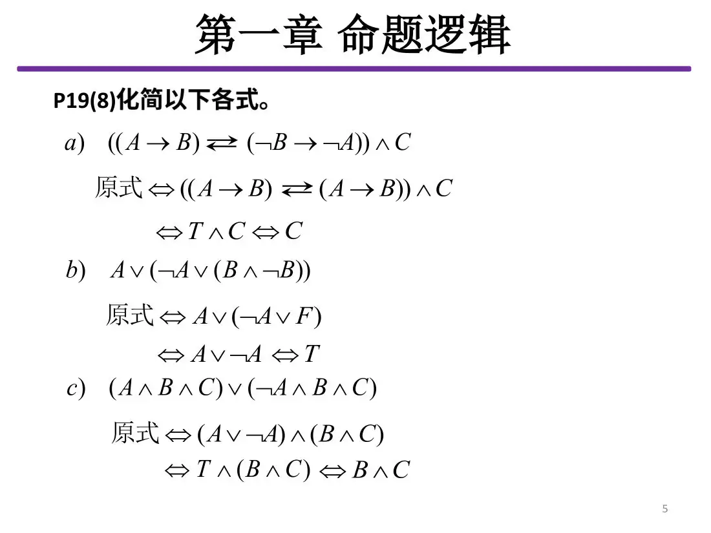

原文：

第一章 命题逻辑

P19(8)化简以下各式。

a) $((A\to B)\Longleftrightarrow (\neg B\to \neg A))\wedge C$

原式 $\Leftrightarrow ((A\to B)\Longleftrightarrow (A\to B))\land C$ $\Leftrightarrow T\land C\Leftrightarrow C$

b) $A \vee (\neg A \vee (B \land \neg B))$

原式 $\Leftrightarrow A\lor (\neg A\lor F)$

$$
\Leftrightarrow A \lor \lnot A \Leftrightarrow T
$$

c) $(A \land B \land C) \lor (\neg A \land B \land C)$ 原式 $\Leftrightarrow (A \lor \neg A) \land (B \land C)$ $\Leftrightarrow T \land (B \land C) \Leftrightarrow B \land C$

5

### 第一章 命题逻辑

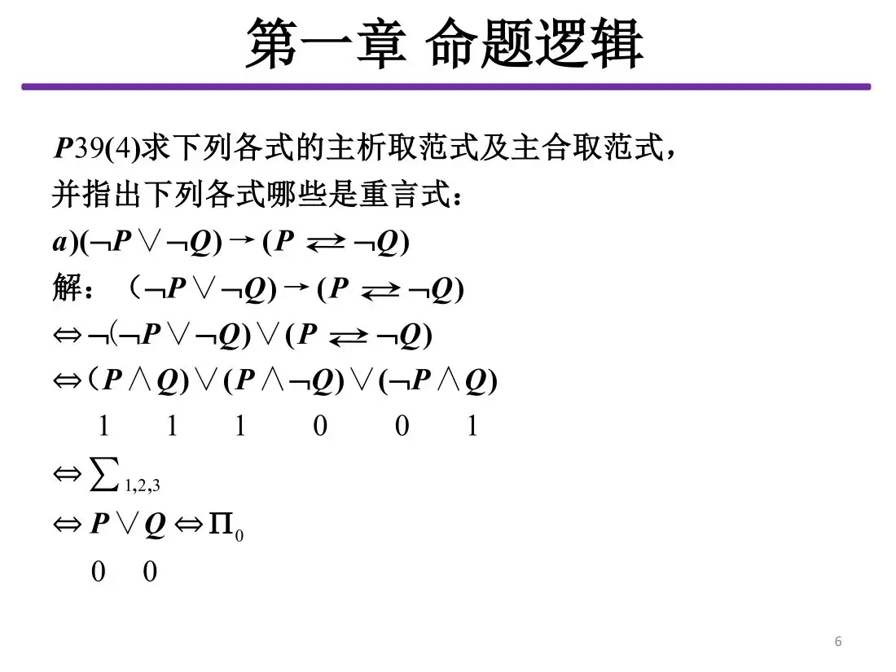

原文：

第一章 命题逻辑

P39(4)求下列各式的主析取范式及主合取范式，

并指出下列各式哪些是重言式:

$$
a) (\neg P \lor \neg Q) \rightarrow (P \rightleftarrows \neg Q)
$$

解： $(\neg P \lor \neg Q) \to (P \rightleftharpoons \neg Q)$

$$
\begin{array}{l}\Leftrightarrow \neg (\neg P \lor \neg Q) \lor (P \rightleftarrows \neg Q)\\\Leftrightarrow (P \land Q) \lor (P \land \neg Q) \lor (\neg P \land Q)\\1 \quad 1 \quad 1 \quad 0 \quad 0 \quad 1\\\Leftrightarrow \sum_ {1, 2, 3}\\\Leftrightarrow P \lor Q \Leftrightarrow \Pi_ {0}\\0 \quad 0\end{array}
$$

6

### 第一章 命题逻辑

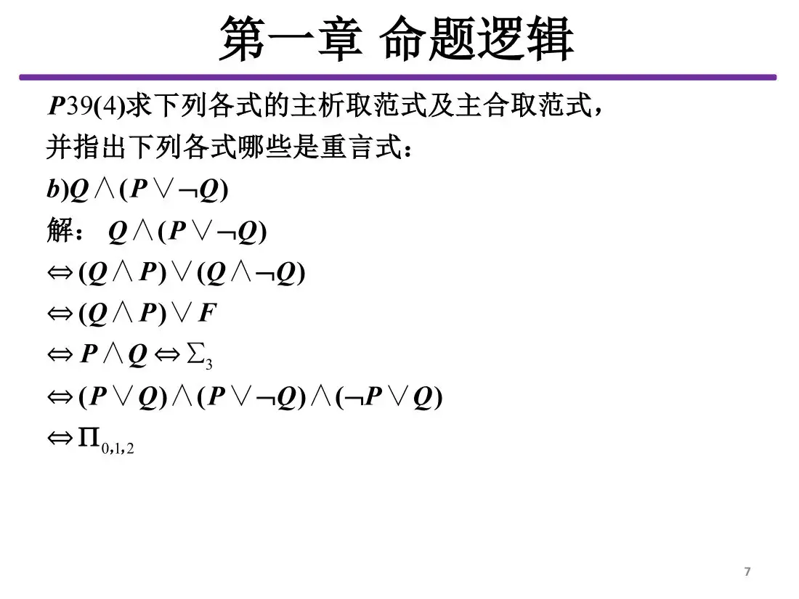

原文：

第一章 命题逻辑

P39(4)求下列各式的主析取范式及主合取范式，

并指出下列各式哪些是重言式:

7

### 第一章 命题逻辑

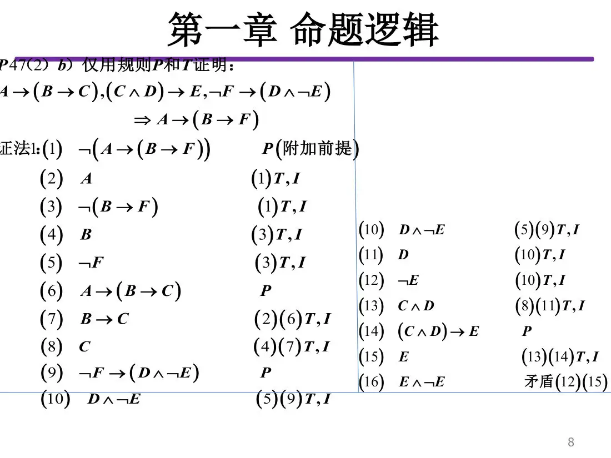

原文：

<table><tr><td colspan="5">P47(2)b)仅用规则P和T证明:</td></tr><tr><td colspan="5">A→(B→C),(C∧D)→E,¬F→(D∧¬E)⇒A→(B→F)</td></tr><tr><td>正法1:(1)</td><td>¬(A→(B→F))</td><td>P(附加前提)</td><td></td><td></td></tr><tr><td>(2)</td><td>A</td><td>(1)T,I</td><td></td><td></td></tr><tr><td>(3)</td><td>¬(B→F)</td><td>(1)T,I</td><td></td><td></td></tr><tr><td>(4)</td><td>B</td><td>(3)T,I</td><td>(10) D∧¬E</td><td>(5)(9)T,I</td></tr><tr><td>(5)</td><td>¬F</td><td>(3)T,I</td><td>(11) D</td><td>(10)T,I</td></tr><tr><td>(6)</td><td>A→(B→C)</td><td>P</td><td>(12) ¬E</td><td>(10)T,I</td></tr><tr><td>(7)</td><td>B→C</td><td>(2)(6)T,I</td><td>(13) C∧D</td><td>(8)(11)T,I</td></tr><tr><td>(8)</td><td>C</td><td>(4)(7)T,I</td><td>(14) (C∧D)→E</td><td>P</td></tr><tr><td>(9)</td><td>¬F→(D∧¬E)</td><td>P</td><td>(15) E</td><td>(13)(14)T,I</td></tr><tr><td>(10)</td><td>D∧¬E</td><td>(5)(9)T,I</td><td>(16) E∧¬E</td><td>矛盾(12)(15)</td></tr></table>

第一章 命题逻辑

8

### 第一章 命题逻辑

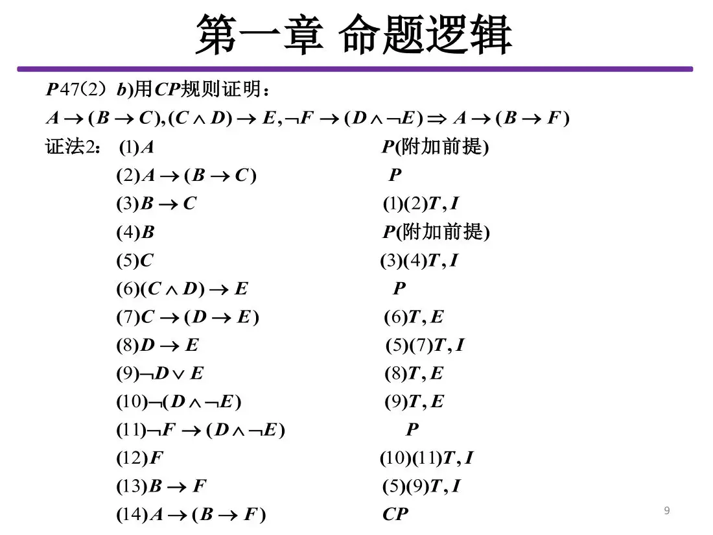

原文：

第一章 命题逻辑

P47(2) b)用CP规则证明：

$$
A \rightarrow (B \rightarrow C), (C \land D) \rightarrow E, \lnot F \rightarrow (D \land \lnot E) \Rightarrow A \rightarrow (B \rightarrow F)
$$

证法2: (1)A

$P(\text{附加前提})$

(2) $A \rightarrow (B \rightarrow C)$

(3) $B\to C$ (1)(2) $T,I$

(4)B P(附加前提)

(5) $C$ (3)(4) $T, I$

(6) $(C\land D)\to E$

(7) $C\to (D\to E)$

(6) $T, E$

(8) $D\to E$

(5)(7)T,I

(9) $\neg D \lor E$

(8) $T, E$

(10) $\neg(D \land \neg E)$

(9) $T, E$

(11) $\neg F\to (D\land \neg E)$ $P$

(12) $F$ (10)(11) $\pmb{T},\pmb{I}$

(13) $B\to F$ (5)(9) $T,I$

(14) $A \rightarrow (B \rightarrow F)$

CP

9

### 第二章 谓词逻辑

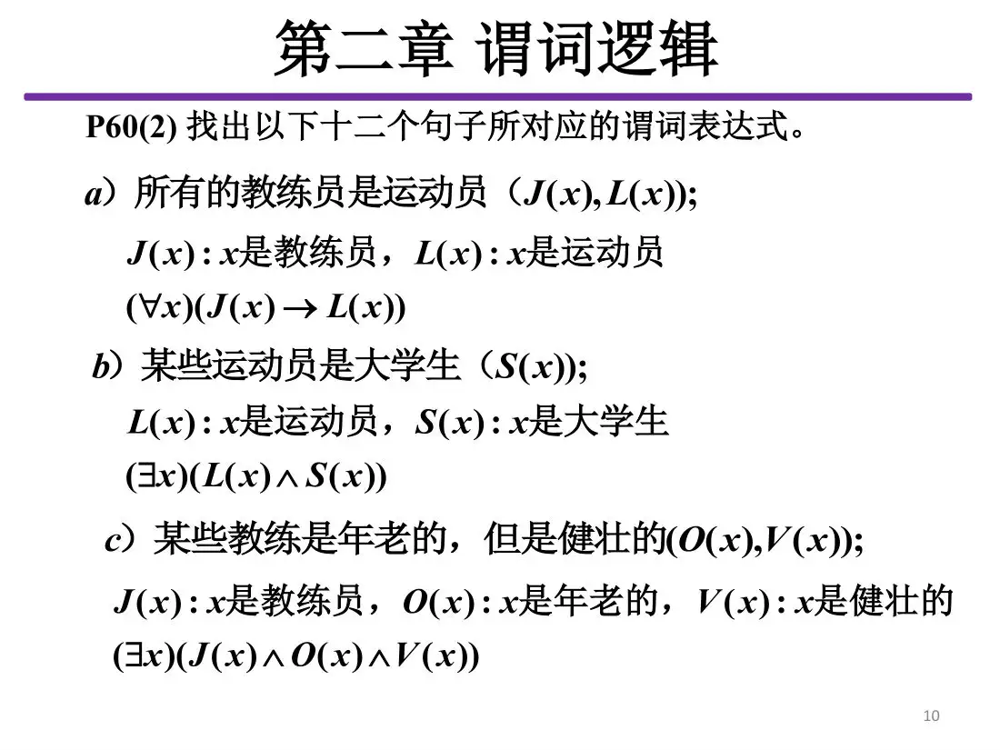

原文：

第二章 谓词逻辑

P60(2) 找出以下十二个句子所对应的谓词表达式。

a）所有的教练员是运动员 $(J(x),L(x))$ ; $J(x):x$ 是教练员， $L(x):x$ 是运动员 $(\forall x)(J(x)\rightarrow L(x))$

b) 某些运动员是大学生 $(S(x))$ ; $L(x)$ : x 是运动员， $S(x)$ : x 是大学生 $(\exists x)(L(x)\land S(x))$

c) 某些教练是年老的，但是健壮的 $(O(x), V(x))$ ; $J(x)$ : x 是教练员， $O(x)$ : x 是年老的， $V(x)$ : x 是健壮的 $(\exists x)(J(x)\land O(x)\land V(x))$

10

### 第二章 谓词逻辑

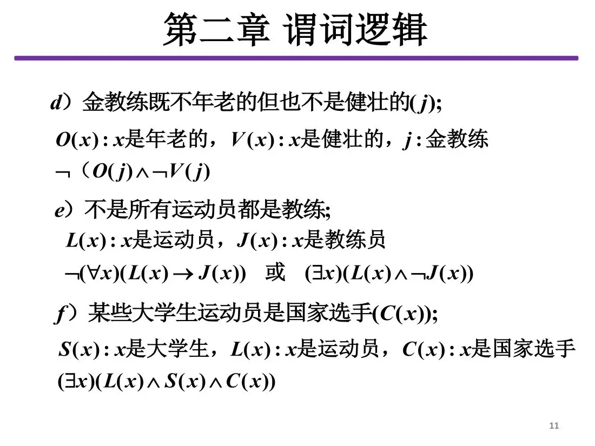

原文：

第二章 谓词逻辑

d）金教练既不年老的但也不是健壮的(j);

$O(x):x$ 是年老的， $V(x):x$ 是健壮的，j:金教练 $\neg (O(j)\land\neg V(j)$

e) 不是所有运动员都是教练; $L(x)$ : x 是运动员, $J(x)$ : x 是教练员 $\neg(\forall x)(L(x)\rightarrow J(x))$ 或 $(\exists x)(L(x)\land\neg J(x))$

f）某些大学生运动员是国家选手 $(C(x))$ ;

$S(x):x$ 是大学生， $L(x):x$ 是运动员， $C(x):x$ 是国家选手 $(\exists x)(L(x)\land S(x)\land C(x))$

11

### 第二章 谓词逻辑

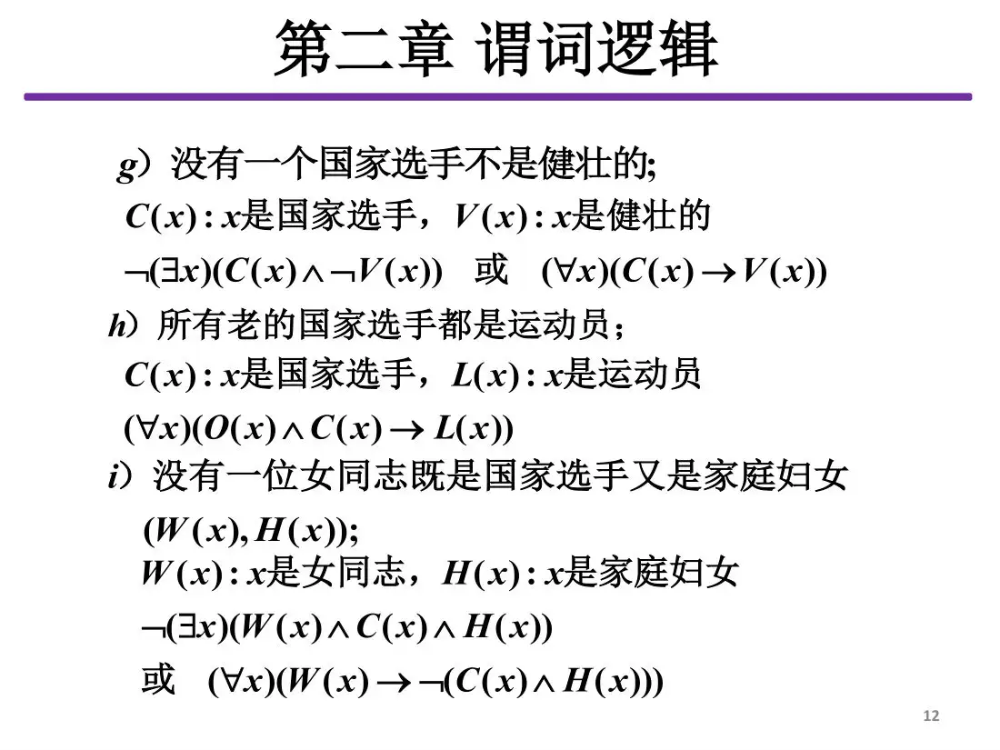

原文：

第二章 谓词逻辑

g) 没有一个国家选手不是健壮的; $C(x)$ : x 是国家选手, $V(x)$ : x 是健壮的 $\neg(\exists x)(C(x)\land\neg V(x))$ 或 $(\forall x)(C(x)\rightarrow V(x))$

h) 所有老的国家选手都是运动员； $C(x)$ : x 是国家选手， $L(x)$ : x 是运动员 $(\forall x)(O(x)\land C(x)\rightarrow L(x))$

i) 没有一位女同志既是国家选手又是家庭妇女 $(W(x), H(x))$ ; $W(x)$ : x 是女同志， $H(x)$ : x 是家庭妇女 $\neg(\exists x)(W(x)\land C(x)\land H(x))$ 或 $(\forall x)(W(x)\rightarrow\neg(C(x)\land H(x)))$

12

### 第二章 谓词逻辑

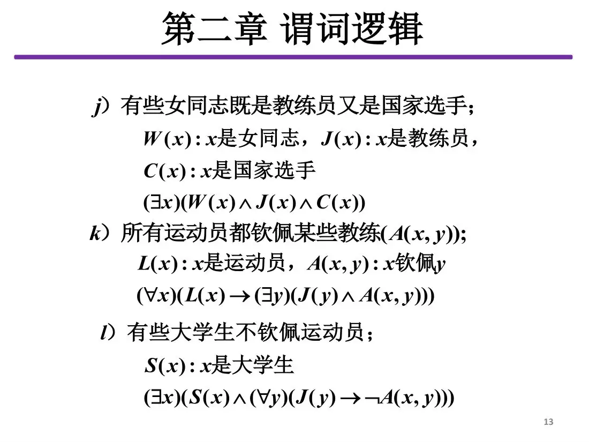

原文：

第二章 谓词逻辑

j）有些女同志既是教练员又是国家选手；

$W(x):x$ 是女同志， $J(x):x$ 是教练员，

$C(x)$ : x 是国家选手

$$
(\exists x) (W (x) \land J (x) \land C (x))
$$

k）所有运动员都钦佩某些教练 $(A(x,y))$ ; $L(x)$ : x 是运动员， $A(x,y)$ : x 钦佩 $(\forall x)(L(x)\rightarrow(\exists y)(J(y)\land A(x,y)))$

l）有些大学生不钦佩运动员；

$S(x)$ : x 是大学生

$$
(\exists x) (S (x) \land (\forall y) (J (y) \rightarrow \neg A (x, y)))
$$

13

### 第三章 集合与关系

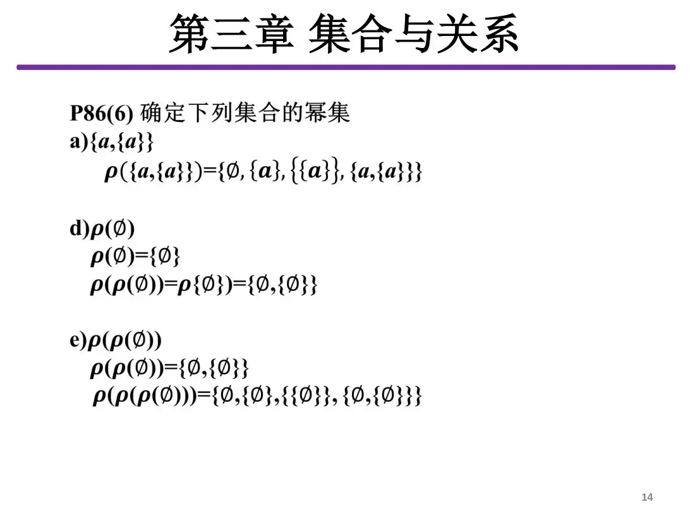

原文：

第三章 集合与关系

14

### 第三章 集合与关系

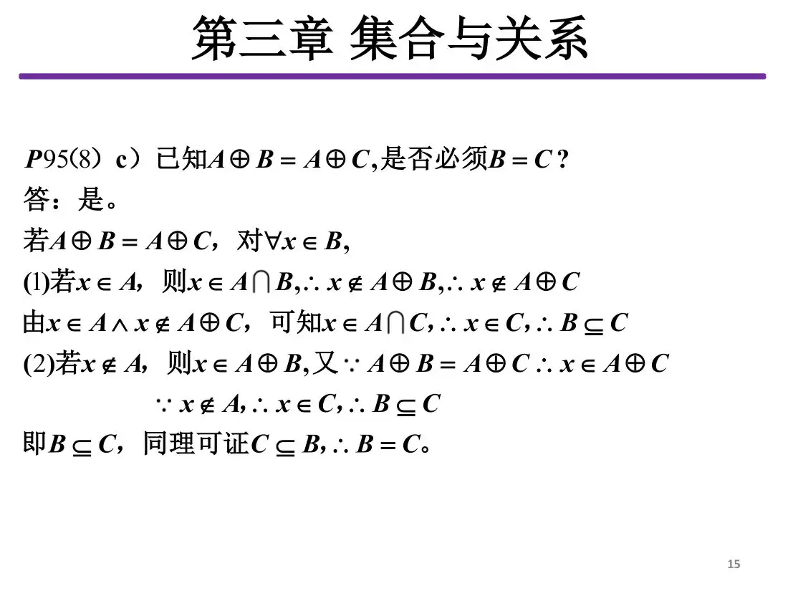

原文：

第三章 集合与关系

P95(8) c）已知 $A\oplus B=A\oplus C$ ，是否必须B=C？

答：是。

若 $A\oplus B=A\oplus C$ ，对 $\forall x\in B,$

(1)若 $x \in A$ ，则 $x \in A \cap B, \therefore x \notin A \oplus B, \therefore x \notin A \oplus C$

由 $x \in A \land x \notin A \oplus C$ ，可知 $x \in A \cap C, \therefore x \in C, \therefore B \subseteq C$

(2)若 $x \notin A$ ，则 $x \in A \oplus B$ , 又 $\because A \oplus B = A \oplus C \therefore x \in A \oplus C$

$$
\because x \notin A, \therefore x \in C, \therefore B \subseteq C
$$

即 $B \subseteq C$ ，同理可证 $C \subseteq B, \therefore B = C$ 。

15

### 第三章 集合与关系

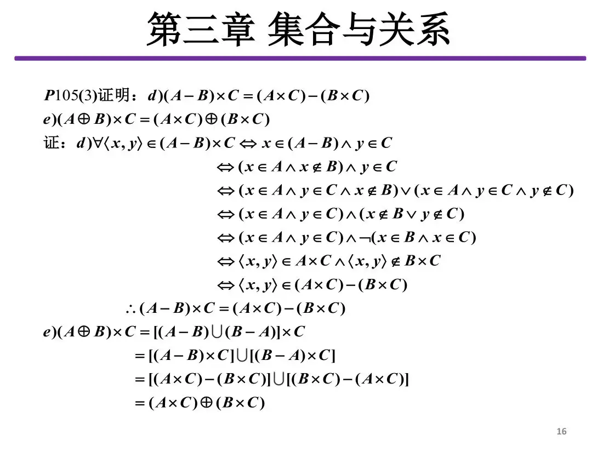

原文：

第三章 集合与关系

P105(3)证明： $d)(A - B)\times C = (A\times C) - (B\times C)$

$$
e) (A \oplus B) \times C = (A \times C) \oplus (B \times C)
$$

证：

$$
\begin{array}{r l} \mathbb {E}: d) \forall \langle x, y \rangle \in (A - B) \times C & \Leftrightarrow x \in (A - B) \land y \in C \\ & \Leftrightarrow (x \in A \land x \notin B) \land y \in C \\ & \Leftrightarrow (x \in A \land y \in C \land x \notin B) \lor (x \in A \land y \in C \land y \notin C) \\ & \Leftrightarrow (x \in A \land y \in C) \land (x \notin B \lor y \notin C) \\ & \Leftrightarrow (x \in A \land y \in C) \land \lnot (x \in B \land x \in C) \\ & \Leftrightarrow \langle x, y \rangle \in A \times C \land \langle x, y \rangle \notin B \times C \\ & \Leftrightarrow \langle x, y \rangle \in (A \times C) - (B \times C) \end{array}
$$

$$
\therefore (A - B) \times C = (A \times C) - (B \times C)
$$

$$
\begin{array}{r l} e) (A \oplus B) \times C & = [ (A - B) \bigcup (B - A) ] \times C \\ & = [ (A - B) \times C ] \bigcup [ (B - A) \times C ] \\ & = [ (A \times C) - (B \times C) ] \bigcup [ (B \times C) - (A \times C) ] \\ & = (A \times C) \oplus (B \times C) \end{array}
$$

16

### 第三章 集合与关系

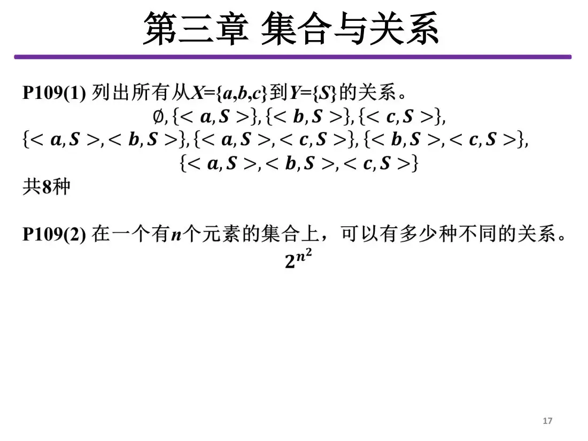

原文：

第三章 集合与关系

P109(1) 列出所有从 $X=\{a,b,c\}$ 到 $Y=\{S\}$ 的关系。

$$
\emptyset , \{<   a, S > \}, \{<   b, S > \}, \{<   c, S > \},
$$

$$
\begin{array}{c} \{\langle a, S >, <   b, S > \}, \{\langle a, S >, <   c, S > \}, \{\langle b, S >, <   c, S > \}, \\ \{\langle a, S >, <   b, S >, <   c, S > \} \end{array}
$$

共8种

P109(2) 在一个有 $n$ 个元素的集合上，可以有多少种不同的关系。

$$
2 ^ {n ^ {2}}
$$

17

### 第三章 集合与关系

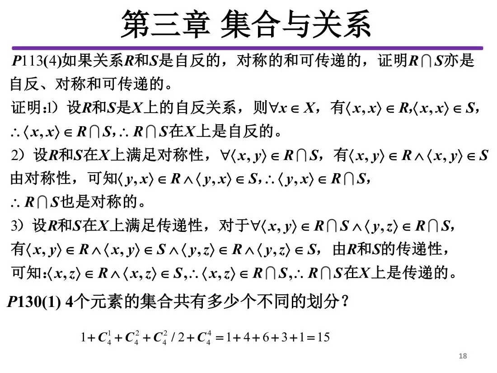

原文：

第三章 集合与关系

P113(4)如果关系R和S是自反的，对称的和可传递的，证明 $R \cap S$ 亦是自反、对称和可传递的。

证明:1) 设R和S是X上的自反关系，则 $\forall x\in X$ ，有 $\langle x,x\rangle\in R,\langle x,x\rangle\in S,$ $\therefore\langle x,x\rangle\in R\cap S,\therefore R\cap S$ 在X上是自反的。

2）设R和S在X上满足对称性， $\forall\langle x,y\rangle\in R\cap S$ ，有 $\langle x,y\rangle\in R\land\langle x,y\rangle\in S$ 由对称性，可知 $\langle y,x\rangle\in R\land\langle y,x\rangle\in S,\therefore\langle y,x\rangle\in R\cap S,$ ∴ $R \cap S$ 也是对称的。

3）设R和S在X上满足传递性，对于 $\forall\langle x,y\rangle\in R\cap S\land\langle y,z\rangle\in R\cap S,$ 有 $\langle x,y\rangle\in R\land\langle x,y\rangle\in S\land\langle y,z\rangle\in R\land\langle y,z\rangle\in S,$ 由R和S的传递性，可知： $\langle x,z\rangle\in R\land\langle x,z\rangle\in S,\therefore\langle x,z\rangle\in R\cap S,\therefore R\cap S$ 在X上是传递的。

P130(1) 4个元素的集合共有多少个不同的划分？

$$
1 + C _ {4} ^ {1} + C _ {4} ^ {2} + C _ {4} ^ {2} / 2 + C _ {4} ^ {4} = 1 + 4 + 6 + 3 + 1 = 1 5
$$

18

### 第三章 集合与关系

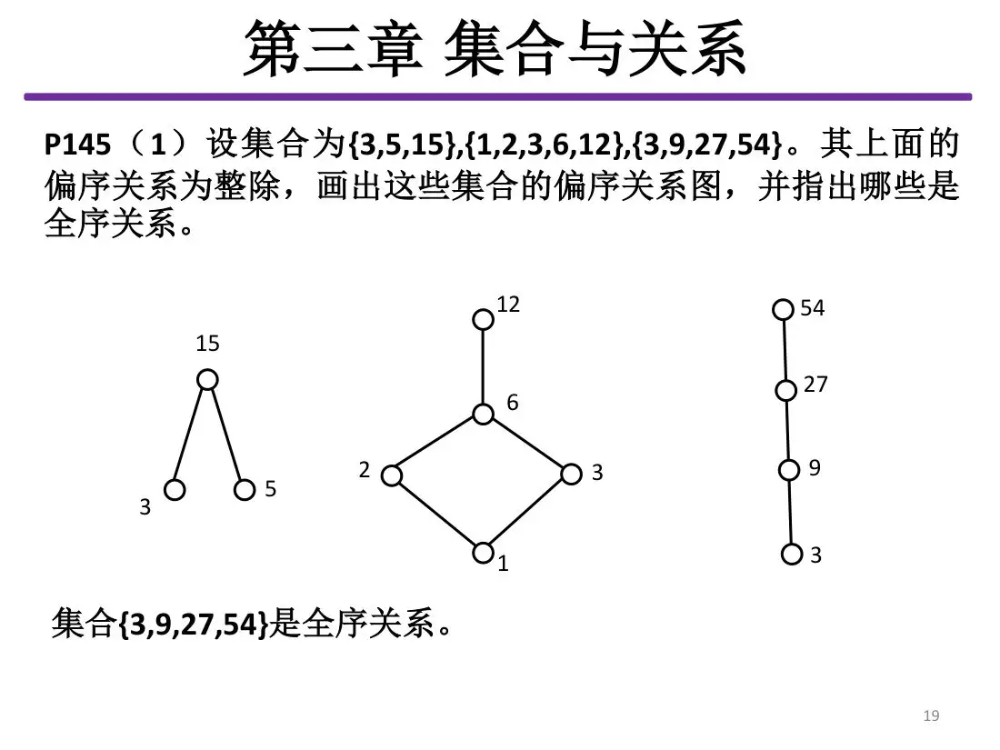

原文：

第三章 集合与关系

P145（1）设集合为{3,5,15},{1,2,3,6,12},{3,9,27,54}。其上面的偏序关系为整除，画出这些集合的偏序关系图，并指出哪些是全序关系。

集合{3,9,27,54}是全序关系。

19

### 第三章 集合与关系

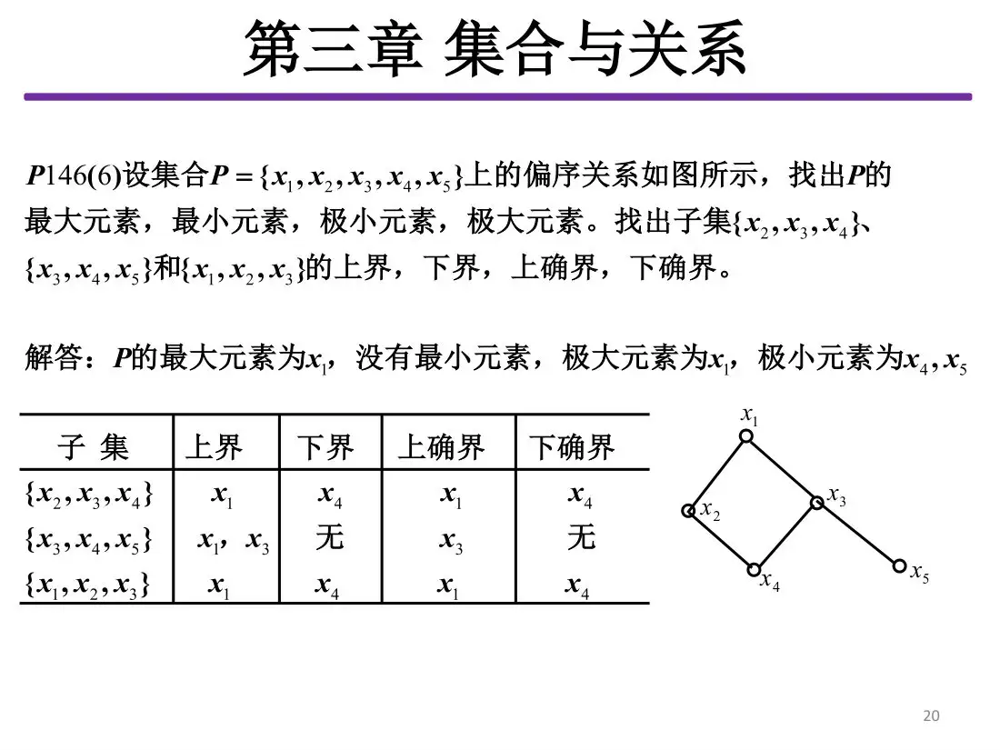

原文：

第三章 集合与关系

P146(6)设集合 $P=\{x_{1},x_{2},x_{3},x_{4},x_{5}\}$ 上的偏序关系如图所示，找出P的最大元素，最小元素，极小元素，极大元素。找出子集 $\{x_{2},x_{3},x_{4}\}$ 、 $\{x_{3},x_{4},x_{5}\}$ 和 $\{x_{1},x_{2},x_{3}\}$ 的上界，下界，上确界，下确界。

解答： $P$ 的最大元素为 $x_{1}$ ，没有最小元素，极大元素为 $x_{1}$ ，极小元素为 $x_{4},x_{5}$

<table><tr><td>子集</td><td>上界</td><td>下界</td><td>上确界</td><td>下确界</td></tr><tr><td> $\{x_2, x_3, x_4\}$ </td><td> $x_1$ </td><td> $x_4$ </td><td> $x_1$ </td><td> $x_4$ </td></tr><tr><td> $\{x_3, x_4, x_5\}$ </td><td> $x_1, x_3$ </td><td>无</td><td> $x_3$ </td><td>无</td></tr><tr><td> $\{x_1, x_2, x_3\}$ </td><td> $x_1$ </td><td> $x_4$ </td><td> $x_1$ </td><td> $x_4$ </td></tr></table>

20

### 第五章 代数系统

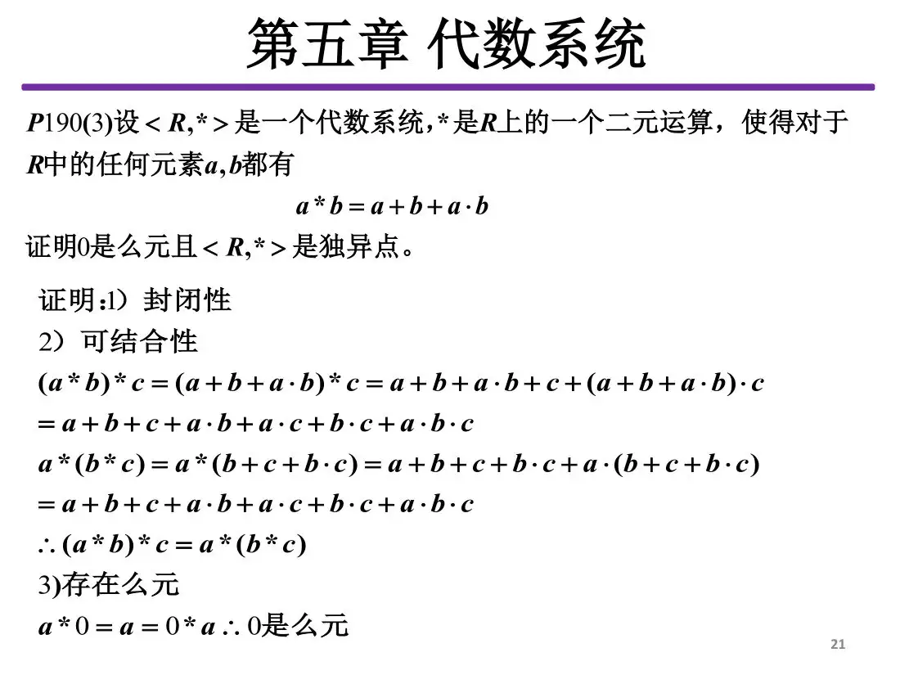

原文：

第五章 代数系统

P190(3)设 $< R, ^{*}>$ 是一个代数系统，\*是 $R$ 上的一个二元运算，使得对于 $R$ 中的任何元素 $a, b$ 都有

$$
\boldsymbol {a} ^ {*} \boldsymbol {b} = \boldsymbol {a} + \boldsymbol {b} + \boldsymbol {a} \cdot \boldsymbol {b}
$$

证明0是么元且 $< R, ^{*} >$ 是独异点。

证明:1) 封闭性

2）可结合性

$$
\begin{array}{r l} & {(a ^ {*} b) ^ {*} c = (a + b + a \cdot b) ^ {*} c = a + b + a \cdot b + c + (a + b + a \cdot b) \cdot c} \\ & {= a + b + c + a \cdot b + a \cdot c + b \cdot c + a \cdot b \cdot c} \\ & {a ^ {*} (b ^ {*} c) = a ^ {*} (b + c + b \cdot c) = a + b + c + b \cdot c + a \cdot (b + c + b \cdot c)} \\ & {= a + b + c + a \cdot b + a \cdot c + b \cdot c + a \cdot b \cdot c} \\ & {\therefore (a ^ {*} b) ^ {*} c = a ^ {*} (b ^ {*} c)} \end{array}
$$

3)存在么元

$a*0=a=0*a\therefore0$ 是么元

21

### 第五章 代数系统

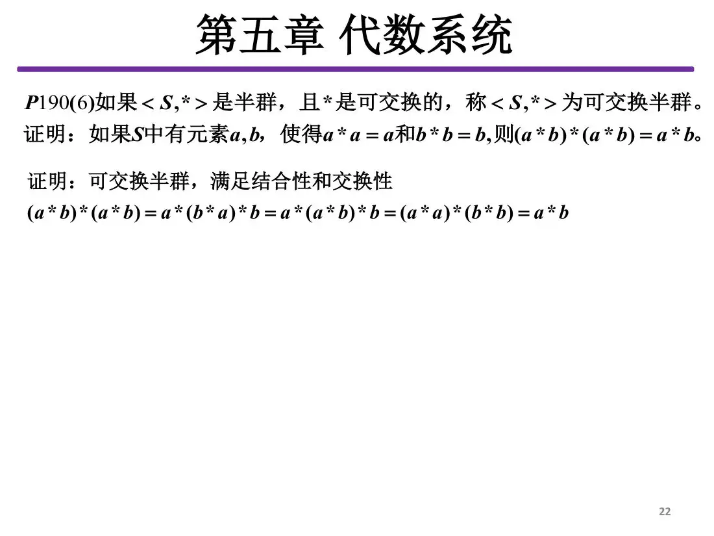

原文：

第五章 代数系统

$P190(6)$ 如果 $<S,*>$ 是半群，且\*是可交换的，称 $<S,*>$ 为可交换半群。

证明：如果S中有元素a,b，使得 $a*a=a$ 和 $b*b=b$ ，则 $(a*b)*(a*b)=a*b$ 。

证明：可交换半群，满足结合性和交换性

$$
(a ^ {*} b) ^ {*} (a ^ {*} b) = a ^ {*} (b ^ {*} a) ^ {*} b = a ^ {*} (a ^ {*} b) ^ {*} b = (a ^ {*} a) ^ {*} (b ^ {*} b) = a ^ {*} b
$$

22

### 第五章 代数系统

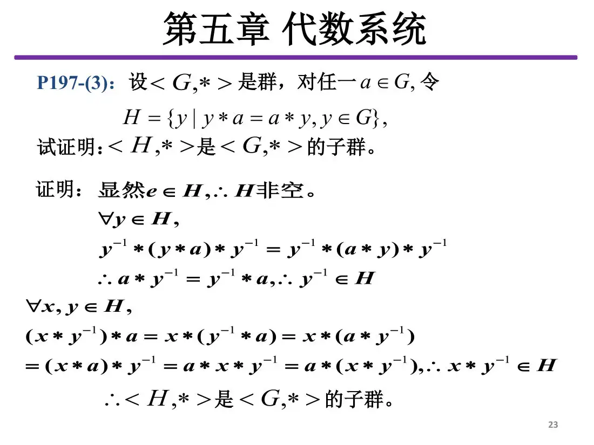

原文：

第五章 代数系统

P197-(3): 设 $< G, * >$ 是群，对任一 $a \in G$ , 令

$$
H = \{y \mid y * a = a * y, y \in G \},
$$

试证明：<H,\*>是<G,\*>的子群。

证明：显然 $e \in H, \therefore H$ 非空。

$$
\forall y \in H,
$$

$$
y ^ {- 1} * (y * a) * y ^ {- 1} = y ^ {- 1} * (a * y) * y ^ {- 1}
$$

$$
\therefore a * y ^ {- 1} = y ^ {- 1} * a, \therefore y ^ {- 1} \in H
$$

$\forall x,y\in H,$

$$
(x * y ^ {- 1}) * a = x * (y ^ {- 1} * a) = x * (a * y ^ {- 1})
$$

$$
= (x * a) * y ^ {- 1} = a * x * y ^ {- 1} = a * (x * y ^ {- 1}), \therefore x * y ^ {- 1} \in H
$$

$\therefore < H, * >$ 是 $< G, * >$ 的子群。

23

### 第六章 格与布尔代数

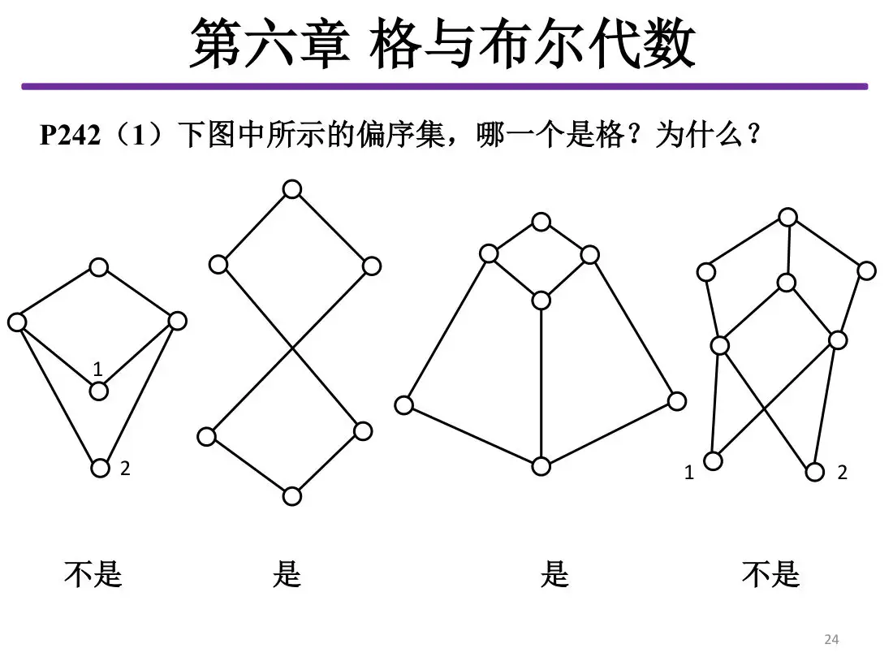

原文：

第六章 格与布尔代数

P242（1）下图中所示的偏序集，哪一个是格？为什么？

24

### 第六章 格与布尔代数

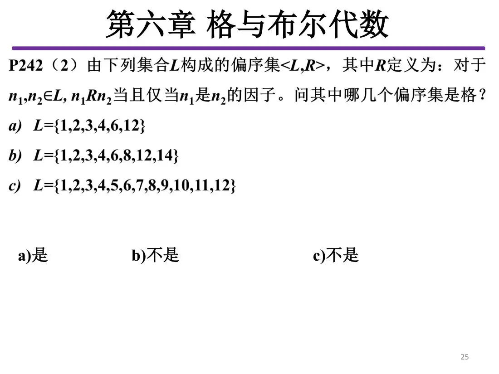

原文：

第六章 格与布尔代数

P242（2）由下列集合L构成的偏序集 $< L, R>$ ，其中R定义为：对于 $n_1, n_2 \in L, n_1 R n_2$ 当且仅当 $n_1$ 是 $n_2$ 的因子。问其中哪几个偏序集是格？  
a) $L = \{1, 2, 3, 4, 6, 12\}$ b) $L = \{1, 2, 3, 4, 6, 8, 12, 14\}$ c) $L = \{1, 2, 3, 4, 5, 6, 7, 8, 9, 10, 11, 12\}$

a)是

b)不是

c)不是

25

### 第六章 格与布尔代数

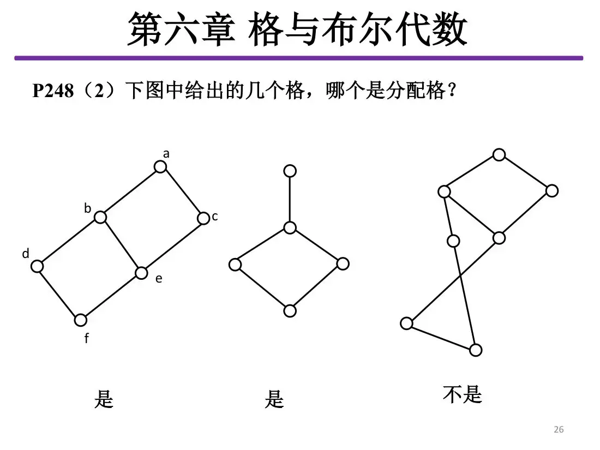

原文：

第六章 格与布尔代数

P248（2）下图中给出的几个格，哪个是分配格？

26

### 第六章 格与布尔代数

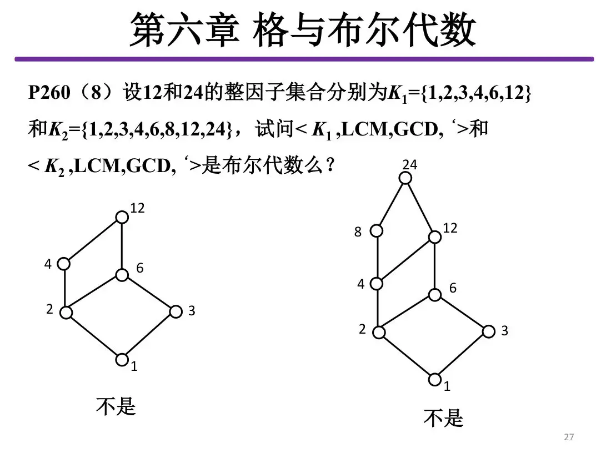

原文：

第六章 格与布尔代数

P260（8）设12和24的整因子集合分别为 $K_{1}=\{1,2,3,4,6,12\}$ 和 $K_{2}=\{1,2,3,4,6,8,12,24\}$ ，试问 $<K_{1},LCM,GCD,'>$ 和

$<K_{2},LCM,GCD,'>$ 是布尔代数么？

27

### 第七章 图论

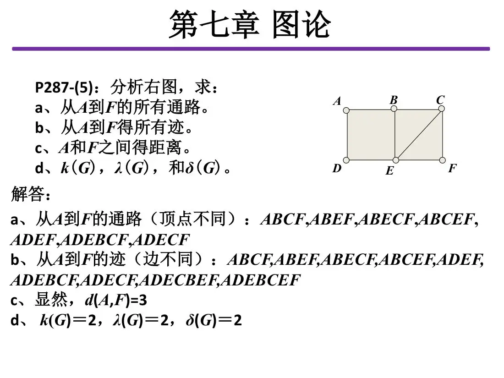

原文：

第七章 图论

P287-(5): 分析右图, 求:

a、从A到F的所有通路。

b、从A到F得所有迹。

c、A和F之间得距离。

d、 $k(G)$ ， $\lambda(G)$ ，和 $\delta(G)$ 。

解答:

a、从A到F的通路（顶点不同）：ABCF,ABEF,ABECF,ABCEF,
ADEF,ADEBCF,ADECF
b、从A到F的迹（边不同）：ABCF,ABEF,ABECF,ABCEF,ADEF,
ADEBCF,ADECF,ADECBEF,ADEBCEF
c、显然， $d(A,F)=3$ d、 $k(G)=2,\lambda(G)=2,\delta(G)=2$

### 第七章 图论

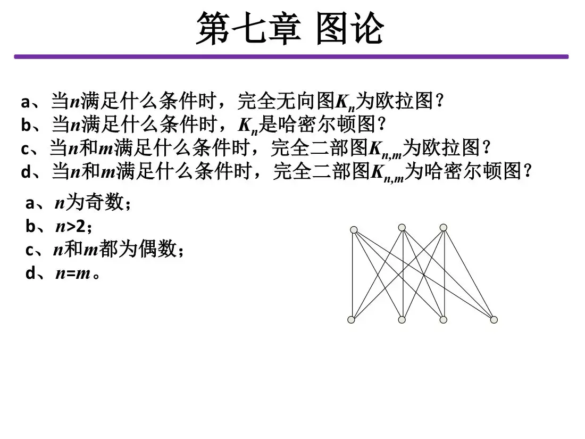

原文：

第七章 图论

a、当 $n$ 满足什么条件时，完全无向图 $K_{n}$ 为欧拉图？

b、当 $n$ 满足什么条件时， $K_{n}$ 是哈密尔顿图？

c、当 $n$ 和 $m$ 满足什么条件时，完全二部图 $K_{n,m}$ 为欧拉图？

d、当n和m满足什么条件时，完全二部图 $K_{n,m}$ 为哈密尔顿图？

a、n为奇数；

b、n>2;

c、n和m都为偶数；

d、n=m。

### 第七章 图论

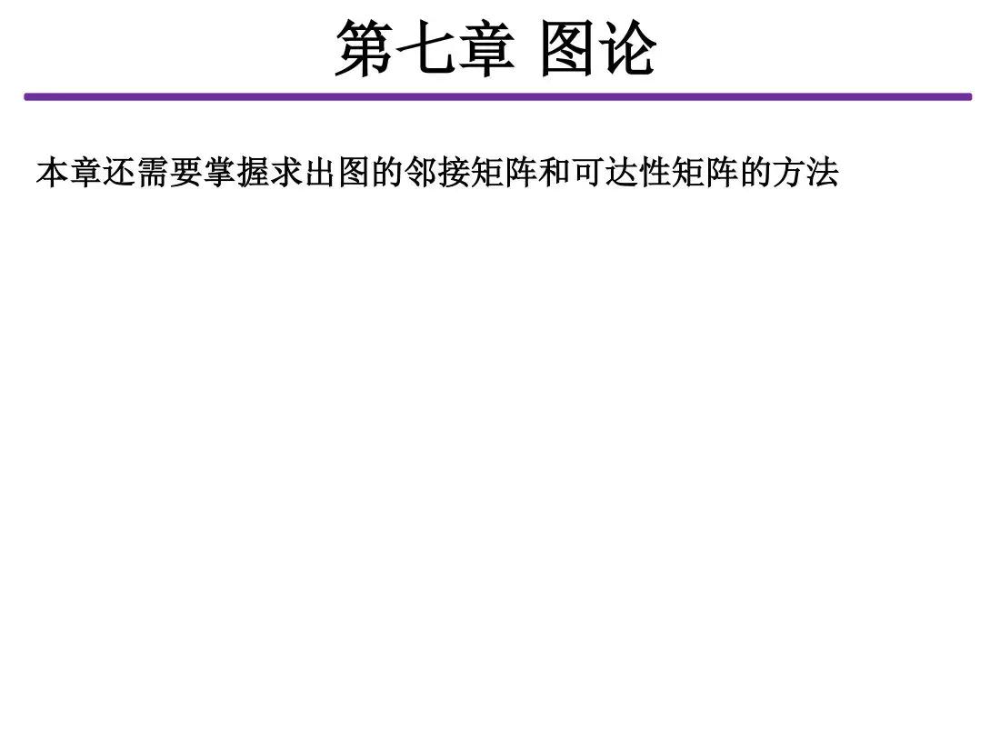

原文：

第七章 图论

本章还需要掌握求出图的邻接矩阵和可达性矩阵的方法
