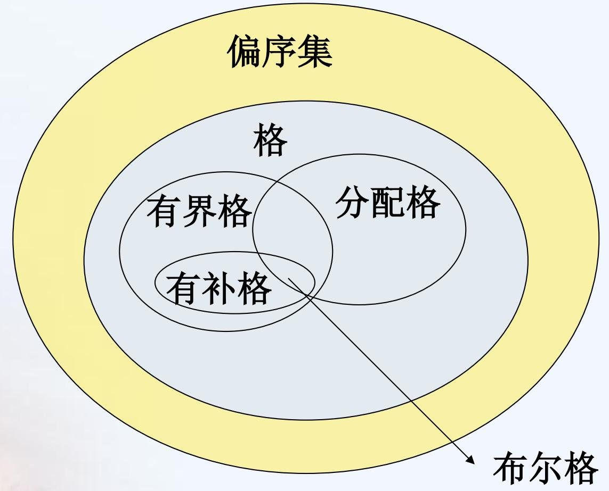
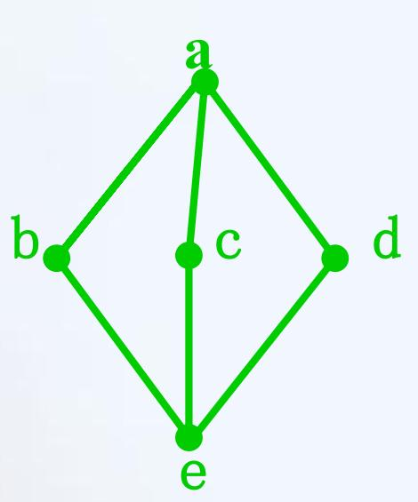
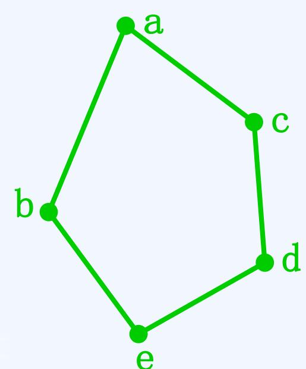
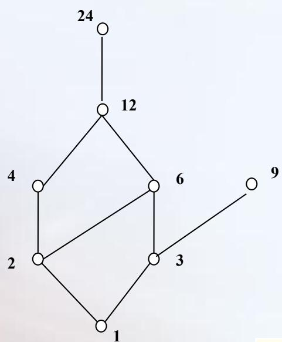
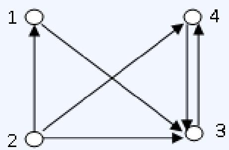
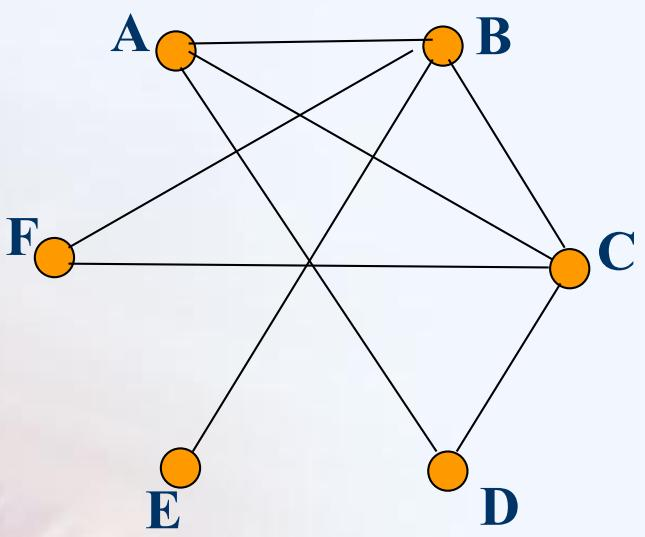
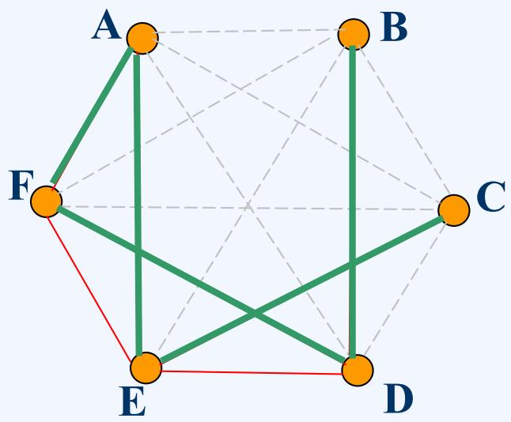

# 《离散数学》考试复习指南（课件）

原件经识别和整理；“参考解答”是我们补的。

# 《离散数学》考试复习指南

## 考试题型

1. 填空题（10小题，20分）
2. 判断题（10小题，20分）
3. 解答题（5小题，40分）
4. 综合应用题（2小题，20分）

## 第一章 命题逻辑

√ 命题的概念、命题的表示法。

√ 五个基本联结词的含义。

√ 命题公式与命题翻译。

√ 命题公式的真值表（万能的真值表！）。

√ 重言式与蕴含式的证明。

√ 主析取范式/主合取范式。

√ 命题公式的推理（真值表法、直接证法、间接证法（反证法+CP规则）。

### 典型例题 1-1

设 $P$ 表示命题“天下雪”，$Q$ 表示命题“我将去镇上”，$R$ 表示命题“我有时间”。

以符号形式写出下列命题：

a）如果天不下雪和我有时间，那么我将去镇上。

b) 我将去镇上，仅当我有时间。

**解：**

(a) $(\neg P \land R) \rightarrow Q$

(b)
(1) “仅当”表示必要条件，有： $Q \rightarrow R$ （本题正确答案）
(2) “当”表示充分条件，有： $R \rightarrow Q$
(3) “当且仅当”表示充要条件，有： $R \leftrightarrow Q$

知识点：[命题公式的递归定义与自然语言符号化翻译](../../../topics/离散数学/命题公式与翻译.md)、[逻辑联结词（否定、合取、析取、蕴含、等价）及其真值表](../../../topics/离散数学/联结词.md)、[命题的概念与命题变元的表示法](../../../topics/离散数学/命题及其表示法.md)

### 典型例题 1-2

求公式 $(P \lor \neg Q) \land (Q \lor R)$ 的主析取范式。

**解：**

**法一：**

$$
\begin{aligned}
(P \lor \neg Q) \land (Q \lor R) &= (P \land Q) \lor (P \land R) \lor (\neg Q \land Q) \lor (\neg Q \land R) \\
&= (P \land Q \land (R \lor \neg R)) \lor (P \land (Q \lor \neg Q) \land R) \lor ((P \lor \neg P) \land \neg Q \land R) \\
&= (P \land Q \land R) \lor (P \land Q \land \neg R) \lor (P \land \neg Q \land R) \lor (\neg P \land \neg Q \land R)
\end{aligned}
$$

**法二：真值表如下：**

| P | Q | R | $P \lor \neg Q$ | $Q \lor R$ | $(P \lor \neg Q) \land (Q \lor R)$ |
|:-:|:-:|:-:|:---------------:|:----------:|:----------------------------------:|
| F | F | F | T               | F          | **F**                              |
| F | F | T | T               | T          | **T**                              |
| F | T | F | F               | T          | **F**                              |
| F | T | T | F               | T          | **F**                              |
| T | F | F | T               | F          | **F**                              |
| T | F | T | T               | T          | **T**                              |
| T | T | F | T               | T          | **T**                              |
| T | T | T | T               | T          | **T**                              |

所以主析取范式为:

$$
(P \land Q \land R) \lor (P \land Q \land \neg R) \lor (P \land \neg Q \land R) \lor (\neg P \land \neg Q \land R)
$$

## 第二章 谓词逻辑

√ 谓词的概念与表示。

√ 量词的含义。

√ 谓词公式与翻译。

√ 判断谓词公式的真值。

√ 谓词演算的等价式与蕴含式证明。

√ 谓词演算的推理。

知识点：[命题公式的递归定义与自然语言符号化翻译](../../../topics/离散数学/命题公式与翻译.md)、[真值表的构造与命题公式的等价判定](../../../topics/离散数学/真值表与等价公式.md)

### 典型例题 2-1

符号化下列命题并推证其结论：任何人如果他喜欢步行，他就不喜欢乘汽车；每一个人或者喜欢乘汽车或者喜欢骑自行车；有的人不爱骑自行车。因而有的人不爱步行。（请假设 $P(x)$: x 喜欢步行, $Q(x)$: x 喜欢乘汽车, $R(x)$: x 喜欢骑自行车。）

前提： $(\forall x)(P(x)\to \neg Q(x)),(\forall x)(Q(x)\lor R(x)), (\exists x)\neg R(x)$
结论： $(\exists x)\neg P(x)$

**证明：**

$(\forall x)(P(x)\to\neg Q(x)),(\forall x)(Q(x)\lor R(x)),(\exists x)\neg R(x) \Rightarrow(\exists x)\neg P(x)$

**证法1：**

(1) $(\exists x)\neg R(x)$ P
(2) $\neg R(c)$ ES(1)
(3) $(\forall x)(Q(x)\lor R(x))$ P
(4) $Q(c)\lor R(c)$ US(3)
(5) $\neg R(c)\to Q(c)$ T(4)
(6) $Q(c)$ T(2)(5)
(7) $(\forall x)(P(x)\to\neg Q(x))$ P
(8) $P(c)\to\neg Q(c)$ US(7)
(9) $Q(c)\to\neg P(c)$ T(8)
(10) $\neg P(c)$ T(6)(9)
(11) $(\exists x)\neg P(x)$ EG(10)

## 第三章 集合与关系

√ 集合、关系、笛卡尔积、幂集的概念。

√ 集合的四种基本运算（交、并、相对补与绝对补、对称差）。

√ 关系的表示方法（直积、关系矩阵、关系图）。

√ 关系的五种基本性质及其判定。

√ 关系的三种运算（复合、逆、闭包、Warshall算法）。

√ 等价关系的定义。

√ 等价类、商集、划分的概念。

√ 偏序关系。

√ 偏序关系的哈斯图画法。

√ 偏序集中一些元素的判别（最大最小元、极大极小元、上下确界）。

知识点：[谓词的概念、个体词与命题函数的表示](../../../topics/离散数学/谓词与命题函数.md)、[全称量词与存在量词的含义及命题符号化](../../../topics/离散数学/量词.md)、[谓词逻辑中的推理规则（US、UG、ES、EG）及间接证法与CP规则应用](../../../topics/离散数学/谓词演算推理理论.md)

### 典型例题 3-1

设 $A = \{-1,0,1\}, R = \{<-1,0>, < 1,0>\}$ 是 $A$ 上的二元关系，求关系的三种闭包运算。

**自反闭包:**

$$
\mathrm{r} (\mathrm{R}) = \{<   - 1, 0 >, <   1, 0 >, <   - 1, - 1 >, <   0, 0 >, <   1, 1 > \};
$$

**对称闭包:**

$$
\mathrm{s} (\mathrm{R}) = \left\{\langle - 1, 0 \rangle , \langle 1, 0 \rangle , \langle 0, - 1 \rangle , \langle 0, 1 \rangle \right\};
$$

**传递闭包:**

$$
\mathrm{t} (\mathrm{R}) = \{<   - 1, 0 >, <   1, 0 > \} 。
$$

## 第五章 代数系统

√ 代数系统的基本性质。

√ 半群、独异点、子群、群的概念。

√ 群的判定。

√ 循环群、交换群、有限循环群。

√ 同态、同构、环与域。

√ 如何求解运算的幺元、零元。

√ 代数系统中幺元与零元的关系。

知识点：[自反闭包r(R)、对称闭包s(R)与传递闭包t(R)的求法](../../../topics/离散数学/关系的闭包运算.md)、[集合的定义、元素与集合的关系及集合的列举法与描述法表示](../../../topics/离散数学/集合的概念和表示法.md)

### 典型例题 5-1

设 $a, b \in \mathbb{Z}$ ，定义 $\mathbb{Z}$ 上的运算 $*$: $a * b = a + b + ab$ 则运算 $*$ 的单位元是？，零元是？，元素2的逆元是？

**解：**

运算 $*$ 的单位元是 0，零元是 -1，元素2的逆元是 $-\frac{2}{3}$ （注：原题此处未给出完整答案，根据运算法则推导：$2*x=0 \Rightarrow 2+x+2x=0 \Rightarrow 3x=-2 \Rightarrow x=-2/3$。若限定在整数集 $\mathbb{Z}$ 上，则2没有逆元。根据上下文语境及常见考题，通常考察有理数或实数集，或者题目有误。此处保留原识别内容结构，但需注意原图可能隐含了数域范围。若严格在整数域，无逆元。鉴于这是复习指南，可能存在笔误或特定语境，暂按原文留白或补充说明。）

*修正提示：根据后续例题5-2涉及实数集R，此处若为整数集Z，2无逆元。若为有理数集Q，逆元为-2/3。原文此处似乎截断或未显示完整答案。*

知识点：[二元运算的结合律、交换律、分配律及幺元、零元、逆元的判定](../../../topics/离散数学/运算及其性质.md)、[代数系统（代数结构）的定义与封闭性概念](../../../topics/离散数学/代数系统的引入.md)

### 典型例题 5-2

设 $\langle R,* \rangle$ 是一个代数系统，$a*b=a+b+1$，试证明 $\langle R,* \rangle$ 是群。

**证明:**

1）$\because a*b=a+b+1$ ，而 $+$ 在 $R$ 中封闭，所以 $*$ 在 $R$ 中封闭

2）结合律：
$$
(a^{*}b)^{*}c = (a + b + 1)^{*}c = a + b + 1 + c + 1 = a + b + c + 2;
$$
$$
a ^ {*} (b ^ {*} c) = a ^ {*} (b + c + 1) = a + b + c + 1 + 1 = a + b + c + 2;
$$
$\because (a ^ {*} b) ^ {*} c = a ^ {*} (b ^ {*} c)$ , 所以 $*$ 运算可结合

3）幺元：
对任意 $a \in R$ ，有 $a * (-1) = a - 1 + 1 = a$ ， $(-1) * a = -1 + a + 1 = a$ ，即 $a * (-1) = (-1) * a = a$ ，故 -1 是 $\langle R, * \rangle$ 的幺元

4）逆元：
对任意 $a \in R$ ，有 $a * (-2 - a) = a - 2 - a + 1 = -1$ ， $(-2 - a) * a = -2 - a + a + 1 = -1$ ，即 $a * (-2 - a) = (-2 - a) * a = -1$ ，故 $a^{-1} = -2 - a$

综上可知， $\langle R, * \rangle$ 是群

## 第六章 格和布尔代数

√ 格的定义。

√ 格同构。

√ 子格的判别。

√ 分配格（五元及五元以上分配格的判别）。

√ 有界格、补元、有补格。

√ 布尔格、布尔代数的基本概念。

知识点：[代数系统（代数结构）的定义与封闭性概念](../../../topics/离散数学/代数系统的引入.md)、[二元运算的结合律、交换律、分配律及幺元、零元、逆元的判定](../../../topics/离散数学/运算及其性质.md)、[群的定义、有限群的判定条件及子群的判定定理](../../../topics/离散数学/群与子群.md)

### 第六章 格与布尔代数

偏序集

知识点：[偏序关系、盖住关系、哈斯图(Hasse图)的画法及特殊元素（极大元、极小元、最大元、最小元、上界、下界、上确界、下确界）](../../../topics/离散数学/序关系.md)、[格作为偏序集（任意两元素有上确界和下确界）与代数系统的双重定义及性质](../../../topics/离散数学/格的概念.md)、[布尔代数的定义（有补分配格）及其基本定理与性质证明](../../../topics/离散数学/布尔代数.md)

### 典型例题 6-1

1、集合 $A = \{1, 2, 3, 4, 6, 9, 12, 24\}$ ， $R$ 为 $A$ 上的整除关系。

(1) 画出偏序集 $< A, R>$ 的哈斯图。(4 分)

(2) 子集 $\mathrm{B} = \{3, 4, 6\}$ , 求 $\mathrm{B}$ 的最小元、极小元、上确界。(6分)

**解：**

极小元：3, 4
最小元：无
上确界：12

## 第七章 图论

√ 图的基本概念（如简单图、完全图、欧拉图）。

√ 图的基本性质（如关于结点度数的三个基本定理）。

√ 图的同构。

√ 点割集、边割集、点/边连通度、距离。

√ 图的连通性。

√ 图的矩阵表示（邻接矩阵、可达性矩阵）。

√ 欧拉图（一笔画问题）。

√ 哈密尔顿图的判定。

知识点：[偏序关系、盖住关系、哈斯图(Hasse图)的画法及特殊元素（极大元、极小元、最大元、最小元、上界、下界、上确界、下确界）](../../../topics/离散数学/序关系.md)、[关系的自反性、反自反性、对称性、反对称性与传递性的判定](../../../topics/离散数学/关系的性质.md)

### 典型例题 7-1

设有向图 $G=<V,E>$，如右图所示，求：

(1) G 的邻接矩阵。

(2) G 的可达矩阵。

**解：**

邻接矩阵 $A(G) = \begin{bmatrix} 0 & 0 & 1 & 0 & 0 \\ 1 & 0 & 1 & 1 & 0 \\ 0 & 0 & 0 & 1 & 0 \\ 0 & 0 & 1 & 0 & 0 \\ 0 & 0 & 0 & 0 & 0 \end{bmatrix}$

可达矩阵 $P = \begin{bmatrix} 0 & 0 & 1 & 1 & 0 \\ 1 & 0 & 1 & 1 & 0 \\ 0 & 0 & 1 & 1 & 0 \\ 0 & 0 & 1 & 1 & 0 \\ 0 & 0 & 0 & 0 & 0 \end{bmatrix}$

## 综合应用题

- 问题: 在6天里安排6门课 – A,B,C,D,E,F -的考试, 每天考1门。假设每人选修课的情况有如下的4类: DCA, BCF, EB, AB。如何安排日程, 使得没有人必须连续两天有考试?

祝考试顺利

知识点：[邻接矩阵、可达矩阵与关联矩阵的构造及在最短路与连通性中的应用](../../../topics/离散数学/图的矩阵表示.md)、[欧拉回路与欧拉图的判定定理、汉密尔顿回路与汉密尔顿图的充分/必要条件](../../../topics/离散数学/欧拉图与汉密尔顿图.md)
