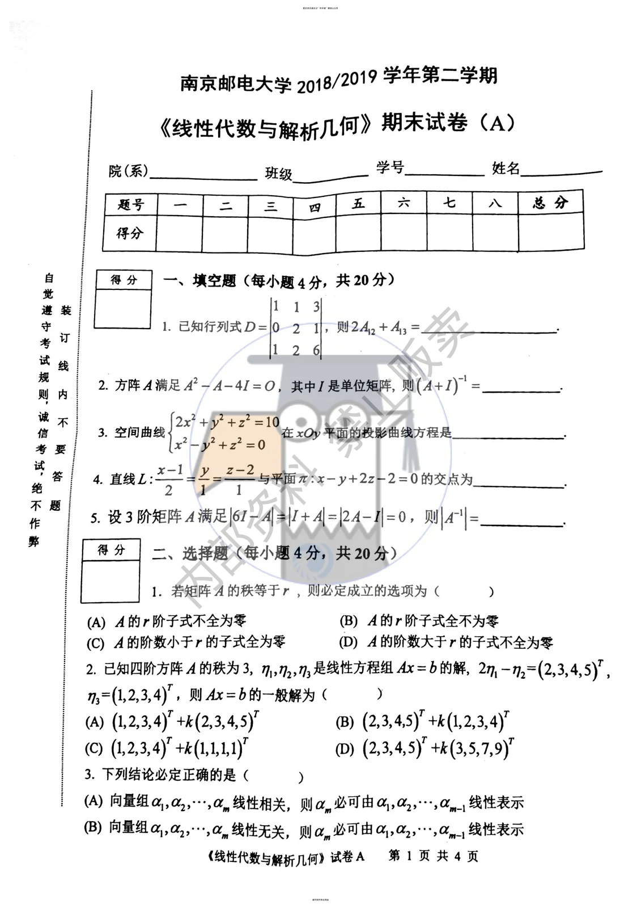
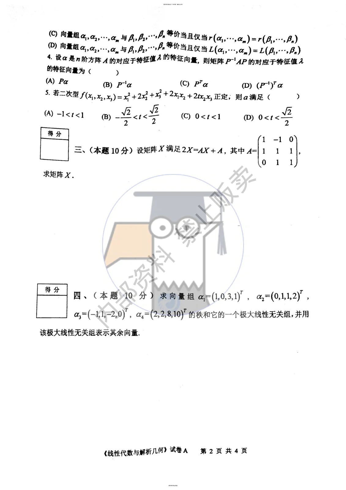
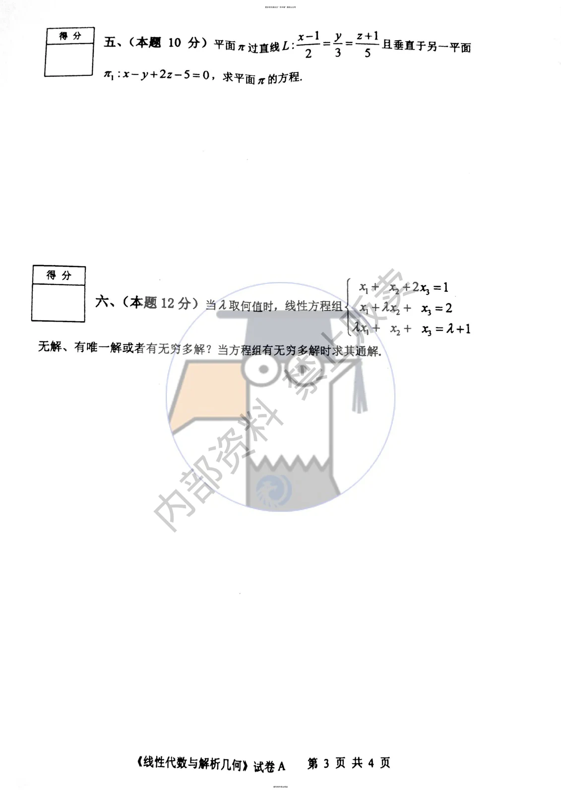
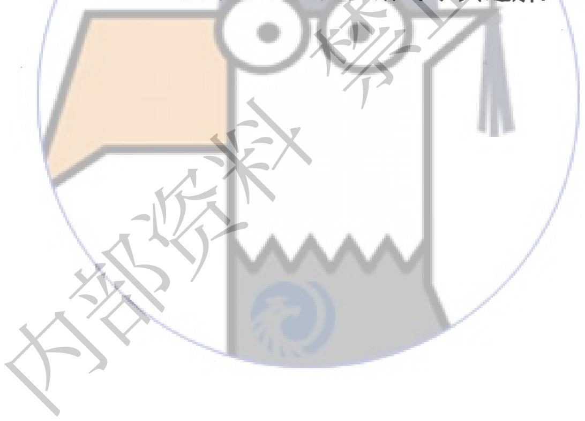
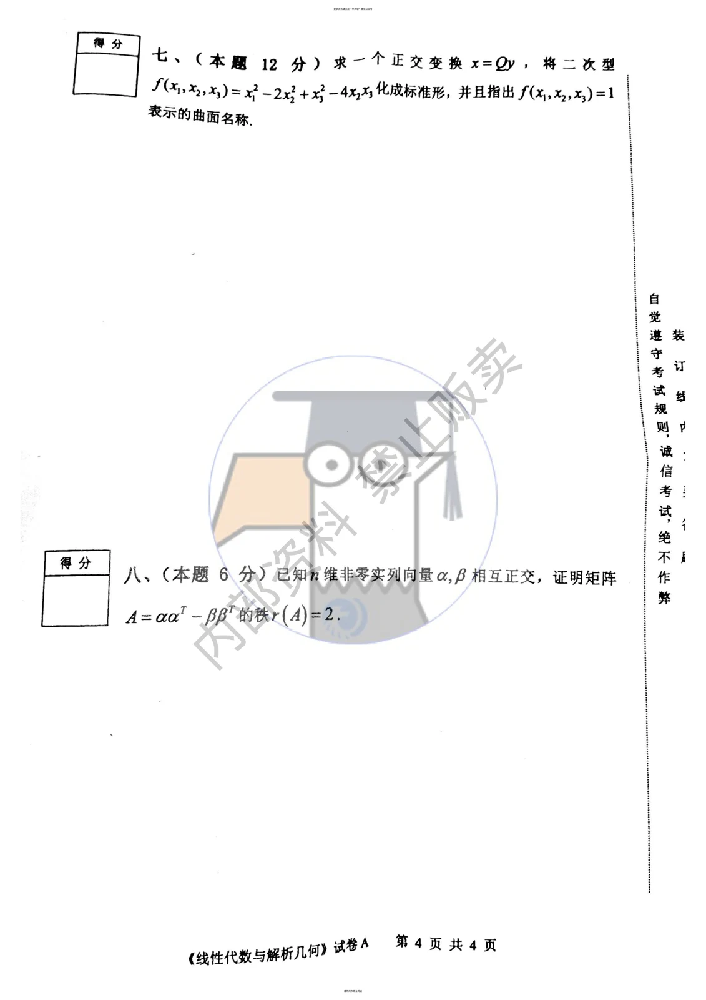
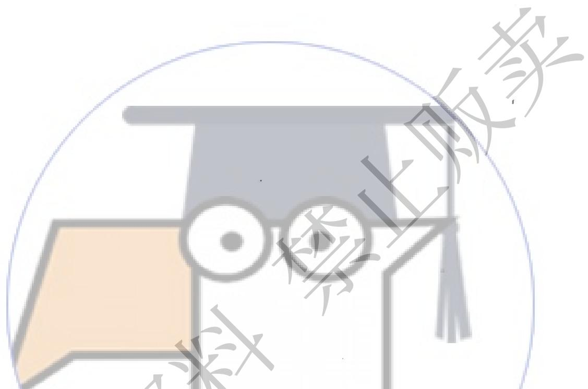

# 2018—2019 学年第二学期《线性代数与解析几何》期末试卷（A卷）

按原件顺序阅读，文字可对照页图。

## 第1页

## 南京邮电大学 2018/2019 学年第二学期

## 《线性代数与解析几何》期末试卷（A）

院(系)\_\_\_\_ 班级 \_\_\_\_ 学号\_\_\_\_ 姓名\_\_\_\_

<table><tr><td>题号</td><td>一</td><td>二</td><td>三</td><td>四</td><td>五</td><td>六</td><td>七</td><td>八</td><td>总分</td></tr><tr><td>得分</td><td></td><td></td><td></td><td></td><td></td><td></td><td></td><td></td><td></td></tr></table>

<table><tr><td>得分</td></tr><tr><td></td></tr></table>

### 一、填空题（每小题4分，共20分）

1. 已知行列式 $D = \begin{vmatrix} 1 & 1 & 3 \\ 0 & 2 & 1 \\ 1 & 2 & 6 \end{vmatrix}$ ，则 $2A_{12} + A_{13} =$ \_\_\_\_.

2. 方阵 A 满足 $A^{2}-A-4I=O$ ，其中 I 是单位矩阵，则 $(A+I)^{-1}=$ \_\_\_\_.

3. 空间曲线 $\left\{\begin{array}{l}2x^{2}+y^{2}+z^{2}=10 \\ x^{2}-y^{2}+z^{2}=0\end{array}\right.$ 在 xOy 平面的投影曲线方程是 \_\_\_\_.

4. 直线 $L : \frac{x - 1}{2} = \frac{y}{1} = \frac{z - 2}{1}$ 与平面 $\pi  : x - y + {2z} - 2 = 0$ 的交点为\_\_\_\_\_.

5. 设 3 阶矩阵 A 满足 $\left|6I - A\right| = \left|I + A\right| = \left|2A - I\right| = 0$ ，则 $\left|A^{-1}\right| =$ \_\_\_\_.

<table><tr><td>得分</td></tr><tr><td></td></tr></table>

### 二、选择题（每小题4分，共20分）

1. 若矩阵 $A$ 的秩等于 $\pmb{r}$ , 则必定成立的选项为 ( )

(A) $A$ 的 $\pmb{r}$ 阶子式不全为零 (B) $A$ 的 $\pmb{r}$ 阶子式全不为零 (C) $A$ 的阶数小于 $\pmb{r}$ 的子式全为零 (D) $A$ 的阶数大于 $\pmb{r}$ 的子式不全为零

2. 已知四阶方阵 A 的秩为 3， $\eta_{1},\eta_{2},\eta_{3}$ 是线性方程组 Ax=b 的解， $2\eta_{1}-\eta_{2}=(2,3,4,5)^{T}$ ， $\eta_{3}=(1,2,3,4)^{T}$ ，则 Ax=b 的一般解为（）
(A) $(1,2,3,4)^{T} + k(2,3,4,5)^{T}$ (B) $(2,3,4,5)^{T} + k(1,2,3,4)^{T}$ (C) $(1,2,3,4)^{T} + k(1,1,1,1)^{T}$ (D) $(2,3,4,5)^{T} + k(3,5,7,9)^{T}$

3. 下列结论必定正确的是（）

(A) 向量组 $\alpha_{1}, \alpha_{2}, \cdots, \alpha_{m}$ 线性相关，则 $\alpha_{m}$ 必可由 $\alpha_{1}, \alpha_{2}, \cdots, \alpha_{m-1}$ 线性表示

(B) 向量组 $\alpha_{1}, \alpha_{2}, \cdots, \alpha_{m}$ 线性无关，则 $\alpha_{m}$ 必可由 $\alpha_{1}, \alpha_{2}, \cdots, \alpha_{m-1}$ 线性表示(C) 向量组 $\alpha_{1}, \alpha_{2}, \cdots, \alpha_{m}$ 与 $\beta_{1}, \beta_{2}, \cdots, \beta_{n}$ 等价当且仅当 $r(\alpha_{1}, \cdots, \alpha_{m}) = r(\beta_{1}, \cdots, \beta_{n})$ (D) 向量组 $\alpha_{1}, \alpha_{2}, \cdots, \alpha_{m}$ 与 $\beta_{1}, \beta_{2}, \cdots, \beta_{n}$ 等价当且仅当 $L(\alpha_{1}, \cdots, \alpha_{m}) = L(\beta_{1}, \cdots, \beta_{n})$ 4. 设 $\alpha$ 是 n 阶方阵 A 的对应于特征值 $\lambda$ 的特征向量，则矩阵 $P^{-1}AP$ 的对应于特征值 $\lambda$ 的特征向量为（）

(A) $P\alpha$ (B) $P^{-1}\alpha$ (C) $P^{T}\alpha$ (D) $(P^{-1})^{T}\alpha$

自觉遵守考试规则，诚信考试，绝不作弊
装订线内不要答题

《线性代数与解析几何》试卷 A

第1页共4页

## 第2页

5. 若二次型 $f(x_{1}, x_{2}, x_{3}) = x_{1}^{2} + 2x_{2}^{2} + x_{3}^{2} + 2x_{1}x_{2} + 2tx_{2}x_{3}$ 正定，则 a 满足（)

(A) -1 < t < 1

(B) $-\frac{\sqrt{2}}{2} < t < \frac{\sqrt{2}}{2}$ (C) 0 < t < 1

(D) $0 < t < \frac{\sqrt{2}}{2}$

得分
三、(本题10分) 设矩阵 X 满足 2X = AX + A，其中 $A = \begin{pmatrix} 1 & -1 & 0 \\ 1 & 1 & 1 \\ 0 & 1 & 1 \end{pmatrix}$ ，求矩阵 X。

得分 四、(本题10分) 求向量组 $\alpha_{1}=(1,0,3,1)^{T}$ ， $\alpha_{2}=(0,1,1,2)^{T}$ ， $\alpha_{3}=(-1,1,-2,0)^{T}$ ， $\alpha_{4}=(2,2,8,10)^{T}$ 的秩和它的一个极大线性无关组，并用该极大线性无关组表示其余向量.

《线性代数与解析几何》试卷 A

第2页共4页

## 第3页

<table><tr><td>得分</td></tr><tr><td></td></tr></table>

五、(本题 10 分) 平面 $\pi$ 过直线 $L: \frac{x - 1}{2} = \frac{y}{3} = \frac{z + 1}{5}$ 且垂直于另一平面 $\pi_1: x - y + 2z - 5 = 0$ , 求平面 $\pi$ 的方程.

得分

六、(本题12分) 当 $\lambda$ 取何值时，线性方程组 $\left\{\begin{array}{l} x_{1}+x_{2}+2x_{3}=1 \\ x_{1}+\lambda x_{2}+x_{3}=2 \\ \lambda x_{1}+x_{2}+x_{3}=\lambda+1 \end{array}\right.$

无解、有唯一解或者有无穷多解？当方程组有无穷多解时求其通解。

《线性代数与解析几何》试卷 A

第3页共4页

## 第4页

<table><tr><td>得分</td></tr><tr><td></td></tr></table>

七、(本题 12 分) 求一个正交变换 $x = Qy$ ，将二次型 $f(x_{1}, x_{2}, x_{3}) = x_{1}^{2} - 2x_{2}^{2} + x_{3}^{2} - 4x_{2}x_{3}$ 化成标准形，并且指出 $f(x_{1}, x_{2}, x_{3}) = 1$ 表示的曲面名称。

<table><tr><td>得分</td></tr><tr><td></td></tr></table>

八、(本题6分)已知n维非零实列向量 $\alpha,\beta$ 相互正交，证明矩阵 $A = \alpha \alpha^{T} - \beta \beta^{T}$ 的秩 $r(A) = 2$ .

自觉遵守考试规则，诚信考试，绝不作弊
装订线中：

《线性代数与解析几何》试卷A

第4页共4页
