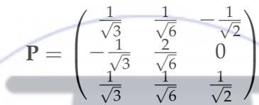
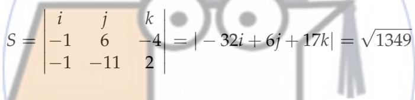

# 南京邮电大学《线性代数与解析几何》期末试卷参考答案（解答题详细版）

原件经识别和整理；“参考解答”是我们补的。

### 填空 1

$4$。

知识点：[行列式的性质（换行变号、提取公因子、成比例为零等）](../../../topics/线性代数/行列式性质.md)、[n阶行列式的定义（逆序数与排列）](../../../topics/线性代数/n阶行列式定义.md)

### 填空 2

$\left\{\begin{array}{l}x^{2}+2y^{2}=16\\z=0\end{array}\right.$。

知识点：[向量组线性相关与线性无关的定义及判定定理](../../../topics/线性代数/线性相关与线性无关.md)

### 填空 3

$(-1,1,2)$。

知识点：[n阶行列式的定义（逆序数与排列）](../../../topics/线性代数/n阶行列式定义.md)

### 填空 4

$(1,1,-1,-1)^{T}$。

知识点：[空间直角坐标系、向量的坐标表示、模与方向余弦](../../../topics/线性代数/空间直角坐标系与向量.md)、[点到平面/直线的距离，两平面、两直线、线面间的夹角与位置关系](../../../topics/线性代数/位置关系与距离夹角.md)

### 填空 5

$-\frac{2}{5}$。

知识点：[常见二次曲面（椭球面、双曲面、抛物面）、旋转曲面、柱面及投影曲线](../../../topics/线性代数/曲面与空间曲线.md)

### 选择 1

答案：B。

知识点：[n阶行列式的定义（逆序数与排列）](../../../topics/线性代数/n阶行列式定义.md)

### 选择 2

答案：D。

知识点：[矩阵的概念及加法、数乘、乘法、转置运算](../../../topics/线性代数/矩阵概念与运算.md)、[方阵的行列式及乘法公式 |AB|=|A||B|](../../../topics/线性代数/方阵行列式.md)

### 选择 3

答案：A。

知识点：[矩阵的秩的概念、求法及秩的运算性质](../../../topics/线性代数/矩阵的秩.md)、[Gauss消元法与线性方程组的矩阵表示](../../../topics/线性代数/高斯消元法.md)、[非齐次线性方程组 Ax=b 有解的判定（系数矩阵与增广矩阵的秩）](../../../topics/线性代数/非齐次方程组有解判定.md)

### 选择 4

答案：A。

知识点：[n阶行列式的定义（逆序数与排列）](../../../topics/线性代数/n阶行列式定义.md)

### 选择 5

答案：A。

## 三、题略

解：由 $AX = B - 2X$ 有 $(A + 2I)X = B$。由题目已知条件知

$$
\mathbf{A} + 2\mathbf{I} = \begin{pmatrix} 1 & 2 & 3 \\ 2 & 2 & 1 \\ 3 & 4 & 3 \end{pmatrix}
$$

从而由

$$
(\mathbf{A} + 2\mathbf{I} : \mathbf{B}) = \begin{pmatrix} 1 & 2 & 3 & 2 & 3 \\ 2 & 2 & 1 & 5 & 2 \\ 3 & 4 & 3 & 4 & 3 \end{pmatrix} \xrightarrow{\text{初等行变换}} \begin{pmatrix} 1 & 0 & 0 & 9 & 3 \\ 0 & 1 & 0 & -8 & -3 \\ 0 & 0 & 1 & 3 & 2 \end{pmatrix}
$$

得

$$
\mathbf{X} = \begin{pmatrix} 9 & 3 \\ -8 & -3 \\ 3 & 2 \end{pmatrix}
$$

## 四、题略

解：令 $\mathbf{A} = (\alpha_{1}, \alpha_{2}, \alpha_{3}, \alpha_{4}, \alpha_{5})$，则向量组 $\mathbf{A}$ 的秩等于矩阵 $\mathbf{A}$ 的秩。因为

$$
\mathbf{A} = \begin{pmatrix} 1 & 1 & 2 & 2 & 1 \\ 0 & 2 & 1 & 5 & -1 \\ 2 & 0 & 3 & -1 & 3 \\ 1 & 1 & 0 & 4 & -1 \end{pmatrix}
$$

初等行变换

$$
\begin{pmatrix} 1 & 0 & 0 & 1 & 0 \\ 0 & 1 & 0 & -3 & -1 \\ 0 & 0 & 1 & -1 & 1 \\ 0 & 0 & 0 & 0 & 0 \end{pmatrix}
$$

故 $r(\mathbf{A}) = 3$，即向量组 $\mathbf{A}$ 的秩为 3。且其中一个极大线性无关组为 $\alpha_{1},\alpha_{2},\alpha_{3}$。其余向量可用 $\alpha_{1},\alpha_{2},\alpha_{3}$ 线性表示如下：

$$
\left\{ \begin{array}{l} \alpha_{4} = \alpha_{1} - 3\alpha_{2} - \alpha_{3} \\ \alpha_{5} = -\alpha_{2} + \alpha_{3} \end{array} \right.
$$

## 五、题略

解：分别记系数矩阵和对应的增广矩阵为 $A, B$。首先计算方程组系数矩阵的行列式。

$$
|\mathbf{A}| = \begin{vmatrix} 1 & 1 & 1+\lambda \\ 1 & 1+\lambda & 1 \\ 1+\lambda & 1 & 1 \end{vmatrix} = -\lambda^{2}(\lambda + 3)
$$

1. 当 $|A| \neq 0$，即 $\lambda \neq 0, -3$ 时，由克莱姆法则知方程组有唯一解；

2. 当 $\lambda = 0$ 时，方程组可写成 $x_{1} + x_{2} + x_{3} = 3$，此时 $r(\mathbf{A}) = r(\mathbf{B}) = 1 < 3$，因此原方程组有无穷多解且通解为

$$
x = (1, 1, 1)^{T} + k_{1}(-1, 1, 0)^{T} + k_{2}(-1, 0, 1)^{T}, \quad k_{1}, k_{2} \text{为任意常数}
$$

3. 当 $\lambda = -3$ 时，$r(\mathbf{A}) = 2$，$r(\mathbf{B}) = 3$，故此时无解。

## 六、题略

解：因为平面 $\pi$ 过直线 $L:\left\{\begin{aligned}x+2y-z+1=0\\ x-y+z-1=0\end{aligned}\right.$，故可设平面 $\pi$ 的方程为

$$
x + 2y - z + 1 + k(x - y + z - 1) = 0
$$

其中 $k$ 为待定参数。将上式整理得

$$
(1 + k)x + (2 - k)y + (k - 1)z + (1 - k) = 0
$$

故平面 $\pi$ 的法向量为 $\vec{n}_{1} = (1 + k, 2 - k, k - 1)$，又因为平面 $\pi$ 与平面 $\pi_{1}$ 垂直（设其法向量为 $\vec{n}_{2}$，则 $\vec{n}_{2} = (1, -1, 1)$），故它们的法向量垂直，即

$$
\vec{n}_{1} \cdot \vec{n}_{2} = 0 \Longrightarrow 1 + k - (2 - k) + k - 1 = 0
$$

解得 $k = \frac{2}{3}$，故所求平面 $\pi$ 的方程为

$$
5x + 4y - z + 1 = 0
$$

## 七、题略

解：由题知二次型的矩阵 $A$ 为

$$
\mathbf{A} = \begin{pmatrix} 1 & 1 & 1 \\ 1 & 3 & 1 \\ 1 & 1 & a \end{pmatrix}
$$

且因为标准形由正交变换得到，从而标准形的矩阵 $\Lambda = \begin{pmatrix} 1 & 0 & 0 \\ 0 & 4 & 0 \\ 0 & 0 & b \end{pmatrix}$ 与 $A$ 相似，故有：

$$
\left\{ \begin{array}{l} tr(\mathbf{A}) = tr(\boldsymbol{\Lambda}) \\ |\mathbf{A}| = |\boldsymbol{\Lambda}| \end{array} \right. \Longrightarrow \left\{ \begin{array}{l} 1 + 3 + a = 1 + 4 + b \\ 2a - 2 = 4b \end{array} \right.
$$

解得 $a = 1, b = 0$。故 $A$ 的特征值为 $1, 4, 0$，且

$$
\mathbf{A} = \begin{pmatrix} 1 & 1 & 1 \\ 1 & 3 & 1 \\ 1 & 1 & 1 \end{pmatrix}
$$

- 当特征值 $\lambda_{1} = 1$ 时。

解齐次线性方程组 $(\mathbf{I}-\mathbf{A})x=0$，得基础解系为 $\alpha_{1}=(1,-1,1)^{T}$。将 $\alpha_{1}$ 单位化得 $\beta_{1}=\frac{1}{\sqrt{3}}(1,-1,1)^{T}$。

- 当特征值 $\lambda_{2} = 4$ 时。

解齐次线性方程组 $(4\mathbf{I}-\mathbf{A})x=0$，得基础解系为 $\alpha_{2}=(1,2,1)^{T}$。将 $\alpha_{2}$ 单位化得 $\beta_{2}=\frac{1}{\sqrt{6}}(1,2,1)^{T}$。

- 当特征值 $\lambda_{3} = 0$ 时。

解齐次线性方程组 $-\mathbf{A}\mathbf{x} = \mathbf{0}$，得基础解系为 $\alpha_{3} = (-1,0,1)^{T}$。将 $\alpha_{3}$ 单位化得 $\beta_{3} = \frac{1}{\sqrt{2}}(-1,0,1)^{T}$。

故所用正交变换矩阵 $P$ 可取为

## 八、题略

证明：必要性。因为 $A$ 为正交矩阵，故有 $A^{T}A = I$。从而有

$$
(\mathbf{A}\alpha, \mathbf{A}\beta) = (\mathbf{A}\alpha)^{T}(\mathbf{A}\beta) = \alpha^{T}\mathbf{A}^{T}\mathbf{A}\beta = \alpha^{T}\mathbf{I}\beta = \alpha^{T}\beta = (\alpha, \beta)
$$

充分性。因为 $(\mathbf{A}\alpha, \mathbf{A}\beta) = (\alpha, \beta)$，所以 $(\mathbf{A}\alpha)^{T}(\mathbf{A}\beta) = \alpha^{T}\beta$，即

$$
\boldsymbol{\alpha}^{T}\mathbf{A}^{T}\mathbf{A}\boldsymbol{\beta} - \boldsymbol{\alpha}^{T}\mathbf{I}\boldsymbol{\beta} = \mathbf{0} \Longrightarrow \boldsymbol{\alpha}^{T}(\mathbf{A}^{T}\mathbf{A} - \mathbf{I})\boldsymbol{\beta} = \mathbf{0}
$$

由于上式对任意 $n$ 维向量均成立，故对任意 $2n$ 个 $n$ 维列向量 $\alpha_{1}, \cdots, \alpha_{n}, \beta_{1}, \cdots, \beta_{n}$ 有

$$
\begin{pmatrix} \boldsymbol{\alpha}_{1}^{T} \\ \vdots \\ \boldsymbol{\alpha}_{n}^{T} \end{pmatrix} (\mathbf{A}^{T}\mathbf{A} - \mathbf{I}) \begin{pmatrix} \boldsymbol{\beta}_{1} & \dots & \boldsymbol{\beta}_{n} \end{pmatrix} = \mathbf{0}
$$

令

$$
\left\{ \begin{array}{l} \boldsymbol{\alpha}_{1} = \boldsymbol{\beta}_{1} = (1, 0, \dots, 0)^{T} \\ \boldsymbol{\alpha}_{2} = \boldsymbol{\beta}_{2} = (0, 1, \dots, 0)^{T} \\ \dots \dots \\ \boldsymbol{\alpha}_{n} = \boldsymbol{\beta}_{n} = (0, 0, \dots, 1)^{T} \end{array} \right.
$$

则有

$$
\begin{pmatrix} \boldsymbol{\alpha}_{1}^{T} \\ \vdots \\ \boldsymbol{\alpha}_{n}^{T} \end{pmatrix}, \begin{pmatrix} \beta_{1} & \dots & \beta_{n} \end{pmatrix} \text{均为单位矩阵}
$$

故 $A^{T}A - I = 0$，即 $A^{T}A = I$，因此 $A$ 为正交矩阵。

# 南京邮电大学《线性代数与解析几何》期末试卷参考答案（解答题详细版）

本资料由识别工具读取并整理，包含填空题答案及计算题、证明题的详细解答过程。

## 一、填空题

知识点：[特殊行列式计算（三角法、爪形、三对角、递推法、数学归纳法）](../../../topics/线性代数/特殊行列式计算.md)、[范德蒙(Vandermonde)行列式及其证明](../../../topics/线性代数/范德蒙行列式.md)

### 填空 1
**答案：** $1, 6$

知识点：[行列式的性质（换行变号、提取公因子、成比例为零等）](../../../topics/线性代数/行列式性质.md)、[n阶行列式的定义（逆序数与排列）](../../../topics/线性代数/n阶行列式定义.md)

### 填空 2
**答案：** $\mathbf{A}^n = 7^n \begin{pmatrix} 2 & 4 & 6 \\ 1 & 2 & 3 \\ 1 & 2 & 3 \end{pmatrix}$

知识点：[向量组线性相关与线性无关的定义及判定定理](../../../topics/线性代数/线性相关与线性无关.md)

### 填空 3
**答案：** $\begin{pmatrix} 3 & 2 & 1 \\ 1 & 1 & 1 \\ 2009 & 2008 & 2007 \end{pmatrix}$

知识点：[n阶行列式的定义（逆序数与排列）](../../../topics/线性代数/n阶行列式定义.md)

### 填空 4
**答案：** $k_1 + k_2 + \dots + k_r = 1$

知识点：[空间直角坐标系、向量的坐标表示、模与方向余弦](../../../topics/线性代数/空间直角坐标系与向量.md)、[点到平面/直线的距离，两平面、两直线、线面间的夹角与位置关系](../../../topics/线性代数/位置关系与距离夹角.md)

### 填空 5
**答案：** $3$

知识点：[常见二次曲面（椭球面、双曲面、抛物面）、旋转曲面、柱面及投影曲线](../../../topics/线性代数/曲面与空间曲线.md)

### 填空 6
**答案：** $(1, 1, 1)$

知识点：[n维向量的概念及其线性运算](../../../topics/线性代数/n维向量与线性运算.md)、[向量组线性相关与线性无关的定义及判定定理](../../../topics/线性代数/线性相关与线性无关.md)、[齐次线性方程组 Ax=0 有非零解的条件](../../../topics/线性代数/齐次方程组有解条件.md)

### 填空 7
**答案：** $\sqrt{56}$

知识点：[向量的数量积（内积、点积）及坐标运算](../../../topics/线性代数/向量数量积.md)、[空间直角坐标系、向量的坐标表示、模与方向余弦](../../../topics/线性代数/空间直角坐标系与向量.md)、[向量的混合积及其几何意义（体积）](../../../topics/线性代数/向量混合积.md)

### 填空 8
**答案：** $\begin{cases} x^2 + y^2 = 1 \\ z = 0 \end{cases}$

知识点：[常见二次曲面（椭球面、双曲面、抛物面）、旋转曲面、柱面及投影曲线](../../../topics/线性代数/曲面与空间曲线.md)

### 填空 9
**答案：** $0$

知识点：[行列式的性质（换行变号、提取公因子、成比例为零等）](../../../topics/线性代数/行列式性质.md)、[特殊行列式计算（三角法、爪形、三对角、递推法、数学归纳法）](../../../topics/线性代数/特殊行列式计算.md)

### 填空 10
**答案：** $k > 1$

## 二、计算下列各题

知识点：[含参数线性方程组解的讨论与求解](../../../topics/线性代数/含参方程组讨论.md)

### 计算 1
**题干：** （略）

**参考解答：**
因为 $AXA + BXB = AXB + BXA + I$，所以有：
$$ (\mathbf{A} - \mathbf{B})\mathbf{X}(\mathbf{A} - \mathbf{B}) = \mathbf{I} $$

因为
$$ \mathbf{A} - \mathbf{B} = \begin{pmatrix} 1 & -1 & -1 \\ 0 & 1 & -1 \\ 0 & 0 & 1 \end{pmatrix} $$

从而由
$$ \left( \begin{array}{ccc|ccc} 1 & -1 & -1 & 1 & 0 & 0 \\ 0 & 1 & -1 & 0 & 1 & 0 \\ 0 & 0 & 1 & 0 & 0 & 1 \end{array} \right) \xrightarrow{\text{初等行变换}} \left( \begin{array}{ccc|ccc} 1 & 0 & 0 & 1 & 1 & 1 \\ 0 & 1 & 0 & 0 & 1 & 1 \\ 0 & 0 & 1 & 0 & 0 & 1 \end{array} \right) $$

知
$$ (\mathbf{A} - \mathbf{B})^{-1} = \begin{pmatrix} 1 & 1 & 1 \\ 0 & 1 & 1 \\ 0 & 0 & 1 \end{pmatrix} $$

故
$$ \mathbf{X} = (\mathbf{A} - \mathbf{B})^{-1}(\mathbf{A} - \mathbf{B})^{-1} = \begin{pmatrix} 1 & 1 & 1 \\ 0 & 1 & 1 \\ 0 & 0 & 1 \end{pmatrix} \begin{pmatrix} 1 & 1 & 1 \\ 0 & 1 & 1 \\ 0 & 0 & 1 \end{pmatrix} = \begin{pmatrix} 1 & 2 & 3 \\ 0 & 1 & 2 \\ 0 & 0 & 1 \end{pmatrix} $$

知识点：[行列式按行（列）展开法则](../../../topics/线性代数/按行按列展开.md)、[特殊行列式计算（三角法、爪形、三对角、递推法、数学归纳法）](../../../topics/线性代数/特殊行列式计算.md)

### 计算 2
**题干：** （略）

**参考解答：**
问题等价于 $\lambda$ 取何值时，下述方程组 $x_1 \alpha_1 + x_2 \alpha_2 + x_3 \alpha_3 = \beta$ 是否有多解、无解。分别记上述方程组的系数矩阵、增广矩阵为 $A, B$，则
$$ | \mathbf{A} | = \left| \begin{array}{ccc} 1+\lambda & 1 & 1 \\ 1 & 1+\lambda & 1 \\ 1 & 1 & 1+\lambda \end{array} \right| = \lambda^2 (\lambda + 3) $$

1. 当 $\lambda = 0$ 时，方程组可写成 $x_1 + x_2 + x_3 = 0$，此时 $r(\mathbf{A}) = 1 < 3$，因此原方程组有无穷多解且通解为：
   $$ x = k_1 (-1, 1, 0)^T + k_2 (-1, 0, 1)^T, \quad k_1, k_2 \text{ 为任意常数} $$

2. 当 $\lambda = -3$ 时，$r(\mathbf{A}) = 2$，$r(\mathbf{B}) = 3$，故此时无解。

综上所述知：
1. 当 $\lambda = 0$ 时，$\beta$ 可由 $\alpha_1, \alpha_2, \alpha_3$ 线性表示，且表示不唯一；
2. 当 $\lambda = -3$ 时，$\beta$ 不能由 $\alpha_1, \alpha_2, \alpha_3$ 线性表示。

知识点：[矩阵的概念及加法、数乘、乘法、转置运算](../../../topics/线性代数/矩阵概念与运算.md)、[矩阵的初等变换与初等矩阵及其关系](../../../topics/线性代数/初等变换与初等矩阵.md)、[用初等行（列）变换求逆矩阵及解矩阵方程](../../../topics/线性代数/初等变换求逆.md)

### 计算 3
**题干：** （略）

**参考解答：**
设
$$ \boldsymbol{\eta} = (\boldsymbol{\eta}_1 + \boldsymbol{\eta}_2) - \boldsymbol{\eta}_3 = (-2, -2, 2, -2)^T $$

则因为
$$ \mathbf{A}\boldsymbol{\eta} = \mathbf{A}[(\boldsymbol{\eta}_1 + \boldsymbol{\eta}_2) - \boldsymbol{\eta}_3] = \mathbf{A}\boldsymbol{\eta}_1 + \mathbf{A}\boldsymbol{\eta}_2 - \mathbf{A}\boldsymbol{\eta}_3 = 2b - b = b $$

所以 $\boldsymbol{\eta}$ 为方程组 $Ax=b$ 的一个解。

因为 $r(\mathbf{A}) = 3$，方程组 $Ax=b$ 为四元线性方程组，所以其对应的齐次线性方程组的基础解系中含有 $4-3=1$ 个解向量，因此，任意非零解向量都可作为一个基础解系。设为 $\xi$，不妨取
$$ \xi = \boldsymbol{\eta}_3 - \boldsymbol{\eta} = (3, 2, -1, 4)^T - (-2, -2, 2, -2)^T = (5, 4, -3, 6)^T $$

从而有方程组 $Ax=b$ 的通解为
$$ \boldsymbol{\eta} + k\xi, \quad k \text{ 为任意常数} $$

知识点：[矩阵的秩的概念、求法及秩的运算性质](../../../topics/线性代数/矩阵的秩.md)、[向量组的极大线性无关组与向量组的秩的求法](../../../topics/线性代数/极大无关组与向量组的秩.md)、[向量组的线性组合与线性表示](../../../topics/线性代数/线性组合与线性表示.md)

### 计算 4
**题干：** （略）

**参考解答：**
易知二次型的矩阵为
$$ \mathbf{A} = \begin{pmatrix} 0 & 1 & 1 \\ 1 & 0 & 1 \\ 1 & 1 & 0 \end{pmatrix} $$

且
$$ |\lambda \mathbf{I} - \mathbf{A}| = \left| \begin{array}{ccc} \lambda & -1 & -1 \\ -1 & \lambda & -1 \\ -1 & -1 & \lambda \end{array} \right| = (\lambda + 1)^2 (\lambda - 2) $$

故 $\mathbf{A}$ 的特征值为 $\lambda_1 = 2, \lambda_2 = \lambda_3 = -1$。二次型的标准形为 $f(x_1, x_2, x_3) = 2y_1^2 - y_2^2 - y_3^2$。下面求所用的正交变换。

1.  **当特征值 $\lambda_1 = 2$ 时：**
    解齐次线性方程组 $(2\mathbf{I}-\mathbf{A})x=0$，得基础解系为 $\alpha_1 = (1, 1, 1)^T$。将 $\alpha_1$ 单位化得 $\beta_1 = \frac{1}{\sqrt{3}}(1, 1, 1)^T$。

2.  **当特征值 $\lambda_2 = \lambda_3 = -1$ 时：**
    解齐次线性方程组 $(-\mathbf{I} - \mathbf{A})x = 0$，得基础解系为 $\alpha_2 = (-1, 1, 0)^T, \alpha_3 = (-1, 0, 1)^T$。将 $\alpha_2, \alpha_3$ 单位化得 $\beta_2 = \frac{1}{\sqrt{2}}(-1, 1, 0)^T, \beta_3 = \frac{1}{\sqrt{2}}(-1, 0, 1)^T$。

故正交矩阵
$$ \mathbf{Q} = (\beta_1, \beta_2, \beta_3) = \begin{pmatrix} \frac{1}{\sqrt{3}} & -\frac{1}{\sqrt{2}} & -\frac{1}{\sqrt{2}} \\ \frac{1}{\sqrt{3}} & \frac{1}{\sqrt{2}} & 0 \\ \frac{1}{\sqrt{3}} & 0 & \frac{1}{\sqrt{2}} \end{pmatrix} $$
为所求的正交变换矩阵。

## 三、解析几何综合题

知识点：[含参数线性方程组解的讨论与求解](../../../topics/线性代数/含参方程组讨论.md)、[非齐次线性方程组 Ax=b 有解的判定（系数矩阵与增广矩阵的秩）](../../../topics/线性代数/非齐次方程组有解判定.md)、[非齐次线性方程组通解结构（特解加齐次通解）](../../../topics/线性代数/非齐次方程组解的结构.md)

### 综合 1
**题干：** （略）

**参考解答：**
设直线 $L_1, L_2$ 的方向向量分别为 $\vec{s}_1, \vec{s}_2$，设与直线 $L_1, L_2$ 都相交的直线为 $L$，方向向量为 $\vec{s}$。依题意有
$$ \vec{s}_1 = (1, 2, 3), \quad \vec{s}_2 = (2, 1, 1) $$
且直线 $L_1$ 过点 $(0,0,0)$，直线 $L_2$ 过点 $(1,2,2)$。

因为
$$ \left| \begin{array}{ccc} 1 & 2 & 3 \\ 2 & 1 & 1 \\ 1 & 2 & 2 \end{array} \right| = 3 \neq 0 $$
因此直线 $L_1, L_2$ 异面。

设 $\vec{s} = (a, b, c)$。则 $L_1, L$ 相交的充要条件是 $L_1, L$ 共面且 $L_1, L$ 不平行，即
$$ \left\{ \begin{array}{l} \left| \begin{array}{ccc} 1 & 2 & 3 \\ a & b & c \\ 1-0 & 1-0 & 1-0 \end{array} \right| = 0 \\ 1:2:3 \neq a:b:c \end{array} \right. \Longrightarrow \left\{ \begin{array}{l} a - 2b + c = 0 \\ 1:2:3 \neq a:b:c \end{array} \right. $$

其次，$L_2, L$ 相交的充要条件是 $L_2, L$ 共面且 $L_2, L$ 不平行，即
$$ \left\{ \begin{array}{l} \left| \begin{array}{ccc} 2 & 1 & 1 \\ a & b & c \\ 1-1 & 1-2 & 1-2 \end{array} \right| = 0 \\ 2:1:1 \neq a:b:c \end{array} \right. \Longrightarrow \left\{ \begin{array}{l} b = c \\ 2:1:1 \neq a:b:c \end{array} \right. $$

因此，要使 $L$ 与直线 $L_1, L_2$ 都相交，则有
$$ \left\{ \begin{array}{l} a - 2b + c = 0 \\ b = c \\ 1:2:3 \neq a:b:c \\ 2:1:1 \neq a:b:c \end{array} \right. $$

解得 $a = b = c$，取 $\vec{s} = (1, 1, 1)$ 作为直线 $L$ 的方向向量，则 $L$ 的方程为
$$ \frac{x-1}{1} = \frac{y-1}{1} = \frac{z-1}{1} $$

## 四、证明题

知识点：[空间直线的点向式（对称式）、参数式与一般式方程及转换](../../../topics/线性代数/空间直线方程.md)、[点到平面/直线的距离，两平面、两直线、线面间的夹角与位置关系](../../../topics/线性代数/位置关系与距离夹角.md)

### 证明 1
**题干：** （略）

**参考解答：**
设 $\alpha_1, \alpha_2$ 线性相关，则存在不全为零的实数 $k_1, k_2$ 使得
$$ k_1 \boldsymbol{\alpha}_1 + k_2 \boldsymbol{\alpha}_2 = \mathbf{0} $$

由于 $\alpha_1, \alpha_2$ 为 $n$ 阶矩阵 $A$ 的特征向量，故 $\alpha_1 \neq 0, \alpha_2 \neq 0$。若 $k_1 = 0$，则有 $k_2 \alpha_2 = 0$，从而有 $k_2 = 0$，这与假设矛盾，故 $k_1 \neq 0$，同理 $k_2 \neq 0$。

因为
$$ \begin{aligned} k_1 \mathbf{A} \alpha_1 + k_2 \mathbf{A} \alpha_2 &= \mathbf{0} \\ k_1 \lambda_1 \alpha_1 + k_2 \lambda_2 \alpha_2 &= \mathbf{0} \end{aligned} $$

两式相减有
$$ k_1 \lambda_2 \alpha_1 + k_2 \lambda_2 \alpha_2 - (k_1 \lambda_1 \alpha_1 + k_2 \lambda_2 \alpha_2) = \mathbf{0} $$
$$ k_1 (\lambda_1 - \lambda_2) \alpha_1 = \mathbf{0} $$

因为 $k_1 \neq 0, \alpha_1 \neq 0$，所以 $\lambda_1 - \lambda_2 = 0$，即 $\lambda_1 = \lambda_2$，这与题目条件矛盾，故假设不成立，因此 $\alpha_1, \alpha_2$ 线性无关。

# 南京邮电大学《线性代数与解析几何》期末试卷参考答案（解答题详细版）第3部分

本部分为《线性代数与解析几何》期末试卷参考答案的第 3 部分，包含填空题、选择题及计算题、证明题的详细解答过程。

## 一、填空题

知识点：[特征值与特征向量的性质及判定条件](../../../topics/线性代数/特征值与特征向量性质.md)、[向量组线性相关与线性无关的定义及判定定理](../../../topics/线性代数/线性相关与线性无关.md)

### 填空 1

题干：……

- 答案：$24$

知识点：[行列式的性质（换行变号、提取公因子、成比例为零等）](../../../topics/线性代数/行列式性质.md)、[n阶行列式的定义（逆序数与排列）](../../../topics/线性代数/n阶行列式定义.md)

### 填空 2

题干：……

- 答案：$1, (1,1,\cdots,1)$

知识点：[向量组线性相关与线性无关的定义及判定定理](../../../topics/线性代数/线性相关与线性无关.md)

### 填空 3

题干：……

- 答案：$k(1,-1,2,-1)^T$，$k$ 为任意非零常数

知识点：[n阶行列式的定义（逆序数与排列）](../../../topics/线性代数/n阶行列式定义.md)

### 填空 4

题干：……

- 答案：$(1,1,-1)$

知识点：[空间直角坐标系、向量的坐标表示、模与方向余弦](../../../topics/线性代数/空间直角坐标系与向量.md)、[点到平面/直线的距离，两平面、两直线、线面间的夹角与位置关系](../../../topics/线性代数/位置关系与距离夹角.md)

### 填空 5

题干：……

- 答案：$\begin{cases}x^2+y^2=1\\z=0\end{cases}$

## 二、选择题

知识点：[常见二次曲面（椭球面、双曲面、抛物面）、旋转曲面、柱面及投影曲线](../../../topics/线性代数/曲面与空间曲线.md)

### 选择 1

题干：……

- A. ……
- B. ……
- C. ……
- D. ……

答案：D

知识点：[n阶行列式的定义（逆序数与排列）](../../../topics/线性代数/n阶行列式定义.md)

### 选择 2

题干：……

- A. ……
- B. ……
- C. ……
- D. ……

答案：$\frac{\pi}{3}$

知识点：[矩阵的概念及加法、数乘、乘法、转置运算](../../../topics/线性代数/矩阵概念与运算.md)、[方阵的行列式及乘法公式 |AB|=|A||B|](../../../topics/线性代数/方阵行列式.md)

### 选择 3

题干：……

- A. ……
- B. ……
- C. ……
- D. ……

答案：B

知识点：[矩阵的秩的概念、求法及秩的运算性质](../../../topics/线性代数/矩阵的秩.md)、[Gauss消元法与线性方程组的矩阵表示](../../../topics/线性代数/高斯消元法.md)、[非齐次线性方程组 Ax=b 有解的判定（系数矩阵与增广矩阵的秩）](../../../topics/线性代数/非齐次方程组有解判定.md)

### 选择 4

题干：……

- A. ……
- B. ……
- C. ……
- D. ……

答案：A

知识点：[n阶行列式的定义（逆序数与排列）](../../../topics/线性代数/n阶行列式定义.md)

### 选择 5

题干：……

- A. ……
- B. ……
- C. ……
- D. ……

答案：C

## 三、计算下列各题

知识点：[特殊行列式计算（三角法、爪形、三对角、递推法、数学归纳法）](../../../topics/线性代数/特殊行列式计算.md)、[范德蒙(Vandermonde)行列式及其证明](../../../topics/线性代数/范德蒙行列式.md)

### 计算 1

题干：设 $A^{-1}BA = 6A + BA$，求矩阵 $\mathbf{B}$。（已知 $\mathbf{A} = \text{diag}(4, 1/2, 2)$）

解：易知 $\mathbf{A}$ 可逆，故由 $A^{-1}BA = 6A + BA$ 有

$$
\mathbf {A} ^ {- 1} \mathbf {B} = 6 \mathbf {I} + \mathbf {B}
$$

从而有

$$
(\mathbf {I} - \mathbf {A}) \mathbf {B} = 6 \mathbf {A} \Longrightarrow \mathbf {B} = 6 (\mathbf {I} - \mathbf {A}) ^ {- 1} \mathbf {A}
$$

因为

$$
\mathbf {I} - \mathbf {A} = \left( \begin{array}{ccc} - 3 & 0 & 0 \\ 0 & \frac {1}{2} & 0 \\ 0 & 0 & - 1 \end{array} \right) \Longrightarrow (\mathbf {I} - \mathbf {A}) ^ {- 1} = \left( \begin{array}{ccc} - \frac {1}{3} & 0 & 0 \\ 0 & 2 & 0 \\ 0 & 0 & - 1 \end{array} \right)
$$

故

$$
\mathbf {B} = 6 \left( \begin{array}{ccc} - \frac {1}{3} & 0 & 0 \\ 0 & 2 & 0 \\ 0 & 0 & - 1 \end{array} \right) \left( \begin{array}{ccc} 4 & 0 & 0 \\ 0 & \frac {1}{2} & 0 \\ 0 & 0 & 2 \end{array} \right) = \left( \begin{array}{ccc} 8 & 0 & 0 \\ 0 & 6 & 0 \\ 0 & 0 & - 12 \end{array} \right)
$$

知识点：[行列式按行（列）展开法则](../../../topics/线性代数/按行按列展开.md)、[特殊行列式计算（三角法、爪形、三对角、递推法、数学归纳法）](../../../topics/线性代数/特殊行列式计算.md)

### 计算 2

题干：求向量组 $\alpha_1, \alpha_2, \alpha_3, \alpha_4$ 的秩及极大线性无关组，并将其余向量用极大线性无关组线性表示。（其中 $\alpha_1=(1,0,2,-1)^T, \alpha_2=(-1,2,2,7)^T, \alpha_3=(2,5,0,-1)^T, \alpha_4=(3,8,-1,-2)^T$）

解：令

$$
\mathbf {B} = \left( \begin{array}{c} \alpha_ {1} \\ \alpha_ {2} \\ \alpha_ {3} \\ \alpha_ {4} \end{array} \right)
$$

对矩阵 $\mathbf{B}$ 施行初等列变换，即

$$
\mathbf {B} = \left( \begin{array}{cccc} {\alpha_ {1}} \\ {\alpha_ {2}} \\ {\alpha_ {3}} \\ {\alpha_ {4}} \end{array} \right) = \left( \begin{array}{cccc} {1} & {- 1} & {2} & {3} \\ {0} & {2} & {5} & {8} \\ {2} & {2} & {0} & {- 1} \\ {- 1} & {7} & {- 1} & {- 2} \end{array} \right) \xrightarrow {\text {初等列变换}} \left( \begin{array}{cccc} {1} & {0} & {0} & {0} \\ {0} & {1} & {0} & {0} \\ {0} & {0} & {1} & {0} \\ {- 3} & {1} & {1} & {0} \end{array} \right)
$$

故向量组的秩为 $r(\mathbf{B}) = 3$ ，且 $\alpha_{1},\alpha_{2},\alpha_{3}$ 为向量组的极大线性无关组，并且

$$
\alpha_ {4} = - 3 \alpha_ {1} + \alpha_ {2} + \alpha_ {3}
$$

知识点：[矩阵的概念及加法、数乘、乘法、转置运算](../../../topics/线性代数/矩阵概念与运算.md)、[矩阵的初等变换与初等矩阵及其关系](../../../topics/线性代数/初等变换与初等矩阵.md)、[用初等行（列）变换求逆矩阵及解矩阵方程](../../../topics/线性代数/初等变换求逆.md)

### 计算 3

题干：讨论参数 $a$ 为何值时，线性方程组 $\begin{cases} ax_1+x_2+x_3=1 \\ x_1+ax_2+x_3=a \\ x_1+x_2+ax_3=a^2 \end{cases}$ 有唯一解、无穷多解或无解？若有解，求出解。

解：对原方程组的增广矩阵 $\mathbf{B}$ 施行行初等变换：

$$
\mathbf {B} = \left( \begin{array}{cccc} \mathbf {A} & \boldsymbol {b} \end{array} \right) = \left( \begin{array}{cccc} a & 1 & 1 & 1 \\ 1 & a & 1 & a \\ 1 & 1 & a & a ^ {2} \end{array} \right) \xrightarrow {r _ {1} \leftrightarrow r _ {3}} \left( \begin{array}{cccc} 1 & 1 & a & a ^ {2} \\ 1 & a & 1 & a \\ a & 1 & 1 & 1 \end{array} \right)
$$

$$
\xrightarrow { \begin{array}{c} (- 1) r _ {1} + r _ {2} \\ (- a) r _ {1} + r _ {3} \end{array} } \left( \begin{array}{cccc} 1 & 1 & a & a ^ {2} \\ 0 & a - 1 & 1 - a & a - a ^ {2} \\ 0 & 1 - a & 1 - a ^ {2} & 1 - a ^ {3} \end{array} \right)
$$

$$
\xrightarrow {r _ {2} + r _ {3}} \left( \begin{array}{cccc} 1 & 1 & a & a ^ {2} \\ 0 & a - 1 & 1 - a & a - a ^ {2} \\ 0 & 0 & 2 - a - a ^ {2} & 1 + a - a ^ {2} - a ^ {3} \end{array} \right) = \mathbf {E}
$$

由定理2.9知

1. 当 $a \neq 1, -2$ 时，$r(\mathbf{A}) = r(\mathbf{B}) = 3$ ，方程组有唯一解，且它与矩阵 $\mathbf{E}$ 所代表的方程组同解。解为：

$$
x _ {1} = \frac {- a - 1}{a + 2}, x _ {2} = \frac {1}{a + 2}, x _ {3} = \frac {(a + 1) ^ {2}}{a + 2}
$$

2. 当 $a = 1$ 时，$r(\mathbf{A}) = r(\mathbf{B}) = 1 < 3$ ，原方程组有无穷多解且可写成 $x_{1} + x_{2} + x_{3} = 1$ ，其中一个特解为 $\eta = (1,0,0)^{T}$ ，对应齐次线性方程组的基础解系含两个解向量，基础解系为 $\xi_{1} = (-1,1,0)^{T}, \xi_{2} = (-1,0,1)^{T}$ ，故通解为

$$
x = \eta + k _ {1} \xi_ {1} + k _ {2} \xi_ {2}, k _ {1}, k _ {2} \text {为任意常数}
$$

3. 当 $a = -2$ 时，$r(\mathbf{A}) = 2$ ，$r(\mathbf{B}) = 3$ ，故此时无解。

知识点：[矩阵的秩的概念、求法及秩的运算性质](../../../topics/线性代数/矩阵的秩.md)、[向量组的极大线性无关组与向量组的秩的求法](../../../topics/线性代数/极大无关组与向量组的秩.md)、[向量组的线性组合与线性表示](../../../topics/线性代数/线性组合与线性表示.md)

### 计算 4

题干：设二次型 $f(x_1,x_2,x_3)$ 的矩阵 $\mathbf{A}$ 的秩为 2，求 $a$ 的值；并求正交变换 $\mathbf{x}=\mathbf{Q}\mathbf{y}$ 将二次型化为标准形。

解：(1) 易知二次型的矩阵 $\mathbf{A}$ 可写成如下

$$
\mathbf {A} = \left( \begin{array}{ccc} 1 - a & 1 + a & 0 \\ 1 + a & 1 - a & 0 \\ 0 & 0 & 2 \end{array} \right)
$$

又

$$
\mathbf {A} = \left( \begin{array}{ccc} 1 - a & 1 + a & 0 \\ 1 + a & 1 - a & 0 \\ 0 & 0 & 2 \end{array} \right) \xrightarrow {\text {初等行变换}} \left( \begin{array}{ccc} 1 & 1 & 0 \\ 0 & 2 a & 0 \\ 0 & 0 & 1 \end{array} \right)
$$

故要使秩为 2，有 $a = 0$。

(2) 由 (1) 知

$$
\mathbf {A} = \left( \begin{array}{ccc} 1 & 1 & 0 \\ 1 & 1 & 0 \\ 0 & 0 & 2 \end{array} \right)
$$

故特征多项式为

$$
| \lambda \mathbf {I} - \mathbf {A} | = \left| \begin{array}{ccc} \lambda - 1 & - 1 & 0 \\ - 1 & \lambda - 1 & 0 \\ 0 & 0 & \lambda - 2 \end{array} \right| = \lambda (\lambda - 2) ^ {2}
$$

从而 $\mathbf{A}$ 的特征值为 $\lambda_1 = 0, \lambda_2 = \lambda_3 = 2$

- 当 $\lambda_{1} = 0$ 时，解齐次线性方程组 $(-A)x = 0$ 。

$$
- \mathbf {A} = \left( \begin{array}{ccc} {- 1} & {- 1} & {0} \\ {- 1} & {- 1} & {0} \\ {0} & {0} & {- 2} \end{array} \right) \xrightarrow {\text {初等行变换}} \left( \begin{array}{ccc} {0} & {0} & {0} \\ {1} & {1} & {0} \\ {0} & {0} & {1} \end{array} \right)
$$

故基础解系为 $\xi_{1} = (-1,1,0)^{T}$

- 当 $\lambda_{2} = \lambda_{3} = 2$ 时，解齐次线性方程组 $(2I - A) x = 0$ 。

$$
2 \mathbf {I} - \mathbf {A} = \left( \begin{array}{ccc} {{1}} & {{- 1}} & {{0}} \\ {{- 1}} & {{1}} & {{0}} \\ {{0}} & {0} & {0} \end{array} \right) \xrightarrow {\text {初等行变换}} \left( \begin{array}{ccc} {{1}} & {{- 1}} & {0} \\ {0} & {0} & {0} \\ {0} & {0} & {0} \end{array} \right)
$$

故基础解系为 $\xi_{2}=(0,0,1)^{T},\xi_{3}=(1,1,0)^{T}$ ，注意到 $\xi_{2},\xi_{3}$ 是正交向量组，下面将 $\xi_{1},\xi_{2},\xi_{3}$ 单位化。
将 $\xi_{1},\xi_{2},\xi_{3}$ 单位化得到如下标准正交向量组。

$$
\begin{array}{l} e _ {1} = \frac {1}{\sqrt {2}} (- 1, 1, 0) ^ {T} \\ e _ {2} = (0, 0, 1) ^ {T} \\ e _ {3} = \frac {1}{\sqrt {2}} (1, 1, 0) ^ {T} \end{array}
$$

故令

$$
\mathbf {Q} = (e _ {1}, e _ {2}, e _ {3}) = \left( \begin{array}{ccc} - \frac {1}{\sqrt {2}} & 0 & \frac {1}{\sqrt {2}} \\ \frac {1}{\sqrt {2}} & 0 & \frac {1}{\sqrt {2}} \\ 0 & 1 & 0 \end{array} \right)
$$

从而正交变换为

$$
\boldsymbol {x} = \mathbf {Q} \boldsymbol {y} = \left( \begin{array}{ccc} - \frac {1}{\sqrt {2}} & 0 & \frac {1}{\sqrt {2}} \\ \frac {1}{\sqrt {2}} & 0 & \frac {1}{\sqrt {2}} \\ 0 & 1 & 0 \end{array} \right) \boldsymbol {y}
$$

标准形为

$$
f (x _ {1}, x _ {2}, x _ {3}) = 2 y _ {2} ^ {2} + 2 y _ {3} ^ {2}
$$

(3) 由 (2) 知二次型的标准形为

$$
f (x _ {1}, x _ {2}, x _ {3}) = 2 y _ {2} ^ {2} + 2 y _ {3} ^ {2}
$$

即经过正交变换 $\mathbf{x} = \mathbf{Q}\mathbf{y}$ 方程 $f(x_{1}, x_{2}, x_{3}) = 8$ 可写成

$$
2 y _ {2} ^ {2} + 2 y _ {3} ^ {2} = 8
$$

由此易知方程 $f(x_{1},x_{2},x_{3}) = 8$ 表示的是椭圆柱面。

## 四、解析几何综合题

题干：求过直线 $\begin{cases} 3x-4y+6=0 \\ 2y+z-11=0 \end{cases}$ 且与平面 $\pi_1: 3x-4y=0$ 垂直的平面 $\pi$ 的方程。

解：记平面 $\pi_{1}$ 的法向量为 $\vec{n}_{1}$ ，则 $\vec{n}_{1} = (3, -4, 0)$ 。设平面 $\pi$ 的方程为

$$
3 x - 4 y + 6 + \lambda (2 y + z - 11) = 0
$$

整理得

$$
3 x + (2 \lambda - 4) y + \lambda z + (6 - 11 \lambda) = 0
$$

则平面 $\pi$ 的法向量 $\vec{n} = (3, 2\lambda -4, \lambda)$ 又平面 $\pi$ 与平面 $\pi_1$ 垂直，故有

$$
\vec {n} \cdot \vec {n _ {1}} = 0
$$

即

$$
9 - 4 (2 \lambda - 4) = 0 \Longrightarrow \lambda = \frac {25}{8}
$$

故所求平面 $\pi$ 的方程为

$$
24 x + 18 y + 25 z - 211 = 0
$$

## 五、矩阵对角化与特征值

题干：设 $\mathbf{A}\alpha_{i}=i\alpha_{i}(i=1,2,3)$ ，且 $\alpha_{i}\neq0(i=1,2,3)$ ，求 $\mathbf{A}$ 的对角化形式及表达式。

解：因为 $\mathbf{A}\alpha_{i}=i\alpha_{i}(i=1,2,3)$ ，且 $\alpha_{i}\neq0(i=1,2,3)$ ，所以 $1,2,3$ 为矩阵 $\mathbf{A}$ 的三个不同特征值，又 $\mathbf{A}$ 为 3 阶方阵，故矩阵 $\mathbf{A}$ 可对角化。因为 $\alpha_{1},\alpha_{2},\alpha_{3}$ 为特征值 $1,2,3$ 所属的特征向量，所以令 $\mathbf{P}=(\alpha_{1},\alpha_{2},\alpha_{3})$ ，则有

$$
\mathbf {P} ^ {- 1} \mathbf {A P} = d i a g (1, 2, 3)
$$

从而

$$
\mathbf {A} = \mathbf {P} d i a g (1, 2, 3) \mathbf {P} ^ {- 1}
$$

# 南京邮电大学《线性代数与解析几何》期末试卷参考答案（解答题详细版）第4部分

本部分为《线性代数与解析几何》期末试卷参考答案的解答题详细版，包含填空题、选择题及计算题的详细推导过程。

## 一、填空题

知识点：[含参数线性方程组解的讨论与求解](../../../topics/线性代数/含参方程组讨论.md)、[非齐次线性方程组 Ax=b 有解的判定（系数矩阵与增广矩阵的秩）](../../../topics/线性代数/非齐次方程组有解判定.md)、[非齐次线性方程组通解结构（特解加齐次通解）](../../../topics/线性代数/非齐次方程组解的结构.md)

### 填空 1

题干……（注：原题未给出具体题干，仅给出答案）

答案：0

知识点：[行列式的性质（换行变号、提取公因子、成比例为零等）](../../../topics/线性代数/行列式性质.md)、[n阶行列式的定义（逆序数与排列）](../../../topics/线性代数/n阶行列式定义.md)

### 填空 2

题干……（注：原题未给出具体题干，仅给出答案）

答案：线性无关

知识点：[向量组线性相关与线性无关的定义及判定定理](../../../topics/线性代数/线性相关与线性无关.md)

### 填空 3

题干……（注：原题未给出具体题干，仅给出答案）

答案：2

知识点：[n阶行列式的定义（逆序数与排列）](../../../topics/线性代数/n阶行列式定义.md)

### 填空 4

题干……（注：原题未给出具体题干，仅给出答案）

答案：$\frac{\pi}{4}$

知识点：[空间直角坐标系、向量的坐标表示、模与方向余弦](../../../topics/线性代数/空间直角坐标系与向量.md)、[点到平面/直线的距离，两平面、两直线、线面间的夹角与位置关系](../../../topics/线性代数/位置关系与距离夹角.md)

### 填空 5

题干……（注：原题未给出具体题干，仅给出答案）

答案：$\left\{\begin{aligned}x^{2}+y^{2}&=1\\ z&=0\end{aligned}\right.$

## 二、选择题

知识点：[常见二次曲面（椭球面、双曲面、抛物面）、旋转曲面、柱面及投影曲线](../../../topics/线性代数/曲面与空间曲线.md)

### 选择 1

题干……（注：原题未给出具体题干，仅给出答案）

答案：C

知识点：[n阶行列式的定义（逆序数与排列）](../../../topics/线性代数/n阶行列式定义.md)

### 选择 2

题干……（注：原题未给出具体题干，仅给出答案）

答案：B

知识点：[矩阵的概念及加法、数乘、乘法、转置运算](../../../topics/线性代数/矩阵概念与运算.md)、[方阵的行列式及乘法公式 |AB|=|A||B|](../../../topics/线性代数/方阵行列式.md)

### 选择 3

题干……（注：原题未给出具体题干，仅给出答案）

答案：D

知识点：[矩阵的秩的概念、求法及秩的运算性质](../../../topics/线性代数/矩阵的秩.md)、[Gauss消元法与线性方程组的矩阵表示](../../../topics/线性代数/高斯消元法.md)、[非齐次线性方程组 Ax=b 有解的判定（系数矩阵与增广矩阵的秩）](../../../topics/线性代数/非齐次方程组有解判定.md)

### 选择 4

题干……（注：原题未给出具体题干，仅给出答案）

答案：A

知识点：[n阶行列式的定义（逆序数与排列）](../../../topics/线性代数/n阶行列式定义.md)

### 选择 5

题干……（注：原题未给出具体题干，仅给出答案）

答案：B

## 三、计算题（行列式计算）

知识点：[特殊行列式计算（三角法、爪形、三对角、递推法、数学归纳法）](../../../topics/线性代数/特殊行列式计算.md)、[范德蒙(Vandermonde)行列式及其证明](../../../topics/线性代数/范德蒙行列式.md)

### 计算 1

**题目：** 计算行列式 $\left| \begin{array}{c c c c} 7 & 9 & 0 & 0 \\ 0 & 7 & 9 & 0 \\ 0 & 0 & 7 & 9 \\ 9 & 0 & 0 & 7 \end{array} \right|$

**解答：**

将行列式按第一列展开有

$$
\left| \begin{array}{c c c c} 7 & 9 & 0 & 0 \\ 0 & 7 & 9 & 0 \\ 0 & 0 & 7 & 9 \\ 9 & 0 & 0 & 7 \end{array} \right| = 7 \times \left| \begin{array}{c c c} 7 & 9 & 0 \\ 0 & 7 & 9 \\ 0 & 0 & 7 \end{array} \right| + 9 \times (- 1) ^ {5} \left| \begin{array}{c c c} 9 & 0 & 0 \\ 7 & 9 & 0 \\ 0 & 7 & 9 \end{array} \right|
$$

计算两个三阶行列式：

1.  $\left| \begin{array}{c c c} 7 & 9 & 0 \\ 0 & 7 & 9 \\ 0 & 0 & 7 \end{array} \right| = 7^3$ （上三角行列式，主对角线元素乘积）
2.  $\left| \begin{array}{c c c} 9 & 0 & 0 \\ 7 & 9 & 0 \\ 0 & 7 & 9 \end{array} \right| = 9^3$ （下三角行列式，主对角线元素乘积）

代入原式：

$$
= 7 \times 7 ^ {3} - 9 ^ {3} = 2401 - 729 = 1672
$$

答案：1672

## 四、矩阵方程求解

知识点：[行列式按行（列）展开法则](../../../topics/线性代数/按行按列展开.md)、[特殊行列式计算（三角法、爪形、三对角、递推法、数学归纳法）](../../../topics/线性代数/特殊行列式计算.md)

### 计算 2

**题目：** 已知矩阵 $\mathbf{A}, \mathbf{B}$，求解矩阵方程中的 $\mathbf{X}$。

**解答：**

易知

$$
\mathbf {B A} = \left( \begin{array}{c c c} 1 & 0 & 0 \\ 0 & 2 & 0 \\ 0 & 0 & - 1 \end{array} \right) \left( \begin{array}{c c c} 1 & 0 & 0 \\ - 1 & - 1 & 0 \\ 0 & 0 & 2 \end{array} \right) = \left( \begin{array}{c c c} 1 & 0 & 0 \\ - 2 & - 2 & 0 \\ 0 & 0 & - 2 \end{array} \right)
$$

从而由增广矩阵 $(\mathbf {A} \mid \mathbf {B A})$ 进行初等行变换求 $\mathbf{X}$（注：此处根据上下文推断，通常此类题型为求解 $\mathbf{AX=B}$ 或类似形式，但原文直接给出了 $(\mathbf {A} \quad \mathbf {B A})$ 的变换过程，最终得出 $\mathbf{X}$。根据结果反推，可能是求解 $\mathbf{X}$ 使得 $\mathbf{AX} = \mathbf{BA}$ 或其他关系，这里忠实记录原文步骤）：

$$
\left( \begin{array}{c c} {\mathbf {A}} & {\mathbf {B A}} \end{array} \right) = \left( \begin{array}{c c c c c c} {1} & {0} & {0} & {1} & {0} & {0} \\ {0} & {2} & {0} & {- 2} & {- 2} & {0} \\ {0} & {0} & {- 1} & {0} & {0} & {- 2} \end{array} \right) \xrightarrow {\text {初等行变换}} \left( \begin{array}{c c c c c c} {1} & {0} & {0} & {1} & {0} & {0} \\ {0} & {1} & {0} & {1} & {2} & {0} \\ {0} & {0} & {1} & {0} & {0} & {1} \end{array} \right)
$$

故

$$
\mathbf {X} = \left( \begin{array}{c c c} 1 & 0 & 0 \\ 1 & 2 & 0 \\ 0 & 0 & 1 \end{array} \right)
$$

## 五、向量组的秩与极大线性无关组

知识点：[矩阵的概念及加法、数乘、乘法、转置运算](../../../topics/线性代数/矩阵概念与运算.md)、[矩阵的初等变换与初等矩阵及其关系](../../../topics/线性代数/初等变换与初等矩阵.md)、[用初等行（列）变换求逆矩阵及解矩阵方程](../../../topics/线性代数/初等变换求逆.md)

### 计算 3

**题目：** 给定向量组，求其秩及极大线性无关组，并表示其他向量。

**解答：**

令

$$
\mathbf {B} = \left( \begin{array}{c} \alpha_ {1} \\ \alpha_ {2} \\ \alpha_ {3} \\ \alpha_ {4} \end{array} \right)
$$

对矩阵 B 施行初等列变换（注：通常求向量组线性相关性时，若将向量作为列构成矩阵，则进行行变换；若作为行，则进行列变换或行变换均可，视定义而定。此处原文写“对矩阵B施行初等列变换”，且B是将向量写成行向量的堆叠，这通常用于保持行空间不变，或者原文意指将向量作为列？观察B的结构，它是 $4 \times 4$ 矩阵，每行是一个向量。对行向量组成的矩阵求线性关系，通常对矩阵做行变换化为行最简形，非零行即为极大无关组。但原文做的是列变换，结果得到的矩阵右半部分是单位阵，左半部分是系数。让我们仔细看变换结果：

$$
\mathbf {B} = \left( \begin{array}{c} {\alpha_ {1}} \\ {\alpha_ {2}} \\ {\alpha_ {3}} \\ {\alpha_ {4}} \end{array} \right) = \left( \begin{array}{c c c c} {2} & {1} & {2} & {3} \\ {1} & {1} & {3} & {3} \\ {0} & {1} & {4} & {3} \\ {1} & {0} & {- 2} & {- 1} \end{array} \right) \xrightarrow {\text {初等列变换}} \left( \begin{array}{c c c c} {0} & {- 1} & {2} & {0} \\ {0} & {0} & {1} & {0} \\ {0} & {1} & {0} & {0} \\ {1} & {0} & {0} & {0} \end{array} \right)
$$

注意：这里原文的操作和结论可能存在表述上的混淆。通常，如果我们将向量 $\alpha_1, \alpha_2, \alpha_3, \alpha_4$ 作为**列**向量构成矩阵 $M = (\alpha_1, \alpha_2, \alpha_3, \alpha_4)$，然后对 $M$ 做**行**变换化为行最简形，非零主元所在的列对应的原向量即为极大无关组。
如果我们将向量作为**行**构成矩阵，做**行**变换，非零行即为极大无关组。
原文中 B 是 $4 \times 4$，每行一个向量。它做了**列**变换。列变换不改变列之间的线性关系，但会改变行。
然而，看变换后的结果：
最后一列只有第一个元素非0，第三列只有前三个元素非0...
实际上，观察变换后的矩阵，可以看出 $\alpha_2, \alpha_3, \alpha_4$ 似乎构成了某种基。
原文结论：$r(\mathbf{B}) = 3$，且 $\alpha_{2}, \alpha_{3}, \alpha_{4}$ 为向量组的一个极大线性无关组。
并且 $\alpha_ {1} = - \alpha_ {3} + 2 \alpha_ {2}$。

让我们验证一下这个关系：
$\alpha_2 = (1, 1, 1, 0)^T$ ? 不对，看B的第一列是 $(2,1,0,1)^T$? 不，B的行是向量。
$\alpha_1 = (2, 1, 2, 3)$
$\alpha_2 = (1, 1, 3, 3)$
$\alpha_3 = (0, 1, 4, 3)$
$\alpha_4 = (1, 0, -2, -1)$

检查 $\alpha_1 = - \alpha_3 + 2 \alpha_2$:
$- \alpha_3 + 2 \alpha_2 = -(0, 1, 4, 3) + 2(1, 1, 3, 3) = (0, -1, -4, -3) + (2, 2, 6, 6) = (2, 1, 2, 3) = \alpha_1$.
关系成立。

所以，尽管“初等列变换”的描述在常规教材中对于行向量组可能引起歧义（通常行向量组用行变换），但根据最终的数学结论，我们保留原文的计算过程和结果。

故向量组的秩为 $r(\mathbf{B}) = 3$ ，且 $\alpha_{2}, \alpha_{3}, \alpha_{4}$ 为向量组的一个极大线性无关组，并且

$$
\alpha_ {1} = - \alpha_ {3} + 2 \alpha_ {2}
$$

## 六、含参线性方程组讨论

知识点：[矩阵的秩的概念、求法及秩的运算性质](../../../topics/线性代数/矩阵的秩.md)、[向量组的极大线性无关组与向量组的秩的求法](../../../topics/线性代数/极大无关组与向量组的秩.md)、[向量组的线性组合与线性表示](../../../topics/线性代数/线性组合与线性表示.md)

### 计算 4

**题目：** 讨论参数 $a$ 取何值时，线性方程组有无穷多解，并求通解。

**解答：**

设方程组的系数矩阵和增广矩阵分别为 A, B. 对原方程组的增广矩阵 B 施行行初等变换:

$$
\mathbf {B} = \left( \begin{array}{c c} {\mathbf {A}} & {b} \end{array} \right) = \left( \begin{array}{c c c c} {a} & {1} & {1} & {1} \\ {1} & {a} & {1} & {1} \\ {1} & {1} & {a} & {- 2} \end{array} \right) \xrightarrow {\text {初等行变换}} \left( \begin{array}{c c c c} {1} & {1} & {a} & {- 2} \\ {0} & {a - 1} & {1 - a} & {3} \\ {0} & {0} & {2 - a - a ^ {2}} & {4 + 2 a} \end{array} \right)
$$

要使方程组有无穷多解, 则 $r(\mathbf{A}) = r(\mathbf{B}) < 3$ .

分析如下：
*   当 $a \neq 1, -2$ 时, $r(\mathbf{A}) = r(\mathbf{B}) = 3$ , 此时有唯一解;
*   当 $a = 1$ 时, $r(\mathbf{A}) = 1, r(\mathbf{B}) = 2$ , 此时无解;
    *   注：当 $a=1$ 时，第二行变为 $0, 0, 0, 3$，矛盾，故无解。
*   当 $a = -2$ 时, $r(\mathbf{A}) = r(\mathbf{B}) = 2 < 3$ , 有无穷多解
    *   注：当 $a=-2$ 时，$2-a-a^2 = 2-(-2)-4 = 0$，$4+2a = 0$。最后一行全为0。

故当 $a = -2$ 时, $r(\mathbf{A}) = r(\mathbf{B}) = 2$ , 有无穷多解. 此时

$$
\mathbf {B} = \left( \begin{array}{c c} {{\mathbf {A}}} & {{b}} \end{array} \right) = \left( \begin{array}{c c c c} {{- 2}} & {{1}} & {{1}} & {{1}} \\ {{1}} & {{- 2}} & {{1}} & {{1}} \\ {{1}} & {{1}} & {{- 2}} & {{- 2}} \end{array} \right) \xrightarrow {\text {初等行变换}} \left( \begin{array}{c c c c} {{1}} & {{- 1}} & {{0}} & {{0}} \\ {{0}} & {{1}} & {{- 1}} & {{- 1}} \\ {{0}} & {{0}} & {{0}} & {{0}} \end{array} \right)
$$

对应的同解方程组为：
$\begin{cases} x_1 - x_2 = 0 \\ x_2 - x_3 = -1 \end{cases} \Rightarrow \begin{cases} x_1 = x_2 \\ x_2 = x_3 - 1 \end{cases}$

令自由变量 $x_3 = k$，则 $x_2 = k - 1$, $x_1 = k - 1$.
特解 $\eta$ 可取 $k=0$ 时，$\eta = (-1, -1, 0)^T$。
对应齐次线性方程组的基础解系 $\xi$：
齐次方程为 $x_1=x_2, x_2=x_3$。令 $x_3=1$，则 $x_2=1, x_1=1$。
故 $\xi = (1, 1, 1)^T$。

易得一个特解为 $\eta = (-1, -1, 0)^T$ , 对应齐次线性方程组的基础解系为 $\xi = (1, 1, 1)^T$ . 故原方程组的通解为

$$
x = \eta + k \xi , \quad k \text {为任意常数}
$$
即
$$
\mathbf{x} = \begin{pmatrix} -1 \\ -1 \\ 0 \end{pmatrix} + k \begin{pmatrix} 1 \\ 1 \\ 1 \end{pmatrix}
$$

## 七、空间直线方程

知识点：[含参数线性方程组解的讨论与求解](../../../topics/线性代数/含参方程组讨论.md)、[非齐次线性方程组 Ax=b 有解的判定（系数矩阵与增广矩阵的秩）](../../../topics/线性代数/非齐次方程组有解判定.md)、[非齐次线性方程组通解结构（特解加齐次通解）](../../../topics/线性代数/非齐次方程组解的结构.md)

### 计算 5

**题目：** 求过点 $(-3,2,5)$ 且垂直于两平面（法向量分别为 $\vec{n}_1, \vec{n}_2$）的直线方程。

**解答：**

设两平面的法向量分别为 $\vec{n}_{1}, \vec{n}_{2}$ ，所求直线的方向向量为 $\vec{s}$ 。易知满足要求的直线的方向向量与两平面的法向量垂直，因此取

$$
\vec {s} = \vec {n _ {1}} \times \vec {n _ {2}}
$$

因为 $\vec{n}_1 = (1,0, - 4),\vec{n}_2 = (2, - 1, - 5)$ ，故有

$$
\vec {s} = \vec {n _ {1}} \times \vec {n _ {2}} = \left| \begin{array}{c c c} i & j & k \\ 1 & 0 & - 4 \\ 2 & - 1 & - 5 \end{array} \right| = i(0 - 4) - j(-5 - (-8)) + k(-1 - 0) = - 4 i - 3 j - k
$$

故 $\vec{s}=(-4,-3,-1)$ ，又直线过点 $(-3,2,5)$ ，从而直线方程为

$$
\frac {x + 3}{- 4} = \frac {y - 2}{- 3} = \frac {z - 5}{- 1}
$$

## 八、二次型标准化

知识点：[向量的向量积（外积、叉积）及坐标运算](../../../topics/线性代数/向量向量积.md)、[空间直线的点向式（对称式）、参数式与一般式方程及转换](../../../topics/线性代数/空间直线方程.md)

### 计算 6

**题目：** 已知二次型的矩阵 $\mathbf{A}$ 及其标准形，求参数 $a$ 及正交变换矩阵 $\mathbf{Q}$。

**解答：**

易知二次型的矩阵为

$$
\mathbf {A} = \left( \begin{array}{c c c} 1 & 1 & 1 \\ 1 & a & 1 \\ 1 & 1 & 1 \end{array} \right)
$$

记正交变换所得标准形对应的对角矩阵为 $\Lambda$ ，则由题条件知

$$
\boldsymbol {\Lambda} = \left( \begin{array}{c c c} 0 & 0 & 0 \\ 0 & 1 & 0 \\ 0 & 0 & 4 \end{array} \right)
$$

故 A 的特征值为 1,4,0. 由于 A 相似于 $\Lambda$ , 故迹相等：

$$
t r (\mathbf {A}) = 0 + 1 + 4 \Longleftrightarrow 1 + a + 1 = 5
$$

解得 $a = 3$ . 从而

$$
\mathbf {A} = \left( \begin{array}{c c c} 1 & 1 & 1 \\ 1 & 3 & 1 \\ 1 & 1 & 1 \end{array} \right)
$$

接下来求特征向量并单位化：

*   当特征值 $\lambda_{1} = 1$ 时.
    解齐次线性方程组 $(\mathbf{I} - \mathbf{A})x = 0$ ，即
    $$
    \left( \begin{array}{c c c} 0 & -1 & -1 \\ -1 & -2 & -1 \\ -1 & -1 & 0 \end{array} \right) \xrightarrow{} \dots \Rightarrow \alpha_{1} = (1, -1, 1)^{T}
    $$
    将 $\alpha_{1}$ 单位化得 $\beta_{1} = \frac{1}{\sqrt{3}}(1, -1, 1)^{T}$ 。

*   当特征值 $\lambda_{2} = 4$ 时.
    解齐次线性方程组 $(4\mathbf{I} - \mathbf{A})x = 0$ ，即
    $$
    \left( \begin{array}{c c c} 3 & -1 & -1 \\ -1 & 1 & -1 \\ -1 & -1 & 3 \end{array} \right) \xrightarrow{} \dots \Rightarrow \alpha_{2} = (1,2,1)^{T}
    $$
    将 $\alpha_{2}$ 单位化得 $\beta_{2} = \frac{1}{\sqrt{6}} (1,2,1)^{T}$

*   当特征值 $\lambda_{3} = 0$ 时.
    解齐次线性方程组 $-\mathbf{A}\mathbf{x} = \mathbf{0}$ , 即 $\mathbf{A}\mathbf{x} = \mathbf{0}$ ,
    $$
    \left( \begin{array}{c c c} 1 & 1 & 1 \\ 1 & 3 & 1 \\ 1 & 1 & 1 \end{array} \right) \xrightarrow{} \dots \Rightarrow \alpha_{3} = (-1,0,1)^{T}
    $$
    将 $\alpha_{3}$ 单位化得 $\beta_{3} = \frac{1}{\sqrt{2}}(-1,0,1)^{T}$ .

故所用正交变换矩阵Q可取为

$$
\mathbf {P} = \left( \begin{array}{c c c} \frac {1}{\sqrt {3}} & \frac {1}{\sqrt {6}} & - \frac {1}{\sqrt {2}} \\ - \frac {1}{\sqrt {3}} & \frac {2}{\sqrt {6}} & 0 \\ \frac {1}{\sqrt {3}} & \frac {1}{\sqrt {6}} & \frac {1}{\sqrt {2}} \end{array} \right)
$$

## 九、齐次线性方程组解的性质

知识点：[用正交变换法化二次型为标准形](../../../topics/线性代数/正交变换化标准形.md)、[方阵的特征值与特征向量的定义及求法](../../../topics/线性代数/特征值与特征向量.md)、[实对称矩阵的正交相似对角化](../../../topics/线性代数/实对称矩阵对角化.md)

### 计算 7

**题目：** 已知齐次线性方程组有非零解，且非零矩阵 B 的每一列都是该方程组的解，判断 B 的列数限制。

**解答：**

由题易知齐次线性方程组有非零解. 记齐次线性方程组的系数矩阵为 A, 则 $r(\mathbf{A}) < 3$ . 对系数矩阵 A 施行行初等变换, 即

$$
\mathbf {A} = \left( \begin{array}{c c c} 1 & 2 & - 2 \\ 2 & - 1 & t \\ 3 & 1 & - 1 \end{array} \right) \xrightarrow {\text {初等行变换}} \left( \begin{array}{c c c} 1 & 2 & - 2 \\ 0 & - 5 & 4 + t \\ 0 & 0 & 1 - t \end{array} \right)
$$

当 t=1 时, $r(\mathbf{A})=2<3$ . 此时齐次线性方程组的基础解系含有 $n - r(A) = 3 - 2 = 1$ 个解向量.

因为非零矩阵 B 的每一列都是方程组的解, 故 B 的列向量都属于解空间. 解空间的维数为 1.
因此, B 的列向量组线性相关，且最多只有 1 个线性无关的列向量。
故 B 至多有 1 列线性无关.
*(注：原文结论“B至多有1列线性无关”是指B中线性无关的列的最大数目为1。这也意味着如果B是非零矩阵，它至少有一列非零，但这列就是极大线性无关组。如果B有多列，它们必然成比例。)*

## 一、填空题

填空 1：$-60$，$0$；填空 2：$\mathbf{B}^{-1}=\begin{pmatrix} I & O \\ -\frac{1}{2}A & -\frac{1}{2}I \end{pmatrix}$；填空 3：$i=5,\ j=1$；填空 4：$2$；填空 5：$\dfrac{1}{21600}$；填空 6：$x-2y+z+6=0$。

## 二、选择题

选择 1：B；选择 2：B；选择 3：B；选择 4：A；选择 5：A；选择 6：A。

## 三、计算题

解：因为

$$
\left( \begin{array}{cc} \mathbf{A} & \mathbf{B} \end{array} \right)
= \left( \begin{array}{ccccc} 1 & 0 & 1 & -6 & 4 \\ 0 & 1 & 0 & -2 & 1 \\ -1 & 0 & 1 & 0 & -2 \end{array} \right)
\xrightarrow{r_1+r_3}
\left( \begin{array}{ccccc} 1 & 0 & 1 & -6 & 4 \\ 0 & 1 & 0 & -2 & 1 \\ 0 & 0 & 2 & -6 & 2 \end{array} \right)
$$

$$
\xrightarrow{\frac{1}{2}r_3}
\left( \begin{array}{ccccc} 1 & 0 & 1 & -6 & 4 \\ 0 & 1 & 0 & -2 & 1 \\ 0 & 0 & 1 & -3 & 1 \end{array} \right)
\xrightarrow{r_1-r_3}
\left( \begin{array}{ccccc} 1 & 0 & 1 & -3 & 3 \\ 0 & 1 & 0 & -2 & 1 \\ 0 & 0 & 1 & -3 & 1 \end{array} \right)
$$

故所求

$$
X=\left( \begin{array}{cc} -3 & 3 \\ -2 & 1 \\ -3 & 1 \end{array} \right)
$$

## 四、计算题

解：

$$
\text{原式}=\left| \begin{array}{ccccc} a+x_1 & a & a & \dots & a \\ -x_1 & x_2 & 0 & \dots & 0 \\ -x_1 & 0 & x_3 & \dots & 0 \\ \vdots & \vdots & \vdots & \ddots & \vdots \\ -x_1 & 0 & 0 & \dots & x_n \end{array} \right|
=\prod_{i=1}^{n}x_i\left| \begin{array}{ccccc} \frac{a}{x_1}+1 & \frac{a}{x_2} & \frac{a}{x_3} & \dots & \frac{a}{x_n} \\ -1 & 1 & 0 & \dots & 0 \\ -1 & 0 & 1 & \dots & 0 \\ \vdots & \vdots & \vdots & \ddots & \vdots \\ -1 & 0 & 0 & \dots & 1 \end{array} \right|
$$

$$
\frac{c_1+c_i}{i=2,3,\cdots,n}\ \prod_{i=1}^{n}x_i\left| \begin{array}{ccccc} \sum_{i=1}^{n}\frac{a}{x_i}+1 & \frac{a}{x_2} & \frac{a}{x_3} & \dots & \frac{a}{x_n} \\ 0 & 1 & 0 & \dots & 0 \\ 0 & 0 & 1 & \dots & 0 \\ \vdots & \vdots & \vdots & \ddots & \vdots \\ 0 & 0 & 0 & \dots & 1 \end{array} \right|
=\prod_{i=1}^{n}x_i\left(\sum_{i=1}^{n}\frac{a}{x_i}+1\right)
$$

## 五、计算题

解：方法 I：

首先计算方程组的系数行列式：

$$
\mathbf{D}=\left| \begin{array}{ccc} \lambda & 1 & 1 \\ 1 & \lambda & 1 \\ 1 & 1 & \lambda \end{array} \right|
=(\lambda-1)^2(\lambda+2)
$$

1. 当 $D\neq 0$，即 $\lambda\neq 1,-2$ 时，方程组有唯一解：

$$
x_1=\frac{-\lambda-1}{\lambda+2},\quad x_2=\frac{1}{\lambda+2},\quad x_3=\frac{(\lambda+1)^2}{\lambda+2}
$$

2. 当 $\lambda=1$ 时，$r(\mathbf{A})=r(\mathbf{B})=1<3$，原方程组有无穷多解且

$x_1=1-x_2-x_3$，$x_2,x_3$ 为任意数。

3. 当 $\lambda=-2$ 时，$r(\mathbf{A})=2$，$r(\mathbf{B})=3$，故此时无解。

解：方法 II：

对原方程组的增广矩阵 $\mathbf{B}$ 施行行初等变换：

$$
\begin{array}{l}
\mathbf{B}=\left( \begin{array}{cc} \mathbf{A} & \boldsymbol{b} \end{array} \right)
=\left( \begin{array}{cccc} \lambda & 1 & 1 & 1 \\ 1 & \lambda & 1 & \lambda \\ 1 & 1 & \lambda & \lambda^2 \end{array} \right)
\xrightarrow{r_1\leftrightarrow r_3}
\left( \begin{array}{cccc} 1 & 1 & \lambda & \lambda^2 \\ 1 & \lambda & 1 & \lambda \\ \lambda & 1 & 1 & 1 \end{array} \right) \\
\xrightarrow[(-\lambda)r_1+r_3]{(-1)r_1+r_2}
\left( \begin{array}{cccc} 1 & 1 & \lambda & \lambda^2 \\ 0 & \lambda-1 & 1-\lambda & \lambda-\lambda^2 \\ 0 & 1-\lambda & 1-\lambda^2 & 1-\lambda^3 \end{array} \right) \\
\xrightarrow{r_2+r_3}
\left( \begin{array}{cccc} 1 & 1 & \lambda & \lambda^2 \\ 0 & \lambda-1 & 1-\lambda & \lambda-\lambda^2 \\ 0 & 0 & 2-\lambda-\lambda^2 & 1+\lambda-\lambda^2-\lambda^3 \end{array} \right)=\mathbf{E}
\end{array}
$$

由定理 2.9 知

1. 当 $\lambda\neq 1,-2$ 时，$r(\mathbf{A})=r(\mathbf{B})=3$，方程组有唯一解，且它与矩阵 $\mathbf{E}$ 所代表的方程组同解。解为：

$$
x_1=\frac{-\lambda-1}{\lambda+2},\quad x_2=\frac{1}{\lambda+2},\quad x_3=\frac{(\lambda+1)^2}{\lambda+2}
$$

2. 当 $\lambda=1$ 时，$r(\mathbf{A})=r(\mathbf{B})=1<3$，原方程组有无穷多解且

$$
x_1=1-x_2-x_3,\quad x_2,x_3\ \text{为任意数}
$$

3. 当 $\lambda=-2$ 时，$r(\mathbf{A})=2,\ r(\mathbf{B})=3$，故此时无解。

## 六、计算题

解：易知 $\boldsymbol{\alpha}=(-1,6,-4),\ \boldsymbol{\beta}=(-1,-11,2)$。

(1) $(\boldsymbol{\alpha}+2\boldsymbol{\beta})\cdot(\boldsymbol{\alpha}\times\boldsymbol{\beta})=0$。

(2)

$$
\cos\beta_x=\frac{-1}{|\boldsymbol{\beta}|}=\frac{-1}{\sqrt{126}}=-\frac{1}{3\sqrt{14}}
$$

$$
\cos\beta_y=\frac{-11}{|\boldsymbol{\beta}|}=\frac{-11}{\sqrt{126}}=-\frac{11}{3\sqrt{14}}
$$

$$
\cos\beta_z=\frac{2}{|\boldsymbol{\beta}|}=\frac{2}{\sqrt{126}}=\frac{2}{3\sqrt{14}}
$$

(3) 设投影为 $\lambda$，则

$$
\lambda=Prj_{\boldsymbol{\beta}}\boldsymbol{\alpha}=|\boldsymbol{\alpha}|\cos(\boldsymbol{\alpha},\boldsymbol{\beta})=\frac{\boldsymbol{\alpha}\cdot\boldsymbol{\beta}}{|\boldsymbol{\beta}|}=-\frac{73}{3\sqrt{14}}
$$

(4) 设面积为 $S$，则

## 七、题略

解：略。

## 八、计算题

解：平面方程可设为 $By+D=0$，代入已知点坐标，可知 $D=-5B$，故平面方程为 $y=-5$。

## 九、证明题

证明：(1)

知识点：[n维向量的概念及其线性运算](../../../topics/线性代数/n维向量与线性运算.md)、[向量组线性相关与线性无关的定义及判定定理](../../../topics/线性代数/线性相关与线性无关.md)、[齐次线性方程组 Ax=0 有非零解的条件](../../../topics/线性代数/齐次方程组有解条件.md)
