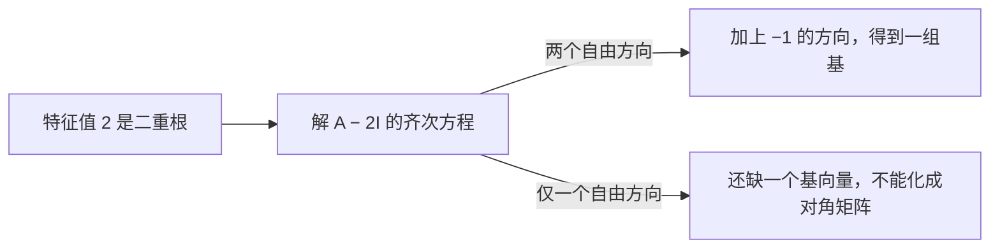

# 相似对角化复习：重根、特征方向与投影

这份历史课件的第 6.2 节讨论相似不变量和对角化条件。下面用一个自编矩阵族把两者接起来，不转录课件例题或证明，也不把讲解当成原件全文。

## 特征值没变，能不能把相互牵连的坐标拆开？

**补充。** 在实数域考察
$$
A_t=\begin{pmatrix}2&t&0\\0&2&0\\1&0&-1\end{pmatrix}.
$$
找出哪些参数允许相似对角化；在可对角化情形，不直接计算逆矩阵，写出任意非负整数次幂。

**参考解答。** 对角矩阵的每个坐标独立伸缩。换回原坐标就是找一组基向量，每个都只被伸缩而不被拐到别的方向。这里的特征多项式是
$$
\det(\lambda I-A_t)=(\lambda-2)^2(\lambda+1),
$$
与 $t$ 无关。但能否组成一组基，要数的是==独立的特征方向==，不能只数特征多项式的根。把两个方程组直接写开：

| 特征值 | 等价约束 | 特征空间维数 |
|---|---|---|
| $2$ | $t x_2=0$，$x_1=3x_3$ | $t=0$ 时为 $2$；$t\ne0$ 时为 $1$ |
| $-1$ | $x_1=x_2=0$ | 恒为 $1$ |

不同特征值的空间合起来不会重复占方向，因此恰在 $t=0$ 时凑齐三维。此时可取 $(3,0,1)$、$(0,1,0)$、$(0,0,1)$ 为基，前两者对应 $2$，后者对应 $-1$。

> [!WARNING]
> $A_0$ 与 $A_1$ 的特征多项式相同，却不相似：若 $B=P^{-1}AP$，则 $B-2I=P^{-1}(A-2I)P$，零空间维数不变。这比仅比较迹、行列式或根的重数更有分辨力。

## 把两个伸缩方向分开后，为什么幂能直接写？

**参考解答。** 取 $A=A_0$。想从任意向量抽出属于特征值 $2$ 的分量，可以找一个一次多项式，使它在 $2$ 上取 $1$、在 $-1$ 上取 $0$。所以两个投影为
$$
E_2=\frac{A+I}{3},\qquad E_{-1}=\frac{2I-A}{3}.
$$
它们分别在对应特征空间上保留向量，在另一空间上消去向量；因此 $E_2+E_{-1}=I$，而对任意非负整数 $k$，
$$
A^k=2^k E_2+(-1)^k E_{-1}.
$$
例如把 $(1,0,0)$ 分解成 $(1,0,1/3)+(0,0,-1/3)$，它经过三次作用变为 $(8,0,3)$；直接连乘三次也得到同一结果。这两个投影一般不是正交投影：此处 $(3,0,1)$ 和 $(0,0,1)$ 内积为 $1$。题目若要求用==正交矩阵==对角化，就不能沿用「找够独立方向即可」的判断。

如果改成 $A_1$，仍可以把同样的两个一次多项式代进去，但它们不再是相应的投影。例如 $(A_1-2I)(A_1+I)(0,1,0)^{\mathsf T}=(3,0,1)^{\mathsf T}\ne0$。这说明两段纯伸缩无法覆盖所有方向，套幂公式会漏掉耦合。

知识点：[矩阵相似](../../../topics/线性代数/矩阵相似.md)、[特征值与特征向量](../../../topics/线性代数/特征值与特征向量.md)、[矩阵相似对角化](../../../topics/线性代数/矩阵相似对角化.md)。
