# 《线性代数与空间解析几何》第1.1讲 行列式定义与性质（课件）

原件的每一页，下面附识别出的文字。

### 线性代数与空间解析 几何

原文：

线性代数与空间解析 几何

闫庆伦

南京邮电大学工程数学中心

◀ ▶

1

### 线代课的重要提醒

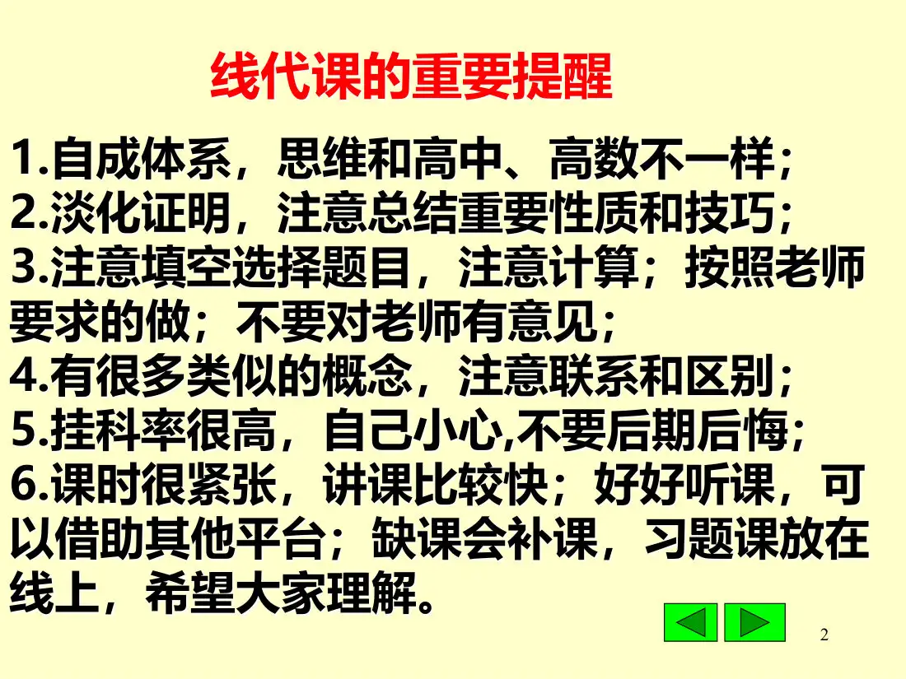

原文：

线代课的重要提醒

1. 自成体系，思维和高中、高数不一样；

2. 淡化证明，注意总结重要性质和技巧；

3. 注意填空选择题目，注意计算；按照老师要求的做；不要对老师有意见；

4.有很多类似的概念，注意联系和区别；

5. 挂科率很高，自己小心,不要后期后悔;

6.课时很紧张，讲课比较快；好好听课，可以借助其他平台；缺课会补课，习题课放在线上，希望大家理解。

◀ ▶

2

### 对大学生活的善意建议

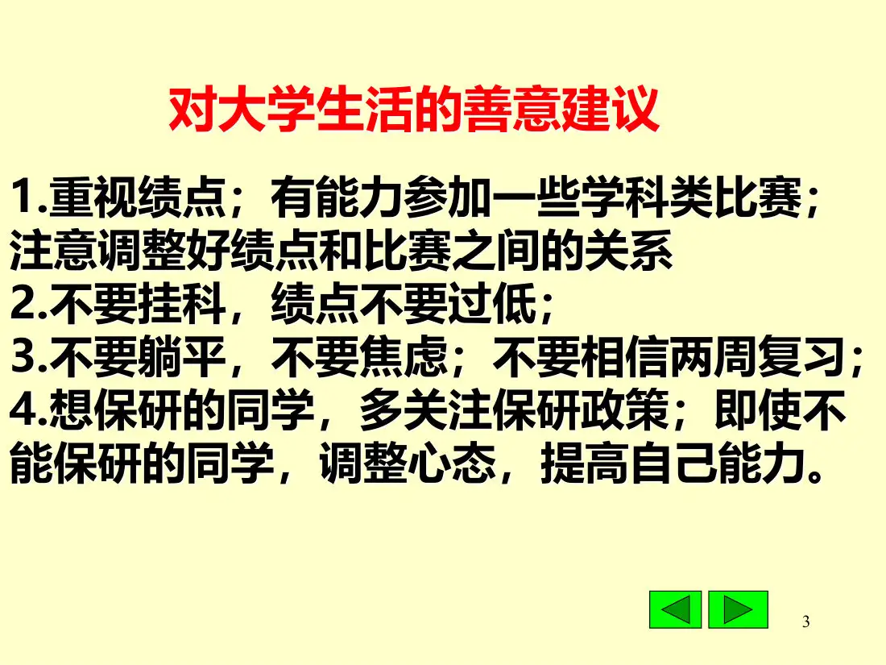

原文：

对大学生活的善意建议

1. 重视绩点；有能力参加一些学科类比赛；注意调整好绩点和比赛之间的关系

2. 不要挂科，绩点不要过低；

3. 不要躺平，不要焦虑；不要相信两周复习；

4. 想保研的同学，多关注保研政策；即使不能保研的同学，调整心态，提高自己能力。

◀ ▶

3

### 《线性代数与解析几何》序言

原文：

《线性代数与解析几何》序言

\- 学时:48 学时

3 学分,共16 周课, 单双周上课.

\- 成绩: 100 分

平时+期末

◀ ▶

4

### 齐次线性方程组的表示形式

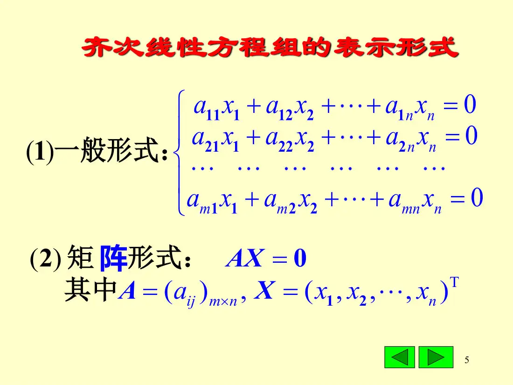

原文：

齐次线性方程组的表示形式

(1)一般形式:

$$
\left\{ \begin{array}{l} a _ {1 1} x _ {1} + a _ {1 2} x _ {2} + \dots + a _ {1 n} x _ {n} = 0 \\ a _ {2 1} x _ {1} + a _ {2 2} x _ {2} + \dots + a _ {2 n} x _ {n} = 0 \\ \dots \dots \\ a _ {m 1} x _ {1} + a _ {m 2} x _ {2} + \dots + a _ {m n} x _ {n} = 0 \end{array} \right.
$$

(2) 矩阵形式: AX = 0
其中 $A = (a_{ij})_{m \times n}, X = (x_1, x_2, \cdots, x_n)^{\mathrm{T}}$ 非齐次线性方程组的表示形式

◀ ▶

5

### (1)一般形式:

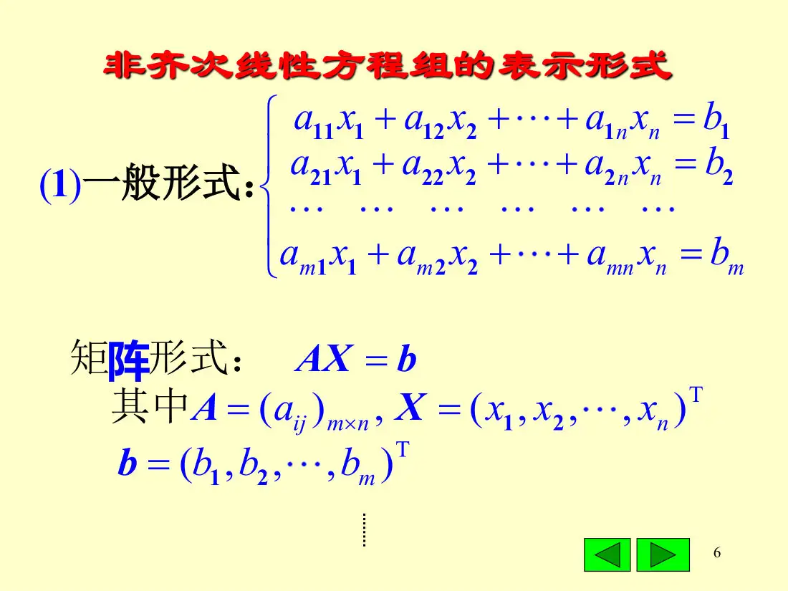

原文：

(1)一般形式:

$$
\left\{ \begin{array}{l} a _ {1 1} x _ {1} + a _ {1 2} x _ {2} + \dots + a _ {1 n} x _ {n} = b _ {1} \\ a _ {2 1} x _ {1} + a _ {2 2} x _ {2} + \dots + a _ {2 n} x _ {n} = b _ {2} \\ \dots \quad \dots \quad \dots \quad \dots \quad \dots \quad \dots \\ a _ {m 1} x _ {1} + a _ {m 2} x _ {2} + \dots + a _ {m n} x _ {n} = b _ {m} \end{array} \right.
$$

矩阵形式: AX = b

其中 $A=(a_{ij})_{m\times n},X=(x_{1},x_{2},\cdots,x_{n})^{\mathrm{T}}$

$$
\boldsymbol {b} = (b _ {1}, b _ {2}, \dots , b _ {m}) ^ {\mathrm{T}}
$$

◀ ▶

6

### ◀ ▶

原文：

线性代数的重要性：线性代数与微积分是大学数学基础课。无论这样评价其重要性都不为过。而学好这些数学基础课程，将受益终生。

线性代数的应用:有很多实际问题,都可以转成线性代数的方法去解决.在工程学、计算机科学、物理学、数学、生物学、密码学、经济学和统计学中都有很多应用.

◀ ▶

7

### 一、教学内容

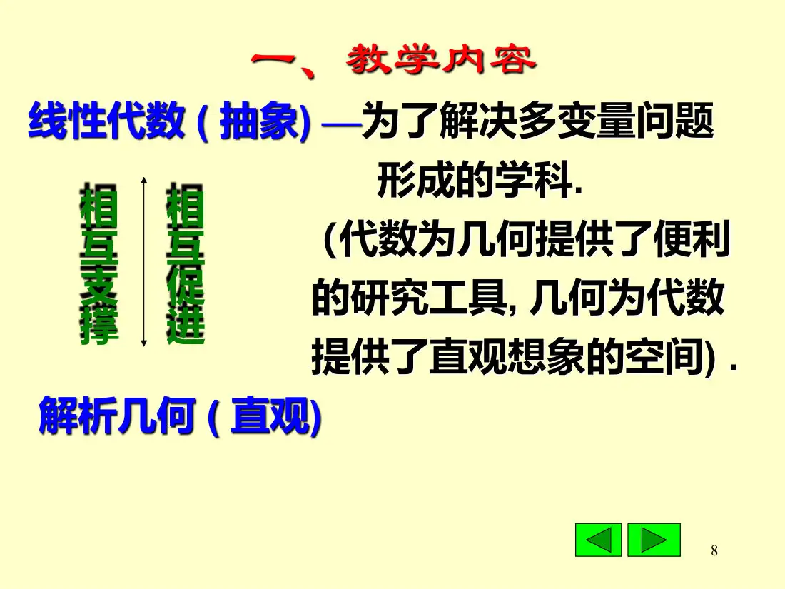

原文：

一、教学内容

线性代数（抽象）——为了解决多变量问题形成的学科。
相互支撑 ↑ 相互促进
(代数为几何提供了便利的研究工具, 几何为代数提供了直观想象的空间)

解析几何 (直观)

◀ ▶

8

### 二、课程特点

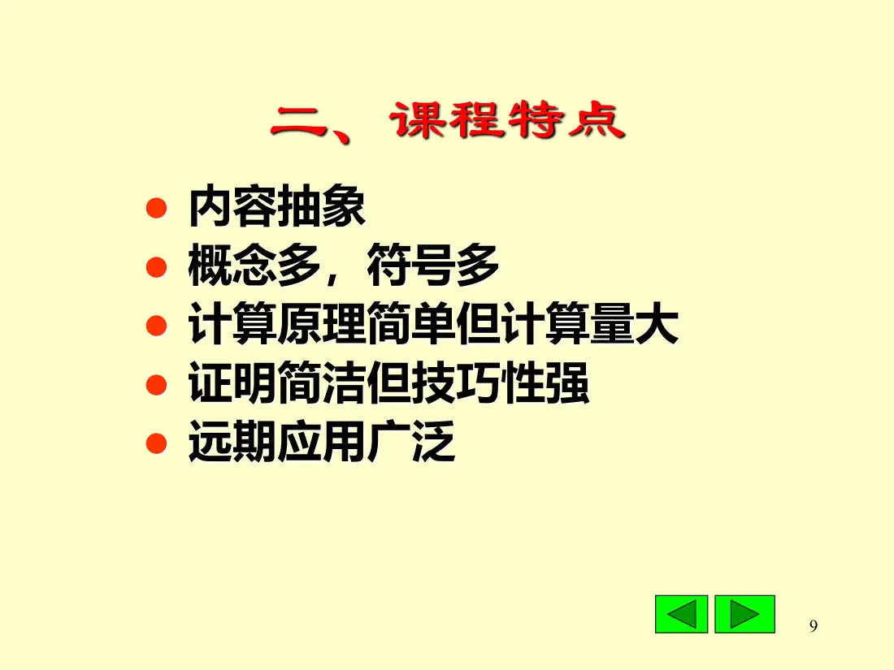

原文：

二、课程特点

\- 内容抽象

\- 概念多，符号多

\- 计算原理简单但计算量大

\- 证明简洁但技巧性强

\- 远期应用广泛

◀ ▶

9

### 三、学习方法

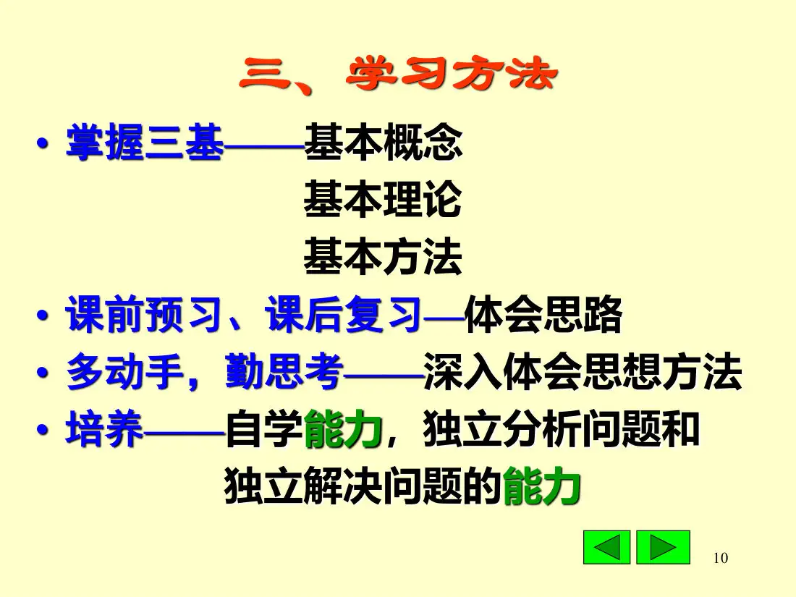

原文：

三、学习方法

\- 掌握三基——基本概念

基本理论

基本方法

\- 课前预习、课后复习—体会思路

· 多动手，勤思考——深入体会思想方法

\- 培养——自学能力，独立分析问题和独立解决问题的能力

◀ ▶

10

### 四、教学参考书

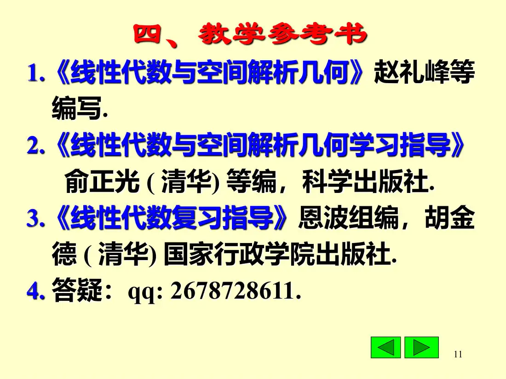

原文：

四、教学参考书

1. 《线性代数与空间解析几何》赵礼峰等编写。

2. 《线性代数与空间解析几何学习指导》
俞正光（清华）等编，科学出版社。

3.《线性代数复习指导》恩波组编，胡金德（清华）国家行政学院出版社。

4. 答疑: qq: 2678728611.

◀ ▶

11

### 五、教学要求

原文：

五、教学要求

1. 前排就坐，上课遵守纪律关手机，不迟到!!!

2.答疑时间:

3.交作业时间: 1-2周一次, 上课时候交 (线下). (作业 写上姓名学号!!!)

周四中午 教2-316-1

◀ ▶

12

### 目录

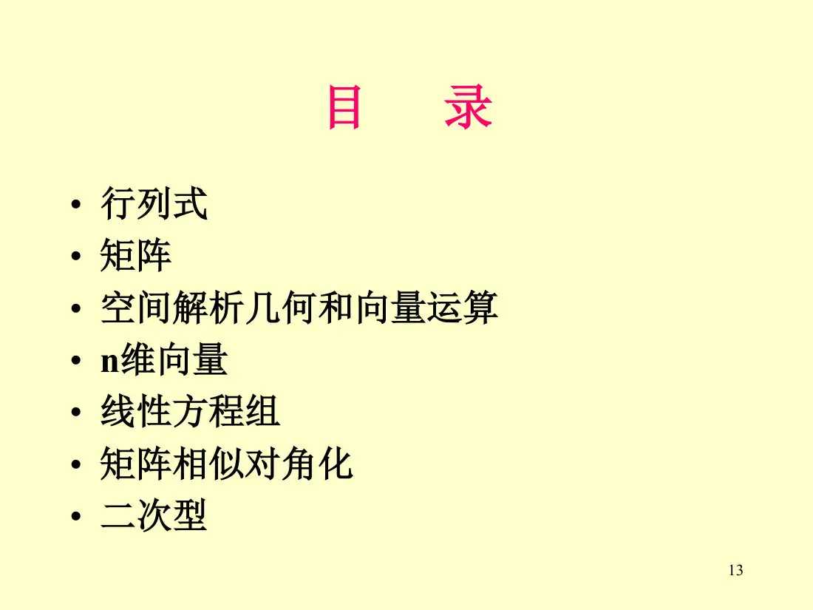

原文：

目录

\- 行列式
- 矩阵
- 空间解析几何和向量运算
- n维向量
- 线性方程组
- 矩阵相似对角化
- 二次型

13

### 《线性代数与空间解析几何》

原文：

《线性代数与空间解析几何》

第一章

行列式

◀ ▶

14

### 本章主要内容

原文：

本章主要内容

行列式的定义

行列式的性质

行列式的计算

Cramer法则

◀ ▶

15

### 本节主要内容

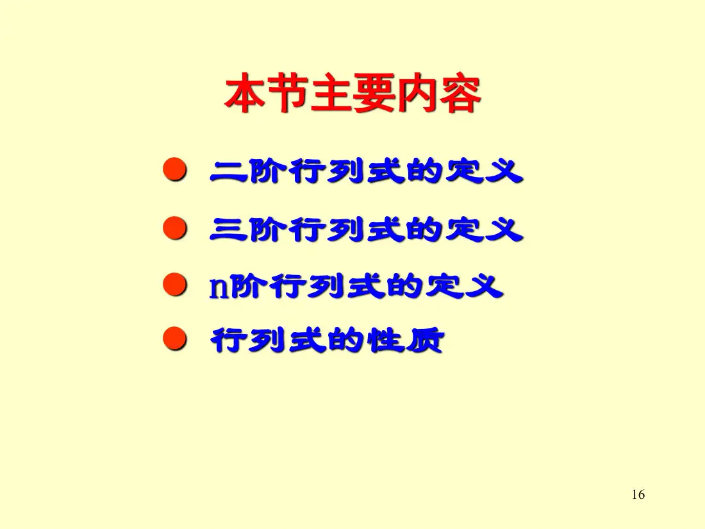

原文：

本节主要内容

二阶行列式的定义

三阶行列式的定义

n阶行列式的定义

行列式的性质

16

### 1.1 $n$ 阶行列式

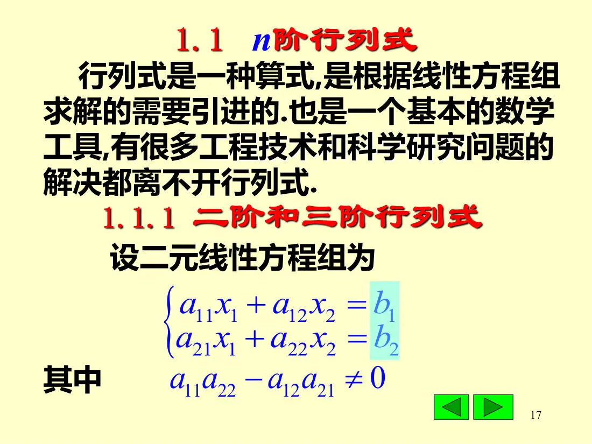

原文：

1.1 $n$ 阶行列式

行列式是一种算式,是根据线性方程组求解的需要引进的.也是一个基本的数学工具,有很多工程技术和科学研究问题的解决都离不开行列式.

1.1.1 二阶和三阶行列式

设二元线性方程组为

其中

$$
\left\{ \begin{array}{l} a _ {1 1} x _ {1} + a _ {1 2} x _ {2} = b _ {1} \\ a _ {2 1} x _ {1} + a _ {2 2} x _ {2} = b _ {2} \\ a _ {1 1} a _ {2 2} - a _ {1 2} a _ {2 1} \neq 0 \end{array} \right.
$$

◀ ▶

17

### 对方程组用加减消元法求出解:

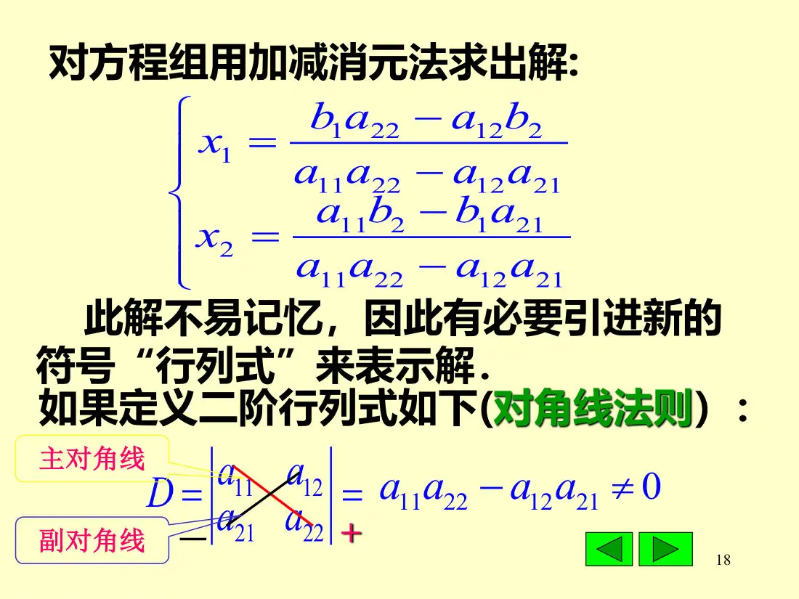

原文：

对方程组用加减消元法求出解:

$$
\left\{ \begin{array}{l} x _ {1} = \frac {b _ {1} a _ {2 2} - a _ {1 2} b _ {2}}{a _ {1 1} a _ {2 2} - a _ {1 2} a _ {2 1}} \\ x _ {2} = \frac {a _ {1 1} b _ {2} - b _ {1} a _ {2 1}}{a _ {1 1} a _ {2 2} - a _ {1 2} a _ {2 1}} \end{array} \right.
$$

此解不易记忆，因此有必要引进新的符号“行列式”来表示解。

如果定义二阶行列式如下(对角线法则)：

主对角线

副对角线

$$
D = \left| \begin{array}{c c} a _ {1 1} & a _ {1 2} \\ a _ {2 1} & a _ {2 2} \end{array} \right| = a _ {1 1} a _ {2 2} - a _ {1 2} a _ {2 1} \neq 0
$$

18

### $$

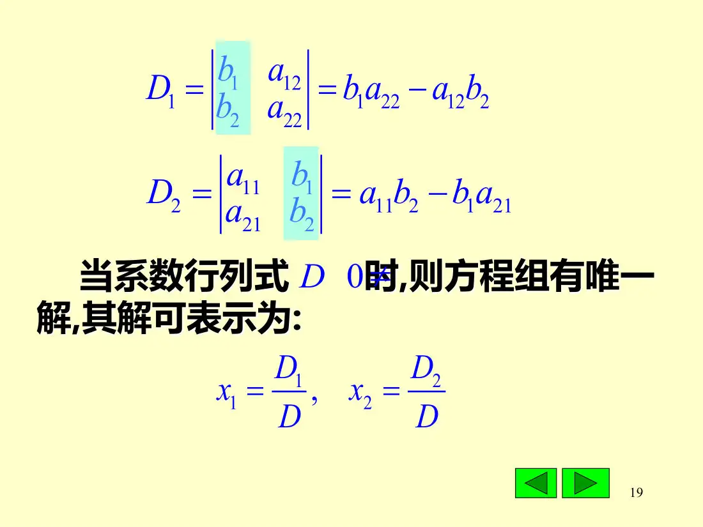

原文：

$$
D _ {1} = \left| \begin{array}{c c} b _ {1} & a _ {1 2} \\ b _ {2} & a _ {2 2} \end{array} \right| = b _ {1} a _ {2 2} - a _ {1 2} b _ {2}
$$

$$
D _ {2} = \left| \begin{array}{c c} a _ {1 1} & b _ {1} \\ a _ {2 1} & b _ {2} \end{array} \right| = a _ {1 1} b _ {2} - b _ {1} a _ {2 1}
$$

当系数行列式 D 0 时,则方程组有唯一解,其解可表示为:

$$
x _ {1} = \frac {D _ {1}}{D}, x _ {2} = \frac {D _ {2}}{D}
$$

◀ ▶

19

### 第 20 页

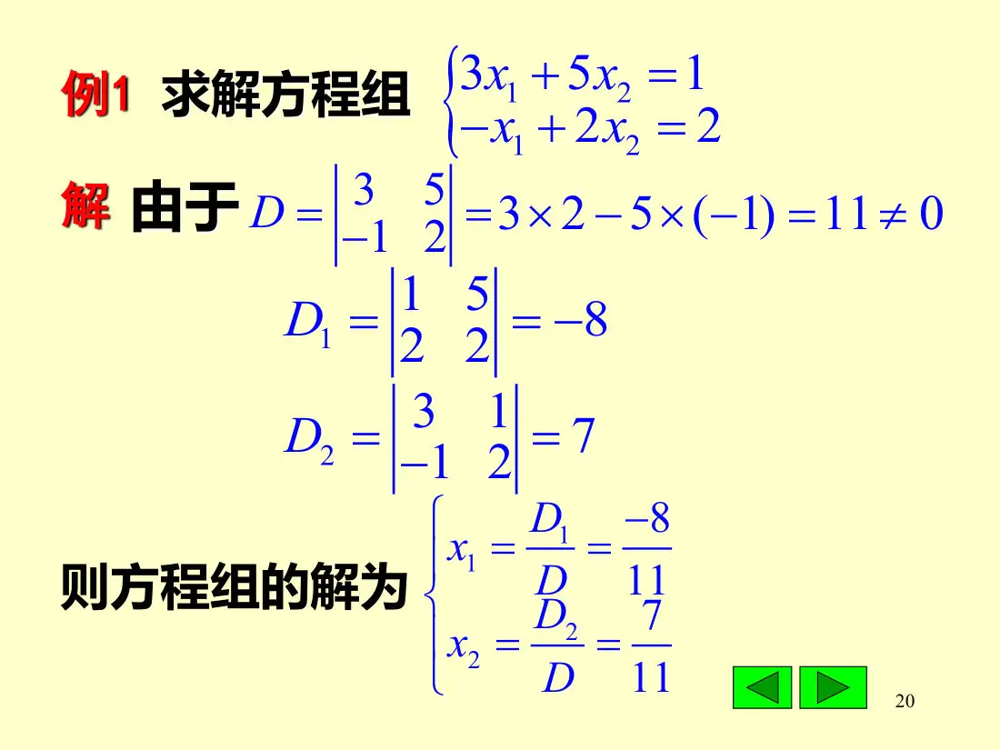

原文：

例1 求解方程组 $\left\{\begin{aligned}3x_{1}+5x_{2}&=1\\ -x_{1}+2x_{2}&=2\end{aligned}\right.$ 解 由于 $D=\left|\begin{matrix}3 & 5 \\ -1 & 2\end{matrix}\right|=3\times2-5\times(-1)=11\neq0$ $D_{1}=\left|\begin{matrix}1 & 5 \\ 2 & 2\end{matrix}\right|=-8$ $D_{2}=\left|\begin{matrix}3 & 1 \\ -1 & 2\end{matrix}\right|=7$ 则方程组的解为 $\left\{\begin{aligned}x_{1}&=\frac{D_{1}}{D}=\frac{-8}{11}\\ x_{2}&=\frac{D_{2}}{D}=\frac{7}{11}\end{aligned}\right.$

### 二阶行列式对角线法则:

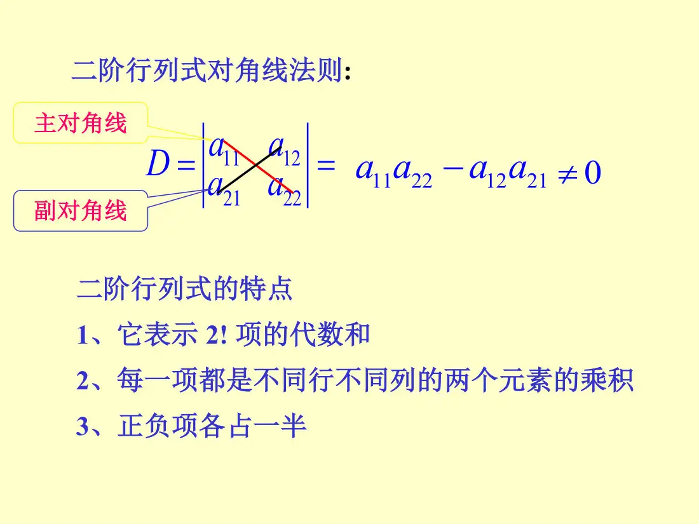

原文：

二阶行列式对角线法则:

主对角线

副对角线

$$
D = \left| \begin{array}{c c} a _ {1 1} & a _ {1 2} \\ a _ {2 1} & a _ {2 2} \end{array} \right| = a _ {1 1} a _ {2 2} - a _ {1 2} a _ {2 1} \neq 0
$$

二阶行列式的特点

1、它表示 2! 项的代数和

2、每一项都是不同行不同列的两个元素的乘积

3、正负项各占一半

### 三阶行列式对角线法则:

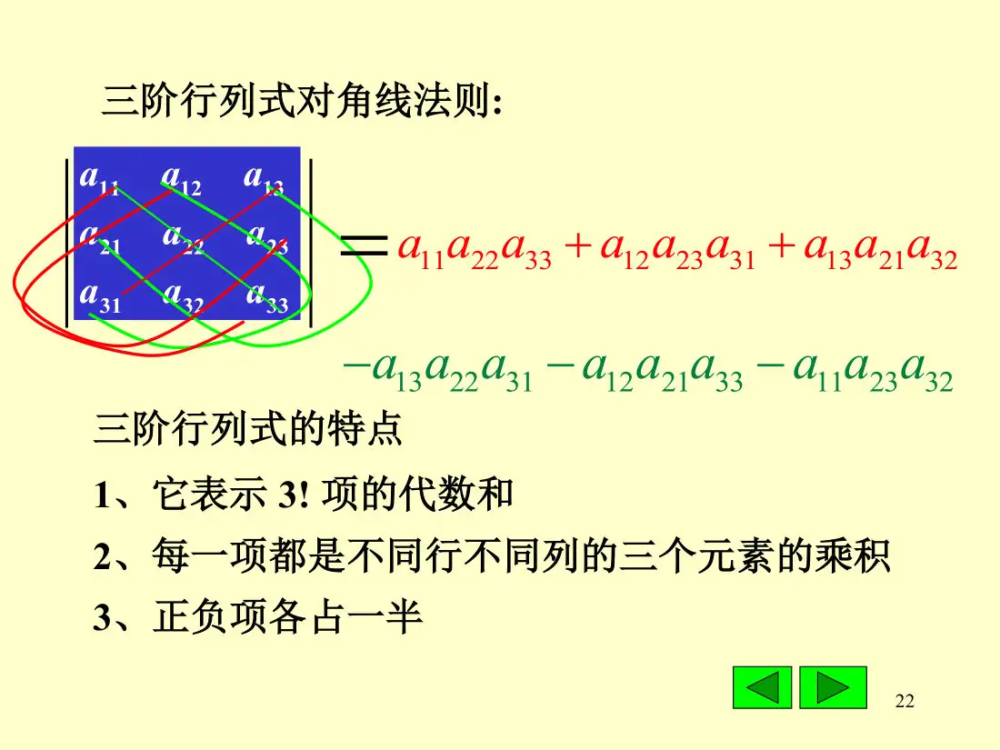

原文：

三阶行列式对角线法则:

三阶行列式的特点

1、它表示 3! 项的代数和

2、每一项都是不同行不同列的三个元素的乘积

3、正负项各占一半

◀ ▶

22

### 如果定义三阶行列式如下(对角线法则)：

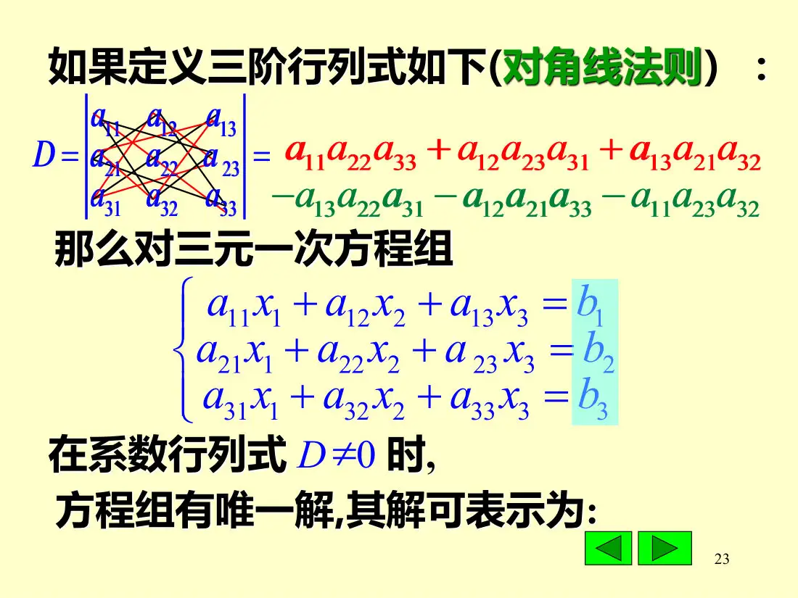

原文：

如果定义三阶行列式如下(对角线法则)：

$$
D = \left| \begin{array}{c c c} a _ {1 1} & a _ {1 2} & a _ {1 3} \\ a _ {2 1} & a _ {2 2} & a _ {2 3} \\ a _ {3 1} & a _ {3 2} & a _ {3 3} \end{array} \right| = a _ {1 1} a _ {2 2} a _ {3 3} + a _ {1 2} a _ {2 3} a _ {3 1} + a _ {1 3} a _ {2 1} a _ {3 2} - a _ {1 3} a _ {2 2} a _ {3 1} - a _ {1 2} a _ {2 1} a _ {3 3} - a _ {1 1} a _ {2 3} a _ {3 2}
$$

那么对三元一次方程组

$$
\left\{ \begin{array}{l} a _ {1 1} x _ {1} + a _ {1 2} x _ {2} + a _ {1 3} x _ {3} = b _ {1} \\ a _ {2 1} x _ {1} + a _ {2 2} x _ {2} + a _ {2 3} x _ {3} = b _ {2} \\ a _ {3 1} x _ {1} + a _ {3 2} x _ {2} + a _ {3 3} x _ {3} = b _ {3} \end{array} \right.
$$

在系数行列式 $D \neq 0$ 时，
方程组有唯一解,其解可表示为:

◀ ▶

23

### $$

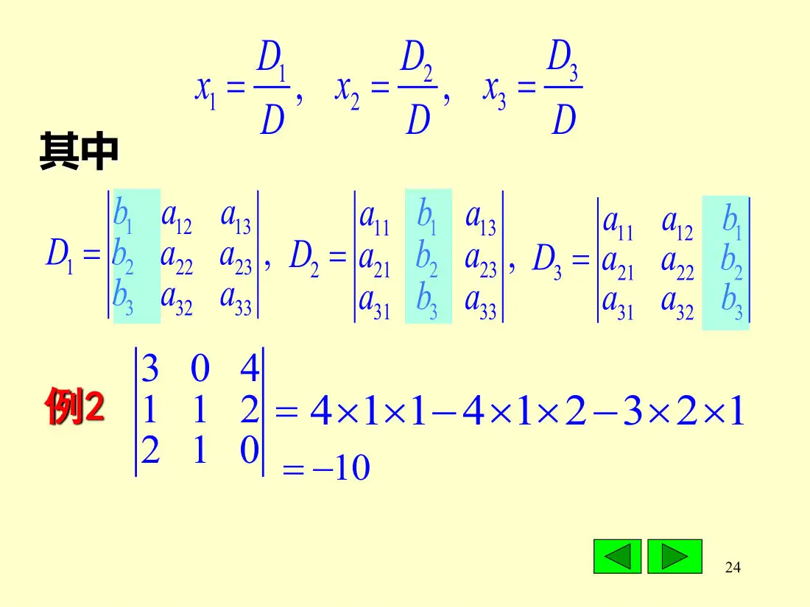

原文：

$$
x _ {1} = \frac {D _ {1}}{D}, \quad x _ {2} = \frac {D _ {2}}{D}, \quad x _ {3} = \frac {D _ {3}}{D}
$$

其中

$$
D _ {1} = \left| \begin{array}{c c c} b _ {1} & a _ {1 2} & a _ {1 3} \\ b _ {2} & a _ {2 2} & a _ {2 3} \\ b _ {3} & a _ {3 2} & a _ {3 3} \end{array} \right|, D _ {2} = \left| \begin{array}{c c c} a _ {1 1} & b _ {1} & a _ {1 3} \\ a _ {2 1} & b _ {2} & a _ {2 3} \\ a _ {3 1} & b _ {3} & a _ {3 3} \end{array} \right|, D _ {3} = \left| \begin{array}{c c c} a _ {1 1} & a _ {1 2} & b _ {1} \\ a _ {2 1} & a _ {2 2} & b _ {2} \\ a _ {3 1} & a _ {3 2} & b _ {3} \end{array} \right|
$$

例2

$$
\left| \begin{array}{c c c} 3 & 0 & 4 \\ 1 & 1 & 2 \\ 2 & 1 & 0 \end{array} \right| = 4 \times 1 \times 1 - 4 \times 1 \times 2 - 3 \times 2 \times 1 = - 1 0
$$

◀ ▶

24

### 问题1：怎样定义n阶行列式？

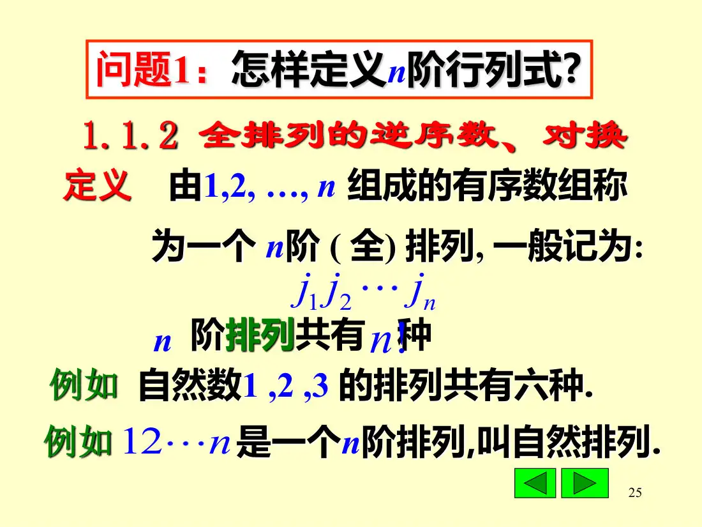

原文：

问题1：怎样定义n阶行列式？

1.1.2 全排列的逆序数、对换定义 由 $1,2,\ldots,n$ 组成的有序数组称

为一个 n 阶（全）排列，一般记为：

$$
j _ {1} j _ {2} \dots j _ {n}
$$

n 阶排列共有 n! 种

例如 自然数1,2,3的排列共有六种.

例如 $12\cdots n$ 是一个 n 阶排列, 叫自然排列.

◀ ▶

25

### ◀ ▶

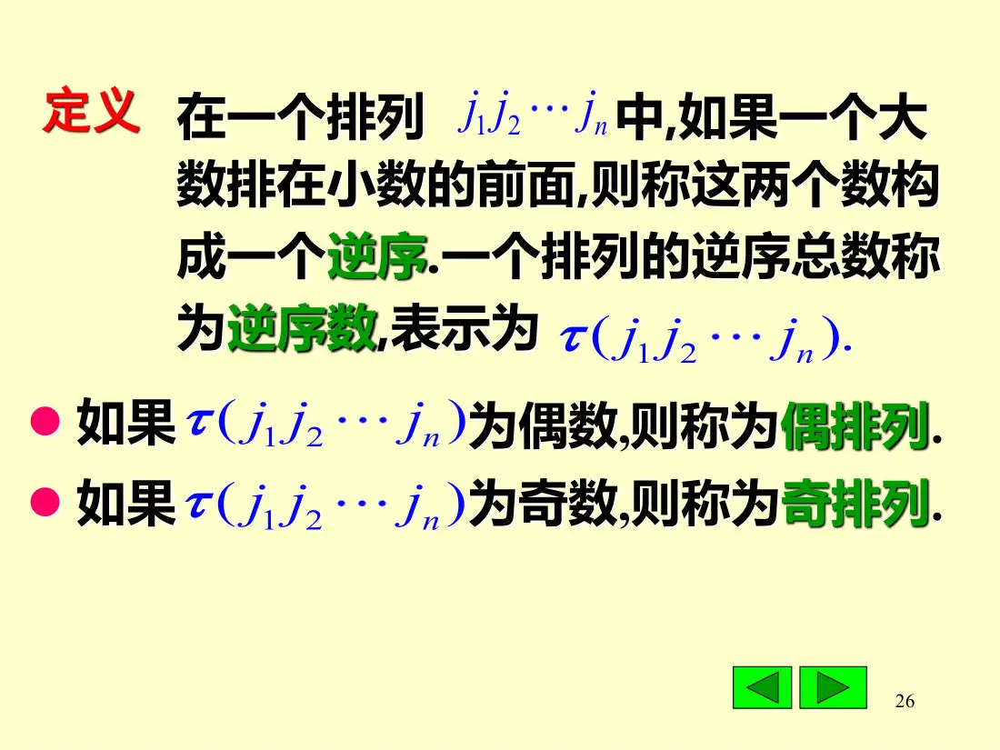

原文：

定义 在一个排列 $j_{1}j_{2}\cdots j_{n}$ 中,如果一个大数排在小数的前面,则称这两个数构成一个逆序.一个排列的逆序总数称为逆序数,表示为 $\tau(j_{1}j_{2}\cdots j_{n})$ .

如果 $\tau (j_{1}j_{2}\dots j_{n})$ 为偶数,则称为偶排列.

如果 $\tau (j_{1}j_{2}\dots j_{n})$ 为奇数,则称为奇排列.

◀ ▶

26

### 例4 $\tau(12\cdots n)=0$

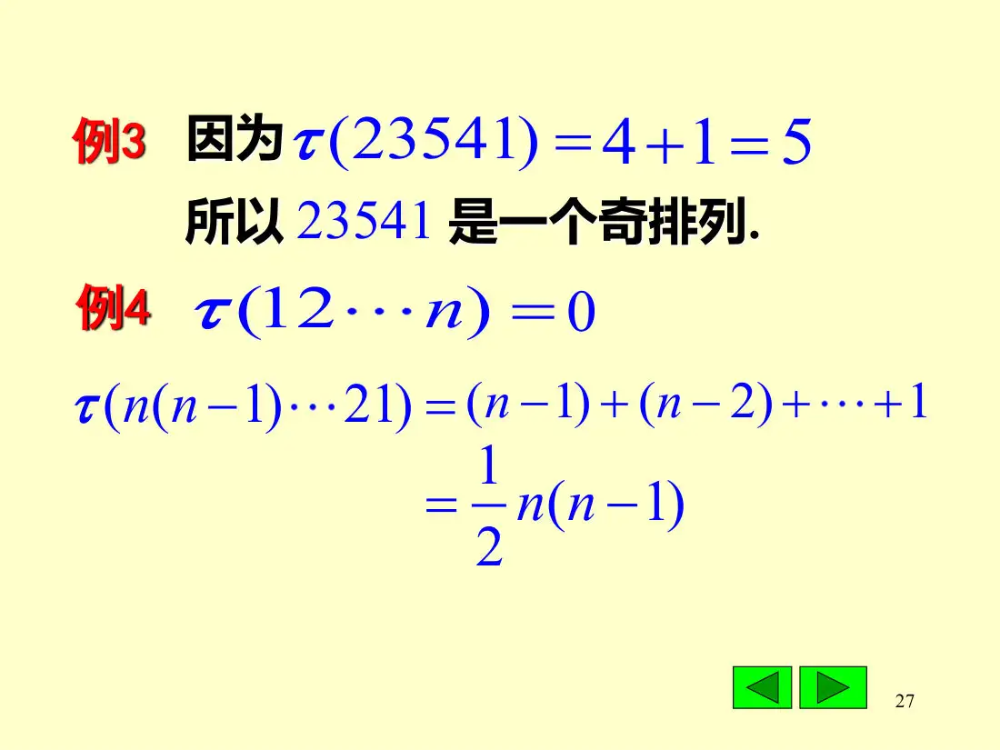

原文：

例3 因为 $\tau(23541) = 4 + 1 = 5$ 所以 23541 是一个奇排列.

例4 $\tau(12\cdots n)=0$

$$
\begin{array}{c} \tau (n (n - 1) \dots 2 1) = (n - 1) + (n - 2) + \dots + 1 \\ = \frac {1}{2} n (n - 1) \end{array}
$$

◀ ▶

27

### 定理1 对换改变排列的奇偶性.

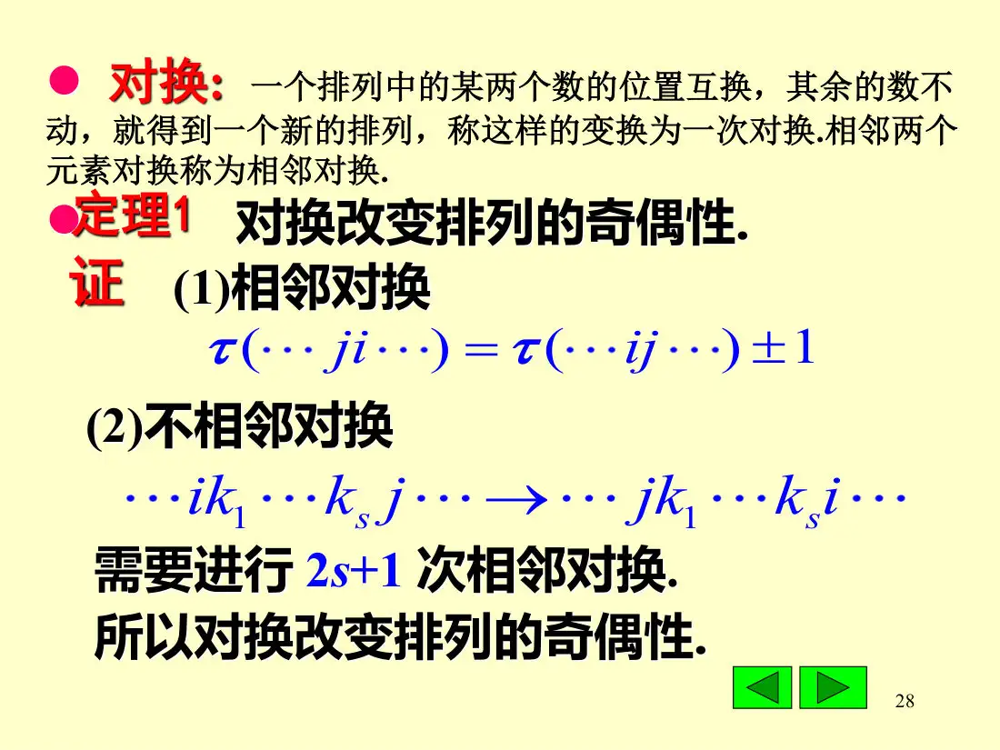

原文：

\- 对换: 一个排列中的某两个数的位置互换, 其余的数不动, 就得到一个新的排列, 称这样的变换为一次对换. 相邻两个元素对换称为相邻对换.

定理1 对换改变排列的奇偶性.

证 (1)相邻对换

$$
\tau (\dots j i \dots) = \tau (\dots i j \dots) \pm 1
$$

(2)不相邻对换

$$
\dots i k _ {1} \dots k _ {s} j \dots \rightarrow \dots j k _ {1} \dots k _ {s} i \dots
$$

需要进行 $2s+1$ 次相邻对换.

所以对换改变排列的奇偶性。

◀ ▶

28

### 29

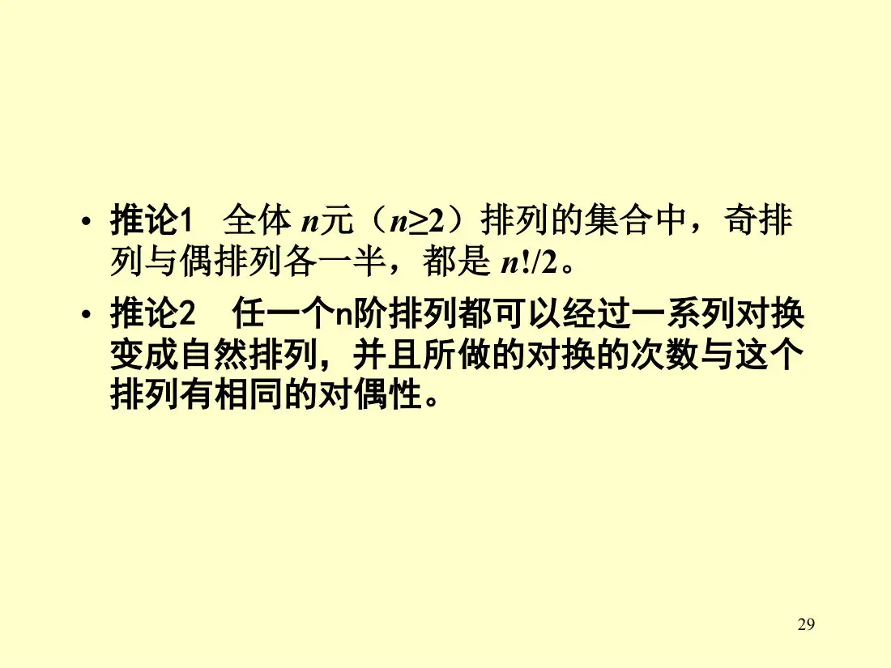

原文：

\- 推论1 全体 $n$ 元（ $n \geq 2$ ）排列的集合中，奇排列与偶排列各一半，都是 $n! / 2$ 。

\- 推论2 任一个n阶排列都可以经过一系列对换变成自然排列，并且所做的对换的次数与这个排列有相同的对偶性。

29

### 1.1.3 n 阶行列式的定义

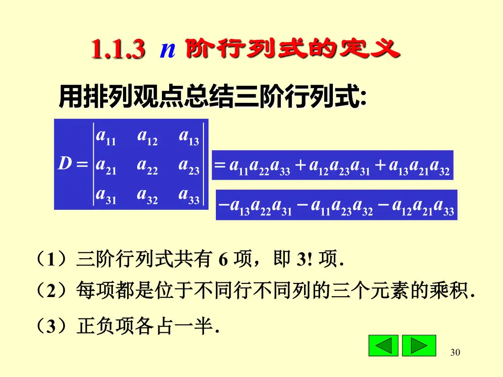

原文：

1.1.3 n 阶行列式的定义
用排列观点总结三阶行列式:

$$
D = \left| \begin{array}{c c c} a _ {1 1} & a _ {1 2} & a _ {1 3} \\ a _ {2 1} & a _ {2 2} & a _ {2 3} \\ a _ {3 1} & a _ {3 2} & a _ {3 3} \end{array} \right| = a _ {1 1} a _ {2 2} a _ {3 3} + a _ {1 2} a _ {2 3} a _ {3 1} + a _ {1 3} a _ {2 1} a _ {3 2} - a _ {1 3} a _ {2 2} a _ {3 1} - a _ {1 1} a _ {2 3} a _ {3 2} - a _ {1 2} a _ {2 1} a _ {3 3}
$$

(1) 三阶行列式共有 6 项, 即 3! 项.

(2) 每项都是位于不同行不同列的三个元素的乘积.

(3) 正负项各占一半.

◀ ▶

30

### (4) 每项的正负号都取决于位于不同行不同列的三个元素的下标排列.

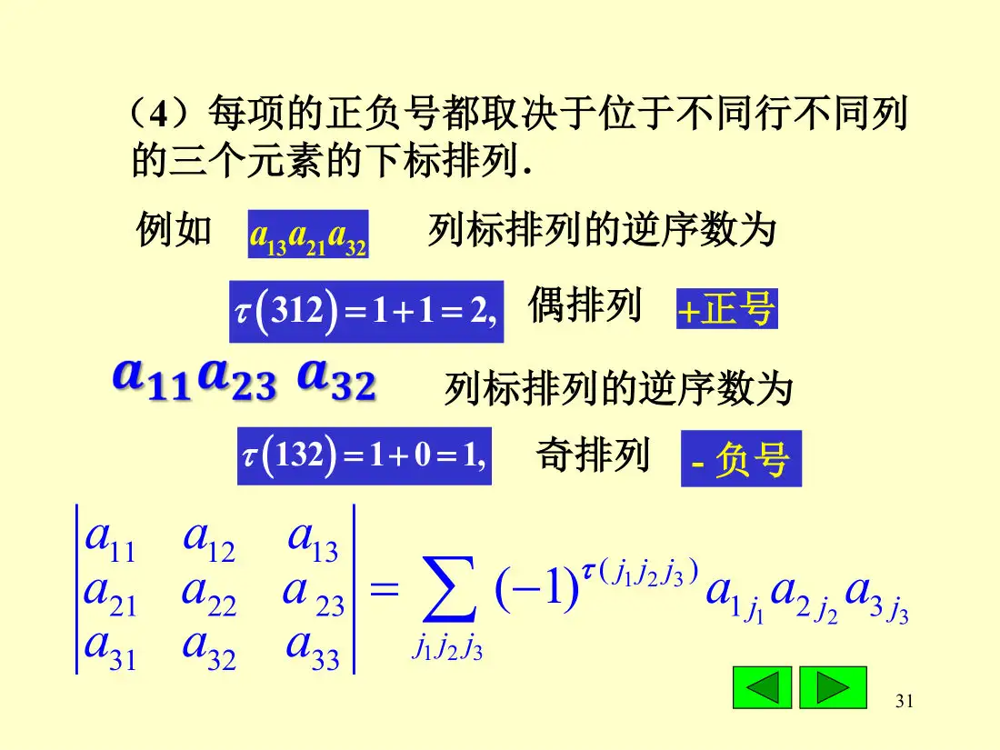

原文：

(4) 每项的正负号都取决于位于不同行不同列的三个元素的下标排列.

例如

$$
a _ {1 3} a _ {2 1} a _ {3 2}
$$

列标排列的逆序数为

$\tau (312) = 1 + 1 = 2,$ 偶排列 +正号

$a_{11}a_{23}a_{32}$ 列标排列的逆序数为

$\tau (132) = 1 + 0 = 1,$ 奇排列 -负号

$$
\left| \begin{array}{c c c} a _ {1 1} & a _ {1 2} & a _ {1 3} \\ a _ {2 1} & a _ {2 2} & a _ {2 3} \\ a _ {3 1} & a _ {3 2} & a _ {3 3} \end{array} \right| = \sum_ {j _ {1} j _ {2} j _ {3}} (- 1) ^ {\tau (j _ {1} j _ {2} j _ {3})} a _ {1 j _ {1}} a _ {2 j _ {2}} a _ {3 j _ {3}}
$$

◀ ▶

31

### 下面给出n阶行列式定义:

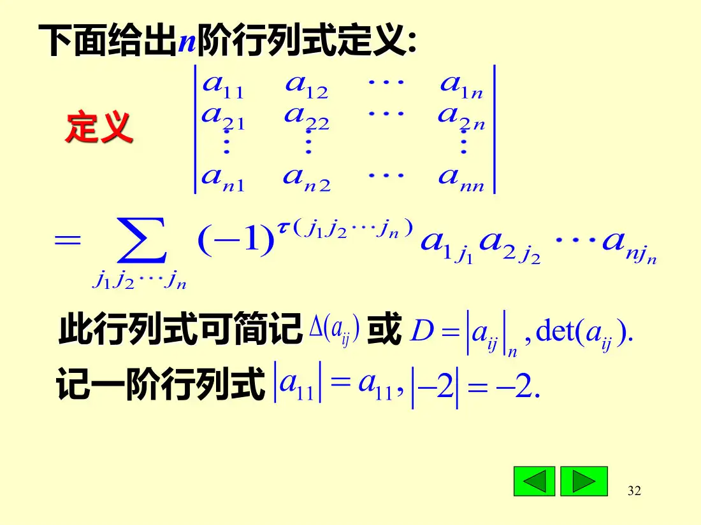

原文：

下面给出n阶行列式定义:

$$
\begin{array}{r l} & {\text {定义} \left| \begin{array}{l l l l} a _ {1 1} & a _ {1 2} & \dots & a _ {1 n} \\ a _ {2 1} & a _ {2 2} & \dots & a _ {2 n} \\ \vdots & \vdots & & \vdots \\ a _ {n 1} & a _ {n 2} & \dots & a _ {n n} \end{array} \right|} \\ & {= \sum_ {j _ {1} j _ {2} \dots j _ {n}} (- 1) ^ {\tau (j _ {1} j _ {2} \dots j _ {n})} a _ {1 j _ {1}} a _ {2 j _ {2}} \dots a _ {n j _ {n}}} \end{array}
$$

此行列式可简记 $\Delta(a_{ij})$ 或 $D=\left|a_{ij}\right|_{n},\det(a_{ij})$ .
记一阶行列式 $\left|a_{11}\right|=a_{11},\left|-2\right|=-2.$

◀ ▶

32

### 归纳如下：

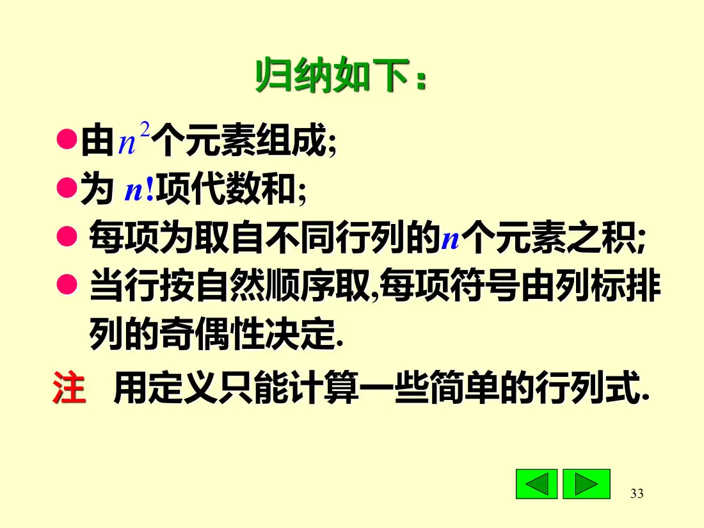

原文：

归纳如下：

由 $n^{2}$ 个元素组成;

\- 为 $n!$ 项代数和;

\- 每项为取自不同行列的 $n$ 个元素之积;

\- 当行按自然顺序取,每项符号由列标排列的奇偶性决定.

注 用定义只能计算一些简单的行列式.

◀ ▶

33

### 例5 证明对角形行列式, 上(下)三角形行列式都等于其主对角元素的乘积, 即

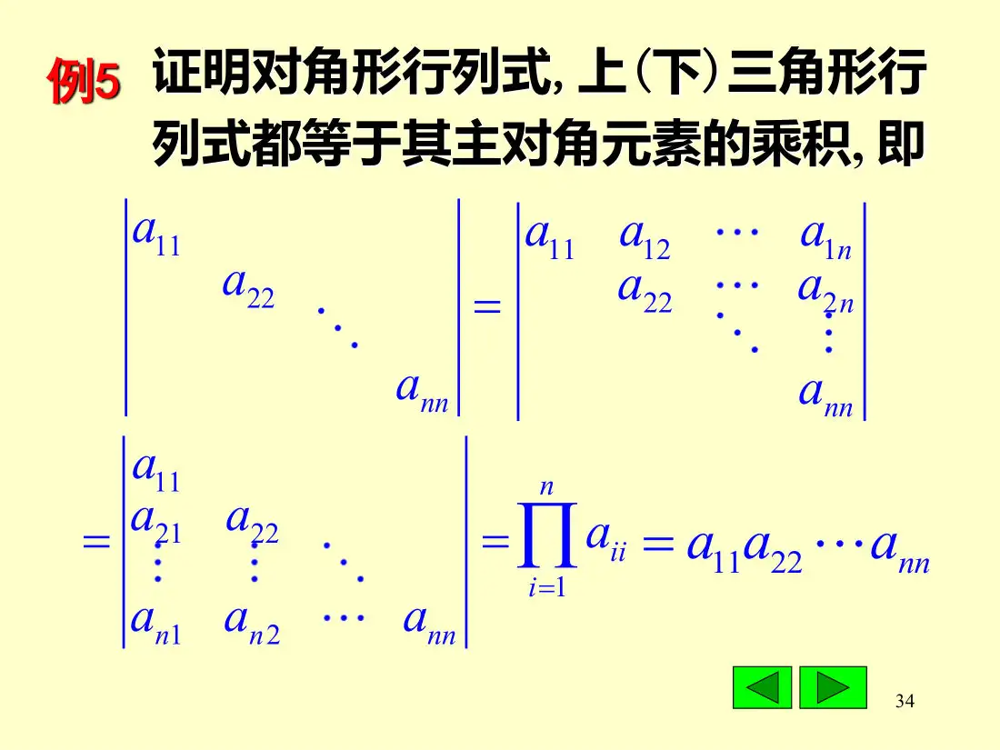

原文：

例5 证明对角形行列式, 上(下)三角形行列式都等于其主对角元素的乘积, 即

$$
\left| \begin{array}{c c c c} a _ {1 1} & & & \\ & a _ {2 2} & \ddots & \\ & & & a _ {n n} \end{array} \right| = \left| \begin{array}{c c c c} a _ {1 1} & a _ {1 2} & \dots & a _ {1 n} \\ & a _ {2 2} & \ddots & a _ {2 n} \\ & & \ddots & \vdots \\ & & & a _ {n n} \end{array} \right|
$$

$$
= \left| \begin{array}{c c c c} a _ {1 1} & & & \\ a _ {2 1} & a _ {2 2} & \cdot & \\ \vdots & \vdots & \ddots & \\ a _ {n 1} & a _ {n 2} & \dots & a _ {n n} \end{array} \right| = \prod_ {i = 1} ^ {n} a _ {i i} = a _ {1 1} a _ {2 2} \dots a _ {n n}
$$

◀ ▶

34

### 证 只以下三角行列式为例来证明.

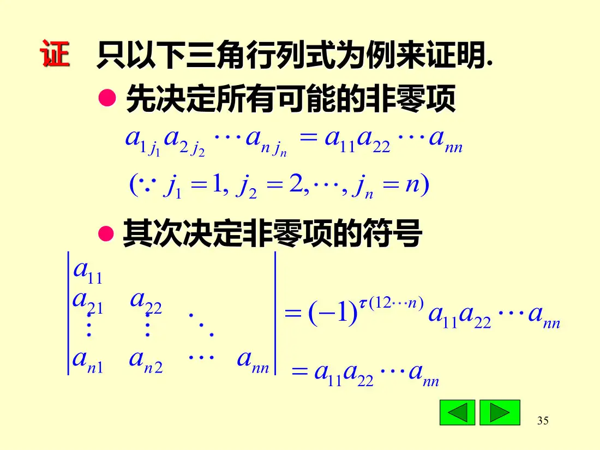

原文：

证 只以下三角行列式为例来证明.

\- 先决定所有可能的非零项

$$
a _ {1 j _ {1}} a _ {2 j _ {2}} \dots a _ {n j _ {n}} = a _ {1 1} a _ {2 2} \dots a _ {n n}
$$

$$
(\because j _ {1} = 1, j _ {2} = 2, \dots , j _ {n} = n)
$$

\- 其次决定非零项的符号

$$
\left| \begin{array}{c c c c} a _ {1 1} & & & \\ a _ {2 1} & a _ {2 2} & \ddots & \\ \vdots & \vdots & \ddots & \\ a _ {n 1} & a _ {n 2} & \dots & a _ {n n} \end{array} \right| = (- 1) ^ {\tau (1 2 \dots n)} a _ {1 1} a _ {2 2} \dots a _ {n n} = a _ {1 1} a _ {2 2} \dots a _ {n n}
$$

◀ ▶

35

### 例6

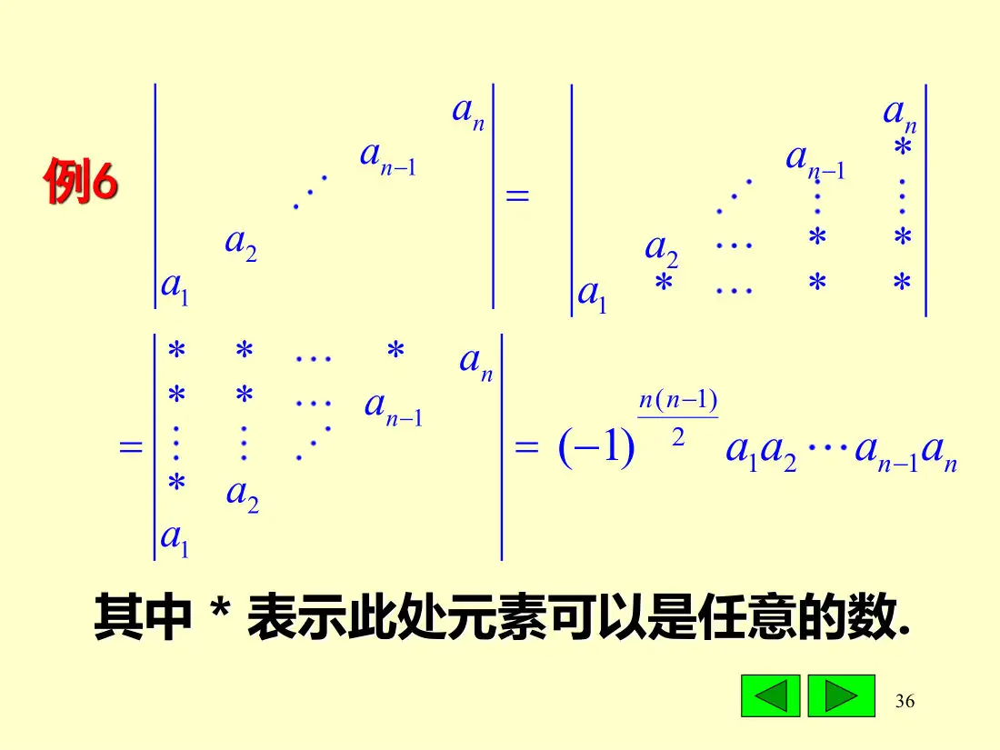

原文：

例6

$$
\begin{array}{l} \text {6} \left| \begin{array}{c c c c} & & & a _ {n} \\ & & \ddots & \\ a _ {1} & a _ {2} & & \\ \end{array} \right| = \left| \begin{array}{c c c c} & & & a _ {n} \\ & & a _ {n - 1} & * \\ & a _ {2} & \ddots & \vdots \\ a _ {1} & * & \ddots & * \\ \end{array} \right| \\ = \left| \begin{array}{c c c c c} * & * & \dots & * & a _ {n} \\ * & * & \dots & a _ {n - 1} \\ \vdots & \vdots & \ddots & \\ * & a _ {2} & & \\ a _ {1} & & & \end{array} \right| = (- 1) ^ {\frac {n (n - 1)}{2}} a _ {1} a _ {2} \dots a _ {n - 1} a _ {n} \end{array}
$$

其中 \* 表示此处元素可以是任意的数。

◀ ▶

36

### 注意 这个行列式的值一般并不等于

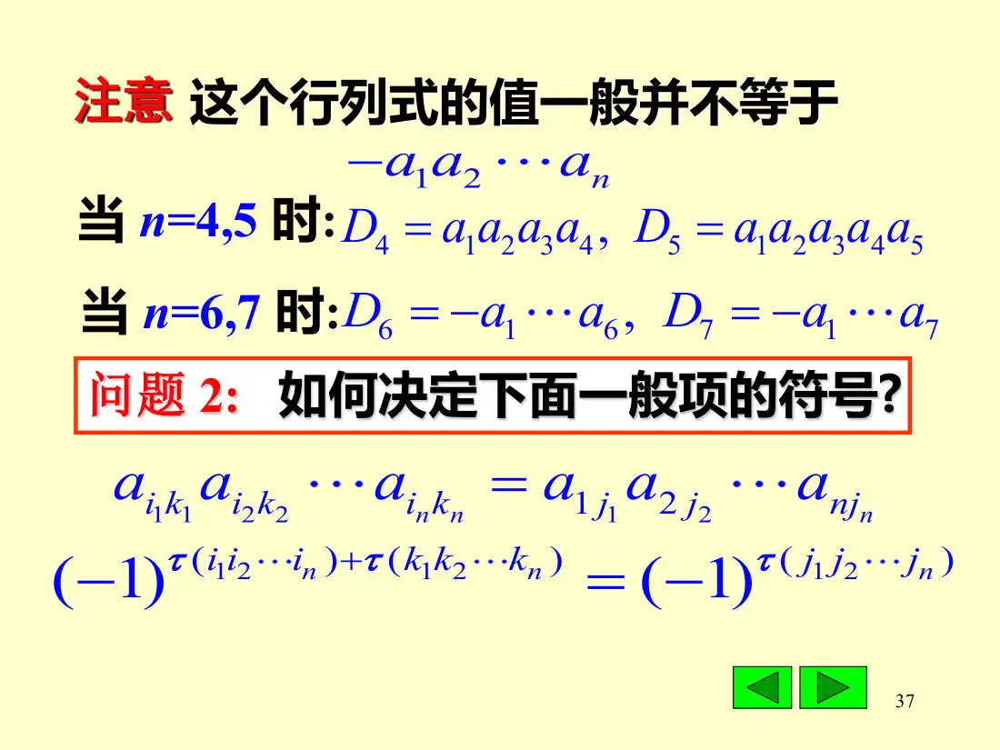

原文：

注意 这个行列式的值一般并不等于

$$
- a _ {1} a _ {2} \dots a _ {n}
$$

当 n=4,5 时: $D_{4}=a_{1}a_{2}a_{3}a_{4},\quad D_{5}=a_{1}a_{2}a_{3}a_{4}a_{5}$

当 n=6,7 时: $D_{6}=-a_{1}\cdots a_{6},\quad D_{7}=-a_{1}\cdots a_{7}$

问题 2: 如何决定下面一般项的符号?

$$
\begin{array}{r} a _ {i _ {1} k _ {1}} a _ {i _ {2} k _ {2}} \dots a _ {i _ {n} k _ {n}} = a _ {1 j _ {1}} a _ {2 j _ {2}} \dots a _ {n j _ {n}} \\ (- 1) ^ {\tau (i _ {1} i _ {2} \dots i _ {n}) + \tau (k _ {1} k _ {2} \dots k _ {n})} = (- 1) ^ {\tau (j _ {1} j _ {2} \dots j _ {n})} \end{array}
$$

◀

37

### 注意 这个行列式的值一般并不等于

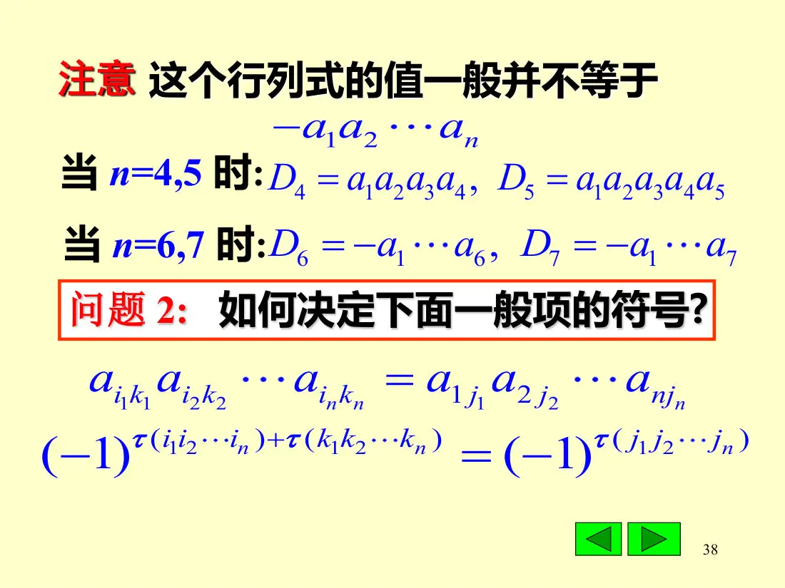

原文：

注意 这个行列式的值一般并不等于

$$
- a _ {1} a _ {2} \dots a _ {n}
$$

当 n=4,5 时: $D_{4}=a_{1}a_{2}a_{3}a_{4},\quad D_{5}=a_{1}a_{2}a_{3}a_{4}a_{5}$

当 n=6,7 时: $D_{6}=-a_{1}\cdots a_{6},\quad D_{7}=-a_{1}\cdots a_{7}$

问题 2: 如何决定下面一般项的符号?

$$
\begin{array}{r} a _ {i _ {1} k _ {1}} a _ {i _ {2} k _ {2}} \dots a _ {i _ {n} k _ {n}} = a _ {1 j _ {1}} a _ {2 j _ {2}} \dots a _ {n j _ {n}} \\ (- 1) ^ {\tau (i _ {1} i _ {2} \dots i _ {n}) + \tau (k _ {1} k _ {2} \dots k _ {n})} = (- 1) ^ {\tau (j _ {1} j _ {2} \dots j _ {n})} \end{array}
$$

◀

38

### \- 根据这个结论,也可以把行列式表示为:

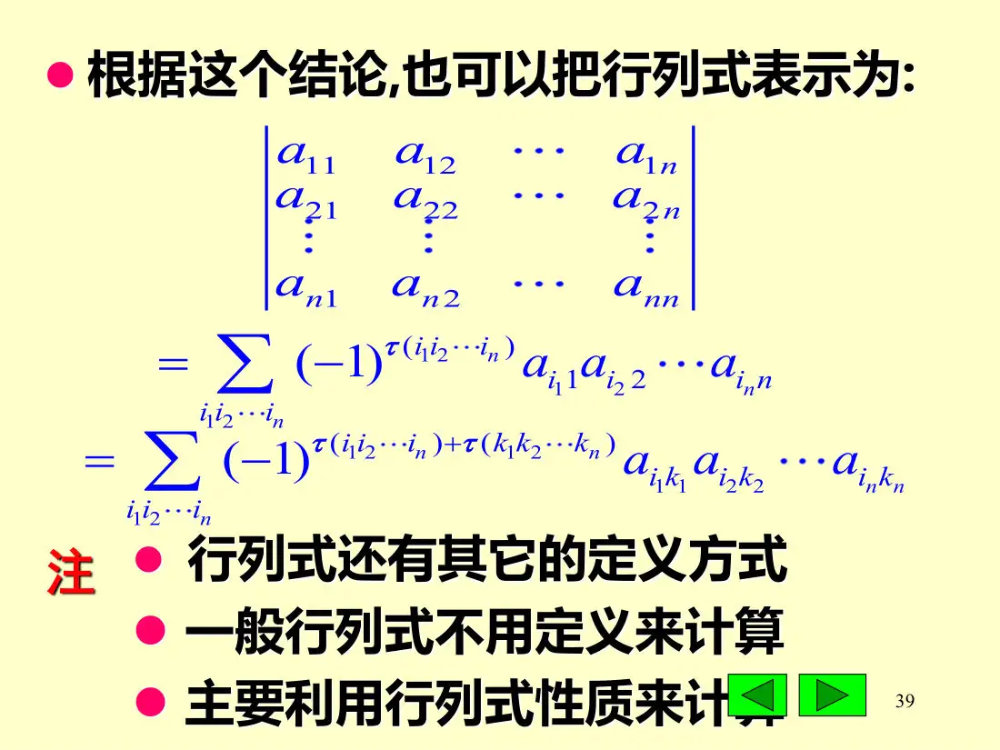

原文：

\- 根据这个结论,也可以把行列式表示为:

$$
\begin{array}{r l} & {\left| \begin{array}{l l l l} a _ {1 1} & a _ {1 2} & \dots & a _ {1 n} \\ a _ {2 1} & a _ {2 2} & \dots & a _ {2 n} \\ \vdots & \vdots & & \vdots \\ a _ {n 1} & a _ {n 2} & \dots & a _ {n n} \end{array} \right|} \\ & {= \sum_ {i _ {1} i _ {2} \dots i _ {n}} (- 1) ^ {\tau (i _ {1} i _ {2} \dots i _ {n})} a _ {i _ {1} 1} a _ {i _ {2} 2} \dots a _ {i _ {n} n}} \\ & {= \sum_ {i _ {1} i _ {2} \dots i _ {n}} (- 1) ^ {\tau (i _ {1} i _ {2} \dots i _ {n}) + \tau (k _ {1} k _ {2} \dots k _ {n})} a _ {i _ {1} k _ {1}} a _ {i _ {2} k _ {2}} \dots a _ {i _ {n} k _ {n}}} \end{array}
$$

注 • 行列式还有其它的定义方式

\- 一般行列式不用定义来计算

\- 主要利用行列式性质来计算

39

### 1.2 n 阶行列式的性质

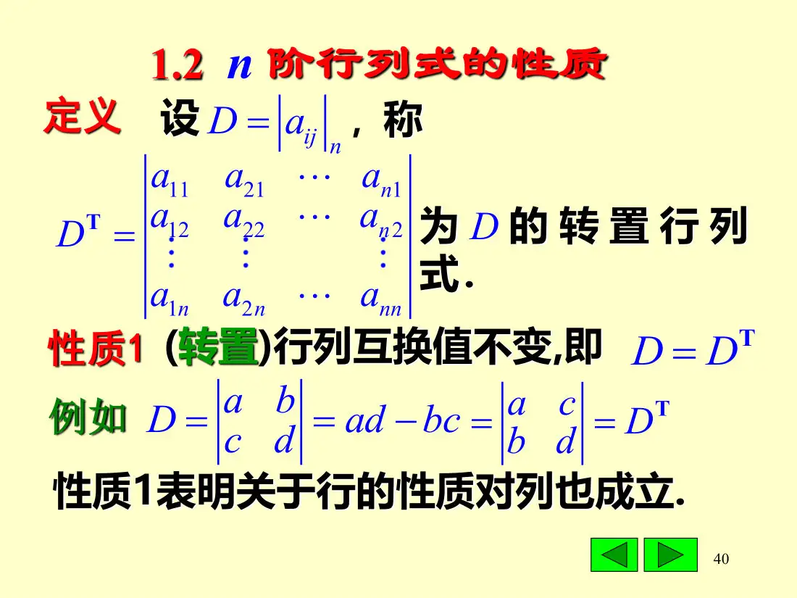

原文：

1.2 n 阶行列式的性质
定义 设 $D = \left| a_{ij} \right|_{n}$ ，称 $D^{T} = \begin{vmatrix} a_{11} & a_{21} & \cdots & a_{n1} \\ a_{12} & a_{22} & \cdots & a_{n2} \\ \vdots & \vdots & & \vdots \\ a_{1n} & a_{2n} & \cdots & a_{nn} \end{vmatrix}$ 为 D 的转置行列式.
性质1 (转置) 行列互换值不变, 即 $D = D^{T}$ 例如 $D = \begin{vmatrix} a & b \\ c & d \end{vmatrix} = ad - bc = \begin{vmatrix} a & c \\ b & d \end{vmatrix} = D^{T}$ 性质1表明关于行的性质对列也成立.

◀ ▶

40

### 性质2 (换法)换行(列)换号,即

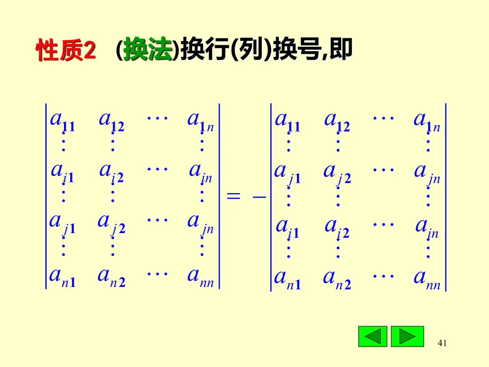

原文：

性质2 (换法)换行(列)换号,即

$$
\left| \begin{array}{c c c c} a _ {1 1} & a _ {1 2} & \dots & a _ {1 n} \\ \vdots & \vdots & & \vdots \\ a _ {i 1} & a _ {i 2} & \dots & a _ {i n} \\ \vdots & \vdots & & \vdots \\ a _ {j 1} & a _ {j 2} & \dots & a _ {j n} \\ \vdots & \vdots & & \vdots \\ a _ {n 1} & a _ {n 2} & \dots & a _ {n n} \end{array} \right| = - \left| \begin{array}{c c c c} a _ {1 1} & a _ {1 2} & \dots & a _ {1 n} \\ \vdots & \vdots & & \vdots \\ a _ {j 1} & a _ {j 2} & \dots & a _ {j n} \\ \vdots & \vdots & & \vdots \\ a _ {i 1} & a _ {i 2} & \dots & a _ {i n} \\ \vdots & \vdots & & \vdots \\ a _ {n 1} & a _ {n 2} & \dots & a _ {n n} \end{array} \right|
$$

◀ ▶

41

### 推论 两行(列)同值为零.即

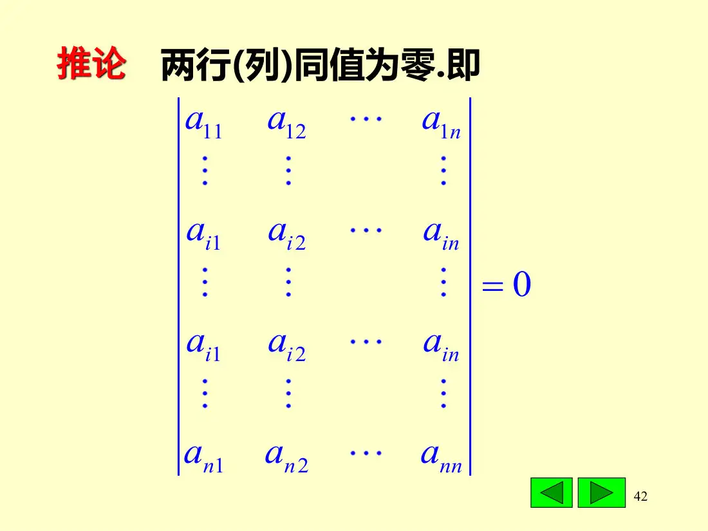

原文：

推论 两行(列)同值为零.即

$$
\left| \begin{array}{c c c c} a _ {1 1} & a _ {1 2} & \dots & a _ {1 n} \\ \vdots & \vdots & & \vdots \\ a _ {i 1} & a _ {i 2} & \dots & a _ {i n} \\ \vdots & \vdots & & \vdots \\ a _ {i 1} & a _ {i 2} & \dots & a _ {i n} \\ \vdots & \vdots & & \vdots \\ a _ {n 1} & a _ {n 2} & \dots & a _ {n n} \end{array} \right| = 0
$$

◀ △

42

### $$

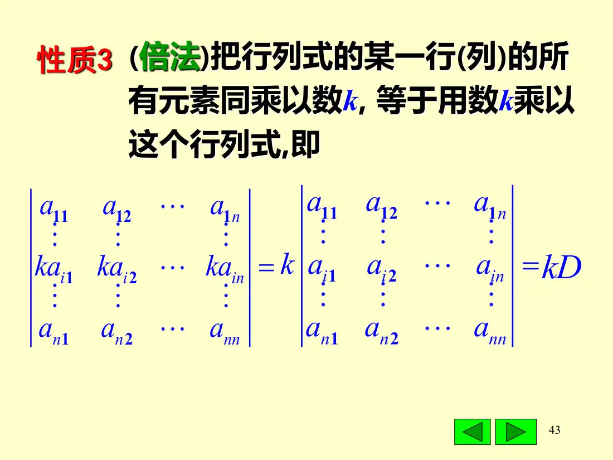

原文：

性质3 (倍法)把行列式的某一行(列)的所有元素同乘以数k, 等于用数k乘以这个行列式,即

$$
\left| \begin{array}{c c c c} a _ {1 1} & a _ {1 2} & \dots & a _ {1 n} \\ \vdots & \vdots & & \vdots \\ k a _ {i 1} & k a _ {i 2} & \dots & k a _ {i n} \\ \vdots & \vdots & & \vdots \\ a _ {n 1} & a _ {n 2} & \dots & a _ {n n} \end{array} \right| = k \left| \begin{array}{c c c c} a _ {1 1} & a _ {1 2} & \dots & a _ {1 n} \\ \vdots & \vdots & & \vdots \\ a _ {i 1} & a _ {i 2} & \dots & a _ {i n} \\ \vdots & \vdots & & \vdots \\ a _ {n 1} & a _ {n 2} & \dots & a _ {n n} \end{array} \right| = k D
$$

◀ ▶

43

### 推论2 如果行列式有两行(列)成比例,则该行列式为零.

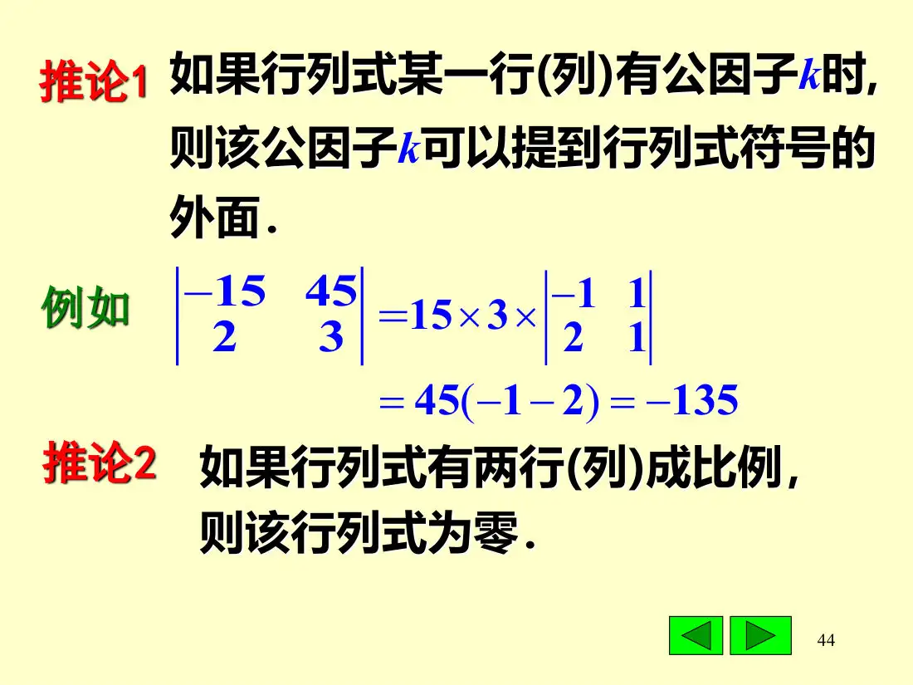

原文：

推论1 如果行列式某一行(列)有公因子k时,则该公因子k可以提到行列式符号的外面.

例如 $\left|\begin{matrix}-15 & 45 \\ 2 & 3\end{matrix}\right|=15\times3\times\left|\begin{matrix}-1 & 1 \\ 2 & 1\end{matrix}\right|$ $=45(-1-2)=-135$

推论2 如果行列式有两行(列)成比例,则该行列式为零.

◀ ▶

44

### ◀ ▶

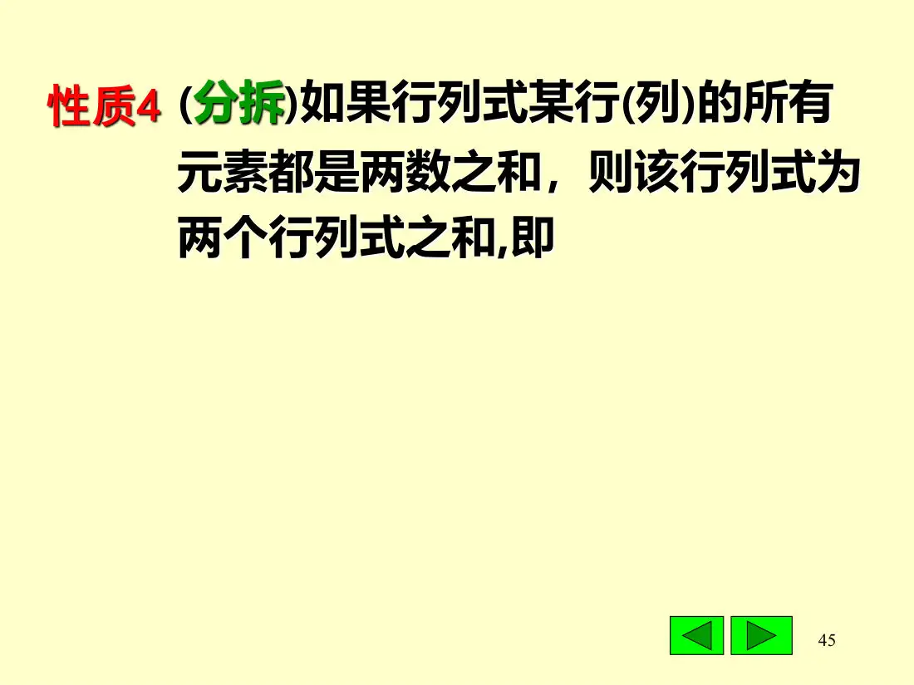

原文：

性质4 (分拆)如果行列式某行(列)的所有元素都是两数之和，则该行列式为两个行列式之和,即

◀ ▶

45

### $$

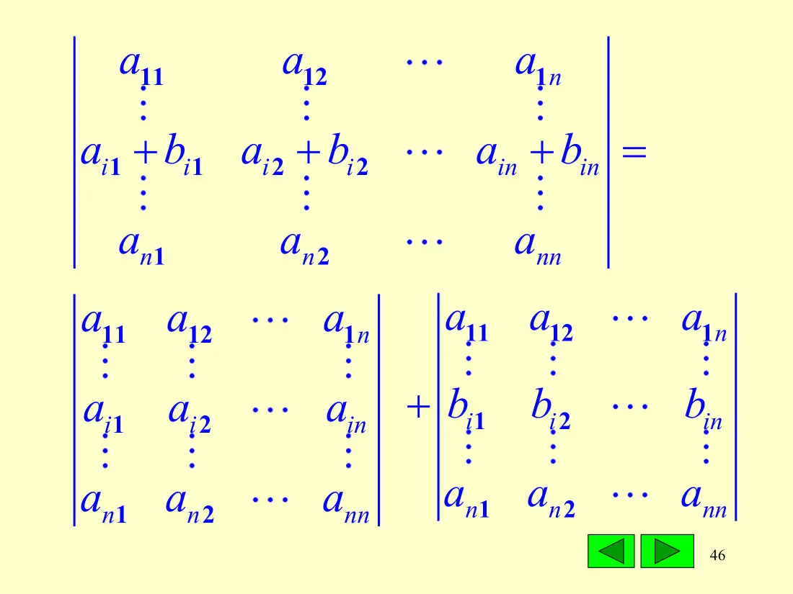

原文：

$$
\left| \begin{array}{c c c c} a _ {1 1} & a _ {1 2} & \dots & a _ {1 n} \\ \vdots & \vdots & & \vdots \\ a _ {i 1} + b _ {i 1} & a _ {i 2} + b _ {i 2} & \dots & a _ {i n} + b _ {i n} \\ \vdots & \vdots & & \vdots \\ a _ {n 1} & a _ {n 2} & \dots & a _ {n n} \end{array} \right| =
$$

$$
\left| \begin{array}{c c c c} a _ {1 1} & a _ {1 2} & \dots & a _ {1 n} \\ \vdots & \vdots & & \vdots \\ a _ {i 1} & a _ {i 2} & \dots & a _ {i n} \\ \vdots & \vdots & & \vdots \\ a _ {n 1} & a _ {n 2} & \dots & a _ {n n} \end{array} \right| + \left| \begin{array}{c c c c} a _ {1 1} & a _ {1 2} & \dots & a _ {1 n} \\ \vdots & \vdots & & \vdots \\ b _ {i 1} & b _ {i 2} & \dots & b _ {i n} \\ \vdots & \vdots & & \vdots \\ a _ {n 1} & a _ {n 2} & \dots & a _ {n n} \end{array} \right|
$$

◀ ▶

46

### $$

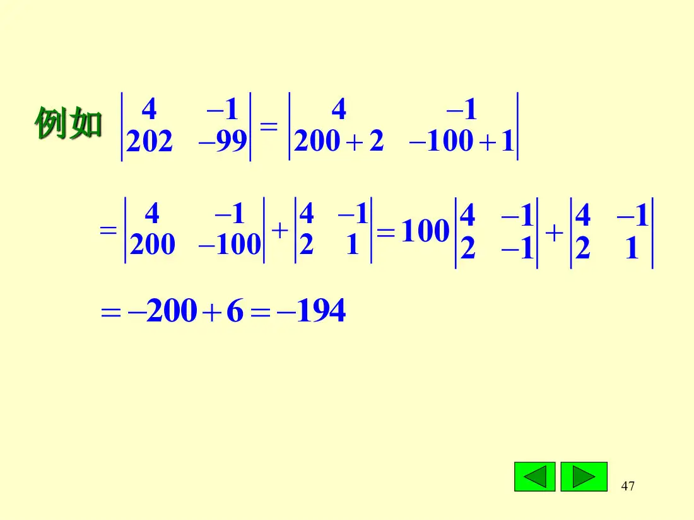

原文：

$$
\begin{array}{r l} \text {例如} & \left| \begin{array}{c c} 4 & - 1 \\ 2 0 2 & - 9 9 \end{array} \right| = \left| \begin{array}{c c} 4 & - 1 \\ 2 0 0 + 2 & - 1 0 0 + 1 \end{array} \right| \\ & = \left| \begin{array}{c c} 4 & - 1 \\ 2 0 0 & - 1 0 0 \end{array} \right| + \left| \begin{array}{c c} 4 & - 1 \\ 2 & 1 \end{array} \right| = 1 0 0 \left| \begin{array}{c c} 4 & - 1 \\ 2 & - 1 \end{array} \right| + \left| \begin{array}{c c} 4 & - 1 \\ 2 & 1 \end{array} \right| \\ & = - 2 0 0 + 6 = - 1 9 4 \end{array}
$$

◀◀

47

### $$

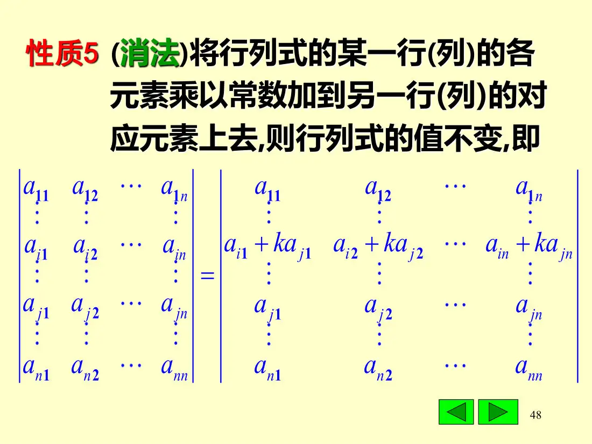

原文：

性质5 (消法)将行列式的某一行(列)的各元素乘以常数加到另一行(列)的对应元素上去,则行列式的值不变,即

$$
\left| \begin{array}{c c c c} a _ {1 1} & a _ {1 2} & \dots & a _ {1 n} \\ \vdots & \vdots & & \vdots \\ a _ {i 1} & a _ {i 2} & \dots & a _ {i n} \\ \vdots & \vdots & & \vdots \\ a _ {j 1} & a _ {j 2} & \dots & a _ {j n} \\ \vdots & \vdots & & \vdots \\ a _ {n 1} & a _ {n 2} & \dots & a _ {n n} \end{array} \right| = \left| \begin{array}{c c c c} a _ {1 1} & a _ {1 2} & \dots & a _ {1 n} \\ \vdots & \vdots & & \vdots \\ a _ {i 1} + k a _ {j 1} & a _ {i 2} + k a _ {j 2} & \dots & a _ {i n} + k a _ {j n} \\ \vdots & \vdots & & \vdots \\ a _ {j 1} & a _ {j 2} & \dots & a _ {j n} \\ \vdots & \vdots & & \vdots \\ a _ {n 1} & a _ {n 2} & \dots & a _ {n n} \end{array} \right|
$$

◀ ▶

48

### 定理2 全部 $n(\geq2)$ 阶排列中奇偶排列各占一半.

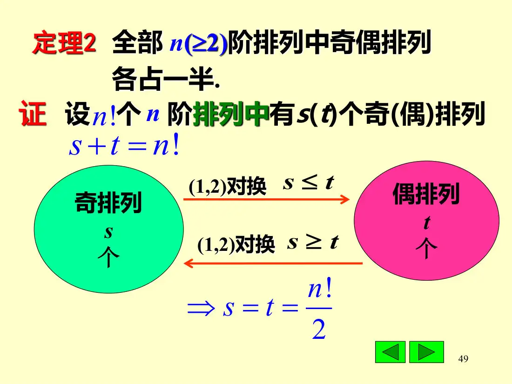

原文：

定理2 全部 $n(\geq2)$ 阶排列中奇偶排列各占一半.

证 设 $n!$ 个 $n$ 阶排列中有 $s(t)$ 个奇(偶)排列 $s + t = n!$

奇排列

s
个

(1,2)对换 $s \leq t$

(1,2)对换 $s \geq t$

$$
\Rightarrow s = t = \frac {n !}{2}
$$

偶排列

t个

◀ ▶

49

### 学习大学数学，要了解大学数学与中学数学的差别：

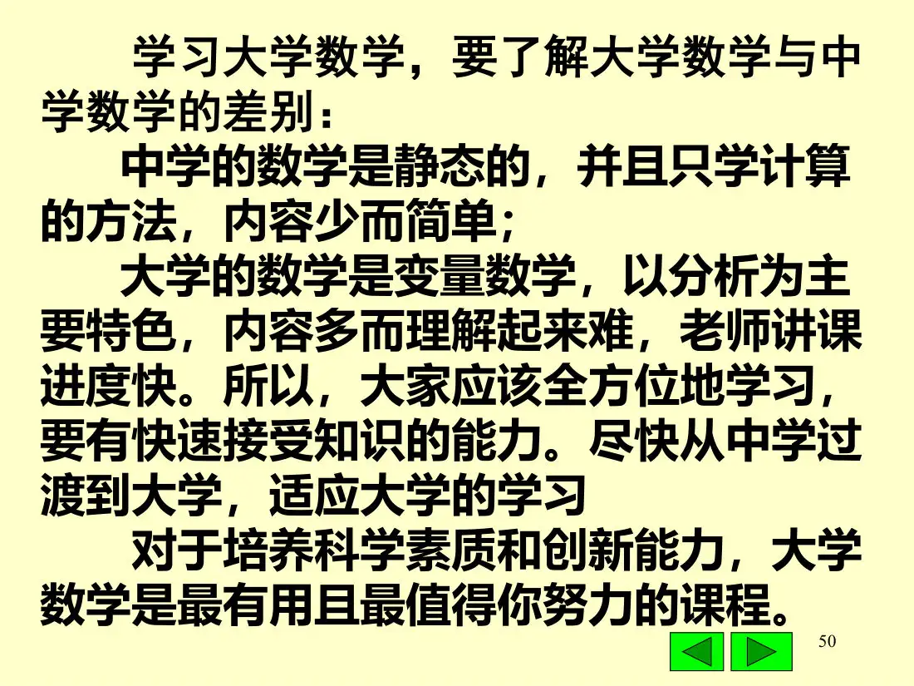

原文：

学习大学数学，要了解大学数学与中学数学的差别：

中学的数学是静态的，并且只学计算的方法，内容少而简单；

大学的数学是变量数学，以分析为主要特色，内容多而理解起来难，老师讲课进度快。所以，大家应该全方位地学习，要有快速接受知识的能力。尽快从中学过渡到大学，适应大学的学习

对于培养科学素质和创新能力，大学数学是最有用且最值得你努力的课程。

◀ ▶

50
