# 《线性代数与空间解析几何》第1章 行列式 1.4 克莱姆法则（课件）

原件的每一页，下面附识别出的文字。

### 《线性代数与空间解析几何》

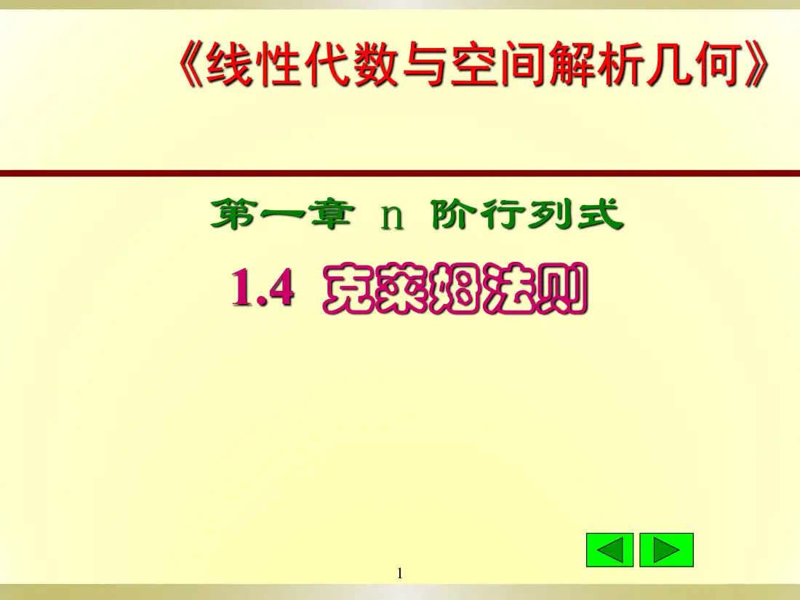

原文：

《线性代数与空间解析几何》

第一章 n 阶行列式

1.4 克莱姆法则

1

◀ ▶

### 1.4 克莱姆 (Cramer) 法则

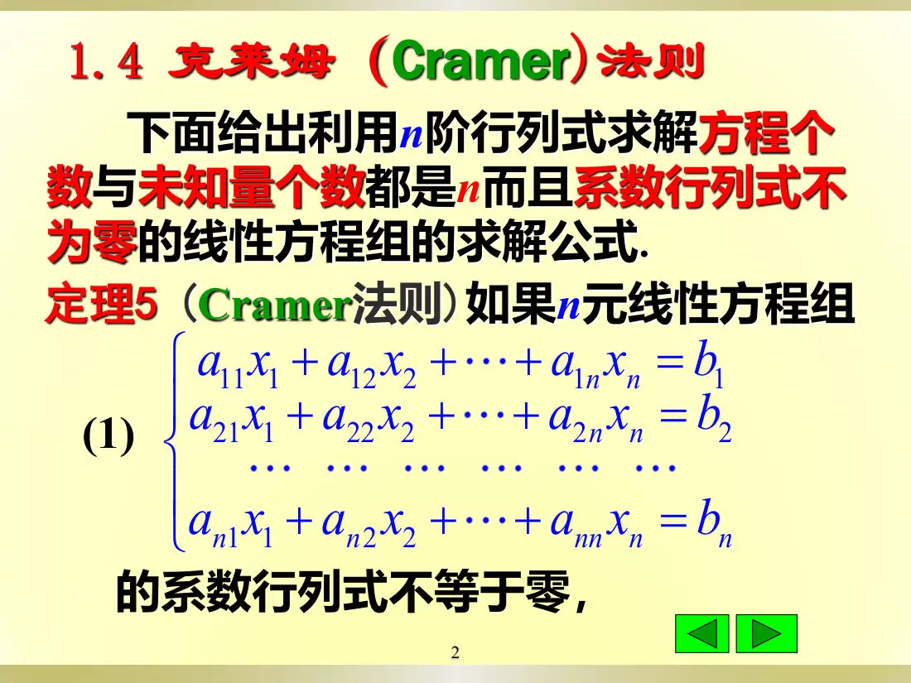

原文：

1.4 克莱姆 (Cramer) 法则

下面给出利用 $n$ 阶行列式求解方程个数与未知量个数都是 $n$ 而且系数行列式不为零的线性方程组的求解公式.

定理5 (Cramer法则) 如果n元线性方程组

(1)

$$
\left\{ \begin{array}{l} a _ {1 1} x _ {1} + a _ {1 2} x _ {2} + \dots + a _ {1 n} x _ {n} = b _ {1} \\ a _ {2 1} x _ {1} + a _ {2 2} x _ {2} + \dots + a _ {2 n} x _ {n} = b _ {2} \\ \dots \dots \\ a _ {n 1} x _ {1} + a _ {n 2} x _ {2} + \dots + a _ {n n} x _ {n} = b _ {n} \end{array} \right.
$$

的系数行列式不等于零，

2

◀◀

### $$

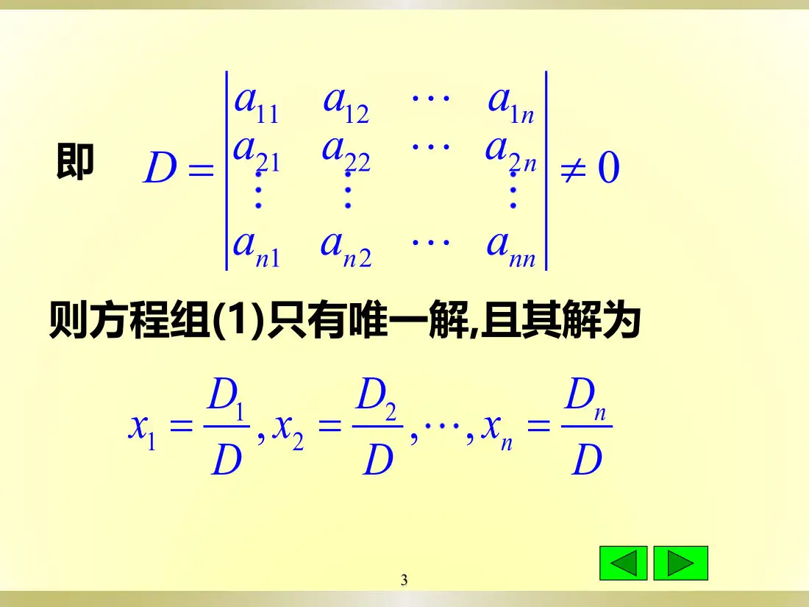

原文：

即

$$
D = \left| \begin{array}{c c c c} a _ {1 1} & a _ {1 2} & \dots & a _ {1 n} \\ a _ {2 1} & a _ {2 2} & \dots & a _ {2 n} \\ \vdots & \vdots & & \vdots \\ a _ {n 1} & a _ {n 2} & \dots & a _ {n n} \end{array} \right| \neq 0
$$

则方程组(1)只有唯一解,且其解为

$$
x _ {1} = \frac {D _ {1}}{D}, x _ {2} = \frac {D _ {2}}{D}, \dots , x _ {n} = \frac {D _ {n}}{D}
$$

3

◀ △

### 其中

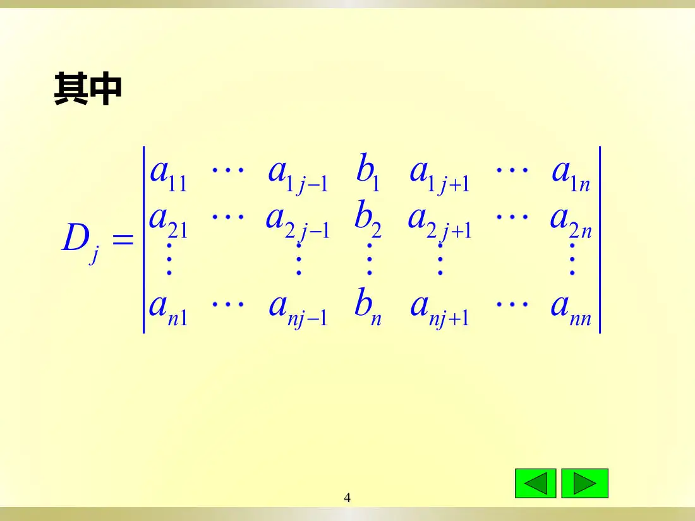

原文：

其中

$$
D _ {j} = \left| \begin{array}{c c c c c c c} a _ {1 1} & \dots & a _ {1 j - 1} & b _ {1} & a _ {1 j + 1} & \dots & a _ {1 n} \\ a _ {2 1} & \dots & a _ {2 j - 1} & b _ {2} & a _ {2 j + 1} & \dots & a _ {2 n} \\ \vdots & & \vdots & \vdots & \vdots & & \vdots \\ a _ {n 1} & \dots & a _ {n j - 1} & b _ {n} & a _ {n j + 1} & \dots & a _ {n n} \end{array} \right|
$$

4

◀ ▶

### 推论1 如果n元齐次线性方程组的系数行列式不等于零,即

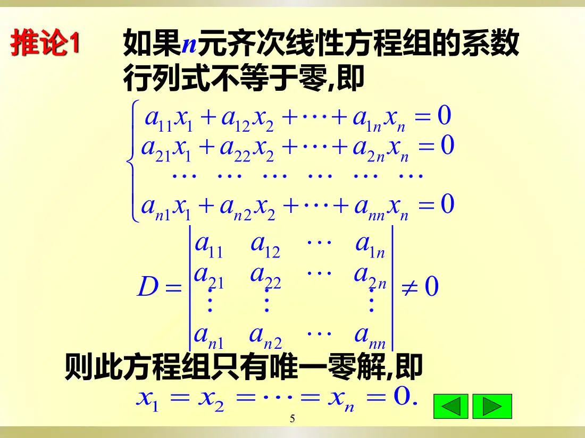

原文：

推论1 如果n元齐次线性方程组的系数行列式不等于零,即

$$
\left\{ \begin{array}{l} a _ {1 1} x _ {1} + a _ {1 2} x _ {2} + \dots + a _ {1 n} x _ {n} = 0 \\ a _ {2 1} x _ {1} + a _ {2 2} x _ {2} + \dots + a _ {2 n} x _ {n} = 0 \\ \dots \dots \\ a _ {n 1} x _ {1} + a _ {n 2} x _ {2} + \dots + a _ {n n} x _ {n} = 0 \\ D = \left| \begin{array}{c c c c} a _ {1 1} & a _ {1 2} & \dots & a _ {1 n} \\ a _ {2 1} & a _ {2 2} & \dots & a _ {2 n} \\ \vdots & \vdots & & \vdots \\ a _ {n 1} & a _ {n 2} & \dots & a _ {n n} \end{array} \right| \neq 0 \end{array} \right.
$$

则此方程组只有唯一零解,即

$$
x _ {1} = x _ {2} = \dots = x _ {n} = 0.
$$

5

◀

### 推论2 如果n元齐次线性方程组

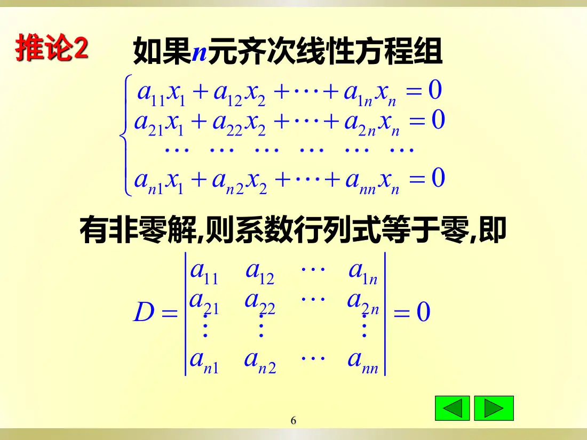

原文：

推论2 如果n元齐次线性方程组

$$
\left\{ \begin{array}{l} a _ {1 1} x _ {1} + a _ {1 2} x _ {2} + \dots + a _ {1 n} x _ {n} = 0 \\ a _ {2 1} x _ {1} + a _ {2 2} x _ {2} + \dots + a _ {2 n} x _ {n} = 0 \\ \ldots \ldots \\ a _ {n 1} x _ {1} + a _ {n 2} x _ {2} + \dots + a _ {n n} x _ {n} = 0 \end{array} \right.
$$

有非零解,则系数行列式等于零,即

$$
D = \left| \begin{array}{c c c c} a _ {1 1} & a _ {1 2} & \dots & a _ {1 n} \\ a _ {2 1} & a _ {2 2} & \dots & a _ {2 n} \\ \vdots & \vdots & & \vdots \\ a _ {n 1} & a _ {n 2} & \dots & a _ {n n} \end{array} \right| = 0
$$

6

◀ △

### 例1 求解线性方程组

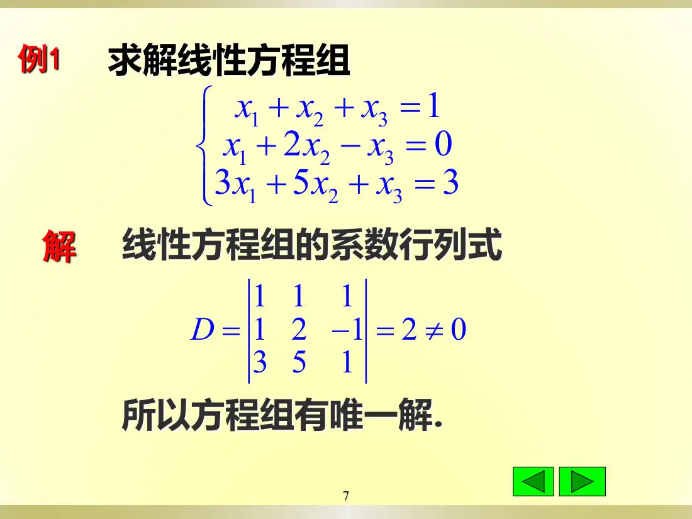

原文：

例1 求解线性方程组

$$
\left\{ \begin{array}{l l} x _ {1} + x _ {2} + x _ {3} = 1 \\ x _ {1} + 2 x _ {2} - x _ {3} = 0 \\ 3 x _ {1} + 5 x _ {2} + x _ {3} = 3 \end{array} \right.
$$

解 线性方程组的系数行列式

$$
D = \left| \begin{array}{c c c} 1 & 1 & 1 \\ 1 & 2 & - 1 \\ 3 & 5 & 1 \end{array} \right| = 2 \neq 0
$$

所以方程组有唯一解.

7

◀◀

### $$

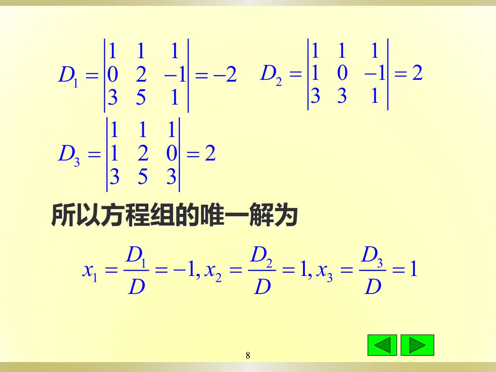

原文：

$$
\begin{array}{l} D _ {1} = \left| \begin{array}{c c c} 1 & 1 & 1 \\ 0 & 2 & - 1 \\ 3 & 5 & 1 \end{array} \right| = - 2 \quad D _ {2} = \left| \begin{array}{c c c} 1 & 1 & 1 \\ 1 & 0 & - 1 \\ 3 & 3 & 1 \end{array} \right| = 2 \\ D _ {3} = \left| \begin{array}{c c c} 1 & 1 & 1 \\ 1 & 2 & 0 \\ 3 & 5 & 3 \end{array} \right| = 2 \end{array}
$$

所以方程组的唯一解为

$$
x _ {1} = \frac {D _ {1}}{D} = - 1, x _ {2} = \frac {D _ {2}}{D} = 1, x _ {3} = \frac {D _ {3}}{D} = 1
$$

8

◀◀

### 第一章的知识网络图

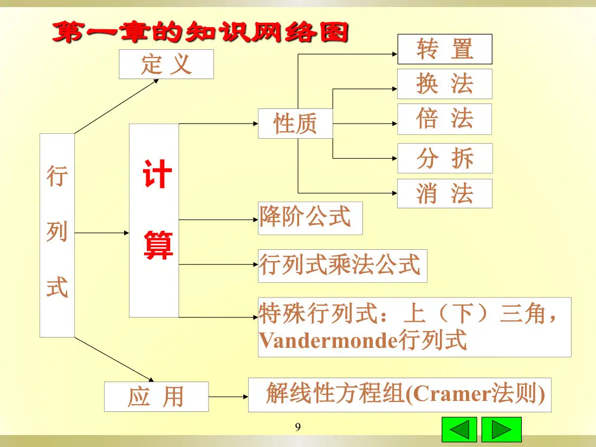

原文：

第一章的知识网络图

定义

行
列
式计

算

应用

性质

转置

换法

倍法

分拆

消法

降阶公式

行列式乘法公式

特殊行列式：上（下）三角，Vandermonde行列式

解线性方程组(Cramer法则)

9

◀ ▶

### 练习

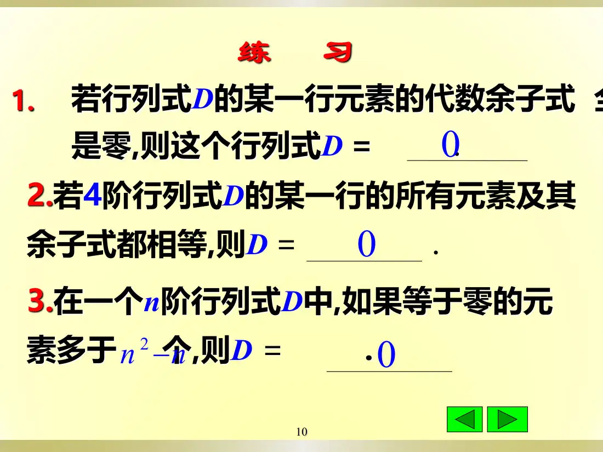

原文：

练习

1. 若行列式D的某一行元素的代数余子式是零,则这个行列式D = 0

2. 若4阶行列式D的某一行的所有元素及其余子式都相等,则D = 0 .

3. 在一个 $n$ 阶行列式 $D$ 中, 如果等于零的元素多于 $n^2 - n$ , 则 $D = \quad .0$

10

◀ ▶

### 4. 不计算行列式值，利用性质证明

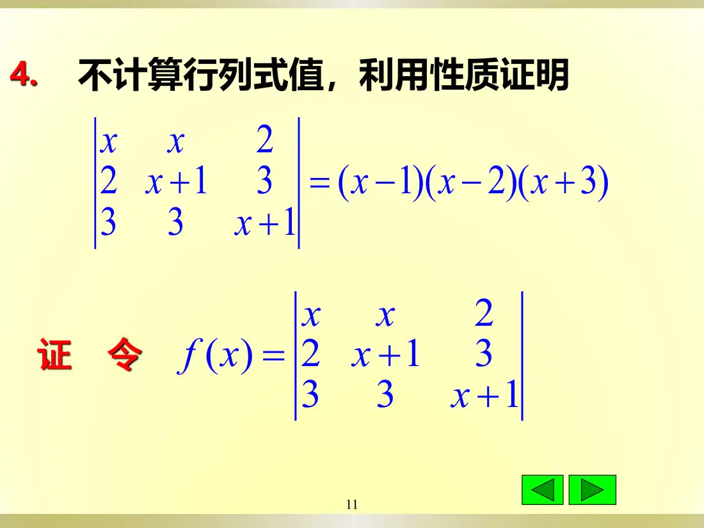

原文：

4. 不计算行列式值，利用性质证明

$$
\left| \begin{array}{c c c} x & x & 2 \\ 2 & x + 1 & 3 \\ 3 & 3 & x + 1 \end{array} \right| = (x - 1) (x - 2) (x + 3)
$$

证

令

$$
f (x) = \left| \begin{array}{c c c} x & x & 2 \\ 2 & x + 1 & 3 \\ 3 & 3 & x + 1 \end{array} \right|
$$

11

◀ △

### 由于 $f(x)$ 是 x 的三次多项式,且

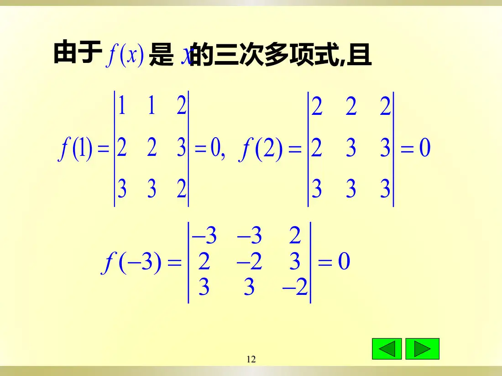

原文：

由于 $f(x)$ 是 x 的三次多项式,且

$$
f (1) = \left| \begin{array}{c c c} 1 & 1 & 2 \\ 2 & 2 & 3 \\ 3 & 3 & 2 \end{array} \right| = 0, f (2) = \left| \begin{array}{c c c} 2 & 2 & 2 \\ 2 & 3 & 3 \\ 3 & 3 & 3 \end{array} \right| = 0
$$

$$
f (- 3) = \left| \begin{array}{c c c} - 3 & - 3 & 2 \\ 2 & - 2 & 3 \\ 3 & 3 & - 2 \end{array} \right| = 0
$$

12

◀◀

### 因此有

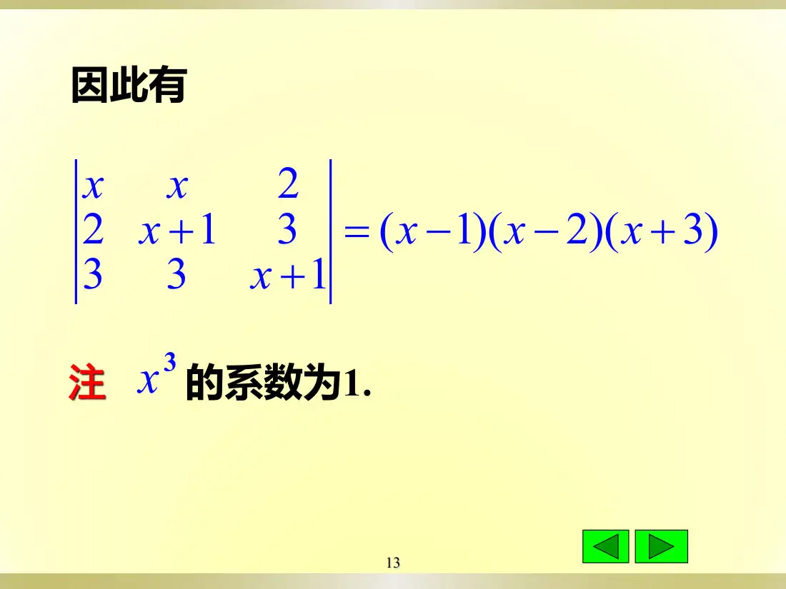

原文：

因此有

$$
\left| \begin{array}{c c c} x & x & 2 \\ 2 & x + 1 & 3 \\ 3 & 3 & x + 1 \end{array} \right| = (x - 1) (x - 2) (x + 3)
$$

注 $x^{3}$ 的系数为1.

13

◀◀

### 计算行列式

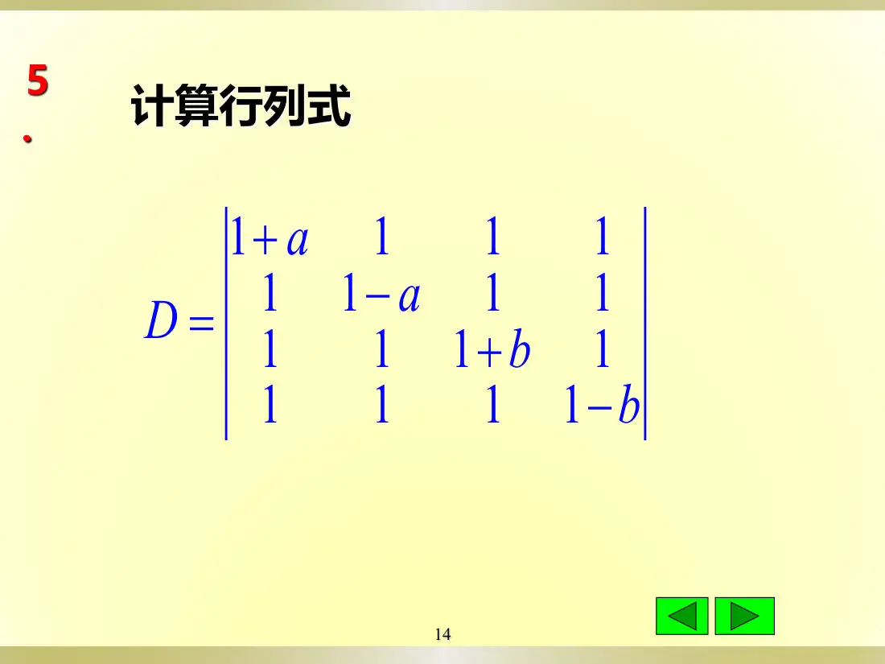

原文：

计算行列式

$$
D = \left| \begin{array}{c c c c} 1 + a & 1 & 1 & 1 \\ 1 & 1 - a & 1 & 1 \\ 1 & 1 & 1 + b & 1 \\ 1 & 1 & 1 & 1 - b \end{array} \right|
$$

14

◀ ▶

### $$

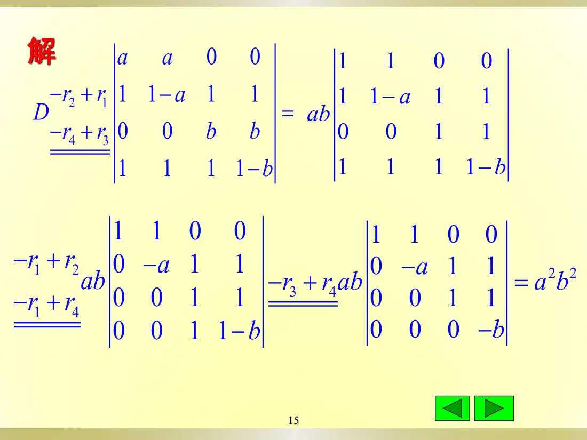

原文：

$$
\begin{array}{c c} \text {解} & \left| \begin{array}{c c c c} a & a & 0 & 0 \\ 1 & 1 - a & 1 & 1 \\ 0 & 0 & b & b \\ 1 & 1 & 1 & 1 - b \end{array} \right| = a b \left| \begin{array}{c c c c} 1 & 1 & 0 & 0 \\ 1 & 1 - a & 1 & 1 \\ 0 & 0 & 1 & 1 \\ 1 & 1 & 1 & 1 - b \end{array} \right| \\ D ^ {- r _ {2} + r _ {1}} & \underline {{- r _ {4} + r _ {3}}} \end{array}
$$

$$
\begin{array}{c c} - r _ {1} + r _ {2} & \left| \begin{array}{l l l l} 1 & 1 & 0 & 0 \\ 0 & - a & 1 & 1 \\ 0 & 0 & 1 & 1 \\ 0 & 0 & 1 & 1 - b \end{array} \right| \\ \underline {{- r _ {1} + r _ {4}}} & \left| \begin{array}{l l l l} 0 & 0 & 1 & 1 - b \\ 0 & 0 & 1 & 1 - b \end{array} \right| \end{array} \begin{array}{c c} - r _ {3} + r _ {4} & \left| \begin{array}{l l l l} 1 & 1 & 0 & 0 \\ 0 & - a & 1 & 1 \\ 0 & 0 & 1 & 1 \\ 0 & 0 & 0 & - b \end{array} \right| = a ^ {2} b ^ {2} \end{array}
$$

15

◀ ▶

### 6. 计算行列式

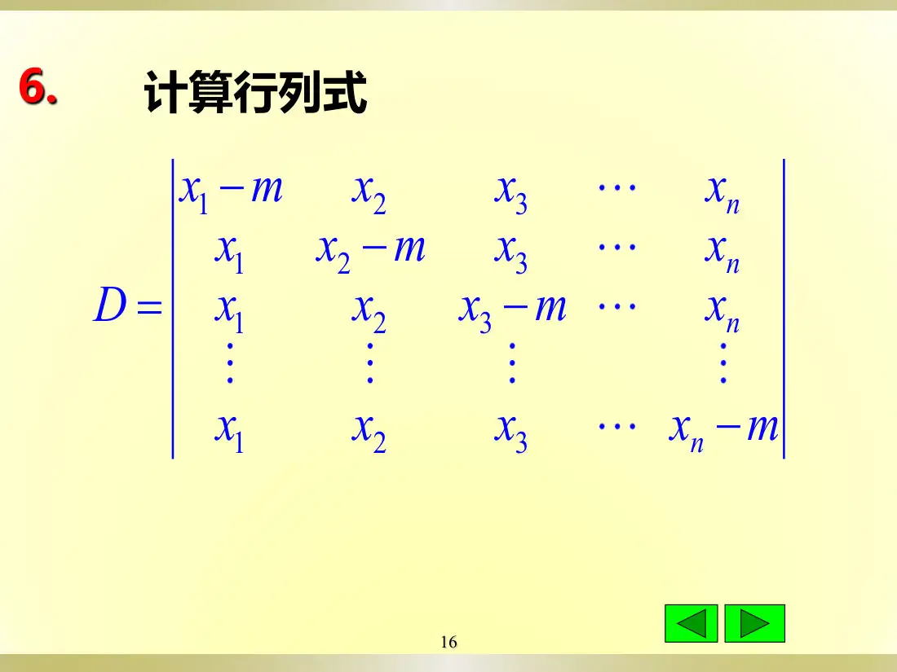

原文：

6. 计算行列式

$$
D = \left| \begin{array}{c c c c c} x _ {1} - m & x _ {2} & x _ {3} & \dots & x _ {n} \\ x _ {1} & x _ {2} - m & x _ {3} & \dots & x _ {n} \\ x _ {1} & x _ {2} & x _ {3} - m & \dots & x _ {n} \\ \vdots & \vdots & \vdots & & \vdots \\ x _ {1} & x _ {2} & x _ {3} & \dots & x _ {n} - m \end{array} \right|
$$

16

◀ ▶

### $$

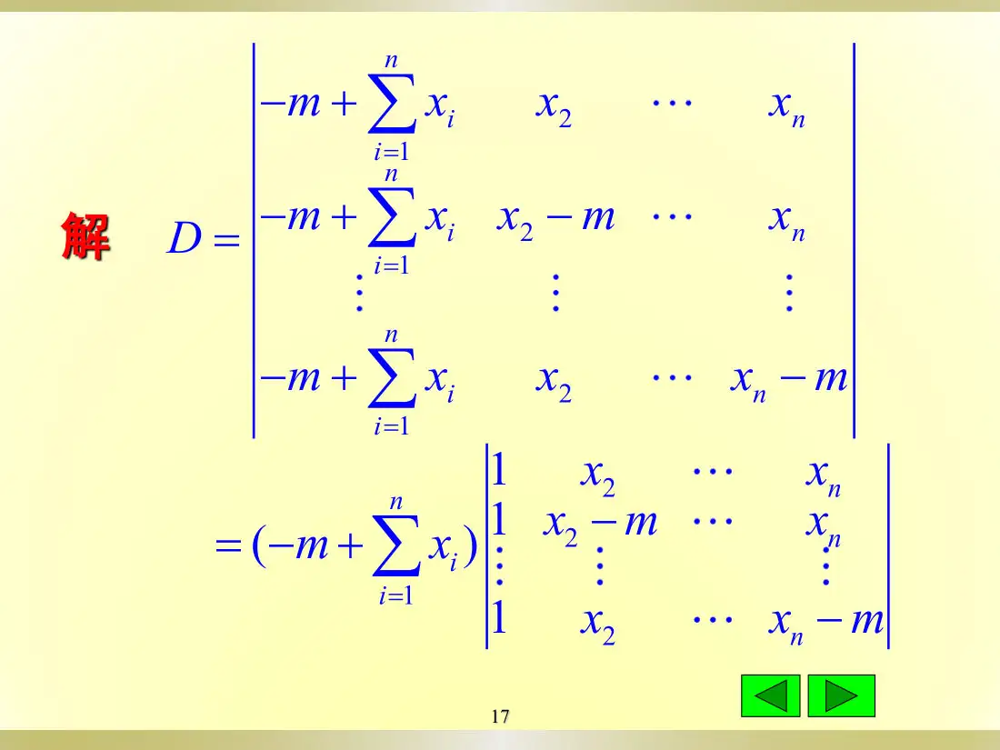

原文：

$$
\begin{array}{r l} \text {解} & D = \left| \begin{array}{c c c c} - m + \sum_ {i = 1} ^ {n} x _ {i} & x _ {2} & \dots & x _ {n} \\ - m + \sum_ {i = 1} ^ {n} x _ {i} & x _ {2} - m & \dots & x _ {n} \\ \vdots & \vdots & & \vdots \\ - m + \sum_ {i = 1} ^ {n} x _ {i} & x _ {2} & \dots & x _ {n} - m \end{array} \right| \\ & = (- m + \sum_ {i = 1} ^ {n} x _ {i}) \left| \begin{array}{c c c c} 1 & x _ {2} & \dots & x _ {n} \\ 1 & x _ {2} - m & \dots & x _ {n} \\ \vdots & \vdots & & \vdots \\ 1 & x _ {2} & \dots & x _ {n} - m \end{array} \right| \end{array}
$$

17

◀ ▶

### $$

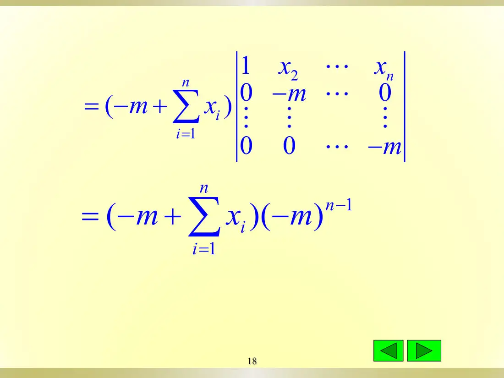

原文：

$$
= (- m + \sum_ {i = 1} ^ {n} x _ {i}) \left| \begin{array}{c c c c} 1 & x _ {2} & \dots & x _ {n} \\ 0 & - m & \dots & 0 \\ \vdots & \vdots & & \vdots \\ 0 & 0 & \dots & - m \end{array} \right|
$$

$$
= (- m + \sum_ {i = 1} ^ {n} x _ {i}) (- m) ^ {n - 1}
$$

18

◀ ▶

### 7. 计算行列式: $(x_{i} \neq a_{i})$

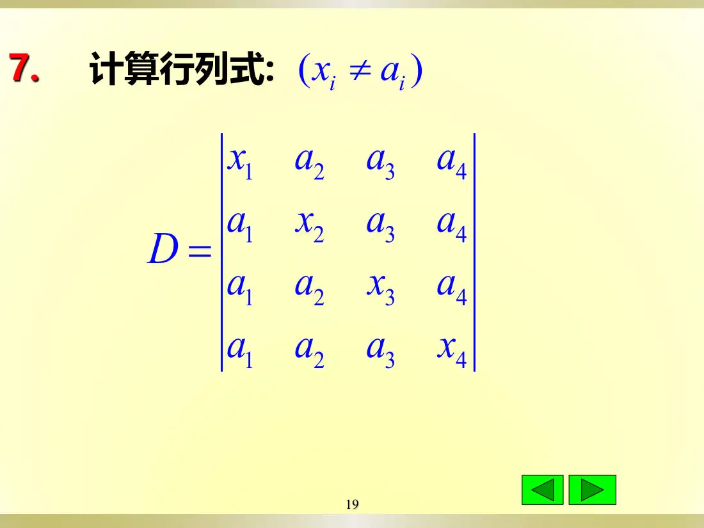

原文：

7. 计算行列式: $(x_{i} \neq a_{i})$

$$
D = \left| \begin{array}{c c c c} x _ {1} & a _ {2} & a _ {3} & a _ {4} \\ a _ {1} & x _ {2} & a _ {3} & a _ {4} \\ a _ {1} & a _ {2} & x _ {3} & a _ {4} \\ a _ {1} & a _ {2} & a _ {3} & x _ {4} \end{array} \right|
$$

19

◀ △

### 解 用加边法

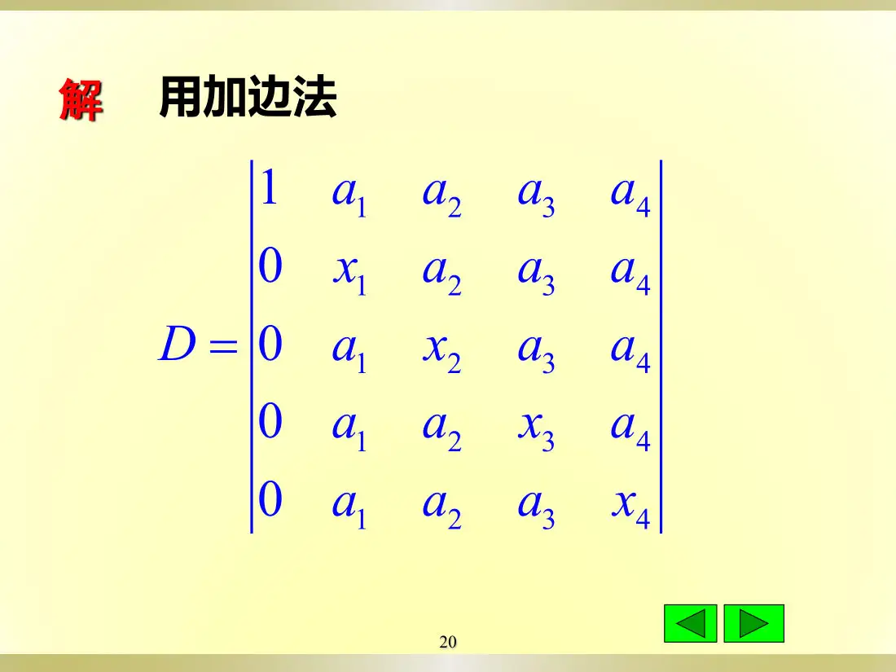

原文：

解 用加边法

$$
D = \left| \begin{array}{l l l l l} 1 & a _ {1} & a _ {2} & a _ {3} & a _ {4} \\ 0 & x _ {1} & a _ {2} & a _ {3} & a _ {4} \\ 0 & a _ {1} & x _ {2} & a _ {3} & a _ {4} \\ 0 & a _ {1} & a _ {2} & x _ {3} & a _ {4} \\ 0 & a _ {1} & a _ {2} & a _ {3} & x _ {4} \end{array} \right|
$$

20

◀◀

### $$

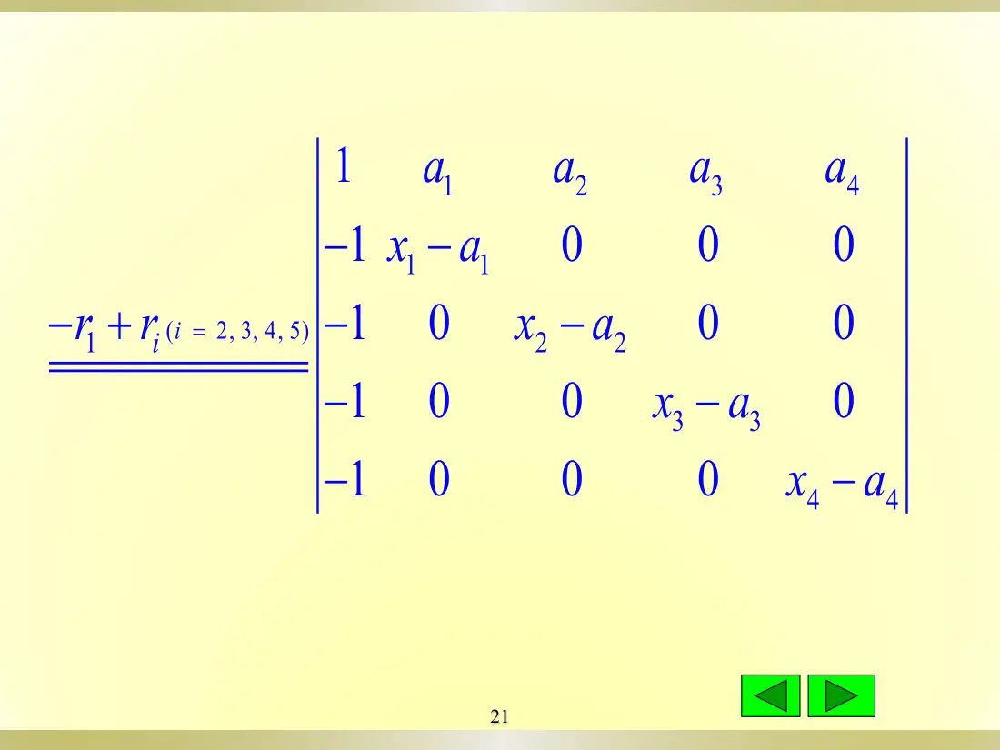

原文：

$$
\frac {- r _ {1} + r _ {i (i = 2 , 3 , 4 , 5)}}{- r _ {1} + r _ {i (i = 2 , 3 , 4 , 5)}} \left| \begin{array}{c c c c c} 1 & a _ {1} & a _ {2} & a _ {3} & a _ {4} \\ - 1 & x _ {1} - a _ {1} & 0 & 0 & 0 \\ - 1 & 0 & x _ {2} - a _ {2} & 0 & 0 \\ - 1 & 0 & 0 & x _ {3} - a _ {3} & 0 \\ - 1 & 0 & 0 & 0 & x _ {4} - a _ {4} \end{array} \right|
$$

21

◀ ▶

### $$

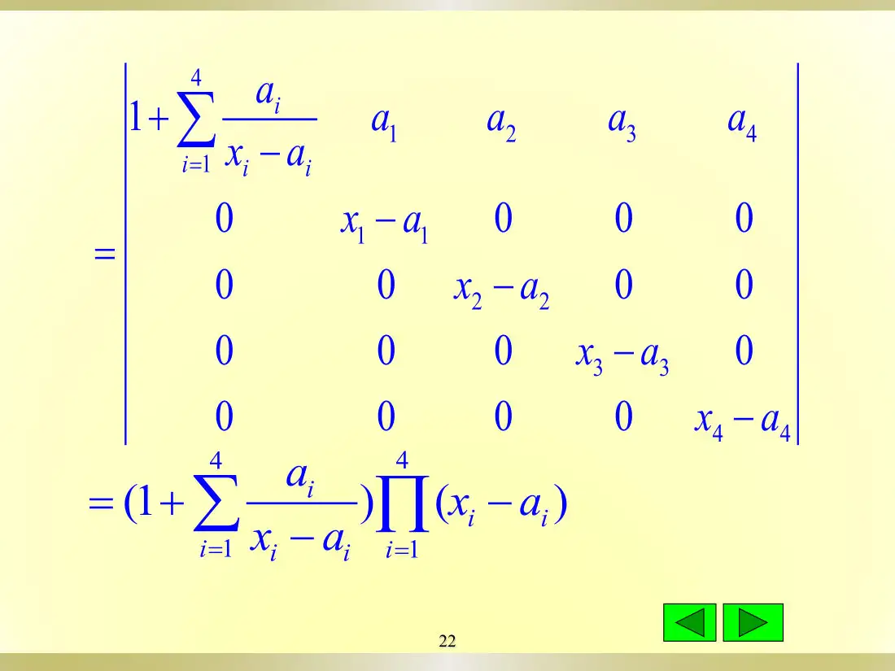

原文：

$$
= \left| \begin{array}{c c c c c} 1 + \sum_ {i = 1} ^ {4} \frac {a _ {i}}{x _ {i} - a _ {i}} & a _ {1} & a _ {2} & a _ {3} & a _ {4} \\ 0 & x _ {1} - a _ {1} & 0 & 0 & 0 \\ 0 & 0 & x _ {2} - a _ {2} & 0 & 0 \\ 0 & 0 & 0 & x _ {3} - a _ {3} & 0 \\ 0 & 0 & 0 & 0 & x _ {4} - a _ {4} \end{array} \right| = (1 + \sum_ {i = 1} ^ {4} \frac {a _ {i}}{x _ {i} - a _ {i}}) \prod_ {i = 1} ^ {4} (x _ {i} - a _ {i})
$$

22

◀ ▶

### $$

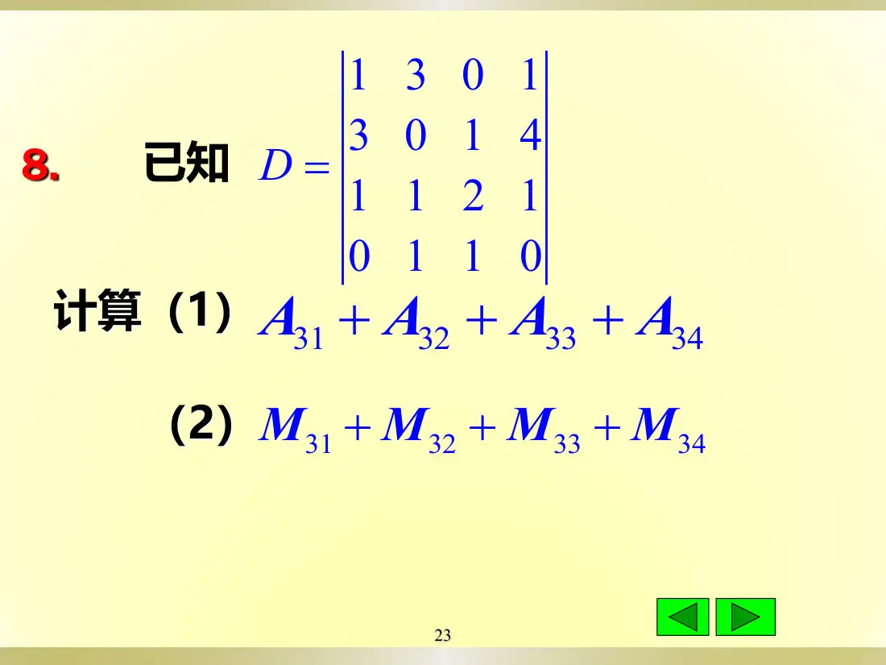

原文：

$$
D = \left| \begin{array}{c c c c} 1 & 3 & 0 & 1 \\ 3 & 0 & 1 & 4 \\ 1 & 1 & 2 & 1 \\ 0 & 1 & 1 & 0 \end{array} \right|
$$

计算 (1) $A_{31} + A_{32} + A_{33} + A_{34}$

(2) $M_{31} + M_{32} + M_{33} + M_{34}$

23

◀ ▶

### $$

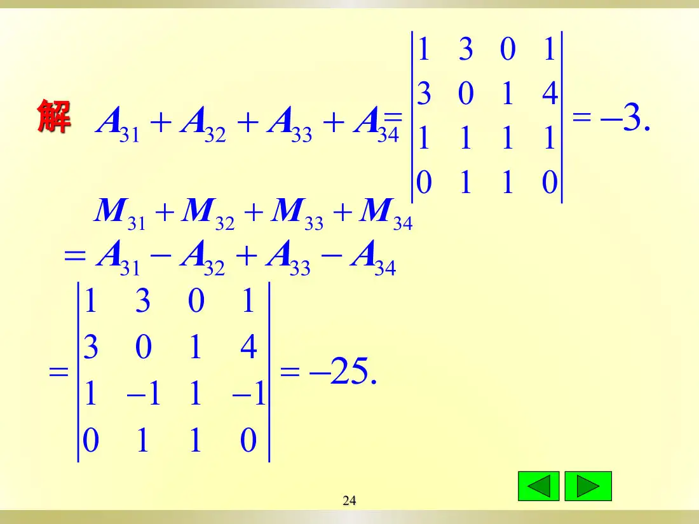

原文：

$$
\begin{array}{r l} & {\text {解} A _ {3 1} + A _ {3 2} + A _ {3 3} + A _ {3 4} = \left| \begin{array}{l l l l} 1 & 3 & 0 & 1 \\ 3 & 0 & 1 & 4 \\ 1 & 1 & 1 & 1 \\ 0 & 1 & 1 & 0 \end{array} \right| = - 3.} \\ & {\quad M _ {3 1} + M _ {3 2} + M _ {3 3} + M _ {3 4}} \\ & {= A _ {3 1} - A _ {3 2} + A _ {3 3} - A _ {3 4}} \\ & {= \left| \begin{array}{l l l l} 1 & 3 & 0 & 1 \\ 3 & 0 & 1 & 4 \\ 1 & - 1 & 1 & - 1 \\ 0 & 1 & 1 & 0 \end{array} \right| = - 2 5.} \end{array}
$$

24

◀◀

### (A)-2; (B)-1; (C)0; (D)2.

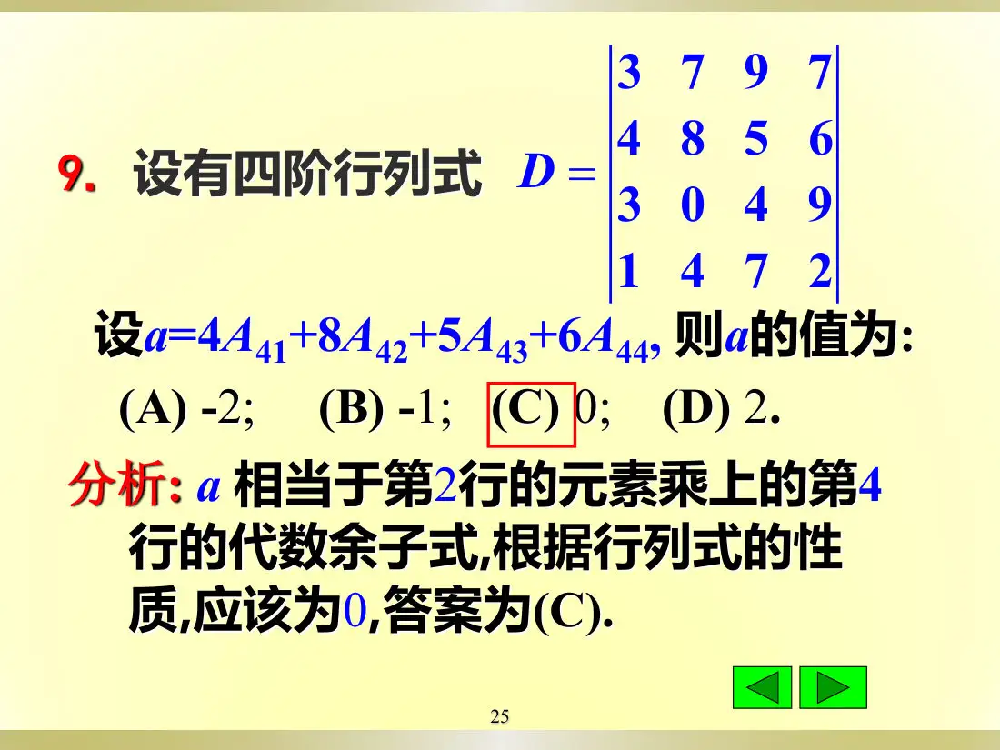

原文：

9. 设有四阶行列式 $D=\begin{vmatrix}3 & 7 & 9 & 7 \\ 4 & 8 & 5 & 6 \\ 3 & 0 & 4 & 9 \\ 1 & 4 & 7 & 2\end{vmatrix}$ 设 $a=4A_{41}+8A_{42}+5A_{43}+6A_{44}$ ，则 a 的值为：

(A)-2; (B)-1; (C)0; (D)2.

分析: $a$ 相当于第2行的元素乘上的第4行的代数余子式,根据行列式的性质,应该为0,答案为(C).

25

◀ ▶

### 由已知 $f(x_{i}) = 0, i = 1, 2, \cdots, n$

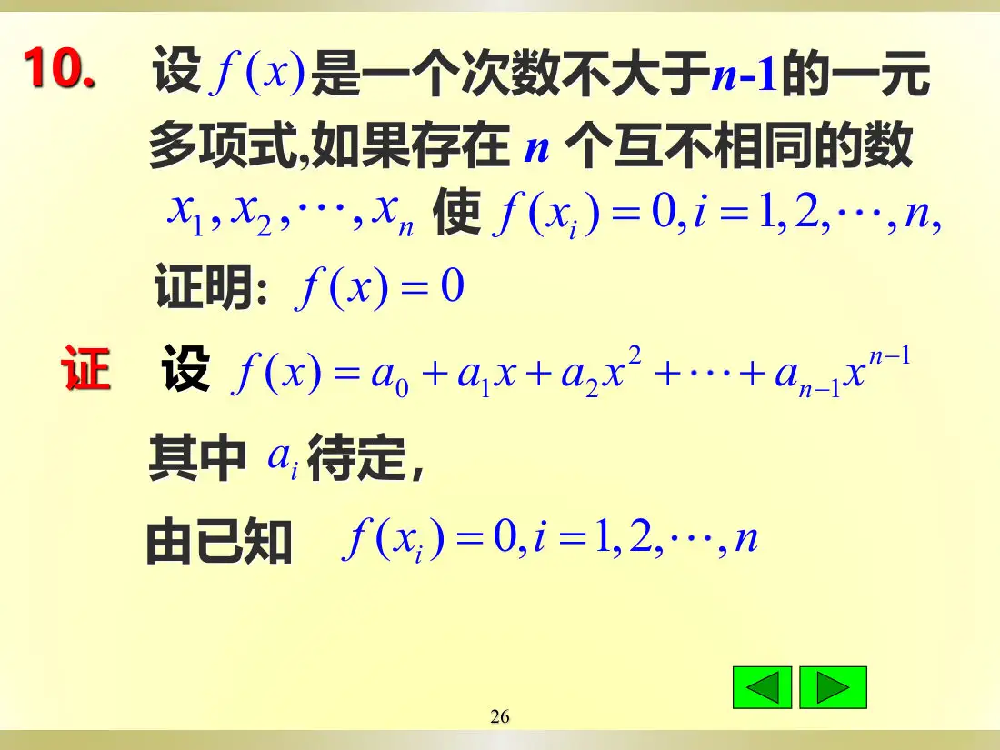

原文：

10. 设 $f(x)$ 是一个次数不大于 n-1 的一元多项式, 如果存在 n 个互不相同的数 $x_{1}, x_{2}, \cdots, x_{n}$ 使 $f(x_{i}) = 0, i = 1, 2, \cdots, n,$ 证明: $f(x) = 0$ 证 设 $f(x) = a_{0} + a_{1}x + a_{2}x^{2} + \cdots + a_{n-1}x^{n-1}$ 其中 $a_{i}$ 待定，
由已知 $f(x_{i}) = 0, i = 1, 2, \cdots, n$

26

◀ ▶

### $$

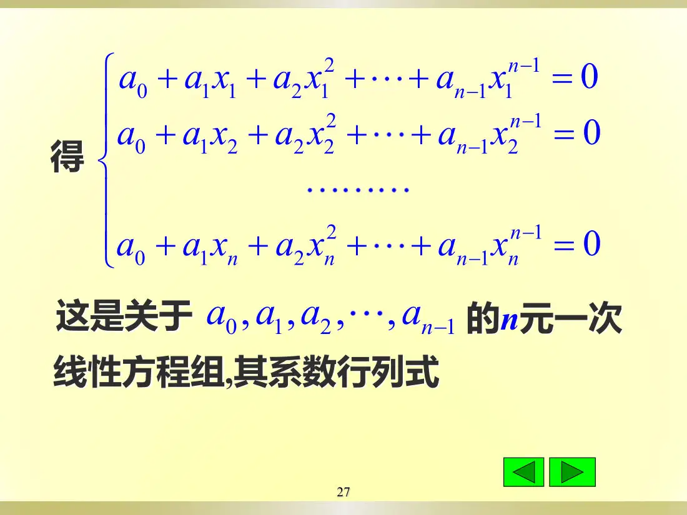

原文：

得

$$
\left\{ \begin{array}{l} a _ {0} + a _ {1} x _ {1} + a _ {2} x _ {1} ^ {2} + \dots + a _ {n - 1} x _ {1} ^ {n - 1} = 0 \\ a _ {0} + a _ {1} x _ {2} + a _ {2} x _ {2} ^ {2} + \dots + a _ {n - 1} x _ {2} ^ {n - 1} = 0 \\ \qquad \qquad \dots \dots \\ a _ {0} + a _ {1} x _ {n} + a _ {2} x _ {n} ^ {2} + \dots + a _ {n - 1} x _ {n} ^ {n - 1} = 0 \end{array} \right.
$$

这是关于 $a_{0}, a_{1}, a_{2}, \cdots, a_{n-1}$ 的 n 元一次线性方程组, 其系数行列式

27

◀ ▶

### $$

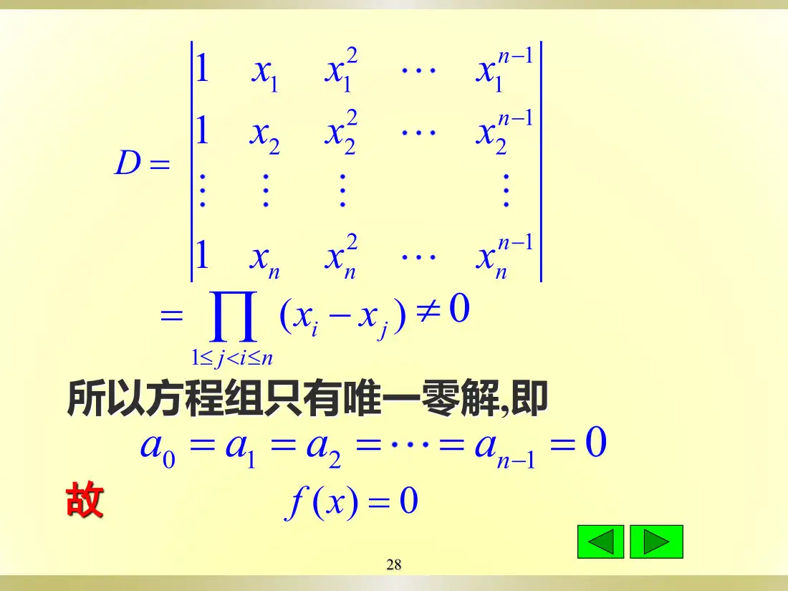

原文：

$$
\begin{array}{r l} & D = \left| \begin{array}{c c c c c} 1 & x _ {1} & x _ {1} ^ {2} & \dots & x _ {1} ^ {n - 1} \\ 1 & x _ {2} & x _ {2} ^ {2} & \dots & x _ {2} ^ {n - 1} \\ \vdots & \vdots & \vdots & & \vdots \\ 1 & x _ {n} & x _ {n} ^ {2} & \dots & x _ {n} ^ {n - 1} \end{array} \right| \\ & = \prod_ {1 \leq j <   i \leq n} (x _ {i} - x _ {j}) \neq 0 \end{array}
$$

所以方程组只有唯一零解,即

$$
a _ {0} = a _ {1} = a _ {2} = \dots = a _ {n - 1} = 0
$$

故

$$
f (x) = 0
$$

◀ ▶

28

### 《线性代数与空间解析几何》

原文：

《线性代数与空间解析几何》

第二章 矩阵

◀ ▶

### 本章的主要内容

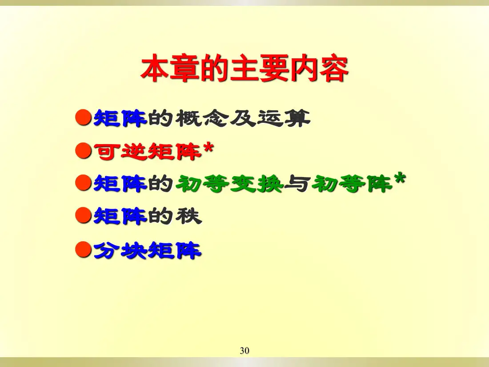

原文：

本章的主要内容

矩阵的概念及运算

可逆矩阵\*

矩阵的初等变换与初等阵\*

矩阵的秩

分块矩阵

30

### 2.1 矩阵的概念

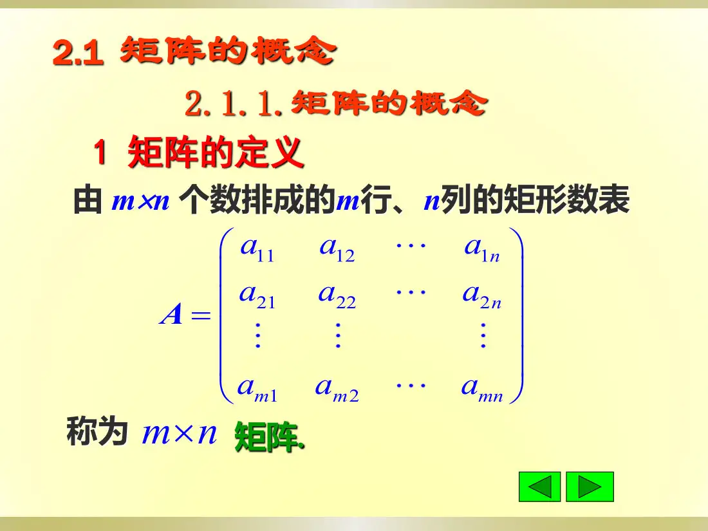

原文：

2.1 矩阵的概念

2.1.1. 矩阵的概念

1 矩阵的定义

由 $m \times n$ 个数排成的 $m$ 行、 $n$ 列的矩形数表

$$
A = \left( \begin{array}{c c c c} a _ {1 1} & a _ {1 2} & \dots & a _ {1 n} \\ a _ {2 1} & a _ {2 2} & \dots & a _ {2 n} \\ \vdots & \vdots & & \vdots \\ a _ {m 1} & a _ {m 2} & \dots & a _ {m n} \end{array} \right)
$$

称为 $m \times n$ 矩阵.

◀ ▶

### 当 m=n 时称为 n 阶方阵.

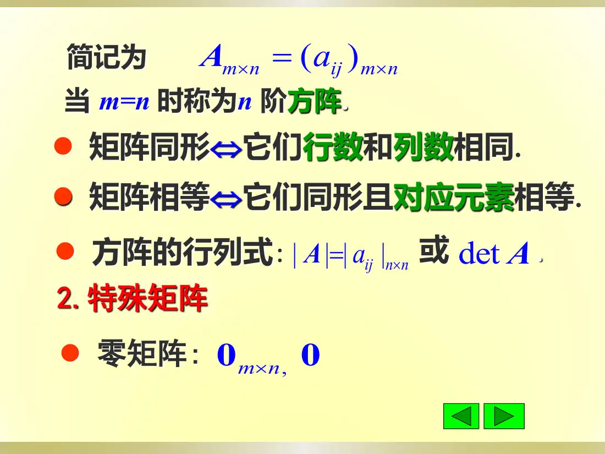

原文：

简记为 $A_{m \times n} = (a_{ij})_{m \times n}$

当 m=n 时称为 n 阶方阵.

\- 矩阵同形 $\Leftrightarrow$ 它们行数和列数相同.

\- 矩阵相等 $\Leftrightarrow$ 它们同形且对应元素相等.

\- 方阵的行列式: $|A| = |a_{ij}|_{n \times n}$ 或 $\det A$ .

2. 特殊矩阵

零矩阵：0 $_{m \times n}$ ，0

◀ ▶

### 第 33 页

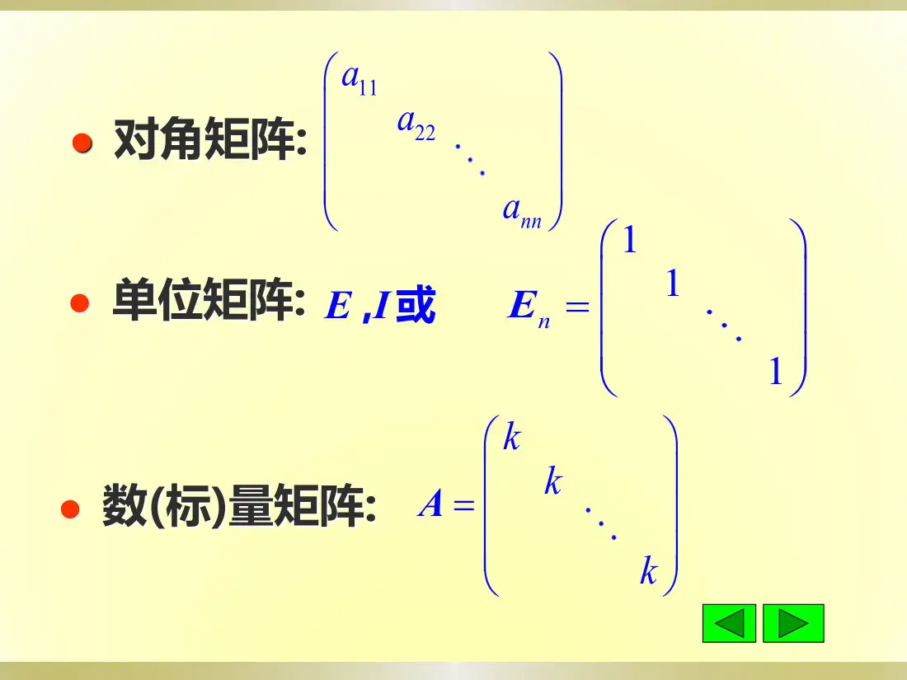

原文：

\- 对角矩阵: $\begin{pmatrix} a_{11} & & \\ & a_{22} & \ddots \\ & & a_{nn} \end{pmatrix}$ - 单位矩阵: $E, I$ 或 $E_n = \begin{pmatrix} 1 & & \\ & 1 & \ddots \\ & & 1 \end{pmatrix}$ - 数(标)量矩阵: $A = \begin{pmatrix} k & & \\ & k & \ddots \\ & & k \end{pmatrix}$ - 上三角矩阵: $\left( \begin{array}{cccc}a_{11} & a_{12} & \cdots & a_{1n}\\ & a_{22} & \ddots & a_{2n}\\ & & \ddots & \vdots \\ & & & a_{nn} \end{array} \right)$ - 下三角矩阵: $\left( \begin{array}{cccc}a_{11} & & & \\ a_{21} & a_{22} & & \\ \vdots & \vdots & \ddots & \\ a_{n1} & a_{n2} & \cdots & a_{nn} \end{array} \right)$ - 行矩阵: $(a_1, a_2, \cdots, a_n)$ • 列矩阵: $\left( \begin{array}{c}a_1\\ a_2\\ \vdots\\ a_n \end{array} \right)$

### 34

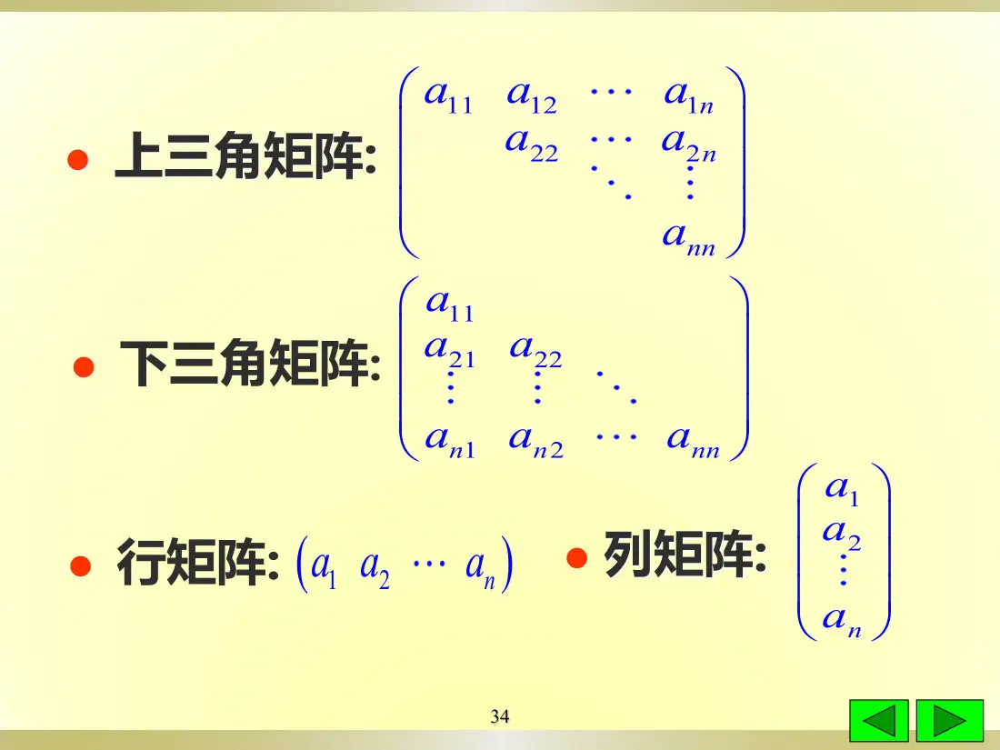

原文：

34

◀ ▶

### 2.2 矩阵运算

原文：

2.2 矩阵运算

矩阵的线性运算

矩阵的乘法运算

方阵的幂及

行列式的乘法公式

矩阵的转置

◀ ▶

### 2.2.1 矩阵的加法: (A与B要同形).

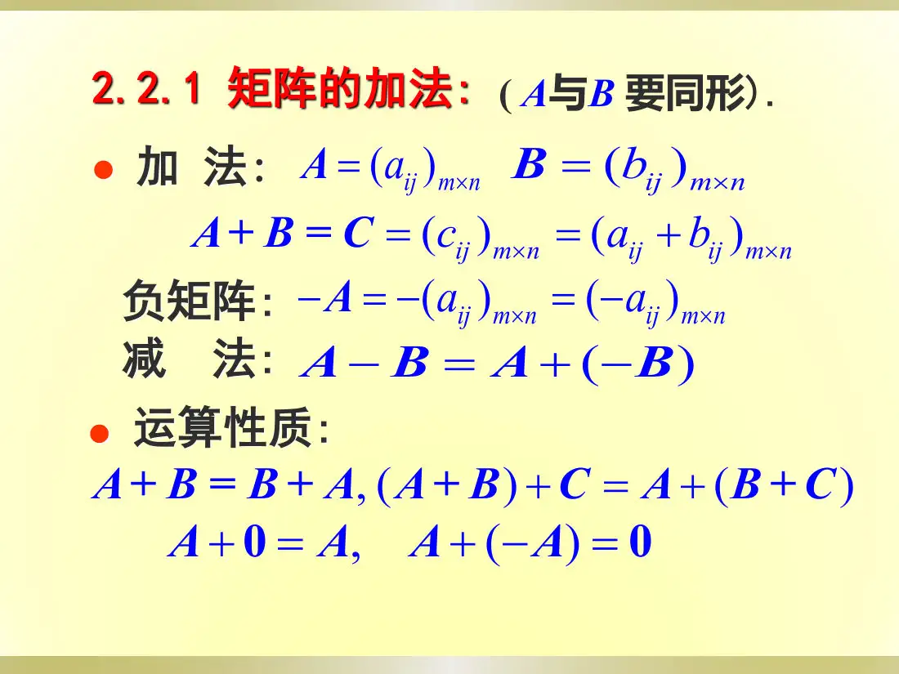

原文：

2.2.1 矩阵的加法: (A与B要同形).

\- 加法: $A = (a_{ij})_{m \times n}$ $\boldsymbol{B} = (b_{ij})_{m \times n}$

$$
\boldsymbol {A} + \boldsymbol {B} = \boldsymbol {C} = (c _ {i j}) _ {m \times n} = (a _ {i j} + b _ {i j}) _ {m \times n}
$$

负矩阵： $-A = -\left(a_{ij}\right)_{m\times n} = \left(-a_{ij}\right)_{m\times n}$

减法: $A - B = A + (-B)$

\- 运算性质:

$$
A + B = B + A, (A + B) + C = A + (B + C)
$$

$$
A + 0 = A, \quad A + (- A) = 0
$$

### 2.2.2 数乘

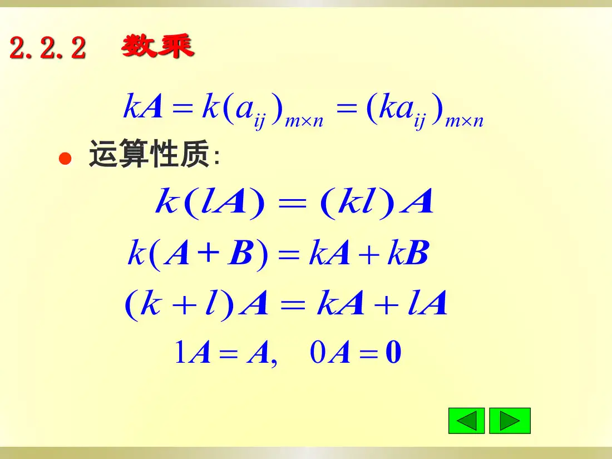

原文：

2.2.2 数乘

$$
k A = k (a _ {i j}) _ {m \times n} = (k a _ {i j}) _ {m \times n}
$$

\- 运算性质:

$$
k (l A) = (k l) A
$$

$$
k (A + B) = k A + k B
$$

$$
(k + l) A = k A + l A
$$

$$
1 A = A, \quad 0 A = 0
$$

◀ ▶

### 2.2.3 矩阵乘法

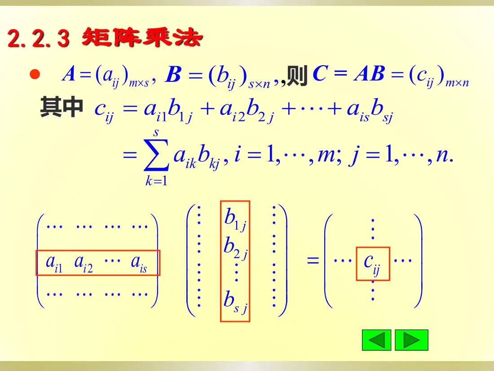

原文：

2.2.3 矩阵乘法

$A=(a_{ij})_{m\times s},\quad B=(b_{ij})_{s\times n},$ 则 $C=AB=(c_{ij})_{m\times n}$

其中 $c_{ij}=a_{i1}b_{1j}+a_{i2}b_{2j}+\cdots+a_{is}b_{sj}$ $=\sum_{k=1}^{s}a_{ik}b_{kj}, i=1,\cdots,m; j=1,\cdots,n.$

$$
\left( \begin{array}{c c c c} \dots & \dots & \dots & \dots \\ & & & \\ a _ {i 1} & a _ {i 2} & \dots & a _ {i s} \\ \hline \dots & \dots & \dots & \dots \end{array} \right) \quad \left( \begin{array}{c c c} \vdots & b _ {1 j} & \vdots \\ \vdots & b _ {2 j} & \vdots \\ \vdots & \vdots & \vdots \\ \vdots & b _ {s j} & \vdots \end{array} \right) = \left( \begin{array}{c} \vdots \\ \cdots \\ c _ {i j} \\ \vdots \end{array} \right)
$$

◀

### 总结如下：

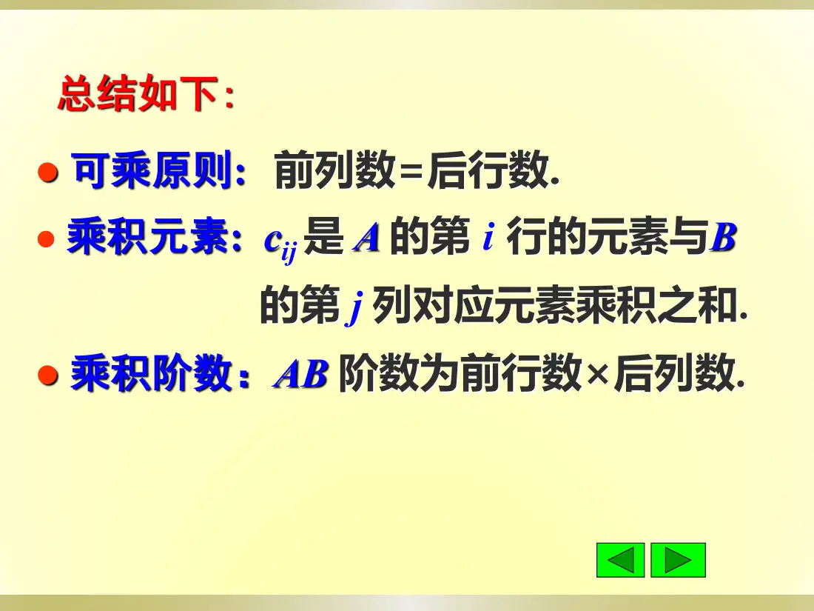

原文：

总结如下：

\- 可乘原则: 前列数=后行数.

\- 乘积元素: $c_{ij}$ 是 $A$ 的第 $i$ 行的元素与 $B$ 的第 $j$ 列对应元素乘积之和.

\- 乘积阶数： $AB$ 阶数为前行数 $\times$ 后列数.

◀ ▶

### \- 运算性质: (A是m×n的矩阵)

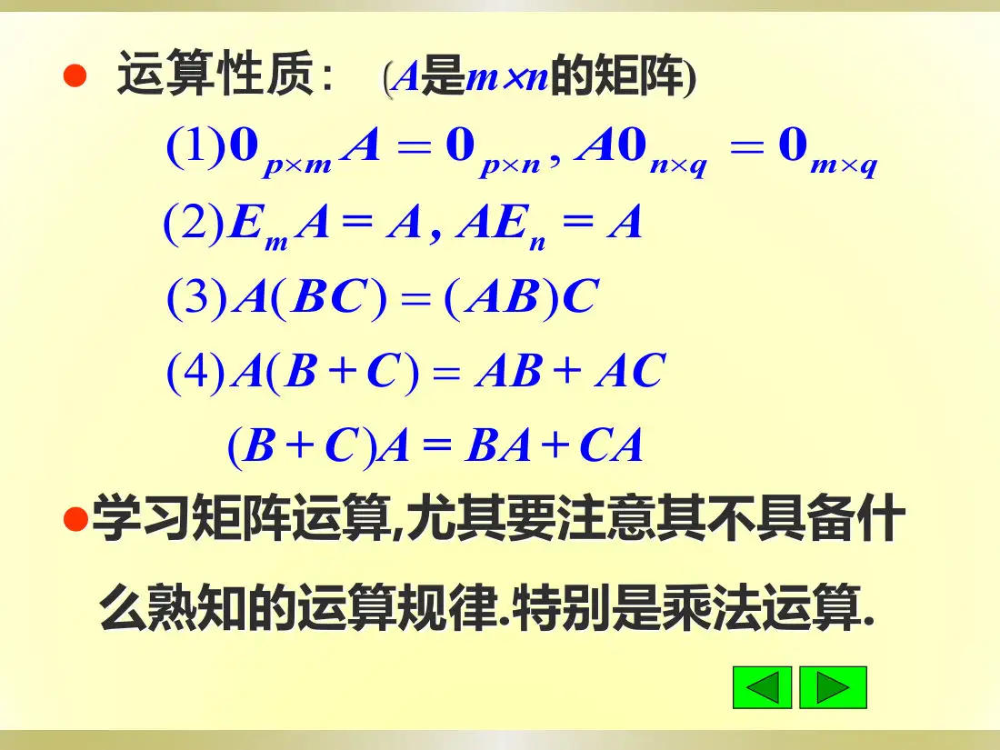

原文：

\- 运算性质: (A是m×n的矩阵)

(1) $0_{p\times m}A=0_{p\times n},A0_{n\times q}=0_{m\times q}$

(2) $E_{m}A=A, AE_{n}=A$

(3) $A(BC)=(AB)C$

(4) $A(B+C)=AB+AC$

$$
(B + C) A = B A + C A
$$

\- 学习矩阵运算,尤其要注意其不具备什么熟知的运算规律.特别是乘法运算.

◀ ▶

### 例1 设

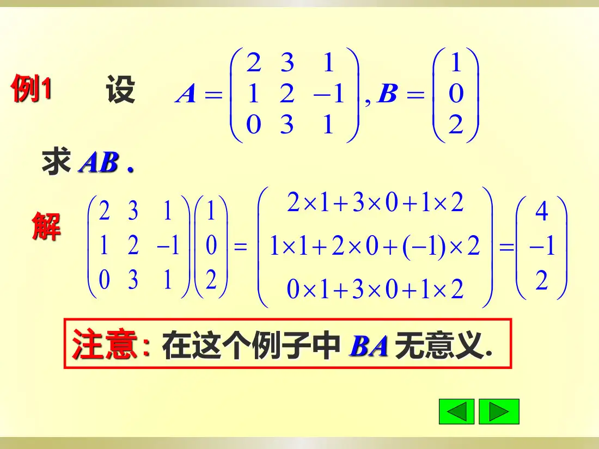

原文：

例1 设

$$
\boldsymbol {A} = \left( \begin{array}{c c c} 2 & 3 & 1 \\ 1 & 2 & - 1 \\ 0 & 3 & 1 \end{array} \right), \boldsymbol {B} = \left( \begin{array}{c} 1 \\ 0 \\ 2 \end{array} \right)
$$

求 $AB$ .

解

$$
\left( \begin{array}{c c c} 2 & 3 & 1 \\ 1 & 2 & - 1 \\ 0 & 3 & 1 \end{array} \right) \left( \begin{array}{c} 1 \\ 0 \\ 2 \end{array} \right) = \left( \begin{array}{c} 2 \times 1 + 3 \times 0 + 1 \times 2 \\ 1 \times 1 + 2 \times 0 + (- 1) \times 2 \\ 0 \times 1 + 3 \times 0 + 1 \times 2 \end{array} \right) = \left( \begin{array}{c} 4 \\ - 1 \\ 2 \end{array} \right)
$$

注意: 在这个例子中 $BA$ 无意义.

### 例2

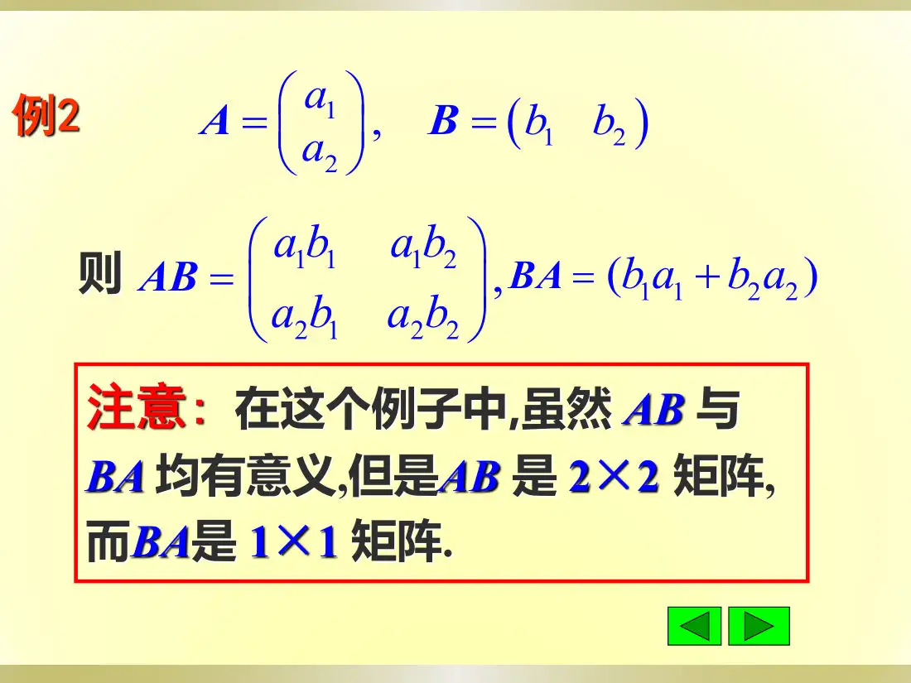

原文：

例2

$$
\boldsymbol {A} = \binom{a _ {1}}{a _ {2}}, \quad \boldsymbol {B} = \left( \begin{array}{c c} b _ {1} & b _ {2} \end{array} \right)
$$

则 $AB = \left( \begin{array}{ll}a_{1}b_{1} & a_{1}b_{2}\\ a_{2}b_{1} & a_{2}b_{2} \end{array} \right),BA = (b_{1}a_{1} + b_{2}a_{2})$

注意: 在这个例子中,虽然 AB 与 BA 均有意义,但是 AB 是 $2 \times 2$ 矩阵,而 BA 是 $1 \times 1$ 矩阵.

◀ ▶

### ◀ ▶

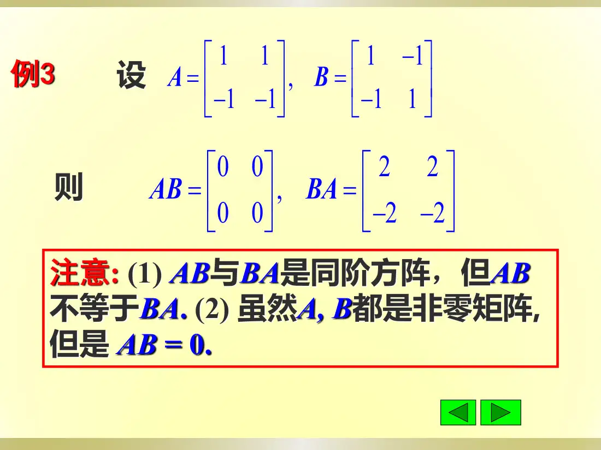

原文：

例3 设 $A = \begin{bmatrix} 1 & 1 \\ -1 & -1 \end{bmatrix}, B = \begin{bmatrix} 1 & -1 \\ -1 & 1 \end{bmatrix}$

则 $AB = \begin{bmatrix} 0 & 0 \\ 0 & 0 \end{bmatrix}, \quad BA = \begin{bmatrix} 2 & 2 \\ -2 & -2 \end{bmatrix}$

注意: (1) AB与BA是同阶方阵, 但AB不等于BA. (2) 虽然A, B都是非零矩阵,但是AB = 0.

◀ ▶

### $$

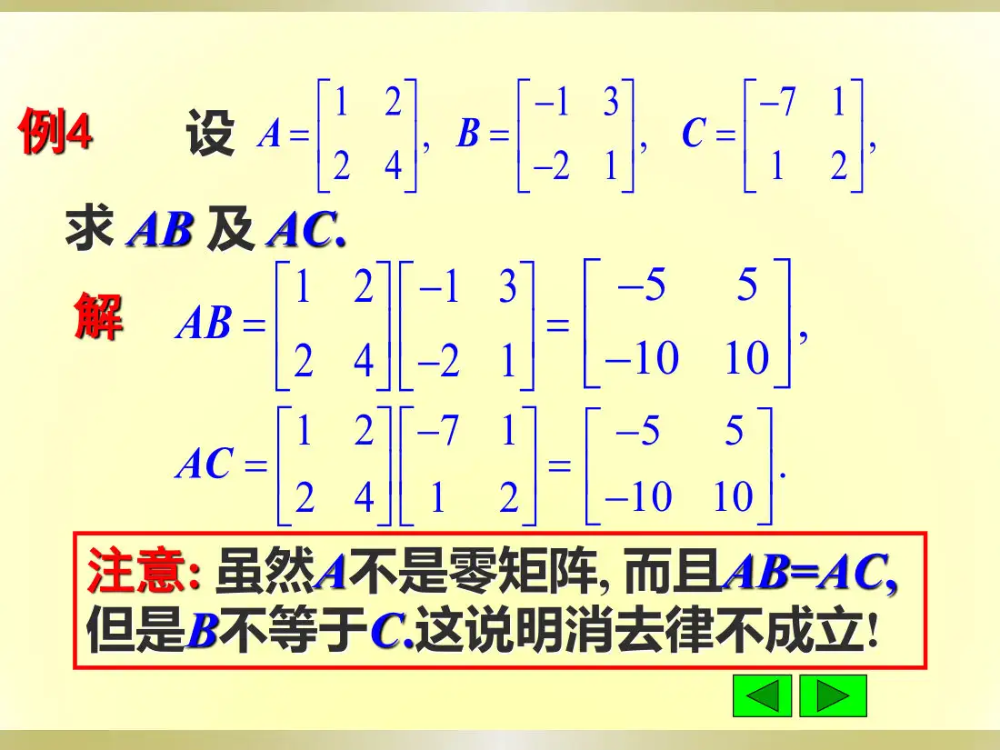

原文：

例4 设 $A=\begin{bmatrix}1 & 2 \\ 2 & 4\end{bmatrix}, B=\begin{bmatrix}-1 & 3 \\ -2 & 1\end{bmatrix}, C=\begin{bmatrix}-7 & 1 \\ 1 & 2\end{bmatrix}$ ，求 AB 及 AC.

解 $AB = \begin{bmatrix} 1 & 2 \\ 2 & 4 \end{bmatrix} \begin{bmatrix} -1 & 3 \\ -2 & 1 \end{bmatrix} = \begin{bmatrix} -5 & 5 \\ -10 & 10 \end{bmatrix},$

$$
\boldsymbol {A} \boldsymbol {C} = \left[ \begin{array}{l l} 1 & 2 \\ 2 & 4 \end{array} \right] \left[ \begin{array}{l l} - 7 & 1 \\ 1 & 2 \end{array} \right] = \left[ \begin{array}{l l} - 5 & 5 \\ - 1 0 & 1 0 \end{array} \right].
$$

注意: 虽然A不是零矩阵, 而且AB=AC, 但是B不等于C.这说明消去律不成立!

◀ ▶

### 总结一下矩阵乘法的一些反常性质:

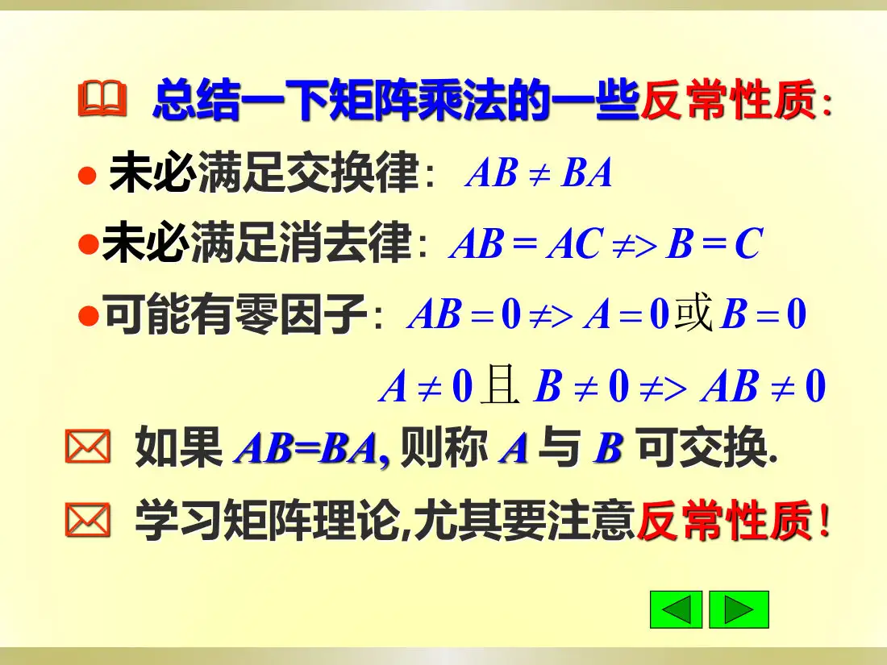

原文：

总结一下矩阵乘法的一些反常性质:

\- 未必满足交换律: $AB \neq BA$

\- 未必满足消去律: $AB = AC \neq > B = C$

\- 可能有零因子: $AB = 0 \neq > A = 0$ 或 $B = 0$

$A \neq 0$ 且 $B \neq 0 \neq > AB \neq 0$

如果 AB=BA，则称 A 与 B 可交换.

学习矩阵理论,尤其要注意反常性质!

◀ ▶

### 预习2.2—2.3

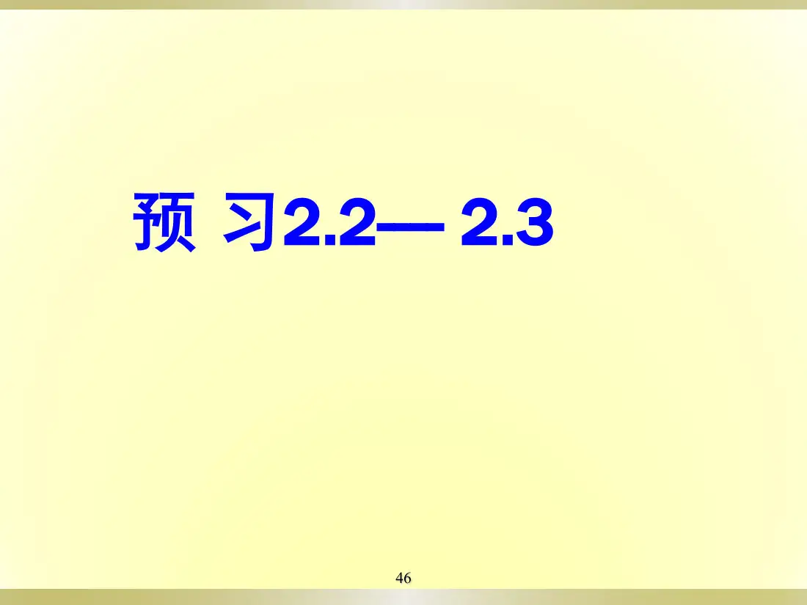

原文：

预习2.2—2.3

46

### 预习 2.2-2.3

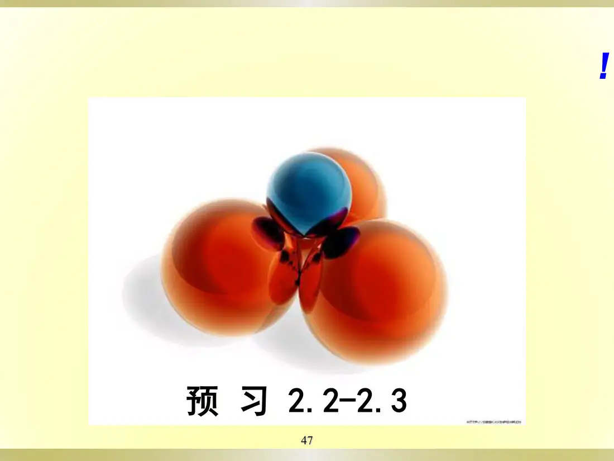

原文：

预习 2.2-2.3

本公司董事会全体成员保证信息披露的内容真实、准确、完整，没有虚假记载、误导性陈述或重大遗漏。

47

### 矩阵理论引言

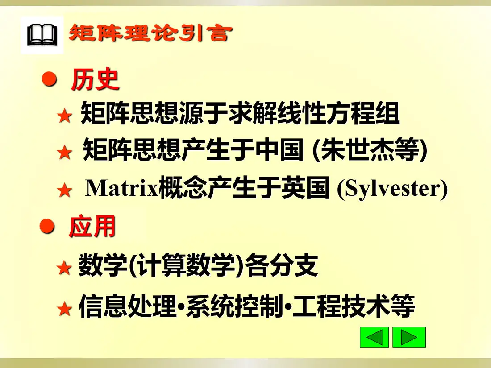

原文：

矩阵理论引言

\- 历史

★ 矩阵思想源于求解线性方程组

★ 矩阵思想产生于中国 (朱世杰等)

★ Matrix概念产生于英国 (Sylvester)

应用

数学(计算数学)各分支

★ 信息处理·系统控制·工程技术等

◀ ▶
