# 《线性代数与空间解析几何》第2章 矩阵（课件）

原件的每一页，下面附识别出的文字。

### 《线性代数与空间解析几何》

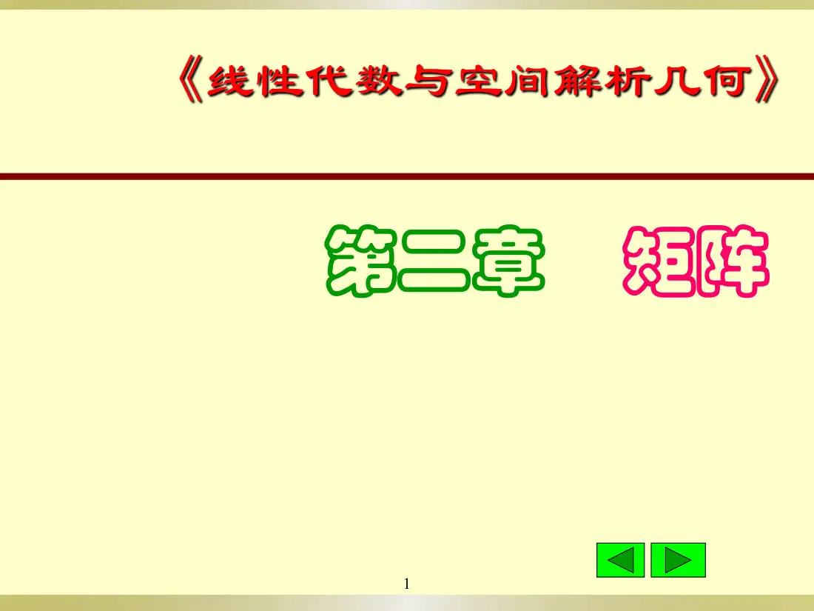

原文：

《线性代数与空间解析几何》

第二章 矩阵

◀ ▶

1

### 本章的主要内容

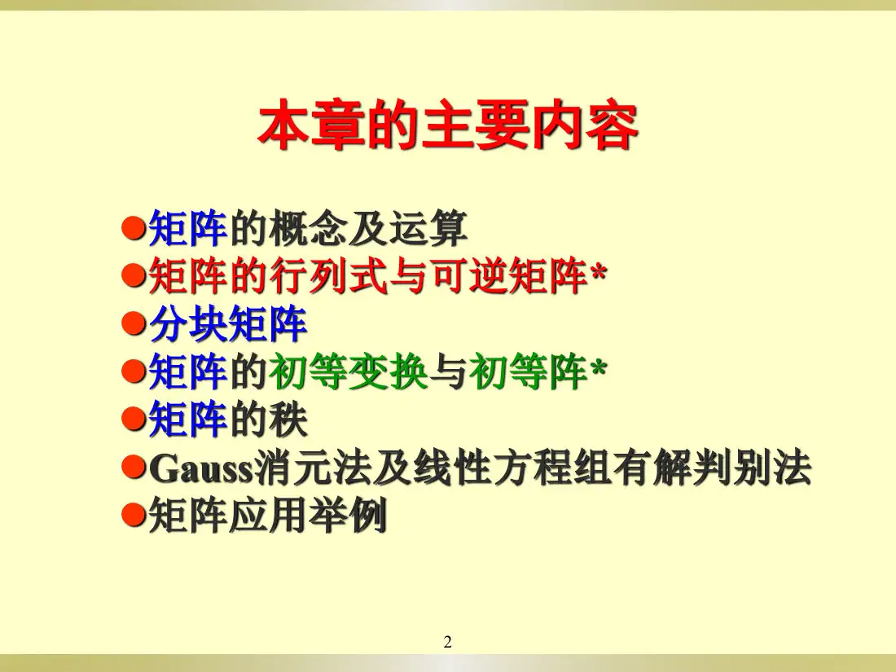

原文：

本章的主要内容

\- 矩阵的概念及运算

\- 矩阵的行列式与可逆矩阵\*

分块矩阵

\- 矩阵的初等变换与初等阵\*

\- 矩阵的秩

●Gauss消元法及线性方程组有解判别法

\- 矩阵应用举例

2

### 例1 解线性方程组

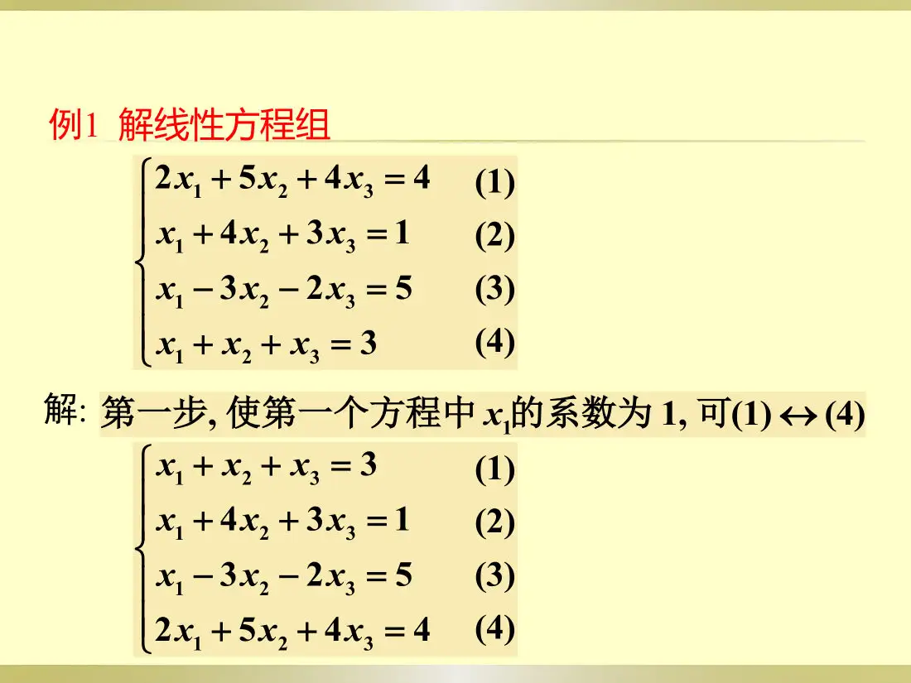

原文：

例1 解线性方程组

$$
2 x _ {1} + 5 x _ {2} + 4 x _ {3} = 4\tag{1}
$$

$$
x _ {1} + 4 x _ {2} + 3 x _ {3} = 1\tag{2}
$$

$$
x _ {1} - 3 x _ {2} - 2 x _ {3} = 5\tag{3}
$$

$$
x _ {1} + x _ {2} + x _ {3} = 3\tag{4}
$$

解: 第一步, 使第一个方程中 $x_{1}$ 的系数为 1, 可(1) $\leftrightarrow$ (4)

$$
x _ {1} + x _ {2} + x _ {3} = 3\tag{1}
$$

$$
x _ {1} + 4 x _ {2} + 3 x _ {3} = 1\tag{2}
$$

$$
x _ {1} - 3 x _ {2} - 2 x _ {3} = 5\tag{3}
$$

$$
\left\lfloor 2 x _ {1} + 5 x _ {2} + 4 x _ {3} = 4 \right.\tag{4}
$$

### $$

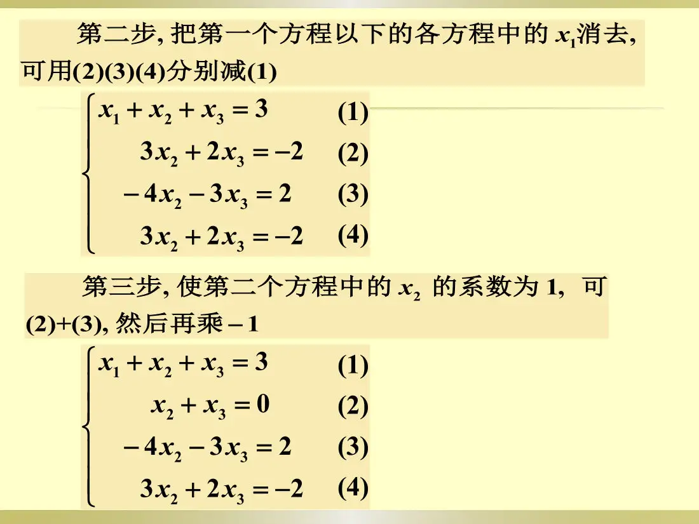

原文：

第二步, 把第一个方程以下的各方程中的 $x_{1}$ 消去, 可用(2)(3)(4)分别减(1)

$$
\left\{ \begin{array}{c} x _ {1} + x _ {2} + x _ {3} = 3 \\ 3 x _ {2} + 2 x _ {3} = - 2 \\ - 4 x _ {2} - 3 x _ {3} = 2 \\ 3 x _ {2} + 2 x _ {3} = - 2 \end{array} \right.\tag{1}
$$

(2)

(3)

(4)

第三步, 使第二个方程中的 $x_{2}$ 的系数为 1, 可 (2)+(3), 然后再乘 -1

$$
\left\{ \begin{array}{c} x _ {1} + x _ {2} + x _ {3} = 3 \\ x _ {2} + x _ {3} = 0 \\ - 4 x _ {2} - 3 x _ {3} = 2 \\ 3 x _ {2} + 2 x _ {3} = - 2 \end{array} \right.\tag{1}
$$

(2)

(3)

(4)

### $$

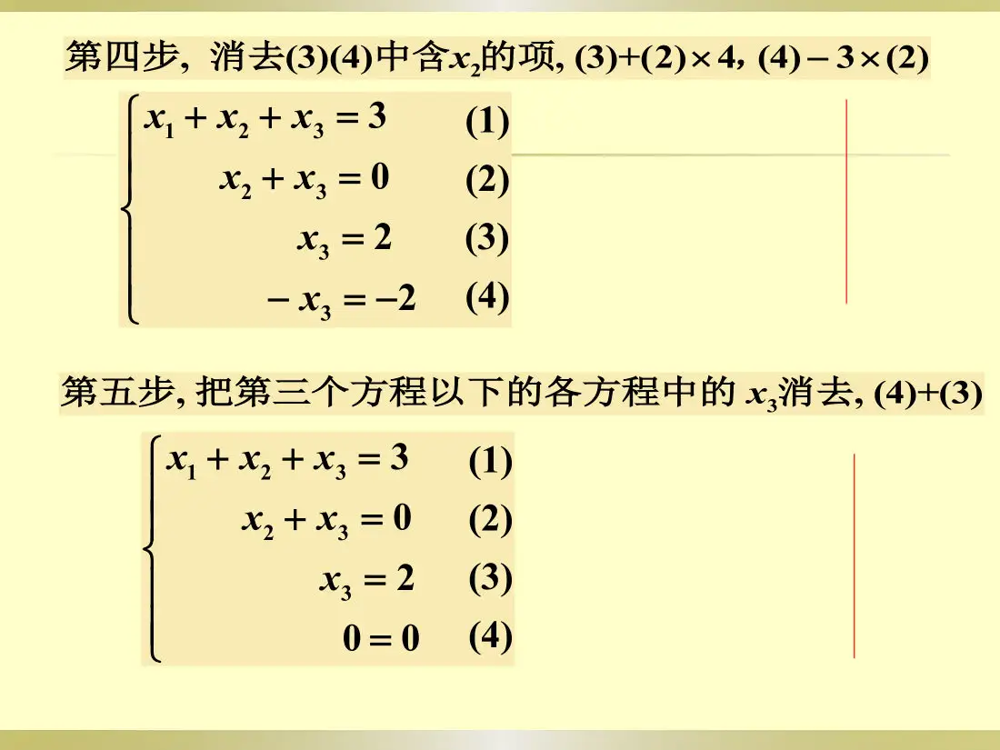

原文：

第四步, 消去(3)(4)中含 $x_{2}$ 的项, (3)+(2)×4, (4)-3×(2)

$$
x _ {1} + x _ {2} + x _ {3} = 3\tag{1}
$$

$$
x _ {2} + x _ {3} = 0\tag{2}
$$

$$
x _ {3} = 2\tag{3}
$$

$$
- x _ {3} = - 2\tag{4}
$$

第五步, 把第三个方程以下的各方程中的 $x_{3}$ 消去, $(4)+(3)$

$$
x _ {1} + x _ {2} + x _ {3} = 3\tag{1}
$$

$$
x _ {2} + x _ {3} = 0\tag{2}
$$

$$
x _ {3} = 2\tag{3}
$$

$$
\mathbf {0} = \mathbf {0}\tag{4}
$$

### 第六步, 用回代的方法求解, 即(2)-(3), (1)-(3)

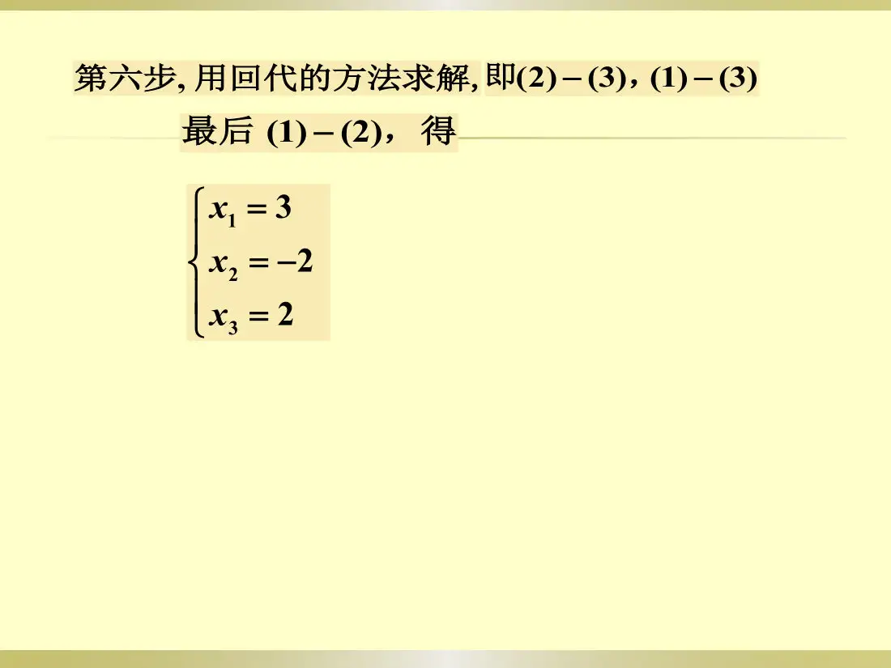

原文：

第六步, 用回代的方法求解, 即(2)-(3), (1)-(3)

最后 (1)-(2)，得

$$
\left\{ \begin{array}{l} x _ {1} = 3 \\ x _ {2} = - 2 \\ x _ {3} = 2 \end{array} \right.
$$

### 上述消元过程中, 我们对方程组施行了以下三种变换:

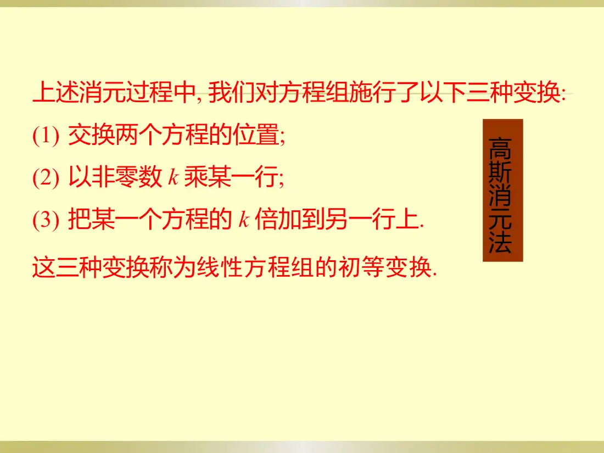

原文：

上述消元过程中, 我们对方程组施行了以下三种变换:

(1) 交换两个方程的位置;

高斯消元法

(2) 以非零数 k 乘某一行;

(3) 把某一个方程的 k 倍加到另一行上.

这三种变换称为线性方程组的初等变换.

### 对方程组施行的初等变换可以用增广矩阵的变换来表示.

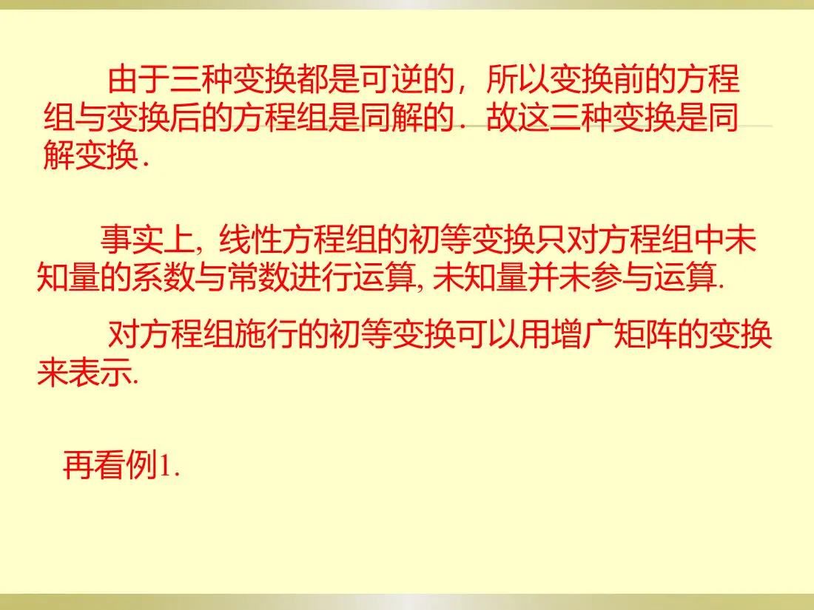

原文：

由于三种变换都是可逆的，所以变换前的方程组与变换后的方程组是同解的。故这三种变换是同解变换。

事实上，线性方程组的初等变换只对方程组中未知量的系数与常数进行运算, 未知量并未参与运算.

对方程组施行的初等变换可以用增广矩阵的变换来表示.

再看例1.

### 例1 解线性方程组

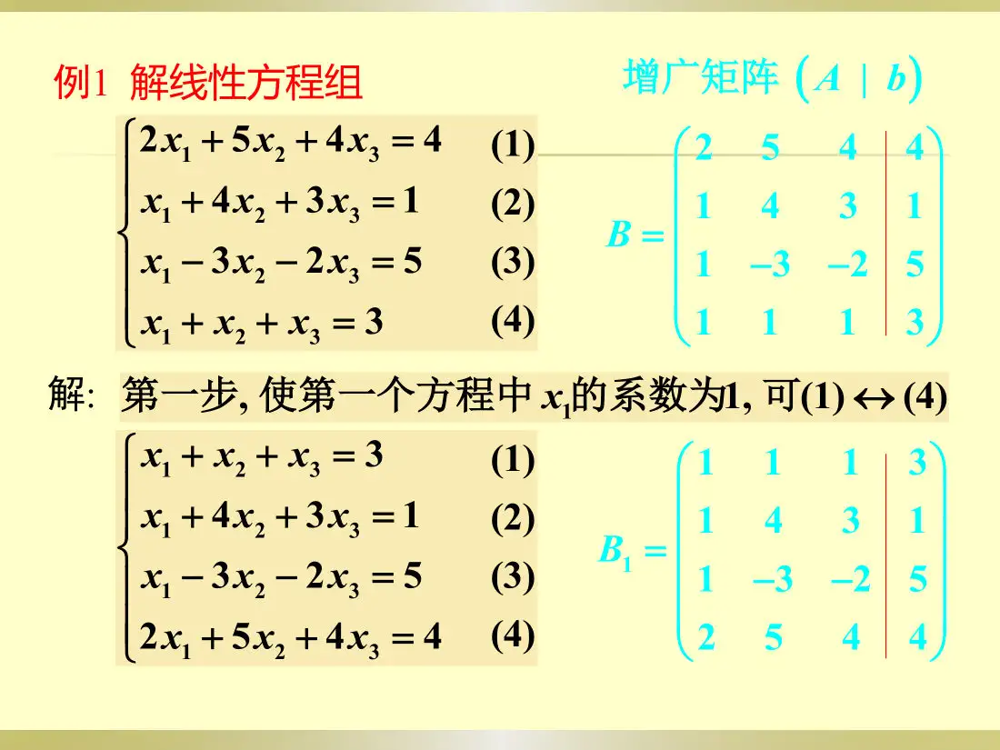

原文：

例1 解线性方程组

$$
2 x _ {1} + 5 x _ {2} + 4 x _ {3} = 4\tag{1}
$$

$$
x _ {1} + 4 x _ {2} + 3 x _ {3} = 1\tag{2}
$$

$$
x _ {1} - 3 x _ {2} - 2 x _ {3} = 5\tag{3}
$$

$$
x _ {1} + x _ {2} + x _ {3} = 3\tag{4}
$$

增广矩阵 $(A \mid b)$

$$
B = \left( \begin{array}{c c c c} 2 & 5 & 4 & 4 \\ 1 & 4 & 3 & 1 \\ 1 & - 3 & - 2 & 5 \\ 1 & 1 & 1 & 3 \end{array} \right)
$$

解: 第一步, 使第一个方程中 $x_{1}$ 的系数为 1 , 可 (1) $\leftrightarrow$ (4)

$$
x _ {1} + x _ {2} + x _ {3} = 3\tag{1}
$$

$$
x _ {1} + 4 x _ {2} + 3 x _ {3} = 1\tag{2}
$$

$$
x _ {1} - 3 x _ {2} - 2 x _ {3} = 5\tag{3}
$$

$$
2 x _ {1} + 5 x _ {2} + 4 x _ {3} = 4\tag{4}
$$

$$
B _ {1} = \left( \begin{array}{c c c c} 1 & 1 & 1 & 3 \\ 1 & 4 & 3 & 1 \\ 1 & - 3 & - 2 & 5 \\ 2 & 5 & 4 & 4 \end{array} \right)
$$

### $$

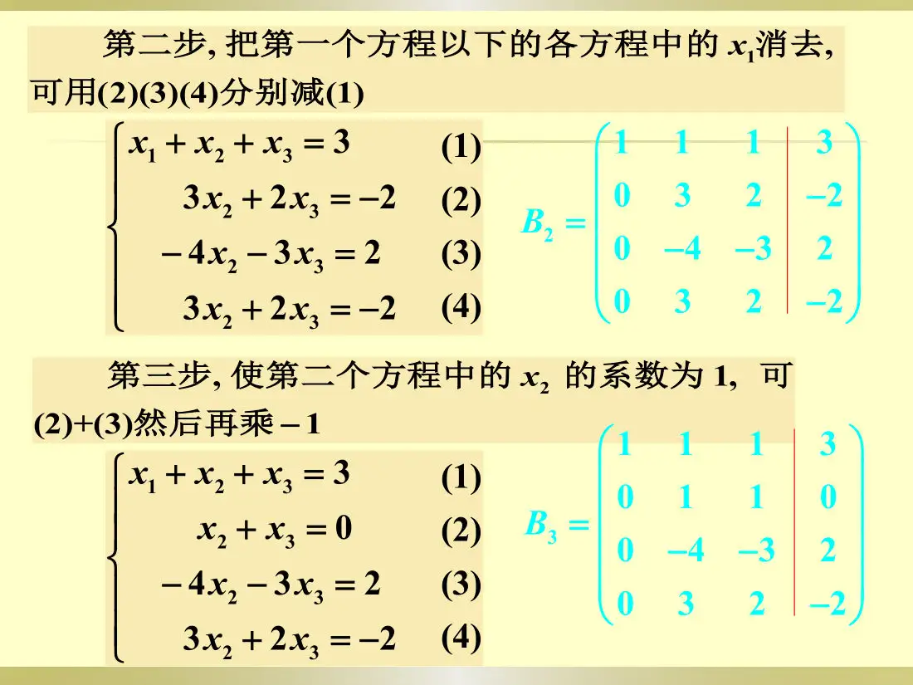

原文：

第二步, 把第一个方程以下的各方程中的 $x_{1}$ 消去, 可用(2)(3)(4)分别减(1)

$$
\left\{ \begin{array}{r} x _ {1} + x _ {2} + x _ {3} = 3 \\ 3 x _ {2} + 2 x _ {3} = - 2 \\ - 4 x _ {2} - 3 x _ {3} = 2 \\ 3 x _ {2} + 2 x _ {3} = - 2 \end{array} \right.\tag{1}
$$

(2)

(3)

$$
B _ {2} = \left( \begin{array}{c c c c} 1 & 1 & 1 & 3 \\ 0 & 3 & 2 & - 2 \\ 0 & - 4 & - 3 & 2 \\ 0 & 3 & 2 & - 2 \end{array} \right)\tag{4}
$$

第三步, 使第二个方程中的 $x_{2}$ 的系数为 1, 可 (2)+(3)然后再乘 -1

$$
\left\{ \begin{array}{c} x _ {1} + x _ {2} + x _ {3} = 3 \\ x _ {2} + x _ {3} = 0 \\ - 4 x _ {2} - 3 x _ {3} = 2 \\ 3 x _ {2} + 2 x _ {3} = - 2 \end{array} \right.\tag{1}
$$

(2)

(3)

$$
B _ {3} = \left( \begin{array}{c c c c} 1 & 1 & 1 & 3 \\ 0 & 1 & 1 & 0 \\ 0 & - 4 & - 3 & 2 \\ 0 & 3 & 2 & - 2 \end{array} \right)\tag{4}
$$

### $$

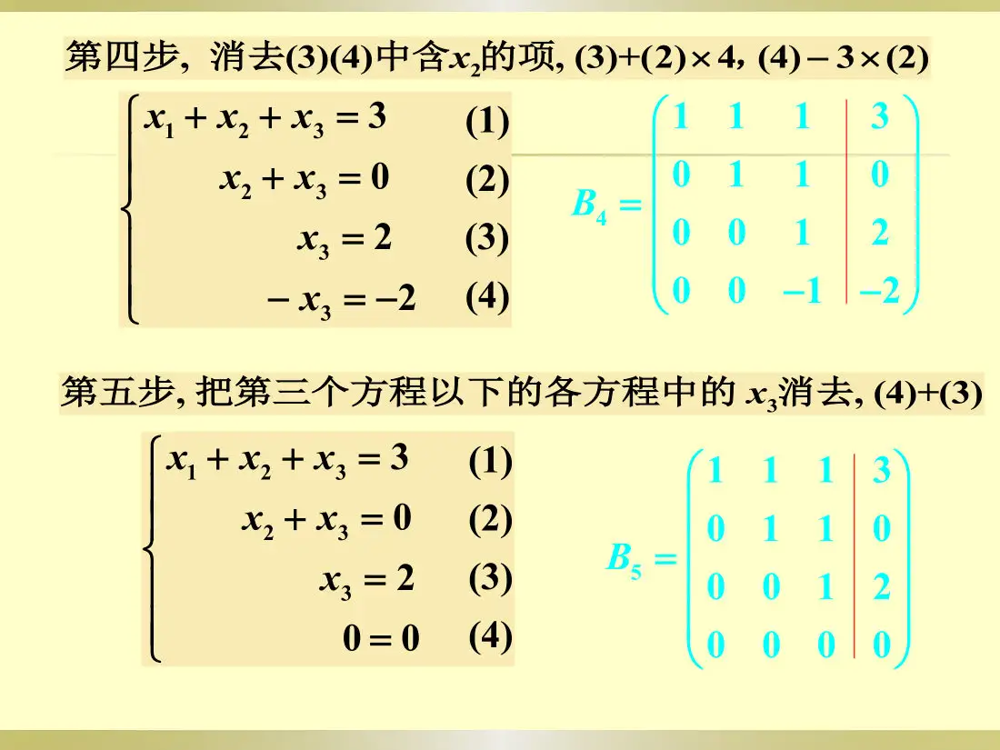

原文：

第四步, 消去(3)(4)中含 $x_{2}$ 的项, (3)+(2)×4, (4)-3×(2)

$$
\left\{ \begin{array}{r} x _ {1} + x _ {2} + x _ {3} = 3 \\ x _ {2} + x _ {3} = 0 \\ x _ {3} = 2 \\ - x _ {3} = - 2 \end{array} \right.
$$

(1)

(2)

(3)

$$
B _ {4} = \left( \begin{array}{c c c c} 1 & 1 & 1 & 3 \\ \hline 0 & 1 & 1 & 0 \\ 0 & 0 & 1 & 2 \\ 0 & 0 & - 1 & - 2 \end{array} \right)\tag{4}
$$

第五步, 把第三个方程以下的各方程中的 $x_{3}$ 消去, $(4)+(3)$

(1)

$$
x _ {2} + x _ {3} = 0\tag{2}
$$

$$
x _ {3} = 2
$$

$$
\mathbf {0} = \mathbf {0}\tag{3}
$$

$$
B _ {5} = \left( \begin{array}{c c c c} 1 & 1 & 1 & 3 \\ 0 & 1 & 1 & 0 \\ 0 & 0 & 1 & 2 \\ 0 & 0 & 0 & 0 \end{array} \right)\tag{4}
$$

### 第六步, 用回代的方法求解, 即(2)-(3), (1)-(3)

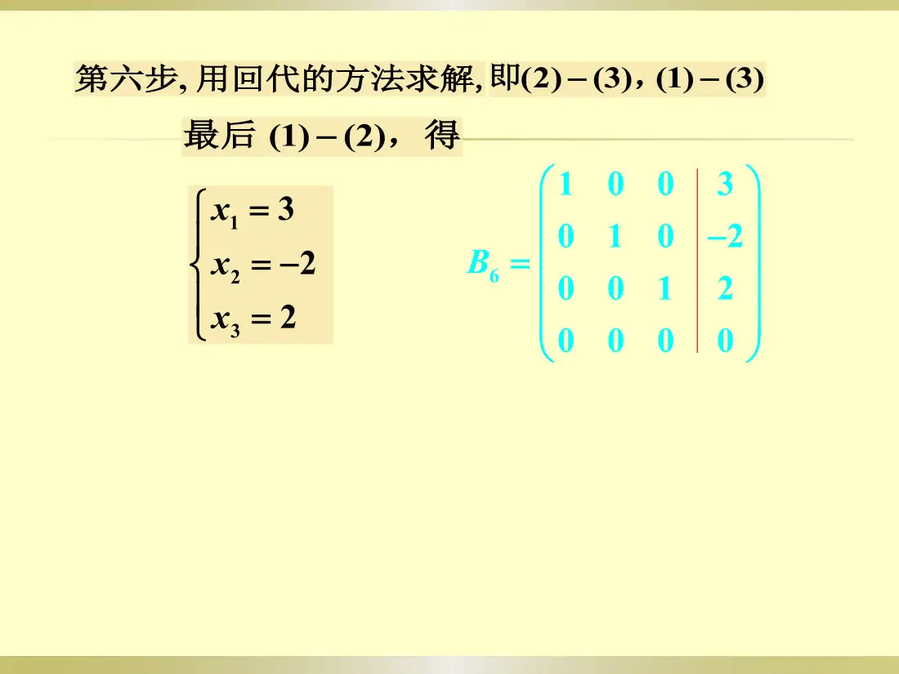

原文：

第六步, 用回代的方法求解, 即(2)-(3), (1)-(3)

最后 (1)-(2)，得

$$
\left\{ \begin{array}{l} x _ {1} = 3 \\ x _ {2} = - 2 \\ x _ {3} = 2 \end{array} \right.
$$

$$
B _ {6} = \left( \begin{array}{c c c c} 1 & 0 & 0 & 3 \\ 0 & 1 & 0 & - 2 \\ 0 & 0 & 1 & 2 \\ 0 & 0 & 0 & 0 \end{array} \right)
$$

### 矩阵概念的引入

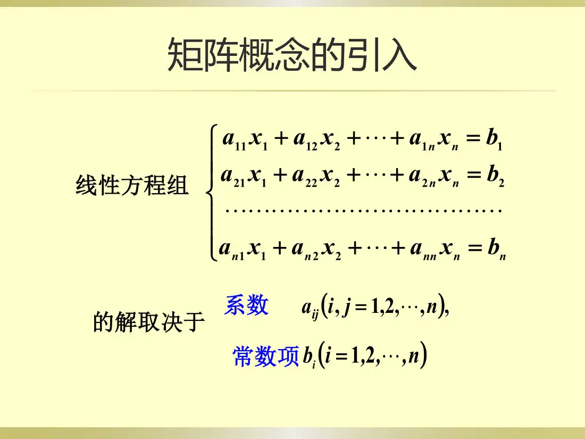

原文：

矩阵概念的引入

线性方程组

$$
\left\{ \begin{array}{l} a _ {1 1} x _ {1} + a _ {1 2} x _ {2} + \dots + a _ {1 n} x _ {n} = b _ {1} \\ a _ {2 1} x _ {1} + a _ {2 2} x _ {2} + \dots + a _ {2 n} x _ {n} = b _ {2} \\ \dots\dots\\ a _ {n 1} x _ {1} + a _ {n 2} x _ {2} + \dots + a _ {n n} x _ {n} = b _ {n} \end{array} \right.
$$

的解取决于

系数

$$
a _ {i j} (i, j = 1, 2, \dots , n),
$$

常数项 $b_{i}(i=1,2,\cdots,n)$

### $$

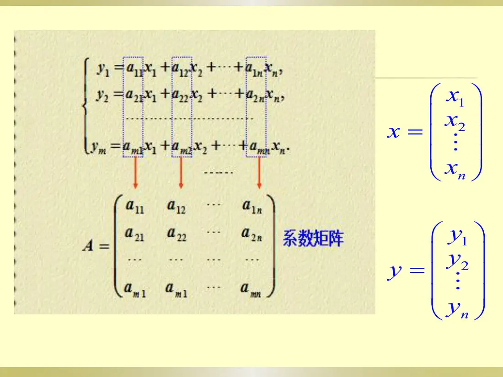

原文：

$$
\left\{ \begin{array}{l} y _ {1} = a _ {1 1} x _ {1} + a _ {1 2} x _ {2} + \dots + a _ {1 n} x _ {n}, \\ y _ {2} = a _ {2 1} x _ {1} + a _ {2 2} x _ {2} + \dots + a _ {2 n} x _ {n}, \\ \vdots \\ y _ {m} = a _ {m 1} x _ {1} + a _ {m 2} x _ {2} + \dots + a _ {m n} x _ {n}. \end{array} \right.
$$

$$
x = \left( \begin{array}{l} x _ {1} \\ x _ {2} \\ \vdots \\ x _ {n} \end{array} \right)
$$

$$
\boldsymbol {A} = \left( \begin{array}{c c c c} \boldsymbol {a} _ {1 1} & \boldsymbol {a} _ {1 2} & \dots & \boldsymbol {a} _ {1 n} \\ \boldsymbol {a} _ {2 1} & \boldsymbol {a} _ {2 2} & \dots & \boldsymbol {a} _ {2 n} \\ \dots & \dots & \dots & \dots \\ \boldsymbol {a} _ {m 1} & \boldsymbol {a} _ {m 1} & \dots & \boldsymbol {a} _ {m n} \end{array} \right)
$$

系数矩阵

$$
y = \left( \begin{array}{c} y _ {1} \\ y _ {2} \\ \vdots \\ y _ {n} \end{array} \right)
$$

### $$

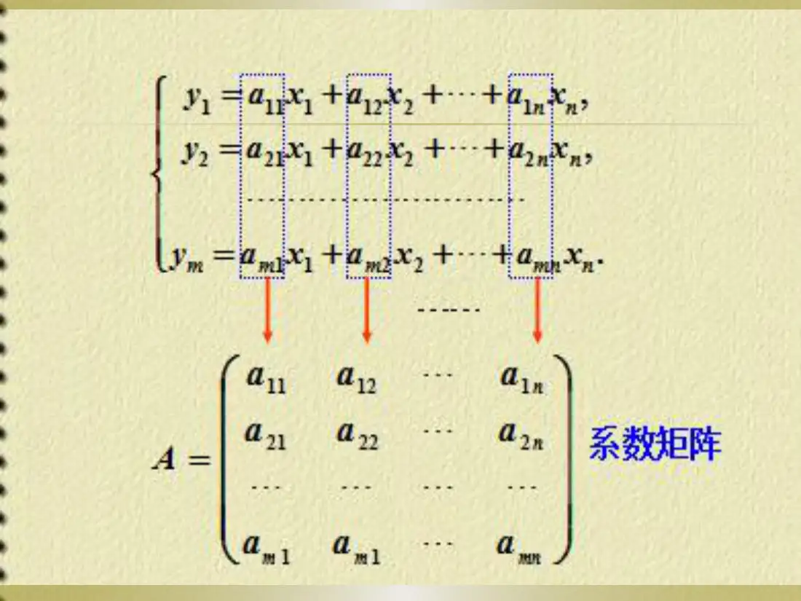

原文：

$$
\left\{ \begin{array}{l} y _ {1} = a _ {1 1} x _ {1} + a _ {1 2} x _ {2} + \dots + a _ {1 n} x _ {n}, \\ y _ {2} = a _ {2 1} x _ {1} + a _ {2 2} x _ {2} + \dots + a _ {2 n} x _ {n}, \\ \dots \\ y _ {m} = a _ {m 1} x _ {1} + a _ {m 2} x _ {2} + \dots + a _ {m n} x _ {n}. \end{array} \right.
$$

$$
A = \left( \begin{array}{c c c c} a _ {1 1} & a _ {1 2} & \dots & a _ {1 n} \\ a _ {2 1} & a _ {2 2} & \dots & a _ {2 n} \\ \dots & \dots & \dots & \dots \\ a _ {m 1} & a _ {m 1} & \dots & a _ {m n} \end{array} \right)
$$

系数矩阵

### 2.1 矩阵的概念

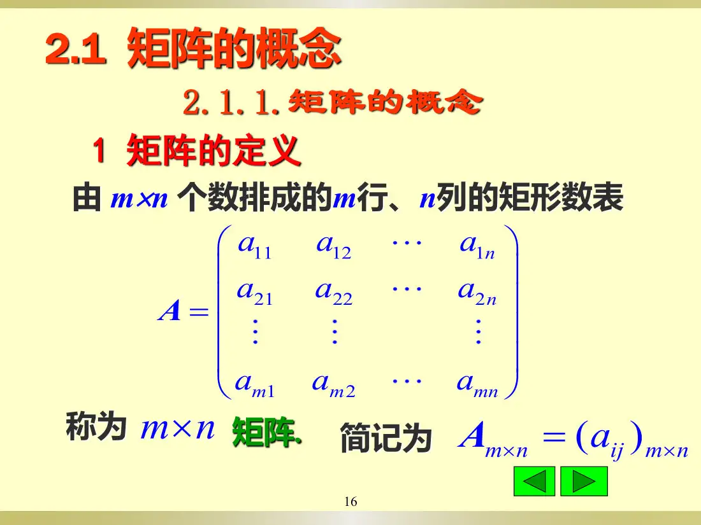

原文：

2.1 矩阵的概念

2.1.1. 矩阵的概念

1 矩阵的定义

由 $m \times n$ 个数排成的 $m$ 行、 $n$ 列的矩形数表

$$
A = \left( \begin{array}{c c c c} a _ {1 1} & a _ {1 2} & \dots & a _ {1 n} \\ a _ {2 1} & a _ {2 2} & \dots & a _ {2 n} \\ \vdots & \vdots & & \vdots \\ a _ {m 1} & a _ {m 2} & \dots & a _ {m n} \end{array} \right)
$$

称为 $m \times n$ 矩阵. 简记为 $A_{m \times n} = (a_{ij})_{m \times n}$

◀ ▶

16

### $$

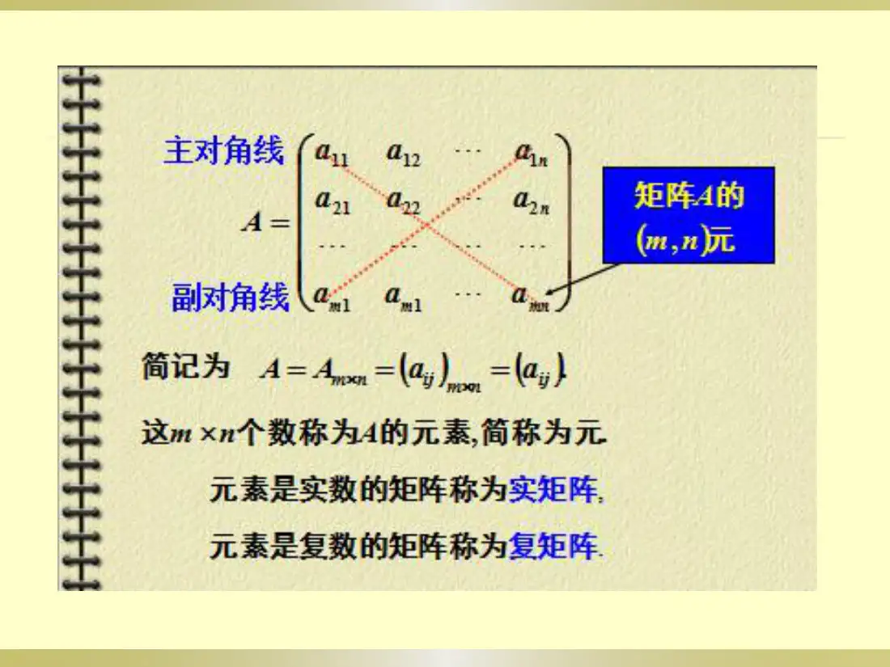

原文：

$$
\begin{array}{r l} & {\mathrm{主对角线}} \\ & {A = \left( \begin{array}{l l l l} {a _ {1 1}} & {a _ {1 2}} & {\dots} & {a _ {1 n}} \\ {a _ {2 1}} & {a _ {2 2}} & {\dots} & {a _ {2 n}} \\ {\dots} & {\dots} & {\dots} & {\dots} \\ {a _ {m 1}} & {a _ {m 1}} & {\dots} & {a _ {m n}} \end{array} \right)} \end{array}
$$

矩阵A的

简记为 $A = A_{mn} = (a_{ij})_{mn} = (a_{ij})$

(m,n)元

这 $m \times n$ 个数称为4的元素,简称为元

元素是实数的矩阵称为实矩阵.

元素是复数的矩阵称为复矩阵.

### 第 18 页

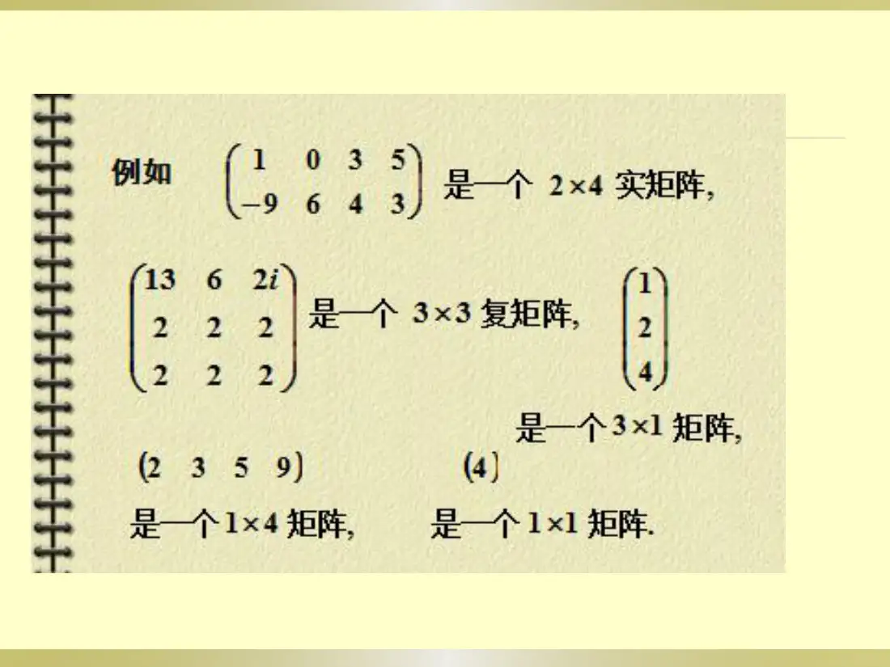

原文：

例如 $\left( \begin{array}{ccc}1 & 0 & 3 & 5\\ -9 & 6 & 4 & 3 \end{array} \right)$ 是一个 $2\times 4$ 实矩阵， $\left( \begin{array}{ccc}13 & 6 & 2i\\ 2 & 2 & 2\\ 2 & 2 & 2 \end{array} \right)$ 是一个 $3\times 3$ 复矩阵， $\left( \begin{array}{c}1\\ 2\\ 4 \end{array} \right)$ 是一个 $3\times 1$ 矩阵，(2 3 5 9) (4) 是一个 $1\times 4$ 矩阵，是一个 $1\times 1$ 矩阵.

### 当 m=n 时称为 n 阶方阵.

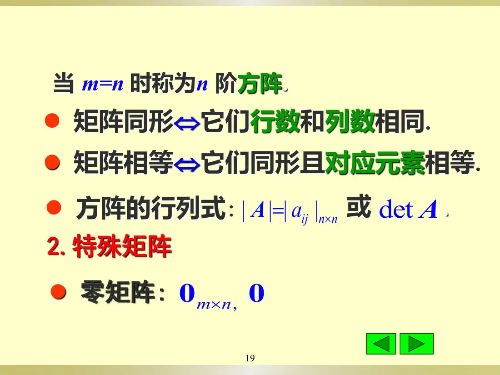

原文：

当 m=n 时称为 n 阶方阵.

\- 矩阵同形 $\Leftrightarrow$ 它们行数和列数相同.

\- 矩阵相等 $\Leftrightarrow$ 它们同形且对应元素相等.

\- 方阵的行列式: $|A| = |a_{ij}|_{n \times n}$ 或 $\det A$ .

2. 特殊矩阵

零矩阵：0 $_{m \times n}$ ，0- 对角矩阵: $\begin{pmatrix} a_{11} & & \\ & a_{22} & \ddots \\ & & a_{nn} \end{pmatrix}$ - 单位矩阵: $E, I$ 或 $E_n = \begin{pmatrix} 1 & & \\ & 1 & \ddots \\ & & 1 \end{pmatrix}$ - 数(标)量矩阵: $A = \begin{pmatrix} k & & \\ & k & \ddots \\ & & k \end{pmatrix}$

19

◀ ▶

### 第 20 页

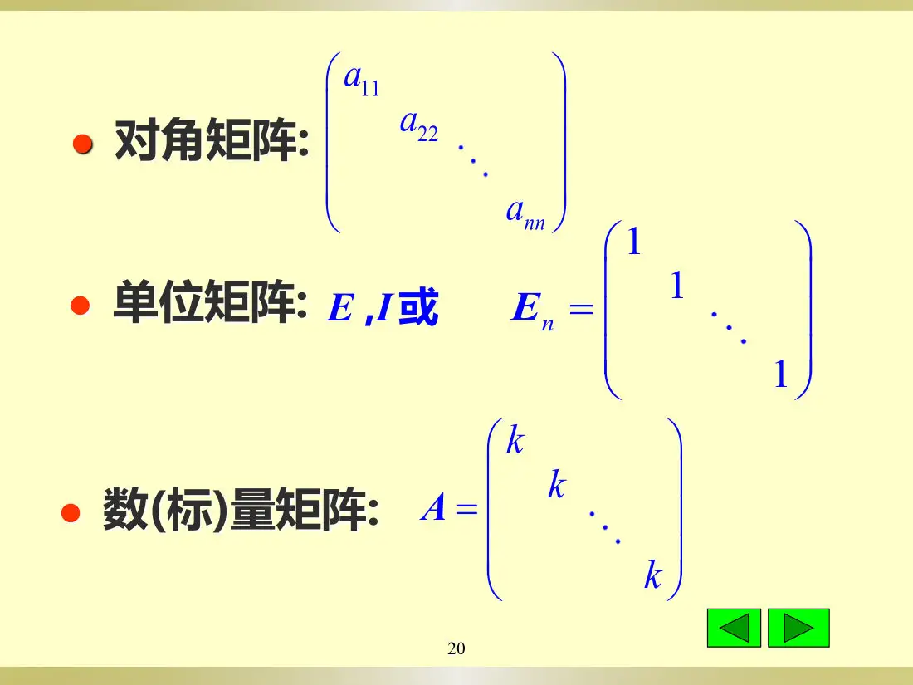

### 21

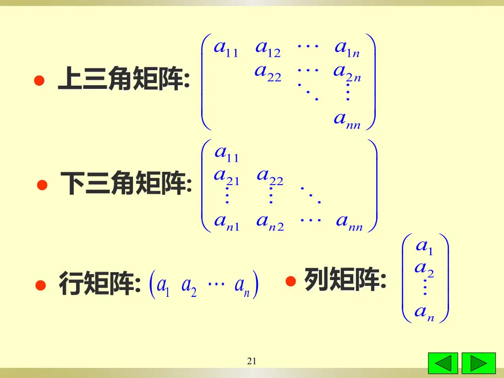

原文：

\- 上三角矩阵: $\left( \begin{array}{cccc}a_{11} & a_{12} & \cdots & a_{1n}\\ & a_{22} & \ddots & a_{2n}\\ & & \ddots & \vdots \\ & & & a_{nn} \end{array} \right)$ - 下三角矩阵: $\left( \begin{array}{cccc}a_{11} & & & \\ a_{21} & a_{22} & & \\ \vdots & \vdots & \ddots & \\ a_{n1} & a_{n2} & \cdots & a_{nn} \end{array} \right)$ - 行矩阵: $(a_1, a_2, \cdots, a_n)$ • 列矩阵: $\left( \begin{array}{c}a_1\\ a_2\\ \vdots\\ a_n \end{array} \right)$

21

◀

### 2.2 矩阵运算

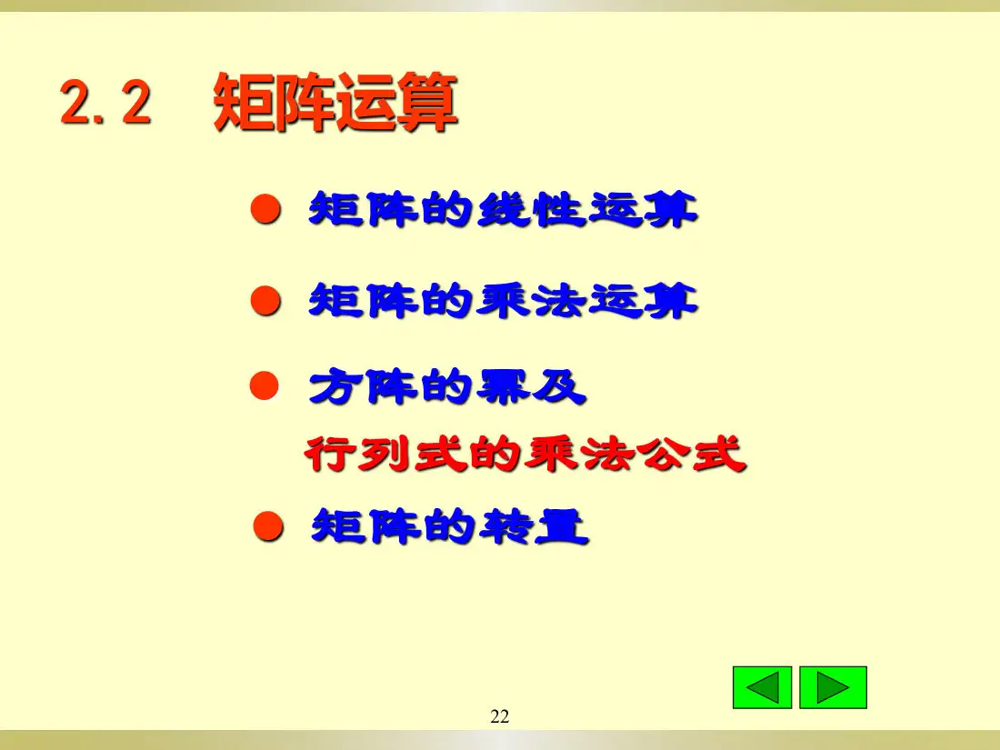

原文：

2.2 矩阵运算

\- 矩阵的线性运算

矩阵的乘法运算

方阵的幂及

行列式的乘法公式

矩阵的转置

22

◀ ▶

### 2.2.1 矩阵的加法: (A与B要同形).

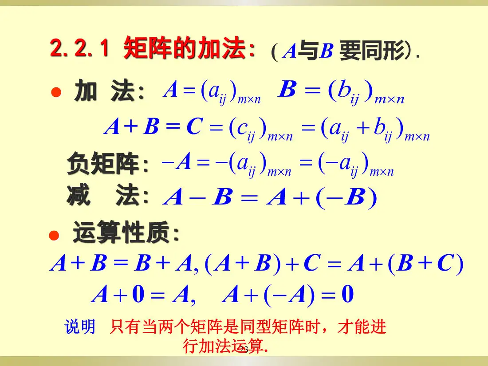

原文：

2.2.1 矩阵的加法: (A与B要同形).

\- 加法: $A = (a_{ij})_{m \times n}$ $B = (b_{ij})_{m \times n}$

$$
A + B = C = (c _ {i j}) _ {m \times n} = (a _ {i j} + b _ {i j}) _ {m \times n}
$$

负矩阵： $-A=-\left(a_{ij}\right)_{m\times n}=(-a_{ij})_{m\times n}$

减法: $A - B = A + (-B)$

运算性质：

$$
A + B = B + A, (A + B) + C = A + (B + C)
$$

$$
A + 0 = A, \quad A + (- A) = 0
$$

说明 只有当两个矩阵是同型矩阵时，才能进行加法运算.

### 说明 只有当两个矩阵是同型矩阵时，才能进行加法运算.

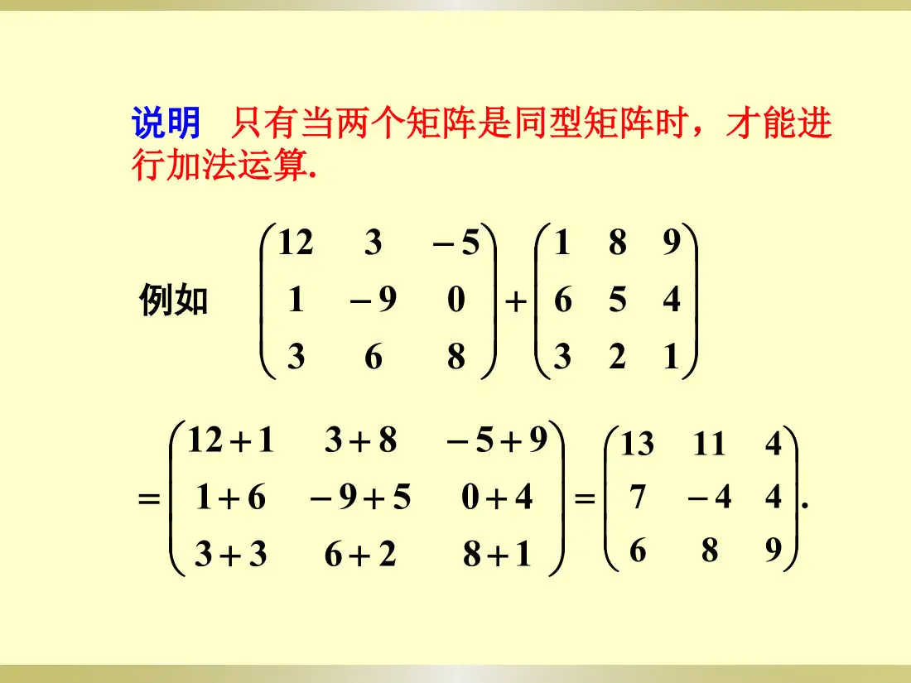

原文：

说明 只有当两个矩阵是同型矩阵时，才能进行加法运算.

例如

$$
\left( \begin{array}{r r r} 1 2 & 3 & - 5 \\ 1 & - 9 & 0 \\ 3 & 6 & 8 \end{array} \right) + \left( \begin{array}{r r r} 1 & 8 & 9 \\ 6 & 5 & 4 \\ 3 & 2 & 1 \end{array} \right)
$$

$$
= \left( \begin{array}{c c c} 1 2 + 1 & 3 + 8 & - 5 + 9 \\ 1 + 6 & - 9 + 5 & 0 + 4 \\ 3 + 3 & 6 + 2 & 8 + 1 \end{array} \right) = \left( \begin{array}{c c c} 1 3 & 1 1 & 4 \\ 7 & - 4 & 4 \\ 6 & 8 & 9 \end{array} \right).
$$

### 2.2.2 数乘

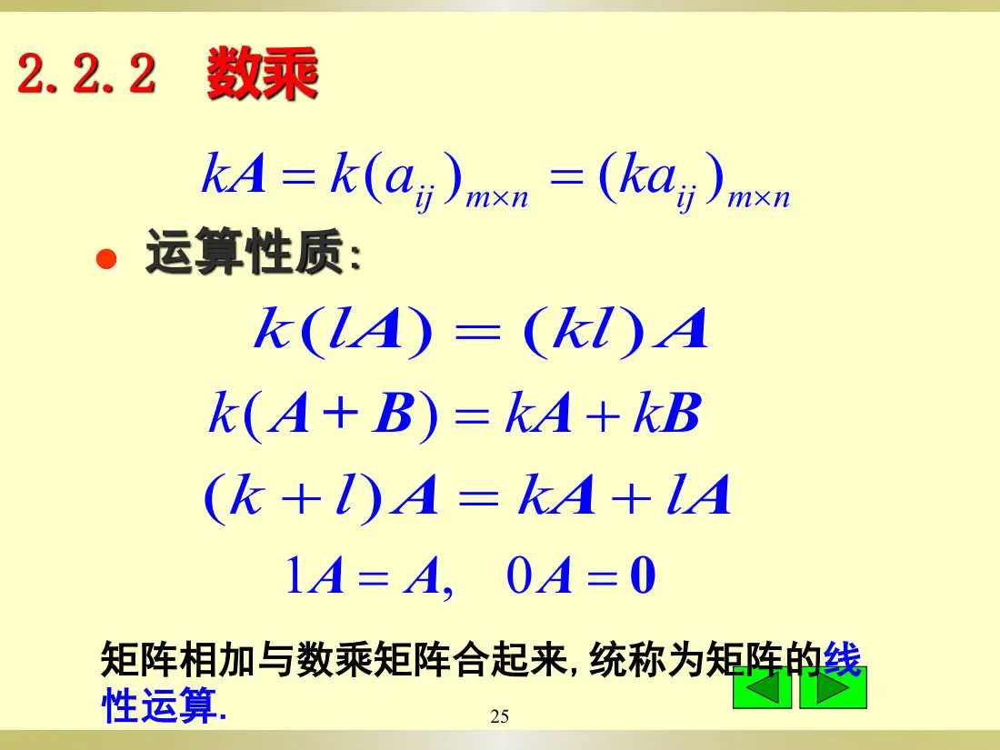

原文：

2.2.2 数乘

$$
k A = k (a _ {i j}) _ {m \times n} = (k a _ {i j}) _ {m \times n}
$$

运算性质：

$$
k (l A) = (k l) A
$$

$$
k (A + B) = k A + k B
$$

$$
(k + l) A = k A + l A
$$

$$
1 A = A, \quad 0 A = 0
$$

矩阵相加与数乘矩阵合起来, 统称为矩阵的线性运算.
25

### 2.2.3 矩阵乘法

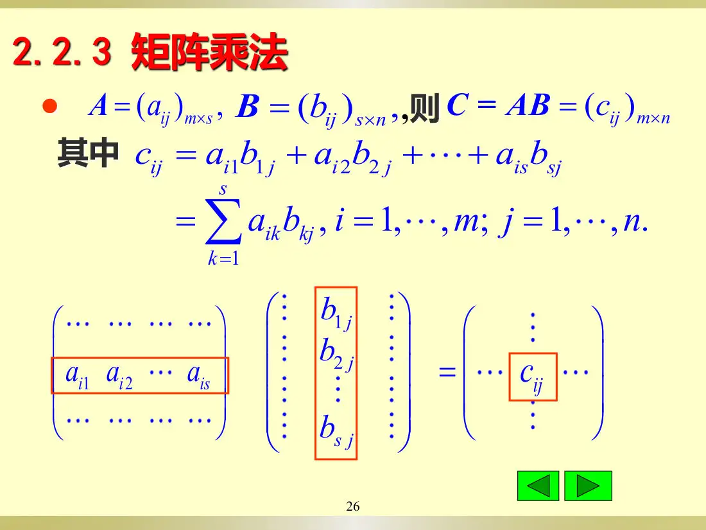

原文：

2.2.3 矩阵乘法

$A=(a_{ij})_{m\times s},\quad B=(b_{ij})_{s\times n},$ 则 $C=AB=(c_{ij})_{m\times n}$

其中 $c_{ij}=a_{i1}b_{1j}+a_{i2}b_{2j}+\cdots+a_{is}b_{sj}$ $=\sum_{k=1}^{s}a_{ik}b_{kj}, i=1,\cdots,m; j=1,\cdots,n.$

$$
\left( \begin{array}{c c c c} \dots & \dots & \dots & \dots \\ & & & \\ a _ {i 1} & a _ {i 2} & \dots & a _ {i s} \\ \hline \dots & \dots & \dots & \dots \end{array} \right) \quad \left( \begin{array}{c c c} \vdots & b _ {1 j} & \vdots \\ \vdots & b _ {2 j} & \vdots \\ \vdots & \vdots & \vdots \\ \vdots & b _ {s j} & \vdots \end{array} \right) = \left( \begin{array}{c} \vdots \\ \cdots \\ c _ {i j} \\ \vdots \end{array} \right)
$$

26

◀ ▶

### 例1

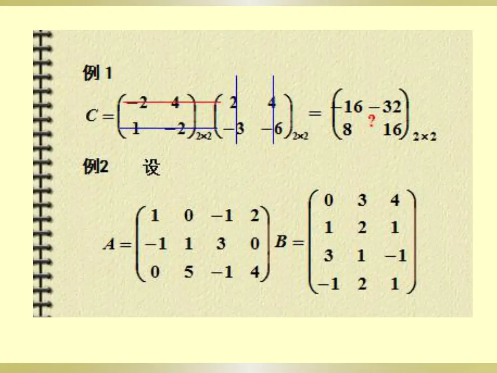

原文：

例1

$$
C = \left( \begin{array}{l l} - 2 & 4 \\ 1 & - 2 \end{array} \right) _ {2 \times 2} \left( \begin{array}{l l} 2 & 4 \\ - 3 & - 6 \end{array} \right) _ {2 \times 2} = \left( \begin{array}{l l} 1 6 & - 3 2 \\ 8 & ? & 1 6 \end{array} \right) _ {2 \times 2}
$$

例2 设

$$
A = \left( \begin{array}{c c c c} 1 & 0 & - 1 & 2 \\ - 1 & 1 & 3 & 0 \\ 0 & 5 & - 1 & 4 \end{array} \right) B = \left( \begin{array}{c c c} 0 & 3 & 4 \\ 1 & 2 & 1 \\ 3 & 1 & - 1 \\ - 1 & 2 & 1 \end{array} \right)
$$

### $$

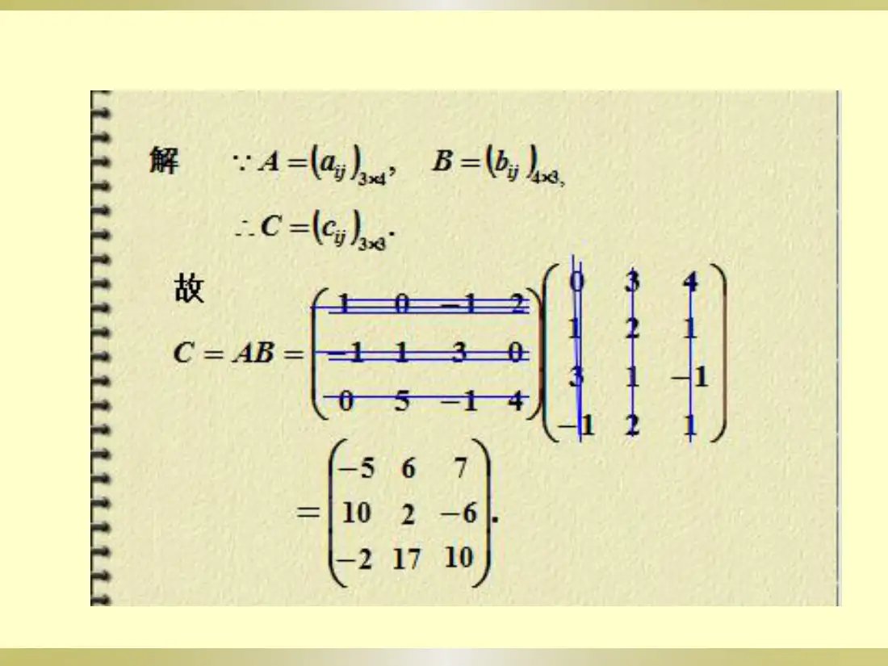

原文：

解

$$
\begin{array}{l l} \because A = (a _ {i j}) _ {3 \times 4}, & B = (b _ {i j}) _ {4 \times 3}, \\ \therefore C = (c _ {i j}) _ {3 \times 3}. \end{array}
$$

$$
\begin{array}{r l} & {\text {故}} \\ & {C = A B = \left( \begin{array}{l l l l} 1 & 0 & - 1 & 2 \\ - 1 & 1 & 3 & 0 \\ 0 & 5 & - 1 & 4 \end{array} \right) \left( \begin{array}{l l l} 0 & 3 & 4 \\ 1 & 2 & 1 \\ 3 & 1 & - 1 \\ - 1 & 2 & 1 \end{array} \right)} \\ & {\qquad = \left( \begin{array}{l l l} - 5 & 6 & 7 \\ 1 0 & 2 & - 6 \\ - 2 & 1 7 & 1 0 \end{array} \right).} \end{array}
$$

### 则含 n 个未知量, m 个方程的线性方程组

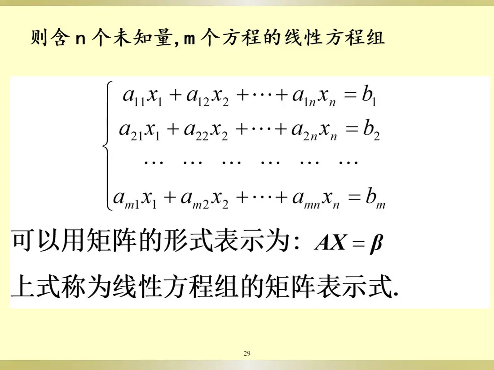

原文：

则含 n 个未知量, m 个方程的线性方程组

$$
\left\{ \begin{array}{l} a _ {1 1} x _ {1} + a _ {1 2} x _ {2} + \dots + a _ {1 n} x _ {n} = b _ {1} \\ a _ {2 1} x _ {1} + a _ {2 2} x _ {2} + \dots + a _ {2 n} x _ {n} = b _ {2} \\ \dots \dots \\ a _ {m 1} x _ {1} + a _ {m 2} x _ {2} + \dots + a _ {m n} x _ {n} = b _ {m} \end{array} \right.
$$

可以用矩阵的形式表示为: $AX = \beta$ 上式称为线性方程组的矩阵表示式.

29

### 30

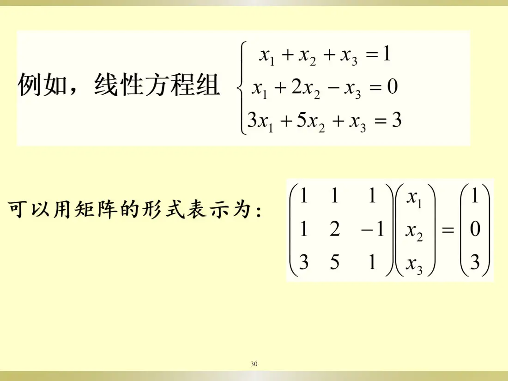

原文：

例如，线性方程组 $\left\{\begin{aligned}x_{1}+x_{2}+x_{3}&=1\\ x_{1}+2x_{2}-x_{3}&=0\\ 3x_{1}+5x_{2}+x_{3}&=3\end{aligned}\right.$

可以用矩阵的形式表示为： $\begin{pmatrix}1&1&1\\ 1&2&-1\\ 3&5&1\end{pmatrix}\begin{pmatrix}x_{1}\\ x_{2}\\ x_{3}\end{pmatrix}=\begin{pmatrix}1\\ 0\\ 3\end{pmatrix}$

30

### 则含 n 个未知量, m 个方程的线性方程组

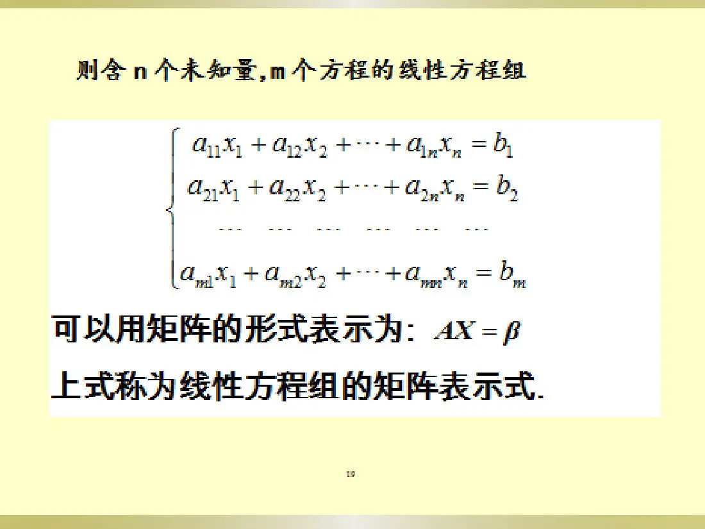

原文：

则含 n 个未知量, m 个方程的线性方程组

$$
\left\{ \begin{array}{l} a _ {1 1} x _ {1} + a _ {1 2} x _ {2} + \dots + a _ {1 n} x _ {n} = b _ {1} \\ a _ {2 1} x _ {1} + a _ {2 2} x _ {2} + \dots + a _ {2 n} x _ {n} = b _ {2} \\ \dots \quad \dots \quad \dots \quad \dots \quad \dots \quad \dots \\ a _ {m 1} x _ {1} + a _ {m 2} x _ {2} + \dots + a _ {m n} x _ {n} = b _ {m} \end{array} \right.
$$

可以用矩阵的形式表示为： $AX = \beta$ 上式称为线性方程组的矩阵表示式.

18

### 第 32 页

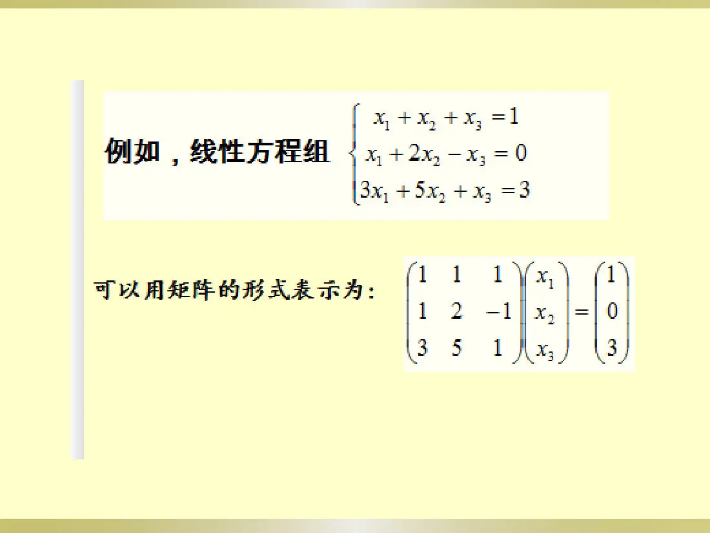

原文：

例如，线性方程组 $\left\{ \begin{array}{l}x_{1} + x_{2} + x_{3} = 1\\ x_{1} + 2x_{2} - x_{3} = 0\\ 3x_{1} + 5x_{2} + x_{3} = 3 \end{array} \right.$

可以用矩阵的形式表示为： $\begin{pmatrix} 1 & 1 & 1 \\ 1 & 2 & -1 \\ 3 & 5 & 1 \end{pmatrix} \begin{pmatrix} x_1 \\ x_2 \\ x_3 \end{pmatrix} = \begin{pmatrix} 1 \\ 0 \\ 3 \end{pmatrix}$

### 总结如下：

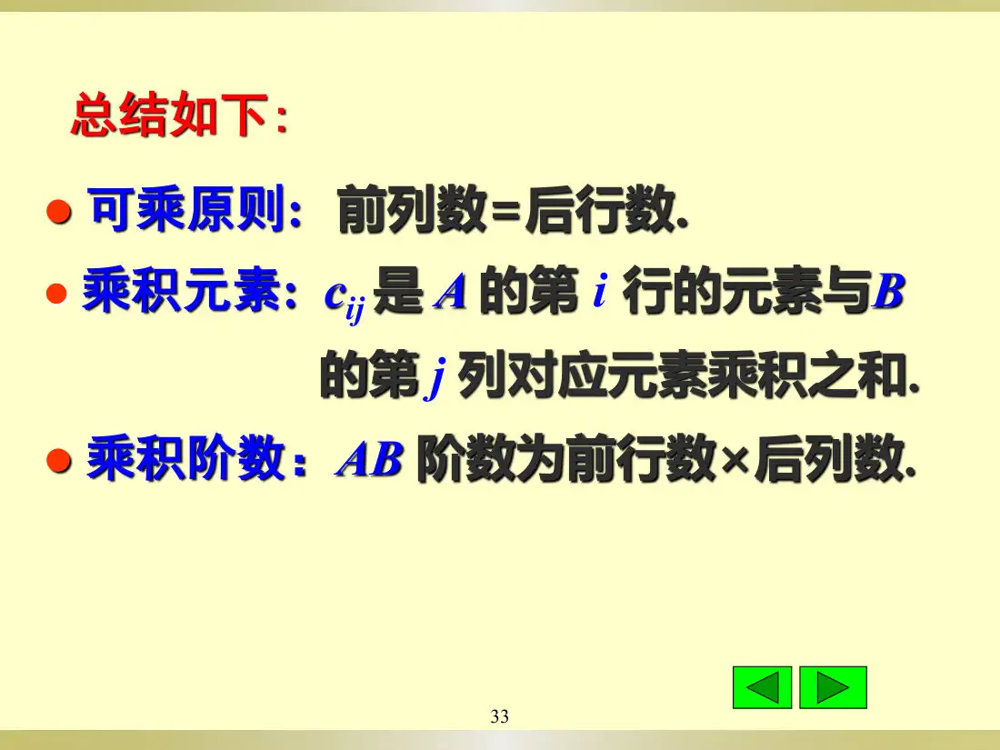

原文：

总结如下：

\- 可乘原则: 前列数=后行数.

\- 乘积元素: $c_{ij}$ 是 $A$ 的第 $i$ 行的元素与 $B$ 的第 $j$ 列对应元素乘积之和.

\- 乘积阶数：AB 阶数为前行数×后列数.

33

◀ ▶

### \- 运算性质: (A是m×n的矩阵)

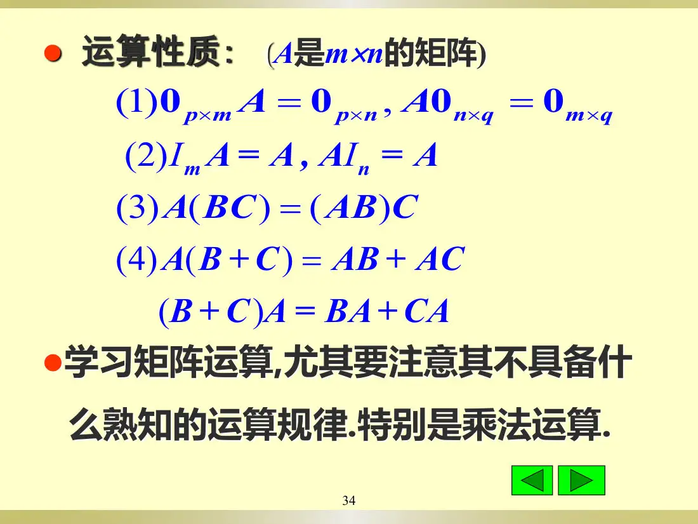

原文：

\- 运算性质: (A是m×n的矩阵)

(1) $0_{p\times m}A=0_{p\times n},A0_{n\times q}=0_{m\times q}$

(2) $I_{m}A=A,AI_{n}=A$

(3) $A(BC)=(AB)C$

(4) $A(B+C)=AB+AC$

$$
(B + C) A = B A + C A
$$

\- 学习矩阵运算,尤其要注意其不具备什么熟知的运算规律.特别是乘法运算.

◀

34

### 例1 设

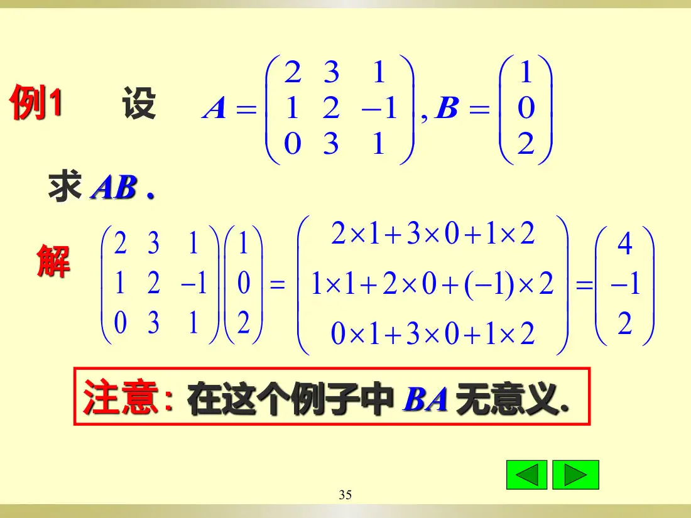

原文：

例1 设

求 $AB$ .

$$
\boldsymbol {A} = \left( \begin{array}{c c c} 2 & 3 & 1 \\ 1 & 2 & - 1 \\ 0 & 3 & 1 \end{array} \right), \boldsymbol {B} = \left( \begin{array}{c} 1 \\ 0 \\ 2 \end{array} \right)
$$

解

$$
\left( \begin{array}{c c c} 2 & 3 & 1 \\ 1 & 2 & - 1 \\ 0 & 3 & 1 \end{array} \right) \left( \begin{array}{c} 1 \\ 0 \\ 2 \end{array} \right) = \left( \begin{array}{c} 2 \times 1 + 3 \times 0 + 1 \times 2 \\ 1 \times 1 + 2 \times 0 + (- 1) \times 2 \\ 0 \times 1 + 3 \times 0 + 1 \times 2 \end{array} \right) = \left( \begin{array}{c} 4 \\ - 1 \\ 2 \end{array} \right)
$$

注意: 在这个例子中 $BA$ 无意义.

35

◀ ▶

### 例2

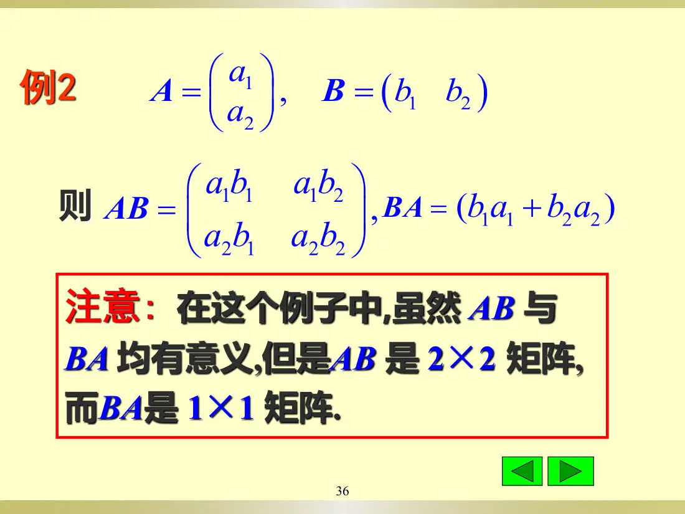

原文：

例2

$$
\boldsymbol {A} = \binom{a _ {1}}{a _ {2}}, \quad \boldsymbol {B} = \left( \begin{array}{c c} b _ {1} & b _ {2} \end{array} \right)
$$

则 $AB = \left( \begin{array}{ll}a_{1}b_{1} & a_{1}b_{2}\\ a_{2}b_{1} & a_{2}b_{2} \end{array} \right),BA = (b_{1}a_{1} + b_{2}a_{2})$

注意: 在这个例子中,虽然 AB 与 BA 均有意义,但是 AB 是 $2 \times 2$ 矩阵,而 BA 是 $1 \times 1$ 矩阵.

36

◀ ▶

### 37

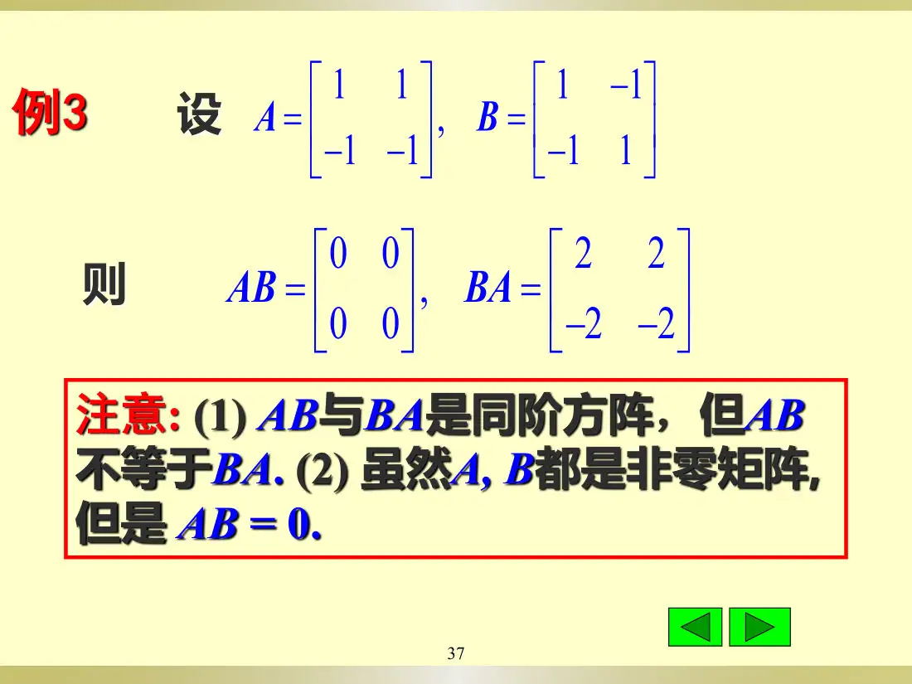

原文：

例3 设 $A = \begin{bmatrix} 1 & 1 \\ -1 & -1 \end{bmatrix}, B = \begin{bmatrix} 1 & -1 \\ -1 & 1 \end{bmatrix}$

则 $AB = \begin{bmatrix} 0 & 0 \\ 0 & 0 \end{bmatrix}, \quad BA = \begin{bmatrix} 2 & 2 \\ -2 & -2 \end{bmatrix}$

注意: (1) AB与BA是同阶方阵, 但AB不等于BA. (2) 虽然A, B都是非零矩阵,但是AB = 0.

37

◀ ▶

### $$

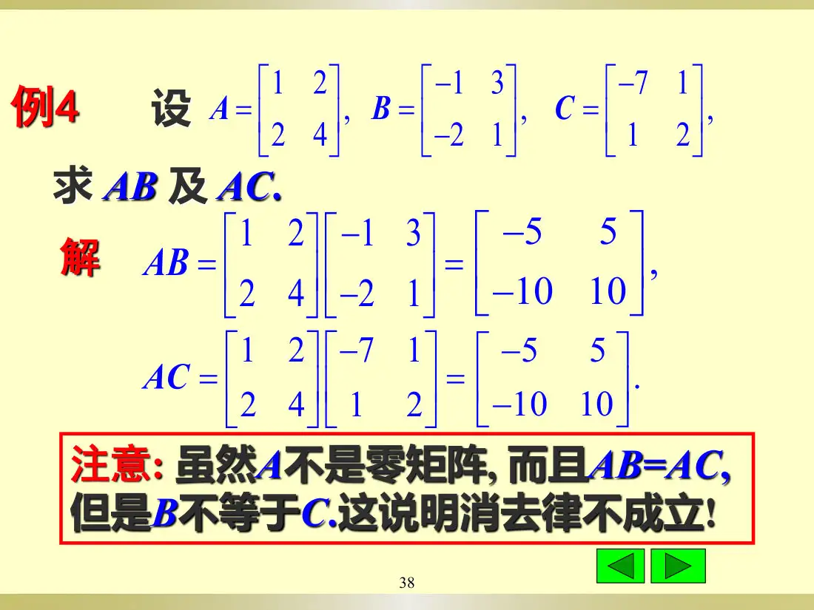

原文：

例4 设 $A=\begin{bmatrix}1 & 2 \\ 2 & 4\end{bmatrix}$ ， $B=\begin{bmatrix}-1 & 3 \\ -2 & 1\end{bmatrix}$ ， $C=\begin{bmatrix}-7 & 1 \\ 1 & 2\end{bmatrix}$ ，求 AB 及 AC.

解 $AB = \begin{bmatrix} 1 & 2 \\ 2 & 4 \end{bmatrix} \begin{bmatrix} -1 & 3 \\ -2 & 1 \end{bmatrix} = \begin{bmatrix} -5 & 5 \\ -10 & 10 \end{bmatrix},$

$$
\boldsymbol {A} \boldsymbol {C} = \left[ \begin{array}{l l} 1 & 2 \\ 2 & 4 \end{array} \right] \left[ \begin{array}{l l} - 7 & 1 \\ 1 & 2 \end{array} \right] = \left[ \begin{array}{l l} - 5 & 5 \\ - 1 0 & 1 0 \end{array} \right].
$$

注意: 虽然A不是零矩阵, 而且AB=AC, 但是B不等于C.这说明消去律不成立!

38

◀ ▶

### 总结一下矩阵乘法的一些反常性质：

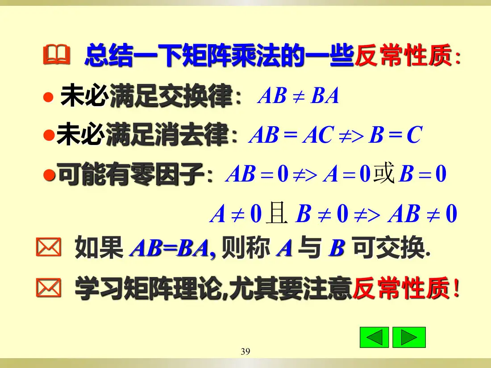

原文：

总结一下矩阵乘法的一些反常性质：

\- 未必满足交换律: $AB \neq BA$

\- 未必满足消去律: $AB = AC \neq > B = C$

\- 可能有零因子: $AB = 0 \neq > A = 0$ 或 $B = 0$

$A \neq 0$ 且 $B \neq 0 \neq > AB \neq 0$

如果 AB=BA，则称 A 与 B 可交换。

学习矩阵理论,尤其要注意反常性质!

39

◀ ▶

### 矩阵理论引言

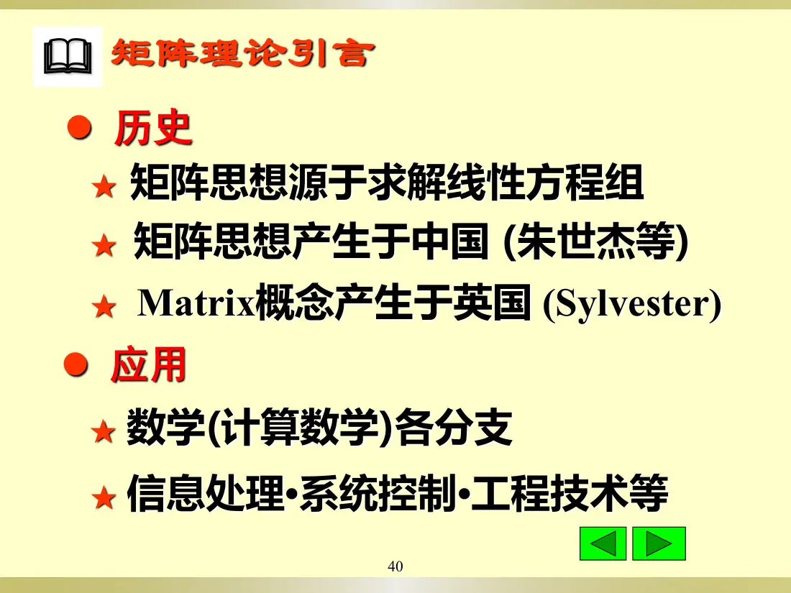

原文：

矩阵理论引言

- 历史

★ 矩阵思想源于求解线性方程组

★ 矩阵思想产生于中国 (朱世杰等)

★ Matrix概念产生于英国 (Sylvester)

应用

数学(计算数学)各分支

★ 信息处理·系统控制·工程技术等

40

◀ ▶
