# 《线性代数与空间解析几何》第四章 n维向量（4.1-4.2 线性相关）课件

原件的每一页，下面附识别出的文字。

### 《线性代数与空间解析几何》

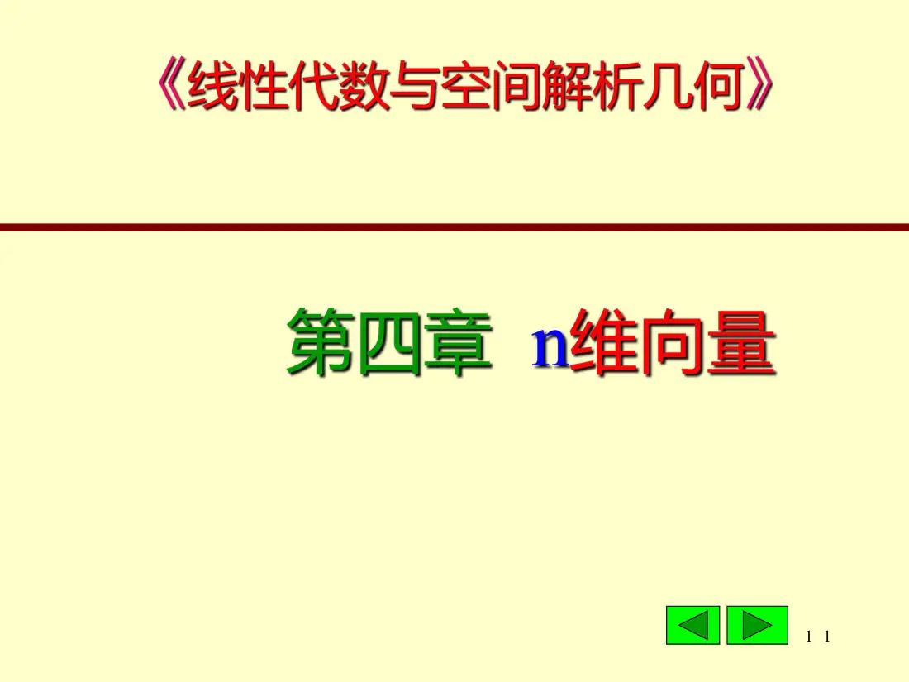

原文：

《线性代数与空间解析几何》

第四章 n维向量

◀ ▶

1 1

### 引言

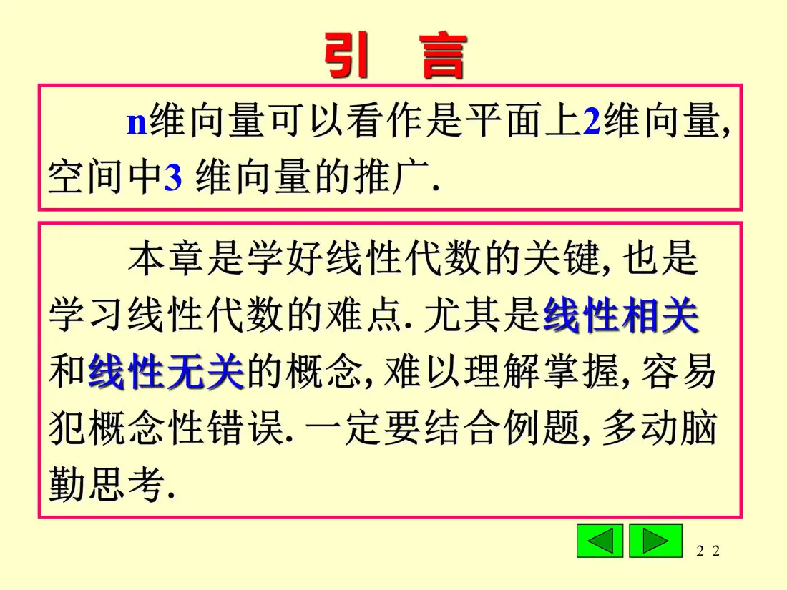

原文：

引言

n维向量可以看作是平面上2维向量,空间中3维向量的推广.

本章是学好线性代数的关键, 也是学习线性代数的难点. 尤其是线性相关和线性无关的概念, 难以理解掌握, 容易犯概念性错误. 一定要结合例题, 多动脑勤思考.

◀ ▶

2 2

### 对于三元一次方程组

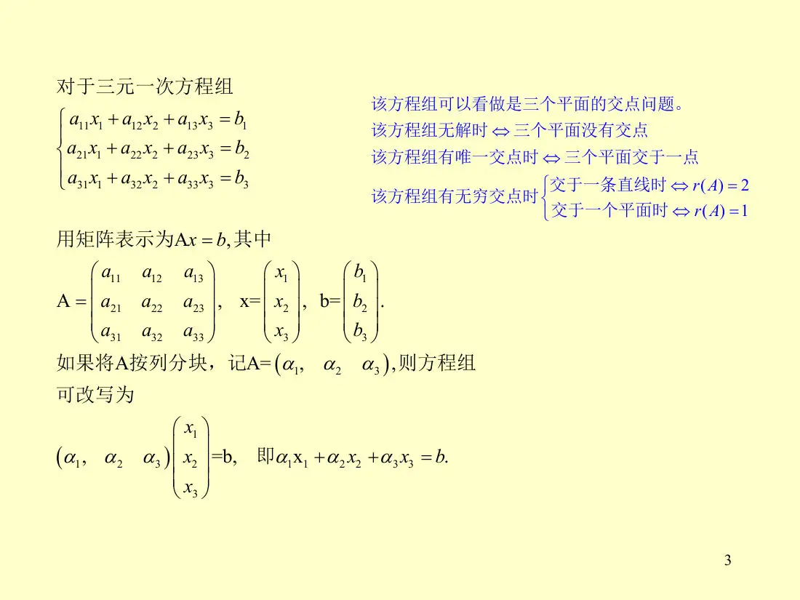

原文：

对于三元一次方程组

$$
\left\{ \begin{array}{l} a _ {1 1} x _ {1} + a _ {1 2} x _ {2} + a _ {1 3} x _ {3} = b _ {1} \\ a _ {2 1} x _ {1} + a _ {2 2} x _ {2} + a _ {2 3} x _ {3} = b _ {2} \\ a _ {3 1} x _ {1} + a _ {3 2} x _ {2} + a _ {3 3} x _ {3} = b _ {3} \end{array} \right.
$$

该方程组可以看做是三个平面的交点问题。

该方程组无解时 $\Leftrightarrow$ 三个平面没有交点

该方程组有无穷交点时 $\left\{ \begin{array}{l} \text{交于一条直线时} \Leftrightarrow r(A) = 2 \\ \text{交于一个平面时} \Leftrightarrow r(A) = 1 \end{array} \right.$

用矩阵表示为Ax=b,其中

该方程组有唯一交点时 $\Leftrightarrow$ 三个平面交于一点

$$
\mathrm{A} = \left( \begin{array}{c c c} a _ {1 1} & a _ {1 2} & a _ {1 3} \\ a _ {2 1} & a _ {2 2} & a _ {2 3} \\ a _ {3 1} & a _ {3 2} & a _ {3 3} \end{array} \right), \quad \mathrm{x} = \left( \begin{array}{c} x _ {1} \\ x _ {2} \\ x _ {3} \end{array} \right), \quad \mathrm{b} = \left( \begin{array}{c} b _ {1} \\ b _ {2} \\ b _ {3} \end{array} \right).
$$

如果将A按列分块，记 $A=\left(\alpha_{1},\quad\alpha_{2}\quad\alpha_{3}\right)$ ，则方程组可改写为

$$
\left( \begin{array}{l l l} \alpha_ {1}, & \alpha_ {2} & \alpha_ {3} \end{array} \right) \left( \begin{array}{l} x _ {1} \\ x _ {2} \\ x _ {3} \end{array} \right) = b, \quad \text {即} \alpha_ {1} x _ {1} + \alpha_ {2} x _ {2} + \alpha_ {3} x _ {3} = b.
$$

3

### 本章的主要内容

原文：

本章的主要内容

■ n维向量的概念及线性运算

向量组的线性关系\*

向量组的极大无关组与秩

向量空间

◀ ▶

4 4

### 三维向量空间

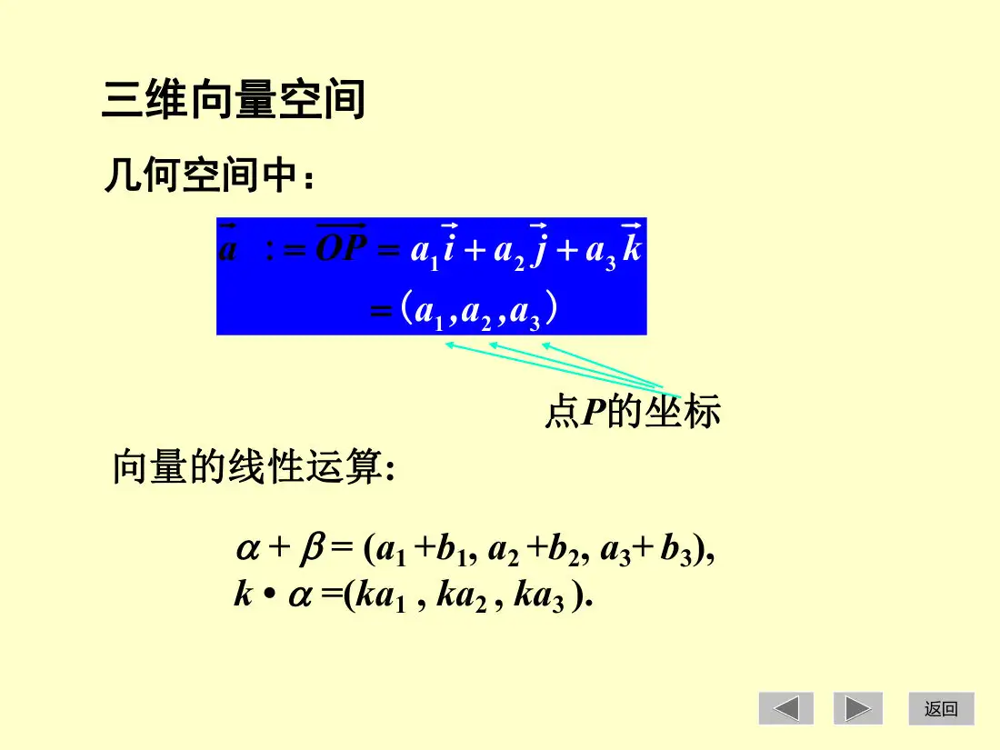

原文：

三维向量空间

几何空间中：

$$
\begin{array}{r l} \overrightarrow {a} & := \overrightarrow {O P} = a _ {1} \overrightarrow {i} + a _ {2} \overrightarrow {j} + a _ {3} \overrightarrow {k} \\ & = (a _ {1}, a _ {2}, a _ {3}) \end{array}
$$

点 $P$ 的坐标

向量的线性运算:

$$
\begin{array}{l} \alpha + \beta = (a _ {1} + b _ {1}, a _ {2} + b _ {2}, a _ {3} + b _ {3}), \\ k \cdot \alpha = (k a _ {1}, k a _ {2}, k a _ {3}). \end{array}
$$

◀ △

返回

### 4.1 n维向量的概念及其线性运算 4.1.1 n维向量的定义

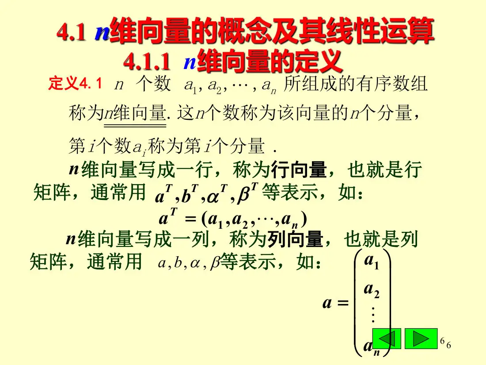

原文：

4.1 n维向量的概念及其线性运算 4.1.1 n维向量的定义

定义4.1 n 个数 $a_{1}, a_{2}, \cdots, a_{n}$ 所组成的有序数组称为n维向量。这n个数称为该向量的n个分量，第i个数 $a_{i}$ 称为第i个分量。

n维向量写成一行，称为行向量，也就是行矩阵，通常用 $a^{T}, b^{T}, \alpha^{T}, \beta^{T}$ 等表示，如：

$$
\boldsymbol {a} ^ {T} = \left(a _ {1}, a _ {2}, \dots , a _ {n}\right)
$$

n维向量写成一列，称为列向量，也就是列

矩阵，通常用 $a, b, \alpha, \beta$ 等表示，如：

$$
a = \left( \begin{array}{c} a _ {1} \\ a _ {2} \\ \vdots \\ a _ {n} \end{array} \right) \quad 6 _ {6}
$$

### 注意

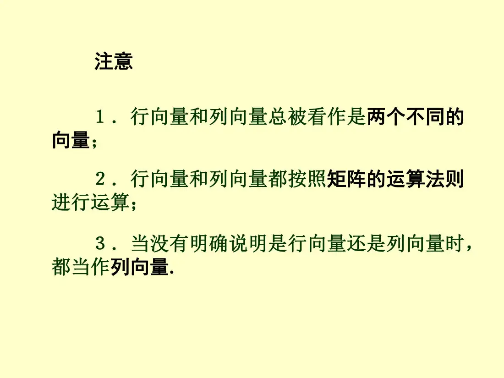

原文：

注意

1. 行向量和列向量总被看作是两个不同的向量;

2．行向量和列向量都按照矩阵的运算法则进行运算；

3. 当没有明确说明是行向量还是列向量时,都当作列向量.

### $$

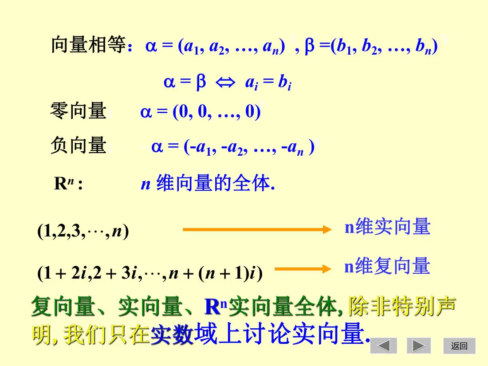

原文：

向量相等： $\alpha=(a_{1},a_{2},\ldots,a_{n})^{\mathrm{T}},\beta=(b_{1},b_{2},\ldots,b_{n})$

$$
\alpha = \beta \iff a _ {i} = b _ {i}
$$

零向量： $\alpha = (0,0,\dots ,0)$

负向量： $\alpha = (-a_{1}, - a_{2},\dots , - a_{n})$

$R^{n}$ : n 维向量的全体.

$$
(1, 2, 3, \dots , n)
$$

n维实向量

$$
(1 + 2 i, 2 + 3 i, \dots , n + (n + 1) i)
$$

n维复向量

复向量、实向量、 $\mathbf{R}^{\mathrm{n}}$ 实向量全体, 除非特别声明, 我们只在实数域上讨论实向量.

返回

### 9 9

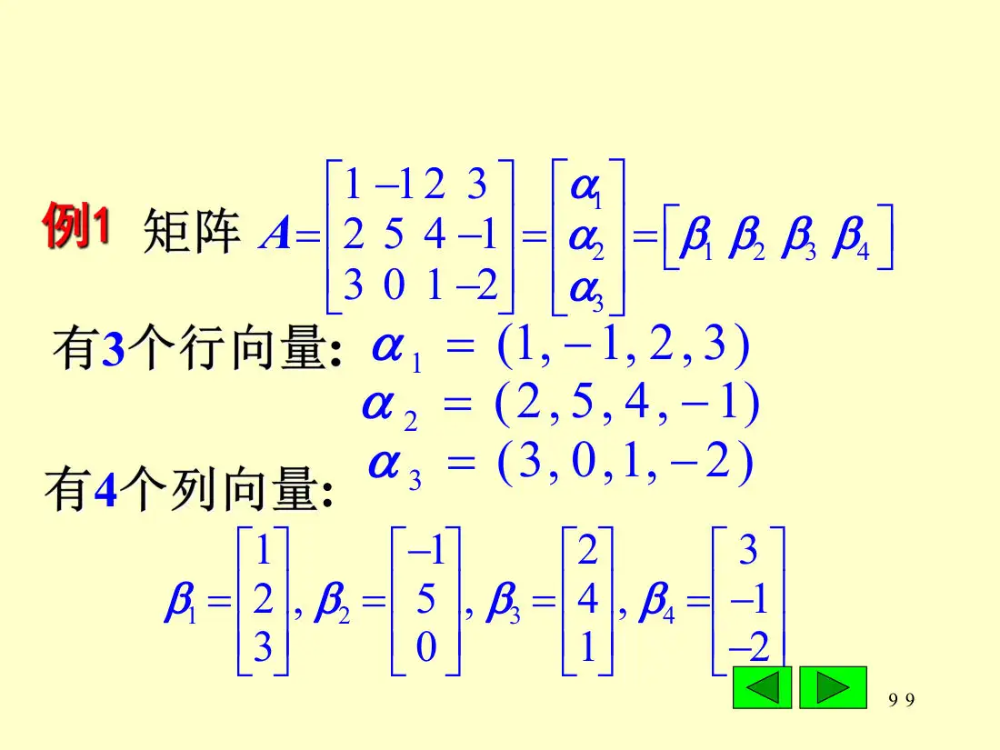

原文：

例1 矩阵 $A=\begin{bmatrix}1-123\\ 254-1\\ 301-2\end{bmatrix}=\begin{bmatrix}\alpha_{1}\\ \alpha_{2}\\ \alpha_{3}\end{bmatrix}=\begin{bmatrix}\beta_{1}\beta_{2}\beta_{3}\beta_{4}\end{bmatrix}$ 有3个行向量： $\alpha_{1}=(1,-1,2,3)$ $\alpha_{2}=(2,5,4,-1)$ 有4个列向量： $\alpha_{3}=(3,0,1,-2)$ $\beta_{1}=\begin{bmatrix}1\\ 2\\ 3\end{bmatrix},\beta_{2}=\begin{bmatrix}-1\\ 5\\ 0\end{bmatrix},\beta_{3}=\begin{bmatrix}2\\ 4\\ 1\end{bmatrix},\beta_{4}=\begin{bmatrix}3\\ -1\\ -2\end{bmatrix}$ 向量可以看作是特殊的矩阵. 从下面关于向量的相等以及向量的线性运算(加法和数乘运算)可以看出向量的线性运算与矩阵相应运算的一致性.

9 9

### 10

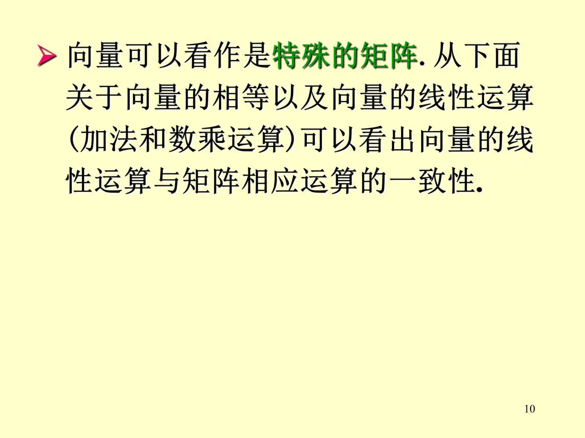

原文：

10

### 4.1.2 n维向量的线性运算

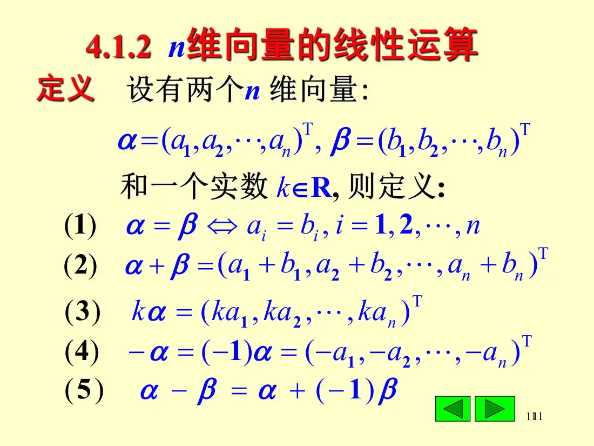

原文：

4.1.2 n维向量的线性运算

定义 设有两个 $n$ 维向量:

$$
\boldsymbol {\alpha} = (a _ {1}, a _ {2}, \dots , a _ {n}) ^ {\mathrm{T}}, \boldsymbol {\beta} = (b _ {1}, b _ {2}, \dots , b _ {n}) ^ {\mathrm{T}}
$$

和一个实数 $k \in \mathbf{R}$ , 则定义:

(1) $\alpha = \beta \Leftrightarrow a_{i} = b_{i}, i = 1, 2, \cdots, n$

(2) $\boldsymbol{\alpha} + \boldsymbol{\beta} = (a_{1} + b_{1}, a_{2} + b_{2}, \cdots, a_{n} + b_{n})^{\mathrm{T}}$

(3) $k\alpha=(ka_{1},ka_{2},\cdots,ka_{n})^{\mathrm{T}}$

(4) $-\alpha=(-1)\alpha=(-a_{1},-a_{2},\cdots,-a_{n})^{\mathrm{T}}$

(5) $\alpha - \beta = \alpha + (-1)\beta$

◀ ▶

1111

### (8) $(k+l)\alpha=k\alpha+l\alpha$ (分配律)

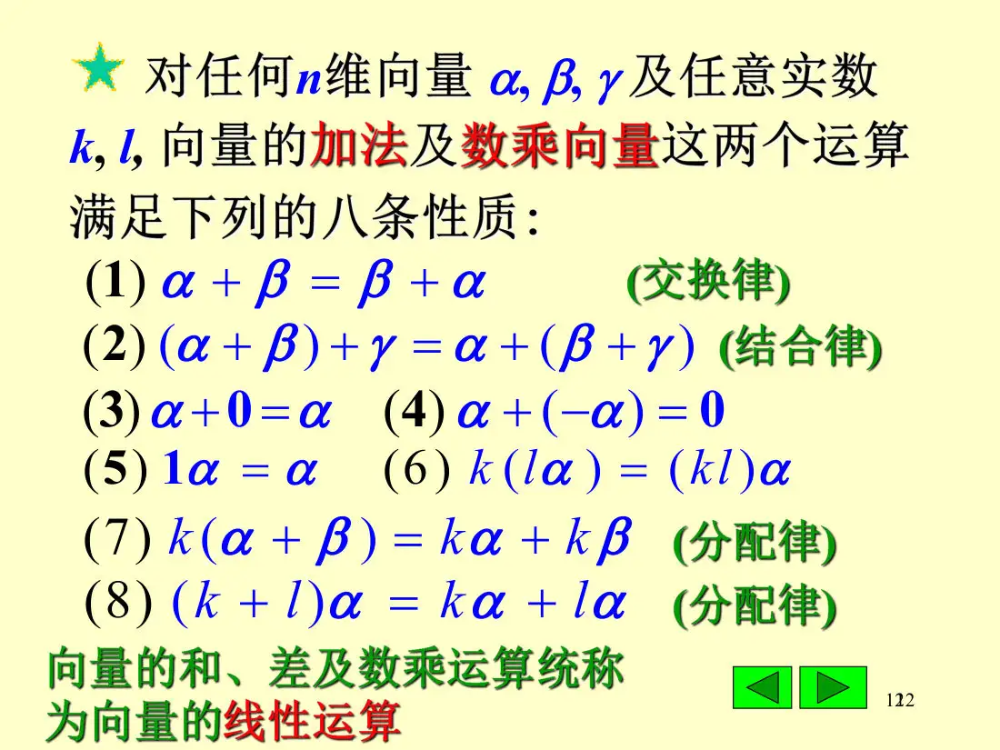

原文：

★ 对任何n维向量 $\alpha, \beta, \gamma$ 及任意实数 k, l, 向量的加法及数乘向量这两个运算满足下列的八条性质:

(1) $\alpha + \beta = \beta + \alpha$ (交换律)

(2) $(\alpha+\beta)+\gamma=\alpha+(\beta+\gamma)$ (结合律)

(3) $\alpha + 0 = \alpha$ (4) $\alpha + (-\alpha) = 0$

(5) $1\alpha = \alpha$ (6) $k(l\alpha) = (kl)\alpha$

(7) $k(\alpha + \beta) = k\alpha + k\beta$ (分配律)

(8) $(k+l)\alpha=k\alpha+l\alpha$ (分配律)

向量的和、差及数乘运算统称为向量的线性运算

◀

122

### 4.1.3 向量空间

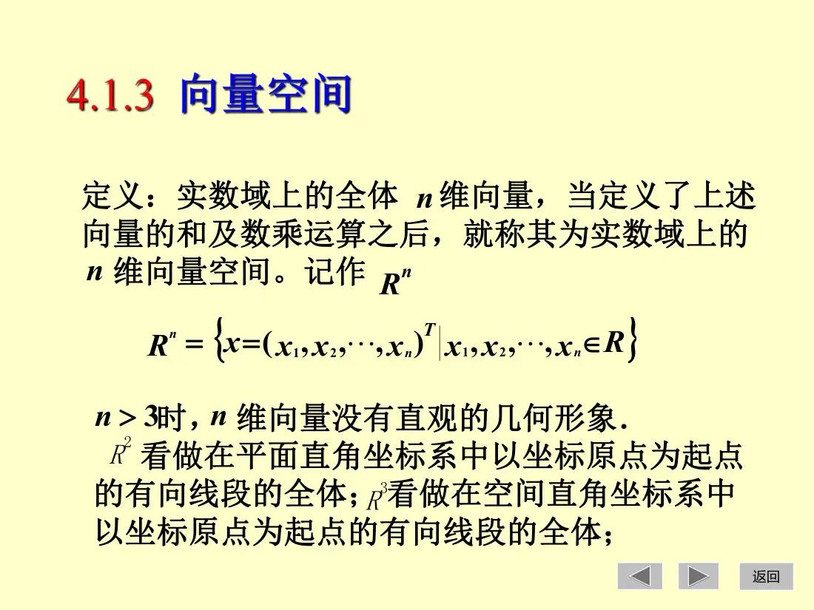

原文：

4.1.3 向量空间

定义: 实数域上的全体 $n$ 维向量, 当定义了上述向量的和及数乘运算之后, 就称其为实数域上的 $n$ 维向量空间。记作 $\mathbf{R}^n$

$$
R ^ {n} = \left\{x = \left(x _ {1}, x _ {2}, \dots , x _ {n}\right) ^ {T} \mid x _ {1}, x _ {2}, \dots , x _ {n} \in R \right\}
$$

$n > 3$ 时， $n$ 维向量没有直观的几何形象.

$R^{2}$ 看做在平面直角坐标系中以坐标原点为起点的有向线段的全体； $R^{3}$ 看做在空间直角坐标系中以坐标原点为起点的有向线段的全体；

返回

### ◀ ▶

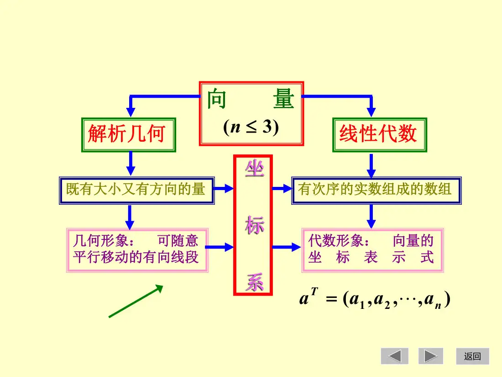

原文：

◀ ▶

返回

### $$

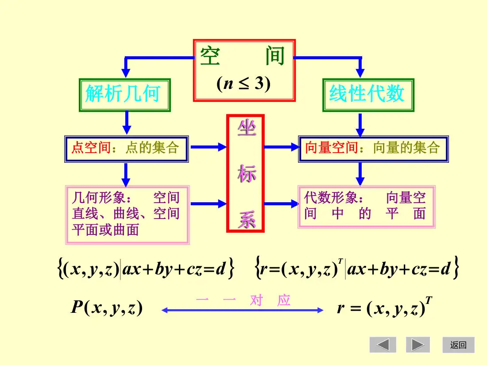

原文：

$$
\{(x, y, z) | a x + b y + c z = d \} \quad \left\{r = (x, y, z) ^ {T} | a x + b y + c z = d \right\}
$$

$$
P (x, y, z) \quad \xleftarrow {\text {一 一 对 应}} r = (x, y, z) ^ {T}
$$

◀ ▶

返回

### n维向量的实际意义

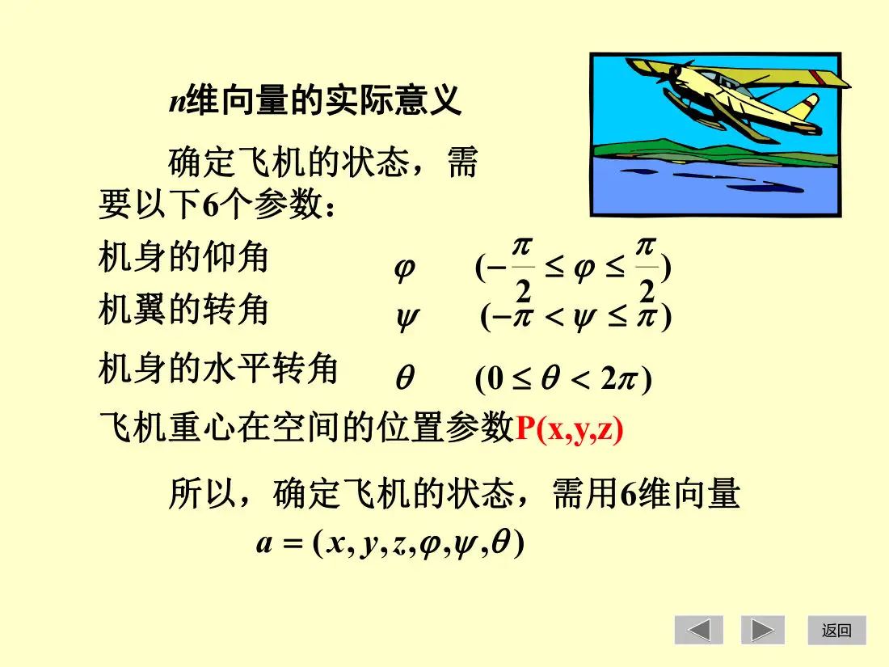

原文：

n维向量的实际意义

确定飞机的状态，需要以下6个参数：

机身的仰角
机翼的转角
机身的水平转角

$$
\begin{array}{l l} \varphi & (- \frac {\pi}{2} \leq \varphi \leq \frac {\pi}{2}) \\ \psi & (- \pi <   \psi \leq \pi) \\ \theta & (0 \leq \theta <   2 \pi) \end{array}
$$

飞机重心在空间的位置参数P(x,y,z)

所以，确定飞机的状态，需用6维向量

$$
a = (x, y, z, \varphi , \psi , \theta)
$$

◀ △

返回

### 若干个同维数的列向量（或同维数的行向量）所组成的集合叫做向量组.

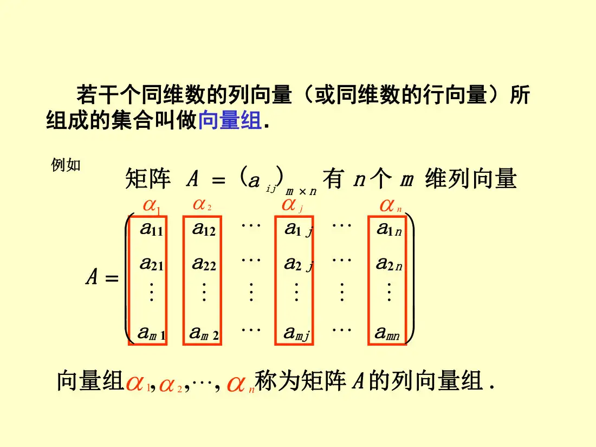

原文：

若干个同维数的列向量（或同维数的行向量）所组成的集合叫做向量组.

例如

矩阵 $A = (a_{ij})_{m \times n}$ 有 $n$ 个 $m$ 维列向量

$$
A = \left( \begin{array}{c c c c c c} \alpha_ {1} & \alpha_ {2} & & \alpha_ {j} & & \alpha_ {n} \\ \hline a _ {1 1} & a _ {1 2} & \dots & a _ {1 j} & \dots & a _ {1 n} \\ a _ {2 1} & a _ {2 2} & \dots & a _ {2 j} & \dots & a _ {2 n} \\ \vdots & \vdots & \vdots & \vdots & \vdots & \vdots \\ a _ {m 1} & a _ {m 2} & \dots & a _ {m j} & \dots & a _ {m n} \end{array} \right)
$$

向量组 $\alpha_{1},\alpha_{2},\cdots,\alpha_{n}$ 称为矩阵A的列向量组.

### $$

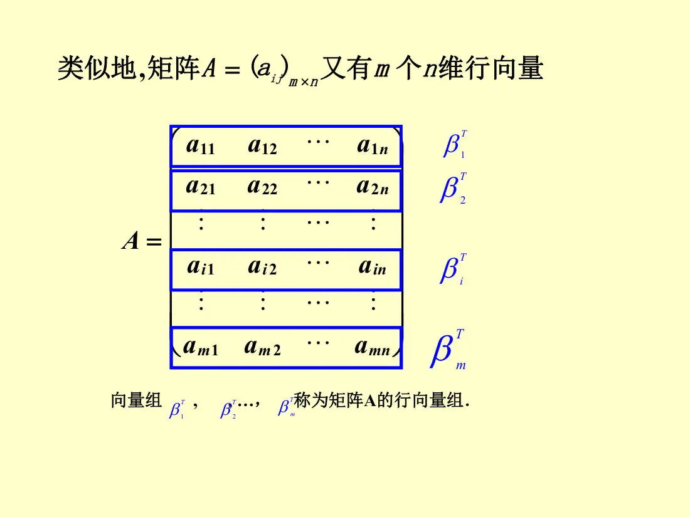

原文：

类似地,矩阵 $A=(a_{ij})_{m\times n}$ 又有m个n维行向量

$$
A = \left[ \begin{array}{c c c c} a _ {1 1} & a _ {1 2} & \dots & a _ {1 n} \\ \hline a _ {2 1} & a _ {2 2} & \dots & a _ {2 n} \\ \hline \vdots & \vdots & \dots & \vdots \\ \hline a _ {i 1} & a _ {i 2} & \dots & a _ {i n} \\ \hline \vdots & \vdots & \dots & \vdots \\ \hline (a _ {m 1} & a _ {m 2} & \dots & a _ {m n}) \end{array} \right] \begin{array}{l} \beta_ {1} ^ {T} \\ \beta_ {2} ^ {T} \\ \beta_ {i} ^ {T} \\ \beta_ {m} ^ {T} \end{array}
$$

向量组 $\beta_{1}^{T}$ ， $\beta_{2}^{T}\cdots$ ， $\beta_{m}^{T}$ 称为矩阵A的行向量组.

### $$

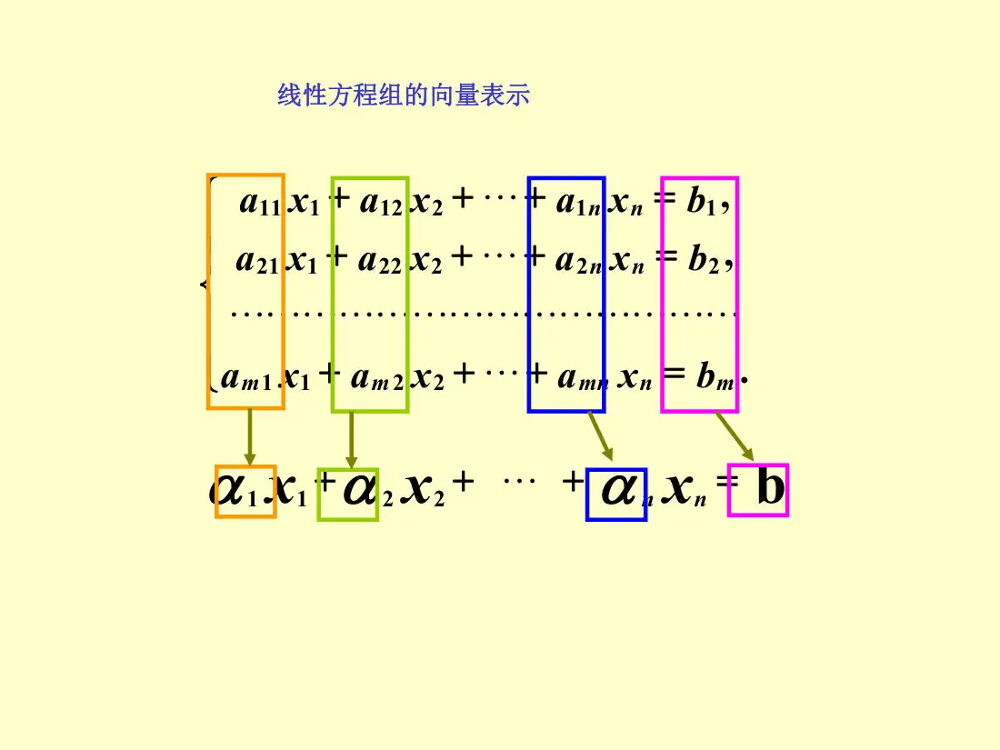

原文：

$$
\left\{ \begin{array}{c} a _ {1 1} x _ {1} + a _ {1 2} x _ {2} + \dots + a _ {1 n} x _ {n} = b _ {1}, \\ a _ {2 1} x _ {1} + a _ {2 2} x _ {2} + \dots + a _ {2 n} x _ {n} = b _ {2}, \\ \dots \dots \\ a _ {m 1} x _ {1} + a _ {m 2} x _ {2} + \dots + a _ {m n} x _ {n} = b _ {m}. \\ \alpha_ {1} x _ {1} + \alpha_ {2} x _ {2} + \dots + \alpha_ {n} x _ {n} = b \end{array} \right.
$$

线性方程组的向量表示

### 4.2 线性相关与线性无关

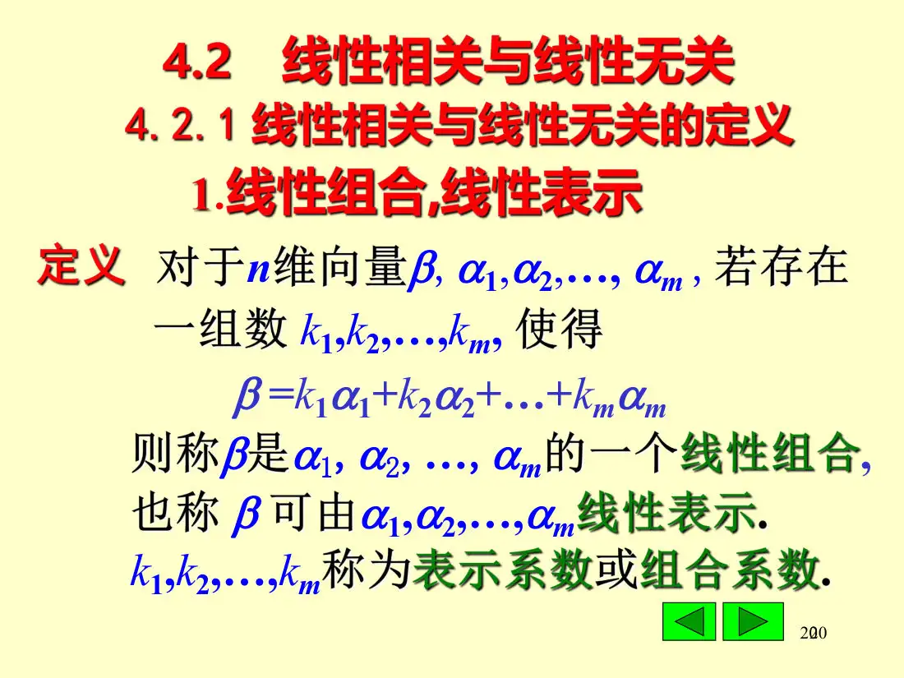

原文：

4.2 线性相关与线性无关

4.2.1 线性相关与线性无关的定义

1. 线性组合, 线性表示

定义 对于 $n$ 维向量 $\beta, \alpha_{1}, \alpha_{2}, \ldots, \alpha_{m}$ , 若存在一组数 $k_{1}, k_{2}, \ldots, k_{m}$ , 使得

$$
\beta = k _ {1} \alpha_ {1} + k _ {2} \alpha_ {2} + \dots + k _ {m} \alpha_ {m}
$$

则称 $\beta$ 是 $\alpha_{1}, \alpha_{2}, \ldots, \alpha_{m}$ 的一个线性组合，也称 $\beta$ 可由 $\alpha_{1}, \alpha_{2}, \ldots, \alpha_{m}$ 线性表示。

$k_{1},k_{2},\ldots,k_{m}$ 称为表示系数或组合系数.

◀ ▶

200

### $$

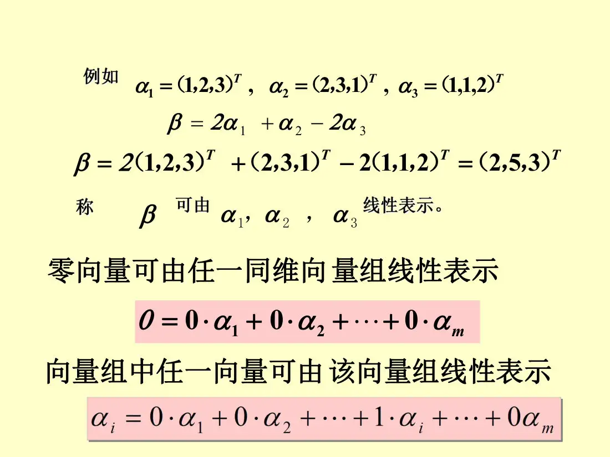

原文：

例如 $\alpha_{1} = (1,2,3)^{T}$ ， $\alpha_{2} = (2,3,1)^{T}$ ， $\alpha_{3} = (1,1,2)^{T}$

$$
\beta = 2 \alpha_ {1} + \alpha_ {2} - 2 \alpha_ {3}
$$

$$
\beta = 2 (1, 2, 3) ^ {T} + (2, 3, 1) ^ {T} - 2 (1, 1, 2) ^ {T} = (2, 5, 3) ^ {T}
$$

称 $\beta$ 可由 $\alpha_{1},\alpha_{2}$ ， $\alpha_{3}$ 线性表示。

零向量可由任一同维向量组线性表示

$$
\boldsymbol {0} = \mathbf {0} \cdot \boldsymbol {\alpha} _ {1} + \mathbf {0} \cdot \boldsymbol {\alpha} _ {2} + \dots + \mathbf {0} \cdot \boldsymbol {\alpha} _ {m}
$$

向量组中任一向量可由该向量组线性表示

$$
\alpha_ {i} = 0 \cdot \alpha_ {1} + 0 \cdot \alpha_ {2} + \dots + 1 \cdot \alpha_ {i} + \dots + 0 \alpha_ {m}
$$

### 解 由观察可知 $\alpha = -\beta + \gamma$ .

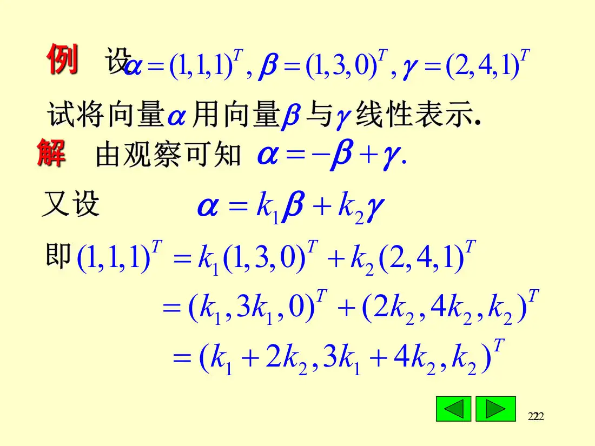

原文：

例 设 $\boldsymbol{\alpha}=(1,1,1)^{T},\boldsymbol{\beta}=(1,3,0)^{T},\boldsymbol{\gamma}=(2,4,1)^{T}$

试将向量 $\alpha$ 用向量 $\beta$ 与 $\gamma$ 线性表示.

解 由观察可知 $\alpha = -\beta + \gamma$ .

又设

$$
\alpha = k _ {1} \beta + k _ {2} \gamma
$$

$$
\begin{array}{r l} \text {即} (1, 1, 1) ^ {T} & = k _ {1} (1, 3, 0) ^ {T} + k _ {2} (2, 4, 1) ^ {T} \\ & = (k _ {1}, 3 k _ {1}, 0) ^ {T} + (2 k _ {2}, 4 k _ {2}, k _ {2}) ^ {T} \\ & = (k _ {1} + 2 k _ {2}, 3 k _ {1} + 4 k _ {2}, k _ {2}) ^ {T} \end{array}
$$

◀ ▶

222

### 按向量相等即有

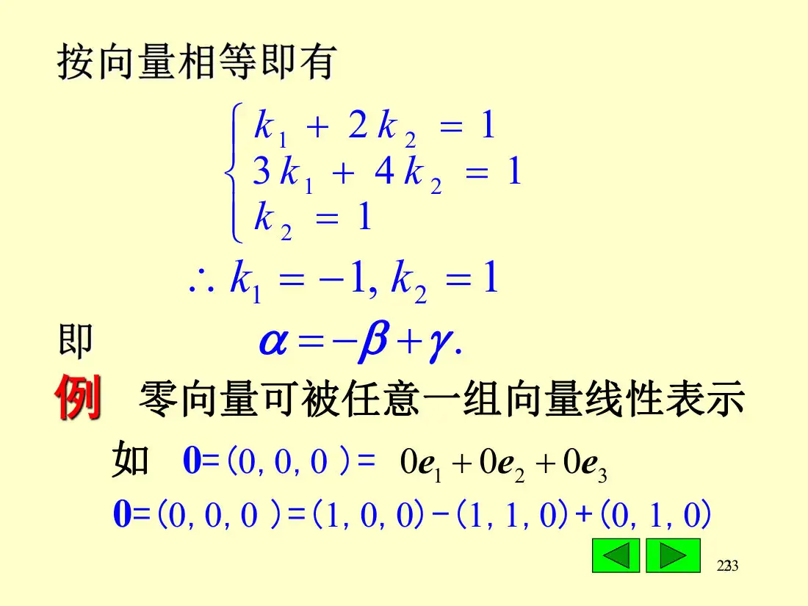

原文：

按向量相等即有

$$
\begin{array}{r l} & {\left\{ \begin{array}{l} k _ {1} + 2 k _ {2} = 1 \\ 3 k _ {1} + 4 k _ {2} = 1 \\ k _ {2} = 1 \end{array} \right.} \\ & {\therefore k _ {1} = - 1, k _ {2} = 1} \\ & {\alpha = - \beta + \gamma .} \end{array}
$$

例 零向量可被任意一组向量线性表示
如 $\mathbf{0}=(0,0,0)=0\mathbf{e}_{1}+0\mathbf{e}_{2}+0\mathbf{e}_{3}$ $\mathbf{0}=(0,0,0)=(1,0,0)-(1,1,0)+(0,1,0)$

◀ ▶

233

### 线性表示？ 线性方程组的向量表示

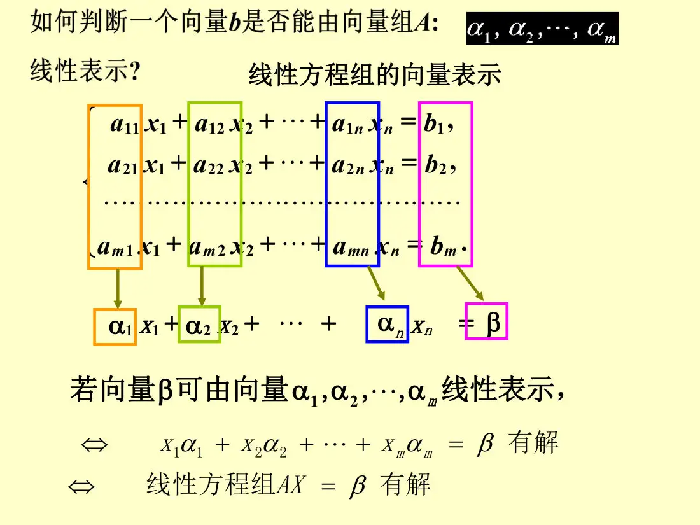

原文：

如何判断一个向量b是否能由向量组A: $\alpha_{1}, \alpha_{2}, \cdots, \alpha_{m}$

线性表示？ 线性方程组的向量表示

$$
\left\{ \begin{array}{c} a _ {1 1} x _ {1} + a _ {1 2} x _ {2} + \dots + a _ {1 n} x _ {n} = b _ {1}, \\ a _ {2 1} x _ {1} + a _ {2 2} x _ {2} + \dots + a _ {2 n} x _ {n} = b _ {2}, \\ \dots \dots \\ a _ {m 1}. x _ {1} + a _ {m 2}. x _ {2} + \dots + a _ {m n}. x _ {n} = b _ {m}. \\ \alpha_ {1} x _ {1} + \alpha_ {2}. x _ {2} + \dots + \alpha_ {n}. x _ {n} = \beta \end{array} \right.
$$

若向量 $\beta$ 可由向量 $\alpha_{1},\alpha_{2},\cdots,\alpha_{m}$ 线性表示，

$\Leftrightarrow x_{1}\alpha_{1} + x_{2}\alpha_{2} + \cdots + x_{m}\alpha_{m} = \beta$ 有解

$\Leftrightarrow$ 线性方程组 $AX = \beta$ 有解

### 例：设

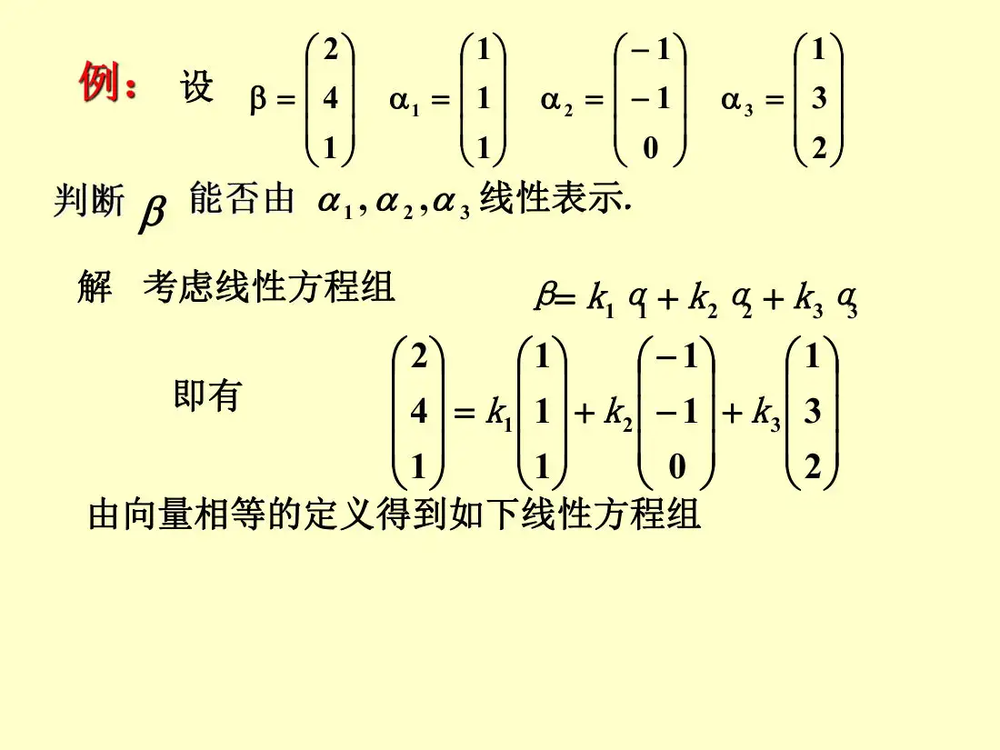

原文：

例：设

$$
\boldsymbol {\beta} = \left( \begin{array}{c} 2 \\ 4 \\ 1 \end{array} \right) \quad \boldsymbol {\alpha} _ {1} = \left( \begin{array}{c} 1 \\ 1 \\ 1 \end{array} \right) \quad \boldsymbol {\alpha} _ {2} = \left( \begin{array}{c} - 1 \\ - 1 \\ 0 \end{array} \right) \quad \boldsymbol {\alpha} _ {3} = \left( \begin{array}{c} 1 \\ 3 \\ 2 \end{array} \right)
$$

判断 $\beta$ 能否由 $\alpha_{1}, \alpha_{2}, \alpha_{3}$ 线性表示.

解 考虑线性方程组

$$
\beta = k _ {1} q + k _ {2} q + k _ {3} q
$$

即有

$$
\left( \begin{array}{c} 2 \\ 4 \\ 1 \end{array} \right) = k _ {1} \left( \begin{array}{c} 1 \\ 1 \\ 1 \end{array} \right) + k _ {2} \left( \begin{array}{c} - 1 \\ - 1 \\ 0 \end{array} \right) + k _ {3} \left( \begin{array}{c} 1 \\ 3 \\ 2 \end{array} \right)
$$

由向量相等的定义得到如下线性方程组

### $$

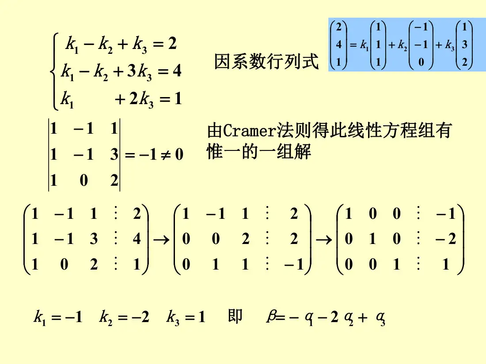

原文：

$$
\left\{ \begin{array}{l} k _ {1} - k _ {2} + k _ {3} = 2 \\ k _ {1} - k _ {2} + 3 k _ {3} = 4 \\ k _ {1} \qquad + 2 k _ {3} = 1 \end{array} \right.
$$

因系数行列式

$$
\left( \begin{array}{c} 2 \\ 4 \\ 1 \end{array} \right) = k _ {1} \left( \begin{array}{c} 1 \\ 1 \\ 1 \end{array} \right) + k _ {2} \left( \begin{array}{c} - 1 \\ - 1 \\ 0 \end{array} \right) + k _ {3} \left( \begin{array}{c} 1 \\ 3 \\ 2 \end{array} \right)
$$

$$
\left| \begin{array}{c c c} 1 & - 1 & 1 \\ 1 & - 1 & 3 \\ 1 & 0 & 2 \end{array} \right| = - 1 \neq 0
$$

由Cramer法则得此线性方程组有惟一的一组解

$$
\left(\begin{array}{c c c c c}1&- 1&1&\vdots&2\\1&- 1&3&\vdots&4\\1&0&2&\vdots&1\end{array}\right)\rightarrow \left(\begin{array}{c c c c c}1&- 1&1&\vdots&2\\0&0&2&\vdots&2\\0&1&1&\vdots&- 1\end{array}\right)\rightarrow \left(\begin{array}{c c c c c}1&0&0&\vdots&- 1\\0&1&0&\vdots&- 2\\0&0&1&\vdots&1\end{array}\right)
$$

$$
k _ {1} = - 1 \quad k _ {2} = - 2 \quad k _ {3} = 1 \quad \text {即} \quad \beta = - q - 2 q + a _ {3}
$$

### 例 n 维向量组

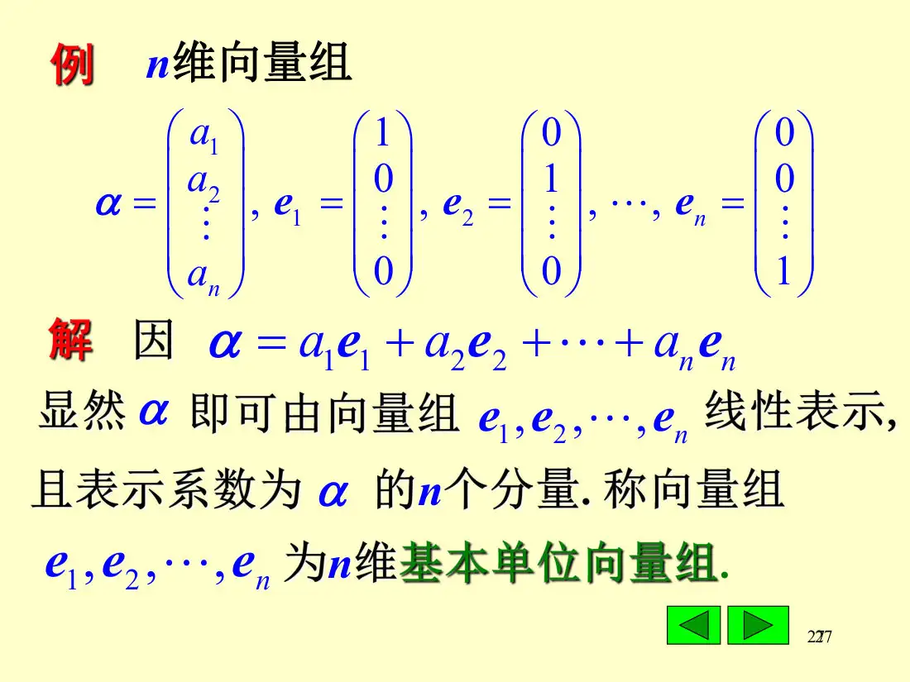

原文：

例 n 维向量组

$$
\boldsymbol {\alpha} = \left( \begin{array}{c} a _ {1} \\ a _ {2} \\ \vdots \\ a _ {n} \end{array} \right), \boldsymbol {e} _ {1} = \left( \begin{array}{c} 1 \\ 0 \\ \vdots \\ 0 \end{array} \right), \boldsymbol {e} _ {2} = \left( \begin{array}{c} 0 \\ 1 \\ \vdots \\ 0 \end{array} \right), \dots , \boldsymbol {e} _ {n} = \left( \begin{array}{c} 0 \\ 0 \\ \vdots \\ 1 \end{array} \right)
$$

解 因 $\alpha = a_{1}e_{1} + a_{2}e_{2} + \cdots + a_{n}e_{n}$ 显然 $\alpha$ 即可由向量组 $e_{1}, e_{2}, \cdots, e_{n}$ 线性表示，
且表示系数为 $\alpha$ 的 n 个分量. 称向量组 $e_{1}, e_{2}, \cdots, e_{n}$ 为 n 维基本单位向量组.

◀ ▶

227

### 以 $n$ 维基本单位向量组为列向量构成单位矩阵。

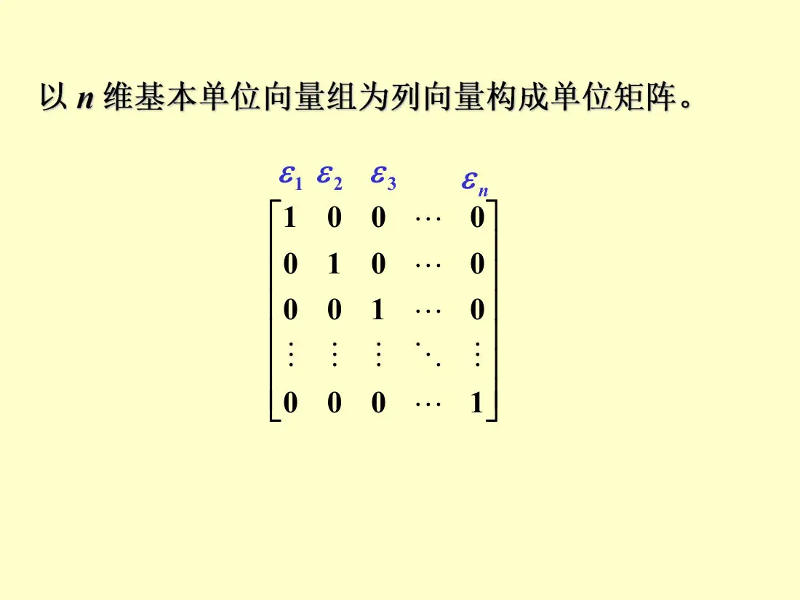

原文：

以 $n$ 维基本单位向量组为列向量构成单位矩阵。

$$
\left[ \begin{array}{l l l l l} \varepsilon_ {1} & \varepsilon_ {2} & \varepsilon_ {3} & & \varepsilon_ {n} \\ 1 & 0 & 0 & \dots & 0 \\ 0 & 1 & 0 & \dots & 0 \\ 0 & 0 & 1 & \dots & 0 \\ \vdots & \vdots & \vdots & \ddots & \vdots \\ 0 & 0 & 0 & \dots & 1 \end{array} \right]
$$

### $$

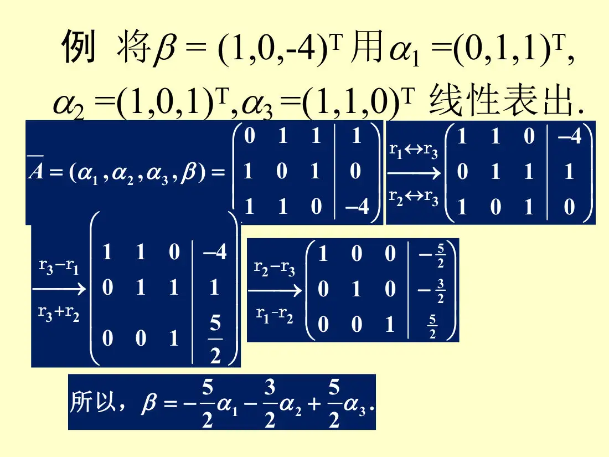

原文：

例 将 $\beta=(1,0,-4)^{\mathrm{T}}$ 用 $\alpha_{1}=(0,1,1)^{\mathrm{T}}$ , $\alpha_{2}=(1,0,1)^{\mathrm{T}},\alpha_{3}=(1,1,0)^{\mathrm{T}}$ 线性表出.

$$
\begin{array}{l} \overline {{A}} = (\alpha_ {1}, \alpha_ {2}, \alpha_ {3}, \beta) = \left( \begin{array}{c c c c} 0 & 1 & 1 & 1 \\ 1 & 0 & 1 & 0 \\ 1 & 1 & 0 & - 4 \end{array} \right) \xrightarrow [ r _ {2} \leftrightarrow r _ {3} ]{r _ {1} \leftrightarrow r _ {3}} \left( \begin{array}{c c c c} 1 & 1 & 0 & - 4 \\ 0 & 1 & 1 & 1 \\ 1 & 0 & 1 & 0 \end{array} \right) \\ \xrightarrow [ r _ {3} + r _ {2} ]{r _ {3} - r _ {1}} \left( \begin{array}{c c c c} 1 & 1 & 0 & - 4 \\ 0 & 1 & 1 & 1 \\ 0 & 0 & 1 & \frac {5}{2} \end{array} \right) \xrightarrow [ r _ {1} - r _ {2} ]{r _ {2} - r _ {3}} \left( \begin{array}{c c c c} 1 & 0 & 0 & - \frac {5}{2} \\ 0 & 1 & 0 & - \frac {3}{2} \\ 0 & 0 & 1 & \frac {5}{2} \end{array} \right) \end{array}
$$

所以， $\beta = -\frac{5}{2}\alpha_{1} - \frac{3}{2}\alpha_{2} + \frac{5}{2}\alpha_{3}$ .

### 例：设

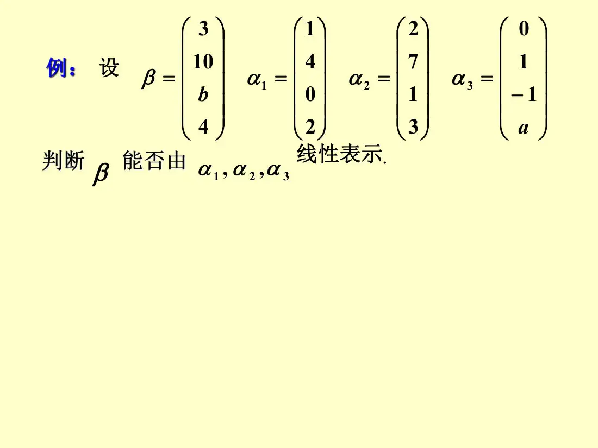

原文：

例：设

$$
\boldsymbol {\beta} = \left( \begin{array}{c} 3 \\ 1 0 \\ b \\ 4 \end{array} \right) \quad \alpha_ {1} = \left( \begin{array}{c} 1 \\ 4 \\ 0 \\ 2 \end{array} \right) \quad \alpha_ {2} = \left( \begin{array}{c} 2 \\ 7 \\ 1 \\ 3 \end{array} \right) \quad \alpha_ {3} = \left( \begin{array}{c} 0 \\ 1 \\ - 1 \\ a \end{array} \right)
$$

判断 $\beta$ 能否由 $\alpha_{1}, \alpha_{2}, \alpha_{3}$ 线性表示.

### 2. 线性相关,线性无关

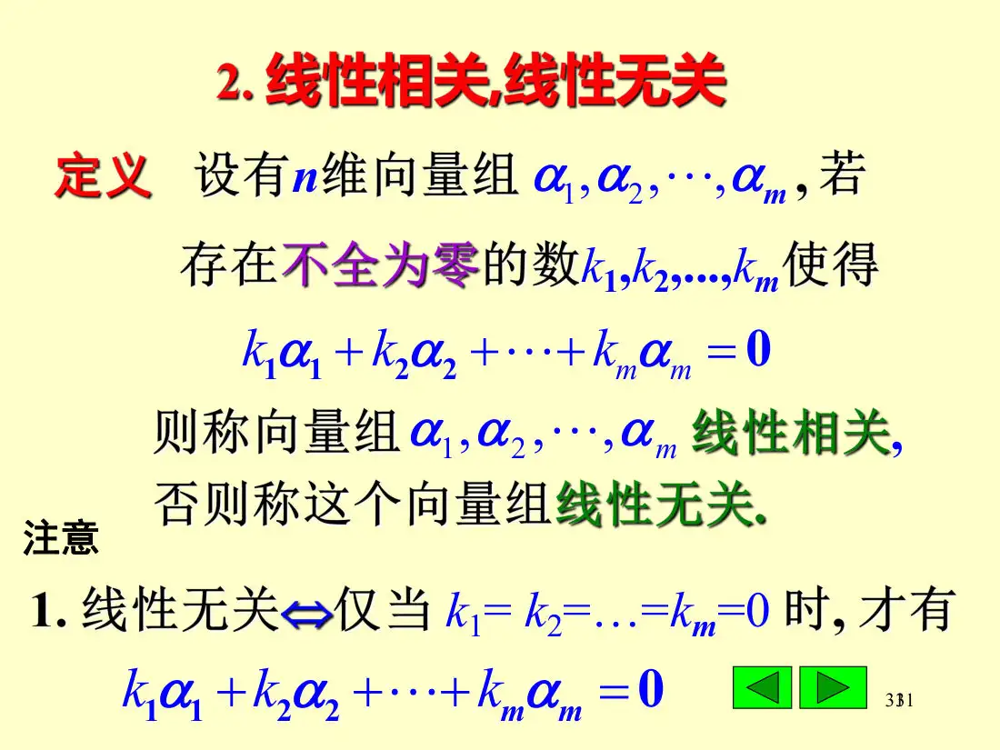

原文：

2. 线性相关,线性无关

定义 设有n维向量组 $\alpha_{1},\alpha_{2},\cdots,\alpha_{m}$ ，若

存在不全为零的数 $k_{1},k_{2},\ldots,k_{m}$ 使得

$k_{1}\alpha_{1}+k_{2}\alpha_{2}+\cdots+k_{m}\alpha_{m}=0$ 则称向量组 $\alpha_{1}, \alpha_{2}, \cdots, \alpha_{m}$ 线性相关，
否则称这个向量组线性无关.

注意

1. 线性无关 $\Leftrightarrow$ 仅当 $k_{1} = k_{2} = \ldots = k_{m} = 0$ 时, 才有

$$
k _ {1} \alpha_ {1} + k _ {2} \alpha_ {2} + \dots + k _ {m} \alpha_ {m} = 0
$$

331

### 注：

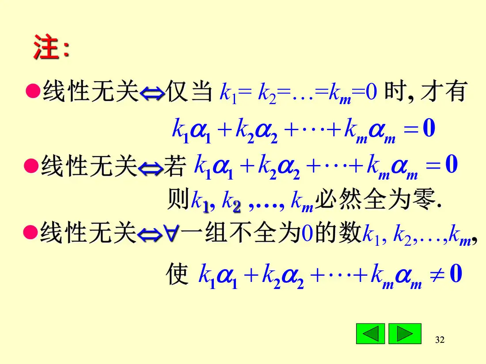

原文：

注：

线性无关 $\Leftrightarrow$ 仅当 $k_{1} = k_{2} = \ldots = k_{m} = 0$ 时, 才有

$$
k _ {1} \alpha_ {1} + k _ {2} \alpha_ {2} + \dots + k _ {m} \alpha_ {m} = 0
$$

线性无关 $\Leftrightarrow$ 若 $k_{1}\alpha_{1} + k_{2}\alpha_{2} + \dots +k_{m}\alpha_{m} = 0$

则 $k_{1}, k_{2}, \ldots, k_{m}$ 必然全为零.

线性无关 $\Leftrightarrow \forall$ 一组不全为0的数 $k_{1}, k_{2}, \ldots, k_{m}$ ,

使 $k_{1}\alpha_{1} + k_{2}\alpha_{2} + \cdots + k_{m}\alpha_{m} \neq 0$

◀

32

### 2. 对于任一向量组, 不是线性无关就是线性相关.

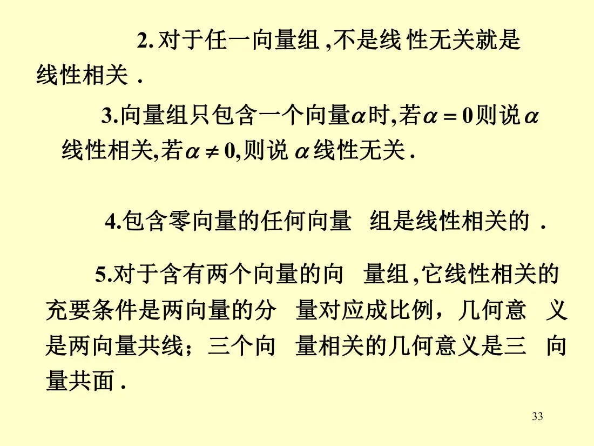

原文：

2. 对于任一向量组, 不是线性无关就是线性相关.

3. 向量组只包含一个向量 $\alpha$ 时, 若 $\alpha = 0$ 则说 $\alpha$ 线性相关, 若 $\alpha \neq 0$ , 则说 $\alpha$ 线性无关.

4. 包含零向量的任何向量 组是线性相关的。

5.对于含有两个向量的向量组,它线性相关的充要条件是两向量的分量对应成比例,几何意义是两向量共线;三个向量相关的几何意义是三向量共面.

33

### $\mathbf{R}^{3}$ 中线性相关的 几何解释

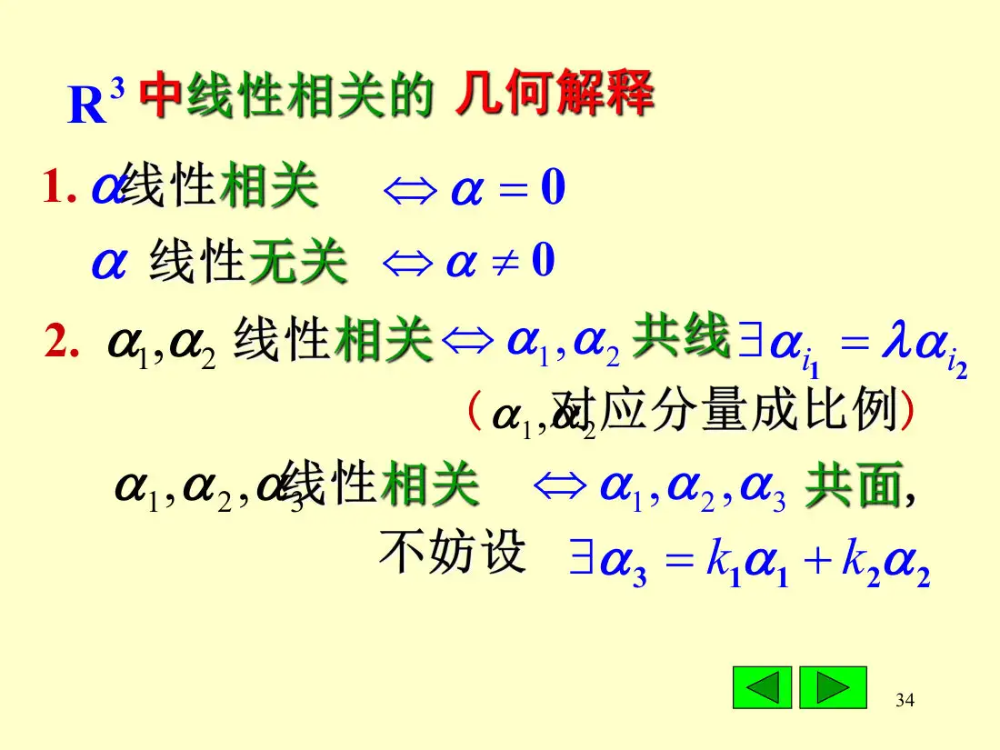

原文：

$\mathbf{R}^{3}$ 中线性相关的 几何解释

1. $\alpha$ 线性相关 $\Leftrightarrow \alpha = 0$

α 线性无关 $\Leftrightarrow \alpha \neq 0$

2. $\alpha_{1},\alpha_{2}$ 线性相关 $\Leftrightarrow \alpha_{1},\alpha_{2}$ 共线 $\exists \alpha_{i_1} = \lambda \alpha_{i_2}$ （ $\alpha_{1},\alpha_{2}$ 对应分量成比例） $\alpha_{1},\alpha_{2},\alpha_{3}$ 线性相关 $\Leftrightarrow \alpha_{1},\alpha_{2},\alpha_{3}$ 共面，不妨设 $\exists \alpha_{3} = k_{1}\alpha_{1} + k_{2}\alpha_{2}$

◀

34

### $$

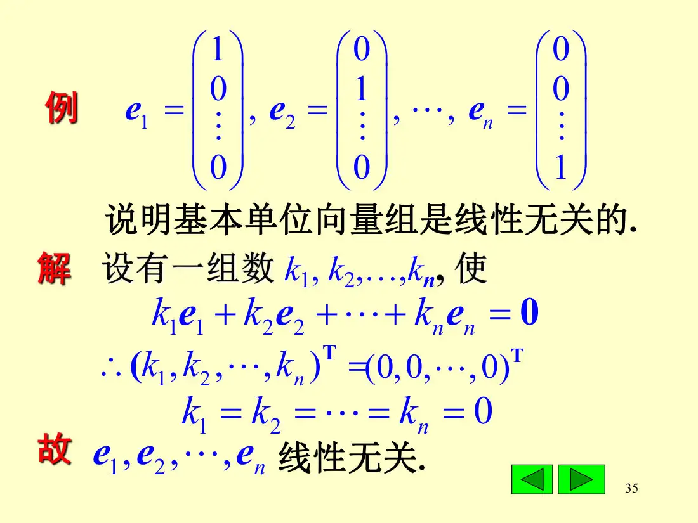

原文：

例

$$
\boldsymbol {e} _ {1} = \left( \begin{array}{c} 1 \\ 0 \\ \vdots \\ 0 \end{array} \right), \boldsymbol {e} _ {2} = \left( \begin{array}{c} 0 \\ 1 \\ \vdots \\ 0 \end{array} \right), \dots , \boldsymbol {e} _ {n} = \left( \begin{array}{c} 0 \\ 0 \\ \vdots \\ 1 \end{array} \right)
$$

说明基本单位向量组是线性无关的.

解 设有一组数 $k_{1}, k_{2}, \ldots, k_{n}$ , 使

$$
k _ {1} \boldsymbol {e} _ {1} + k _ {2} \boldsymbol {e} _ {2} + \dots + k _ {n} \boldsymbol {e} _ {n} = \mathbf {0}
$$

$$
\therefore (k _ {1}, k _ {2}, \dots , k _ {n}) ^ {\mathrm{T}} = (0, 0, \dots , 0) ^ {\mathrm{T}}
$$

$$
k _ {1} = k _ {2} = \dots = k _ {n} = 0
$$

故 $e_{1}, e_{2}, \cdots, e_{n}$ 线性无关.

◀ ▶

35

### $$

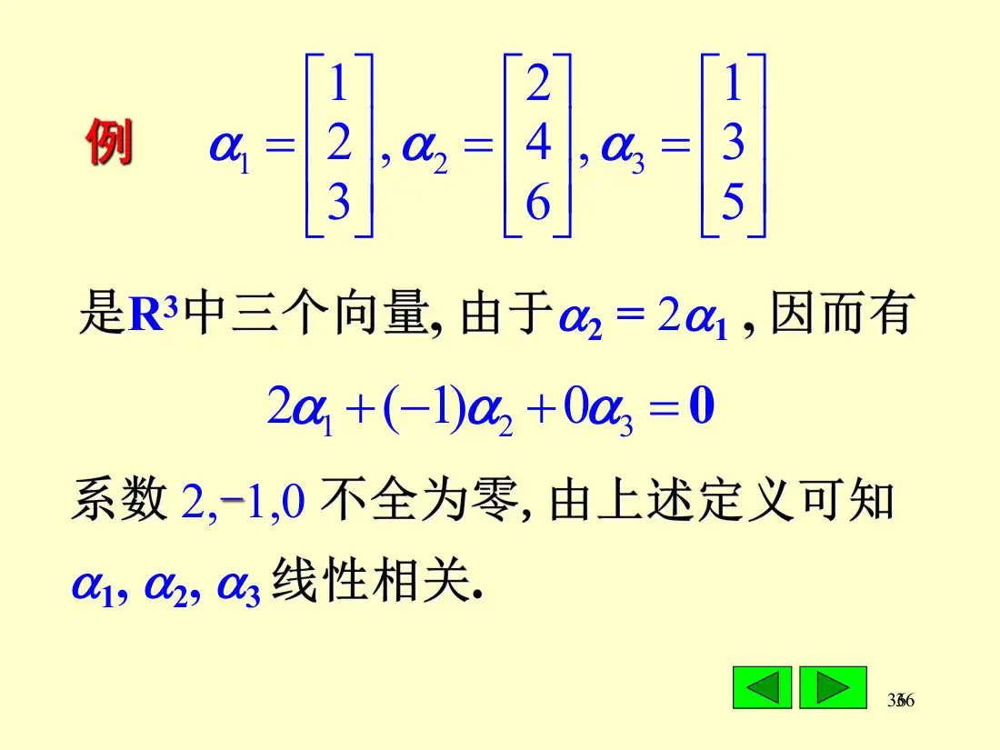

原文：

例

$$
\boldsymbol {\alpha} _ {1} = \left[ \begin{array}{l} 1 \\ 2 \\ 3 \end{array} \right], \boldsymbol {\alpha} _ {2} = \left[ \begin{array}{l} 2 \\ 4 \\ 6 \end{array} \right], \boldsymbol {\alpha} _ {3} = \left[ \begin{array}{l} 1 \\ 3 \\ 5 \end{array} \right]
$$

是 $R^{3}$ 中三个向量, 由于 $\alpha_{2}=2\alpha_{1}$ , 因而有

$$
2 \alpha_ {1} + (- 1) \alpha_ {2} + 0 \alpha_ {3} = 0
$$

系数 2,-1,0 不全为零, 由上述定义可知 $\alpha_{1}, \alpha_{2}, \alpha_{3}$ 线性相关.

◀ ▶

366

### 解设

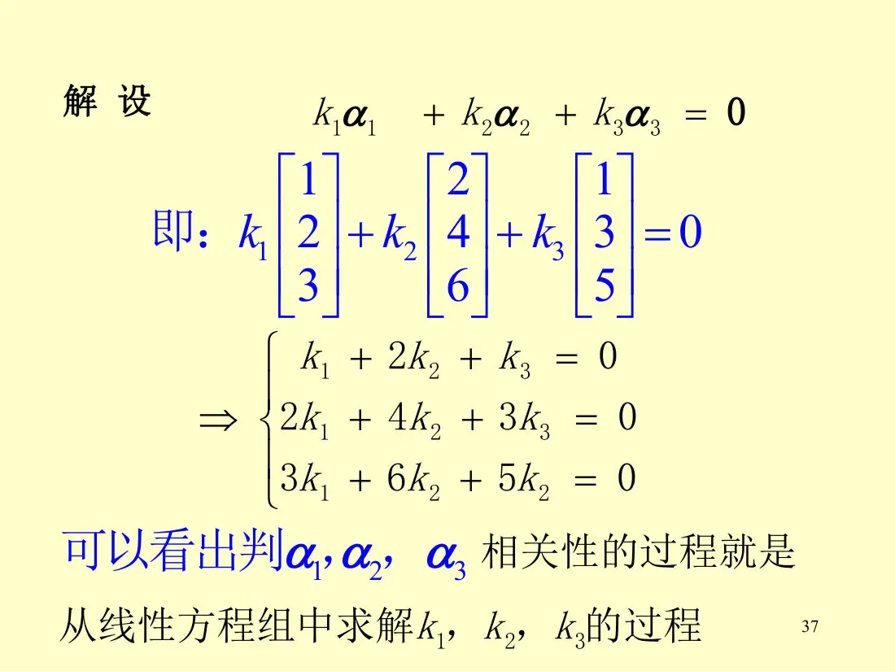

原文：

解设

$$
k _ {1} \pmb {\alpha} _ {1} + k _ {2} \pmb {\alpha} _ {2} + k _ {3} \pmb {\alpha} _ {3} = 0
$$

即:

$$
k _ {1} \left[ \begin{array}{l} 1 \\ 2 \\ 3 \end{array} \right] + k _ {2} \left[ \begin{array}{l} 2 \\ 4 \\ 6 \end{array} \right] + k _ {3} \left[ \begin{array}{l} 1 \\ 3 \\ 5 \end{array} \right] = 0
$$

$$
\Rightarrow \left\{ \begin{array}{l} k _ {1} + 2 k _ {2} + k _ {3} = 0 \\ 2 k _ {1} + 4 k _ {2} + 3 k _ {3} = 0 \\ 3 k _ {1} + 6 k _ {2} + 5 k _ {2} = 0 \end{array} \right.
$$

可以看出判 $\alpha_{1},\alpha_{2},\alpha_{3}$ 相关性的过程就是从线性方程组中求解 $k_{1},k_{2},k_{3}$ 的过程

37

### 线性相关性在线性方程组中的应用——判断线性相关性的等价条件：

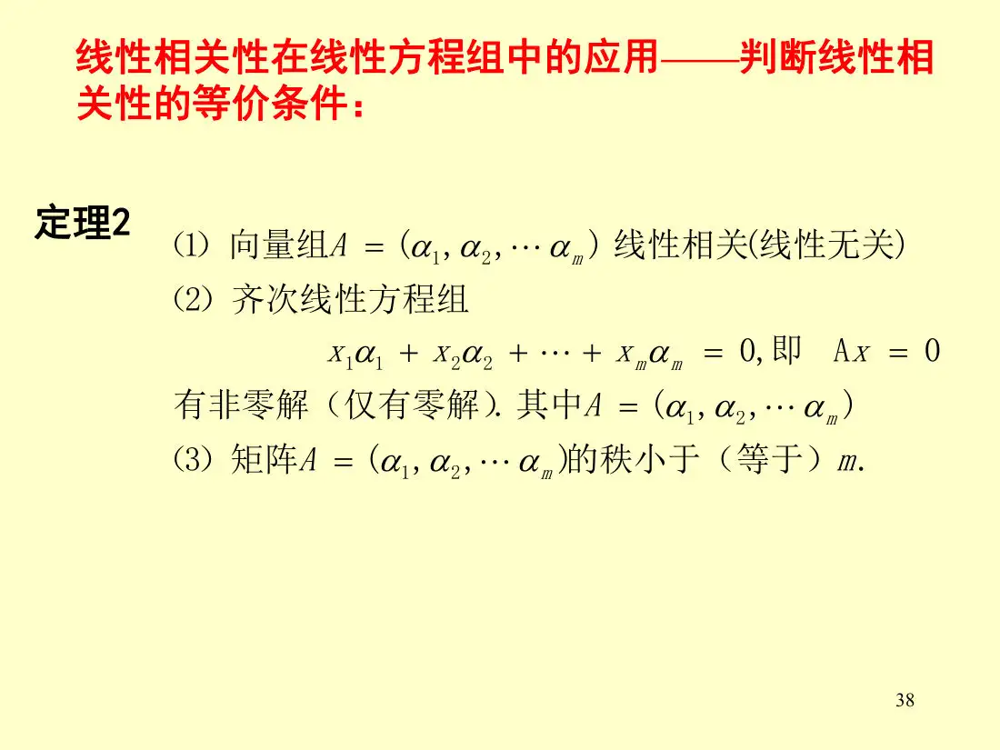

原文：

线性相关性在线性方程组中的应用——判断线性相关性的等价条件：

定理2

(1) 向量组 $A = (\alpha_{1}, \alpha_{2}, \cdots, \alpha_{m})$ 线性相关(线性无关)

(2) 齐次线性方程组

$$
x _ {1} \alpha_ {1} + x _ {2} \alpha_ {2} + \dots + x _ {m} \alpha_ {m} = 0, \text {即} A x = 0
$$

有非零解（仅有零解）. 其中 $A = (\alpha_{1}, \alpha_{2}, \cdots, \alpha_{m})$

(3) 矩阵 $A = (\alpha_{1}, \alpha_{2}, \cdots, \alpha_{m})$ 的秩小于（等于）m.

38

### 即 $A$ 为列满秩.

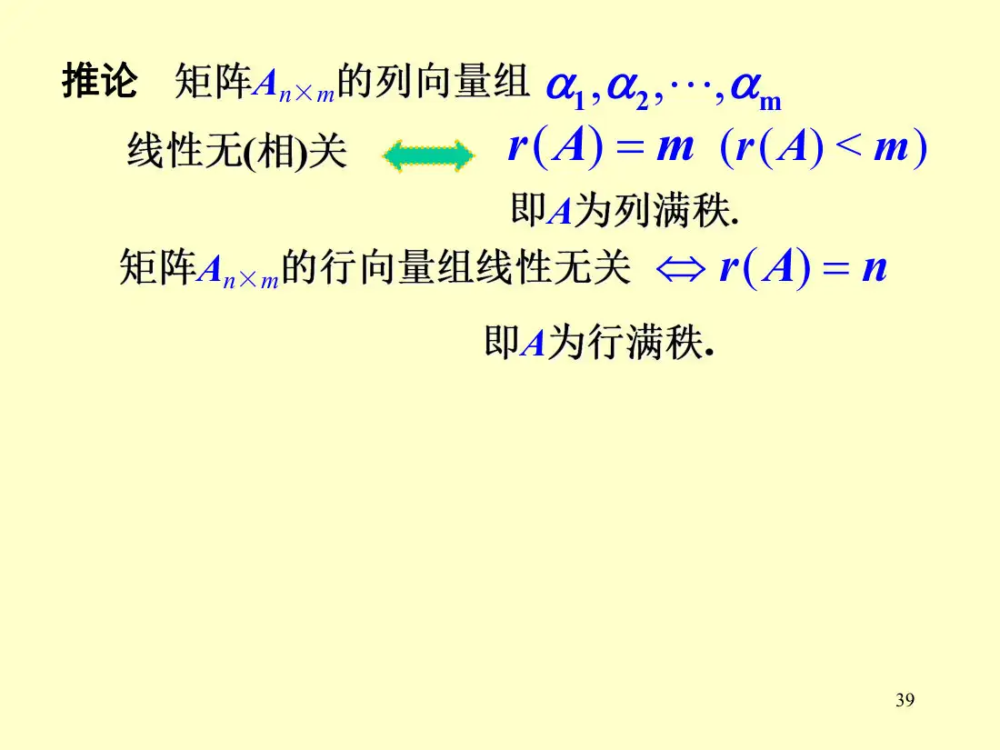

原文：

推论 矩阵 $A_{n\times m}$ 的列向量组 $\alpha_{1},\alpha_{2},\cdots,\alpha_{m}$

线性无(相)关 $\Longleftrightarrow r(A)=m(r(A)<m)$

即 $A$ 为列满秩.

矩阵 $A_{n\times m}$ 的行向量组线性无关 $\Leftrightarrow r(A)=n$

即A为行满秩.

39

### 线性无关性与行列式间的关系

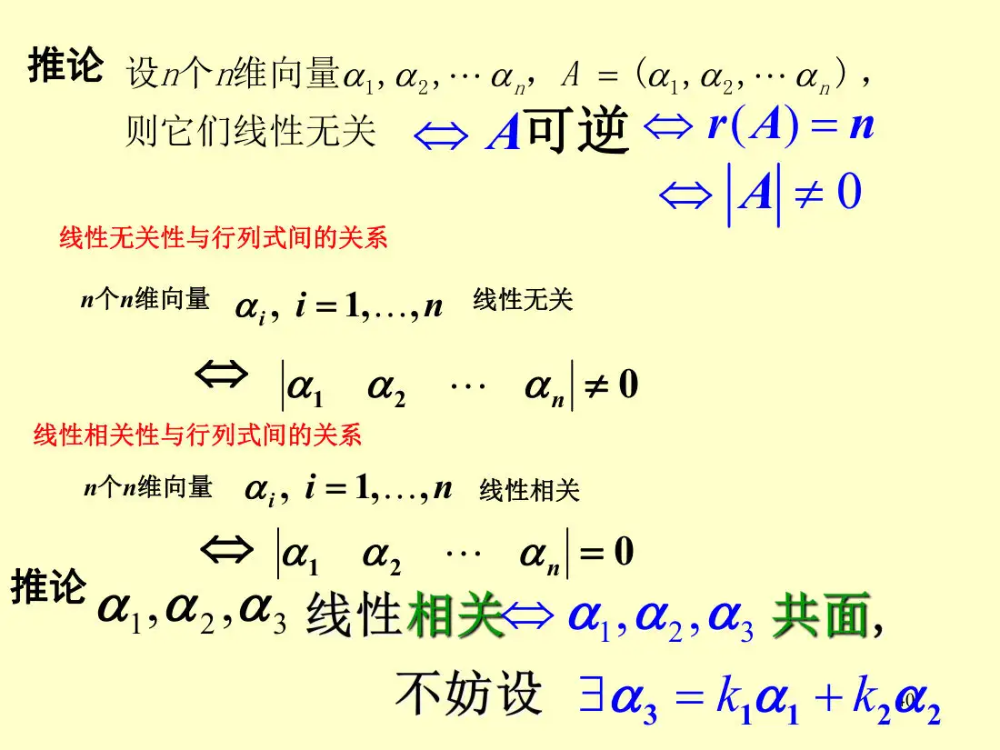

原文：

推论 设n个n维向量 $\alpha_{1},\alpha_{2},\cdots\alpha_{n},\quad A=(\alpha_{1},\alpha_{2},\cdots\alpha_{n})$ ,

则它们线性无关 $\Leftrightarrow A$ 可逆 $\Leftrightarrow r(A) = n$ $\Leftrightarrow |A| \neq 0$

线性无关性与行列式间的关系

$n$ 个 $n$ 维向量 $\alpha_{i}, i = 1, \ldots, n$ 线性无关

$$
\Leftrightarrow \left| \begin{array}{c c c c} \alpha_ {1} & \alpha_ {2} & \dots & \alpha_ {n} \end{array} \right| \neq 0
$$

线性相关性与行列式间的关系

$n$ 个 $n$ 维向量 $\alpha_{i}, i = 1, \ldots, n$ 线性相关

$$
\Leftrightarrow \left| \begin{array}{c c c c} \alpha_ {1} & \alpha_ {2} & \dots & \alpha_ {n} \end{array} \right| = 0
$$

推论 $\alpha_{1},\alpha_{2},\alpha_{3}$ 线性相关 $\Leftrightarrow \alpha_{1},\alpha_{2},\alpha_{3}$ 共面，

不妨设 $\exists\alpha_{3}=k_{1}\alpha_{1}+k_{2}\alpha_{2}$ 推论2 设 $\alpha_{1},\alpha_{2},\cdots,\alpha_{m}$ 为 n 维向量, 若 m>n,
则 $\alpha_{1},\alpha_{2},\cdots,\alpha_{m}$ 线性相关 $\because r(A)\leq n<m$ (向量个数>分量个数)
例7 $\forall n+1$ 个 n 维向量 $\alpha_{1},\alpha_{2},\cdots,\alpha_{n},\alpha_{n+1}$ 线性相关.
证 $A=(\alpha_{1}\alpha_{2}\cdots\alpha_{n}\alpha_{n+1})=A_{n\times(n+1)}$ $r(A)\leq n<n+1$ 所以 $\alpha_{1},\alpha_{2},\cdots,\alpha_{n},\alpha_{n+1}$ 线性相关.
任意无关的n维向量组最多含有n个向量

### 第 41 页

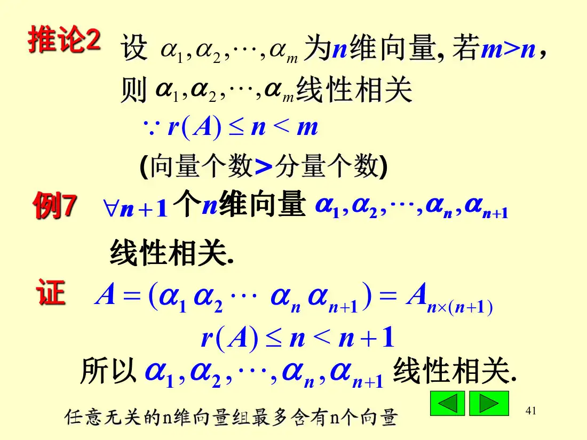

### 例 已知

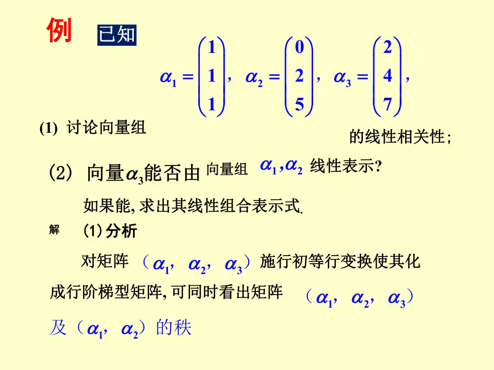

原文：

例 已知

$$
\alpha_ {1} = \left( \begin{array}{c} 1 \\ 1 \\ 1 \end{array} \right), \quad \alpha_ {2} = \left( \begin{array}{c} 0 \\ 2 \\ 5 \end{array} \right), \quad \alpha_ {3} = \left( \begin{array}{c} 2 \\ 4 \\ 7 \end{array} \right),
$$

(1) 讨论向量组

的线性相关性；

(2) 向量 $\alpha_{3}$ 能否由向量组 $\alpha_{1},\alpha_{2}$ 线性表示? 如果能,求出其线性组合表示式.

解 (1) 分析

对矩阵 $(\alpha_{1}, \alpha_{2}, \alpha_{3})$ 施行初等行变换使其化成行阶梯型矩阵, 可同时看出矩阵 $(\alpha_{1}, \alpha_{2}, \alpha_{3})$ 及 $(\alpha_{1}, \alpha_{2})$ 的秩

### $$

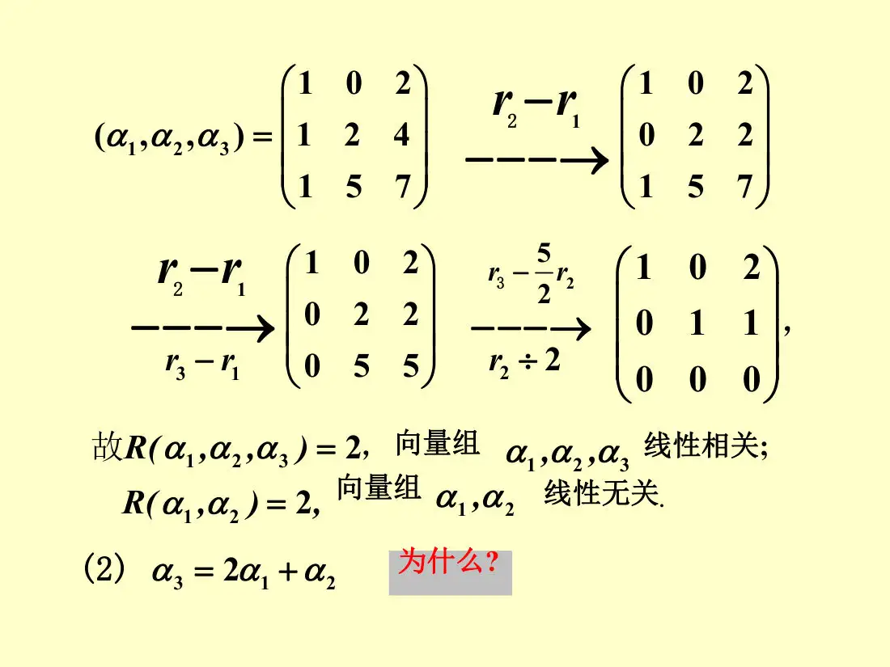

原文：

$$
(\alpha_ {1}, \alpha_ {2}, \alpha_ {3}) = \left( \begin{array}{c c c} 1 & 0 & 2 \\ 1 & 2 & 4 \\ 1 & 5 & 7 \end{array} \right) \quad \xrightarrow {r _ {2} - r _ {1}} \left( \begin{array}{c c c} 1 & 0 & 2 \\ 0 & 2 & 2 \\ 1 & 5 & 7 \end{array} \right)
$$

$$
\xrightarrow [ r _ {3} - r _ {1} ]{r _ {2} - r _ {1}} \left( \begin{array}{c c c} 1 & 0 & 2 \\ 0 & 2 & 2 \\ 0 & 5 & 5 \end{array} \right) \quad \xrightarrow [ r _ {2} \div 2 ]{r _ {3} - \frac {5}{2} r _ {2}} \left( \begin{array}{c c c} 1 & 0 & 2 \\ 0 & 1 & 1 \\ 0 & 0 & 0 \end{array} \right),
$$

故 $R(\alpha_{1},\alpha_{2},\alpha_{3})=2$ ，向量组 $\alpha_{1},\alpha_{2},\alpha_{3}$ 线性相关； $R(\alpha_{1},\alpha_{2})=2,$ 向量组 $\alpha_{1},\alpha_{2}$ 线性无关.

(2) $\alpha_{3} = 2\alpha_{1} + \alpha_{2}$

为什么？

### 解1

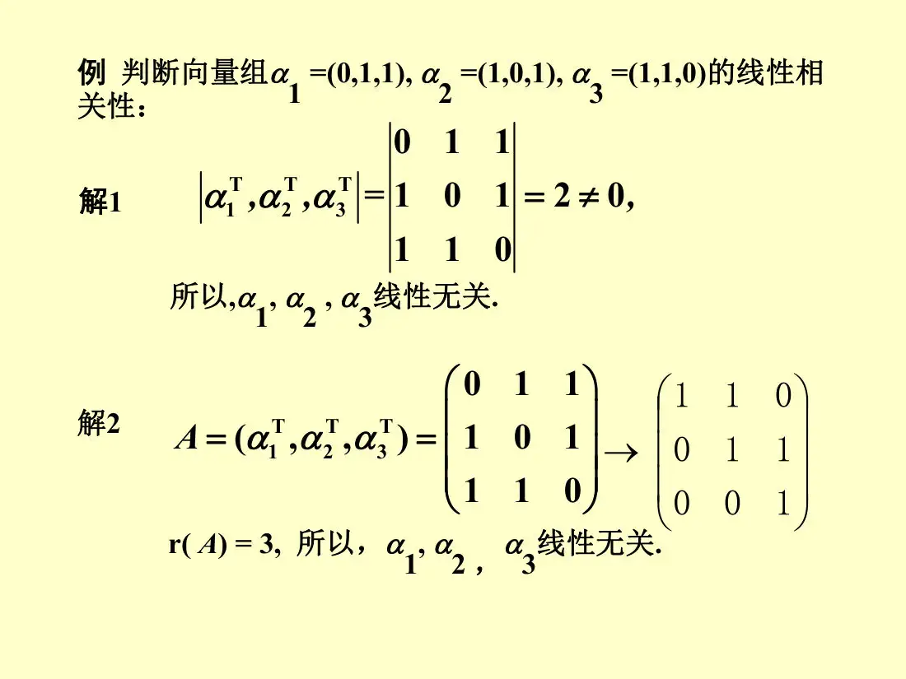

原文：

例 判断向量组 $\alpha_{1}=(0,1,1)$ , $\alpha_{2}=(1,0,1)$ , $\alpha_{3}=(1,1,0)$ 的线性相关性:

解1

$$
\left| \alpha_ {1} ^ {\mathrm{T}}, \alpha_ {2} ^ {\mathrm{T}}, \alpha_ {3} ^ {\mathrm{T}} \right| = \left| \begin{array}{c c c} 0 & 1 & 1 \\ 1 & 0 & 1 \\ 1 & 1 & 0 \end{array} \right| = 2 \neq 0,
$$

所以, $\alpha_{1},\alpha_{2},\alpha_{3}$ 线性无关.

解2

$$
\boldsymbol {A} = (\boldsymbol {\alpha} _ {1} ^ {\mathrm{T}}, \boldsymbol {\alpha} _ {2} ^ {\mathrm{T}}, \boldsymbol {\alpha} _ {3} ^ {\mathrm{T}}) = \left(\begin{array}{c c c}\mathbf {0}&\mathbf {1}&\mathbf {1}\\\mathbf {1}&\mathbf {0}&\mathbf {1}\\\mathbf {1}&\mathbf {1}&\mathbf {0}\end{array}\right)\rightarrow \left(\begin{array}{c c c}1&1&0\\0&1&1\\0&0&1\end{array}\right)
$$

$\mathbf{r}(A) = 3$ ，所以， $\alpha_{1},\alpha_{2},\alpha_{3}$ 线性无关.

### 例 判别 $\mathbf{R}^{3}$ 中向量组

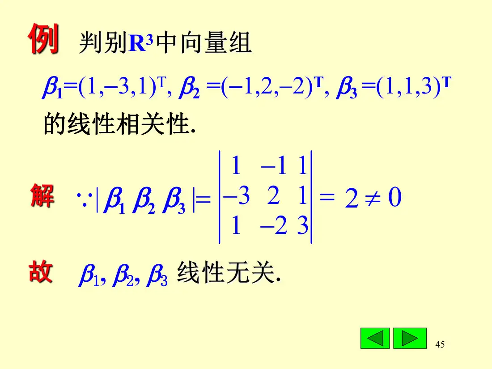

原文：

例 判别 $\mathbf{R}^{3}$ 中向量组

$\beta_{1} = (1, - 3,1)^{\mathrm{T}},\beta_{2} = (-1,2, - 2)^{\mathrm{T}},\beta_{3} = (1,1,3)^{\mathrm{T}}$ 的线性相关性.

解 $\because|\beta_{1}\beta_{2}\beta_{3}|=\begin{vmatrix}1&-1&1\\-3&2&1\\1&-2&3\end{vmatrix}=2\neq0$

故 $\beta_{1}, \beta_{2}, \beta_{3}$ 线性无关.

◀ ▶

45

### 例 判别向量组的线性相关性

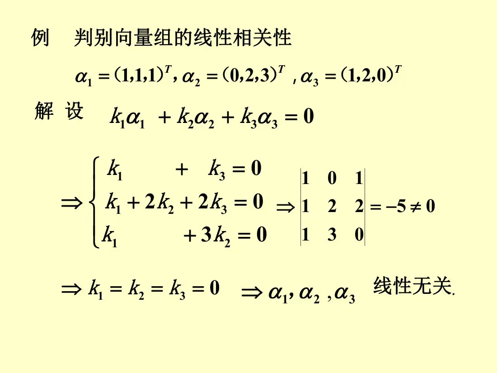

原文：

例 判别向量组的线性相关性

$$
\alpha_ {1} = (1, 1, 1) ^ {T}, \alpha_ {2} = (0, 2, 3) ^ {T}, \alpha_ {3} = (1, 2, 0) ^ {T}
$$

解设 $k_{1}\alpha_{1} + k_{2}\alpha_{2} + k_{3}\alpha_{3} = 0$

$$
\Rightarrow \left\{ \begin{array}{l l} k _ {1} + k _ {3} = 0 \\ k _ {1} + 2 k _ {2} + 2 k _ {3} = 0 \\ k _ {1} + 3 k _ {2} = 0 \end{array} \right. \Rightarrow \left| \begin{array}{l l l} 1 & 0 & 1 \\ 1 & 2 & 2 \\ 1 & 3 & 0 \end{array} \right| = - 5 \neq 0
$$

$$
\Rightarrow k _ {1} = k _ {2} = k _ {3} = 0 \quad \Rightarrow \alpha_ {1}, \alpha_ {2}, \alpha_ {3}
$$

线性无关.

### 例 为何值时

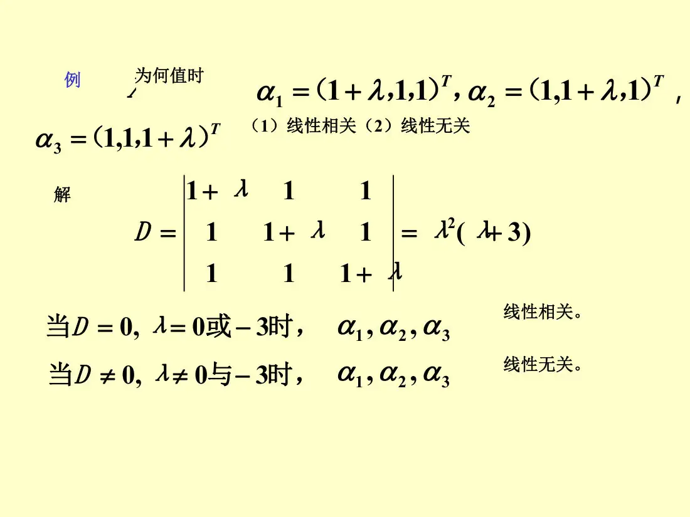

原文：

例 为何值时

$$
\alpha_ {1} = (1 + \lambda , 1, 1) ^ {T}, \alpha_ {2} = (1, 1 + \lambda , 1) ^ {T}
$$

$$
\alpha_ {3} = (1, 1, 1 + \lambda) ^ {T}
$$

（1）线性相关（2）线性无关

解

$$
D = \left| \begin{array}{c c c c} 1 + \lambda & 1 & 1 \\ 1 & 1 + \lambda & 1 \\ 1 & 1 & 1 + \lambda \end{array} \right| = \lambda^ {2} (\lambda + 3)
$$

当 $D = 0$ ， $\lambda = 0$ 或-3时， $\alpha_{1},\alpha_{2},\alpha_{3}$ 当 $D\neq 0$ ， $\lambda \neq 0$ 与-3时， $\alpha_{1},\alpha_{2},\alpha_{3}$

线性相关。

线性无关。

### 证设

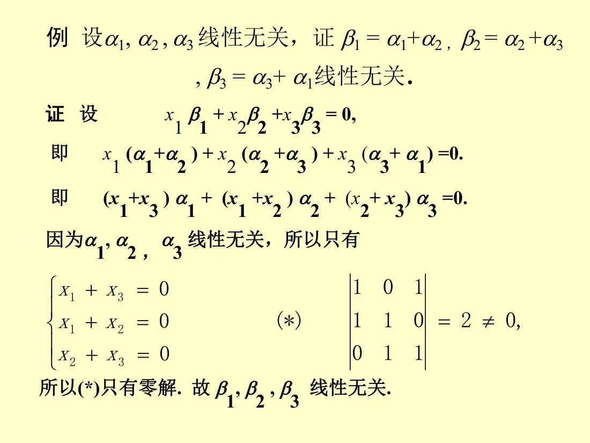

原文：

例 设 $\alpha_{1}, \alpha_{2}, \alpha_{3}$ 线性无关，证 $\beta_{1} = \alpha_{1} + \alpha_{2}, \beta_{2} = \alpha_{2} + \alpha_{3}$ , $\beta_{3} = \alpha_{3} + \alpha_{1}$ 线性无关.

证设

$$
x _ {1} \beta_ {1} + x _ {2} \beta_ {2} + x _ {3} \beta_ {3} = 0,
$$

即 $x_{1}(\alpha_{1} + \alpha_{2}) + x_{2}(\alpha_{2} + \alpha_{3}) + x_{3}(\alpha_{3} + \alpha_{1}) = 0.$

即

$$
\left(x _ {1} + x _ {3}\right) \alpha_ {1} + \left(x _ {1} + x _ {2}\right) \alpha_ {2} + \left(x _ {2} + x _ {3}\right) \alpha_ {3} = 0.
$$

因为 $\alpha_{1},\alpha_{2},\alpha_{3}$ 线性无关，所以只有

$$
\left\{ \begin{array}{l} X _ {1} + X _ {3} = 0 \\ X _ {1} + X _ {2} = 0 \\ X _ {2} + X _ {3} = 0 \end{array} \right.
$$

(\*)

$$
\left| \begin{array}{c c c} 1 & 0 & 1 \\ 1 & 1 & 0 \\ 0 & 1 & 1 \end{array} \right| = 2 \neq 0,
$$

所以(\*)只有零解. 故 $\beta_{1}, \beta_{2}, \beta_{3}$ 线性无关.

### 例 当 $\lambda$ 取何值时，下列向量组线性相关或无关？

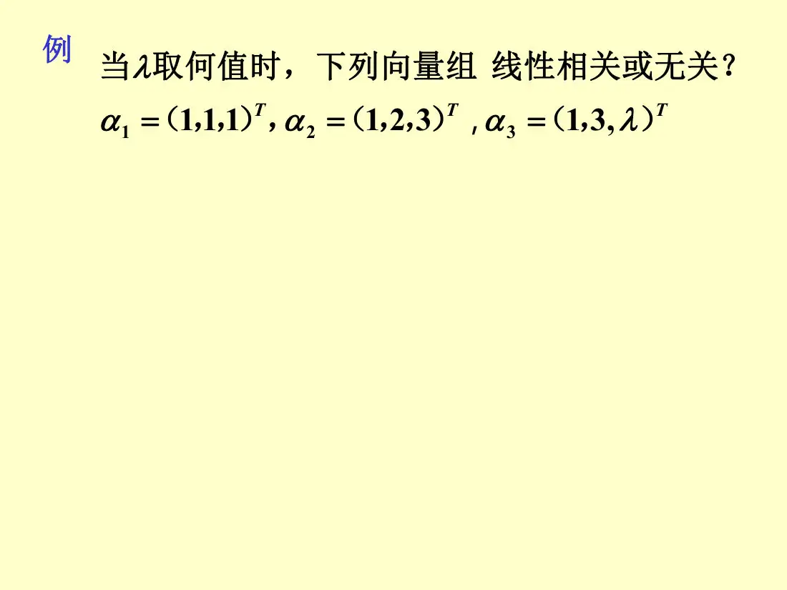

原文：

例 当 $\lambda$ 取何值时，下列向量组线性相关或无关？

$$
\alpha_ {1} = (1, 1, 1) ^ {T}, \alpha_ {2} = (1, 2, 3) ^ {T}, \alpha_ {3} = (1, 3, \lambda) ^ {T}
$$

### $$

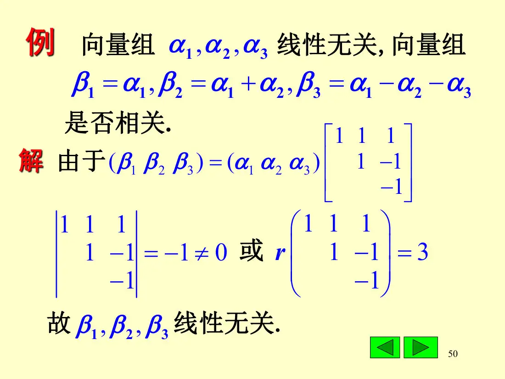

原文：

例 向量组 $\alpha_{1},\alpha_{2},\alpha_{3}$ 线性无关, 向量组

$$
\beta_ {1} = \alpha_ {1}, \beta_ {2} = \alpha_ {1} + \alpha_ {2}, \beta_ {3} = \alpha_ {1} - \alpha_ {2} - \alpha_ {3}
$$

是否相关.

是否相关.
解 由于 $(\beta_{1}\beta_{2}\beta_{3})=(\alpha_{1}\alpha_{2}\alpha_{3})\begin{bmatrix}1&1&1\\ &1&-1\\ & &-1\end{bmatrix}$

$\left| \begin{array}{ccc}1 & 1 & 1\\ 1 & -1\\ 1 & -1 \end{array} \right| = -1\neq 0$ 或 $r\left( \begin{array}{ccc}1 & 1 & 1\\ 1 & -1\\ 1 & -1 \end{array} \right) = 3$

故 $\beta_{1}, \beta_{2}, \beta_{3}$ 线性无关.

◀ ▶

50

### 的线性相关性.

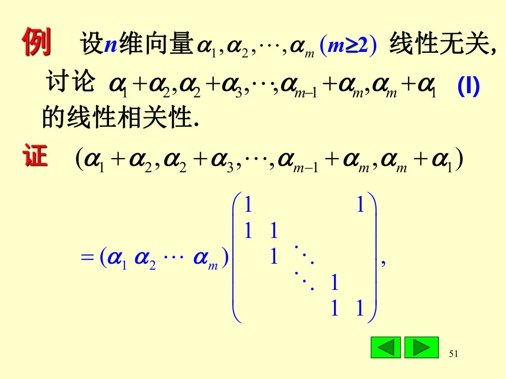

原文：

例 设n维向量 $\alpha_{1},\alpha_{2},\cdots,\alpha_{m}(m\geq2)$ 线性无关,
讨论 $\alpha_{1}+\alpha_{2},\alpha_{2}+\alpha_{3},\cdots,\alpha_{m-1}+\alpha_{m},\alpha_{m}+\alpha_{1}$ (I)
的线性相关性.

证 $(\alpha_{1}+\alpha_{2},\alpha_{2}+\alpha_{3},\cdots,\alpha_{m-1}+\alpha_{m},\alpha_{m}+\alpha_{1})$

$$
= (\alpha_ {1} \alpha_ {2} \dots \alpha_ {m}) \left( \begin{array}{c c c c c} 1 & & & & 1 \\ 1 & 1 & & & \\ & 1 & \ddots & & \\ & & \ddots & 1 & \\ & & & 1 & 1 \end{array} \right),
$$

◀

51

### $$

原文：

$$
\left| \begin{array}{c c c c c} 1 & & & & 1 \\ 1 & 1 & & & \\ & 1 & \ddots & & \\ & & \ddots & 1 & \\ & & & 1 & 1 \end{array} \right| = 1 + (- 1) ^ {1 + m}
$$

$= \left\{ \begin{array}{ll}2,m & \text{为奇数时 (I)线性无关;}\\ 0,m & \text{为偶数时 (I)线性相关.} \end{array} \right.$

52

### 4.2.2 线性相关性的一种刻画

原文：

4.2.2 线性相关性的一种刻画

定理 n维向量 $\alpha_{1}, \alpha_{2}, \ldots, \alpha_{m} (m \geq 2)$ 线性相关的 $\Longleftrightarrow$ 是其中有一个向量可由其余的向量线性表示.

证 $\rightarrow$ $\alpha_{1}, \alpha_{2}, \ldots, \alpha_{m}$ 线性相关, 由定义知
∃不全为零的常数 $k_{1}, k_{2}, \ldots, k_{m}$ 使

$$
k _ {1} \alpha_ {1} + k _ {2} \alpha_ {2} + \dots + k _ {m} \alpha_ {m} = 0
$$

不妨设 $k_{i} \neq 0$ , 于是

◀ ▶

53

### $$

原文：

$$
\alpha_ {i} = - \frac {k _ {1}}{k _ {i}} \alpha_ {1} - \dots - \frac {k _ {i - 1}}{k _ {i}} \alpha_ {i - 1} - \frac {k _ {i + 1}}{k _ {i}} \alpha_ {i + 1} - \dots - \frac {k _ {m}}{k _ {i}} \alpha_ {m}
$$

即 $\alpha_{i}$ 可由 $\alpha_{1},\ldots,\alpha_{i-1},\alpha_{i+1},\ldots,\alpha_{m}$ 线性表示.

如果

$$
\alpha_ {j} = k _ {1} \alpha_ {1} + \dots + k _ {j - 1} \alpha_ {j - 1} + k _ {j + 1} \alpha_ {j + 1} + \dots + k _ {m} \alpha_ {m}
$$

那么

$$
k _ {1} \alpha_ {1} + \dots + k _ {j - 1} \alpha_ {j - 1} - \alpha_ {j} + k _ {j + 1} \alpha_ {j + 1} + \dots + k _ {m} \alpha_ {m} = 0
$$

所以向量组 $\alpha_{1}, \alpha_{2}, \ldots, \alpha_{m}$ 线性相关.

◀

594

### 定理

原文：

定理

设 $\alpha_{1}, \alpha_{2}, \cdots, \alpha_{m}$ 线性无关, 而 $\alpha_{1}, \cdots, \alpha_{m}, \beta$ 线性相关, 则向量 $\beta$ 必能由 $\alpha_{1}, \cdots, \alpha_{m}$ 线性表示, 且表示式是唯一的.

上述两个定理刻画了线性相关和线性表示之间的关系.

◀ ▶

55

### “部分相关，则整体相关。”

原文：

例：设 $\alpha_{1},\alpha_{2},\cdots,\alpha_{3}$ 线性相关,证明 $\alpha_{1},\cdots,\alpha_{4}$ 也线性相关.

“部分相关，则整体相关。”

“整体无关，则部分无关”

定理：在向量组 $\alpha_{1},\alpha_{2},\cdots,\alpha_{m}$ 中，若有部分向量构成的向量组线性相关,则全体向量也线性相关；反之，若全体向量线性无关，则有任意向量向量组线性相关.

◀ ▶

56

### 短的线性无关

原文：

定理：若n维向量组 $\alpha_{i}=(\alpha_{i1},\alpha_{i2},\cdots,\alpha_{in})$ 线性无关,则 $n+1$ 维向量组 $\beta_{i}=(\alpha_{i1},\alpha_{i2},\cdots,\alpha_{in},\alpha_{in+1})$ 也线性无关.

短的线性无关

长的线性相关

加长后线性无关

缩短后线性相关

◀ ▶

57

### 58

原文：

例

设向量组 $\alpha, \beta, \gamma$ 线性无关, $\alpha, \beta, \delta$ 线性相关, 以下命题正确的是( ).

(A) $\alpha$ 可以由 $\beta, \gamma, \delta$ 线性表示;

(B) $\beta$ 不可由 $\alpha, \gamma, \delta$ 线性表示.

(C) $\delta$ 可以由 $\alpha, \beta, \gamma$ 线性表示;

(D) $\delta$ 不可由 $\alpha, \beta, \gamma$ 线性表示.

58

### (1) $a_{1}$ 能由向量 $a_{2}, a_{3}$ 线性表出.

原文：

练习 已知 $a_1, a_2, a_3$ 线性相关， $a_2, a_3, a_4$ 线性无关。则

(1) $a_{1}$ 能由向量 $a_{2}, a_{3}$ 线性表出.

(2) $a_{4}$ 不能由向量 $a_{1}, a_{2}, a_{3}$ 线性表出.

证明：

(1)∵ $a_{2}, a_{3}, a_{4}$ 线性无关，
∴ $a_{2}, a_{3}$ 线性无关

“整体无关，则部分无关。”

又∵ $a_1, a_2, a_3$ 线性相关, 而 $a_2, a_3$ 线性无关

∴ $a_{1}$ 可由 $a_{2}, a_{3}$ 线性表出, 且表达式唯一.

### (1) $a_{1}$ 能由向量 $a_{2}, a_{3}$ 线性表出.

原文：

练习 已知 $a_1, a_2, a_3$ 线性相关， $a_2, a_3, a_4$ 线性无关。则

(1) $a_{1}$ 能由向量 $a_{2}, a_{3}$ 线性表出.

(2) $a_{4}$ 不能由向量 $a_{1}, a_{2}, a_{3}$ 线性表出.

证明：（1）另证：

$a_{1}, a_{2}, a_{3}$ 线性相关

$\Rightarrow \exists k_{1}, k_{2}, k_{3} \in \mathbb{R}$ ，有 $k_{1}a_{1} + k_{2}a_{2} + k_{3}a_{3} = 0$ ， $k_{i}$ 不全为零
若 $k_{1} = 0$ ，则 $k_{2}, k_{3}$ 不全为零且 $k_{2}a_{2} + k_{3}a_{3} + 0 \cdot a_{4} = 0$ .

这与 $a_{2},a_{3},a_{4}$ 线性无关矛盾.

故 $k_{1}\neq0$ ，从而 $a_{1}=-\frac{k_{2}}{k_{1}}a_{2}-\frac{k_{3}}{k_{1}}a_{3}.$

### (1) $a_{1}$ 能由向量 $a_{2}, a_{3}$ 线性表出.

原文：

练习 已知 $a_{1}, a_{2}, a_{3}$ 线性相关， $a_{2}, a_{3}, a_{4}$ 线性无关。则

(1) $a_{1}$ 能由向量 $a_{2}, a_{3}$ 线性表出.

(2) $a_{4}$ 不能由向量 $a_{1}, a_{2}, a_{3}$ 线性表出.

证明：（2）反证法.

假设 $a_{4}$ 能由向量 $a_{1},a_{2},a_{3}$ 线性表出，即

$$
a _ {4} = k _ {1} a _ {1} + k _ {2} a _ {2} + k _ {3} a _ {3},
$$

由（1）有 $a_{1}=l_{2}a_{2}+l_{3}a_{3}$ ，代入得

$$
a _ {4} = \left(k _ {1} l _ {2} + k _ {2}\right) a _ {2} + \left(k _ {1} l _ {3} + k _ {3}\right) a _ {3},
$$

这与 $a_{2},a_{3},a_{4}$ 线性无关矛盾.

故 $a_{4}$ 不能由向量 $a_{1},a_{2},a_{3}$ 线性表出.

### 第 62 页

原文：

练习 若向量组 $a_1, a_2, \ldots, a_m$ 线性相关, 但其中任意 $m - 1$ 个向量线性无关, 则存在一组全不为零的实数 $k_1, k_2, \ldots, k_m$ , 使得 $k_1a_1 + k_2a_2 + \ldots + k_m a_m = 0$ . 证明: $\because a_1, a_2, \ldots, a_m$ 线性相关 $\therefore$ 存在一组不全为零的实数 $k_1, k_2, \ldots, k_m$ , 使得 $k_1a_1 + k_2a_2 + \ldots + k_m a_m = 0$ . (\*) 若 $\{k_i\}$ 中有一个数为零, 不妨设 $k_1 = 0$ , 则 $k_2a_2 + \ldots + k_m a_m = 0$ , 且 $k_2, \ldots, k_m$ 不全为零. 这与“任意 $m - 1$ 个向量线性无关”矛盾. 故 (\*) 式中 $k_i$ 全不为零.

### 方阵 $A$ 可逆的充分必要条件

原文：

方阵 $A$ 可逆的充分必要条件

$A_{n}$ 可逆 $\Leftrightarrow$ (1) 存在 B, AB = I (或 BA = I)

$\Leftrightarrow$ (2) $AX = 0$ 只有零解

$\Leftrightarrow$ (3) $AX = \mathbf{b}$ 有非零解

$\Leftrightarrow (4) A \sim I_{n}^{行}$

$\Leftrightarrow$ (5) $A = E_{1}E_{2}\dots E_{s}$

$\Leftrightarrow (6) |A| \neq 0$

$\Leftrightarrow$ (7) $A$ 非奇异

$\Leftrightarrow$ (8) $A$ 为满秩矩阵

$\Leftrightarrow$ (9) $A$ 的列（行）向量组线性无关

### 复习线性相关性的判定理论

原文：

复习线性相关性的判定理论

\- 单个向量组成的向量组 $\alpha$ :

(1)若 $\alpha = 0$ , 则线性相关;

(2)若 $\alpha \neq 0$ , 则线性无关.

\- 两个向量组成的向量组 $\alpha, \beta$ :

(1)若对应分量成比例, 则线性相关;

(2)若对应分量不成比例, 则线性无关.

◀ ▶

64

### 复习线性相关性的判定理论

原文：

复习线性相关性的判定理论

\- 设有 $n$ 维向量组成的向量组: $\alpha_{1}, \alpha_{2}, \ldots, \alpha_{m}$

(1)包含0向量⇒线性相关. $(m \geq 2)$

(2)包含成比例的向量⇒线性相关.

(3)线性相关 $\Leftrightarrow$ 存在一个向量可由其余的向量线性表示.

(4)线性无关 $\Leftrightarrow$ 任何向量都不能由其余的向量线性表示.

(5) 增加 (减少) 个数不改变相 (无) 关性.

(6) 增加 (减少) 维数不改变无 (相) 关性.

◀ ▶

65

### $\Leftrightarrow$ 齐次线性方程组 $AX = 0$ 有非零解

原文：

(7) 向量组 $\alpha_{1}, \alpha_{2}, \ldots, \alpha_{m}$ 线性相关性

$\Leftrightarrow x_{1}\alpha_{1} + x_{2}\alpha_{2} + \ldots +x_{m}\alpha_{m} = 0$ 有非零解

$\Leftrightarrow$ 齐次线性方程组 $AX = 0$ 有非零解

其中 $A = (\alpha_{1},\alpha_{2},\dots ,\alpha_{m}),X = (x_{1},x_{2},\dots ,x_{m})^{\mathrm{T}}$

(8)设有n个n维向量 $\alpha_{1},\alpha_{2},\ldots,\alpha_{n}$ :

$\alpha_{1},\alpha_{2},\ldots,\alpha_{n}$ 线性相关 $\Leftrightarrow|\alpha_{1},\alpha_{2},\ldots,\alpha_{n}|=0;$

$\alpha_{1},\alpha_{2},\ldots,\alpha_{n}$ 线性无关 $\Leftrightarrow|\alpha_{1},\alpha_{2},\ldots,\alpha_{n}|\neq0.$

(9) $\mathbf{R}^{\mathrm{n}}$ 中 $\forall n + 1$ 个向量一定线性相关.

(10)矩阵判别法.

◀◀

66
