# 《线性代数与解析几何》1.2-1.3 讲行列式性质（课件）

原件的每一页，下面附识别出的文字。

### 1.2 n 阶行列式的性质

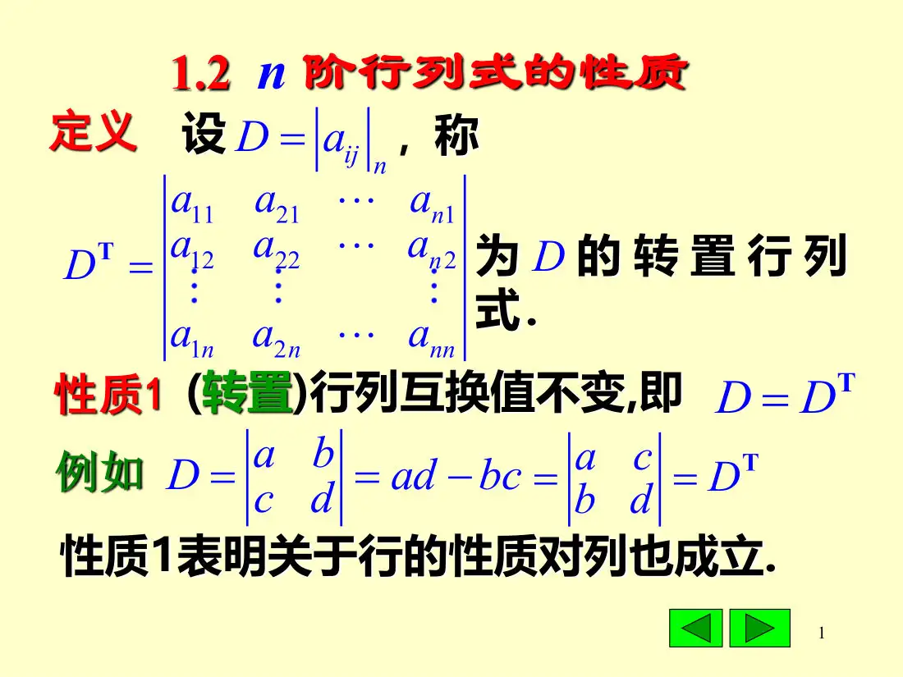

原文：

1.2 n 阶行列式的性质
定义 设 $D = \left| a_{ij} \right|_{n}$ ，称 $D^{T} = \begin{vmatrix} a_{11} & a_{21} & \cdots & a_{n1} \\ a_{12} & a_{22} & \cdots & a_{n2} \\ \vdots & \vdots & & \vdots \\ a_{1n} & a_{2n} & \cdots & a_{nn} \end{vmatrix}$ 为 D 的转置行列式.
性质1 (转置) 行列互换值不变, 即 $D = D^{T}$ 例如 $D = \begin{vmatrix} a & b \\ c & d \end{vmatrix} = ad - bc = \begin{vmatrix} a & c \\ b & d \end{vmatrix} = D^{T}$ 性质1表明关于行的性质对列也成立.

◀

1

### 性质2 (换法)换行(列)换号,即

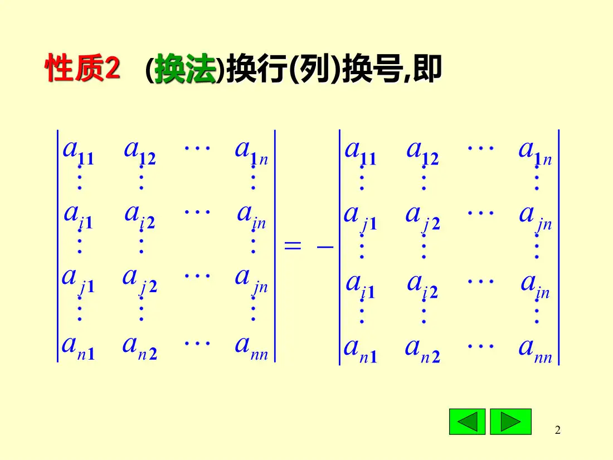

原文：

性质2 (换法)换行(列)换号,即

$$
\left| \begin{array}{c c c c} a _ {1 1} & a _ {1 2} & \dots & a _ {1 n} \\ \vdots & \vdots & & \vdots \\ a _ {i 1} & a _ {i 2} & \dots & a _ {i n} \\ \vdots & \vdots & & \vdots \\ a _ {j 1} & a _ {j 2} & \dots & a _ {j n} \\ \vdots & \vdots & & \vdots \\ a _ {n 1} & a _ {n 2} & \dots & a _ {n n} \end{array} \right| = - \left| \begin{array}{c c c c} a _ {1 1} & a _ {1 2} & \dots & a _ {1 n} \\ \vdots & \vdots & & \vdots \\ a _ {j 1} & a _ {j 2} & \dots & a _ {j n} \\ \vdots & \vdots & & \vdots \\ a _ {i 1} & a _ {i 2} & \dots & a _ {i n} \\ \vdots & \vdots & & \vdots \\ a _ {n 1} & a _ {n 2} & \dots & a _ {n n} \end{array} \right|
$$

◀ ▶

2

### 推论 两行(列)同值为零,即

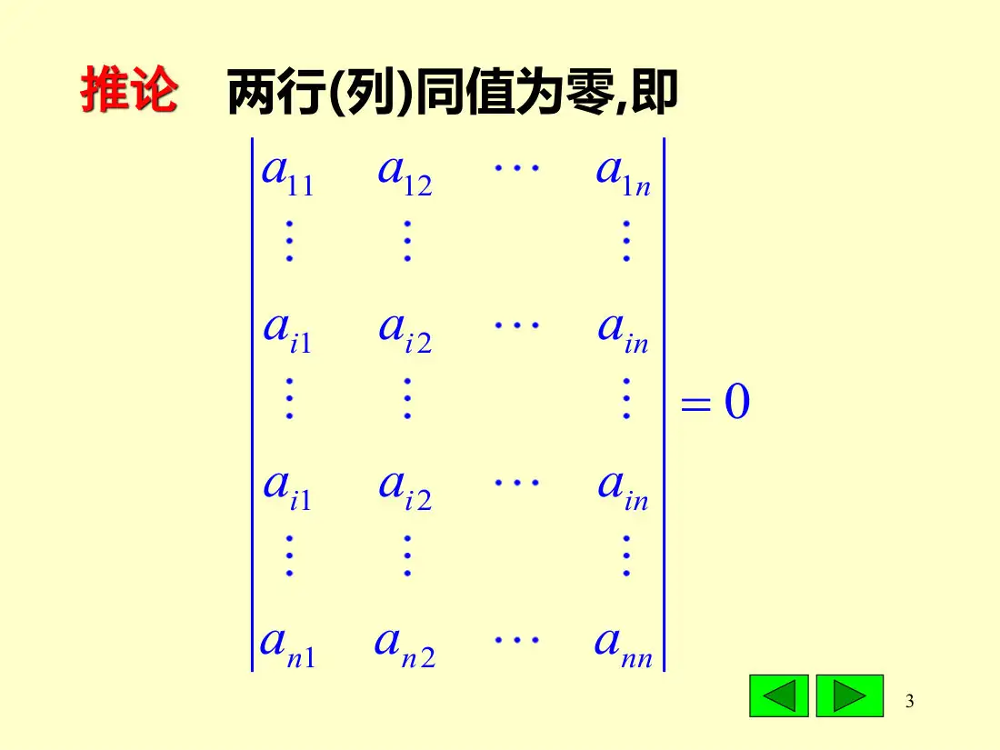

原文：

推论 两行(列)同值为零,即

$$
\left| \begin{array}{c c c c} a _ {1 1} & a _ {1 2} & \dots & a _ {1 n} \\ \vdots & \vdots & & \vdots \\ a _ {i 1} & a _ {i 2} & \dots & a _ {i n} \\ \vdots & \vdots & & \vdots \\ a _ {i 1} & a _ {i 2} & \dots & a _ {i n} \\ \vdots & \vdots & & \vdots \\ a _ {n 1} & a _ {n 2} & \dots & a _ {n n} \end{array} \right| = 0
$$

◀ ▶

3

### $$

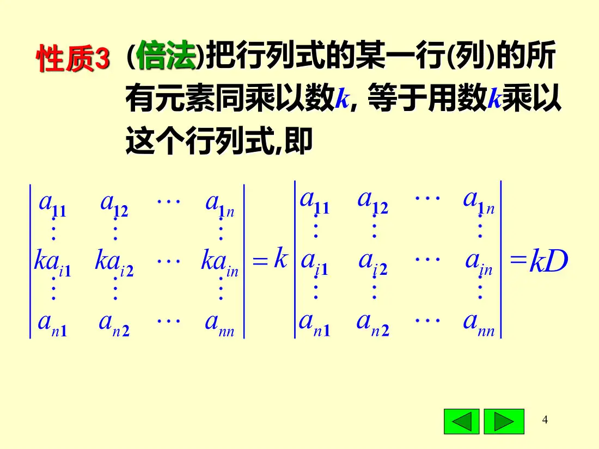

原文：

性质3 (倍法)把行列式的某一行(列)的所有元素同乘以数k, 等于用数k乘以这个行列式,即

$$
\left| \begin{array}{c c c c} a _ {1 1} & a _ {1 2} & \dots & a _ {1 n} \\ \vdots & \vdots & & \vdots \\ k a _ {i 1} & k a _ {i 2} & \dots & k a _ {i n} \\ \vdots & \vdots & & \vdots \\ a _ {n 1} & a _ {n 2} & \dots & a _ {n n} \end{array} \right| = k \left| \begin{array}{c c c c} a _ {1 1} & a _ {1 2} & \dots & a _ {1 n} \\ \vdots & \vdots & & \vdots \\ a _ {i 1} & a _ {i 2} & \dots & a _ {i n} \\ \vdots & \vdots & & \vdots \\ a _ {n 1} & a _ {n 2} & \dots & a _ {n n} \end{array} \right| = k D
$$

◀ ▶

4

### 即:如果行列式某一行(列)有公因子k时,则k可以提到行列式符号的外面.

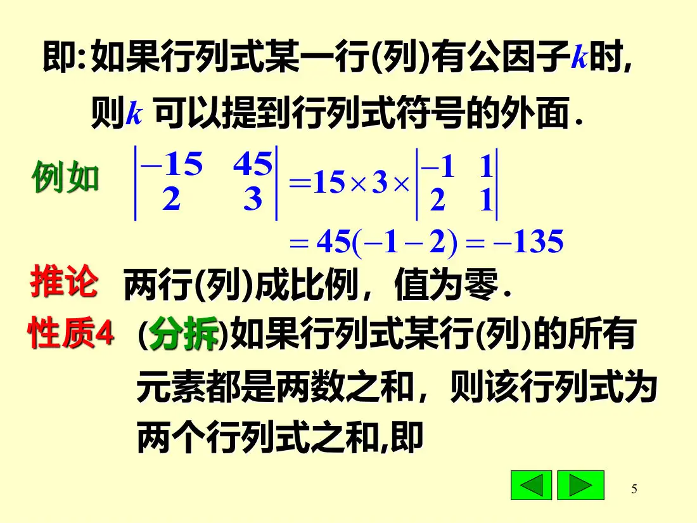

原文：

即:如果行列式某一行(列)有公因子k时,则k可以提到行列式符号的外面.

例如 $\left|\begin{matrix}-15 & 45 \\ 2 & 3\end{matrix}\right|=15\times3\times\left|\begin{matrix}-1 & 1 \\ 2 & 1\end{matrix}\right|$ $=45(-1-2)=-135$

推论 两行(列)成比例，值为零.

性质4 (分拆)如果行列式某行(列)的所有元素都是两数之和，则该行列式为两个行列式之和,即

◀ ▶

5

### $$

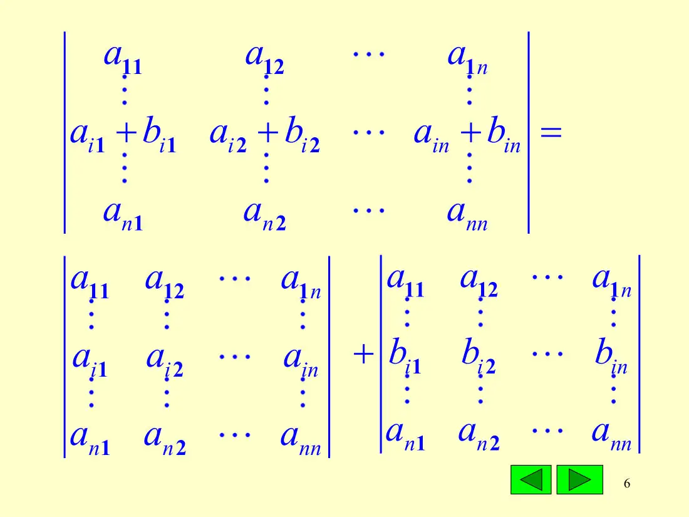

原文：

$$
\left| \begin{array}{c c c c} a _ {1 1} & a _ {1 2} & \dots & a _ {1 n} \\ \vdots & \vdots & & \vdots \\ a _ {i 1} + b _ {i 1} & a _ {i 2} + b _ {i 2} & \dots & a _ {i n} + b _ {i n} \\ \vdots & \vdots & & \vdots \\ a _ {n 1} & a _ {n 2} & \dots & a _ {n n} \end{array} \right| =
$$

$$
\left| \begin{array}{c c c c} a _ {1 1} & a _ {1 2} & \dots & a _ {1 n} \\ \vdots & \vdots & & \vdots \\ a _ {i 1} & a _ {i 2} & \dots & a _ {i n} \\ \vdots & \vdots & & \vdots \\ a _ {n 1} & a _ {n 2} & \dots & a _ {n n} \end{array} \right| + \left| \begin{array}{c c c c} a _ {1 1} & a _ {1 2} & \dots & a _ {1 n} \\ \vdots & \vdots & & \vdots \\ b _ {i 1} & b _ {i 2} & \dots & b _ {i n} \\ \vdots & \vdots & & \vdots \\ a _ {n 1} & a _ {n 2} & \dots & a _ {n n} \end{array} \right|
$$

6

### $$

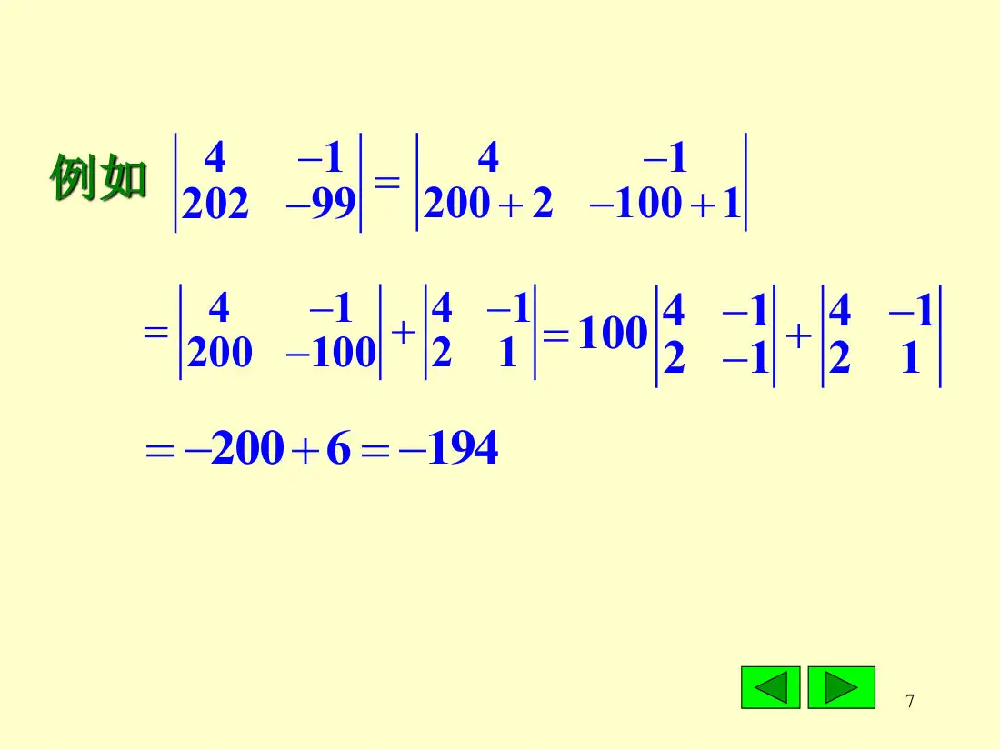

原文：

$$
\begin{array}{r l} \text {例如} & \left| \begin{array}{c c} 4 & - 1 \\ 2 0 2 & - 9 9 \end{array} \right| = \left| \begin{array}{c c} 4 & - 1 \\ 2 0 0 + 2 & - 1 0 0 + 1 \end{array} \right| \\ & = \left| \begin{array}{c c} 4 & - 1 \\ 2 0 0 & - 1 0 0 \end{array} \right| + \left| \begin{array}{c c} 4 & - 1 \\ 2 & 1 \end{array} \right| = 1 0 0 \left| \begin{array}{c c} 4 & - 1 \\ 2 & - 1 \end{array} \right| + \left| \begin{array}{c c} 4 & - 1 \\ 2 & 1 \end{array} \right| \\ & = - 2 0 0 + 6 = - 1 9 4 \end{array}
$$

◀◀

7

### $$

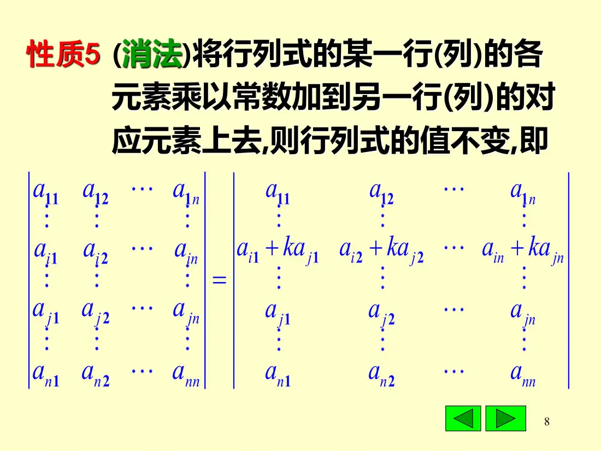

原文：

性质5 (消法)将行列式的某一行(列)的各元素乘以常数加到另一行(列)的对应元素上去,则行列式的值不变,即

$$
\left| \begin{array}{c c c c} a _ {1 1} & a _ {1 2} & \dots & a _ {1 n} \\ \vdots & \vdots & & \vdots \\ a _ {i 1} & a _ {i 2} & \dots & a _ {i n} \\ \vdots & \vdots & & \vdots \\ a _ {j 1} & a _ {j 2} & \dots & a _ {j n} \\ \vdots & \vdots & & \vdots \\ a _ {n 1} & a _ {n 2} & \dots & a _ {n n} \end{array} \right| = \left| \begin{array}{c c c c} a _ {1 1} & a _ {1 2} & \dots & a _ {1 n} \\ \vdots & \vdots & & \vdots \\ a _ {i 1} + k a _ {j 1} & a _ {i 2} + k a _ {j 2} & \dots & a _ {i n} + k a _ {j n} \\ \vdots & \vdots & & \vdots \\ a _ {j 1} & a _ {j 2} & \dots & a _ {j n} \\ \vdots & \vdots & & \vdots \\ a _ {n 1} & a _ {n 2} & \dots & a _ {n n} \end{array} \right|
$$

◀ ▶

8

### 总结行列式性质

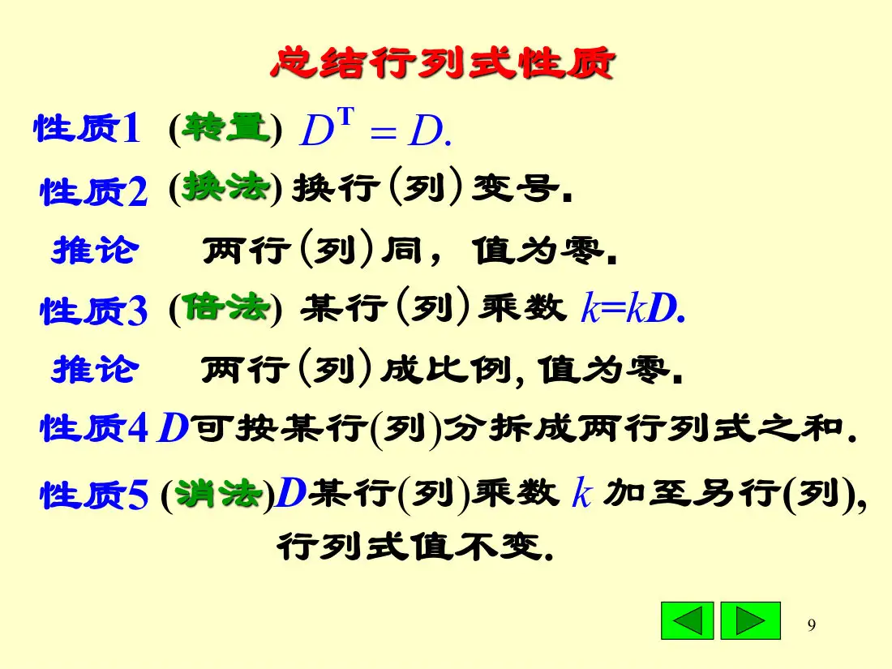

原文：

总结行列式性质

性质1 (转置) $D^{T}=D.$

性质2 (换法) 换行(列)变号.

推论 两行(列)同，值为零.

性质3 (倍法) 某行(列)乘数 k=kD.

推论 两行(列)成比例, 值为零.

性质4 D可按某行(列)分拆成两行列式之和.

性质5 (消法) $D$ 某行(列)乘数 $k$ 加至另行(列), 行列式值不变.

◀ ▶

9

### - 行列式的性质是有关行列式计算和推理的基础,必须熟练掌握,会灵活运用。

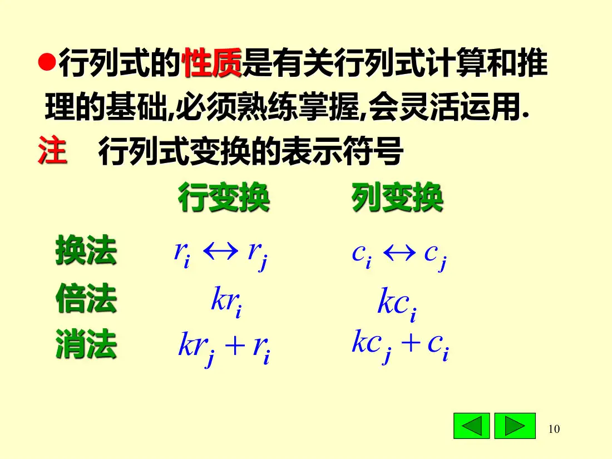

原文：

- 行列式的性质是有关行列式计算和推理的基础,必须熟练掌握,会灵活运用。

注 行列式变换的表示符号

换法

倍法

消法

行变换

$$
r _ {i} \leftrightarrow r _ {j}
$$

$$
k r _ {i}
$$

$$
k r _ {j} + r _ {i}
$$

列变换

$$
\begin{array}{c} c _ {i} \leftrightarrow c _ {j} \\ k c _ {i} \\ k c _ {j} + c _ {i} \end{array}
$$

◀ ▶

10

### 例9 已知

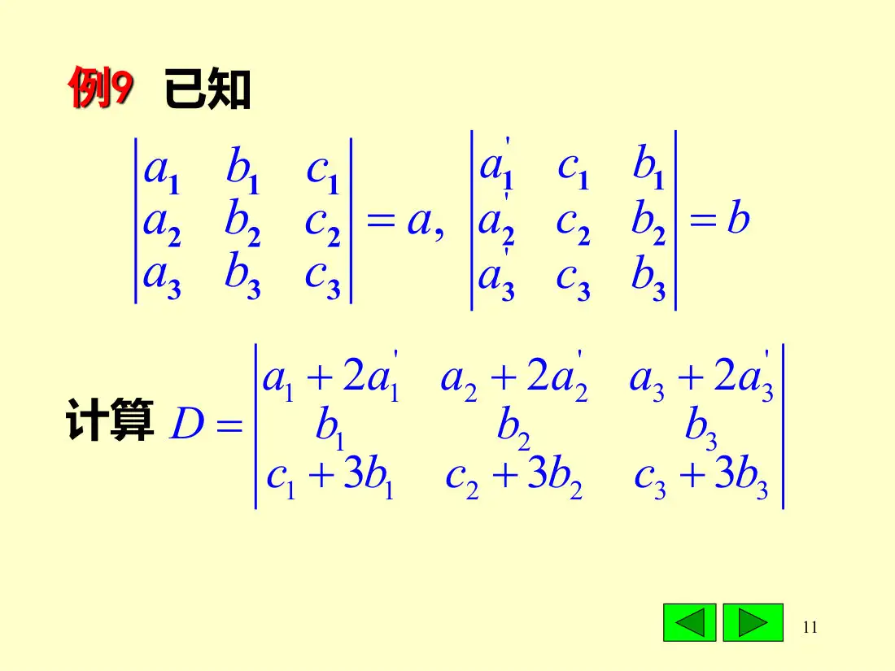

原文：

例9 已知

$$
\left| \begin{array}{c c c} a _ {1} & b _ {1} & c _ {1} \\ a _ {2} & b _ {2} & c _ {2} \\ a _ {3} & b _ {3} & c _ {3} \end{array} \right| = a, \left| \begin{array}{c c c} a _ {1} ^ {\prime} & c _ {1} & b _ {1} \\ a _ {2} ^ {\prime} & c _ {2} & b _ {2} \\ a _ {3} ^ {\prime} & c _ {3} & b _ {3} \end{array} \right| = b
$$

计算

$$
D = \left| \begin{array}{c c c} a _ {1} + 2 a _ {1} ^ {\prime} & a _ {2} + 2 a _ {2} ^ {\prime} & a _ {3} + 2 a _ {3} ^ {\prime} \\ b _ {1} & b _ {2} & b _ {3} \\ c _ {1} + 3 b _ {1} & c _ {2} + 3 b _ {2} & c _ {3} + 3 b _ {3} \end{array} \right|
$$

◀ ▶

11

### 解 由性质4 D=

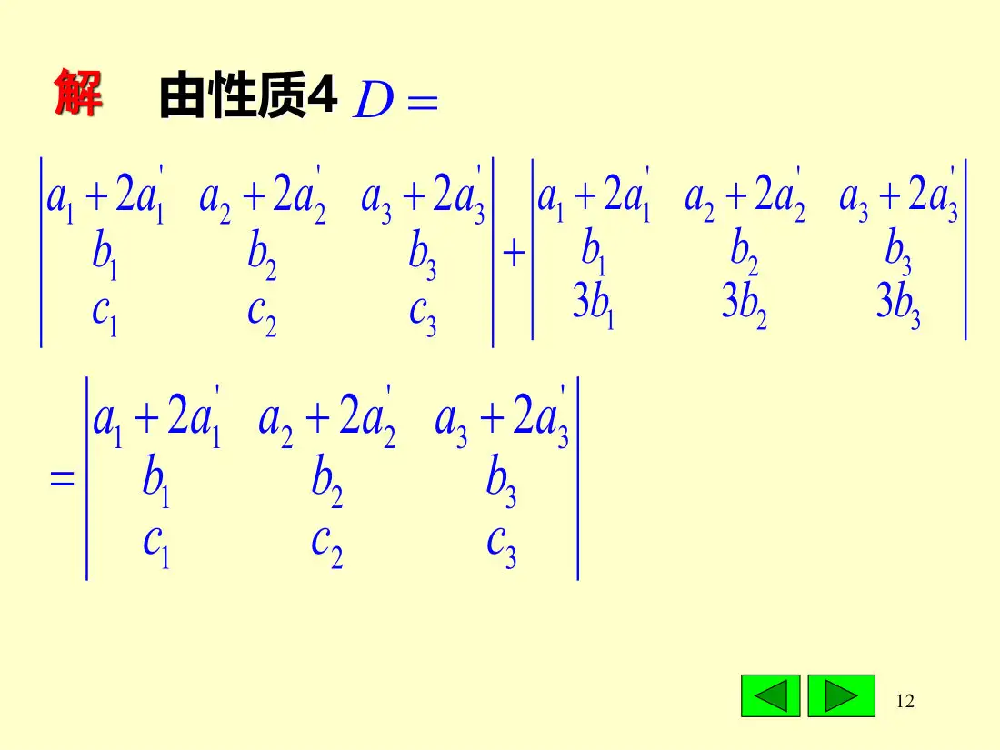

原文：

解 由性质4 D=

$$
\left| \begin{array}{c c c} a _ {1} + 2 a _ {1} ^ {\prime} & a _ {2} + 2 a _ {2} ^ {\prime} & a _ {3} + 2 a _ {3} ^ {\prime} \\ b _ {1} & b _ {2} & b _ {3} \\ c _ {1} & c _ {2} & c _ {3} \end{array} \right| + \left| \begin{array}{c c c} a _ {1} + 2 a _ {1} ^ {\prime} & a _ {2} + 2 a _ {2} ^ {\prime} & a _ {3} + 2 a _ {3} ^ {\prime} \\ b _ {1} & b _ {2} & b _ {3} \\ 3 b _ {1} & 3 b _ {2} & 3 b _ {3} \end{array} \right|
$$

$$
= \left| \begin{array}{c c c} a _ {1} + 2 a _ {1} ^ {\prime} & a _ {2} + 2 a _ {2} ^ {\prime} & a _ {3} + 2 a _ {3} ^ {\prime} \\ b _ {1} & b _ {2} & b _ {3} \\ c _ {1} & c _ {2} & c _ {3} \end{array} \right|
$$

◀ ▶

12

### $$

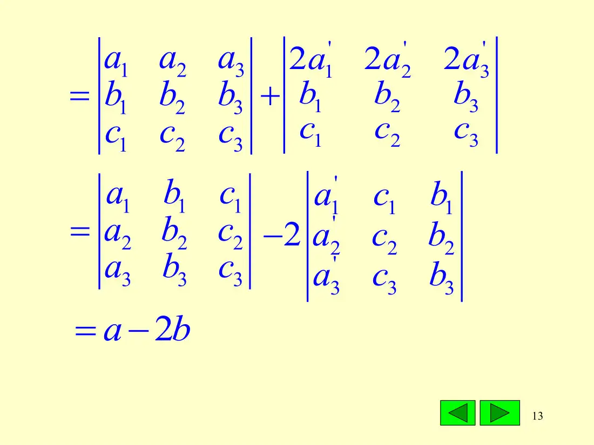

原文：

$$
\begin{array}{l} = \left| \begin{array}{c c c} a _ {1} & a _ {2} & a _ {3} \\ b _ {1} & b _ {2} & b _ {3} \\ c _ {1} & c _ {2} & c _ {3} \end{array} \right| + \left| \begin{array}{c c c} 2 a _ {1} ^ {\prime} & 2 a _ {2} ^ {\prime} & 2 a _ {3} ^ {\prime} \\ b _ {1} & b _ {2} & b _ {3} \\ c _ {1} & c _ {2} & c _ {3} \end{array} \right| \\ = \left| \begin{array}{c c c} a _ {1} & b _ {1} & c _ {1} \\ a _ {2} & b _ {2} & c _ {2} \\ a _ {3} & b _ {3} & c _ {3} \end{array} \right| - 2 \left| \begin{array}{c c c} a _ {1} ^ {\prime} & c _ {1} & b _ {1} \\ a _ {2} ^ {\prime} & c _ {2} & b _ {2} \\ a _ {3} ^ {\prime} & c _ {3} & b _ {3} \end{array} \right| \\ = a - 2 b \end{array}
$$

◀ ▶

13

### 例8 设有四阶行列式:

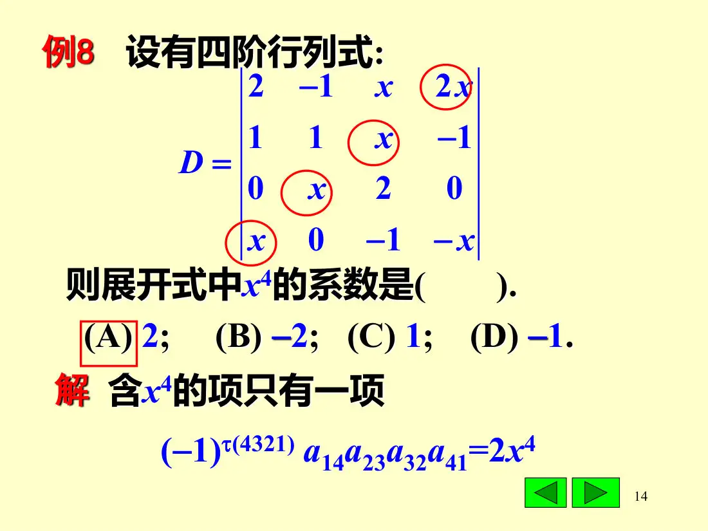

原文：

例8 设有四阶行列式:
D = $\begin{vmatrix} 2 & -1 & x & 2x \\ 1 & 1 & x & -1 \\ 0 & x & 2 & 0 \\ x & 0 & -1 & -x \end{vmatrix}$

则展开式中 $x^{4}$ 的系数是( ). (A)2; (B)-2; (C)1; (D)-1.

解 含 $x^4$ 的项只有一项

$(-1)^{\tau(4321)} a_{14}a_{23}a_{32}a_{41}=2x^{4}$

◀ ▶

14

### 二、行列式的计算

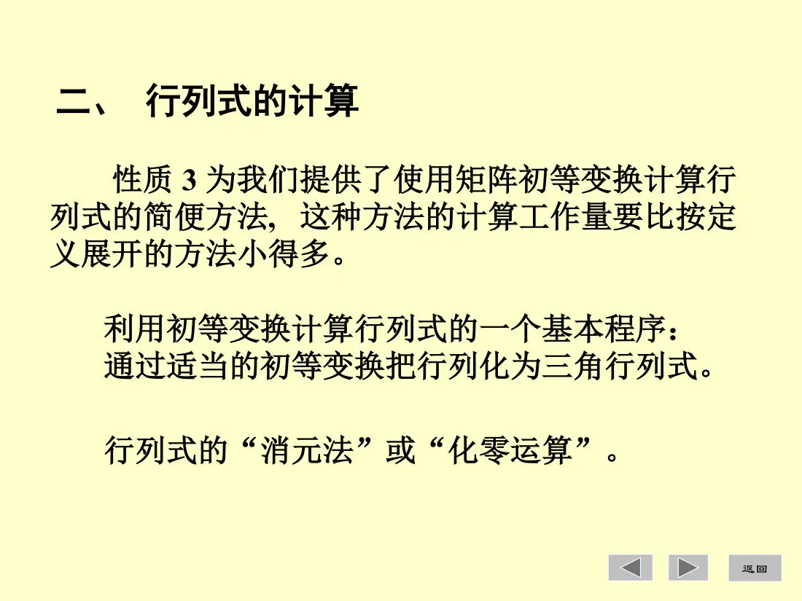

原文：

二、行列式的计算

性质 3 为我们提供了使用矩阵初等变换计算行列式的简便方法，这种方法的计算工作量要比按定义展开的方法小得多。

利用初等变换计算行列式的一个基本程序:

通过适当的初等变换把行列化为三角行列式。

行列式的“消元法”或“化零运算”。

◀ ▶

返回

### $$

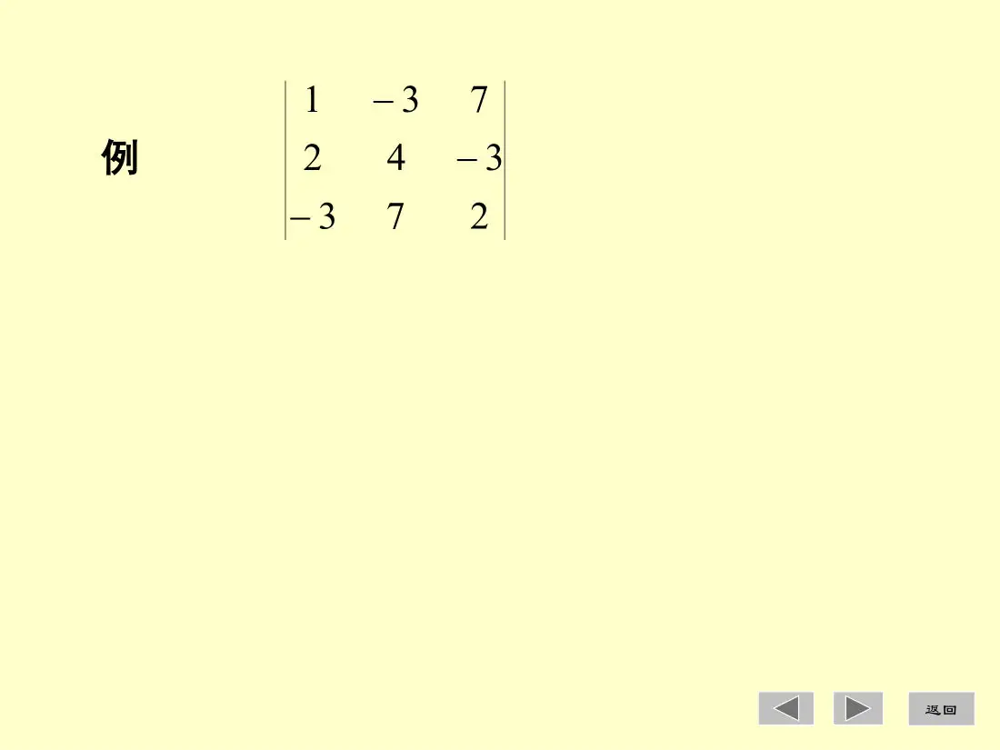

原文：

例

$$
\left| \begin{array}{c c c} 1 & - 3 & 7 \\ 2 & 4 & - 3 \\ - 3 & 7 & 2 \end{array} \right|
$$

◀ ▶

返回

### $$

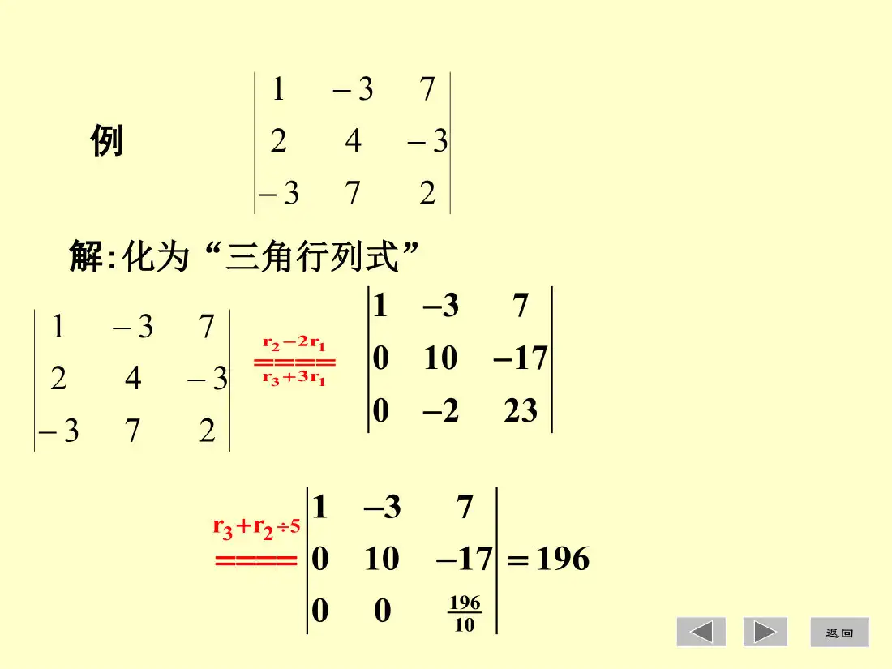

原文：

例

$$
\left| \begin{array}{c c c} 1 & - 3 & 7 \\ 2 & 4 & - 3 \\ - 3 & 7 & 2 \end{array} \right|
$$

解:化为 “三角行列式”

$$
\left| \begin{array}{r r r} 1 & - 3 & 7 \\ 2 & 4 & - 3 \\ - 3 & 7 & 2 \end{array} \right| \overset {r _ {2} - 2 r _ {1}} {=} \left| \begin{array}{r r r} 1 & - 3 & 7 \\ 0 & 1 0 & - 1 7 \\ 0 & - 2 & 2 3 \end{array} \right|
$$

$$
\begin{array}{r} \mathbf {r} _ {3} + \mathbf {r} _ {2} \div 5 \\ = = = = \left| \begin{array}{c c c} 1 & - 3 & 7 \\ 0 & 1 0 & - 1 7 \\ 0 & 0 & \frac {1 9 6}{1 0} \end{array} \right| = 1 9 6 \end{array}
$$

◀ ▶

返回

### $$

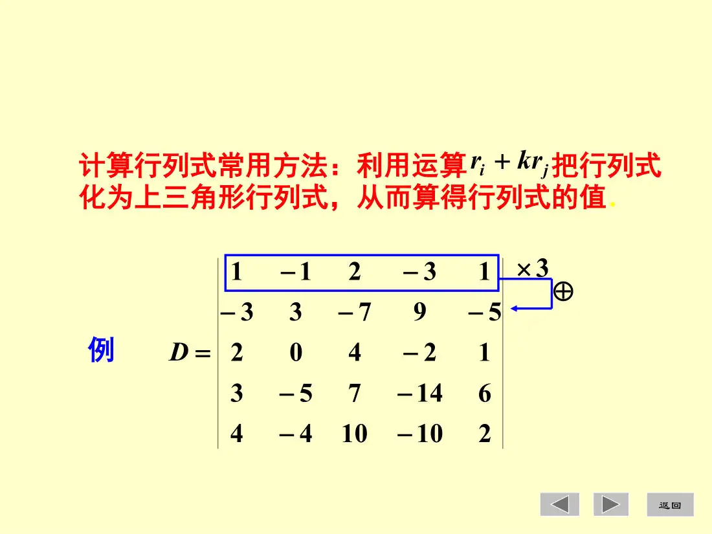

原文：

计算行列式常用方法：利用运算 $r_i + kr_j$ 把行列式化为上三角形行列式，从而算得行列式的值。

例

$$
D = \left| \begin{array}{r r r r r} 1 & - 1 & 2 & - 3 & 1 \\ - 3 & 3 & - 7 & 9 & - 5 \\ 2 & 0 & 4 & - 2 & 1 \\ 3 & - 5 & 7 & - 1 4 & 6 \\ 4 & - 4 & 1 0 & - 1 0 & 2 \end{array} \right| \xrightarrow {\times 3} \oplus
$$

◀ ▶

返回

### $$

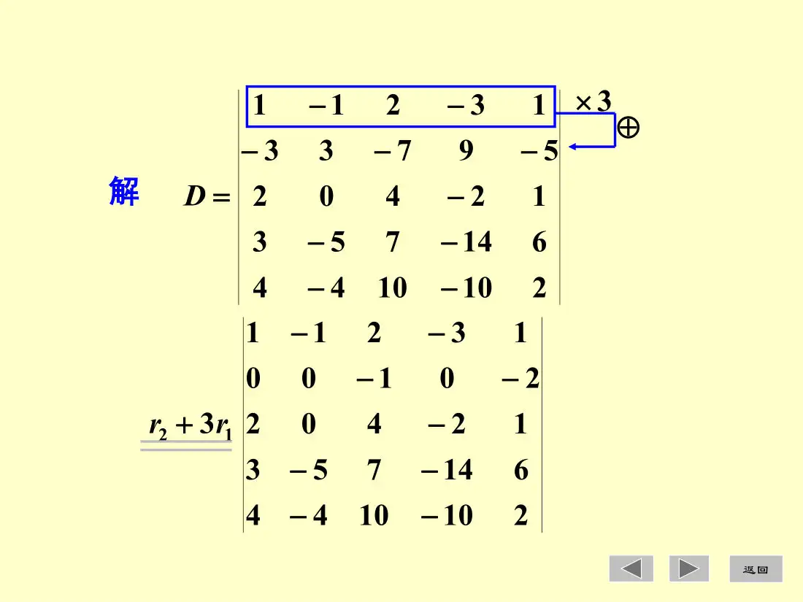

原文：

解

$$
\begin{array}{c} \text {且} D = \left| \begin{array}{r r r r r} 1 & - 1 & 2 & - 3 & 1 \\ - 3 & 3 & - 7 & 9 & - 5 \\ 2 & 0 & 4 & - 2 & 1 \\ 3 & - 5 & 7 & - 1 4 & 6 \\ 4 & - 4 & 1 0 & - 1 0 & 2 \end{array} \right| \\ \underline {{r _ {2} + 3 r _ {1}}} \left| \begin{array}{r r r r r} 1 & - 1 & 2 & - 3 & 1 \\ 0 & 0 & - 1 & 0 & - 2 \\ 2 & 0 & 4 & - 2 & 1 \\ 3 & - 5 & 7 & - 1 4 & 6 \\ 4 & - 4 & 1 0 & - 1 0 & 2 \end{array} \right| \end{array}
$$

◀ ▶

返回

### $$

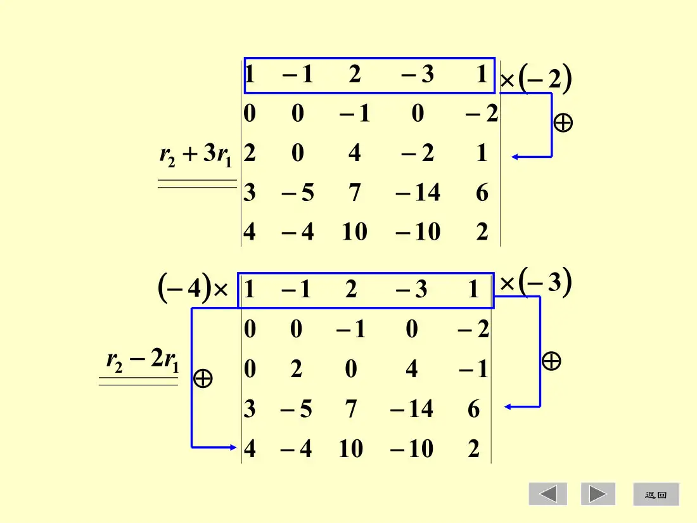

原文：

$$
\begin{array}{c c c c c} & 1 & - 1 & 2 & - 3 & 1 \\ \hline r _ {2} + 3 r _ {1} & 0 & 0 & - 1 & 0 & - 2 \\ \hline & 2 & 0 & 4 & - 2 & 1 \\ & 3 & - 5 & 7 & - 1 4 & 6 \\ & 4 & - 4 & 1 0 & - 1 0 & 2 \end{array} \Bigg | \times (- 2)
$$

$$
\begin{array}{c} (- 4) \times \boxed {1 - 1 2 - 3 1} \times (- 3) \\ \underline {{r _ {2} - 2 r _ {1}}} \oplus \boxed {0 0 - 1 0 - 2} \\ \boxed {0 2 0 4 - 1} \\ \boxed {3 - 5 7 - 1 4 6} \\ \boxed {4 - 4 1 0 - 1 0 2} \end{array}
$$

◀ ▶

返回

### $$

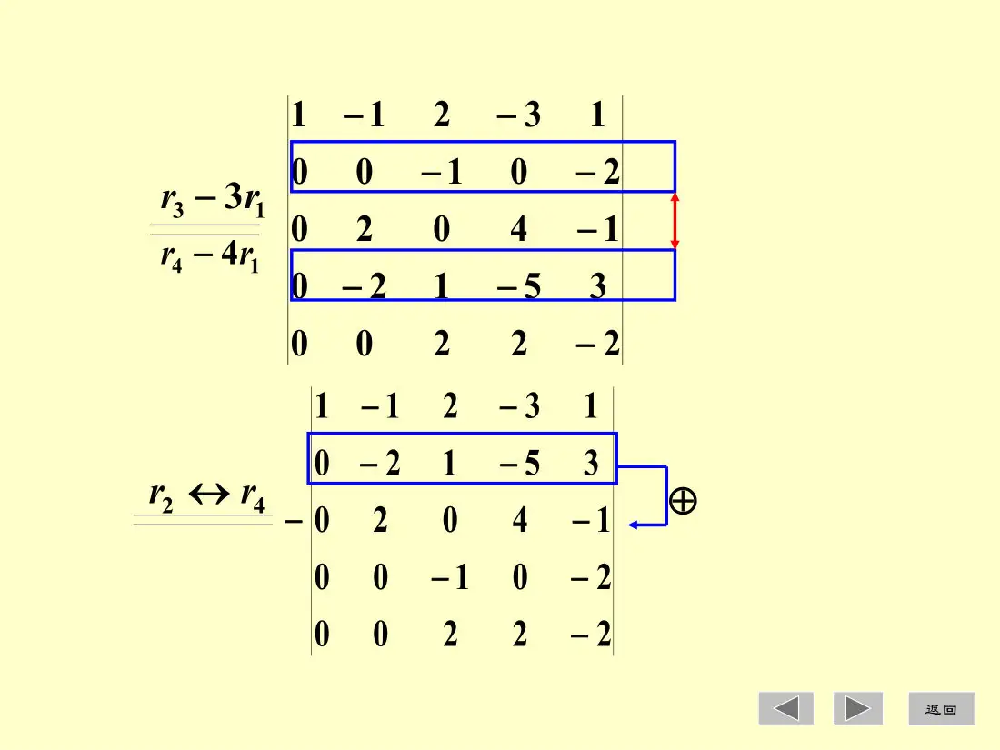

原文：

$$
\frac {r _ {3} - 3 r _ {1}}{r _ {4} - 4 r _ {1}} \left| \begin{array}{c c c c c} 1 & - 1 & 2 & - 3 & 1 \\ \hline 0 & 0 & - 1 & 0 & - 2 \\ \hline 0 & 2 & 0 & 4 & - 1 \\ \hline 0 & - 2 & 1 & - 5 & 3 \\ \hline 0 & 0 & 2 & 2 & - 2 \end{array} \right|
$$

$$
\underline {{r _ {2} \leftrightarrow r _ {4}}} - \begin{array}{c c c c c} 1 & - 1 & 2 & - 3 & 1 \\ \hline 0 & - 2 & 1 & - 5 & 3 \\ \hline 0 & 2 & 0 & 4 & - 1 \\ 0 & 0 & - 1 & 0 & - 2 \\ 0 & 0 & 2 & 2 & - 2 \end{array} \oplus
$$

◀ ▶

返回

### $$

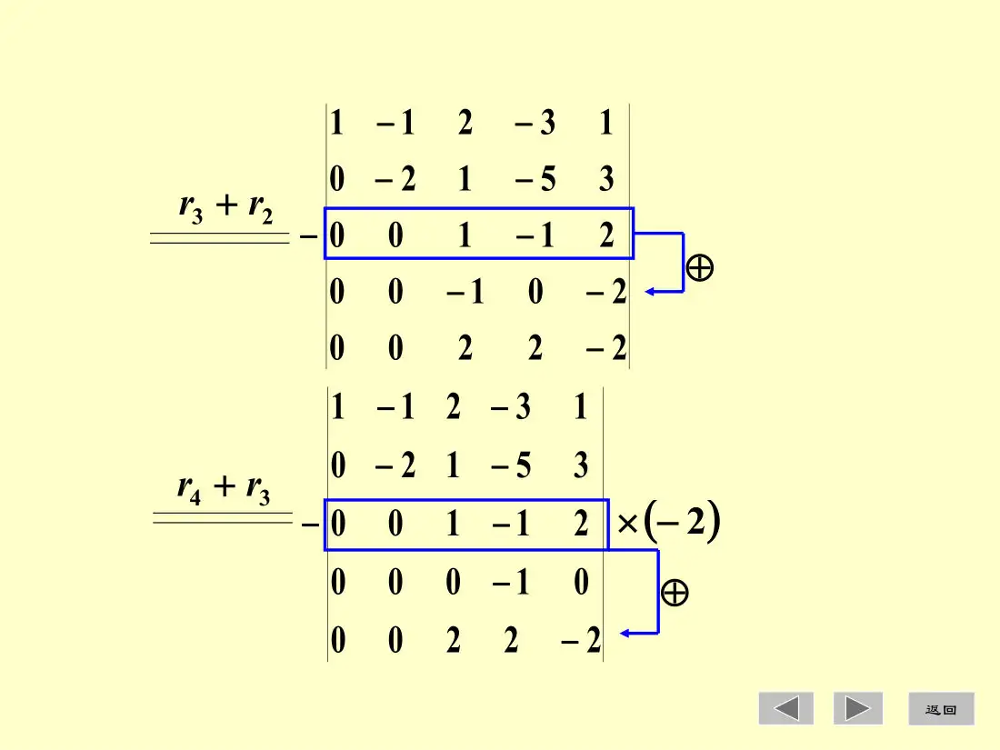

原文：

$$
\underline {{\underline {{r _ {3} + r _ {2}}}}} - \begin{array}{c c c c c} 1 & - 1 & 2 & - 3 & 1 \\ 0 & - 2 & 1 & - 5 & 3 \\ \hline 0 & 0 & 1 & - 1 & 2 \\ \hline 0 & 0 & - 1 & 0 & - 2 \\ 0 & 0 & 2 & 2 & - 2 \end{array} \textcircled {+}
$$

$$
\frac {r _ {4} + r _ {3}}{- \left| \begin{array}{r r r r r} 1 & - 1 & 2 & - 3 & 1 \\ 0 & - 2 & 1 & - 5 & 3 \\ \hline 0 & 0 & 1 & - 1 & 2 \\ \hline 0 & 0 & 0 & - 1 & 0 \\ 0 & 0 & 2 & 2 & - 2 \end{array} \right| \times (- 2)} \oplus
$$

◀ ▶

返回

### $$

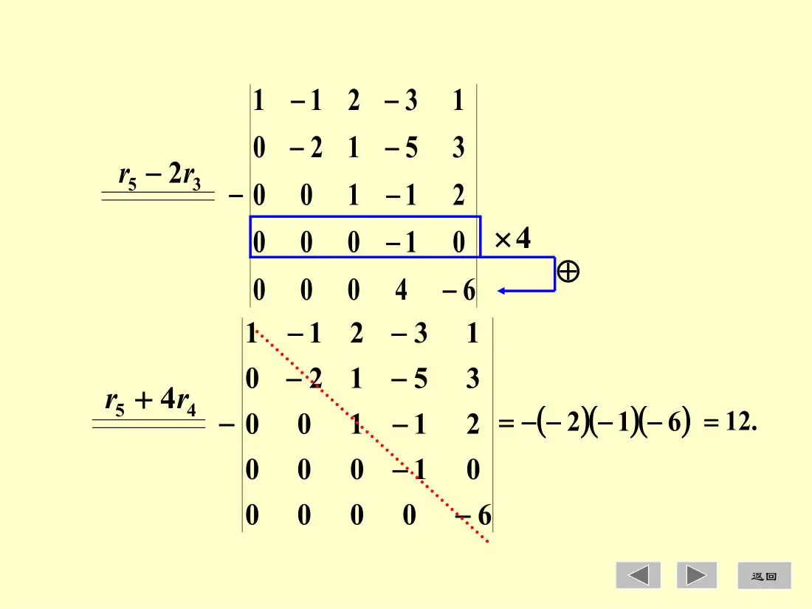

原文：

$$
\underline {{r _ {5} - 2 r _ {3}}} \quad - \begin{array}{c c c c c} 1 & - 1 & 2 & - 3 & 1 \\ 0 & - 2 & 1 & - 5 & 3 \\ 0 & 0 & 1 & - 1 & 2 \\ \hline 0 & 0 & 0 & - 1 & 0 \\ \hline 0 & 0 & 0 & 4 & - 6 \end{array} \times 4
$$

$$
\frac {r _ {5} + 4 r _ {4}}- \left| \begin{array}{c c c c c} 1 & - 1 & 2 & - 3 & 1 \\ 0 & - 2 & 1 & - 5 & 3 \\ 0 & 0 & 1 & - 1 & 2 \\ 0 & 0 & 0 & - 1 & 0 \\ 0 & 0 & 0 & 0 & - 6 \end{array} \right| = - (- 2) (- 1) (- 6) = 1 2.
$$

◀ ▶

返回

### ◀ △

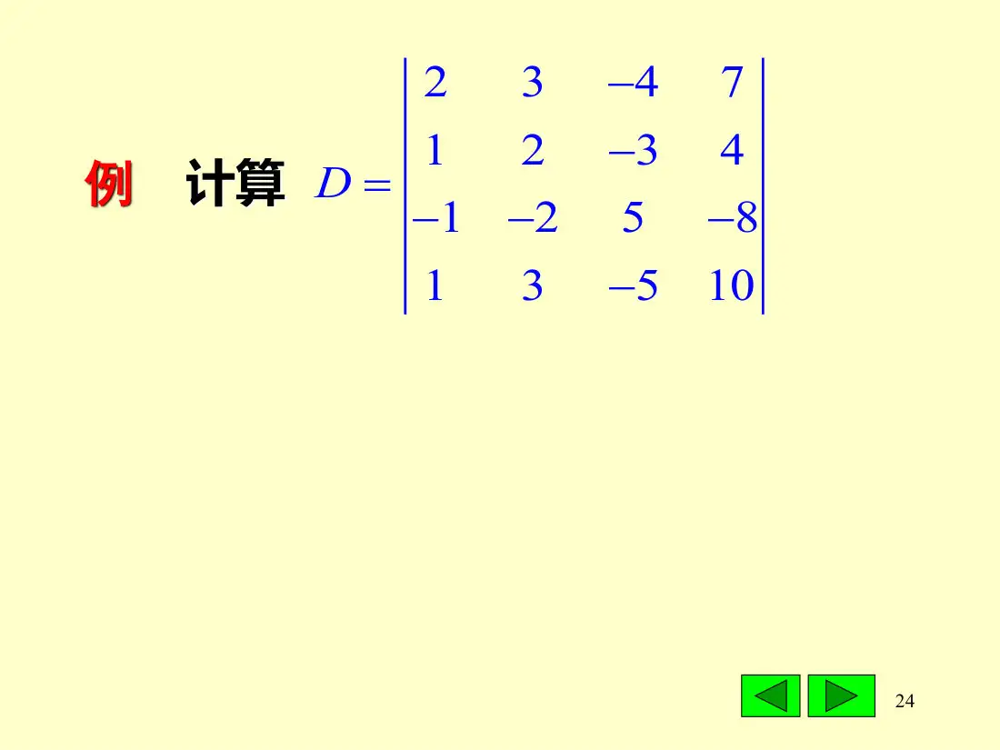

原文：

例 计算 $D=\begin{vmatrix}2&3&-4&7\\1&2&-3&4\\-1&-2&5&-8\\1&3&-5&10\end{vmatrix}$

◀ △

24

### 例 计算

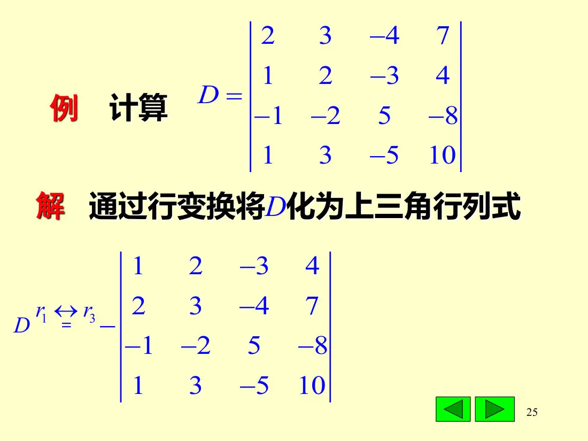

原文：

例 计算

$$
D = \left| \begin{array}{r r r r} 2 & 3 & - 4 & 7 \\ 1 & 2 & - 3 & 4 \\ - 1 & - 2 & 5 & - 8 \\ 1 & 3 & - 5 & 1 0 \end{array} \right|
$$

解 通过行变换将D化为上三角行列式

$$
D ^ {r _ {1} \leftrightarrow r _ {3}} = - \left| \begin{array}{c c c c} 1 & 2 & - 3 & 4 \\ 2 & 3 & - 4 & 7 \\ - 1 & - 2 & 5 & - 8 \\ 1 & 3 & - 5 & 1 0 \end{array} \right|
$$

◀ △

25

### $$

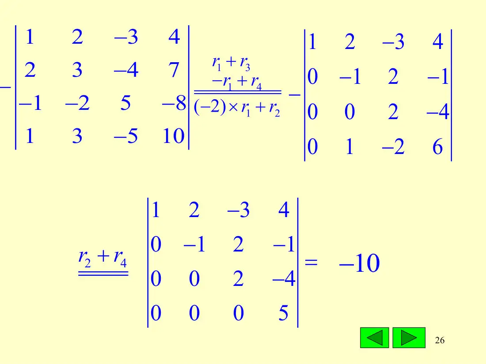

原文：

$$
- \left| \begin{array}{c c c c} 1 & 2 & - 3 & 4 \\ 2 & 3 & - 4 & 7 \\ - 1 & - 2 & 5 & - 8 \\ 1 & 3 & - 5 & 1 0 \end{array} \right| \frac {r _ {1} + r _ {3}}{\overline {{- r _ {1} + r _ {4}}}} - \left| \begin{array}{c c c c} 1 & 2 & - 3 & 4 \\ 0 & - 1 & 2 & - 1 \\ 0 & 0 & 2 & - 4 \\ 0 & 1 & - 2 & 6 \end{array} \right|
$$

$$
\underline {{\underline {{r _ {2} + r _ {4}}}}} \left| \begin{array}{c c c c} 1 & 2 & - 3 & 4 \\ 0 & - 1 & 2 & - 1 \\ 0 & 0 & 2 & - 4 \\ 0 & 0 & 0 & 5 \end{array} \right| = - 1 0
$$

◀ ▶

26

### 例2 计算 $n$ 阶行列式

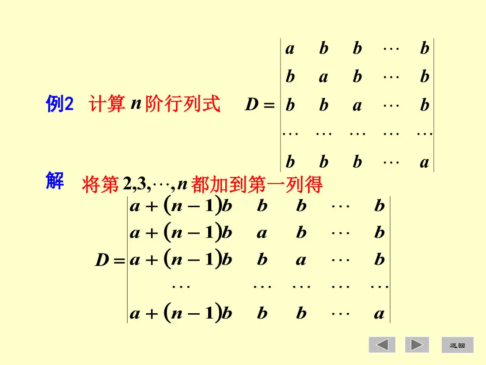

原文：

例2 计算 $n$ 阶行列式

$$
D = \left| \begin{array}{c c c c c} a & b & b & \dots & b \\ b & a & b & \dots & b \\ b & b & a & \dots & b \\ \dots & \dots & \dots & \dots & \dots \\ b & b & b & \dots & a \end{array} \right|
$$

解 将第 2,3,…,n 都加到第一列得

$$
D = \left| \begin{array}{c c c c c} a + (n - 1) b & b & b & \dots & b \\ a + (n - 1) b & a & b & \dots & b \\ a + (n - 1) b & b & a & \dots & b \\ \dots & \dots & \dots & \dots & \dots \\ a + (n - 1) b & b & b & \dots & a \end{array} \right|
$$

◀ ▶

返回

### $$

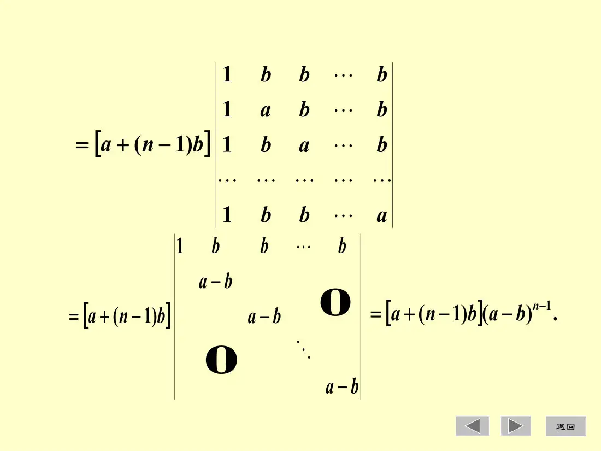

原文：

$$
= [ a + (n - 1) b ] \left| \begin{array}{c c c c c} 1 & b & b & \dots & b \\ 1 & a & b & \dots & b \\ 1 & b & a & \dots & b \\ \dots & \dots & \dots & \dots & \dots \\ 1 & b & b & \dots & a \end{array} \right|
$$

$$
= \left[ a + (n - 1) b \right] \left| \begin{array}{c c c c c} 1 & b & b & \dots & b \\ & a - b & & & \\ & & a - b & & \mathbf {O} \\ & \mathbf {O} & & \ddots & \\ & & & & a - b \end{array} \right| = \left[ a + (n - 1) b \right] (a - b) ^ {n - 1}.
$$

◀ ▶

返回

### 例5 计算

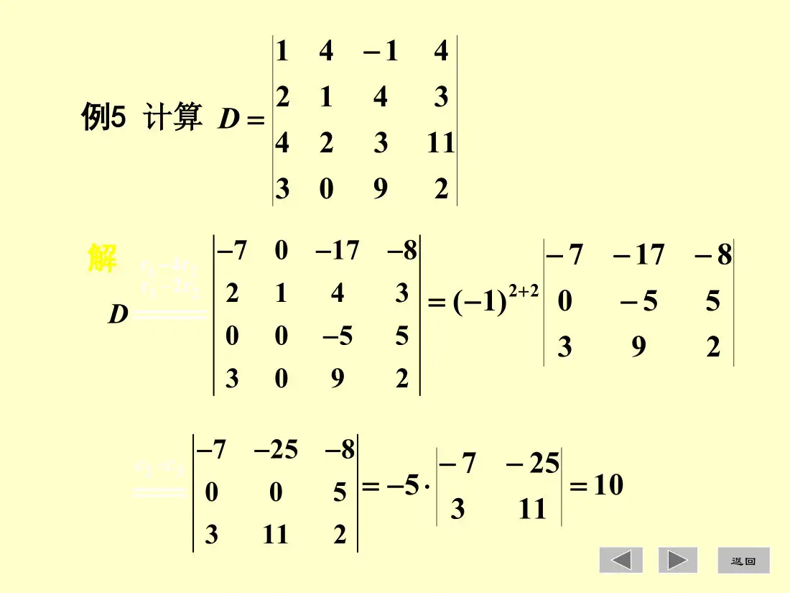

原文：

例5 计算

解

$\mathrm{r}_1 - 4\mathrm{r}_2$ $\mathrm{r}_3 - 2\mathrm{r}_2$

$$
D = \left| \begin{array}{c c c c} 1 & 4 & - 1 & 4 \\ 2 & 1 & 4 & 3 \\ 4 & 2 & 3 & 1 1 \\ 3 & 0 & 9 & 2 \end{array} \right|
$$

D

$$
\left| \begin{array}{c c c c} - 7 & 0 & - 1 7 & - 8 \\ 2 & 1 & 4 & 3 \\ 0 & 0 & - 5 & 5 \\ 3 & 0 & 9 & 2 \end{array} \right| = (- 1) ^ {2 + 2} \left| \begin{array}{c c c} - 7 & - 1 7 & - 8 \\ 0 & - 5 & 5 \\ 3 & 9 & 2 \end{array} \right|
$$

$$
\left| \begin{array}{c c c} - 7 & - 2 5 & - 8 \\ 0 & 0 & 5 \\ 3 & 1 1 & 2 \end{array} \right| = - 5 \cdot \left| \begin{array}{c c} - 7 & - 2 5 \\ 3 & 1 1 \end{array} \right| = 1 0
$$

◀ ▶

返回

### 例6 计算

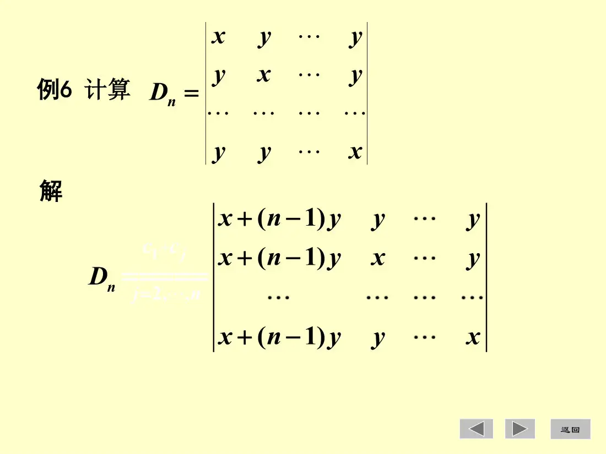

原文：

例6 计算

解

$$
D _ {n} = \left| \begin{array}{c c c c} x & y & \dots & y \\ y & x & \dots & y \\ \dots & \dots & \dots & \dots \\ y & y & \dots & x \end{array} \right|
$$

$$
D _ {n} \underset {j = 2, \dots , n} {\overset {c _ {1} + c _ {j}} {=}} \left| \begin{array}{c c c c} x + (n - 1) y & y & \dots & y \\ x + (n - 1) y & x & \dots & y \\ \dots & \dots & \dots & \dots \\ x + (n - 1) y & y & \dots & x \end{array} \right|
$$

◀ ▶

返回

### 提取公因子

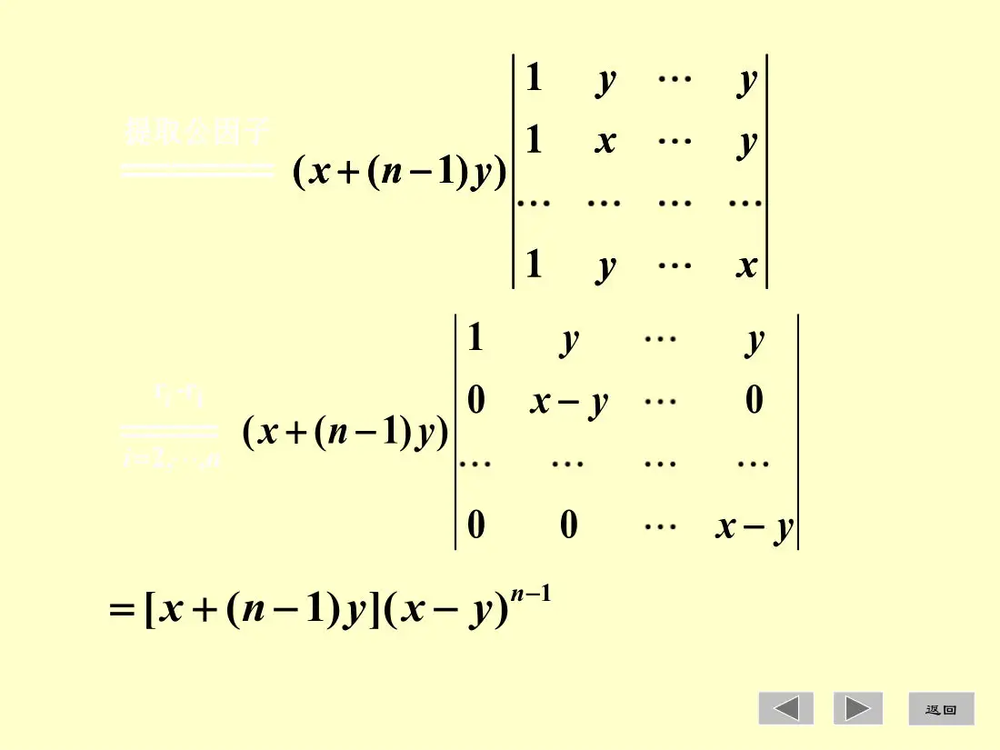

原文：

提取公因子

$$
(x + (n - 1) y) \left| \begin{array}{c c c c} 1 & y & \dots & y \\ 1 & x & \dots & y \\ \dots & \dots & \dots & \dots \\ 1 & y & \dots & x \end{array} \right|
$$

$r_{i}-r_{1}$ $i=2,\cdots,n$

$$
(x + (n - 1) y) \left| \begin{array}{c c c c} 1 & y & \dots & y \\ 0 & x - y & \dots & 0 \\ \dots & \dots & \dots & \dots \\ 0 & 0 & \dots & x - y \end{array} \right|
$$

$$
= [ x + (n - 1) y ] (x - y) ^ {n - 1}
$$

◀ ▶

返回

### 例7 证明范德蒙行列式(n≥2)

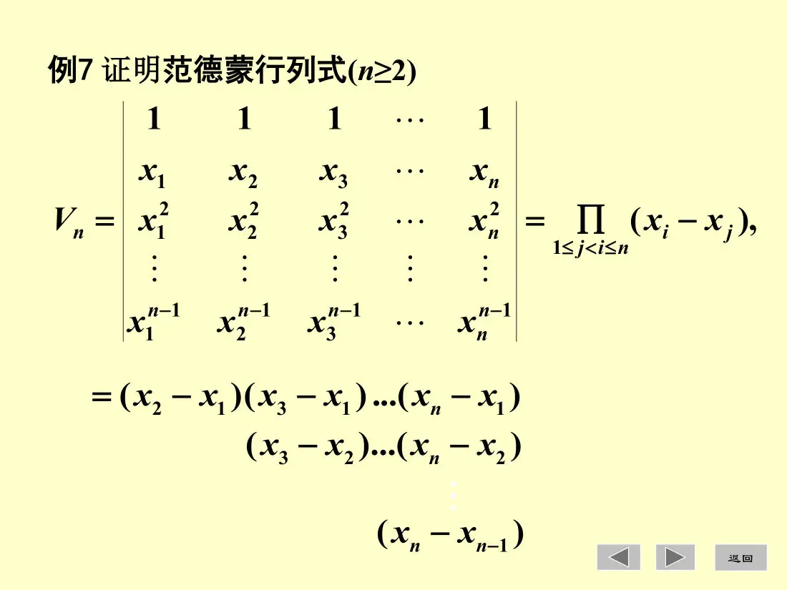

原文：

例7 证明范德蒙行列式(n≥2)

$$
\begin{array}{r l} & V _ {n} = \left| \begin{array}{c c c c c} 1 & 1 & 1 & \dots & 1 \\ x _ {1} & x _ {2} & x _ {3} & \dots & x _ {n} \\ x _ {1} ^ {2} & x _ {2} ^ {2} & x _ {3} ^ {2} & \dots & x _ {n} ^ {2} \\ \vdots & \vdots & \vdots & \vdots & \vdots \\ x _ {1} ^ {n - 1} & x _ {2} ^ {n - 1} & x _ {3} ^ {n - 1} & \dots & x _ {n} ^ {n - 1} \end{array} \right| = \prod_ {1 \leq j <   i \leq n} (x _ {i} - x _ {j}), \\ & = (x _ {2} - x _ {1}) (x _ {3} - x _ {1})... (x _ {n} - x _ {1}) \\ & \qquad (x _ {3} - x _ {2})... (x _ {n} - x _ {2}) \end{array}
$$

$$
(x _ {n} - x _ {n - 1})
$$

◀ ▶

返回

### 例7 证明范德蒙行列式 $(n \geq 2)$

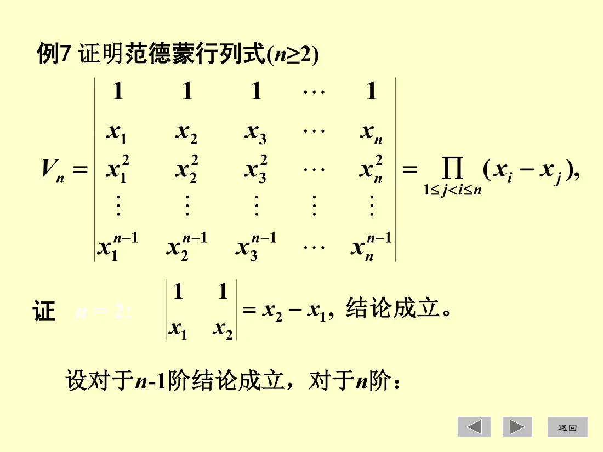

原文：

例7 证明范德蒙行列式 $(n \geq 2)$

$$
V _ {n} = \left| \begin{array}{c c c c c} 1 & 1 & 1 & \dots & 1 \\ x _ {1} & x _ {2} & x _ {3} & \dots & x _ {n} \\ x _ {1} ^ {2} & x _ {2} ^ {2} & x _ {3} ^ {2} & \dots & x _ {n} ^ {2} \\ \vdots & \vdots & \vdots & \vdots & \vdots \\ x _ {1} ^ {n - 1} & x _ {2} ^ {n - 1} & x _ {3} ^ {n - 1} & \dots & x _ {n} ^ {n - 1} \end{array} \right| = \prod_ {1 \leq j <   i \leq n} (x _ {i} - x _ {j}),
$$

证 $n = 2$ ： $\left| \begin{array}{cc}1 & 1\\ x_1 & x_2 \end{array} \right| = x_2 - x_1$ ，结论成立。

设对于n-1阶结论成立，对于n阶：

◀ ▶

返回

### $$

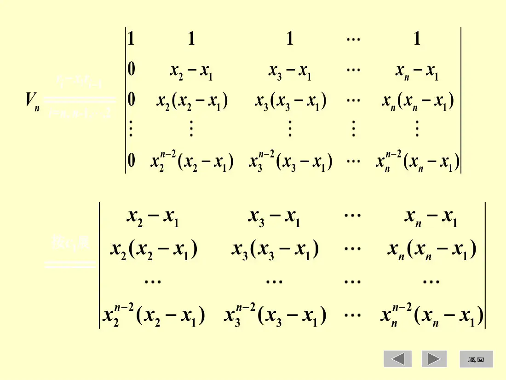

原文：

$$
V _ {n} \frac {r _ {i} - x _ {1} r _ {i - 1}}{i = n ,   n - 1 , \cdots , 2} \left| \begin{array}{c c c c c} 1 & 1 & 1 & \dots & 1 \\ 0 & x _ {2} - x _ {1} & x _ {3} - x _ {1} & \dots & x _ {n} - x _ {1} \\ 0 & x _ {2} (x _ {2} - x _ {1}) & x _ {3} (x _ {3} - x _ {1}) & \dots & x _ {n} (x _ {n} - x _ {1}) \\ \vdots & \vdots & \vdots & \vdots & \vdots \\ 0 & x _ {2} ^ {n - 2} (x _ {2} - x _ {1}) & x _ {3} ^ {n - 2} (x _ {3} - x _ {1}) & \dots & x _ {n} ^ {n - 2} (x _ {n} - x _ {1}) \end{array} \right|
$$

按 $c_{1}$ 展

$$
\left| \begin{array}{c c c c} x _ {2} - x _ {1} & x _ {3} - x _ {1} & \dots & x _ {n} - x _ {1} \\ x _ {2} (x _ {2} - x _ {1}) & x _ {3} (x _ {3} - x _ {1}) & \dots & x _ {n} (x _ {n} - x _ {1}) \\ \dots & \dots & \dots & \dots \\ x _ {2} ^ {n - 2} (x _ {2} - x _ {1}) & x _ {3} ^ {n - 2} (x _ {3} - x _ {1}) & \dots & x _ {n} ^ {n - 2} (x _ {n} - x _ {1}) \end{array} \right|
$$

◀ ▶

返回

### $$

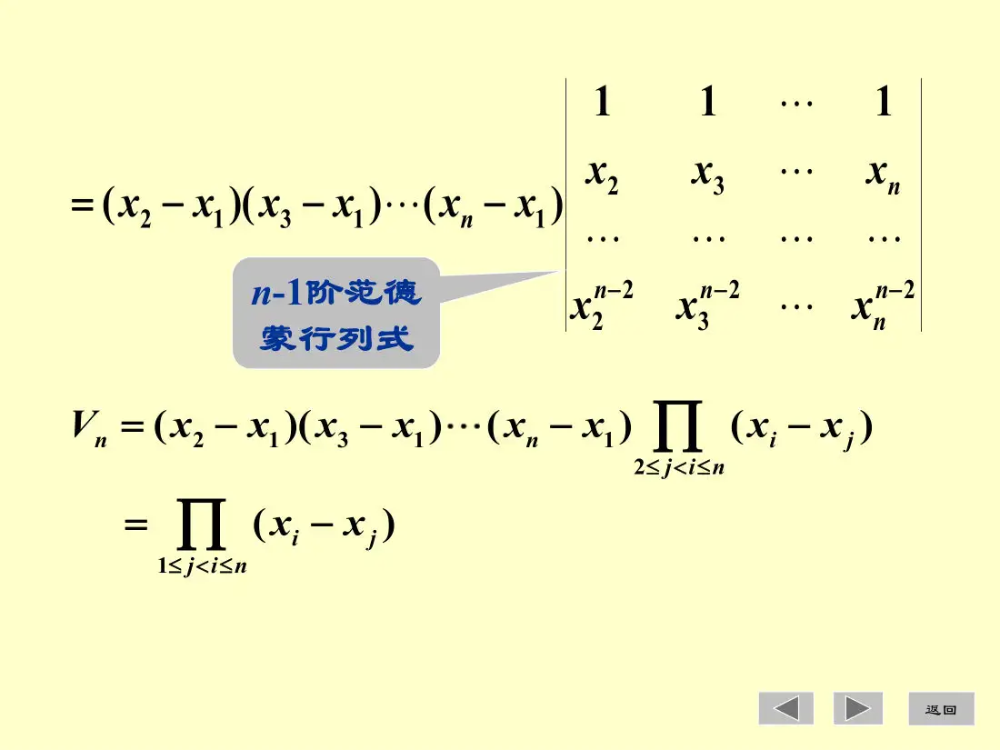

原文：

$$
= (x _ {2} - x _ {1}) (x _ {3} - x _ {1}) \dots (x _ {n} - x _ {1}) \left| \begin{array}{c c c c} 1 & 1 & \dots & 1 \\ x _ {2} & x _ {3} & \dots & x _ {n} \\ \dots & \dots & \dots & \dots \\ x _ {2} ^ {n - 2} & x _ {3} ^ {n - 2} & \dots & x _ {n} ^ {n - 2} \end{array} \right|
$$

$$
\begin{array}{l} V _ {n} = (x _ {2} - x _ {1}) (x _ {3} - x _ {1}) \dots (x _ {n} - x _ {1}) \prod_ {2 \leq j <   i \leq n} (x _ {i} - x _ {j}) \\ = \prod_ {1 \leq j <   i \leq n} (x _ {i} - x _ {j}) \end{array}
$$

◀ ▶

返回

### 例8

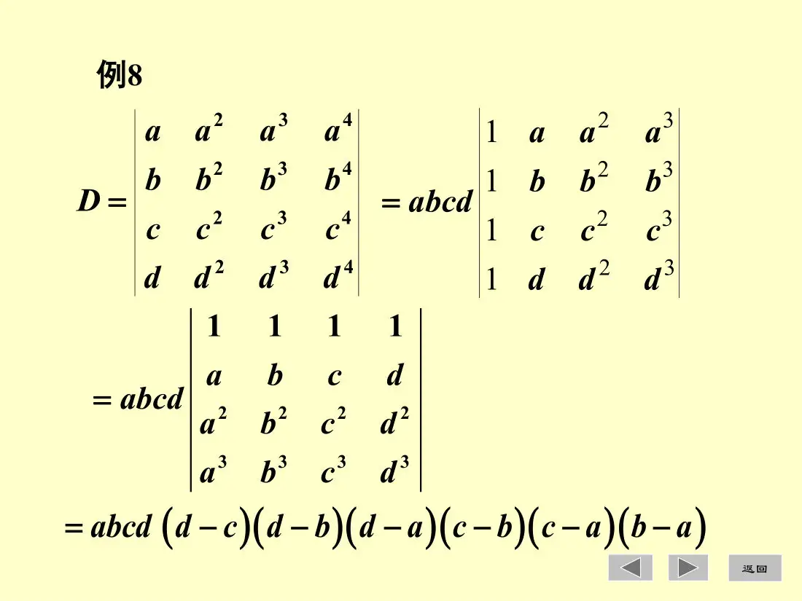

原文：

例8

$$
D = \left| \begin{array}{c c c c} a & a ^ {2} & a ^ {3} & a ^ {4} \\ b & b ^ {2} & b ^ {3} & b ^ {4} \\ c & c ^ {2} & c ^ {3} & c ^ {4} \\ d & d ^ {2} & d ^ {3} & d ^ {4} \end{array} \right| = a b c d \left| \begin{array}{c c c c} 1 & a & a ^ {2} & a ^ {3} \\ 1 & b & b ^ {2} & b ^ {3} \\ 1 & c & c ^ {2} & c ^ {3} \\ 1 & d & d ^ {2} & d ^ {3} \end{array} \right|
$$

$$
\begin{array}{r l} & = a b c d \left| \begin{array}{c c c c} 1 & 1 & 1 & 1 \\ a & b & c & d \\ a ^ {2} & b ^ {2} & c ^ {2} & d ^ {2} \\ a ^ {3} & b ^ {3} & c ^ {3} & d ^ {3} \end{array} \right| \\ & = a b c d (d - c) (d - b) (d - a) (c - b) (c - a) (b - a) \end{array}
$$

◀ ▶

返回

### 例9 计算

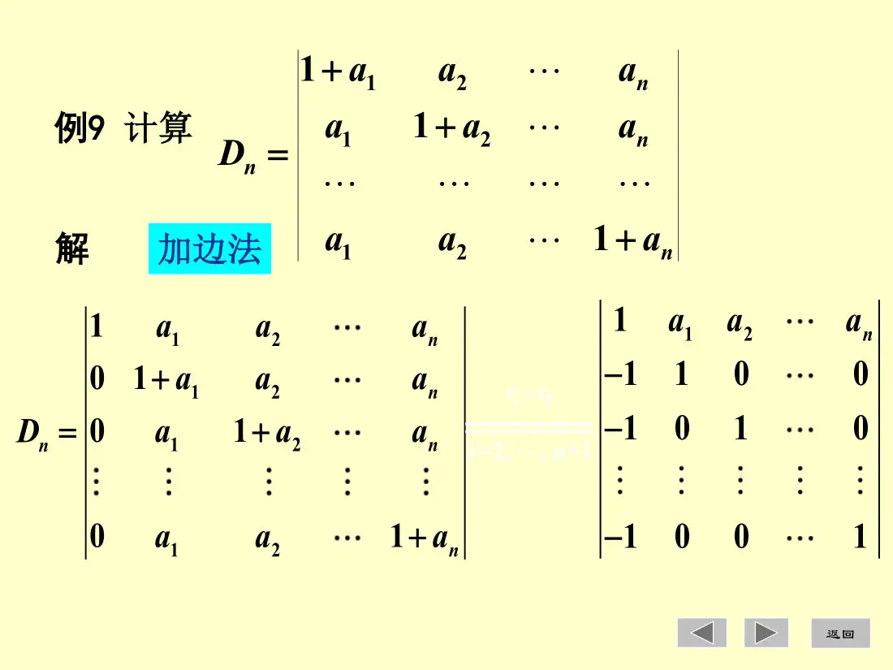

原文：

例9 计算

解

$$
D _ {n} = \left| \begin{array}{c c c c} 1 + a _ {1} & a _ {2} & \dots & a _ {n} \\ a _ {1} & 1 + a _ {2} & \dots & a _ {n} \\ \dots & \dots & \dots & \dots \\ a _ {1} & a _ {2} & \dots & 1 + a _ {n} \end{array} \right|
$$

加边法

$$
D _ {n} = \left| \begin{array}{c c c c c} 1 & a _ {1} & a _ {2} & \dots & a _ {n} \\ 0 & 1 + a _ {1} & a _ {2} & \dots & a _ {n} \\ 0 & a _ {1} & 1 + a _ {2} & \dots & a _ {n} \\ \vdots & \vdots & \vdots & \vdots & \vdots \\ 0 & a _ {1} & a _ {2} & \dots & 1 + a _ {n} \end{array} \right| \overset {r _ {i} - r _ {1}} {\underset {i = 2, \dots , n + 1} {\longrightarrow}} \left| \begin{array}{c c c c c} 1 & a _ {1} & a _ {2} & \dots & a _ {n} \\ - 1 & 1 & 0 & \dots & 0 \\ - 1 & 0 & 1 & \dots & 0 \\ \vdots & \vdots & \vdots & \vdots & \vdots \\ - 1 & 0 & 0 & \dots & 1 \end{array} \right|
$$

◀ ▶

返回

### $$

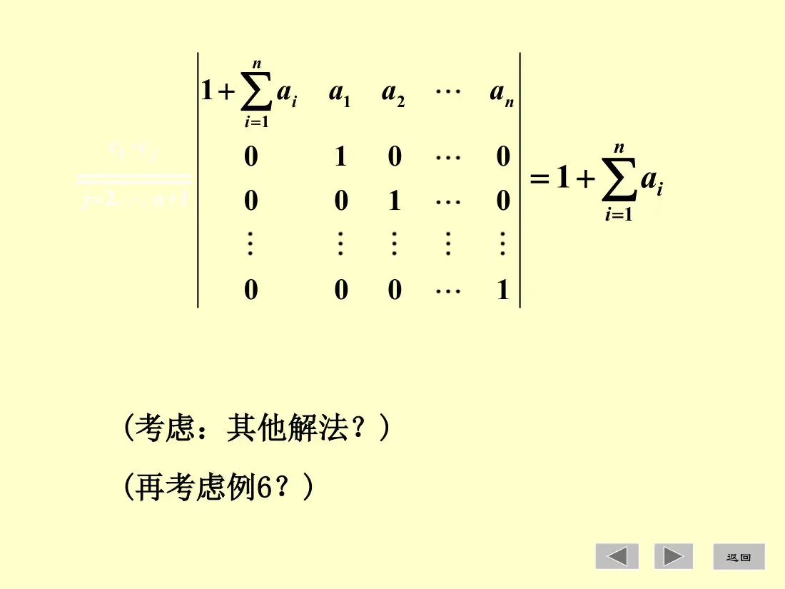

原文：

$$
\frac {c _ {1} + c _ {j}}{j = 2 , \cdots , n + 1} \left| \begin{array}{c c c c c} 1 + \sum_ {i = 1} ^ {n} a _ {i} & a _ {1} & a _ {2} & \dots & a _ {n} \\ 0 & 1 & 0 & \dots & 0 \\ 0 & 0 & 1 & \dots & 0 \\ \vdots & \vdots & \vdots & \vdots & \vdots \\ 0 & 0 & 0 & \dots & 1 \end{array} \right| = 1 + \sum_ {i = 1} ^ {n} a _ {i}
$$

(考虑：其他解法？)

(再考虑例6？)

◀ ▶

返回

### 解二

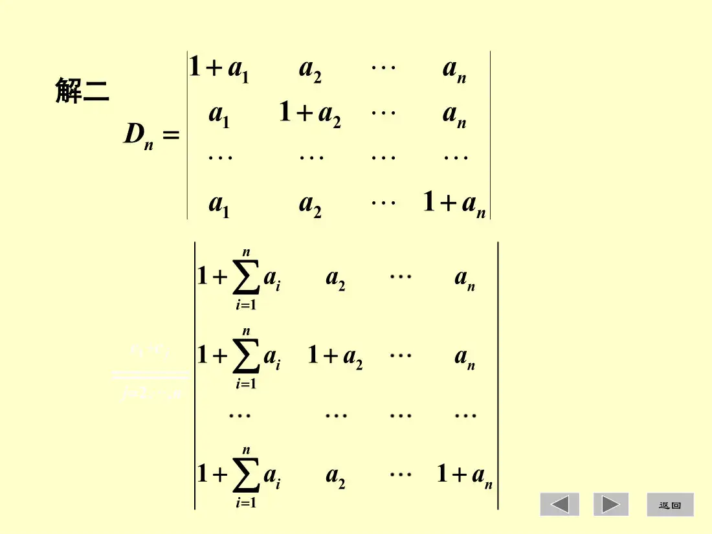

原文：

解二

$$
D _ {n} = \left| \begin{array}{c c c c} 1 + a _ {1} & a _ {2} & \dots & a _ {n} \\ a _ {1} & 1 + a _ {2} & \dots & a _ {n} \\ \dots & \dots & \dots & \dots \\ a _ {1} & a _ {2} & \dots & 1 + a _ {n} \end{array} \right|
$$

$$
\frac {c _ {1} + c _ {j}}{j = 2 , \cdots , n} \left| \begin{array}{c c c c} 1 + \sum_ {i = 1} ^ {n} a _ {i} & a _ {2} & \dots & a _ {n} \\ 1 + \sum_ {i = 1} ^ {n} a _ {i} & 1 + a _ {2} & \dots & a _ {n} \\ \dots & \dots & \dots & \dots \\ 1 + \sum_ {i = 1} ^ {n} a _ {i} & a _ {2} & \dots & 1 + a _ {n} \end{array} \right|
$$

◀ ▶

返回

### $$

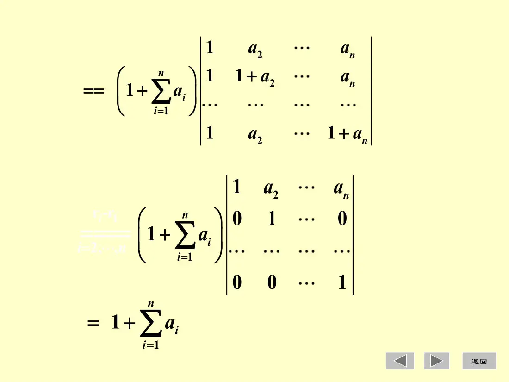

原文：

$$
= = \left(1 + \sum_ {i = 1} ^ {n} a _ {i}\right) \left| \begin{array}{c c c c} 1 & a _ {2} & \dots & a _ {n} \\ 1 & 1 + a _ {2} & \dots & a _ {n} \\ \dots & \dots & \dots & \dots \\ 1 & a _ {2} & \dots & 1 + a _ {n} \end{array} \right|
$$

$$
\begin{array}{r l} & \underset {i = 2, \dots , n} {\overset {r _ {i} - r _ {1}} {=}} \left(1 + \sum_ {i = 1} ^ {n} a _ {i}\right) \left| \begin{array}{c c c c} 1 & a _ {2} & \dots & a _ {n} \\ 0 & 1 & \dots & 0 \\ \dots & \dots & \dots & \dots \\ 0 & 0 & \dots & 1 \end{array} \right| \\ & = 1 + \sum_ {i = 1} ^ {n} a _ {i} \end{array}
$$

◀ ▶

返回

### 计算行列式的方法归纳及综合运用：

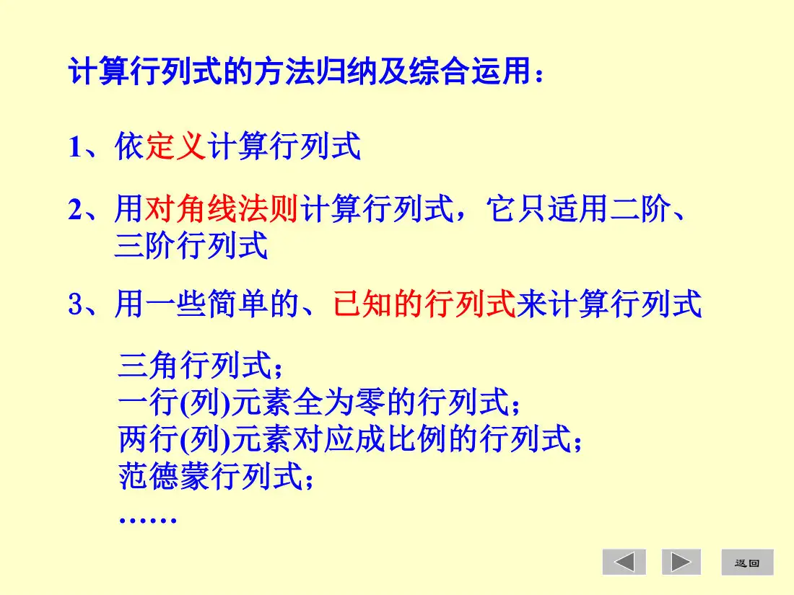

原文：

计算行列式的方法归纳及综合运用：

1、依定义计算行列式

2、用对角线法则计算行列式，它只适用二阶、三阶行列式

3、用一些简单的、已知的行列式来计算行列式
三角行列式；
一行(列)元素全为零的行列式；
两行(列)元素对应成比例的行列式；
范德蒙行列式；

◀ ▶

返回

### 4、用行列式性质对行列式进行变形，化成已知的或容易计算的行列式

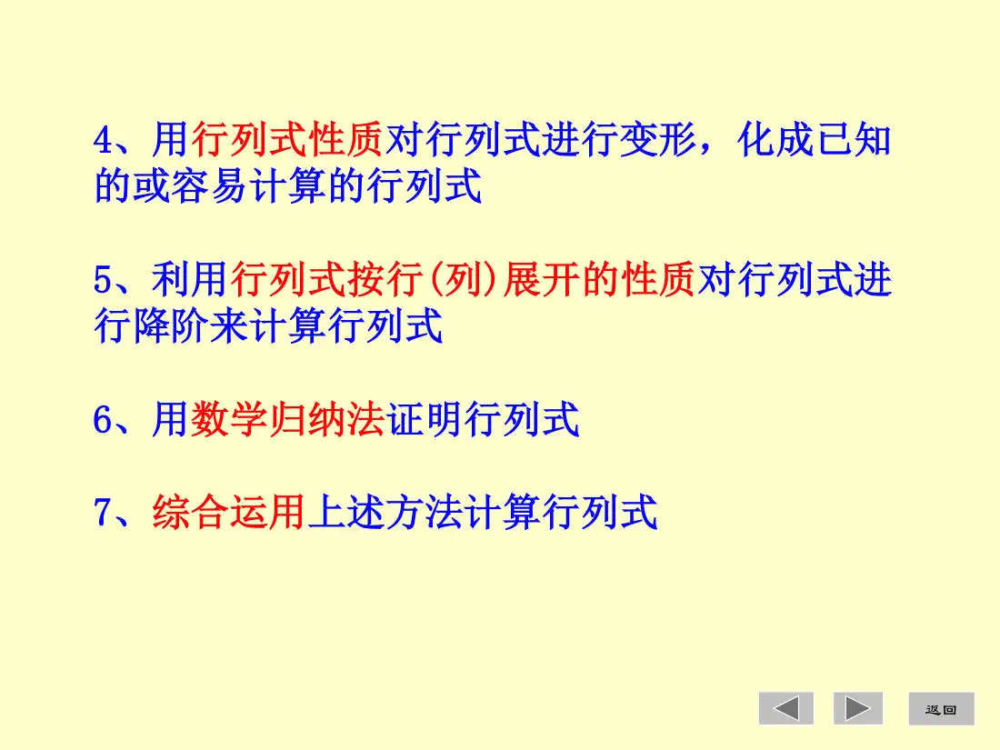

原文：

4、用行列式性质对行列式进行变形，化成已知的或容易计算的行列式

5、利用行列式按行(列)展开的性质对行列式进行降阶来计算行列式

6、用数学归纳法证明行列式

7、综合运用上述方法计算行列式

◀ ▶

返回

### 例10 计算4阶行列式

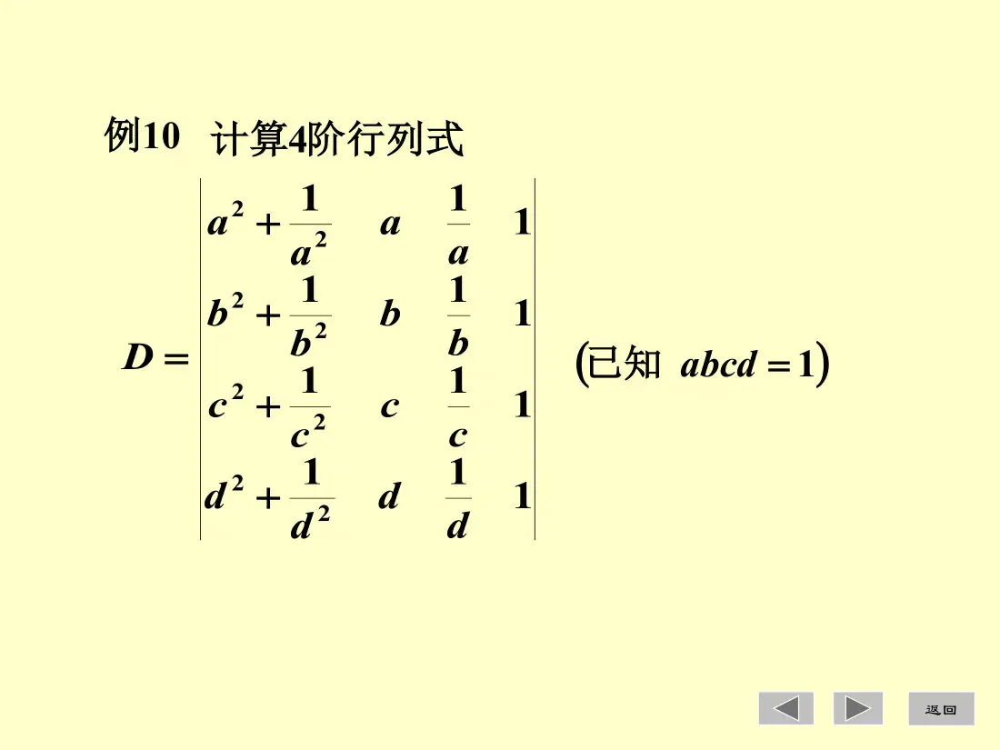

原文：

例10 计算4阶行列式

$$
D = \left| \begin{array}{c c c c} a ^ {2} + \frac {1}{a ^ {2}} & a & \frac {1}{a} & 1 \\ b ^ {2} + \frac {1}{b ^ {2}} & b & \frac {1}{b} & 1 \\ c ^ {2} + \frac {1}{c ^ {2}} & c & \frac {1}{c} & 1 \\ d ^ {2} + \frac {1}{d ^ {2}} & d & \frac {1}{d} & 1 \end{array} \right|
$$

(已知 abcd = 1)

◀ ▶

返回

### $$

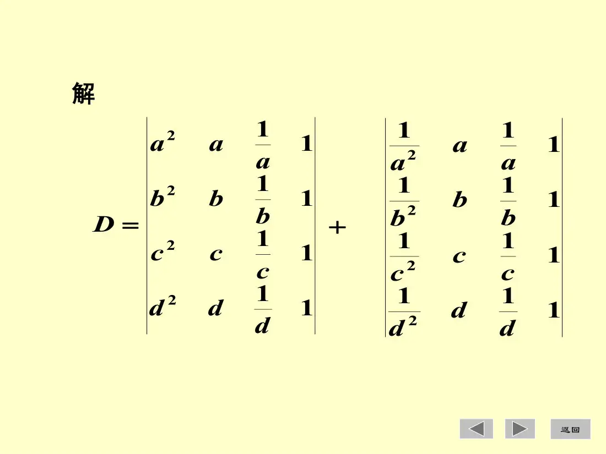

原文：

解

$$
D = \left| \begin{array}{c c c c} a ^ {2} & a & \frac {1}{a} & 1 \\ b ^ {2} & b & \frac {1}{b} & 1 \\ c ^ {2} & c & \frac {1}{c} & 1 \\ d ^ {2} & d & \frac {1}{d} & 1 \end{array} \right| + \left| \begin{array}{c c c c} \frac {1}{a ^ {2}} & a & \frac {1}{a} & 1 \\ \frac {1}{b ^ {2}} & b & \frac {1}{b} & 1 \\ \frac {1}{c ^ {2}} & c & \frac {1}{c} & 1 \\ \frac {1}{d ^ {2}} & d & \frac {1}{d} & 1 \end{array} \right|
$$

◀ ▶

返回

### $$

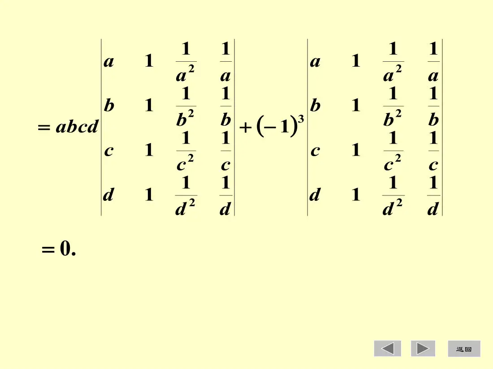

原文：

$$
= a b c d \left| \begin{array}{c c c c} a & 1 & \frac {1}{a ^ {2}} & \frac {1}{a} \\ b & 1 & \frac {1}{b ^ {2}} & \frac {1}{b} \\ c & 1 & \frac {1}{c ^ {2}} & \frac {1}{c} \\ d & 1 & \frac {1}{d ^ {2}} & \frac {1}{d} \end{array} \right| + (- 1) ^ {3} \left| \begin{array}{c c c c} a & 1 & \frac {1}{a ^ {2}} & \frac {1}{a} \\ b & 1 & \frac {1}{b ^ {2}} & \frac {1}{b} \\ c & 1 & \frac {1}{c ^ {2}} & \frac {1}{c} \\ d & 1 & \frac {1}{d ^ {2 .}} & \frac {1}{d} \end{array} \right|
$$

◀ ▶

返回

### 思考题1

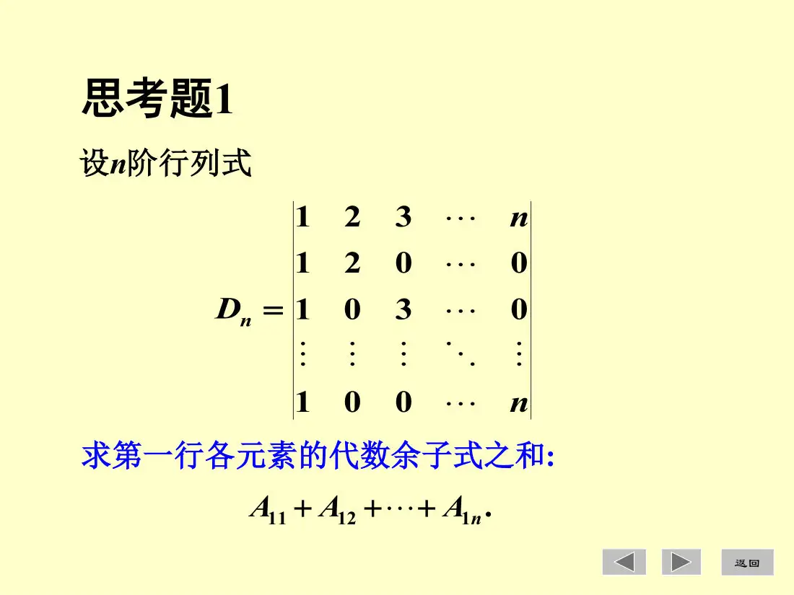

原文：

思考题1

设n阶行列式

$$
D _ {n} = \left| \begin{array}{c c c c c} 1 & 2 & 3 & \dots & n \\ 1 & 2 & 0 & \dots & 0 \\ 1 & 0 & 3 & \dots & 0 \\ \vdots & \vdots & \vdots & \ddots & \vdots \\ 1 & 0 & 0 & \dots & n \end{array} \right|
$$

求第一行各元素的代数余子式之和:

$$
A _ {1 1} + A _ {1 2} + \dots + A _ {1 n}.
$$

◀ ▶

返回

### 解 第一行各元素的代数余子式之和可以表示成

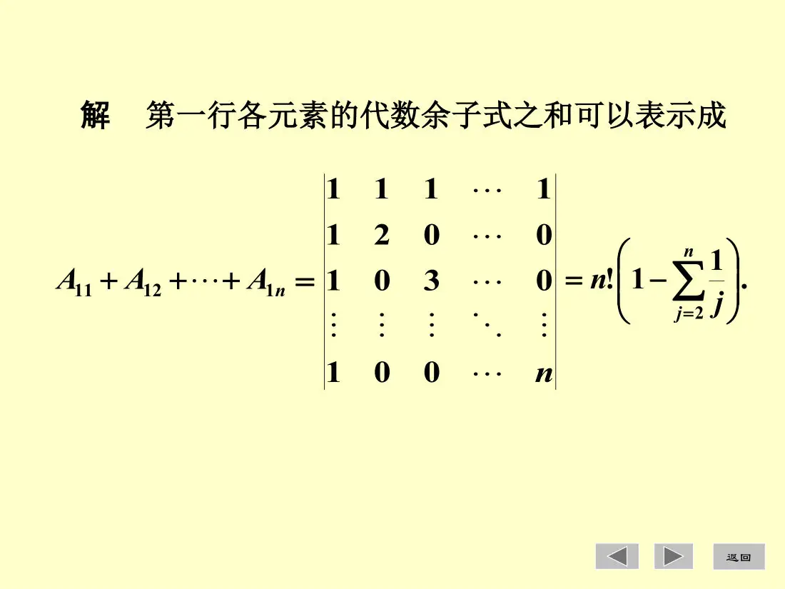

原文：

解 第一行各元素的代数余子式之和可以表示成

$$
A _ {1 1} + A _ {1 2} + \dots + A _ {1 n} = \left| \begin{array}{c c c c c} 1 & 1 & 1 & \dots & 1 \\ 1 & 2 & 0 & \dots & 0 \\ 1 & 0 & 3 & \dots & 0 \\ \vdots & \vdots & \vdots & \ddots & \vdots \\ 1 & 0 & 0 & \dots & n \end{array} \right| = n! \left(1 - \sum_ {j = 2} ^ {n} \frac {1}{j}\right).
$$

◀ ▶

返回

### 思考题2

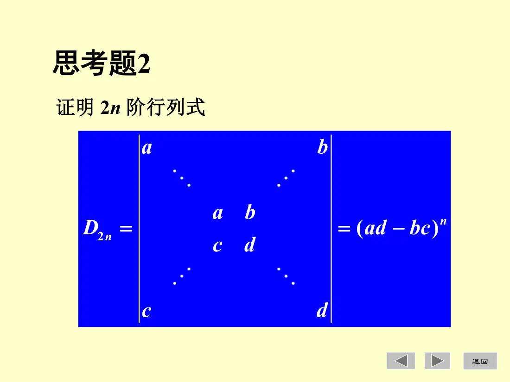

原文：

思考题2

证明 $2n$ 阶行列式

$$
D _ {2 n} = \left| \begin{array}{c c c c c} a & & & & b \\ & \ddots & & \ddots \\ & & a & b \\ & & c & d \\ & \ddots & & \ddots \\ c & & & & d \end{array} \right| = (a d - b c) ^ {n}
$$

◀ ▶

返回

### 证一：

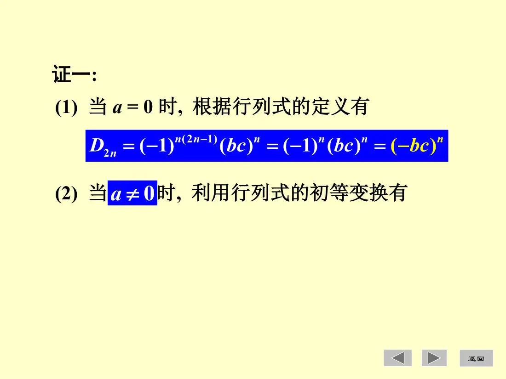

原文：

证一：

(1) 当 $a = 0$ 时, 根据行列式的定义有

$$
D _ {2 n} = (- 1) ^ {n (2 n - 1)} (b c) ^ {n} = (- 1) ^ {n} (b c) ^ {n} = (- b c) ^ {n}
$$

(2) 当 $a \neq 0$ 时, 利用行列式的初等变换有

◀ ▶

返回

### $$

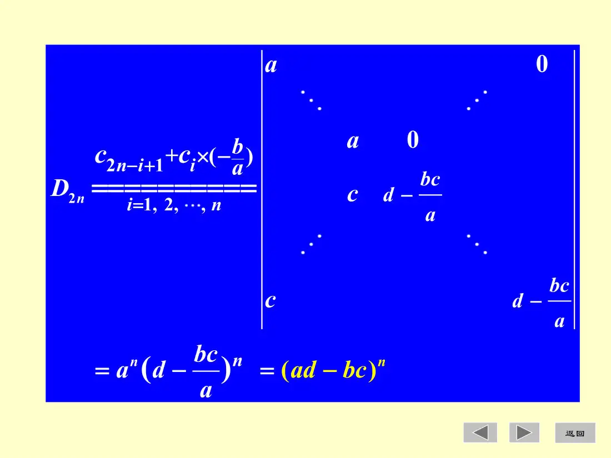

原文：

$$
c _ {2 n - i + 1} + c _ {i} \times (- \frac {b}{a})
$$

$$
c \quad d - \frac {b c}{a}
$$

$$
d - \frac {b c}{a}
$$

$$
= a ^ {n} \left(d - \frac {b c}{a}\right) ^ {n} = (a d - b c) ^ {n}
$$

◀ ▶

返回

### $$

原文：

证二：将行列式第 2n 行依次与第2n-1行，…，第2行对调(作2n-2次相邻对换)，再把第2n列依次与2n-1列，…，第2列对调，得

$$
D _ {2 n} = \left| \begin{array}{c c c c c c c c c} a & b & & & & & & \\ c & d & & & & & & \\ & & a & & & & & b \\ & & & \ddots & & & \ddots & \\ & & & & a & b & & \\ & & & c & d & & \ddots & \\ & & \ddots & & & \ddots & \\ c & & & & & d \end{array} \right|
$$

$$
\left| \begin{array}{c c} A & O \\ O & B \end{array} \right| = | A | | B |
$$

◀ ▶

返回

### 思考题3

原文：

思考题3

计算

$$
D _ {n} = x D _ {n - 1} + a _ {n}
$$

解

按第一列展开

$$
\left| \begin{array}{c c c c c c} x & - 1 & 0 & \ldots & 0 & 0 \\ 0 & x & - 1 & \ldots & 0 & 0 \\ 0 & 0 & x & \ldots & 0 & 0 \\ \ldots & \ldots & \ldots & \ldots & \ldots & \ldots \\ 0 & 0 & 0 & \ldots & x & - 1 \\ a _ {n} & a _ {n - 1} & a _ {n - 2} & \ldots & a _ {2} & x + a _ {1} \end{array} \right|
$$

$$
\left| \begin{array}{cccccc} x & - 1 & 0 & \dots & 0 & 0 \\ 0 & x & - 1 & \dots & 0 & 0 \\ 0 & 0 & x & \dots & 0 & 0 \\ \dots & \dots & \dots & \dots & \dots & \dots \\ 0 & 0 & 0 & \dots & x & - 1 \\ a _ {n - 1} & a _ {n - 2} & a _ {n - 3} & \dots & a _ {2} & x + a _ {1} \\ \end{array} \right|
$$

$$
+ (- 1) ^ {n + 1} a _ {n} (- 1) ^ {n - 1}
$$

◀ ▶

返回

### $$

原文：

$$
D _ {n} = x D _ {n - 1} + a _ {n}
$$

$$
D _ {n - 1} = x D _ {n - 2} + a _ {n - 1}
$$

$$
D _ {n - 2} = x D _ {n - 3} + a _ {n - 2}
$$

●●●●●●

$$
D _ {2} = \left| \begin{array}{c c} x & - 1 \\ a _ {2} & x + a _ {1} \end{array} \right| = x D _ {1} + a _ {2}
$$

$$
D _ {1} = x + a _ {1}
$$

$$
\therefore D _ {n} = x ^ {n} + a _ {1} x ^ {n - 1} + a _ {2} x ^ {n - 2} + \dots + a _ {n - 1} x + a _ {n}
$$

◀ ▶

返回

### (5)

原文：

(5)

$$
\left| \begin{array}{c c c c c c} 1 & 2 & 2 & ... & 2 & 2 \\ 2 & 2 & 2 & ... & 2 & 2 \\ 2 & 2 & 3 & ... & 2 & 2 \\ ... & ... & ... & ... & ... & ... \\ 2 & 2 & 2 & ... & n - 1 & 2 \\ 2 & 2 & 2 & ... & 2 & n \end{array} \right|
$$

$$
\begin{array}{c} \underline {{\underline {{r _ {i} - r _ {2}}}}} \\ i = 3, L , n \end{array} \left| \begin{array}{c c c c c c} 1 & 2 & 2 & ... & 2 & 2 \\ 2 & 2 & 2 & ... & 2 & 2 \\ 0 & 0 & 1 & ... & 0 & 0 \\ ... & ... & ... & ... & ... & ... \\ 0 & 0 & 0 & ... & n - 3 & 0 \\ 0 & 0 & 0 & ... & 0 & n - 2 \end{array} \right|
$$

$$
\left| \begin{array}{c c c c c c} 1 & 2 & 2 & \ldots & 2 & 2 \\ 0 & - 2 & - 2 & \ldots & - 2 & - 2 \\ 0 & 0 & 1 & \ldots & 0 & 0 \\ \ldots & \ldots & \ldots & \ldots & \ldots & \ldots \\ 0 & 0 & 0 & \ldots & n - 3 & 0 \\ 0 & 0 & 0 & \ldots & 0 & n - 2 \end{array} \right|
$$

$$
= - 2 (n - 2)!
$$

◀ ▶

返回

### (5)

原文：

(5)

$$
\left| \begin{array}{c c c c c c} 1 & 2 & 2 & \ldots & 2 & 2 \\ 2 & 2 & 2 & \ldots & 2 & 2 \\ 2 & 2 & 3 & \ldots & 2 & 2 \\ \ldots & \ldots & \ldots & \ldots & \ldots & \ldots \\ 2 & 2 & 2 & \ldots & n - 1 & 2 \\ 2 & 2 & 2 & \ldots & 2 & n \end{array} \right| \overset {r _ {i} - r _ {2}} {\underset {i = 1, 3, L , n} {=}} \left| \begin{array}{c c c c c c} - 1 & 0 & 0 & \ldots & 0 & 0 \\ 2 & 2 & 2 & \ldots & 2 & 2 \\ 0 & 0 & 1 & \ldots & 0 & 0 \\ \ldots & \ldots & \ldots & \ldots & \ldots & \ldots \\ 0 & 0 & 0 & \ldots & n - 3 & 0 \\ 0 & 0 & 0 & \ldots & 0 & n - 2 \end{array} \right|
$$

$$
\begin{array}{c c} \hline r _ {2 + 2} r _ {1} & \left| \begin{array}{l l l l l l} - 1 & 0 & 0 & \dots & 0 & 0 \\ 0 & 2 & 2 & \dots & 2 & 2 \\ 0 & 0 & 1 & \dots & 0 & 0 \\ \dots & \dots & \dots & \dots & \dots & \dots \\ 0 & 0 & 0 & \dots & n - 3 & 0 \\ 0 & 0 & 0 & \dots & 0 & n - 2 \end{array} \right| = - 2 (n - 2)! \\ \hline \end{array}
$$

返回

### $$

原文：

$$
D = \left| \begin{array}{c c c c} 1 & 4 & 9 & 1 6 \\ 4 & 9 & 1 6 & 2 5 \\ 9 & 1 6 & 2 5 & 3 6 \\ 1 6 & 2 5 & 3 6 & 4 9 \end{array} \right| \quad \begin{array}{c c c c} c _ {4} - c _ {3} & 1 & 3 & 5 & 7 \\ c _ {3} - c _ {2} & 4 & 5 & 7 & 9 \\ \overline \overline \overline \overline \overline \overline \overline \overline {{\overline {{\overline {{\overline {{\overline {{\overline {{\overline {{\overline {{\overline {{\overline {{\overline {{\overline {{\overline {{\overline {{\overline {{\overline {{\overline {{\overline {{\overline {{}}}}}}}}}}}}}}}}}}}}}}}}}}}}}}}}}}}}}} & c _ {2} - c _ {1} & 9 & 7 & 9 & 1 1 \\ & & 1 6 & 9 & 1 1 & 1 3 \end{array}\tag{6}
$$

$$
\begin{array}{c c c c c} & 1 & 3 & 2 & 2 \\ \hline c _ {4} - c _ {3} & 4 & 5 & 2 & 2 \\ \hline c _ {3} - c _ {2} & 9 & 7 & 2 & 2 \\ & 1 6 & 9 & 2 & 2 \end{array}
$$

$$
= 0
$$

◀ ▶

返回

### $$

原文：

$$
D = \left| \begin{array}{c c c c} 1 & 4 & 9 & 1 6 \\ 4 & 9 & 1 6 & 2 5 \\ 9 & 1 6 & 2 5 & 3 6 \\ 1 6 & 2 5 & 3 6 & 4 9 \end{array} \right| \overset {r _ {3} - r _ {2}} {\underset {r _ {4} - r _ {1}} {=}} \left| \begin{array}{c c c c} 1 & 4 & 9 & 1 6 \\ 4 & 9 & 1 6 & 2 5 \\ 5 & 7 & 9 & 1 1 \\ 1 5 & 2 1 & 2 7 & 3 3 \end{array} \right|\tag{6}
$$

两行对应成比列

◀ ▶

返回

### 推广

原文：

推广

$$
D = \left| \begin{array}{c c c c} a ^ {2} & (a + 1) ^ {2} & (a + 2) ^ {2} & (a + 3) ^ {2} \\ (a + 1) ^ {2} & (a + 2) ^ {2} & (a + 3) ^ {2} & (a + 4) ^ {2} \\ (a + 2) ^ {2} & (a + 3) ^ {2} & (a + 4) ^ {2} & (a + 5) ^ {2} \\ (a + 3) ^ {2} & (a + 4) ^ {2} & (a + 5) ^ {2} & (a + 6) ^ {2} \end{array} \right|
$$

$$
= 0
$$

◀ ▶

返回

### 下面讨论将 $n$ 阶行列式转化为 $n - 1$ 阶行列式计算的问题, 即

原文：

下面讨论将 $n$ 阶行列式转化为 $n - 1$ 阶行列式计算的问题, 即

1.3 行列式展开定理

定义 在给定的n阶行列式 $=|a_{ij}|$ 中,把元素 $a_{ij}$ 所在的i行和j列的元素划去,剩余元素构成的n-1阶行列式称为元素 $a_{ij}$ 的余子式,记作 $M_{ij}$ ;而元素 $a_{ij}$ 的代数余子式记作 $A_{ij}$

$$
A _ {i j} = (- 1) ^ {i + j} M _ {i j}
$$

◀ ▶

59

### $$

原文：

$$
M _ {i j} = \left| \begin{array}{c c c c c} a _ {1 1} & \dots & a _ {1 j} & \dots & a _ {1 n} \\ \vdots & & \vdots & & \vdots \\ \vdots & & \vdots & & \vdots \\ \hline a _ {i 1} & \dots & a _ {i j} & \dots & a _ {i n} \\ \vdots & & \vdots & & \vdots \\ \vdots & & \vdots & & \vdots \\ a _ {n 1} & \dots & a _ {n j} & \dots & a _ {n n} \end{array} \right|
$$

◀ ▶

60

### 则 $D = a_{ij} A_{ij}$

原文：

例10 在行列式 $D=\begin{vmatrix}1&2&-3&4\\2&3&-4&7\\-1&-2&5&-8\\1&3&-5&10\end{vmatrix}$ 中 $M_{11}=\begin{vmatrix}3&-4&7\\-2&5&-8\\3&-5&10\end{vmatrix}=11,\ A_{11}=(-1)^{1+1}M_{11}=11$ $M_{21}=\begin{vmatrix}2 & -3 & 4 \\ -2 & 5 & -8 \\ 3 & -5 & 10\end{vmatrix}=12,\ A_{21}=(-1)^{2+1}M_{21}=-12$ 引理 若 D 的第 i 行元素除 $a_{ij}$ 外都是零，
则 $D = a_{ij} A_{ij}$

◀ ▶

61

### 62

原文：

定理3 n阶行列式 $D = \left| a_{ij} \right|_n$ 等于它的任意一行(列)的所有元素与其对应的代数余子式的乘积之和, 即

$D = a_{i1}A_{i1} + a_{i2}A_{i2} + \dots +a_{in}A_{in}(i = 1,2,\dots ,n)\quad D = a_{1j}A_{1j} + a_{2j}A_{2j} + \dots +a_{nj}A_{nj}(j = 1,2,\dots ,n)$

◀

62

### $$

原文：

$$
\begin{array}{r l} & D = \left| \begin{array}{c c c c} a _ {1 1} & a _ {1 2} & \dots & a _ {1 n} \\ \vdots & \vdots & & \vdots \\ a _ {i 1} + 0 + \dots + 0 0 + a _ {i 2} + 0 + \dots + 0 \dots 0 + \dots + 0 + a _ {i n} \\ \vdots & \vdots & & \vdots \\ a _ {n 1} & a _ {n 2} & \dots & a _ {n n} \end{array} \right| \\ & = a _ {i 1} A _ {i 1} + a _ {i 2} A _ {i 2} + \dots + a _ {i n} A _ {i n} (i = 1, 2, \dots , n) \end{array}
$$

63

### 定理4 n阶行列式 $D = \left| a_{j} \right|_{n}$

原文：

定理4 n阶行列式 $D = \left| a_{j} \right|_{n}$

$$
a _ {i 1} A _ {j 1} + a _ {i 2} A _ {j 2} + \dots + a _ {i n} A _ {j n} = \left\{ \begin{array}{l l} D & i = j \\ 0 & i \neq j \end{array} \right.
$$

$$
a _ {1 i} A _ {1 j} + a _ {2 i} A _ {2 j} + \dots + a _ {n i} A _ {n j} = \left\{ \begin{array}{l l} D, & i = j \\ 0, & i \neq j \end{array} \right.
$$

◀ ▶

64

### $$

原文：

$$
G = \left| \begin{array}{c c c c} a _ {1 1} & a _ {1 2} & \dots & a _ {1 n} \\ \vdots & \vdots & & \vdots \\ a _ {i 1} & a _ {i 2} & \dots & a _ {i n} \\ \vdots & \vdots & & \vdots \\ a _ {i 1} & a _ {i 2} & \dots & a _ {i n} \\ \vdots & \vdots & & \vdots \\ a _ {n 1} & a _ {n 2} & \dots & a _ {n n} \end{array} \right| = 0
$$

第 $i$ 行

第j行

及降阶法将 G 按 j 行展开有

$$
G = a _ {i 1} A _ {j 1} + a _ {i 2} A _ {j 2} + \dots + a _ {i n} A _ {j n} = 0
$$

◀ ▶

65

### 总结 n 行列式的计算方法

原文：

总结 n 行列式的计算方法
1. 定义法——利用 n 阶行列式的定义计算;

2.三角形法——利用性质化为三角形行列式来计算；

3. 降阶法——利用行列式的按行(列)展开性质对行列式进行降阶计算；

4. 加边法(升阶法);

5. 递推公式法;

6.归纳法.

◀◀

66

### 例1 计算 n 阶行列式(行和相同)

原文：

例1 计算 n 阶行列式(行和相同)

$$
D _ {n} = \left| \begin{array}{c c c c c} x & a & a & \dots & a \\ a & x & a & \dots & a \\ a & a & x & \dots & a \\ \vdots & \vdots & \vdots & & \vdots \\ a & a & a & \dots & x \end{array} \right|
$$

◀ △

67

### $$

原文：

解

$$
D _ {n} \xlongequal {c _ {1} + c _ {i} (i = 2, 3, \dots , n)} \left| \begin{array}{c c c c c} x + (n - 1) a & a & a & \dots & a \\ x + (n - 1) a & x & a & \dots & a \\ x + (n - 1) a & a & x & \dots & a \\ \vdots & \vdots & \vdots & & \vdots \\ x + (n - 1) a & a & a & \dots & x \end{array} \right|
$$

$$
= [ x + (n - 1) a ] \left| \begin{array}{c c c c c} 1 & a & a & \dots & a \\ 1 & x & a & \dots & a \\ 1 & a & x & \dots & a \\ \vdots & \vdots & \vdots & & \vdots \\ 1 & a & a & \dots & x \end{array} \right|
$$

◀ ▶

68

### $$

原文：

$$
\begin{array}{c} r _ {j} - r _ {1} (j = 2, 3, \dots , n) \\ \text {===[x + (n - 1)a]} \end{array} \left| \begin{array}{c c c c c} 1 & a & a & \dots & a \\ 0 & x - a & 0 & \dots & 0 \\ 0 & 0 & x - a & \dots & 0 \\ \vdots & \vdots & \vdots & & \vdots \\ 0 & 0 & 0 & \dots & x - a \end{array} \right|
$$

$$
= [ x + (n - 1) a ] (x - a) ^ {n - 1}
$$

◀ ▶

69

### 例2 计算 n 阶行列式 (两道一点)

原文：

例2 计算 n 阶行列式 (两道一点)

$$
D _ {n} = \left| \begin{array}{c c c c c} a _ {1} & b _ {1} & & & \\ & a _ {2} & b _ {2} & & \\ & & \ddots & \ddots & \\ & & & a _ {n - 1} & b _ {n - 1} \\ b _ {n} & & & & a _ {n} \end{array} \right|
$$

解

$$
\begin{array}{r} D _ {n} = a _ {1} a _ {2} \dots a _ {n} + (- 1) ^ {n + 1} b _ {n} b _ {1} b _ {2} \dots b _ {n - 1} \\ = a _ {1} a _ {2} \dots a _ {n} + (- 1) ^ {n + 1} b _ {1} b _ {2} \dots b _ {n - 1} b _ {n} \end{array}
$$

◀ ▶

70

### 例3 计算 $n+1$ 阶行列式(爪形)

原文：

例3 计算 $n+1$ 阶行列式(爪形)

$$
D = \left| \begin{array}{c c c c c} a _ {0} & a _ {1} & a _ {2} & \dots & a _ {n} \\ b _ {1} & d _ {1} & & & \\ b _ {2} & & d _ {2} & & \\ \vdots & & & \ddots & \\ b _ {n} & & & & d _ {n} \end{array} \right|
$$

其中 $d_{i} \neq 0,\quad i = 1,2,\cdots,\quad n$

◀ ▶

71

### $$

原文：

解

$$
D = \left| \begin{array}{c c c c c} a _ {0} & a _ {1} & a _ {2} & \dots & a _ {n} \\ b _ {1} & d _ {1} & & & \\ b _ {2} & & d _ {2} & & \\ \vdots & & & \ddots & \\ b _ {n} & & & & d _ {n} \end{array} \right|
$$

◀ △

72

### 当 $d_{1},d_{2},\cdots,d_{n}$ 全不为零时

原文：

当 $d_{1},d_{2},\cdots,d_{n}$ 全不为零时

$$
D \frac {c _ {1} - \frac {b _ {j - 1}}{d _ {j - 1}} c _ {j}}{j = 2 , 3 , \cdots , n} \left| \begin{array}{c c c c c} a _ {0} - \sum_ {k = 1} ^ {n} \frac {a _ {k} b _ {k}}{d _ {k}} & a _ {1} & a _ {2} & \dots & a _ {n} \\ 0 & d _ {1} & & & \\ 0 & & d _ {2} & & \\ \vdots & & & \ddots & \\ 0 & & & & d _ {n} \end{array} \right|
$$

$$
= (a _ {0} - \sum_ {k = 1} ^ {n} \frac {a _ {k} b _ {k}}{d _ {k}}) d _ {1} d _ {2} \dots d _ {n}
$$

◀ △

73

### 例4 证明n阶(三对角)行列式

原文：

例4 证明n阶(三对角)行列式

$$
\begin{array}{r l} & {D _ {n} = \left| \begin{array}{c c c c c c c} {\alpha + \beta} & {\alpha \beta} & & & & \\ {1} & {\alpha + \beta} & {\alpha \beta} & & & \\ & {1} & {\alpha + \beta} & {\alpha \beta} & & \\ & & {\ddots} & {\ddots} & {\ddots} & \\ & & & {1} & {\alpha + \beta} & {\alpha \beta} \\ & & & & {1} & {\alpha + \beta} \end{array} \right|} \\ & {= \frac {\beta^ {n + 1} - \alpha^ {n + 1}}{\beta - \alpha} \quad \text {其中} \quad \alpha \neq \beta} \end{array}
$$

◀ ▶

74

### 证 对行列式阶数n用数学归纳法证明

原文：

证 对行列式阶数n用数学归纳法证明
1° n=1 时， $D_{1}=\left|\alpha+\beta\right|=\alpha+\beta=\frac{\beta^{2}-\alpha^{2}}{\beta-\alpha}$ 结论成立.
n=2 时， $D_{2}=\begin{vmatrix}\alpha+\beta&\alpha\beta\\1&\alpha+\beta\end{vmatrix}$ $=(\alpha+\beta)^{2}-\alpha\beta=\frac{\beta^{3}-\alpha^{3}}{\beta-\alpha}$ 结论成立.

◀ ▶

75

### 2° 设n-1, n-2时结论成立,

原文：

2° 设n-1, n-2时结论成立,
则对于n阶行列式 $D_{n}$ 按第一行展开有

$$
\begin{array}{l} D _ {n} = (\alpha + \beta) D _ {n - 1} - \alpha \beta D _ {n - 2} \\ = (\alpha + \beta) \frac {\beta^ {n} - \alpha^ {n}}{\beta - \alpha} - \alpha \beta \frac {\beta^ {n - 1} - \alpha^ {n - 1}}{\beta - \alpha} \\ = \frac {\beta^ {n + 1} - a ^ {n + 1}}{\beta - \alpha} \end{array}
$$

◀ ▶

76

### 例5 证明范德蒙(Vandermonde)行列式

原文：

例5 证明范德蒙(Vandermonde)行列式

$$
V _ {n} = \left| \begin{array}{c c c c c} 1 & 1 & 1 & \dots & 1 \\ x _ {1} & x _ {2} & x _ {3} & \dots & x _ {n} \\ x _ {1} ^ {2} & x _ {2} ^ {2} & x _ {3} ^ {2} & \dots & x _ {n} ^ {2} \\ \vdots & \vdots & \vdots & & \vdots \\ x _ {1} ^ {n - 1} & x _ {2} ^ {n - 1} & x _ {3} ^ {n - 1} & \dots & x _ {n} ^ {n - 1} \end{array} \right| = \prod_ {1 \leq j <   i \leq n} (x _ {i} - x _ {j})   (n \geq 2)
$$

◀ ▶

77

### 证 用数学归纳法证明

原文：

证 用数学归纳法证明

n=2 时， $V_{2}=\left|\begin{matrix}1&1\\ x_{1}&x_{2}\end{matrix}\right|=x_{2}-x_{1}=\prod_{1\leq j<i\leq2}(x_{i}-x_{j})$ 结论成立.

假设对n-1阶行列式结论成立,下证n阶成立.

从第 $n$ 行开始, 每一行减去前一行的 $x_{1}$ 倍, 目的是把第一列除1以外的元素都化为零. 然后按第一列展开, 并提取各列的公因子, 可以得到:

◀ ▶

78

### $$

原文：

$$
\begin{array}{r l} & V _ {n} = (x _ {2} - x _ {1}) (x _ {3} - x _ {1}) \dots (x _ {n} - x _ {1}) \left| \begin{array}{c c c c} 1 & 1 & \dots & 1 \\ x _ {2} & x _ {3} & \dots & x _ {n} \\ \vdots & \vdots & & \vdots \\ x _ {2} ^ {n - 2} & x _ {3} ^ {n - 2} & \dots & x _ {n} ^ {n - 2} \end{array} \right| \\ & = (x _ {2} - x _ {1}) (x _ {3} - x _ {1}) \dots (x _ {n} - x _ {1}) V _ {n - 1} \\ & = (x _ {2} - x _ {1}) (x _ {3} - x _ {1}) \dots (x _ {n} - x _ {1}) \prod_ {2 \leq j <   i \leq n} (x _ {i} - x _ {j}) \\ & = \prod_ {1 \leq j <   i \leq n} (x _ {i} - x _ {j}) \end{array}
$$

◀ △

79

### 或者利用递推公式

原文：

或者利用递推公式

$$
V _ {n} = (x _ {2} - x _ {1}) (x _ {3} - x _ {1}) \dots (x _ {n} - x _ {1}) V _ {n - 1}
$$

$$
V _ {n - 1} = (x _ {3} - x _ {2}) (x _ {4} - x _ {2}) \dots (x _ {n} - x _ {2}) V _ {n - 2}
$$

$$
V _ {3} = (x _ {n} - x _ {n - 2}) (x _ {n - 1} - x _ {n - 2}) V _ {2}
$$

$$
V _ {2} = x _ {n} - x _ {n - 1}
$$

由上述递推结果即可得到结论.

◀ △

80

### 预习 1.4--2.2

原文：

预习 1.4--2.2

81
