# 《线性代数与解析几何》1.2 行列式的性质（课件）

原件的每一页，下面附识别出的文字。

### 1.2 行列式的性质

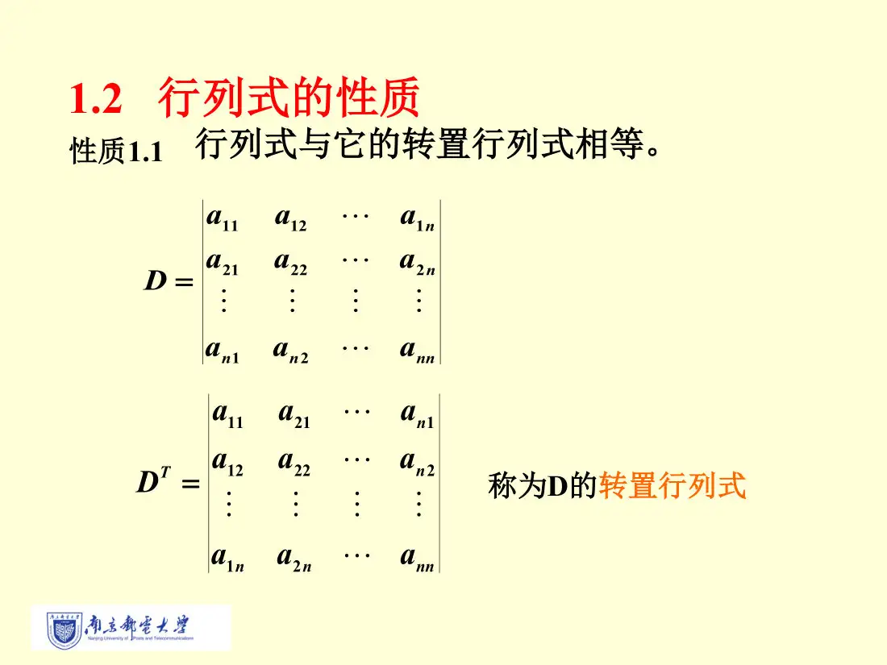

原文：

1.2 行列式的性质

性质1.1 行列式与它的转置行列式相等。

$$
D = \left| \begin{array}{c c c c} a _ {1 1} & a _ {1 2} & \dots & a _ {1 n} \\ a _ {2 1} & a _ {2 2} & \dots & a _ {2 n} \\ \vdots & \vdots & \vdots & \vdots \\ a _ {n 1} & a _ {n 2} & \dots & a _ {n n} \end{array} \right|
$$

$$
\boldsymbol {D} ^ {T} = \left| \begin{array}{c c c c} a _ {1 1} & a _ {2 1} & \dots & a _ {n 1} \\ a _ {1 2} & a _ {2 2} & \dots & a _ {n 2} \\ \vdots & \vdots & \vdots & \vdots \\ a _ {1 n} & a _ {2 n} & \dots & a _ {n n} \end{array} \right|
$$

称为D的转置行列式

南京邮电大学
Nanjing University of Posts and Telecommunications

### 证明：

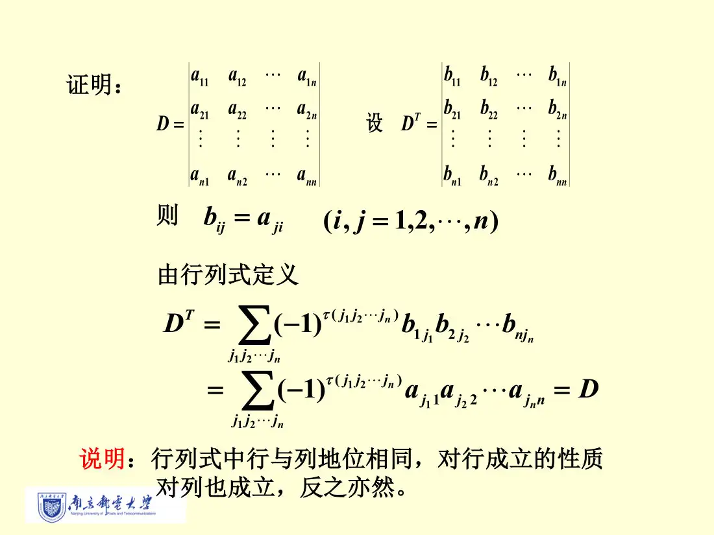

原文：

证明：

$$
D = \left| \begin{array}{c c c c} a _ {1 1} & a _ {1 2} & \dots & a _ {1 n} \\ a _ {2 1} & a _ {2 2} & \dots & a _ {2 n} \\ \vdots & \vdots & \vdots & \vdots \\ a _ {n 1} & a _ {n 2} & \dots & a _ {n n} \end{array} \right|
$$

设

$$
\boldsymbol {D} ^ {T} = \left| \begin{array}{c c c c} \boldsymbol {b} _ {1 1} & \boldsymbol {b} _ {1 2} & \dots & \boldsymbol {b} _ {1 n} \\ \boldsymbol {b} _ {2 1} & \boldsymbol {b} _ {2 2} & \dots & \boldsymbol {b} _ {2 n} \\ \vdots & \vdots & \vdots & \vdots \\ \boldsymbol {b} _ {n 1} & \boldsymbol {b} _ {n 2} & \dots & \boldsymbol {b} _ {n n} \end{array} \right|
$$

则 $b_{ij}=a_{ji}\quad(i,j=1,2,\cdots,n)$

由行列式定义

$$
\begin{array}{r l} D ^ {T} & = \sum_ {j _ {1} j _ {2} \dots j _ {n}} (- 1) ^ {\tau (j _ {1} j _ {2} \dots j _ {n})} b _ {1 j _ {1}} b _ {2 j _ {2}} \dots b _ {n j _ {n}} \\ & = \sum_ {j _ {1} j _ {2} \dots j _ {n}} (- 1) ^ {\tau (j _ {1} j _ {2} \dots j _ {n})} a _ {j _ {1} 1} a _ {j _ {2} 2} \dots a _ {j _ {n} n} = D \end{array}
$$

说明：行列式中行与列地位相同，对行成立的性质对列也成立，反之亦然。

南京邮电大学
Nanjing University of Posts and Telecommunications

### 记法

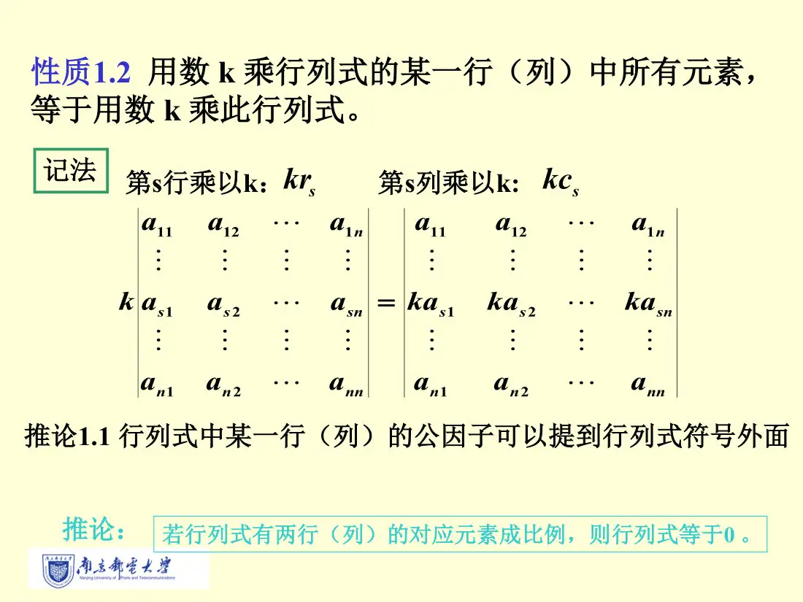

原文：

性质1.2 用数 k 乘行列式的某一行（列）中所有元素，等于用数 k 乘此行列式。

记法

第s行乘以k: $kr_{s}$ 第s列乘以k: $kc_{s}$

$$
\begin{array}{r} \left| \begin{array}{c c c c} a _ {1 1} & a _ {1 2} & \dots & a _ {1 n} \\ \vdots & \vdots & \vdots & \vdots \\ k & a _ {s 1} & a _ {s 2} & \dots & a _ {s n} \\ \vdots & \vdots & \vdots & \vdots \\ a _ {n 1} & a _ {n 2} & \dots & a _ {n n} \end{array} \right| = \left| \begin{array}{c c c c} a _ {1 1} & a _ {1 2} & \dots & a _ {1 n} \\ \vdots & \vdots & \vdots & \vdots \\ k a _ {s 1} & k a _ {s 2} & \dots & k a _ {s n} \\ \vdots & \vdots & \vdots & \vdots \\ a _ {n 1} & a _ {n 2} & \dots & a _ {n n} \end{array} \right| \end{array}
$$

推论1.1 行列式中某一行（列）的公因子可以提到行列式符号外面

推论: 若行列式有两行（列）的对应元素成比例，则行列式等于0。

南京邮电大学
Nanjing University of Posts and Telecommunications

### 性质1.3

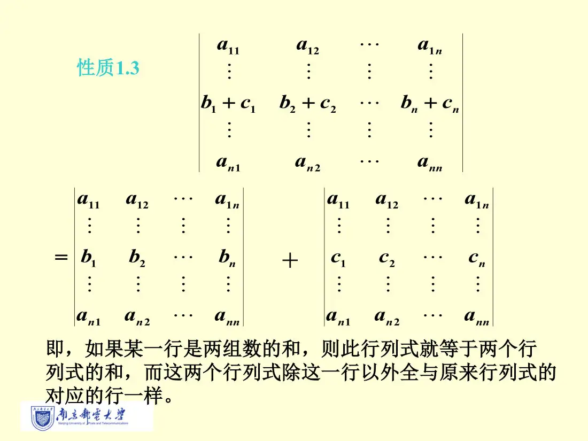

原文：

性质1.3

$$
\left| \begin{array}{c c c c} a _ {1 1} & a _ {1 2} & \dots & a _ {1 n} \\ \vdots & \vdots & \vdots & \vdots \\ b _ {1} + c _ {1} & b _ {2} + c _ {2} & \dots & b _ {n} + c _ {n} \\ \vdots & \vdots & \vdots & \vdots \\ a _ {n 1} & a _ {n 2} & \dots & a _ {n n} \end{array} \right|
$$

$$
= \left| \begin{array}{c c c c} a _ {1 1} & a _ {1 2} & \dots & a _ {1 n} \\ \vdots & \vdots & \vdots & \vdots \\ b _ {1} & b _ {2} & \dots & b _ {n} \\ \vdots & \vdots & \vdots & \vdots \\ a _ {n 1} & a _ {n 2} & \dots & a _ {n n} \end{array} \right| + \left| \begin{array}{c c c c} a _ {1 1} & a _ {1 2} & \dots & a _ {1 n} \\ \vdots & \vdots & \vdots & \vdots \\ c _ {1} & c _ {2} & \dots & c _ {n} \\ \vdots & \vdots & \vdots & \vdots \\ a _ {n 1} & a _ {n 2} & \dots & a _ {n n} \end{array} \right|
$$

即，如果某一行是两组数的和，则此行列式就等于两个行列式的和，而这两个行列式除这一行以外全与原来行列式的对应的行一样。

南京邮电大学
Nanjing University of Posts and Telecommunications

### 性质1.4 互换行列式的两行（列），行列式的值变号。

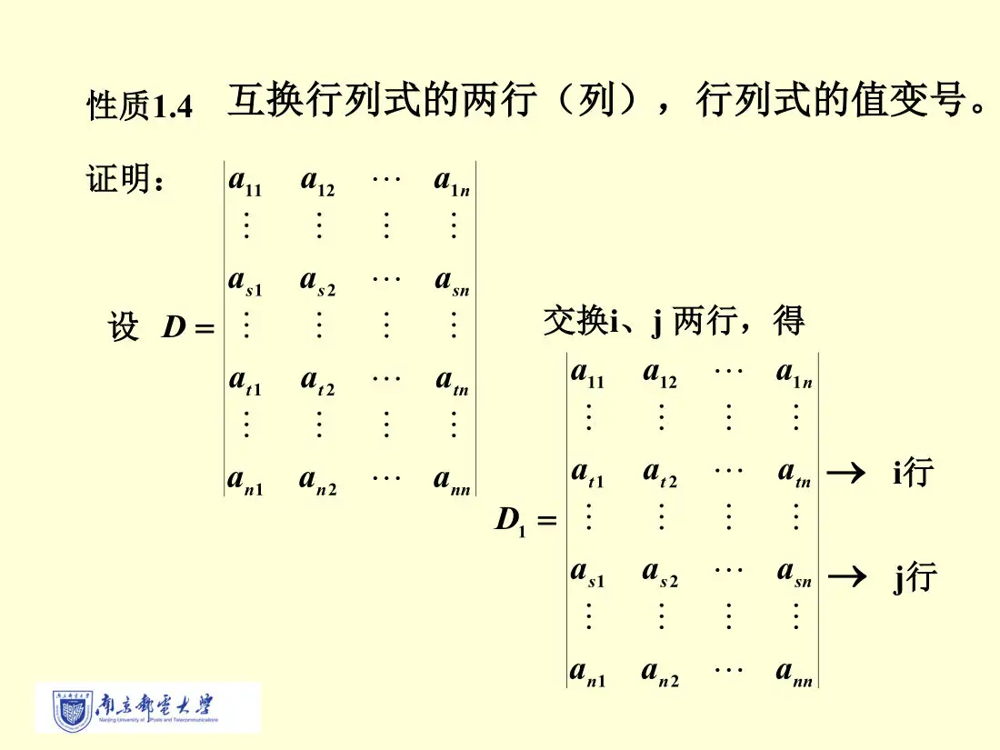

原文：

性质1.4 互换行列式的两行（列），行列式的值变号。

证明：

设

$$
D = \left| \begin{array}{c c c c} a _ {1 1} & a _ {1 2} & \dots & a _ {1 n} \\ \vdots & \vdots & \vdots & \vdots \\ a _ {s 1} & a _ {s 2} & \dots & a _ {s n} \\ \vdots & \vdots & \vdots & \vdots \\ a _ {t 1} & a _ {t 2} & \dots & a _ {t n} \\ \vdots & \vdots & \vdots & \vdots \\ a _ {n 1} & a _ {n 2} & \dots & a _ {n n} \end{array} \right|
$$

交换i、j两行，得

$$
D _ {1} = \left|\begin{array}{c c c c}a _ {1 1}&a _ {1 2}&\dots&a _ {1 n}\\\vdots&\vdots&\vdots&\vdots\\a _ {t 1}&a _ {t 2}&\dots&a _ {t n}\\\vdots&\vdots&\vdots&\vdots\\a _ {s 1}&a _ {s 2}&\dots&a _ {s n}\\\vdots&\vdots&\vdots&\vdots\\a _ {n 1}&a _ {n 2}&\dots&a _ {n n}\end{array}\right|\rightarrow
$$

i行

j行

南京邮电大学
Nanjing University of Posts and Telecommunications

### 由行列式定义可知，D中任一项可以写成

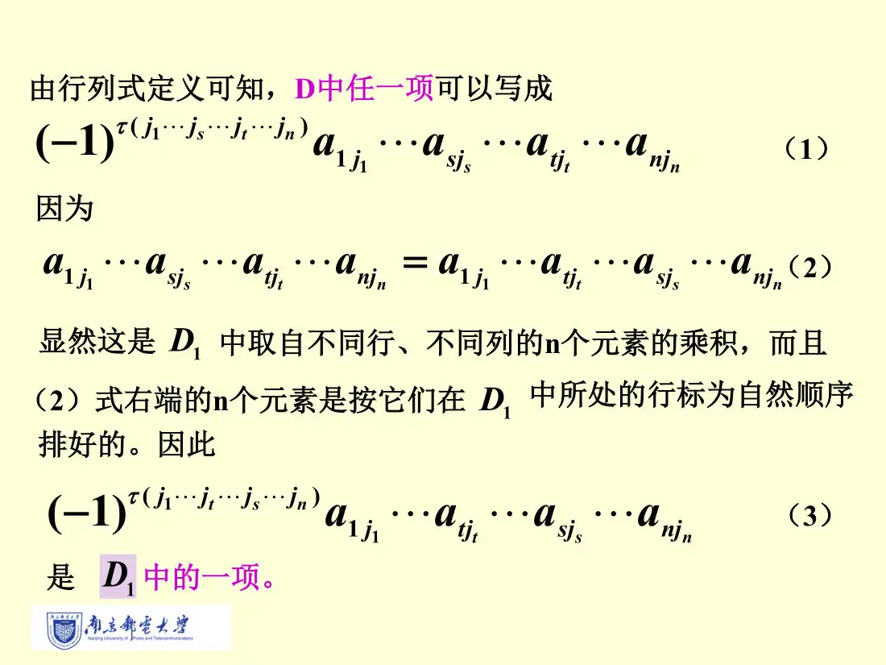

原文：

由行列式定义可知，D中任一项可以写成

$$
(- 1) ^ {\tau (j _ {1} \dots j _ {s} \dots j _ {t} \dots j _ {n})} a _ {1 j _ {1}} \dots a _ {s j _ {s}} \dots a _ {t j _ {t}} \dots a _ {n j _ {n}}\tag{1}
$$

因为

$$
a _ {1 j _ {1}} \dots a _ {s j _ {s}} \dots a _ {t j _ {t}} \dots a _ {n j _ {n}} = a _ {1 j _ {1}} \dots a _ {t j _ {t}} \dots a _ {s j _ {s}} \dots a _ {n j _ {n}}\tag{2}
$$

显然这是 $D_{1}$ 中取自不同行、不同列的n个元素的乘积，而且

(2) 式右端的 $\mathbf{n}$ 个元素是按它们在 $D_{1}$ 中所处的行标为自然顺序排好的。因此

$$
(- 1) ^ {\tau (j _ {1} \dots j _ {t} \dots j _ {s} \dots j _ {n})} a _ {1 j _ {1}} \dots a _ {t j _ {t}} \dots a _ {s j _ {s}} \dots a _ {n j _ {n}}\tag{3}
$$

是 $D_{1}$ 中的一项。

南京邮电大学
Nanjing University of Posts and Telecommunications

### 因此，D=-D

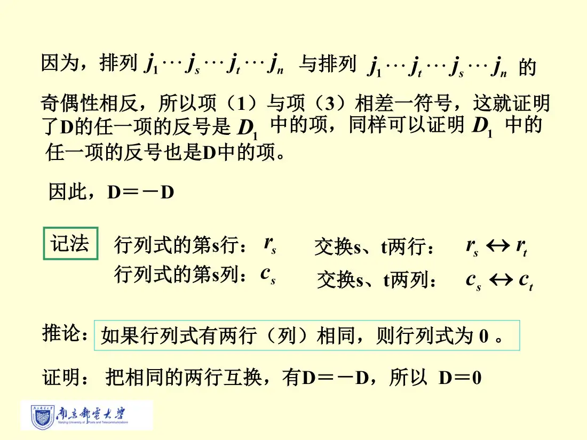

原文：

因为，排列 $j_{1}\cdots j_{s}\cdots j_{t}\cdots j_{n}$ 与排列 $j_{1}\cdots j_{t}\cdots j_{s}\cdots j_{n}$ 的

奇偶性相反，所以项（1）与项（3）相差一符号，这就证明了D的任一项的反号是 $D_{1}$ 中的项，同样可以证明 $D_{1}$ 中的任一项的反号也是D中的项。

因此，D=-D

记法 行列式的第s行： $r_{s}$ 交换s、t两行： $r_{s} \leftrightarrow r_{t}$

行列式的第s列： $c_{s}$ 交换s、t两列： $c_{s} \leftrightarrow c_{t}$

推论: 如果行列式有两行（列）相同，则行列式为 0 。

证明：把相同的两行互换，有 $\mathbf{D} = -\mathbf{D}$ ，所以 $\mathbf{D} = \mathbf{0}$ 性质1.5 行列式的某一行（列）的所有元素乘以同一数k后再加到另一行（列）对应的元素上去，行列式的值不变。

南京邮电大学
Nanjing University of Posts and Telecommunications

### 证明：

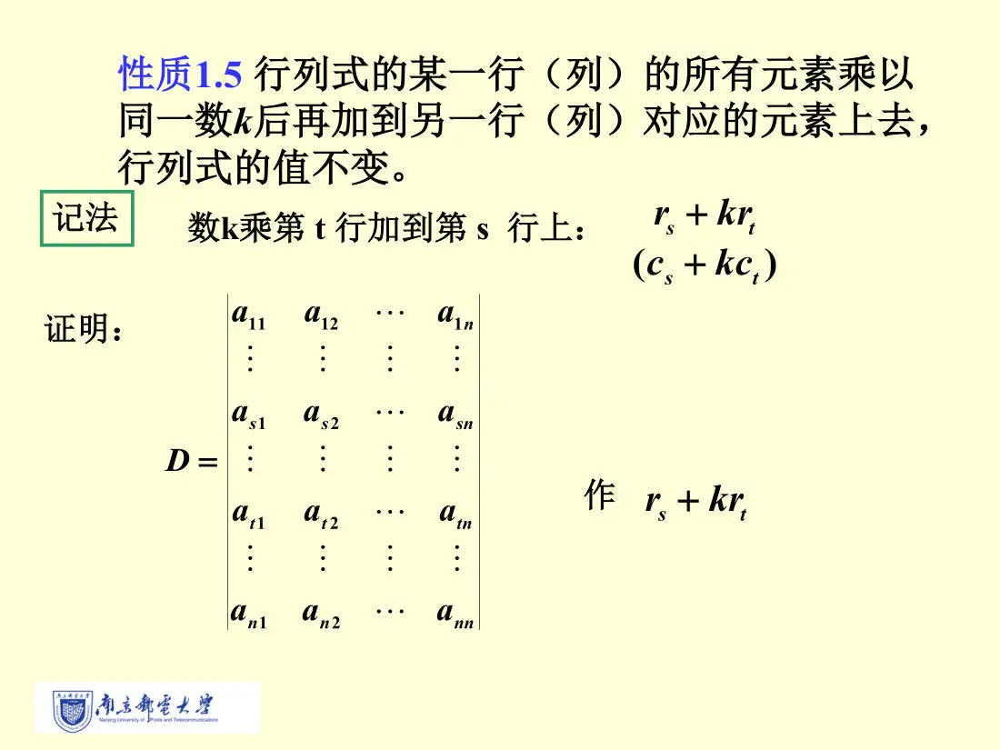

原文：

记法 数k乘第t行加到第s行上: $r_{s} + kr_{t}$ $(c_{s} + kc_{t})$

证明：

$$
D = \left| \begin{array}{c c c c} a _ {1 1} & a _ {1 2} & \dots & a _ {1 n} \\ \vdots & \vdots & \vdots & \vdots \\ a _ {s 1} & a _ {s 2} & \dots & a _ {s n} \\ \vdots & \vdots & \vdots & \vdots \\ a _ {t 1} & a _ {t 2} & \dots & a _ {t n} \\ \vdots & \vdots & \vdots & \vdots \\ a _ {n 1} & a _ {n 2} & \dots & a _ {n n} \end{array} \right|
$$

作 $r_{s} + kr_{t}$

南京邮电大学
Nanjing University of Posts and Telecommunications

### $$

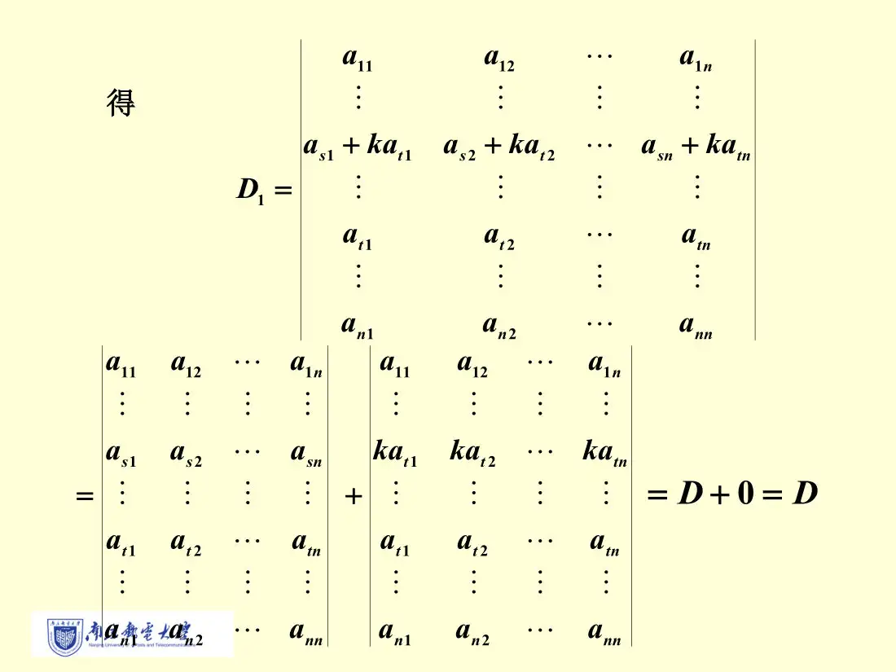

原文：

$$
\begin{array}{r l} & {\text {得} \quad D _ {1} = \left| \begin{array}{c c c c} {a _ {1 1}} & {a _ {1 2}} & {\dots} & {a _ {1 n}} \\ {\vdots} & {\vdots} & {\vdots} & {\vdots} \\ {a _ {s 1} + k a _ {t 1}} & {a _ {s 2} + k a _ {t 2}} & {\dots} & {a _ {s n} + k a _ {t n}} \\ {\vdots} & {\vdots} & {\vdots} & {\vdots} \\ {a _ {t 1}} & {a _ {t 2}} & {\dots} & {a _ {t n}} \\ {\vdots} & {\vdots} & {\vdots} & {\vdots} \\ {a _ {n 1}} & {a _ {n 2}} & {\dots} & {a _ {n n}} \end{array} \right|} \\ & {= \left| \begin{array}{l l l l} {a _ {1 1}} & {a _ {1 2}} & {\dots} & {a _ {1 n}} \\ {\vdots} & {\vdots} & {\vdots} & {\vdots} \\ {a _ {s 1}} & {a _ {s 2}} & {\dots} & {a _ {s n}} \\ {\vdots} & {\vdots} & {\vdots} & {\vdots} \\ {a _ {t 1}} & {a _ {t 2}} & {\dots} & {a _ {t n}} \\ {\vdots} & {\vdots} & {\vdots} & {\vdots} \\ {a _ {n 1}} & {a _ {n 2}} & {\dots} & {a _ {nn}} \end{array} \right| + \left| \begin{array}{l l l l} {a _ {1 1}} & {a _ {1 2}} & {\dots} & {a _ {1 n}} \\ {\vdots} & {\vdots} & {\vdots} & {\vdots} \\ {k a _ {t 1}} & {k a _ {t 2}} & {\dots} & {k a _ {t n}} \\ {\vdots} & {\vdots} & {\vdots} & {\vdots} \\ {a _ {t 1}} & {a _ {t 2}} & {\dots} & {a _ {t n}} \\ {\vdots} & {\vdots} & {\vdots} & {\vdots} \\ {a _ {n 1}} & {a _ {n 2}} & {\dots} & {{a _ {n n}}} \end{array} \right| = D + 0 = D} \end{array}
$$

### 利用行列式性质计算：目标 $\rightarrow$ 化为三角形行列式

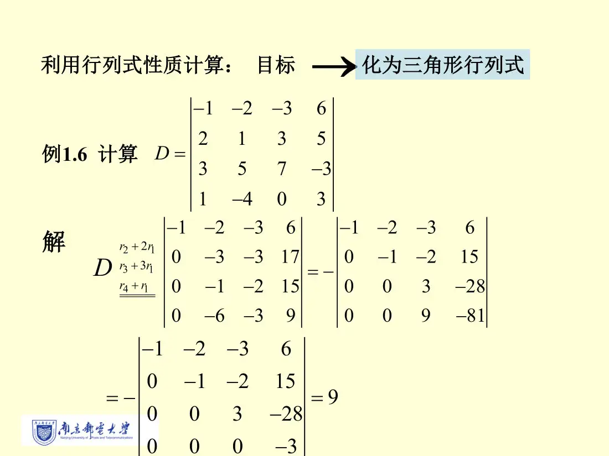

原文：

利用行列式性质计算：目标 $\rightarrow$ 化为三角形行列式

例1.6 计算

$$
D = \left| \begin{array}{c c c c} - 1 & - 2 & - 3 & 6 \\ 2 & 1 & 3 & 5 \\ 3 & 5 & 7 & - 3 \\ 1 & - 4 & 0 & 3 \end{array} \right|
$$

解

$$
D _ {\underline {{\underline {{r _ {4} + r _ {1}}}}}} ^ {r _ {2} + 2 r _ {1}} \left| \begin{array}{c c c c} - 1 & - 2 & - 3 & 6 \\ 0 & - 3 & - 3 & 1 7 \\ 0 & - 1 & - 2 & 1 5 \\ 0 & - 6 & - 3 & 9 \end{array} \right| = - \left| \begin{array}{c c c c} - 1 & - 2 & - 3 & 6 \\ 0 & - 1 & - 2 & 1 5 \\ 0 & 0 & 3 & - 2 8 \\ 0 & 0 & 9 & - 8 1 \end{array} \right|
$$

$$
= - \left| \begin{array}{c c c c} - 1 & - 2 & - 3 & 6 \\ 0 & - 1 & - 2 & 1 5 \\ 0 & 0 & 3 & - 2 8 \\ 0 & 0 & 0 & - 3 \end{array} \right| = 9
$$

南京邮电大学
Nanjing University of Posts and Telecommunications

### 例1.7 计算 $n$ 阶行列式

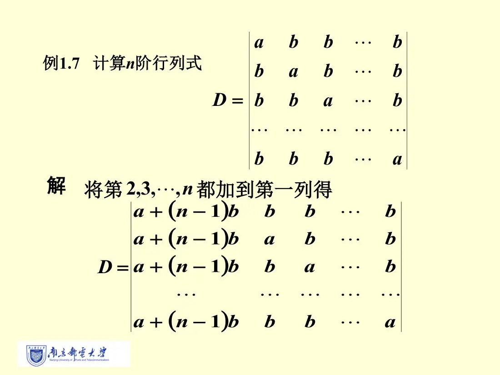

原文：

例1.7 计算 $n$ 阶行列式

$$
D = \left| \begin{array}{c c c c c} a & b & b & \dots & b \\ b & a & b & \dots & b \\ b & b & a & \dots & b \\ \dots & \dots & \dots & \dots & \dots \\ b & b & b & \dots & a \end{array} \right|
$$

解 将第 2,3,…,n 都加到第一列得

$$
D = \left| \begin{array}{c c c c c} a + (n - 1) b & b & b & \dots & b \\ a + (n - 1) b & a & b & \dots & b \\ a + (n - 1) b & b & a & \dots & b \\ \dots & \dots & \dots & \dots & \dots \\ a + (n - 1) b & b & b & \dots & a \end{array} \right|
$$

南京邮电大学
Nanjing University of Posts and Telecommunications

### $$

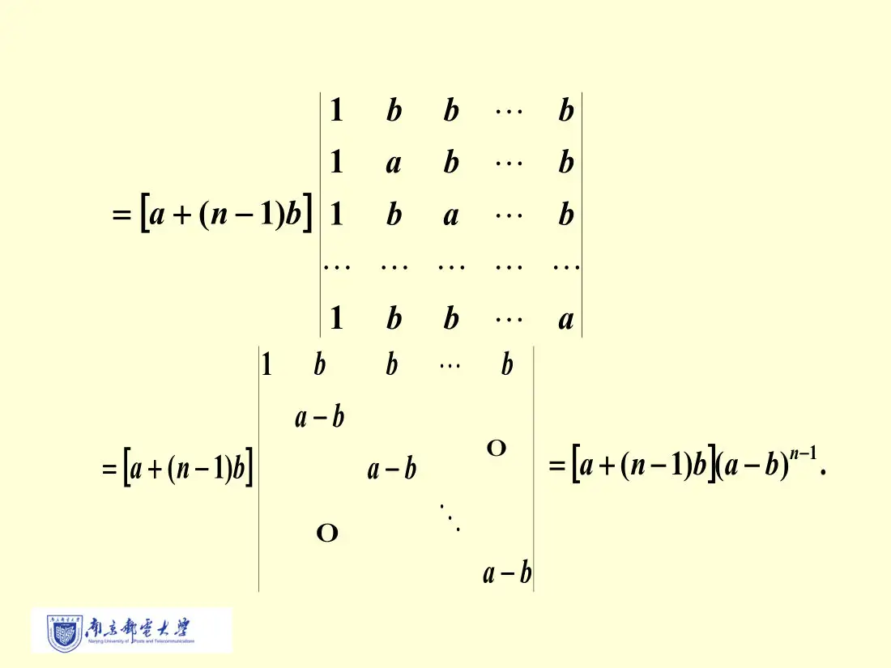

原文：

$$
= [ a + (n - 1) b ] \left| \begin{array}{c c c c c} 1 & b & b & \dots & b \\ 1 & a & b & \dots & b \\ 1 & b & a & \dots & b \\ \dots & \dots & \dots & \dots & \dots \\ 1 & b & b & \dots & a \end{array} \right|
$$

$$
= \left[ a + (n - 1) b \right] \left| \begin{array}{c c c c c} 1 & b & b & \dots & b \\ & a - b & & & \\ & & a - b & & \mathbf {O} \\ & \mathbf {O} & & \ddots & \\ & & & & a - b \end{array} \right| = \left[ a + (n - 1) b \right] (a - b) ^ {n - 1}.
$$

南京邮电大学
Nanjing University of Posts and Telecommunications

### 例1.8 证明 奇阶

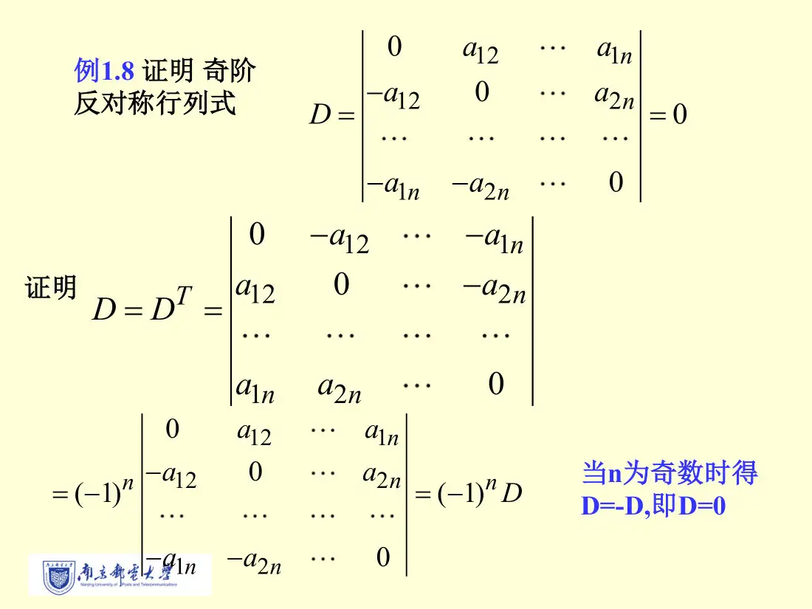

原文：

例1.8 证明 奇阶
反对称行列式

$$
D = \left| \begin{array}{c c c c} 0 & a _ {1 2} & \dots & a _ {1 n} \\ - a _ {1 2} & 0 & \dots & a _ {2 n} \\ \dots & \dots & \dots & \dots \\ - a _ {1 n} & - a _ {2 n} & \dots & 0 \end{array} \right| = 0
$$

证明

$$
D = D ^ {T} = \left| \begin{array}{c c c c} 0 & - a _ {1 2} & \dots & - a _ {1 n} \\ a _ {1 2} & 0 & \dots & - a _ {2 n} \\ \dots & \dots & \dots & \dots \\ a _ {1 n} & a _ {2 n} & \dots & 0 \end{array} \right|
$$

$$
= (- 1) ^ {n} \left| \begin{array}{c c c c} 0 & a _ {1 2} & \dots & a _ {1 n} \\ - a _ {1 2} & 0 & \dots & a _ {2 n} \\ \dots & \dots & \dots & \dots \\ - a _ {1 n} & - a _ {2 n} & \dots & 0 \end{array} \right| = (- 1) ^ {n} D
$$

当n为奇数时得
D=-D,即D=0

### 例1.9 设

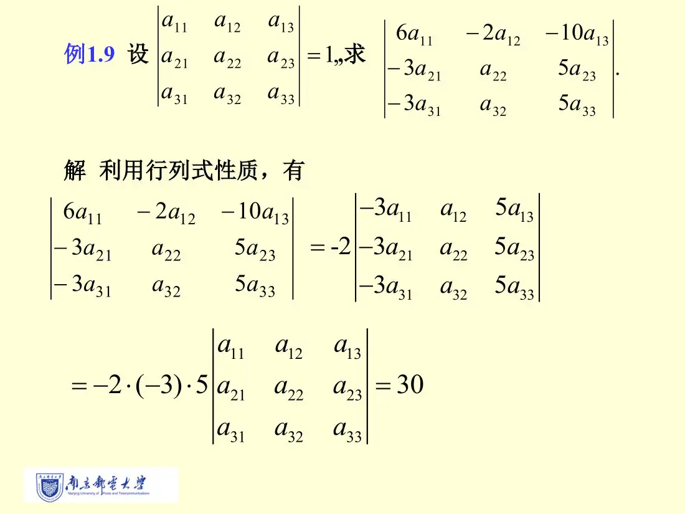

原文：

例1.9 设

$$
\left| \begin{array}{l l l} a _ {1 1} & a _ {1 2} & a _ {1 3} \\ a _ {2 1} & a _ {2 2} & a _ {2 3} \\ a _ {3 1} & a _ {3 2} & a _ {3 3} \end{array} \right| = 1, \text {求} \quad \left| \begin{array}{l l l} 6 a _ {1 1} & - 2 a _ {1 2} & - 1 0 a _ {1 3} \\ - 3 a _ {2 1} & a _ {2 2} & 5 a _ {2 3} \\ - 3 a _ {3 1} & a _ {3 2} & 5 a _ {3 3} \end{array} \right|.
$$

解 利用行列式性质，有

$$
\left| \begin{array}{ccc} 6 a _ {1 1} & - 2 a _ {1 2} & - 1 0 a _ {1 3} \\ - 3 a _ {2 1} & a _ {2 2} & 5 a _ {2 3} \\ - 3 a _ {3 1} & a _ {3 2} & 5 a _ {3 3} \end{array} \right| = - 2 \left| \begin{array}{ccc} - 3 a _ {1 1} & a _ {1 2} & 5 a _ {1 3} \\ - 3 a _ {2 1} & a _ {2 2} & 5 a _ {2 3} \\ - 3 a _ {3 1} & a _ {3 2} & 5 a _ {3 3} \end{array} \right|
$$

$$
= - 2 \cdot (- 3) \cdot 5 \left| \begin{array}{c c c} a _ {1 1} & a _ {1 2} & a _ {1 3} \\ a _ {2 1} & a _ {2 2} & a _ {2 3} \\ a _ {3 1} & a _ {3 2} & a _ {3 3} \end{array} \right| = 3 0
$$

南京邮电大学
Nanjing University of Posts and Telecommunications

### 例1.11 计算行列式

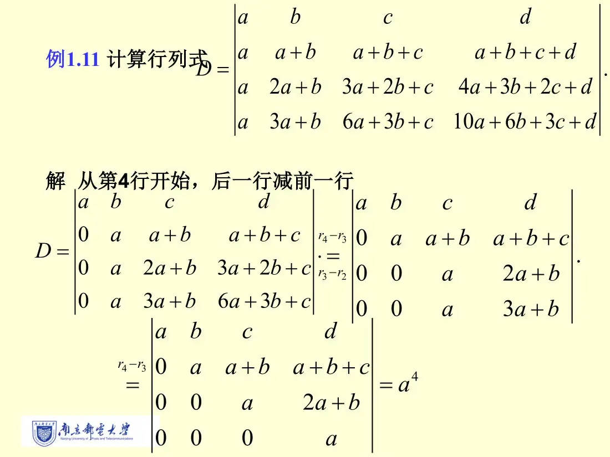

原文：

例1.11 计算行列式

$$
) = \left| \begin{array}{c c c c} a & b & c & d \\ a & a + b & a + b + c & a + b + c + d \\ a & 2 a + b & 3 a + 2 b + c & 4 a + 3 b + 2 c + d \\ a & 3 a + b & 6 a + 3 b + c & 1 0 a + 6 b + 3 c + d \end{array} \right|
$$

解 从第4行开始，后一行减前一行

$$
\begin{array}{r l} D = & \left| \begin{array}{c c c c} a & b & c & d \\ 0 & a & a + b & a + b + c \\ 0 & a & 2 a + b & 3 a + 2 b + c \\ 0 & a & 3 a + b & 6 a + 3 b + c \end{array} \right| _ {r _ {4} - r _ {3}} \cdot = _ {r _ {3} - r _ {2}} \left| \begin{array}{c c c c} a & b & c & d \\ 0 & a & a + b & a + b + c \\ 0 & 0 & a & 2 a + b \\ 0 & 0 & a & 3 a + b \end{array} \right| \\ = & \left| \begin{array}{c c c c} a & b & c & d \\ 0 & a & a + b & a + b + c \\ 0 & 0 & a & 2 a + b \\ 0 & 0 & 0 & a \end{array} \right| = a ^ {4} \end{array}
$$

### 小结

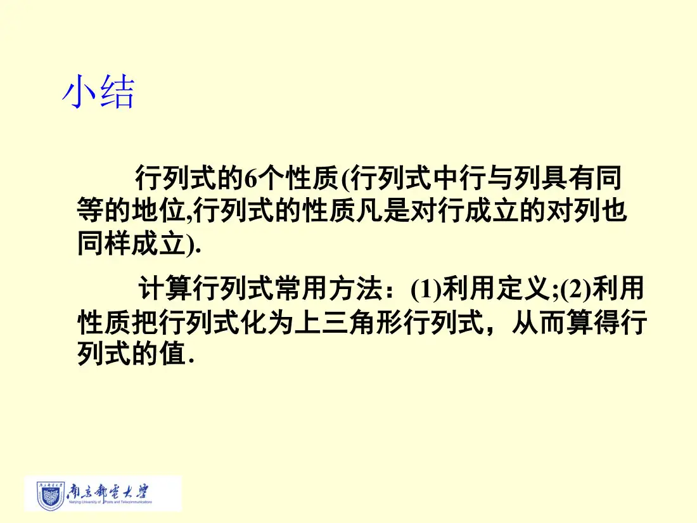

原文：

小结

行列式的6个性质(行列式中行与列具有同等的地位,行列式的性质凡是对行成立的对列也同样成立).

计算行列式常用方法：(1)利用定义；(2)利用性质把行列式化为上三角形行列式，从而算得行列式的值.

南京邮电大学
Nanjing University of Posts and Telecommunications
