# 《线性代数与解析几何》2.1 矩阵及其运算（课件）

原件的每一页，下面附识别出的文字。

### 2.1 矩阵及其运算

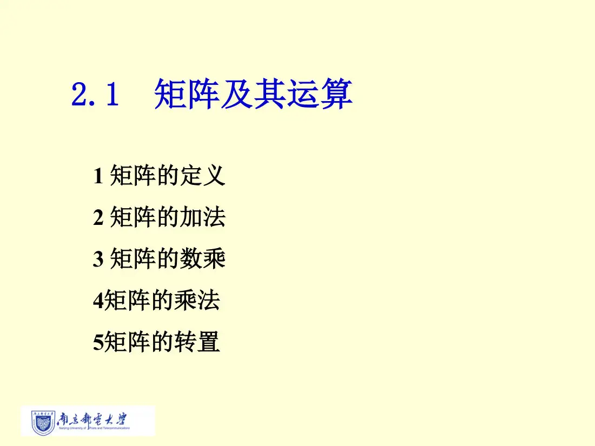

原文：

2.1 矩阵及其运算

1 矩阵的定义
2 矩阵的加法
3 矩阵的数乘
4 矩阵的乘法
5 矩阵的转置

南京邮电大学
Nanjing University of Posts and Telecommunications

### 2.1.1 矩阵的定义

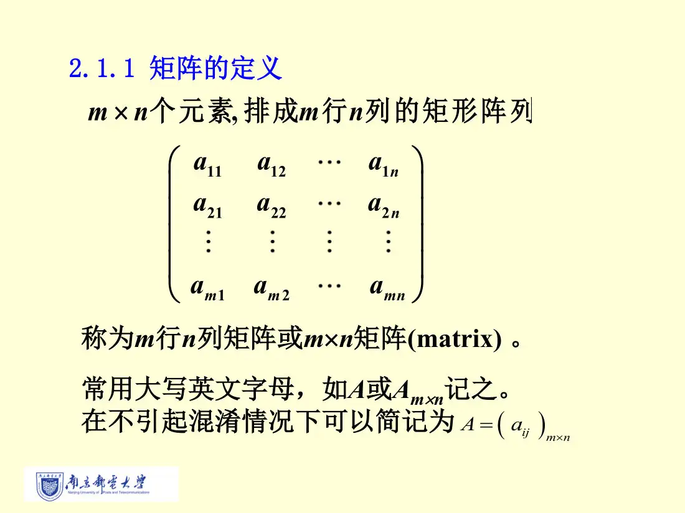

原文：

2.1.1 矩阵的定义

$m \times n$ 个元素,排成m行n列的矩形阵列

$$
\left( \begin{array}{c c c c} a _ {1 1} & a _ {1 2} & \dots & a _ {1 n} \\ a _ {2 1} & a _ {2 2} & \dots & a _ {2 n} \\ \vdots & \vdots & \vdots & \vdots \\ a _ {m 1} & a _ {m 2} & \dots & a _ {m n} \end{array} \right)
$$

称为m行n列矩阵或 $m \times n$ 矩阵(matrix)。

常用大写英文字母，如A或 $A_{m\times n}$ 记之。

在不引起混淆情况下可以简记为 $A = \left(a_{ij}\right)_{m\times n}$

南京邮电大学
Nanjing University of Posts and Telecommunications

### $$

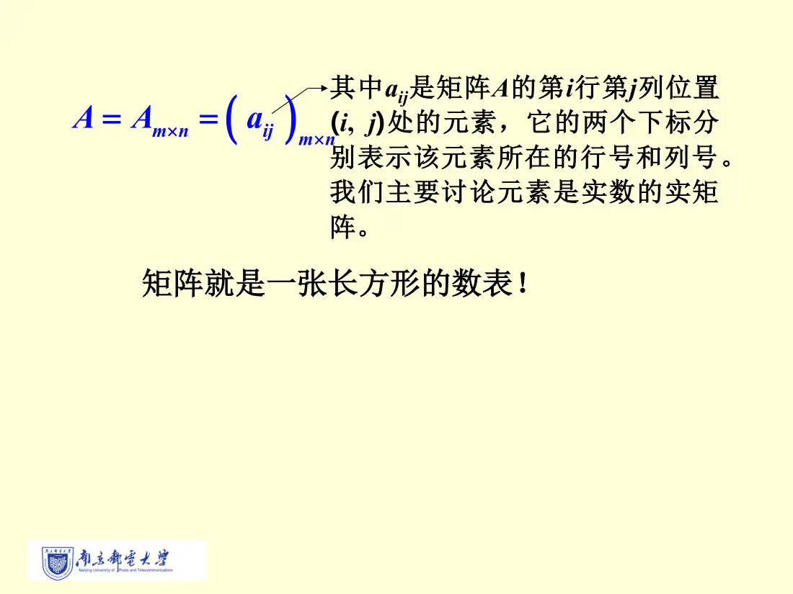

原文：

$$
A = A _ {m \times n} = \left(a _ {i j}\right) _ {m \times n}
$$

其中 $a_{ij}$ 是矩阵A的第i行第j列位置 $(i, j)$ 处的元素，它的两个下标分别表示该元素所在的行号和列号。我们主要讨论元素是实数的实矩阵。

矩阵就是一张长方形的数表！

南京邮电大学
Nanjing University of Posts and Telecommunications

### (2 3 5 9)

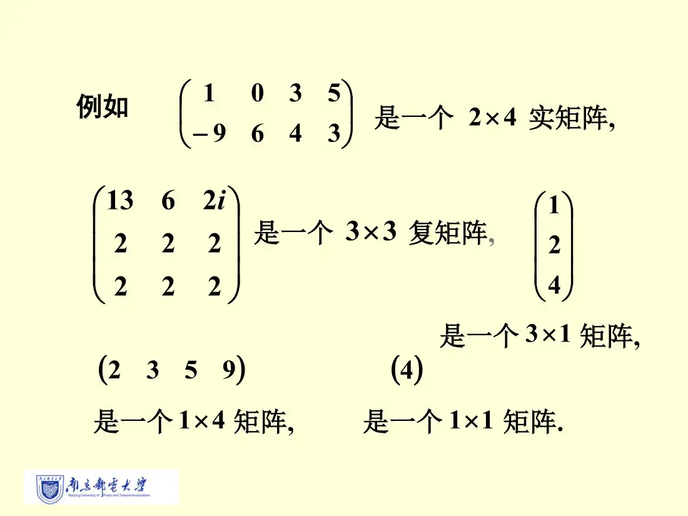

原文：

例如 $\begin{pmatrix}1&0&3&5\\-9&6&4&3\end{pmatrix}$ 是一个 $2\times4$ 实矩阵， $\begin{pmatrix}13&6&2i\\2&2&2\\2&2&2\end{pmatrix}$ 是一个 $3\times3$ 复矩阵， $\begin{pmatrix}1\\2\\4\end{pmatrix}$ 是一个 $3\times1$ 矩阵，

(2 3 5 9)

是一个 $1\times4$ 矩阵，是一个 $1\times1$ 矩阵.

南京邮电大学
Nanjing University of Posts and Telecommunications

### 几种常见的矩阵

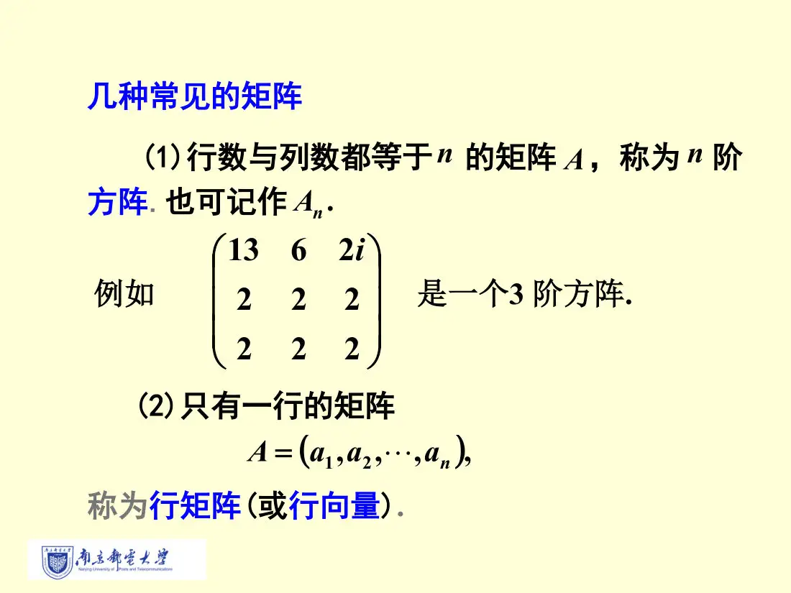

原文：

几种常见的矩阵

(1) 行数与列数都等于 n 的矩阵 A，称为 n 阶方阵。也可记作 $A_{n}$ 。

例如 $\begin{pmatrix}13&6&2i\\2&2&2\\2&2&2\end{pmatrix}$ 是一个3阶方阵.

(2) 只有一行的矩阵

$$
A = (a _ {1}, a _ {2}, \dots , a _ {n}),
$$

称为行矩阵(或行向量).

南京邮电大学
Nanjing University of Posts and Telecommunications

### 只有一列的矩阵

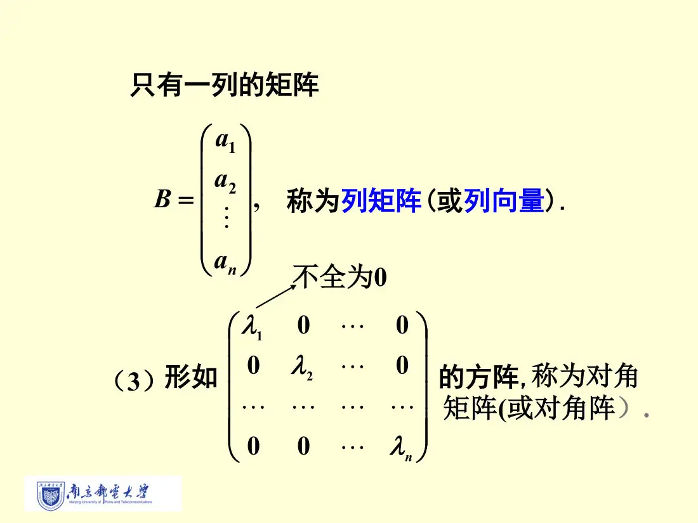

原文：

只有一列的矩阵

$$
\boldsymbol {B} = \left( \begin{array}{c} a _ {1} \\ a _ {2} \\ \vdots \\ a _ {n} \end{array} \right),
$$

称为列矩阵(或列向量).

不全为0

(3) 形如

$$
\left( \begin{array}{c c c c} \lambda_ {1} & \mathbf {0} & \dots & \mathbf {0} \\ \mathbf {0} & \lambda_ {2} & \dots & \mathbf {0} \\ \dots & \dots & \dots & \dots \\ \mathbf {0} & \mathbf {0} & \dots & \lambda_ {n} \end{array} \right)
$$

的方阵, 称为对角矩阵(或对角阵).

南京邮电大学
Nanjing University of Posts and Telecommunications

### 注意 不同阶数的零矩阵是不相等的.

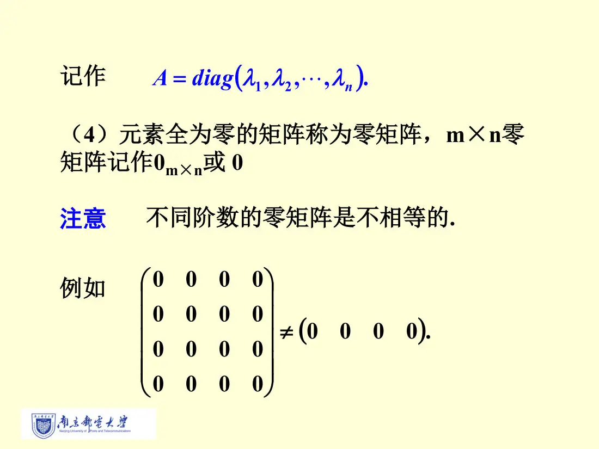

原文：

记作 $A = diag(\lambda_{1}, \lambda_{2}, \cdots, \lambda_{n})$ .

(4) 元素全为零的矩阵称为零矩阵, $\mathbf{m} \times \mathbf{n}$ 零矩阵记作 $0_{\mathrm{m} \times \mathrm{n}}$ 或 0

注意 不同阶数的零矩阵是不相等的.

例如

$$
\left( \begin{array}{c c c c} \mathbf {0} & \mathbf {0} & \mathbf {0} & \mathbf {0} \\ \mathbf {0} & \mathbf {0} & \mathbf {0} & \mathbf {0} \\ \mathbf {0} & \mathbf {0} & \mathbf {0} & \mathbf {0} \\ \mathbf {0} & \mathbf {0} & \mathbf {0} & \mathbf {0} \end{array} \right) \neq (\mathbf {0} \quad \mathbf {0} \quad \mathbf {0} \quad \mathbf {0}).
$$

南京邮电大学
Nanjing University of Posts and Telecommunications

### (5)方阵

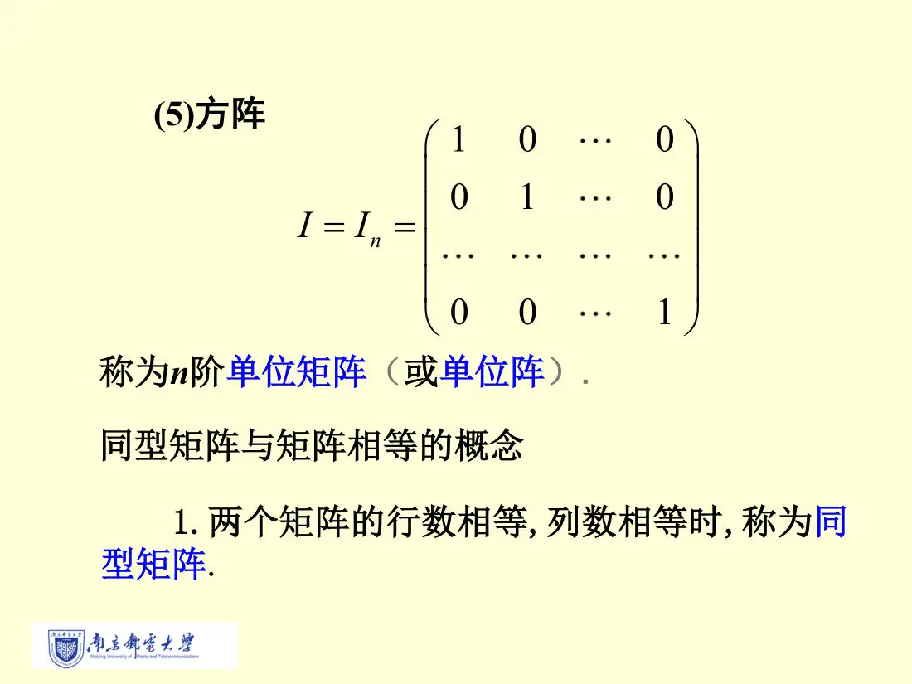

原文：

(5)方阵

$$
I = I _ {n} = \left( \begin{array}{c c c c} 1 & 0 & \dots & 0 \\ 0 & 1 & \dots & 0 \\ \dots & \dots & \dots & \dots \\ 0 & 0 & \dots & 1 \end{array} \right)
$$

称为n阶单位矩阵（或单位阵）.

同型矩阵与矩阵相等的概念

1. 两个矩阵的行数相等, 列数相等时, 称为同型矩阵.

南京邮电大学
Nanjing University of Posts and Telecommunications

### $$

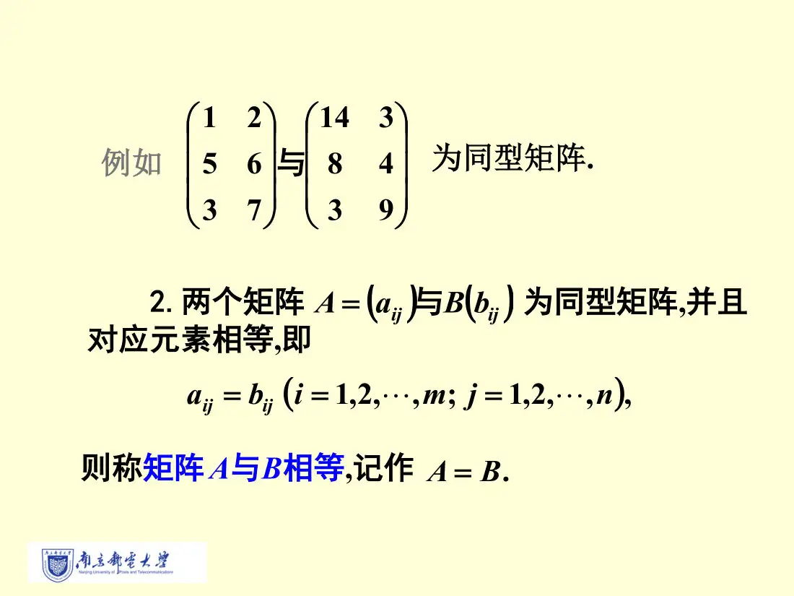

原文：

例如 $\begin{pmatrix}1&2\\5&6\\3&7\end{pmatrix}$ 与 $\begin{pmatrix}14&3\\8&4\\3&9\end{pmatrix}$ 为同型矩阵.

2. 两个矩阵 $A = (a_{ij})$ 与 $B(b_{ij})$ 为同型矩阵,并且对应元素相等,即

$$
a _ {i j} = b _ {i j} (i = 1, 2, \dots , m; j = 1, 2, \dots , n),
$$

则称矩阵 A 与 B 相等, 记作 A = B.

南京邮电大学
Nanjing University of Posts and Telecommunications

### (7) 三角矩阵

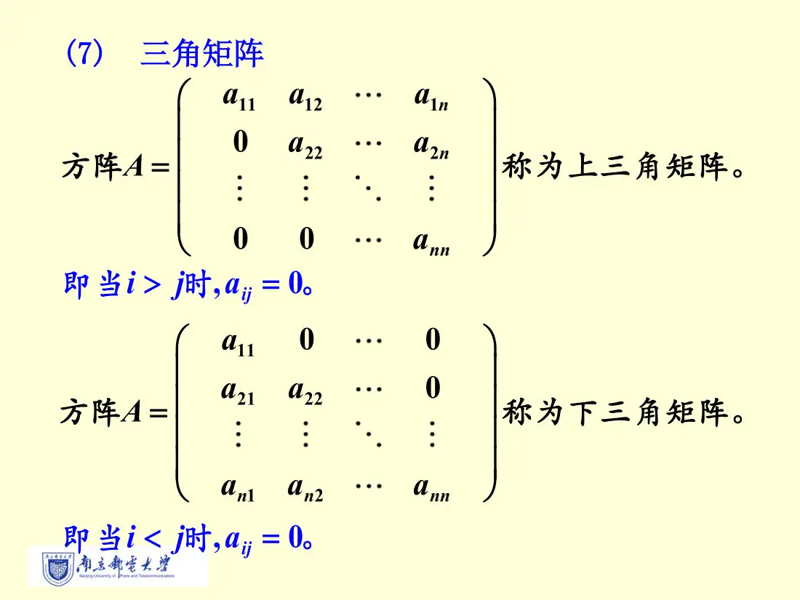

原文：

(7) 三角矩阵

方阵

$$
A = \left( \begin{array}{c c c c} a _ {1 1} & a _ {1 2} & \dots & a _ {1 n} \\ \mathbf {0} & a _ {2 2} & \dots & a _ {2 n} \\ \vdots & \vdots & \ddots & \vdots \\ \mathbf {0} & \mathbf {0} & \dots & a _ {n n} \end{array} \right)
$$

称为上三角矩阵。

即当 $i > j$ 时， $a_{ij} = 0$ 。

方阵

$$
A = \left( \begin{array}{c c c c} a _ {1 1} & \mathbf {0} & \dots & \mathbf {0} \\ a _ {2 1} & a _ {2 2} & \dots & \mathbf {0} \\ \vdots & \vdots & \ddots & \vdots \\ a _ {n 1} & a _ {n 2} & \dots & a _ {n n} \end{array} \right)
$$

称为下三角矩阵。

即当 $i < j$ 时， $a_{ij} = 0$ 。

南京邮电大学
Nanjing University of Posts and Telecommunications

### 2.1.2 矩阵的加法

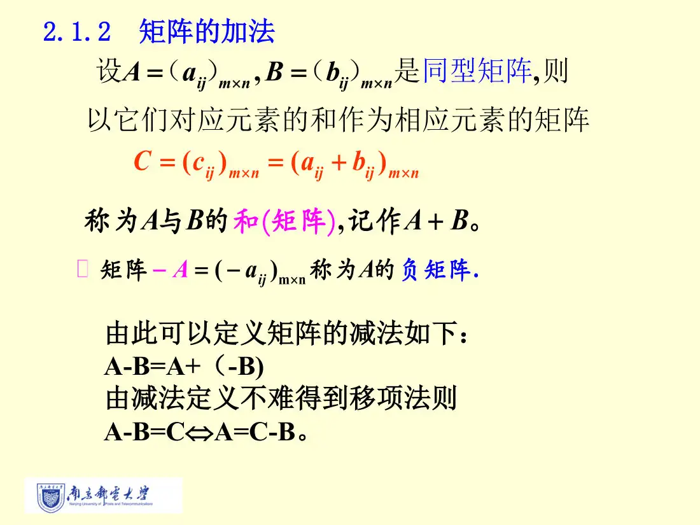

原文：

2.1.2 矩阵的加法

设 $A = (a_{ij})_{m\times n},B = (b_{ij})_{m\times n}$ 是同型矩阵，则以它们对应元素的和作为相应元素的矩阵

$$
C = (c _ {i j}) _ {m \times n} = (a _ {i j} + b _ {i j}) _ {m \times n}
$$

称为A与B的和(矩阵),记作 $A+B$ 。

□ 矩阵 $-A=(-a_{ij})_{\mathrm{m}\times\mathrm{n}}$ 称为 A 的负矩阵.

由此可以定义矩阵的减法如下:

$$
\mathbf {A} - \mathbf {B} = \mathbf {A} + (- \mathbf {B})
$$

由减法定义不难得到移项法则

$$
\mathbf {A} - \mathbf {B} = \mathbf {C} \Leftrightarrow \mathbf {A} = \mathbf {C} - \mathbf {B}
$$

南京邮电大学
Nanjing University of Posts and Telecommunications

### 2.1.3 矩阵的数乘

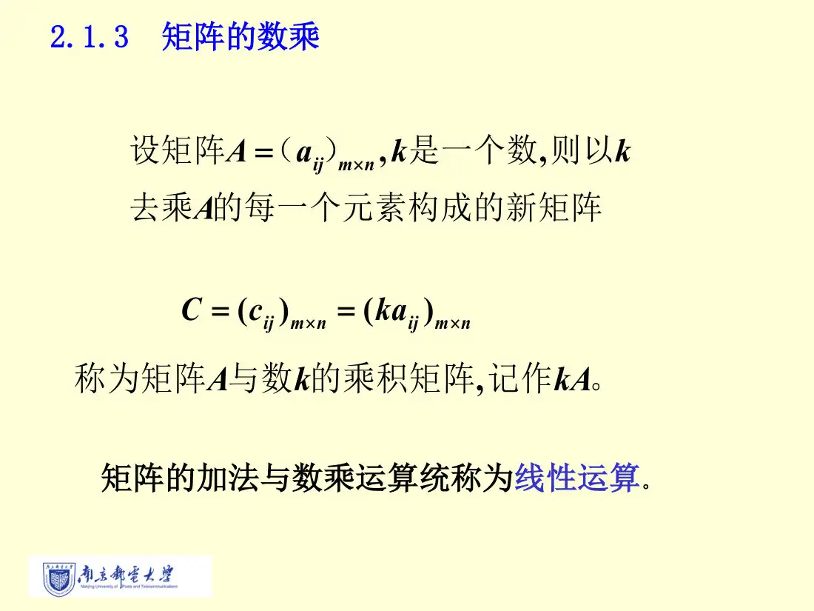

原文：

2.1.3 矩阵的数乘

设矩阵 $A=(a_{ij})_{m\times n},k$ 是一个数,则以k
去乘A的每一个元素构成的新矩阵

$$
C = (c _ {i j}) _ {m \times n} = (k a _ {i j}) _ {m \times n}
$$

称为矩阵A与数k的乘积矩阵,记作kA。

矩阵的加法与数乘运算统称为线性运算。

南京邮电大学
Nanjing University of Posts and Telecommunications

### 矩阵的加法与数乘满足以下运算律

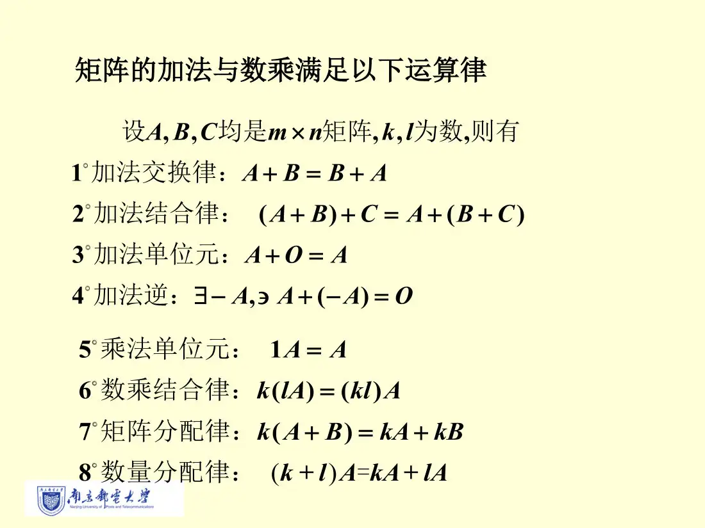

原文：

矩阵的加法与数乘满足以下运算律

设A,B,C均是 $m \times n$ 矩阵,k,l为数,则有

$1^{\circ}$ 加法交换律： $A + B = B + A$

$2^{\circ}$ 加法结合律: $(A + B) + C = A + (B + C)$

$3^{\circ}$ 加法单位元： $A + O = A$

$4^{\circ}$ 加法逆： $\exists-A,\exists A+(-A)=O$

$5^{\circ}$ 乘法单位元：1A=A

6°数乘结合律： $k(lA)=(kl)A$

$7^{\circ}$ 矩阵分配律： $k(A + B) = kA + kB$

8°数量分配律： $(k+l)A=kA+lA$

南京邮电大学
Nanjing University of Posts and Telecommunications

### 例2.2 设

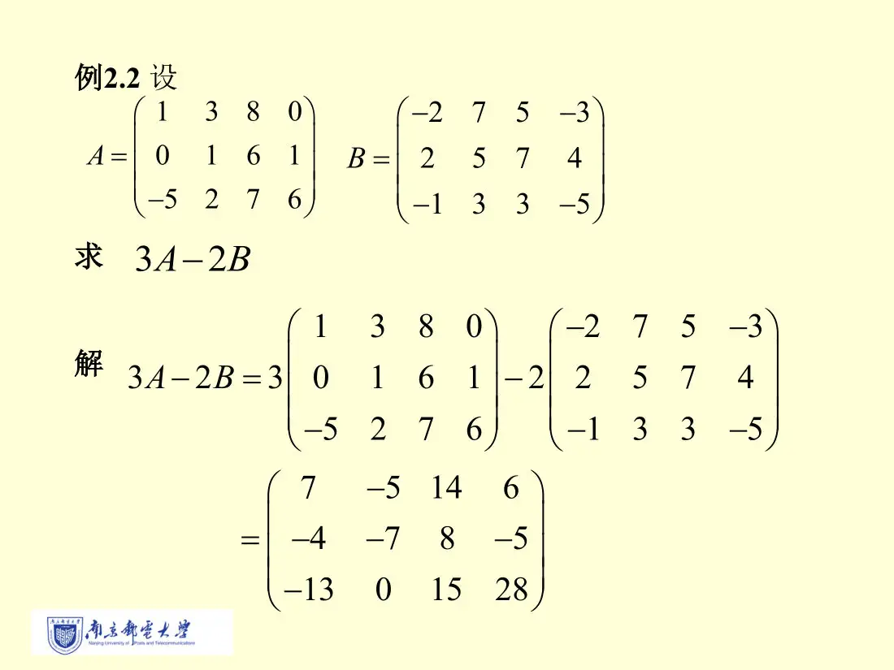

原文：

例2.2 设

$$
A = \left( \begin{array}{r r r r} 1 & 3 & 8 & 0 \\ 0 & 1 & 6 & 1 \\ - 5 & 2 & 7 & 6 \end{array} \right) \quad B = \left( \begin{array}{r r r r} - 2 & 7 & 5 & - 3 \\ 2 & 5 & 7 & 4 \\ - 1 & 3 & 3 & - 5 \end{array} \right)
$$

求 $3A - 2B$

解

$$
3 A - 2 B = 3 \left( \begin{array}{r r r r} 1 & 3 & 8 & 0 \\ 0 & 1 & 6 & 1 \\ - 5 & 2 & 7 & 6 \end{array} \right) - 2 \left( \begin{array}{r r r r} - 2 & 7 & 5 & - 3 \\ 2 & 5 & 7 & 4 \\ - 1 & 3 & 3 & - 5 \end{array} \right)
$$

$$
= \left( \begin{array}{r r r r} 7 & - 5 & 1 4 & 6 \\ - 4 & - 7 & 8 & - 5 \\ - 1 3 & 0 & 1 5 & 2 8 \end{array} \right)
$$

南京邮电大学
Nanjing University of Posts and Telecommunications

### 2.1.3 矩阵的乘法

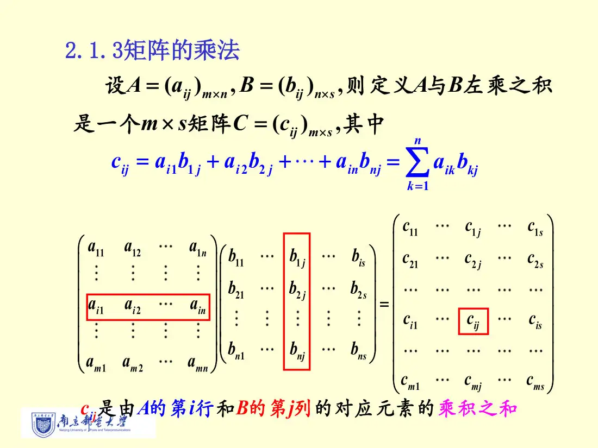

原文：

2.1.3 矩阵的乘法

设 $A = (a_{ij})_{m\times n},B = (b_{ij})_{n\times s}$ ，则定义 $A$ 与 $B$ 左乘之积是一个 $m\times s$ 矩阵 $C = (c_{ij})_{m\times s}$ ，其中

$$
c _ {i j} = a _ {i 1} b _ {1 j} + a _ {i 2} b _ {2 j} + \dots + a _ {i n} b _ {n j} = \sum_ {k = 1} ^ {n} a _ {i k} b _ {k j}
$$

$$
\left( \begin{array}{c c c c} a _ {1 1} & a _ {1 2} & \dots & a _ {1 n} \\ \vdots & \vdots & \vdots & \vdots \\ \framebox {a _ {i 1}} & a _ {i 2} & \dots & a _ {i n} \\ \vdots & \vdots & \vdots & \vdots \\ a _ {m 1} & a _ {m 2} & \dots & a _ {m n} \end{array} \right) \left( \begin{array}{c c c c c} b _ {1 1} & \dots & b _ {1 j} & \dots & b _ {i s} \\ b _ {2 1} & \dots & b _ {2 j} & \dots & b _ {2 s} \\ \vdots & \vdots & \vdots & \vdots & \vdots \\ b _ {n 1} & \dots & b _ {n j} & \dots & b _ {n s} \end{array} \right) = \left( \begin{array}{c c c c c} c _ {1 1} & \dots & c _ {1 j} & \dots & c _ {1 s} \\ c _ {2 1} & \dots & c _ {2 j} & \dots & c _ {2 s} \\ \dots & \dots & \dots & \dots & \dots \\ c _ {i 1} & \dots & c _ {i j} & \dots & c _ {i s} \\ \dots & \dots & \dots & \dots & \dots \\ c _ {m 1} & \dots & c _ {m j} & \dots & c _ {m s} \end{array} \right)
$$

c $_{ij}$ 是由A的第i行和B的第j列的对应元素的乘积之和

### 矩阵乘法：运算条件?如何运算?运算结果?

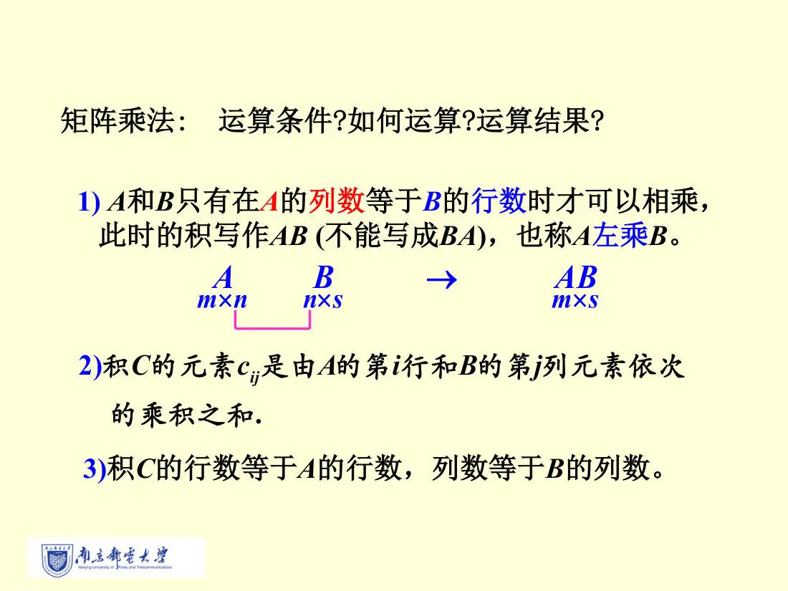

原文：

矩阵乘法：运算条件?如何运算?运算结果?

1) A和B只有在A的列数等于B的行数时才可以相乘，此时的积写作AB(不能写成BA)，也称A左乘B。

2)积C的元素 $c_{ij}$ 是由A的第i行和B的第j列元素依次的乘积之和.

3)积C的行数等于A的行数，列数等于B的列数。

南京邮电大学
Nanjing University of Posts and Telecommunications

### \- 矩阵的乘法满足下列运算律:

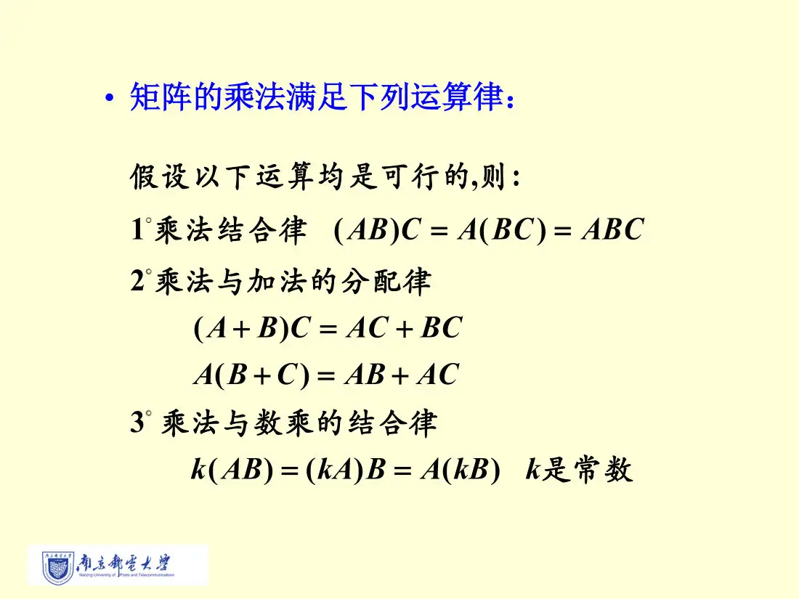

原文：

\- 矩阵的乘法满足下列运算律:

假设以下运算均是可行的,则:

$1^{\circ}$ 乘法结合律 $(AB)C = A(BC) = ABC$

$2^{\circ}$ 乘法与加法的分配律

$$
(A + B) C = A C + B C
$$

$$
A (B + C) = A B + A C
$$

$3^{\circ}$ 乘法与数乘的结合律

$$
k (A B) = (k A) B = A (k B) \quad k \text {是常数}
$$

南京邮电大学
Nanjing University of Posts and Telecommunications

### 求:1)AB和BA; 2)(AB)(AB).

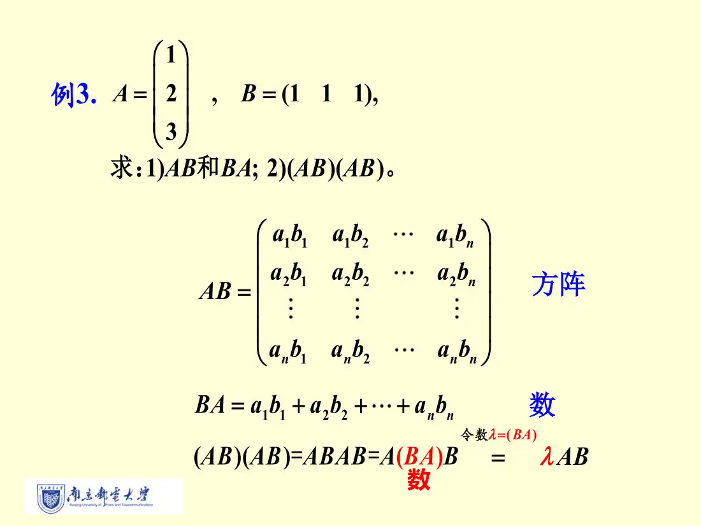

原文：

例3. $A=\begin{pmatrix}1\\2\\3\end{pmatrix}$ ， $B=(1\quad1\quad1)$ ，
求:1)AB和BA; 2)(AB)(AB).

$$
A B = \left( \begin{array}{c c c c} a _ {1} b _ {1} & a _ {1} b _ {2} & \dots & a _ {1} b _ {n} \\ a _ {2} b _ {1} & a _ {2} b _ {2} & \dots & a _ {2} b _ {n} \\ \vdots & \vdots & & \vdots \\ a _ {n} b _ {1} & a _ {n} b _ {2} & \dots & a _ {n} b _ {n} \end{array} \right)
$$

方阵

$$
B A = a _ {1} b _ {1} + a _ {2} b _ {2} + \dots + a _ {n} b _ {n}
$$

数

$$
(A B) (A B) = A B A B = A (B A) B \quad \text {令数} \lambda = (B A)
$$

南京邮电大学
Nanjing University of Posts and Telecommunications

### 注意 矩阵不满足交换律，即：

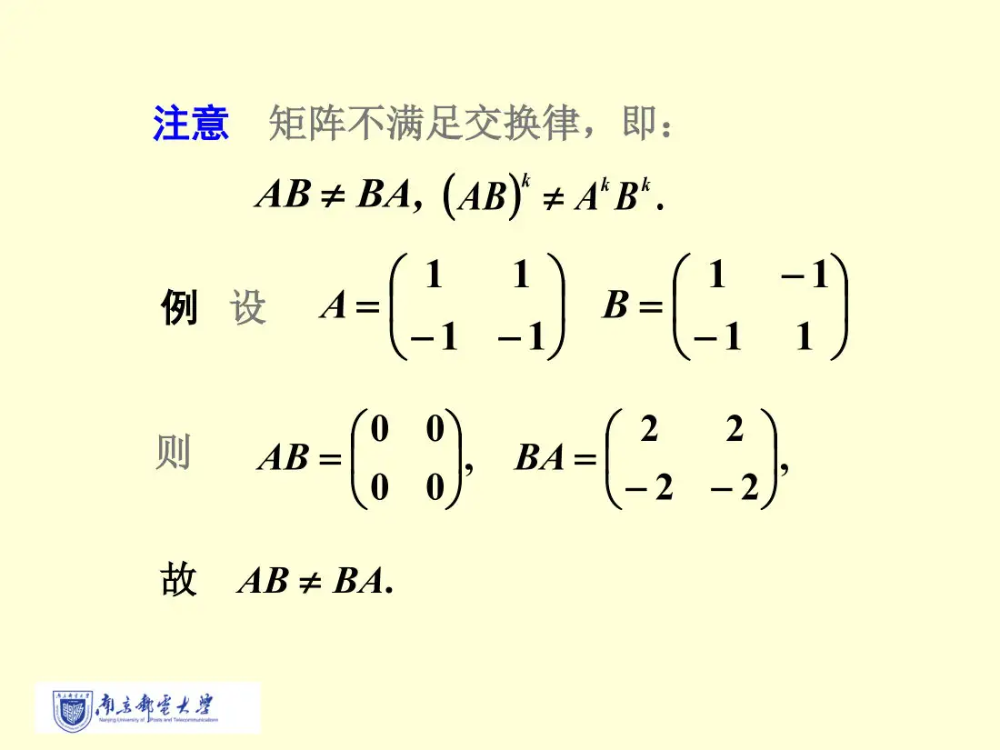

原文：

注意 矩阵不满足交换律，即：

$$
A B \neq B A, (A B) ^ {k} \neq A ^ {k} B ^ {k}.
$$

例设 $A = \begin{pmatrix} 1 & 1 \\ -1 & -1 \end{pmatrix}$ $B = \begin{pmatrix} 1 & -1 \\ -1 & 1 \end{pmatrix}$

$$
\boldsymbol {A} \boldsymbol {B} = \left( \begin{array}{c c} \mathbf {0} & \mathbf {0} \\ \mathbf {0} & \mathbf {0} \end{array} \right), \quad \boldsymbol {B} \boldsymbol {A} = \left( \begin{array}{c c} 2 & 2 \\ - 2 & - 2 \end{array} \right),
$$

故 $AB \neq BA$ .

南京邮电大学
Nanjing University of Posts and Telecommunications

### 但也有例外，比如设

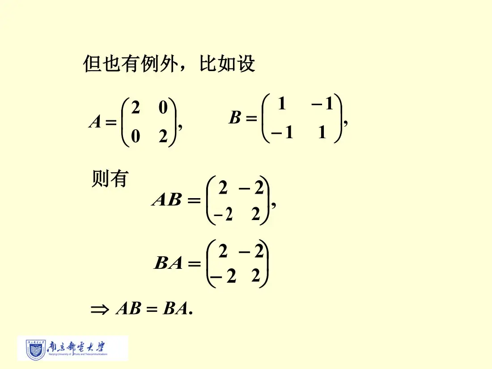

原文：

但也有例外，比如设

$$
A = \left( \begin{array}{c c} 2 & 0 \\ 0 & 2 \end{array} \right),
$$

$$
\boldsymbol {B} = \left( \begin{array}{l l} 1 & - 1 \\ - 1 & 1 \end{array} \right),
$$

则有

$$
\boldsymbol {A} \boldsymbol {B} = \left( \begin{array}{c c} 2 & - 2 \\ - 2 & 2 \end{array} \right),
$$

$$
\boldsymbol {B} \boldsymbol {A} = \left( \begin{array}{c c} 2 & - 2 \\ - 2 & 2 \end{array} \right)
$$

$$
\Rightarrow A B = B A.
$$

南京邮电大学
Nanjing University of Posts and Telecommunications

### - 矩阵的方幂

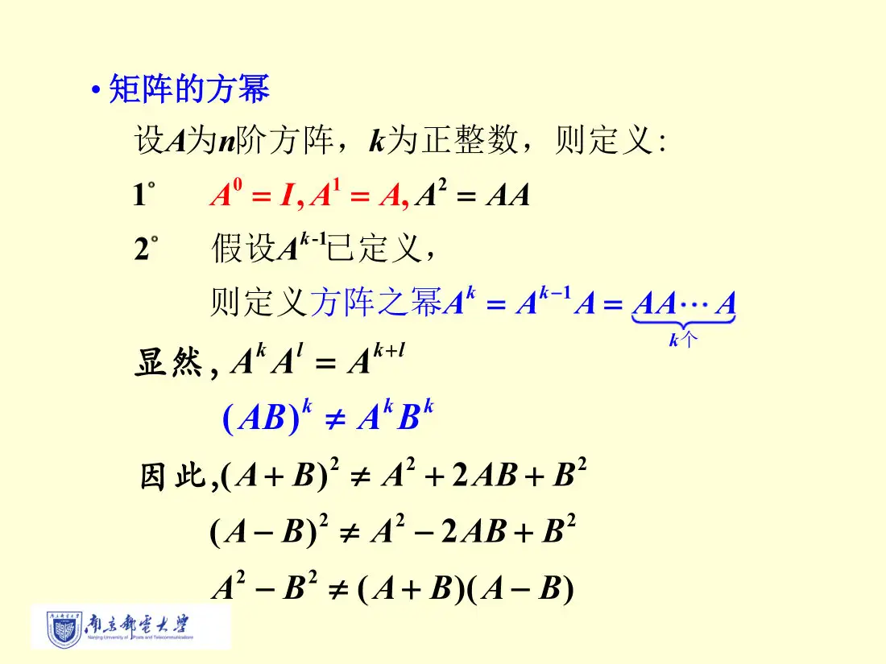

原文：

- 矩阵的方幂

设A为n阶方阵，k为正整数，则定义：

$1^{\circ}$ $A^0 = I, A^1 = A, A^2 = AA$

$2^{\circ}$ 假设 $A^{k-1}$ 已定义，

则定义方阵之幂 $A^{k}=A^{k-1}A=\underbrace{AA\cdots A}_{k个}$ 显然， $A^{k}A^{l}=A^{k+l}$

$$
(A B) ^ {k} \neq A ^ {k} B ^ {k}
$$

因此, $(A + B)^2 \neq A^2 + 2AB + B^2$

$$
(A - B) ^ {2} \neq A ^ {2} - 2 A B + B ^ {2}
$$

$$
A ^ {2} - B ^ {2} \neq (A + B) (A - B)
$$

南京邮电大学
Nanjing University of Posts and Telecommunications

### $$

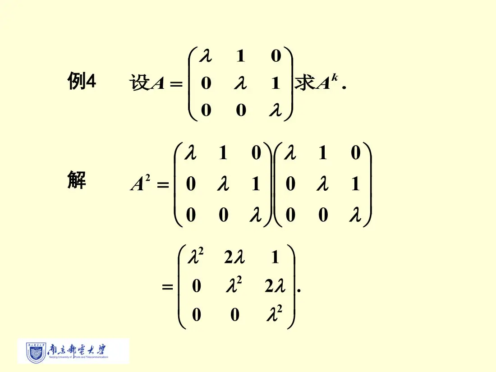

原文：

例4 设 $A = \begin{pmatrix} \lambda & 1 & 0 \\ 0 & \lambda & 1 \\ 0 & 0 & \lambda \end{pmatrix}$ 求 $A^k$ .

解

$$
A ^ {2} = \left( \begin{array}{c c c} \lambda & 1 & 0 \\ 0 & \lambda & 1 \\ 0 & 0 & \lambda \end{array} \right) \left( \begin{array}{c c c} \lambda & 1 & 0 \\ 0 & \lambda & 1 \\ 0 & 0 & \lambda \end{array} \right)
$$

$$
= \left( \begin{array}{c c c} \lambda^ {2} & 2 \lambda & 1 \\ \mathbf {0} & \lambda^ {2} & 2 \lambda \\ \mathbf {0} & \mathbf {0} & \lambda^ {2} \end{array} \right).
$$

南京邮电大学
Nanjing University of Posts and Telecommunications

### $$

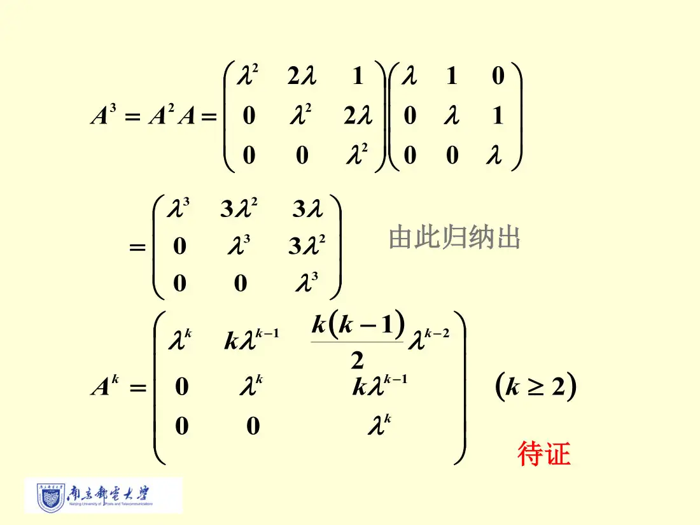

原文：

$$
A ^ {3} = A ^ {2} A = \left( \begin{array}{c c c} \lambda^ {2} & 2 \lambda & 1 \\ 0 & \lambda^ {2} & 2 \lambda \\ 0 & 0 & \lambda^ {2} \end{array} \right) \left( \begin{array}{c c c} \lambda & 1 & 0 \\ 0 & \lambda & 1 \\ 0 & 0 & \lambda \end{array} \right)
$$

$$
= \left( \begin{array}{c c c} \lambda^ {3} & 3 \lambda^ {2} & 3 \lambda \\ \mathbf {0} & \lambda^ {3} & 3 \lambda^ {2} \\ \mathbf {0} & \mathbf {0} & \lambda^ {3} \end{array} \right)
$$

由此归纳出

$$
A ^ {k} = \left( \begin{array}{c c c} \lambda^ {k} & k \lambda^ {k - 1} & \frac {k (k - 1)}{2} \lambda^ {k - 2} \\ 0 & \lambda^ {k} & k \lambda^ {k - 1} \\ 0 & 0 & \lambda^ {k} \end{array} \right)
$$

(k ≥ 2)

待证

南京邮电大学
Nanjing University of Posts and Telecommunications

### 用数学归纳法证明

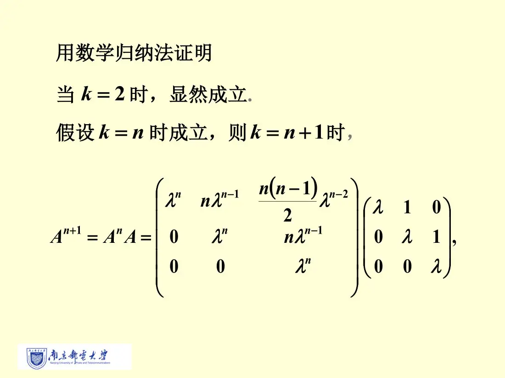

原文：

用数学归纳法证明

当 k=2 时，显然成立.

假设 k=n 时成立，则 $k=n+1$ 时，

$$
A ^ {n + 1} = A ^ {n} A = \left( \begin{array}{c c c} \lambda^ {n} & n \lambda^ {n - 1} & \frac {n (n - 1)}{2} \lambda^ {n - 2} \\ \mathbf {0} & \lambda^ {n} & n \lambda^ {n - 1} \\ \mathbf {0} & \mathbf {0} & \lambda^ {n} \end{array} \right) \left( \begin{array}{c c c} \lambda & 1 & \mathbf {0} \\ \mathbf {0} & \lambda & 1 \\ \mathbf {0} & \mathbf {0} & \lambda \end{array} \right),
$$

南京邮电大学
Nanjing University of Posts and Telecommunications

### $$

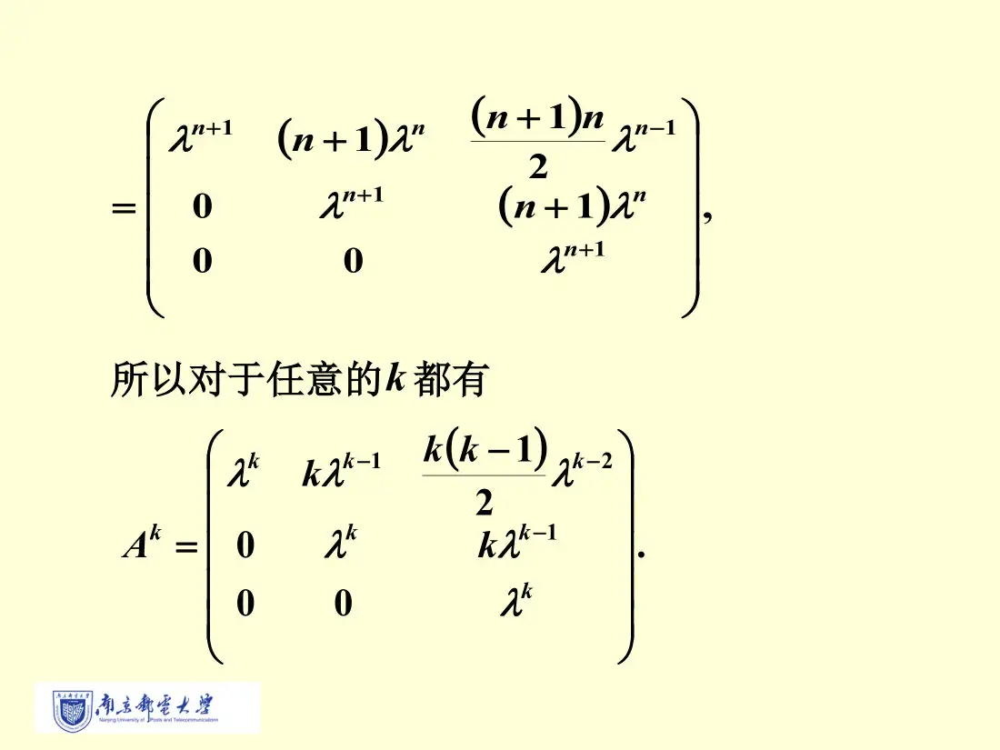

原文：

$$
= \left( \begin{array}{c c c} \lambda^ {n + 1} & (n + 1) \lambda^ {n} & \frac {(n + 1) n}{2} \lambda^ {n - 1} \\ 0 & \lambda^ {n + 1} & (n + 1) \lambda^ {n} \\ 0 & 0 & \lambda^ {n + 1} \end{array} \right),
$$

所以对于任意的 $k$ 都有

$$
A ^ {k} = \left( \begin{array}{c c c} \lambda^ {k} & k \lambda^ {k - 1} & \frac {k (k - 1)}{2} \lambda^ {k - 2} \\ 0 & \lambda^ {k} & k \lambda^ {k - 1} \\ 0 & 0 & \lambda^ {k} \end{array} \right).
$$

南京邮电大学
Nanjing University of Posts and Telecommunications

### 2.1.5 转置矩阵

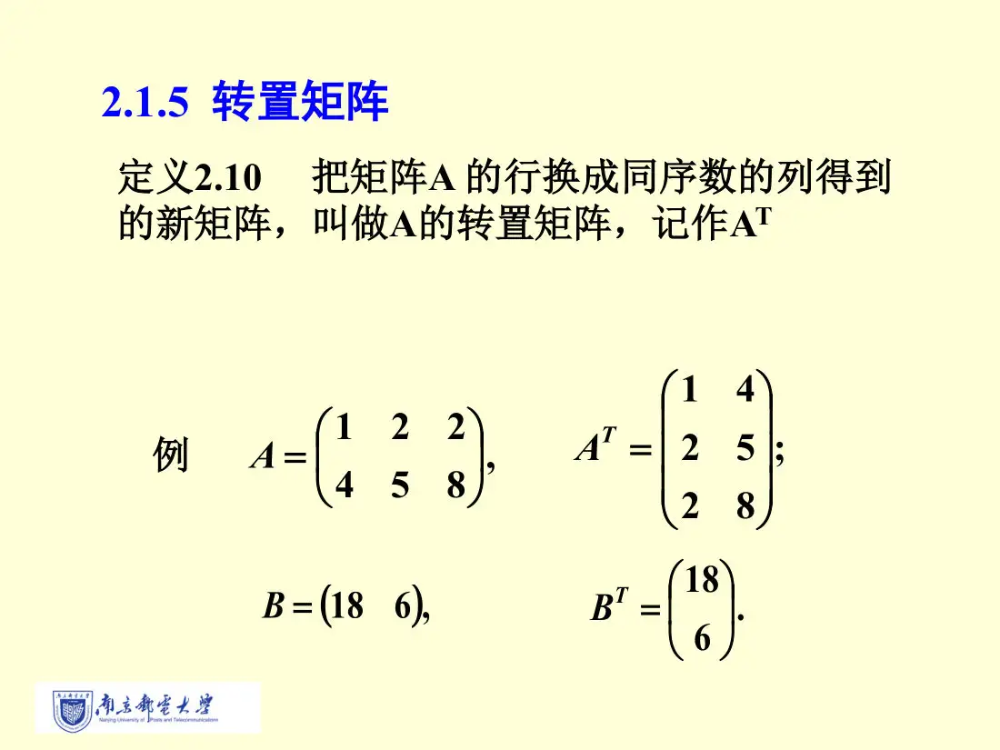

原文：

2.1.5 转置矩阵

定义2.10 把矩阵A的行换成同序数的列得到的新矩阵，叫做A的转置矩阵，记作 $\mathbf{A}^{\mathrm{T}}$

例

$$
A = \left( \begin{array}{c c c} 1 & 2 & 2 \\ 4 & 5 & 8 \end{array} \right), \qquad A ^ {T} = \left( \begin{array}{c c} 1 & 4 \\ 2 & 5 \\ 2 & 8 \end{array} \right);
$$

$$
B = \left( \begin{array}{c c} 1 8 & 6 \end{array} \right),
$$

$$
\boldsymbol {B} ^ {T} = \binom{\mathbf {1 8}}{\mathbf {6}}.
$$

南京邮电大学
Nanjing University of Posts and Telecommunications

### 转置矩阵的运算性质

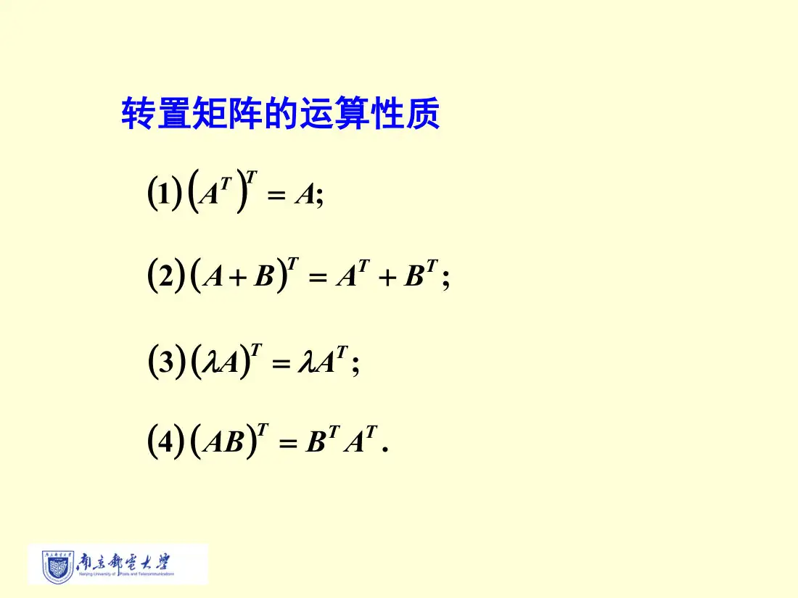

原文：

转置矩阵的运算性质

(1) $\left(A^{T}\right)^{T}=A;$

(2) $(A+B)^{T}=A^{T}+B^{T};$

(3) $(\lambda A)^{T}=\lambda A^{T};$

(4) $(AB)^{T}=B^{T}A^{T}.$

南京邮电大学
Nanjing University of Posts and Telecommunications

### 一般地，我们用归纳法容易证明

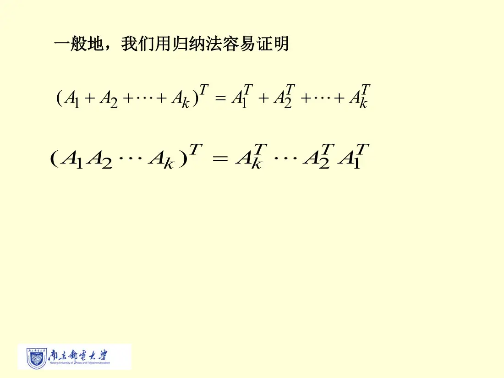

原文：

一般地，我们用归纳法容易证明

$$
(A _ {1} + A _ {2} + \dots + A _ {k}) ^ {T} = A _ {1} ^ {T} + A _ {2} ^ {T} + \dots + A _ {k} ^ {T}
$$

$$
(A _ {1} A _ {2} \dots A _ {k}) ^ {T} = A _ {k} ^ {T} \dots A _ {2} ^ {T} A _ {1} ^ {T}
$$

南京邮电大学
Nanjing University of Posts and Telecommunications

### 例2.4 设

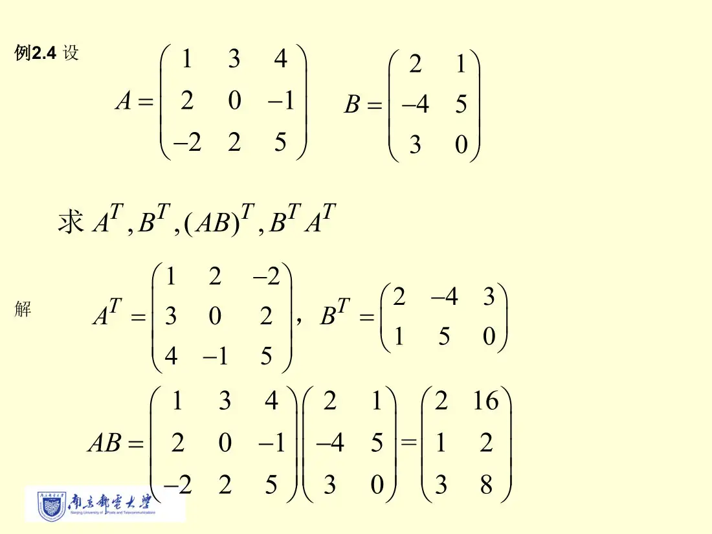

原文：

例2.4 设

$$
A = \left( \begin{array}{r r r} 1 & 3 & 4 \\ 2 & 0 & - 1 \\ - 2 & 2 & 5 \end{array} \right) \quad B = \left( \begin{array}{r r} 2 & 1 \\ - 4 & 5 \\ 3 & 0 \end{array} \right)
$$

求 $A^T, B^T, (AB)^T, B^T A^T$

解

$$
A ^ {T} = \left( \begin{array}{c c c} 1 & 2 & - 2 \\ 3 & 0 & 2 \\ 4 & - 1 & 5 \end{array} \right),
$$

$$
B ^ {T} = \left( \begin{array}{c c c} 2 & - 4 & 3 \\ 1 & 5 & 0 \end{array} \right)
$$

$$
A B = \left( \begin{array}{r r r} 1 & 3 & 4 \\ 2 & 0 & - 1 \\ - 2 & 2 & 5 \end{array} \right) \left( \begin{array}{l l} 2 & 1 \\ - 4 & 5 \\ 3 & 0 \end{array} \right) = \left( \begin{array}{l l} 2 & 1 6 \\ 1 & 2 \\ 3 & 8 \end{array} \right)
$$

南京邮电大学
Nanjing University of Posts and Telecommunications

### $$

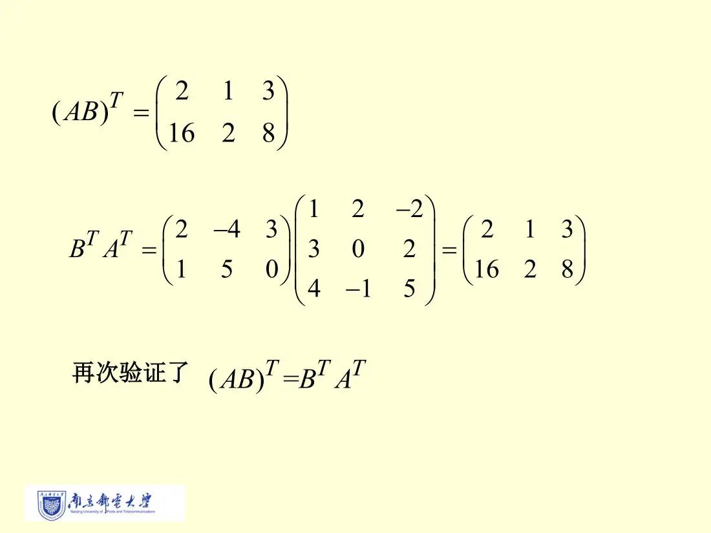

原文：

$$
(A B) ^ {T} = \left( \begin{array}{c c c} 2 & 1 & 3 \\ 1 6 & 2 & 8 \end{array} \right)
$$

$$
B ^ {T} A ^ {T} = \left( \begin{array}{c c c} 2 & - 4 & 3 \\ 1 & 5 & 0 \end{array} \right) \left( \begin{array}{c c c} 1 & 2 & - 2 \\ 3 & 0 & 2 \\ 4 & - 1 & 5 \end{array} \right) = \left( \begin{array}{c c c} 2 & 1 & 3 \\ 1 6 & 2 & 8 \end{array} \right)
$$

再次验证了 $(AB)^T = B^T A^T$

南京邮电大学
Nanjing University of Posts and Telecommunications

### 南京邮电大学

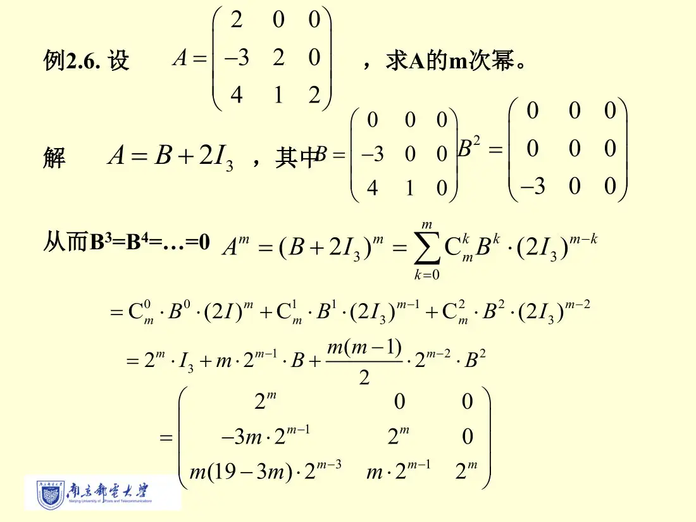

原文：

例2.6. 设 $A=\begin{pmatrix}2&0&0\\-3&2&0\\4&1&2\end{pmatrix}$ ，求A的m次幂。
解 $A=B+2I_{3}$ ，其中 $B=\begin{pmatrix}0&0&0\\-3&0&0\\4&1&0\end{pmatrix}B^{2}=\begin{pmatrix}0&0&0\\0&0&0\\-3&0&0\end{pmatrix}$ 从而 $B^{3}=B^{4}=\ldots=0$ $A^{m}=(B+2I_{3})^{m}=\sum_{k=0}^{m}C_{m}^{k}B^{k}\cdot(2I_{3})^{m-k}$ $=C_{m}^{0}\cdot B^{0}\cdot(2I)^{m}+C_{m}^{1}\cdot B^{1}\cdot(2I_{3})^{m-1}+C_{m}^{2}\cdot B^{2}\cdot(2I_{3})^{m-2}$ $=2^{m}\cdot I_{3}+m\cdot2^{m-1}\cdot B+\frac{m(m-1)}{2}\cdot2^{m-2}\cdot B^{2}$ $=\begin{pmatrix}2^{m}&0&0\\-3m\cdot2^{m-1}&2^{m}&0\\m(19-3m)\cdot2^{m-3}&m\cdot2^{m-1}&2^{m}\end{pmatrix}$

南京邮电大学
Nanjing University of Posts and Telecommunications
