# 《线性代数与解析几何》2.4 矩阵的初等变换与秩（课件）

原件的每一页，下面附识别出的文字。

### 复习: 可逆矩阵的性质: A,B可逆

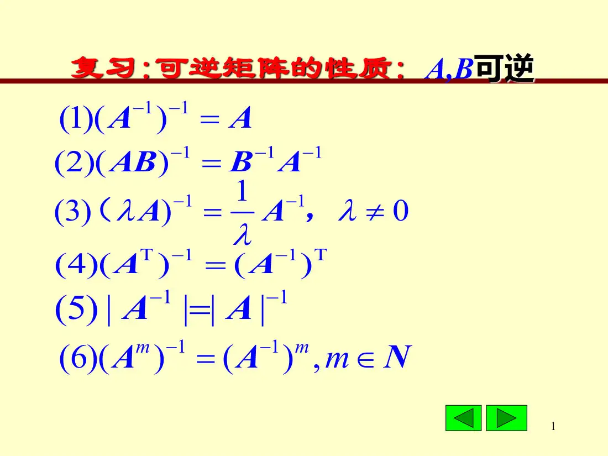

原文：

复习: 可逆矩阵的性质: A,B可逆

(1) $(A^{-1})^{-1} = A$

(2) $(AB)^{-1} = B^{-1}A^{-1}$

(3) $(\lambda A)^{-1} = \frac{1}{\lambda} A^{-1}, \lambda \neq 0$

(4) $(A^{\mathrm{T}})^{-1} = (A^{-1})^{\mathrm{T}}$

(5) $|A^{-1}| = |A|^{-1}$

(6) $(A^{m})^{-1}=(A^{-1})^{m},m\in N$ 例6 设A, B是三阶方阵， $|A| = -2$ , $A^{3}-ABA+2I=0$ . 则 $|A-B|=(\quad)$ .
(A)2; (B)-2; (C) $\frac{1}{2}$ ; (D) $-\frac{1}{2}$ .
解由 $A^{3}-ABA+2I=0$ $A^{3}-ABA=-2I$ $A(A-B)A=-2I$ $|A||A-B||A|=-2I=(-2)^{3}$ $\therefore |A-B|=-2$

◀

1

### 第 2 页

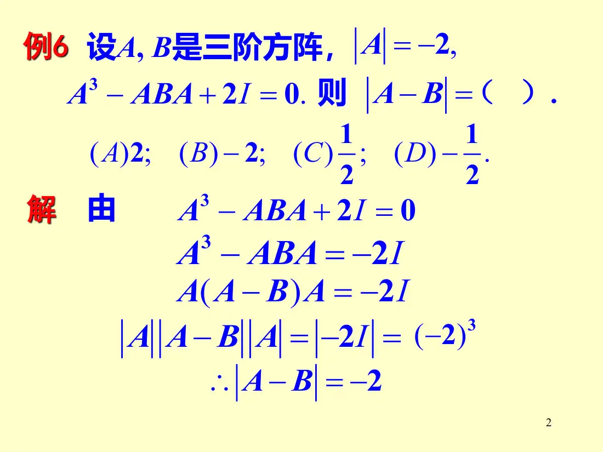

原文：

2

### 解 AA\*=A\*A=|A|I,

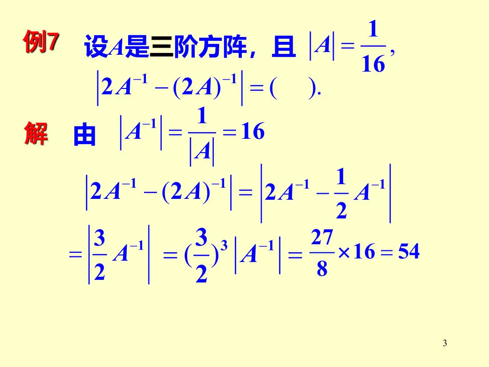

原文：

例7 设A是三阶方阵，且 $\left|A\right|=\frac{1}{16}$ , $\left|2A^{-1}-(2A)^{-1}\right|=(\quad)$ .
解 由 $\left|A^{-1}\right|=\frac{1}{\left|A\right|}=16$ $\left|2A^{-1}-(2A)^{-1}\right|=\left|2A^{-1}-\frac{1}{2}A^{-1}\right|$ $=\left|\frac{3}{2}A^{-1}\right|=\left(\frac{3}{2}\right)^{3}\left|A^{-1}\right|=\frac{27}{8}\times16=54$ 例8 设A为3阶方阵, A\*为A的伴随矩阵, 且|A|=1/2, 则|(3A)⁻¹-2 A\*|的值为( ). (A) 16/27 (B)-4/3 (C) 5 (D)-16/27
解 AA\*=A\*A=|A|I,
∵|A|≠0, ∴A可逆,且 A\*=|A|A⁻¹
|(3A)⁻¹ -2A\*|=|(1/3) A⁻¹ -2|A|A⁻¹|
=|(1/3) A⁻¹ -A⁻¹|
=|(-2/3) A⁻¹|=(-2/3)³|A⁻¹|
=(-8/27)×2=-16/27.

3

### 第 4 页

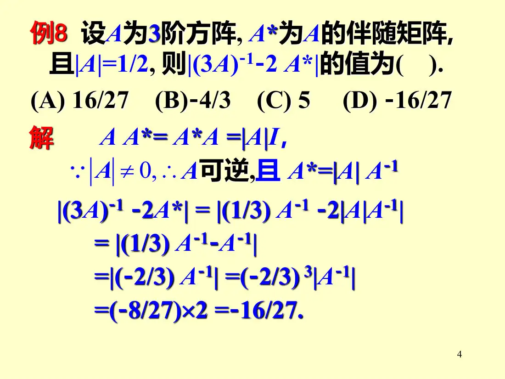

原文：

4

### 例9 设A是n阶方阵， $A^{*}$ 为A的伴随矩阵，

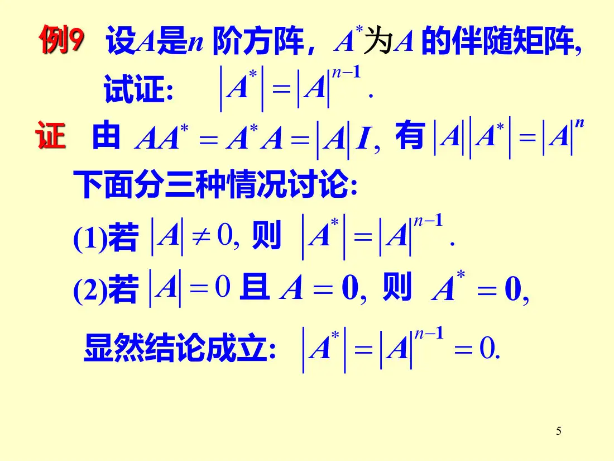

原文：

例9 设A是n阶方阵， $A^{*}$ 为A的伴随矩阵，
试证： $\left|A^{*}\right|=\left|A\right|^{n-1}$ 证 由 $AA^{*}=A^{*}A=\left|A\right|I$ ，有 $\left|A\right|\left|A^{*}\right|=\left|A\right|^{n}$ 下面分三种情况讨论：
(1) 若 $|A| \neq 0$ ，则 $\left|A^{*}\right| = \left|A\right|^{n-1}$ .
(2) 若 $|A|=0$ 且 A=0，则 $A^{*}=0$ ，
显然结论成立： $\left|A^{*}\right|=\left|A\right|^{n-1}=0.$

5

### 第 6 页

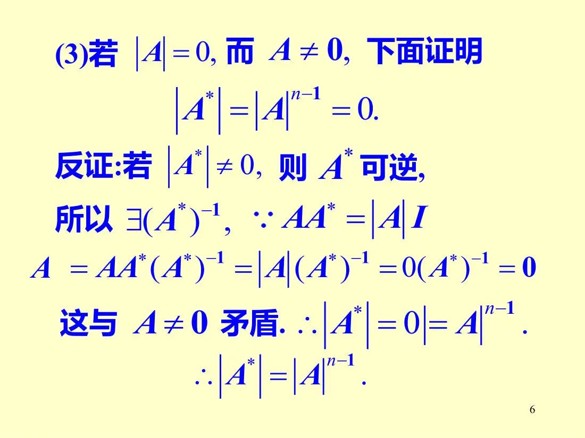

原文：

(3)若 $|A| = 0$ , 而 $A \neq 0$ , 下面证明 $\left|A^{*}\right| = \left|A\right|^{n-1} = 0.$ 反证: 若 $\left|A^{*}\right| \neq 0$ , 则 $A^{*}$ 可逆,
所以 $\exists (A^{*})^{-1}$ , $\because AA^{*} = |A|I$ $A = AA^{*}(A^{*})^{-1} = |A|(A^{*})^{-1} = 0(A^{*})^{-1} = 0$ 这与 $A \neq 0$ 矛盾. $\therefore \left|A^{*}\right| = 0 \left|= A\right|^{n-1}$ . $\therefore \left|A^{*}\right| = \left|A\right|^{n-1}$ .

6

### 分析 矩阵和它的逆矩阵是乘法可交换的.

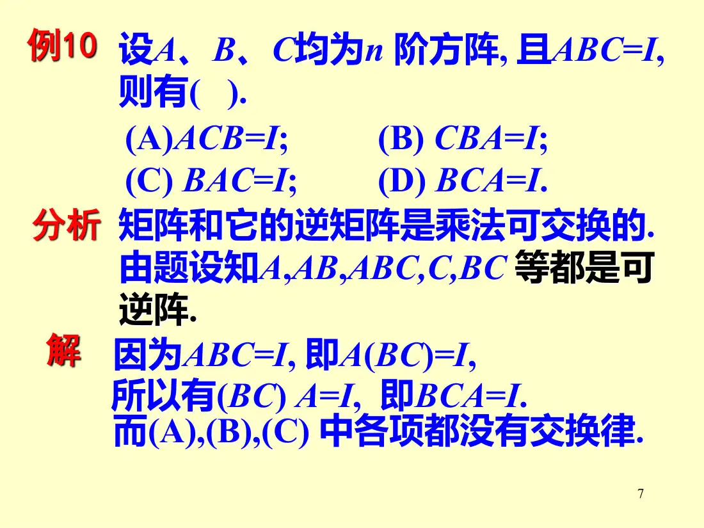

原文：

例10 设A、B、C均为n阶方阵, 且ABC=I, 则有( ). (A)ACB=I; (B) CBA=I; (C) BAC=I; (D) BCA=I.

分析 矩阵和它的逆矩阵是乘法可交换的.
由题设知A,AB,ABC,C,BC等都是可逆阵.

解 因为 $ABC = I$ , 即 $A(BC) = I$ , 所以有 $(BC) A = I$ , 即 $BCA = I$ . 而(A),(B),(C) 中各项都没有交换律.

7

### 从而 $A + I$ 不可逆.

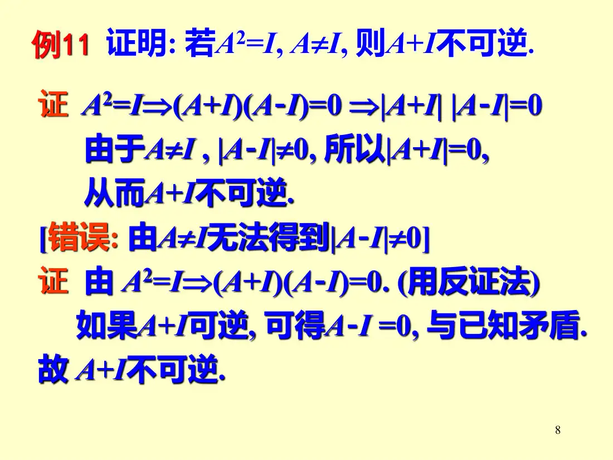

原文：

例11 证明: 若 $A^2 = I, A \neq I$ , 则 $A + I$ 不可逆.

证 $A^2 = I \Rightarrow (A + I)(A - I) = 0 \Rightarrow |A + I| |A - I| = 0$ 由于 $A \neq I, |A - I| \neq 0$ , 所以 $|A + I| = 0$ ,

从而 $A + I$ 不可逆.

[错误: 由 $A \neq I$ 无法得到 $|A - I| \neq 0$ ]

证 由 $A^2 = I \Rightarrow (A + I)(A - I) = 0$ . (用反证法)

如果 $A + I$ 可逆, 可得 $A - I = 0$ , 与已知矛盾.

故 $A + I$ 不可逆.

8

### 2.4 矩阵的初等变换

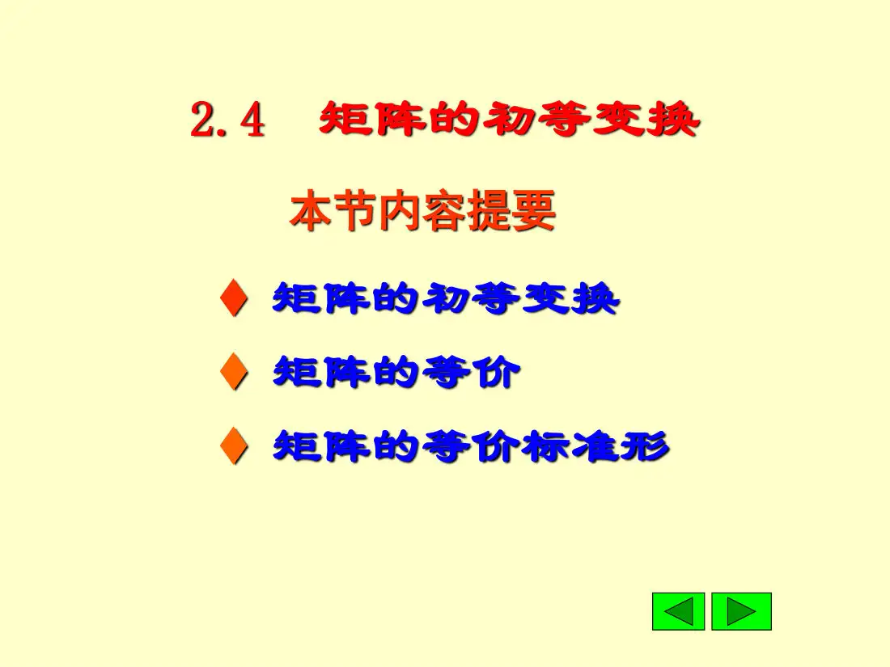

原文：

2.4 矩阵的初等变换

本节内容提要

矩阵的初等变换

矩阵的等价

矩阵的等价标准形

◀ ▶

### 例1 解线性方程组

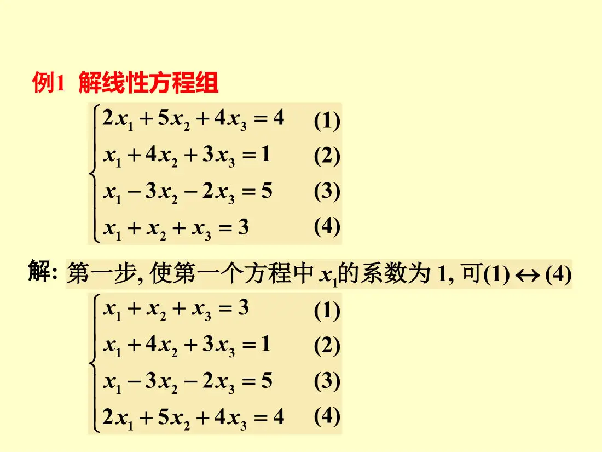

原文：

例1 解线性方程组

$$
2 x _ {1} + 5 x _ {2} + 4 x _ {3} = 4\tag{1}
$$

$$
x _ {1} + 4 x _ {2} + 3 x _ {3} = 1\tag{2}
$$

$$
x _ {1} - 3 x _ {2} - 2 x _ {3} = 5\tag{3}
$$

$$
x _ {1} + x _ {2} + x _ {3} = 3\tag{4}
$$

解: 第一步, 使第一个方程中 $x_{1}$ 的系数为 1, 可(1) $\leftrightarrow$ (4)

$$
x _ {1} + x _ {2} + x _ {3} = 3\tag{1}
$$

$$
x _ {1} + 4 x _ {2} + 3 x _ {3} = 1\tag{2}
$$

$$
x _ {1} - 3 x _ {2} - 2 x _ {3} = 5\tag{3}
$$

$$
\left\lfloor 2 x _ {1} + 5 x _ {2} + 4 x _ {3} = 4 \right.\tag{4}
$$

### 第二步, 把第一个方程以下的各方程中的 $x_{1}$ 消去,

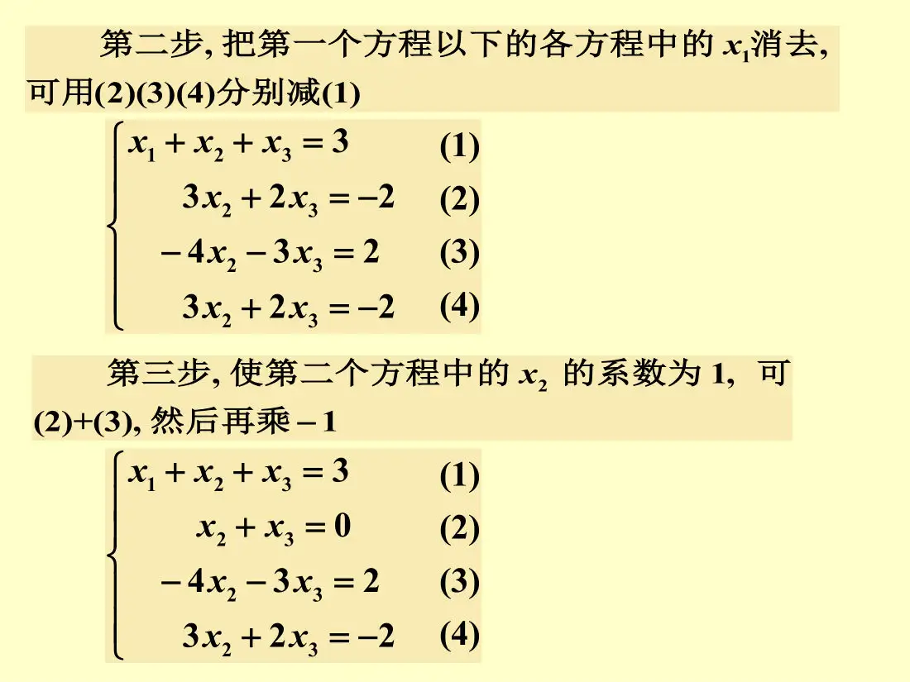

原文：

第二步, 把第一个方程以下的各方程中的 $x_{1}$ 消去,
可用(2)(3)(4)分别减(1)

$$
x _ {1} + x _ {2} + x _ {3} = 3\tag{1}
$$

$$
3 x _ {2} + 2 x _ {3} = - 2\tag{2}
$$

$$
- 4 x _ {2} - 3 x _ {3} = 2\tag{3}
$$

$$
3 x _ {2} + 2 x _ {3} = - 2\tag{4}
$$

第三步, 使第二个方程中的 $x_{2}$ 的系数为 1, 可 (2)+(3), 然后再乘 -1

$$
x _ {1} + x _ {2} + x _ {3} = 3\tag{1}
$$

$$
x _ {2} + x _ {3} = 0\tag{2}
$$

$$
- 4 x _ {2} - 3 x _ {3} = 2\tag{3}
$$

$$
3 x _ {2} + 2 x _ {3} = - 2\tag{4}
$$

### 第六步, 用回代的方法求解, 即(2)-(3), (1)-(3)

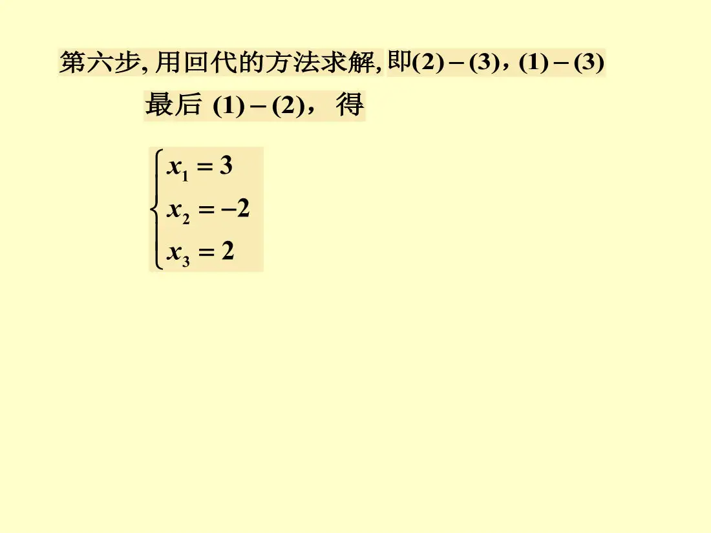

原文：

第六步, 用回代的方法求解, 即(2)-(3), (1)-(3)

最后 (1)-(2)，得

$$
\left\{ \begin{array}{l} x _ {1} = 3 \\ x _ {2} = - 2 \\ x _ {3} = 2 \end{array} \right.
$$

### 上述消元过程中, 我们对方程组施行了以下三种变换:

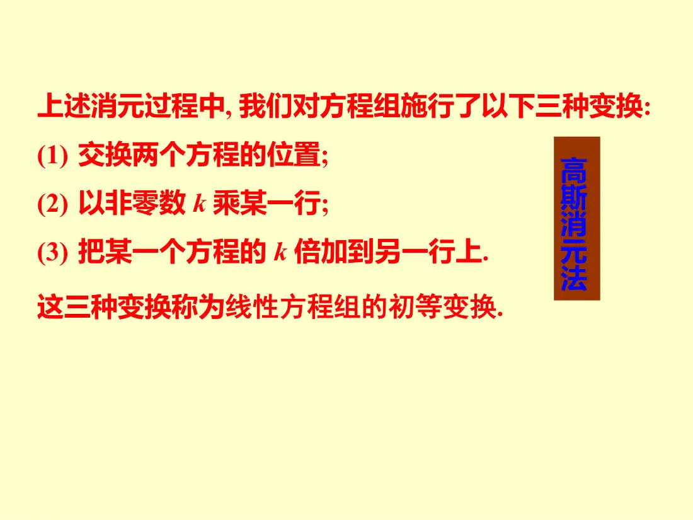

原文：

上述消元过程中, 我们对方程组施行了以下三种变换:

(1) 交换两个方程的位置;

高斯消元法

(2) 以非零数 $k$ 乘某一行;

(3) 把某一个方程的 k 倍加到另一行上.

这三种变换称为线性方程组的初等变换.

### 对方程组施行的初等变换可以用增广矩阵的变换来表示.

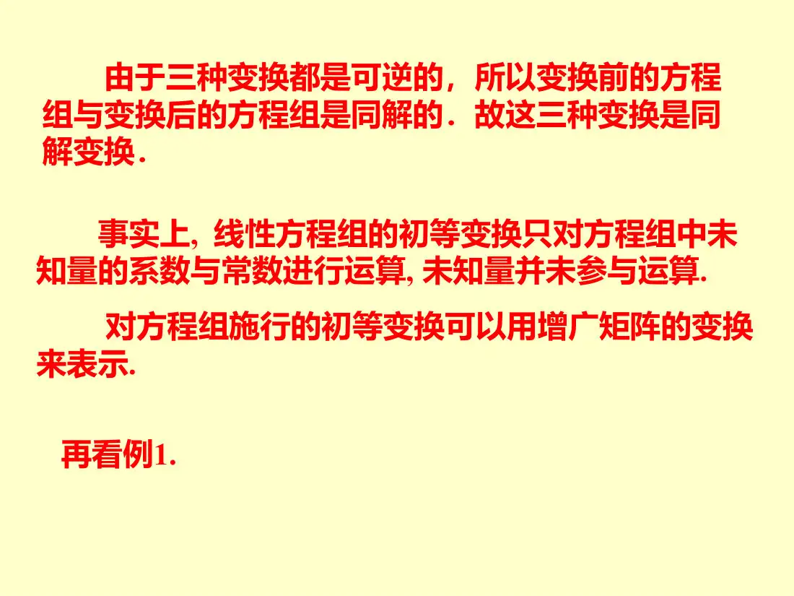

原文：

由于三种变换都是可逆的，所以变换前的方程组与变换后的方程组是同解的。故这三种变换是同解变换。

事实上，线性方程组的初等变换只对方程组中未知量的系数与常数进行运算，未知量并未参与运算。

对方程组施行的初等变换可以用增广矩阵的变换来表示.

再看例1.

### 例1 解线性方程组

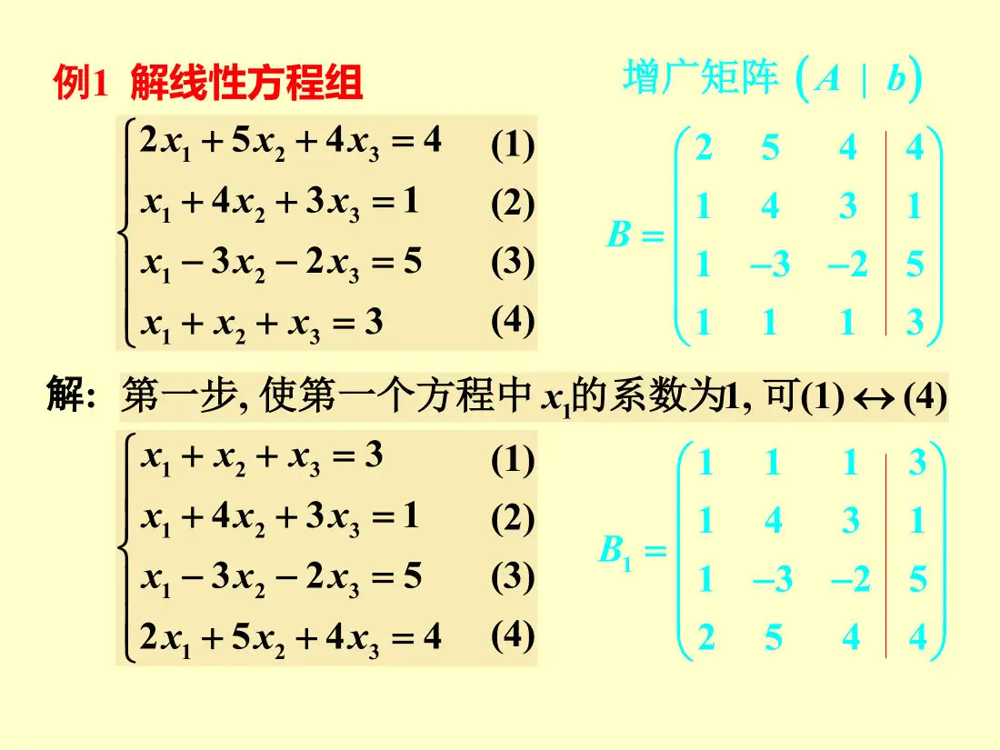

原文：

例1 解线性方程组

$$
2 x _ {1} + 5 x _ {2} + 4 x _ {3} = 4\tag{1}
$$

$$
x _ {1} + 4 x _ {2} + 3 x _ {3} = 1\tag{2}
$$

$$
x _ {1} - 3 x _ {2} - 2 x _ {3} = 5\tag{3}
$$

$$
x _ {1} + x _ {2} + x _ {3} = 3\tag{4}
$$

增广矩阵 $(A \mid b)$

$$
B = \left( \begin{array}{c c c c} 2 & 5 & 4 & 4 \\ 1 & 4 & 3 & 1 \\ 1 & - 3 & - 2 & 5 \\ 1 & 1 & 1 & 3 \end{array} \right)
$$

解: 第一步, 使第一个方程中 $x_{1}$ 的系数为 1 , 可 (1) $\leftrightarrow$ (4)

$$
x _ {1} + x _ {2} + x _ {3} = 3\tag{1}
$$

$$
x _ {1} + 4 x _ {2} + 3 x _ {3} = 1\tag{2}
$$

$$
x _ {1} - 3 x _ {2} - 2 x _ {3} = 5\tag{3}
$$

$$
2 x _ {1} + 5 x _ {2} + 4 x _ {3} = 4\tag{4}
$$

$$
B _ {1} = \left( \begin{array}{c c c c} 1 & 1 & 1 & 3 \\ 1 & 4 & 3 & 1 \\ 1 & - 3 & - 2 & 5 \\ 2 & 5 & 4 & 4 \end{array} \right)
$$

### (1)

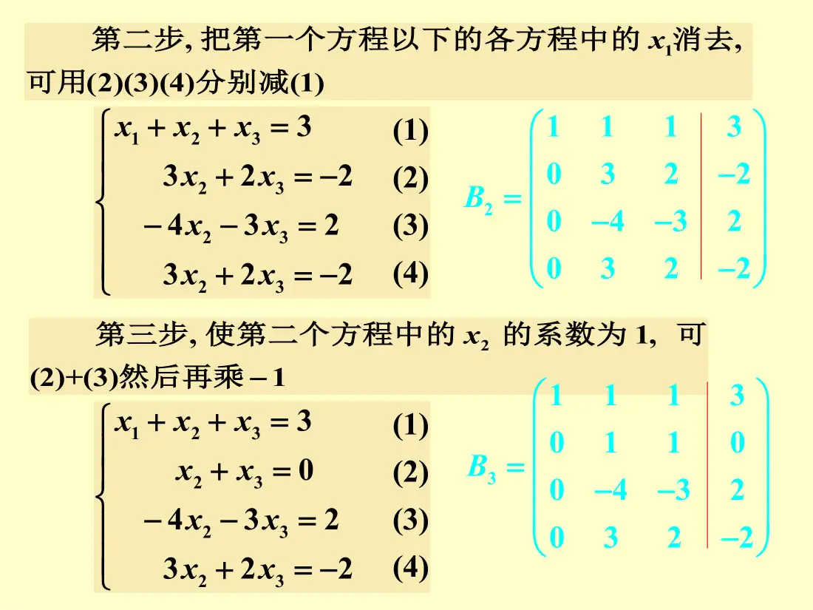

原文：

第二步, 把第一个方程以下的各方程中的 $x_{1}$ 消去, 可用(2)(3)(4)分别减(1)

(1)

$$
\left\{ \begin{array}{r l} x _ {1} + x _ {2} + x _ {3} & = 3 \\ 3 x _ {2} + 2 x _ {3} & = - 2 \\ - 4 x _ {2} - 3 x _ {3} & = 2 \\ 3 x _ {2} + 2 x _ {3} & = - 2 \end{array} \right.\tag{2}
$$

(3)

$$
B _ {2} = \left( \begin{array}{c c c c} 1 & 1 & 1 & 3 \\ 0 & 3 & 2 & - 2 \\ 0 & - 4 & - 3 & 2 \\ 0 & 3 & 2 & - 2 \end{array} \right)\tag{4}
$$

第三步, 使第二个方程中的 $x_{2}$ 的系数为 1, 可 (2)+(3)然后再乘 -1

$$
\left\{ \begin{array}{c} x _ {1} + x _ {2} + x _ {3} = 3 \\ x _ {2} + x _ {3} = 0 \\ - 4 x _ {2} - 3 x _ {3} = 2 \\ 3 x _ {2} + 2 x _ {3} = - 2 \end{array} \right.\tag{1}
$$

(2)

(3)

$$
B _ {3} = \left( \begin{array}{c c c c} 1 & 1 & 1 & 3 \\ 0 & 1 & 1 & 0 \\ 0 & - 4 & - 3 & 2 \\ 0 & 3 & 2 & - 2 \end{array} \right)\tag{4}
$$

### $$

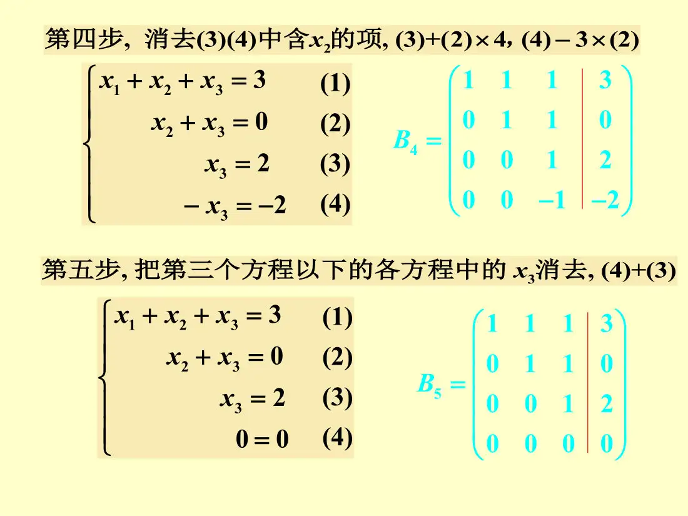

原文：

第四步, 消去(3)(4)中含 $x_{2}$ 的项, (3)+(2)×4, (4)-3×(2)

$$
x _ {1} + x _ {2} + x _ {3} = 3
$$

(1)

$$
x _ {2} + x _ {3} = 0\tag{2}
$$

$$
x _ {3} = 2
$$

(3)

$$
- x _ {3} = - 2\tag{4}
$$

$$
B _ {4} = \left( \begin{array}{c c c c} 1 & 1 & 1 & 3 \\ 0 & 1 & 1 & 0 \\ 0 & 0 & 1 & 2 \\ 0 & 0 & - 1 & - 2 \end{array} \right)
$$

第五步, 把第三个方程以下的各方程中的 $x_{3}$ 消去, $(4)+(3)$

$$
x _ {1} + x _ {2} + x _ {3} = 3\tag{1}
$$

$$
x _ {2} + x _ {3} = 0\tag{2}
$$

$$
x _ {3} = 2\tag{3}
$$

$$
\mathbf {0} = \mathbf {0}\tag{4}
$$

$$
B _ {5} = \left( \begin{array}{c c c c} 1 & 1 & 1 & 3 \\ 0 & 1 & 1 & 0 \\ 0 & 0 & 1 & 2 \\ 0 & 0 & 0 & 0 \end{array} \right)
$$

### 第六步, 用回代的方法求解, 即(2)-(3), (1)-(3)

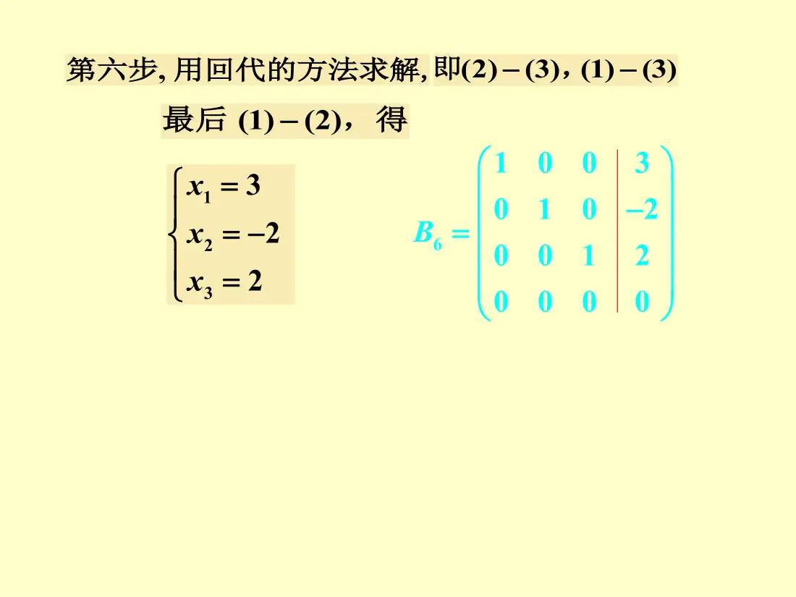

原文：

第六步, 用回代的方法求解, 即(2)-(3), (1)-(3)

最后 (1)-(2)，得

$$
\left\{ \begin{array}{l} x _ {1} = 3 \\ x _ {2} = - 2 \\ x _ {3} = 2 \end{array} \right.
$$

$$
B _ {6} = \left( \begin{array}{c c c c} 1 & 0 & 0 & 3 \\ 0 & 1 & 0 & - 2 \\ 0 & 0 & 1 & 2 \\ 0 & 0 & 0 & 0 \end{array} \right)
$$

### 问题的引入

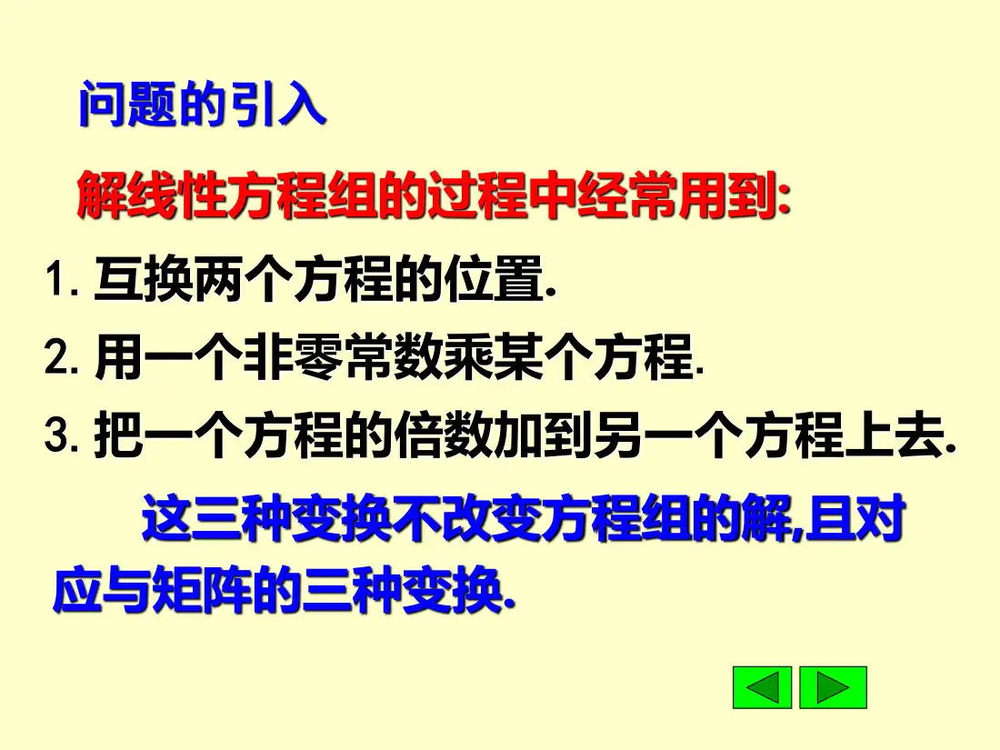

原文：

问题的引入

解线性方程组的过程中经常用到:

1. 互换两个方程的位置。

2. 用一个非零常数乘某个方程.

3. 把一个方程的倍数加到另一个方程上去。

这三种变换不改变方程组的解,且对应与矩阵的三种变换.

◀ ▶

### 2.4.1 矩阵的初等变换

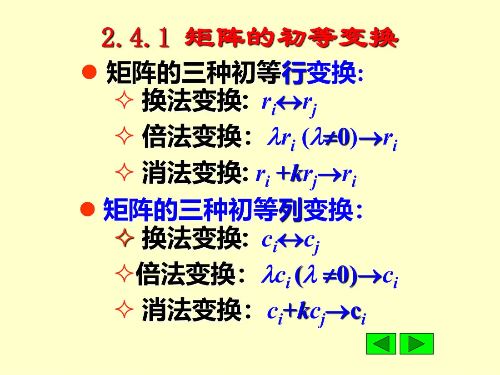

原文：

2.4.1 矩阵的初等变换

\- 矩阵的三种初等行变换:

换法变换: $r_i \leftrightarrow r_j$

倍法变换： $\lambda r_{i} (\lambda \neq 0) \rightarrow r_{i}$

消法变换: $r_{i} + kr_{j} \rightarrow r_{i}$

\- 矩阵的三种初等列变换:

换法变换: $c_{i} \leftrightarrow c_{j}$

倍法变换： $\lambda c_{i}(\lambda\neq0)\rightarrow c_{i}$

消法变换: $c_{i} + k c_{j} \rightarrow c_{i}$

◀ ▶

### 行阶梯形矩阵与行最简形矩阵

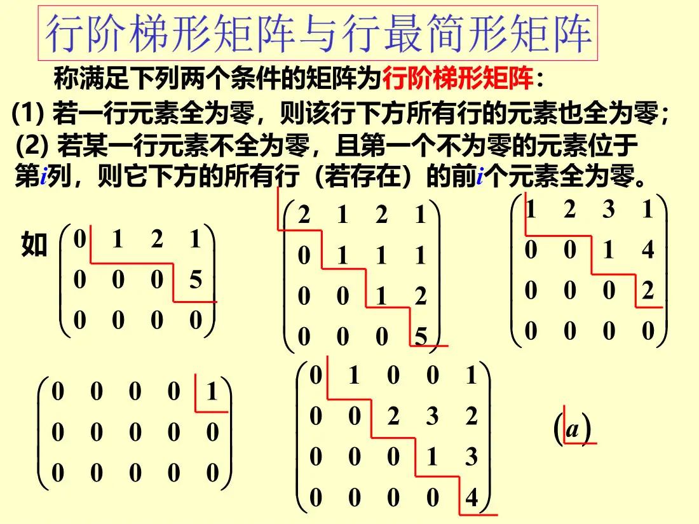

原文：

行阶梯形矩阵与行最简形矩阵

称满足下列两个条件的矩阵为行阶梯形矩阵：

(1) 若一行元素全为零，则该行下方所有行的元素也全为零；

(2) 若某一行元素不全为零，且第一个不为零的元素位于第i列，则它下方的所有行（若存在）的前i个元素全为零。

如

$$
\left( \begin{array}{c c c c} \mathbf {0} & 1 & 2 & 1 \\ \hline \mathbf {0} & \mathbf {0} & \mathbf {0} & 5 \\ \mathbf {0} & \mathbf {0} & \mathbf {0} & \mathbf {0} \end{array} \right)
$$

$$
\left( \begin{array}{c c c c} 2 & 1 & 2 & 1 \\ 0 & 1 & 1 & 1 \\ 0 & 0 & 1 & 2 \\ 0 & 0 & 0 & 5 \end{array} \right)
$$

$$
\left( \begin{array}{c c c c} 1 & 2 & 3 & 1 \\ 0 & 0 & 1 & 4 \\ 0 & 0 & 0 & 2 \\ 0 & 0 & 0 & 0 \end{array} \right)
$$

$$
\left( \begin{array}{c c c c c} \mathbf {0} & \mathbf {0} & \mathbf {0} & \mathbf {0} & \framebox {\text {1}} \\ \mathbf {0} & \mathbf {0} & \mathbf {0} & \mathbf {0} & \mathbf {0} \\ \mathbf {0} & \mathbf {0} & \mathbf {0} & \mathbf {0} & \mathbf {0} \end{array} \right)
$$

$$
\left( \begin{array}{c c c c c} \mathbf {0} & 1 & \mathbf {0} & \mathbf {0} & 1 \\ \mathbf {0} & \mathbf {0} & 2 & 3 & 2 \\ \mathbf {0} & \mathbf {0} & \mathbf {0} & 1 & 3 \\ \mathbf {0} & \mathbf {0} & \mathbf {0} & \mathbf {0} & 4 \end{array} \right)
$$

(a)

### 行阶梯形矩阵与行最简形矩阵

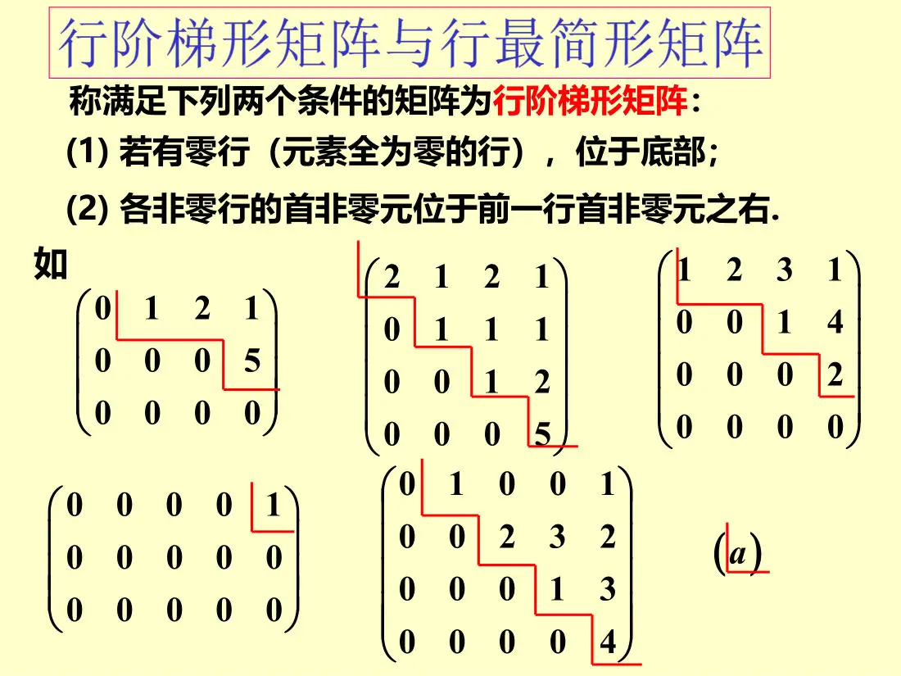

原文：

行阶梯形矩阵与行最简形矩阵

称满足下列两个条件的矩阵为行阶梯形矩阵：

(1) 若有零行（元素全为零的行），位于底部；

(2) 各非零行的首非零元位于前一行首非零元之右.

如

$$
\left( \begin{array}{c c c c} \mathbf {0} & 1 & 2 & 1 \\ \hline \mathbf {0} & \mathbf {0} & \mathbf {0} & \mathbf {5} \\ \mathbf {0} & \mathbf {0} & \mathbf {0} & \mathbf {0} \end{array} \right)
$$

$$
\left( \begin{array}{c c c c} 2 & 1 & 2 & 1 \\ 0 & 1 & 1 & 1 \\ 0 & 0 & 1 & 2 \\ 0 & 0 & 0 & 5 \end{array} \right)
$$

$$
\left( \begin{array}{c c c c} 1 & 2 & 3 & 1 \\ 0 & 0 & 1 & 4 \\ 0 & 0 & 0 & 2 \\ 0 & 0 & 0 & 0 \end{array} \right)
$$

$$
\left( \begin{array}{c c c c c} \mathbf {0} & \mathbf {0} & \mathbf {0} & \mathbf {0} & \framebox {\text {1}} \\ \mathbf {0} & \mathbf {0} & \mathbf {0} & \mathbf {0} & \mathbf {0} \\ \mathbf {0} & \mathbf {0} & \mathbf {0} & \mathbf {0} & \mathbf {0} \end{array} \right)
$$

$$
\left( \begin{array}{c c c c c} \mathbf {0} & 1 & \mathbf {0} & \mathbf {0} & 1 \\ \mathbf {0} & \mathbf {0} & 2 & 3 & 2 \\ \mathbf {0} & \mathbf {0} & \mathbf {0} & 1 & 3 \\ \mathbf {0} & \mathbf {0} & \mathbf {0} & \mathbf {0} & 4 \end{array} \right)
$$

(a)

### 特点：

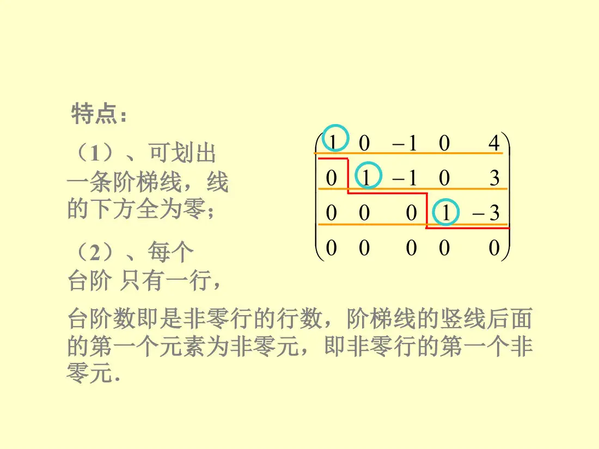

原文：

特点：

(1)、可划出一条阶梯线，线的下方全为零；

(2)、每个台阶 只有一行，

$$
\left( \begin{array}{c c c c c} 1 & 0 & - 1 & 0 & 4 \\ \hline 0 & 1 & - 1 & 0 & 3 \\ \hline 0 & 0 & 0 & 1 & - 3 \\ \hline 0 & 0 & 0 & 0 & 0 \end{array} \right)
$$

台阶数即是非零行的行数，阶梯线的竖线后面的第一个元素为非零元，即非零行的第一个非零元。

### 行阶梯形矩阵判断方法

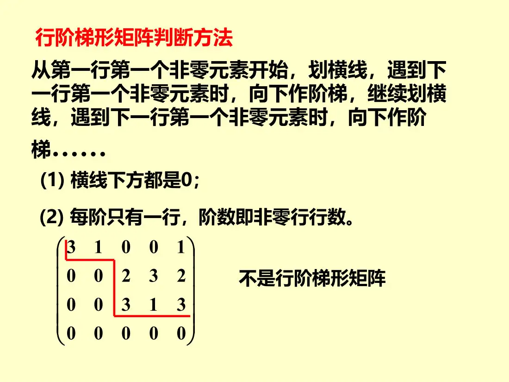

原文：

行阶梯形矩阵判断方法

从第一行第一个非零元素开始，划横线，遇到下一行第一个非零元素时，向下作阶梯，继续划横线，遇到下一行第一个非零元素时，向下作阶梯……

(1) 横线下方都是0;

(2) 每阶只有一行，阶数即非零行行数。

$$
\left( \begin{array}{c c c c c} 3 & 1 & 0 & 0 & 1 \\ 0 & 0 & 2 & 3 & 2 \\ 0 & 0 & 3 & 1 & 3 \\ 0 & 0 & 0 & 0 & 0 \end{array} \right)
$$

不是行阶梯形矩阵

### 例2 利用矩阵的初等行变换,将

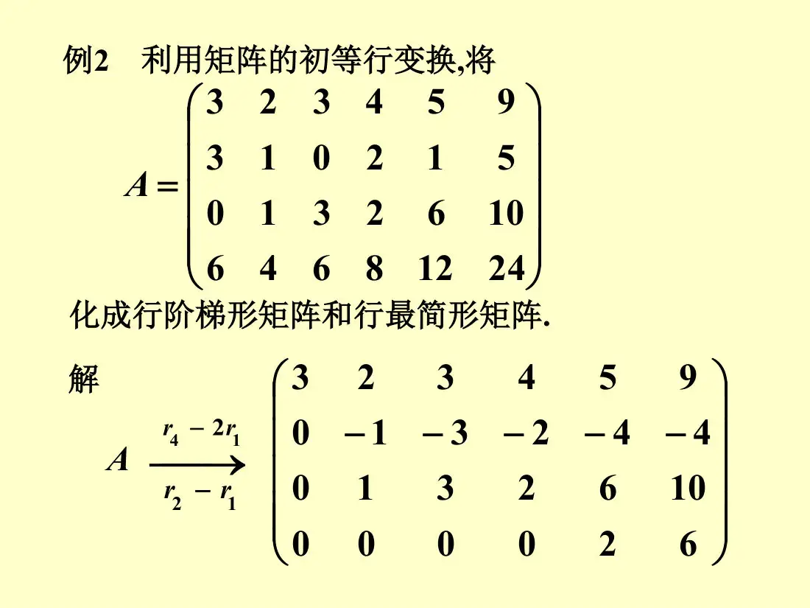

原文：

例2 利用矩阵的初等行变换,将

$$
A = \left( \begin{array}{c c c c c c} 3 & 2 & 3 & 4 & 5 & 9 \\ 3 & 1 & 0 & 2 & 1 & 5 \\ 0 & 1 & 3 & 2 & 6 & 1 0 \\ 6 & 4 & 6 & 8 & 1 2 & 2 4 \end{array} \right)
$$

化成行阶梯形矩阵和行最简形矩阵.

解

$$
A \xrightarrow [ r _ {2} - r _ {1} ]{r _ {4} - 2 r _ {1}} \left( \begin{array}{c c c c c c} 3 & 2 & 3 & 4 & 5 & 9 \\ 0 & - 1 & - 3 & - 2 & - 4 & - 4 \\ 0 & 1 & 3 & 2 & 6 & 1 0 \\ 0 & 0 & 0 & 0 & 2 & 6 \end{array} \right)
$$

### $$

原文：

$$
\xrightarrow {r _ {3} + r _ {2}} \left( \begin{array}{c c c c c c} 3 & 2 & 3 & 4 & 5 & 9 \\ \mathbf {0} & - \mathbf {1} & - 3 & - 2 & - 4 & - 4 \\ \mathbf {0} & \mathbf {0} & \mathbf {0} & \mathbf {0} & 2 & 6 \\ \mathbf {0} & \mathbf {0} & \mathbf {0} & \mathbf {0} & \mathbf {0} & \mathbf {0} \end{array} \right)
$$

行阶梯形矩阵

$$
\xrightarrow [ r _ {1} - 5 r _ {3} ]{\frac {1}{2} r _ {3}} \left( \begin{array}{c c c c c c} 3 & 2 & 3 & 4 & 0 & - 6 \\ 0 & - 1 & - 3 & - 2 & 0 & 8 \\ 0 & 0 & 0 & 0 & 1 & 3 \\ 0 & 0 & 0 & 0 & 0 & 0 \end{array} \right)
$$

### $$

原文：

$$
\overline {{\mathbf {A}}} = \left[ \begin{array}{r r r r} 1 & 2 & 1 & 2 \\ 4 & - 3 & - 1 & 3 \\ 3 & 1 & - 2 & 1 \end{array} \right] \stackrel {(- 4) (- 3)} {\longleftrightarrow} \longrightarrow \left[ \begin{array}{r r r r} 1 & 2 & 1 & 2 \\ 0 & 1 & 1 & 1 \\ 0 & - 1 1 & - 5 & - 5 \end{array} \right]\tag{11}
$$

$$
\begin{array}{r l} & {\longrightarrow \left[ \begin{array}{l l l l} 1 & 2 & 1 & 2 \\ 0 & - 1 1 & - 5 & - 5 \\ 0 & - 5 & - 5 & - 5 \end{array} \right] (- \frac {1}{5})} \\ & {\longrightarrow \left[ \begin{array}{l l l l} 1 & 2 & 1 & 2 \\ 0 & - 1 1 & - 5 & - 5 \\ 0 & 1 & 1 & 1 \end{array} \right]} \end{array}
$$

$$
\longrightarrow \left[ \begin{array}{c c c c} 1 & 2 & 1 & 2 \\ 0 & 1 & 1 & 1 \\ 0 & 0 & 6 & 6 \end{array} \right] (\frac {1}{6})
$$

阶梯形矩阵:

(1)每行非零首元的列数随行数的增加而增加；

(2)零行在下方。

矩阵初等行变换

消元

增广矩阵

阶梯形矩阵

### 称满足下列三个条件的矩阵为行最简形矩阵：

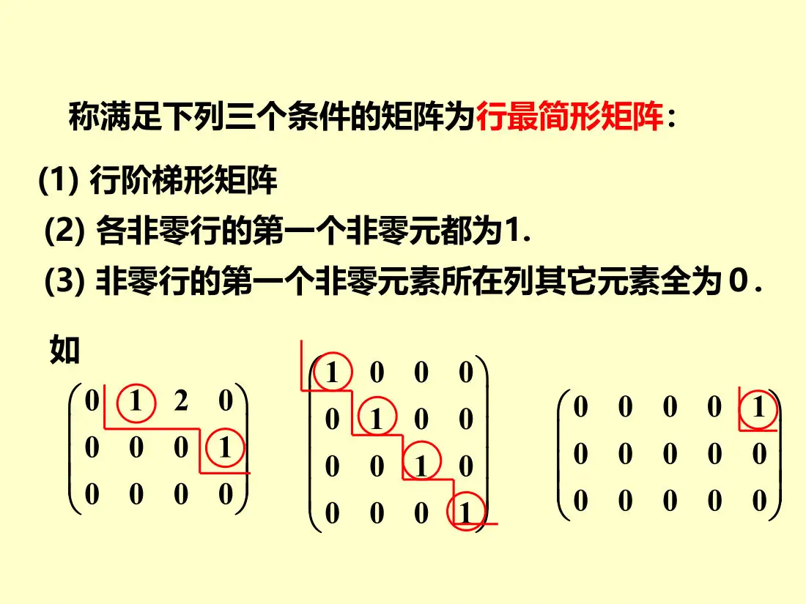

原文：

称满足下列三个条件的矩阵为行最简形矩阵：

(1) 行阶梯形矩阵

(2) 各非零行的第一个非零元都为1.

(3) 非零行的第一个非零元素所在列其它元素全为 0.

如

$$
\left( \begin{array}{c c c c} \mathbf {0} & ① & 2 & \mathbf {0} \\ \hline \mathbf {0} & \mathbf {0} & \mathbf {0} & ① \\ \mathbf {0} & \mathbf {0} & \mathbf {0} & \mathbf {0} \end{array} \right)
$$

$$
\left( \begin{array}{c c c c} 1 & 0 & 0 & 0 \\ 0 & 1 & 0 & 0 \\ 0 & 0 & 1 & 0 \\ 0 & 0 & 0 & 1 \end{array} \right)
$$

$$
\left( \begin{array}{c c c c c} \mathbf {0} & \mathbf {0} & \mathbf {0} & \mathbf {0} & ① \\ \mathbf {0} & \mathbf {0} & \mathbf {0} & \mathbf {0} & \mathbf {0} \\ \mathbf {0} & \mathbf {0} & \mathbf {0} & \mathbf {0} & \mathbf {0} \end{array} \right)
$$

### 例2 利用矩阵的初等行变换,将

原文：

例2 利用矩阵的初等行变换,将

$$
A = \left( \begin{array}{c c c c c c} 3 & 2 & 3 & 4 & 5 & 9 \\ 3 & 1 & 0 & 2 & 1 & 5 \\ 0 & 1 & 3 & 2 & 6 & 1 0 \\ 6 & 4 & 6 & 8 & 1 2 & 2 4 \end{array} \right)
$$

化成行阶梯形矩阵和行最简形矩阵.

解

$$
A \xrightarrow [ r _ {2} - r _ {1} ]{r _ {4} - 2 r _ {1}} \left( \begin{array}{c c c c c c} 3 & 2 & 3 & 4 & 5 & 9 \\ 0 & - 1 & - 3 & - 2 & - 4 & - 4 \\ 0 & 1 & 3 & 2 & 6 & 1 0 \\ 0 & 0 & 0 & 0 & 2 & 6 \end{array} \right)
$$

### $$

原文：

$$
\xrightarrow {r _ {3} + r _ {2}} \left( \begin{array}{c c c c c c} 3 & 2 & 3 & 4 & 5 & 9 \\ \mathbf {0} & - \mathbf {1} & - 3 & - 2 & - 4 & - 4 \\ \mathbf {0} & \mathbf {0} & \mathbf {0} & \mathbf {0} & 2 & 6 \\ \mathbf {0} & \mathbf {0} & \mathbf {0} & \mathbf {0} & \mathbf {0} & \mathbf {0} \end{array} \right)
$$

行阶梯形矩阵

$$
\xrightarrow [ r _ {1} - 5 r _ {3} ]{\frac {1}{2} r _ {3}} \left( \begin{array}{c c c c c c} 3 & 2 & 3 & 4 & 0 & - 6 \\ 0 & - 1 & - 3 & - 2 & 0 & 8 \\ 0 & 0 & 0 & 0 & 1 & 3 \\ 0 & 0 & 0 & 0 & 0 & 0 \end{array} \right)
$$

### $$

原文：

$$
\xrightarrow [ \overline {{3}} ^ {r _ {1}} ]{- r _ {2}} \left( \begin{array}{c c c c c c} 1 & 0 & - 1 & 0 & 0 & \frac {1 0}{3} \\ 0 & 1 & 3 & 2 & 0 & - 8 \\ 0 & 0 & 0 & 0 & 1 & 3 \\ 0 & 0 & 0 & 0 & 0 & 0 \end{array} \right)
$$

行最简形矩阵

(在行最简形矩阵基础上继续实施初等列变换可将其化成标准形)

$$
\left( \begin{array}{c c c c c c} 1 & 0 & 0 & 0 & 0 & 0 \\ 0 & 1 & 0 & 0 & 0 & 0 \\ 0 & 0 & 1 & 0 & 0 & 0 \\ 0 & 0 & 0 & 0 & 0 & 0 \end{array} \right)
$$

标准形

### $$

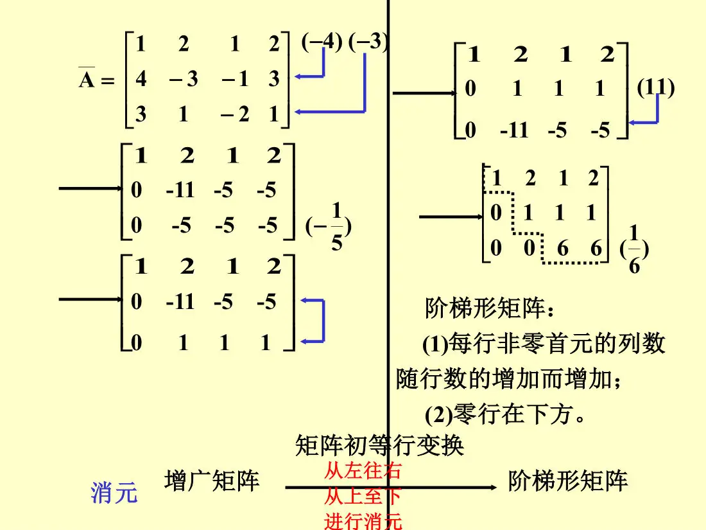

原文：

$$
\overline {{\mathbf {A}}} = \left[ \begin{array}{r r r r} 1 & 2 & 1 & 2 \\ 4 & - 3 & - 1 & 3 \\ 3 & 1 & - 2 & 1 \end{array} \right] \stackrel {(- 4) (- 3)} {\longleftrightarrow} \longrightarrow \left[ \begin{array}{r r r r} 1 & 2 & 1 & 2 \\ 0 & 1 & 1 & 1 \\ 0 & - 1 1 & - 5 & - 5 \end{array} \right]\tag{11}
$$

$$
\begin{array}{r l} & {\longrightarrow \left[ \begin{array}{l l l l} 1 & 2 & 1 & 2 \\ 0 & - 1 1 & - 5 & - 5 \\ 0 & - 5 & - 5 & - 5 \end{array} \right] (- \frac {1}{5})} \\ & {\longrightarrow \left[ \begin{array}{l l l l} 1 & 2 & 1 & 2 \\ 0 & - 1 1 & - 5 & - 5 \\ 0 & 1 & 1 & 1 \end{array} \right]} \end{array}
$$

$$
\longrightarrow \left[ \begin{array}{c c c c} 1 & 2 & 1 & 2 \\ 0 & 1 & 1 & 1 \\ 0 & 0 & 6 & 6 \end{array} \right] (\frac {1}{6})
$$

阶梯形矩阵:

(1)每行非零首元的列数随行数的增加而增加；

(2)零行在下方。

矩阵初等行变换

消元

增广矩阵

阶梯形矩阵

### $$

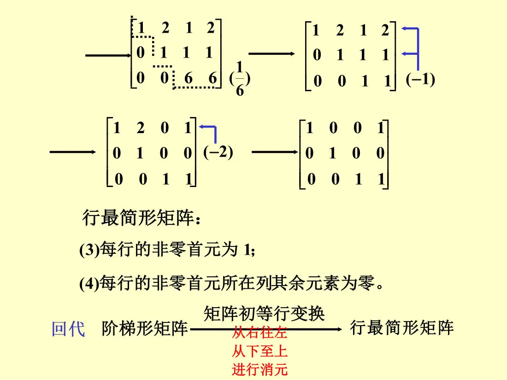

原文：

$$
\longrightarrow \left[ \begin{array}{c c c c} 1 & 2 & 1 & 2 \\ \vdots & \vdots & \vdots & \vdots \\ 0 & 1 & 1 & 1 \\ \vdots & \ddots & \vdots & \vdots \\ 0 & 0 & 6 & 6 \\ \vdots & \ddots & \ddots & \ddots \\ \end{array} \right] (\frac {1}{6}) \longrightarrow \left[ \begin{array}{c c c c} 1 & 2 & 1 & 2 \\ 0 & 1 & 1 & 1 \\ 0 & 0 & 1 & 1 \\ \vdots & \vdots & \vdots & \vdots \\ \vdots & \vdots & \vdots & \vdots \\ \vdots & \vdots & \vdots & \vdots \\ \vdots & \vdots & \vdots & \vdots \\ \vdots & \vdots & \vdots & \vdots \\ \vdots & \vdots & \vdots & \vdots \\ \vdots & \vdots & \vdots & \vdots \\ \vdot & \vdots & \vdots & \vdots \\ \vdots & \vdots & \vdots & \vdots \\ \vdots & \vdots & \vdots & \vdots \\ \vdots & \vdots & \vdots & \vdots \\ \vdots & \vdots & \vdots & \vdots \\ \vdots & \vdots & \vdots & \vdots \\ \vdots & \vdota & - 1) \end{array} \right]
$$

$$
\longrightarrow \left[ \begin{array}{l l l l} 1 & 2 & 0 & 1 \\ 0 & 1 & 0 & 0 \\ 0 & 0 & 1 & 1 \end{array} \right] (- 2) \longrightarrow \left[ \begin{array}{l l l l} 1 & 0 & 0 & 1 \\ 0 & 1 & 0 & 0 \\ 0 & 0 & 1 & 1 \end{array} \right]
$$

行最简形矩阵:

(3)每行的非零首元为 1;

(4)每行的非零首元所在列其余元素为零。

$$
\text {回代} \quad \text {阶梯形矩阵} \xrightarrow {\text {矩阵初等行变换}} \text {行最简形矩阵}
$$

### 标准形

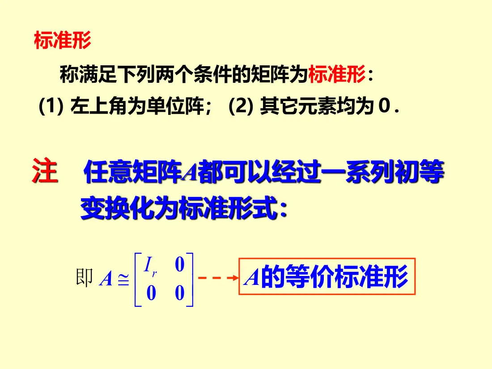

原文：

标准形

称满足下列两个条件的矩阵为标准形：

(1) 左上角为单位阵；(2) 其它元素均为 0.

注 任意矩阵A都可以经过一系列初等变换化为标准形式：

即 $A \cong \begin{bmatrix} I_{r} & 0 \\ 0 & 0 \end{bmatrix}$ --> A 的等价标准形

### 下面的矩阵都是标准形矩阵.

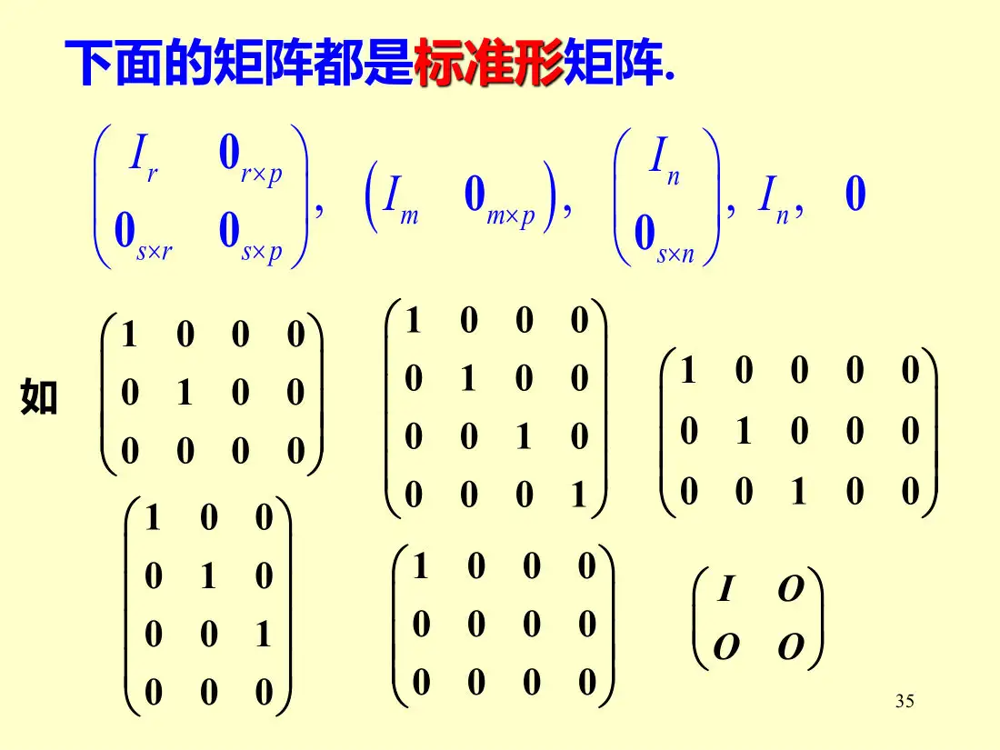

原文：

下面的矩阵都是标准形矩阵.

$$
\left( \begin{array}{c c} I _ {r} & \mathbf {0} _ {r \times p} \\ \mathbf {0} _ {s \times r} & \mathbf {0} _ {s \times p} \end{array} \right),
$$

$$
\binom{I _ {n}}{\mathbf {0} _ {s \times n}},
$$

如

$$
\left( \begin{array}{c c c c} \mathbf {1} & \mathbf {0} & \mathbf {0} & \mathbf {0} \\ \mathbf {0} & \mathbf {1} & \mathbf {0} & \mathbf {0} \\ \mathbf {0} & \mathbf {0} & \mathbf {0} & \mathbf {0} \end{array} \right)
$$

$$
\left( \begin{array}{c c c} \mathbf {1} & \mathbf {0} & \mathbf {0} \\ \mathbf {0} & \mathbf {1} & \mathbf {0} \\ \mathbf {0} & \mathbf {0} & \mathbf {1} \\ \mathbf {0} & \mathbf {0} & \mathbf {0} \end{array} \right)
$$

$$
\left( \begin{array}{c c c c} \mathbf {1} & \mathbf {0} & \mathbf {0} & \mathbf {0} \\ \mathbf {0} & \mathbf {1} & \mathbf {0} & \mathbf {0} \\ \mathbf {0} & \mathbf {0} & \mathbf {1} & \mathbf {0} \\ \mathbf {0} & \mathbf {0} & \mathbf {0} & \mathbf {1} \end{array} \right)
$$

$$
\left( \begin{array}{c c c c c} \mathbf {1} & \mathbf {0} & \mathbf {0} & \mathbf {0} & \mathbf {0} \\ \mathbf {0} & \mathbf {1} & \mathbf {0} & \mathbf {0} & \mathbf {0} \\ \mathbf {0} & \mathbf {0} & \mathbf {1} & \mathbf {0} & \mathbf {0} \end{array} \right)
$$

$$
\left( \begin{array}{c c c c} \mathbf {1} & \mathbf {0} & \mathbf {0} & \mathbf {0} \\ \mathbf {0} & \mathbf {0} & \mathbf {0} & \mathbf {0} \\ \mathbf {0} & \mathbf {0} & \mathbf {0} & \mathbf {0} \end{array} \right)
$$

$$
\left( \begin{array}{c c} I & o \\ o & o \end{array} \right)
$$

35

### 例2 利用矩阵的初等行变换,将

原文：

例2 利用矩阵的初等行变换,将

$$
A = \left( \begin{array}{c c c c c c} 3 & 2 & 3 & 4 & 5 & 9 \\ 3 & 1 & 0 & 2 & 1 & 5 \\ 0 & 1 & 3 & 2 & 6 & 1 0 \\ 6 & 4 & 6 & 8 & 1 2 & 2 4 \end{array} \right)
$$

化成行阶梯形矩阵和行最简形矩阵.

解

$$
A \xrightarrow [ r _ {2} - r _ {1} ]{r _ {4} - 2 r _ {1}} \left( \begin{array}{c c c c c c} 3 & 2 & 3 & 4 & 5 & 9 \\ 0 & - 1 & - 3 & - 2 & - 4 & - 4 \\ 0 & 1 & 3 & 2 & 6 & 1 0 \\ 0 & 0 & 0 & 0 & 2 & 6 \end{array} \right)
$$

### $$

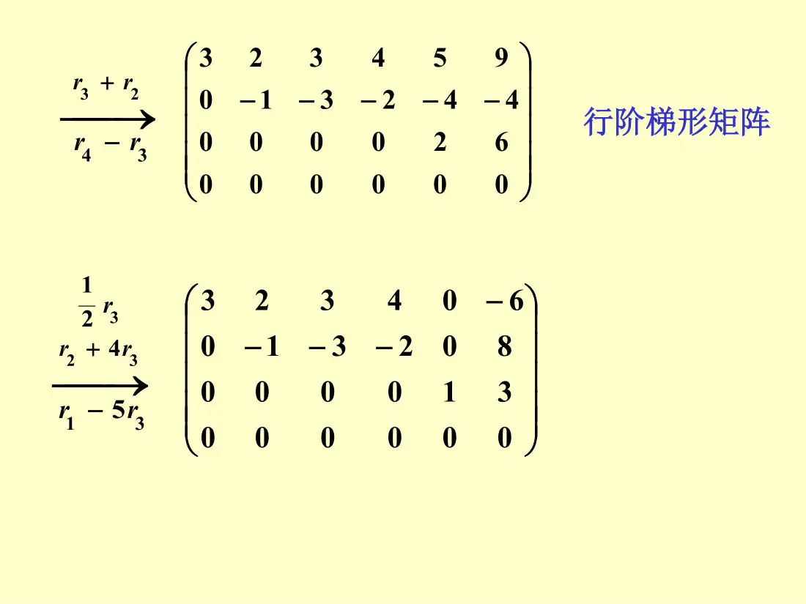

原文：

$$
\xrightarrow {r _ {3} + r _ {2}} \left( \begin{array}{c c c c c c} 3 & 2 & 3 & 4 & 5 & 9 \\ \mathbf {0} & - \mathbf {1} & - 3 & - 2 & - 4 & - 4 \\ \mathbf {0} & \mathbf {0} & \mathbf {0} & \mathbf {0} & 2 & 6 \\ \mathbf {0} & \mathbf {0} & \mathbf {0} & \mathbf {0} & \mathbf {0} & \mathbf {0} \end{array} \right)
$$

行阶梯形矩阵

$$
\xrightarrow [ r _ {1} - 5 r _ {3} ]{\frac {1}{2} r _ {3}} \left( \begin{array}{c c c c c c} 3 & 2 & 3 & 4 & 0 & - 6 \\ 0 & - 1 & - 3 & - 2 & 0 & 8 \\ 0 & 0 & 0 & 0 & 1 & 3 \\ 0 & 0 & 0 & 0 & 0 & 0 \end{array} \right)
$$

### $$

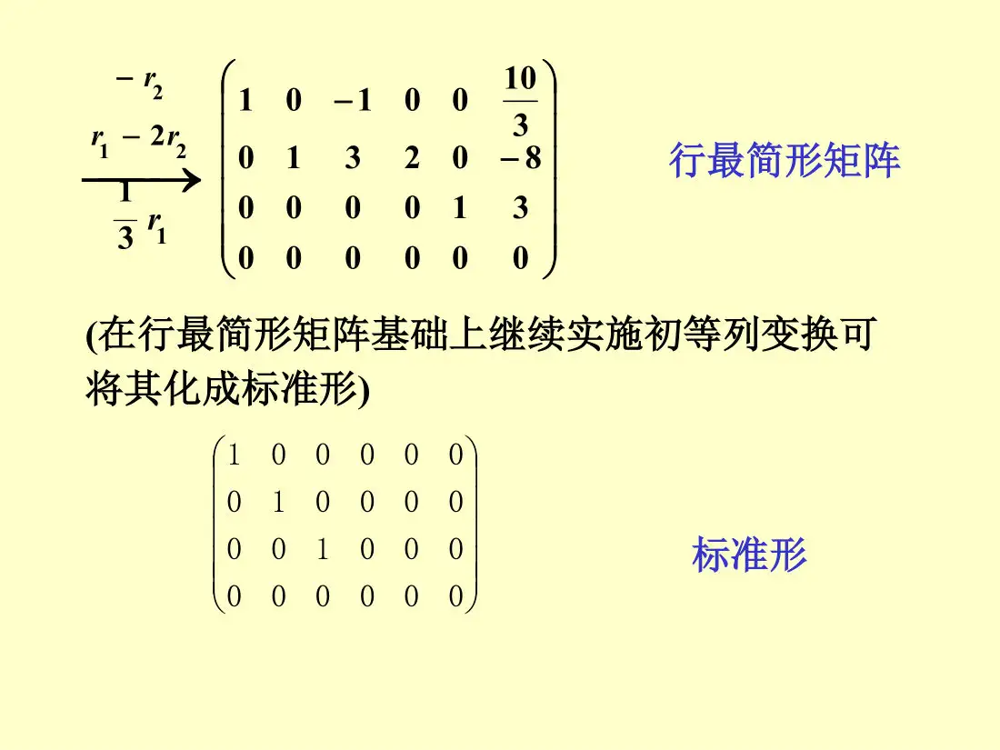

原文：

$$
\xrightarrow [ \overline {{3}} ^ {r _ {1}} ]{- r _ {2}} \left( \begin{array}{c c c c c c} 1 & 0 & - 1 & 0 & 0 & \frac {1 0}{3} \\ 0 & 1 & 3 & 2 & 0 & - 8 \\ 0 & 0 & 0 & 0 & 1 & 3 \\ 0 & 0 & 0 & 0 & 0 & 0 \end{array} \right)
$$

行最简形矩阵

(在行最简形矩阵基础上继续实施初等列变换可将其化成标准形)

$$
\left( \begin{array}{c c c c c c} 1 & 0 & 0 & 0 & 0 & 0 \\ 0 & 1 & 0 & 0 & 0 & 0 \\ 0 & 0 & 1 & 0 & 0 & 0 \\ 0 & 0 & 0 & 0 & 0 & 0 \end{array} \right)
$$

标准形

### 结论

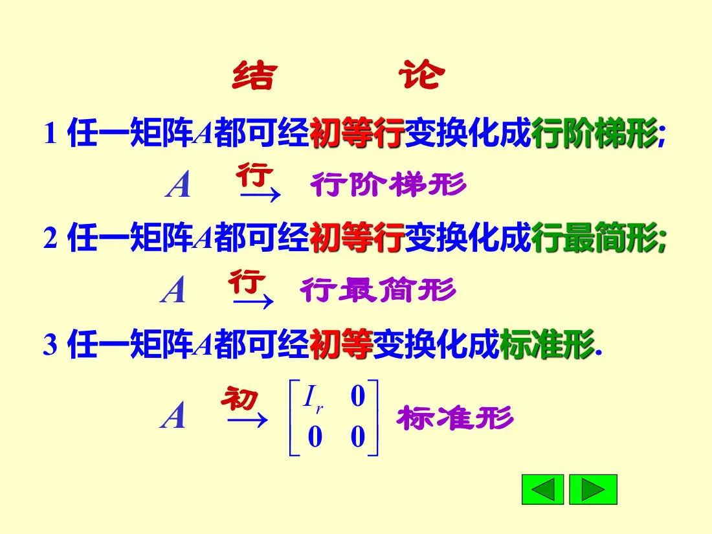

原文：

结论

1 任一矩阵A都可经初等行变换化成行阶梯形;

A 行行阶梯形

2 任一矩阵A都可经初等行变换化成行最简形;

A 行 行最简形

3 任一矩阵 $A$ 都可经初等变换化成标准形.

A $\xrightarrow{初} \begin{bmatrix} I_{r} & 0 \\ 0 & 0 \end{bmatrix}$ 标准形

◀ ▶

### $$

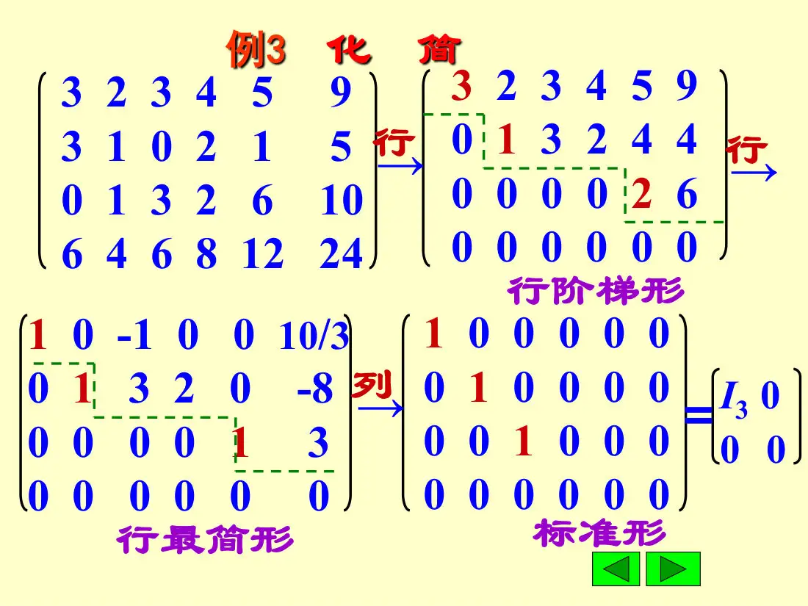

原文：

$$
\left( \begin{array}{c c c c c c} 3 & 2 & 3 & 4 & 5 & 9 \\ 3 & 1 & 0 & 2 & 1 & 5 \\ 0 & 1 & 3 & 2 & 6 & 1 0 \\ 6 & 4 & 6 & 8 & 1 2 & 2 4 \end{array} \right) \xrightarrow {\text {行}} \left( \begin{array}{c c c c c c} 3 & 2 & 3 & 4 & 5 & 9 \\ 0 & 1 & 3 & 2 & 4 & 4 \\ 0 & 0 & 0 & 0 & 2 & 6 \\ 0 & 0 & 0 & 0 & 0 & 0 \end{array} \right) \xrightarrow {\text {行}}
$$

行阶梯形

$$
\left( \begin{array}{c c c c c c} 1 & 0 & - 1 & 0 & 0 & 1 0 / 3 \\ \hline 0 & 1 & 3 & 2 & 0 & - 8 \\ 0 & 0 & 0 & 0 & 1 & 3 \\ 0 & 0 & 0 & 0 & 0 & 0 \end{array} \right) \xrightarrow {\text {列}} \left( \begin{array}{c c c c c c} 1 & 0 & 0 & 0 & 0 & 0 \\ 0 & 1 & 0 & 0 & 0 & 0 \\ 0 & 0 & 1 & 0 & 0 & 0 \\ 0 & 0 & 0 & 0 & 0 & 0 \end{array} \right) = \left[ \begin{array}{c c} I _ {3} & 0 \\ 0 & 0 \end{array} \right]
$$

行最简形

标准形

◀◀

### 2.4.2 初等矩阵

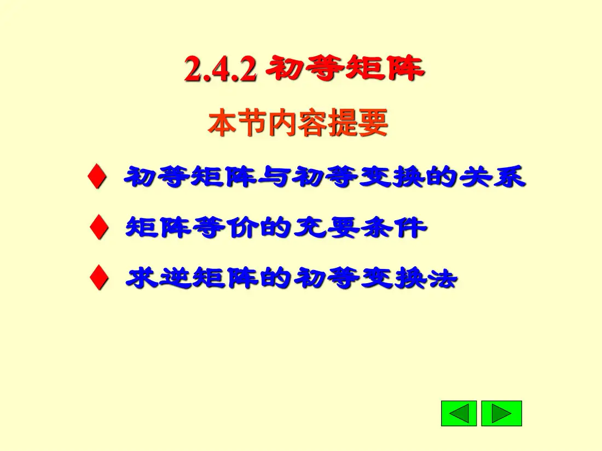

原文：

2.4.2 初等矩阵

本节内容提要

◆ 初等矩阵与初等变换的关系

矩阵等价的充要条件

求逆矩阵的初等变换法

◀ ▶

### 问题:为什么要引入“初等矩阵”呢?

原文：

问题:为什么要引入“初等矩阵”呢?

如果对于单位矩阵/进行一次初等变换, 它会变成什么样?

\- 如果矩阵 $A$ 经过一次初等变换变为 $B$ , 那么 $A$ 与 $B$ 间如何建立等量关系?

◀ ▶

### 初等矩阵的概念

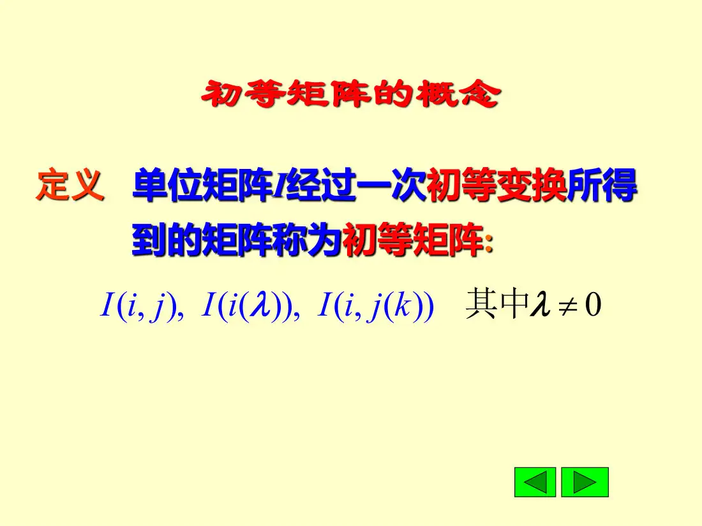

原文：

初等矩阵的概念

定义 单位矩阵/经过一次初等变换所得到的矩阵称为初等矩阵:

$I(i,j), I(i(\lambda)), I(i,j(k))$ 其中 $\lambda \neq 0$

◀ ▶

### $$

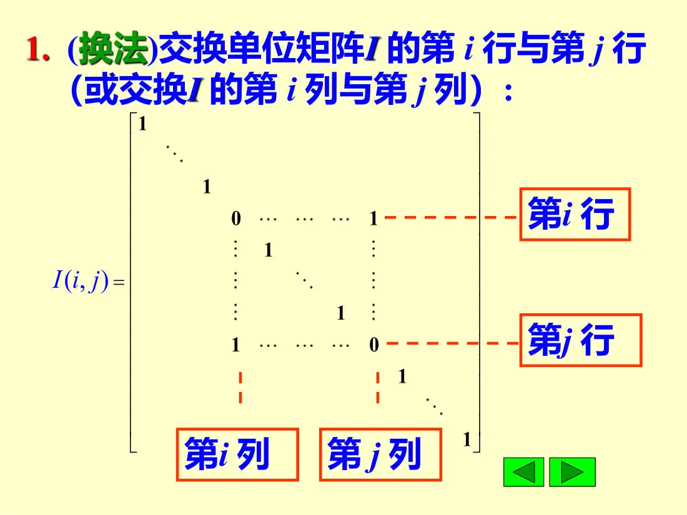

原文：

1. (换法)交换单位矩阵 $I$ 的第 $i$ 行与第 $j$ 行 (或交换 $I$ 的第 $i$ 列与第 $j$ 列):

$$
I (i, j) = \left[ \begin{array}{c c c c c c c c} 1 & & & & & & & \\ & \ddots & & & & & & \\ & & 1 & & & & & \\ & & & 0 & \dots & \dots & \dots & 1 \\ & & & \vdots & 1 & & & \vdots \\ & & & \vdots & & \ddots & & \vdots \\ & & & \vdots & & & 1 & \vdots \\ & & & 1 & \dots & \dots & \dots & 0 \\ & & & 1 & & & & 1 \\ & & & 1 & & & & \ddots \\ \hline \text {第} i \text {列} & \text {第} j \text {列} & 1 \end{array} \right] \quad \begin{array}{l} \text {第} i \text {行} \\ \text {第} j \text {行} \\ \hline \text {第} i \text {列} \\ \text {第} j \text {列} \end{array}
$$

### (或给 I 的第 i 列乘以 $\lambda$ :

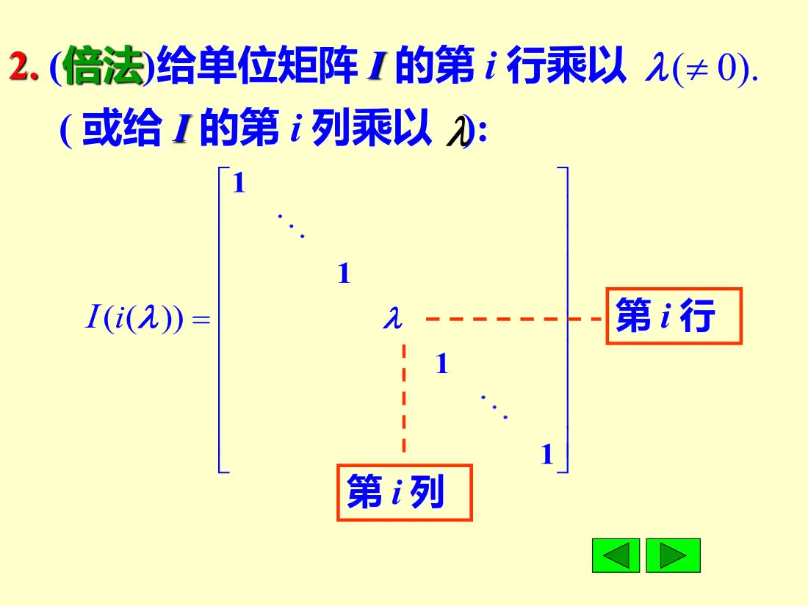

原文：

2. (倍法)给单位矩阵 I 的第 i 行乘以 $\lambda(\neq0)$ .
(或给 I 的第 i 列乘以 $\lambda$ :

$$
I (i (\lambda)) = \left[ \begin{array}{c c c c c} 1 & & & & \\ & \ddots & & & \\ & & 1 & & \\ & & & \lambda & - - - - - - - - - - - - - - - - - - - - - - - - - - - - - - - - - - - - - - - - - - - - - - - - - - - - - - - - - - i \text {列} \\ & & & 1 & \\ & & & \ddots & \\ & & & 1 \end{array} \right] \tag {第i行}
$$

◀ ▶

### $$

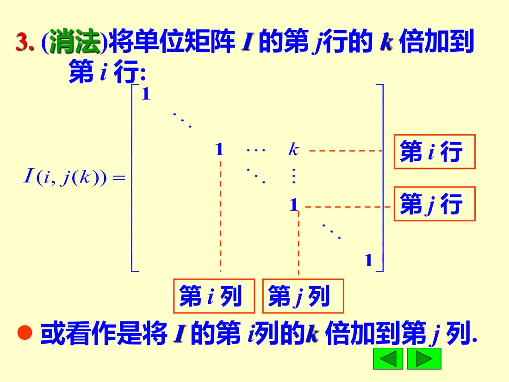

原文：

3. (消法)将单位矩阵 $I$ 的第 $j$ 行的 $k$ 倍加到第 $i$ 行:

$$
I (i, j (k)) = \left[ \begin{array}{c c c c c} 1 & & & & \\ & \ddots & & & \\ & & 1 & \dots & k \\ & & & \ddots & \vdots \\ & & & & 1 \\ & & & & & 1 \end{array} \right] \text {第} i \text {行}
$$

第 $i$ 列 | 第 $j$ 列

\- 或看作是将 $I$ 的第 $i$ 列的 $k$ 倍加到第 $j$ 列.

◀ ▶

### $$

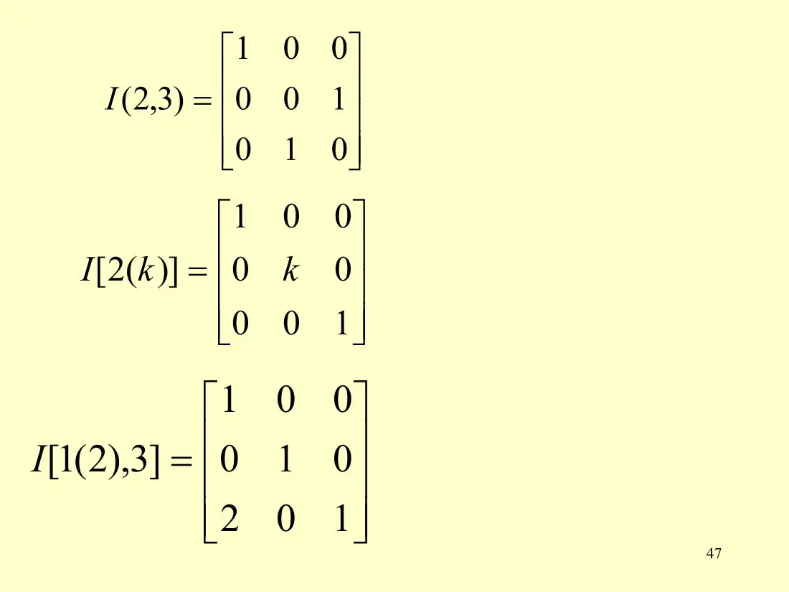

原文：

$$
I (2, 3) = \left[ \begin{array}{l l l} 1 & 0 & 0 \\ 0 & 0 & 1 \\ 0 & 1 & 0 \end{array} \right]
$$

$$
I [ 2 (k) ] = \left[ \begin{array}{l l l} 1 & 0 & 0 \\ 0 & k & 0 \\ 0 & 0 & 1 \end{array} \right]
$$

$$
I [ 1 (2), 3 ] = \left[ \begin{array}{l l l} 1 & 0 & 0 \\ 0 & 1 & 0 \\ 2 & 0 & 1 \end{array} \right]
$$

47

### 初等矩阵的性质

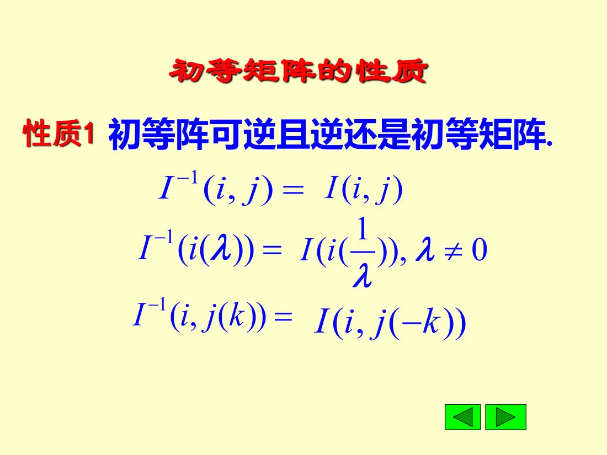

原文：

初等矩阵的性质

性质1 初等阵可逆且逆还是初等矩阵.

$$
\begin{array}{c} I ^ {- 1} (i, j) = I (i, j) \\ I ^ {- 1} (i (\lambda)) = I \left(i \left(\frac {1}{\lambda}\right)\right), \lambda \neq 0 \\ I ^ {- 1} (i, j (k)) = I (i, j (- k)) \end{array}
$$

◀ ▶

### 性质2 初等矩阵转置还是初等矩阵.

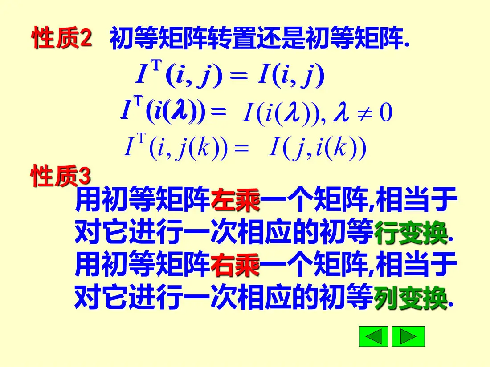

原文：

性质2 初等矩阵转置还是初等矩阵.

$$
I ^ {\mathrm{T}} (i, j) = I (i, j)
$$

$$
I ^ {\mathrm{T}} (i (\lambda)) = I (i (\lambda)), \lambda \neq 0
$$

$$
I ^ {\mathrm{T}} (i, j (k)) = I (j, i (k))
$$

性质3

用初等矩阵左乘一个矩阵,相当于对它进行一次相应的初等行变换.用初等矩阵右乘一个矩阵,相当于对它进行一次相应的初等列变换.

◀ ▶

### $$

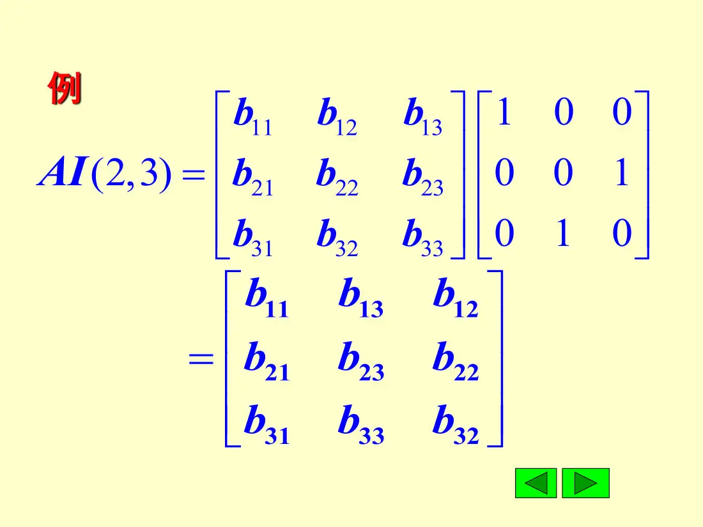

原文：

$$
\begin{array}{r l} \text {例} \\ A I (2, 3) & = \left[ \begin{array}{l l l} b _ {1 1} & b _ {1 2} & b _ {1 3} \\ b _ {2 1} & b _ {2 2} & b _ {2 3} \\ b _ {3 1} & b _ {3 2} & b _ {3 3} \end{array} \right] \left[ \begin{array}{l l l} 1 & 0 & 0 \\ 0 & 0 & 1 \\ 0 & 1 & 0 \end{array} \right] \\ & = \left[ \begin{array}{l l l} b _ {1 1} & b _ {1 3} & b _ {1 2} \\ b _ {2 1} & b _ {2 3} & b _ {2 2} \\ b _ {3 1} & b _ {3 3} & b _ {3 2} \end{array} \right] \end{array}
$$

◀ ▶

### $$

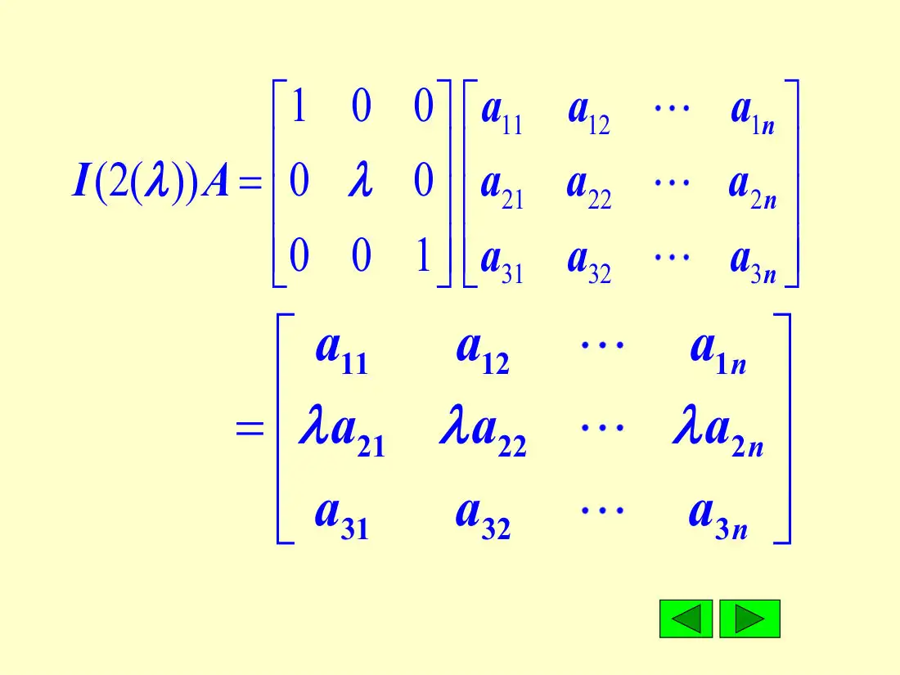

原文：

$$
\begin{array}{r l} & I (2 (\lambda)) A = \left[ \begin{array}{l l l} 1 & 0 & 0 \\ 0 & \lambda & 0 \\ 0 & 0 & 1 \end{array} \right] \left[ \begin{array}{l l l l} a _ {1 1} & a _ {1 2} & \dots & a _ {1 n} \\ a _ {2 1} & a _ {2 2} & \dots & a _ {2 n} \\ a _ {3 1} & a _ {3 2} & \dots & a _ {3 n} \end{array} \right] \\ & = \left[ \begin{array}{l l l l} a _ {1 1} & a _ {1 2} & \dots & a _ {1 n} \\ \lambda a _ {2 1} & \lambda a _ {2 2} & \dots & \lambda a _ {2 n} \\ a _ {3 1} & a _ {3 2} & \dots & a _ {3 n} \end{array} \right] \end{array}
$$

### $$

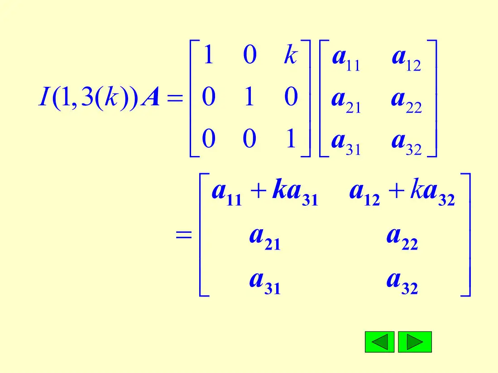

原文：

$$
I (1, 3 (k)) A = \left[ \begin{array}{l l l} 1 & 0 & k \\ 0 & 1 & 0 \\ 0 & 0 & 1 \end{array} \right] \left[ \begin{array}{l l} a _ {1 1} & a _ {1 2} \\ a _ {2 1} & a _ {2 2} \\ a _ {3 1} & a _ {3 2} \end{array} \right]
$$

$$
= \left[ \begin{array}{c c} a _ {1 1} + k a _ {3 1} & a _ {1 2} + k a _ {3 2} \\ a _ {2 1} & a _ {2 2} \\ a _ {3 1} & a _ {3 2} \end{array} \right]
$$

### $$

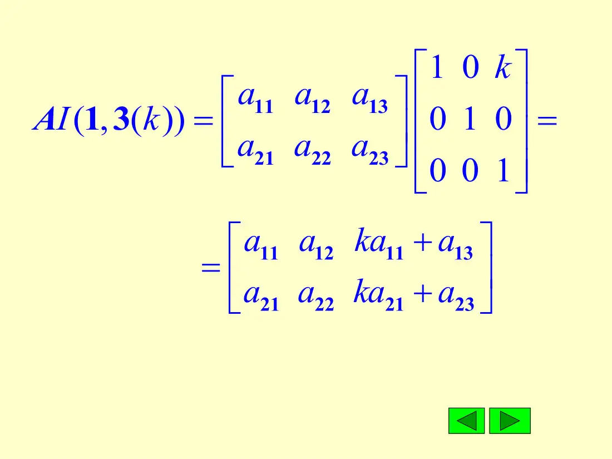

原文：

$$
A I (\mathbf {1}, \mathbf {3} (k)) = \left[ \begin{array}{l l l} a _ {1 1} & a _ {1 2} & a _ {1 3} \\ a _ {2 1} & a _ {2 2} & a _ {2 3} \end{array} \right] \left[ \begin{array}{l l l} 1 & 0 & k \\ 0 & 1 & 0 \\ 0 & 0 & 1 \end{array} \right] =
$$

$$
= \left[ \begin{array}{l l l} a _ {1 1} & a _ {1 2} & k a _ {1 1} + a _ {1 3} \\ a _ {2 1} & a _ {2 2} & k a _ {2 1} + a _ {2 3} \end{array} \right]
$$

◀ ▶

### 例 计算

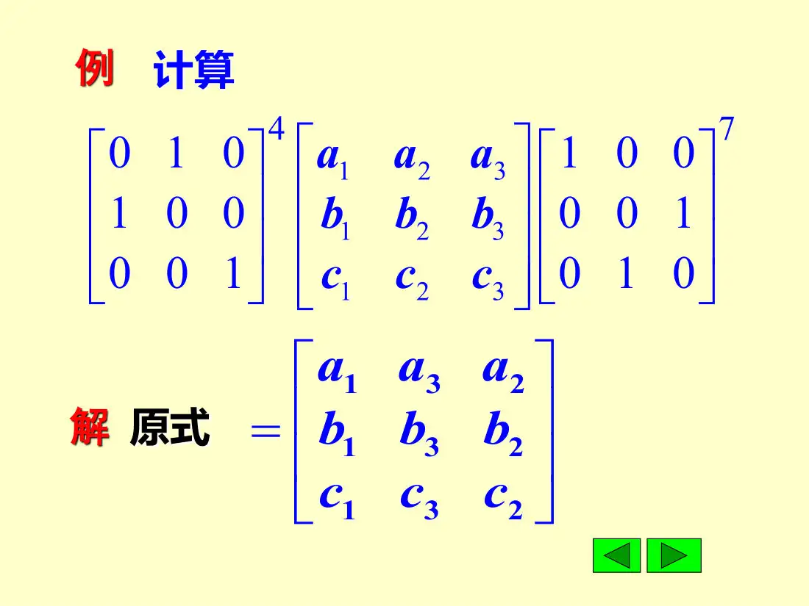

原文：

例 计算

$$
\left[ \begin{array}{l l l} 0 & 1 & 0 \\ 1 & 0 & 0 \\ 0 & 0 & 1 \end{array} \right] ^ {4} \left[ \begin{array}{l l l} a _ {1} & a _ {2} & a _ {3} \\ b _ {1} & b _ {2} & b _ {3} \\ c _ {1} & c _ {2} & c _ {3} \end{array} \right] \left[ \begin{array}{l l l} 1 & 0 & 0 \\ 0 & 0 & 1 \\ 0 & 1 & 0 \end{array} \right] ^ {7}
$$

解 原式

$$
= \left[ \begin{array}{l l l} a _ {1} & a _ {3} & a _ {2} \\ b _ {1} & b _ {3} & b _ {2} \\ c _ {1} & c _ {3} & c _ {2} \end{array} \right]
$$

◀ ▶

### 总结：● 对一般情况我们有:

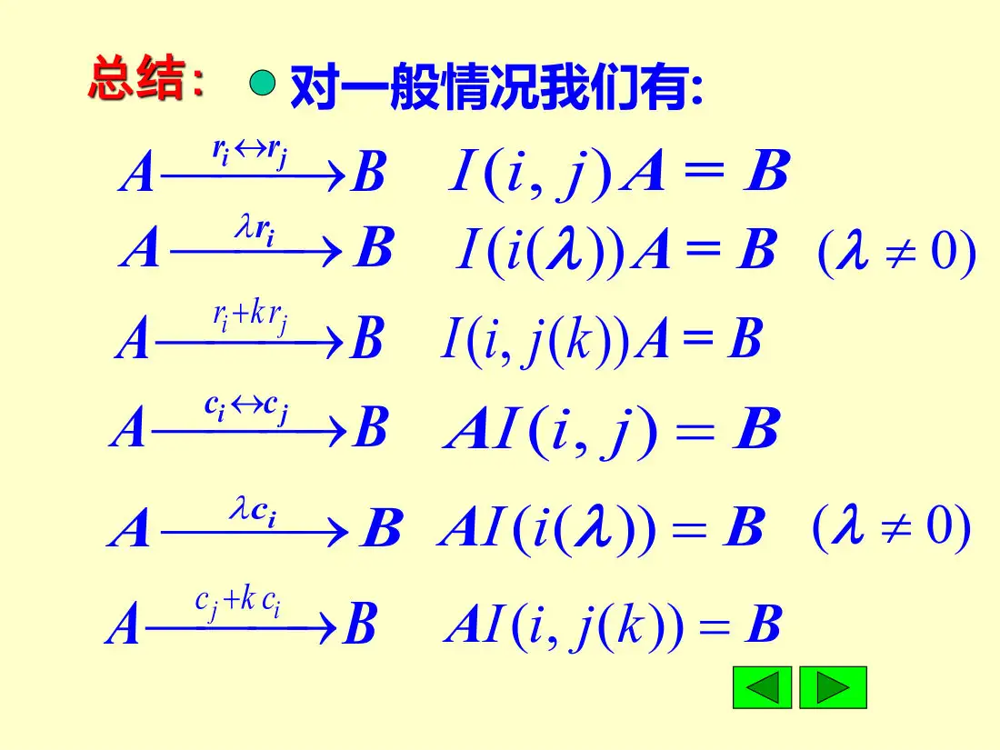

原文：

总结：● 对一般情况我们有:

$$
\begin{array}{l l} A \xrightarrow {r _ {i} \leftrightarrow r _ {j}} B & I (i, j) A = B \\ A \xrightarrow {\lambda r _ {i}} B & I (i (\lambda)) A = B \quad (\lambda \neq 0) \\ A \xrightarrow {r _ {i} + k r _ {j}} B & I (i, j (k)) A = B \\ A \xrightarrow {c _ {i} \leftrightarrow c _ {j}} B & A I (i, j) = B \\ A \xrightarrow {\lambda c _ {i}} B & A I (i (\lambda)) = B \quad (\lambda \neq 0) \\ A \xrightarrow {c _ {j} + k c _ {i}} B & A I (i, j (k)) = B \\ \hline \end{array}
$$

### 初等阵与一次初等变换的关系

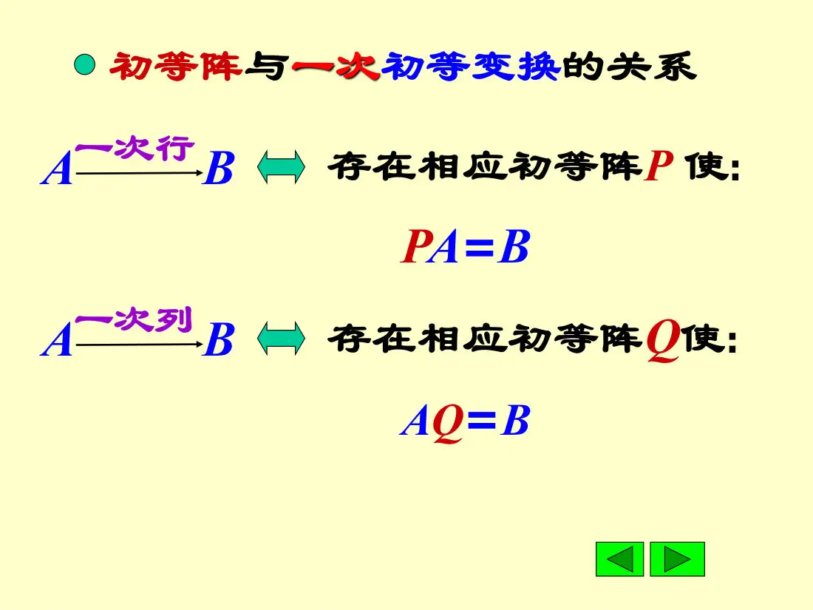

原文：

初等阵与一次初等变换的关系

一次行 $A \xrightarrow{\text{一次行}} B \leftrightarrow$ 存在相应初等阵 $P$ 使:

$$
P A = B
$$

$A\xrightarrow{\text{一次列}}B \leftrightarrow \text{存在相应初等阵} Q\text{使:}$

$$
A Q = B
$$

◀ ▶

### $$

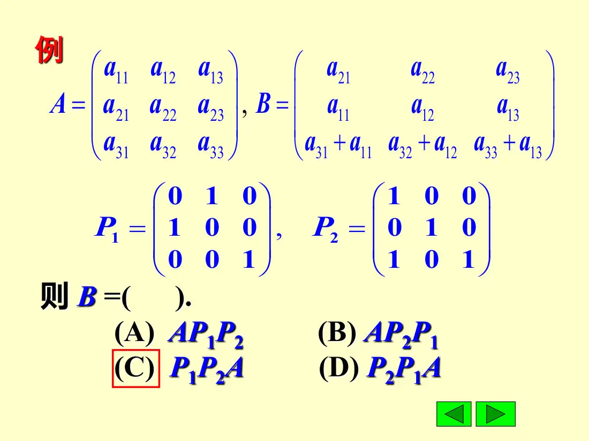

原文：

例

$$
A = \left( \begin{array}{l l l} a _ {1 1} & a _ {1 2} & a _ {1 3} \\ a _ {2 1} & a _ {2 2} & a _ {2 3} \\ a _ {3 1} & a _ {3 2} & a _ {3 3} \end{array} \right), B = \left( \begin{array}{l l l} a _ {2 1} & a _ {2 2} & a _ {2 3} \\ a _ {1 1} & a _ {1 2} & a _ {1 3} \\ a _ {3 1} + a _ {1 1} & a _ {3 2} + a _ {1 2} & a _ {3 3} + a _ {1 3} \end{array} \right)
$$

$$
\boldsymbol {P} _ {1} = \left( \begin{array}{c c c} \mathbf {0} & \mathbf {1} & \mathbf {0} \\ \mathbf {1} & \mathbf {0} & \mathbf {0} \\ \mathbf {0} & \mathbf {0} & \mathbf {1} \end{array} \right), \quad \boldsymbol {P} _ {2} = \left( \begin{array}{c c c} \mathbf {1} & \mathbf {0} & \mathbf {0} \\ \mathbf {0} & \mathbf {1} & \mathbf {0} \\ \mathbf {1} & \mathbf {0} & \mathbf {1} \end{array} \right)
$$

则 $B=(\quad)$ .

(A) $AP_{1}P_{2}$

(C) $P_{1}P_{2}A$

(B) $AP_{2}P_{1}$

(D) $P_{2}P_{1}A$

◀ ▶

### 初等阵与初等变换的关系

原文：

初等阵与初等变换的关系

$A\xrightarrow{行}B\iff$ 存在初等阵 $P_{1}P_{2}\ldots P_{s}$ 使:

$$
P _ {1} P _ {2} \dots P _ {s} A = B
$$

$A\xrightarrow{列}B\iff$ 存在初等阵 $Q_{1}Q_{2}\cdots Q_{t}$ 使:

$$
A Q _ {1} Q _ {2} \dots Q _ {t} = B
$$

$A^{\text{初}} \rightarrow B \Longleftrightarrow$ 存在初等阵 $P_{1}P_{2}\ldots P_{s}Q_{1}Q_{2}\ldots Q_{t}$ ( $A \cong B$ ) 使: $P_{1}P_{2}\ldots P_{s}AQ_{1}Q_{2}\ldots Q_{t}=B$

### $$

原文：

定理 设A, B都是 $m \times n$ 阶矩阵,则 $A \cong B \longleftrightarrow \exists m$ 阶可逆矩阵P, n阶可逆矩阵Q使

$$
P A Q = B
$$

证 $A \cong B \leftrightarrow A \xrightarrow{\text{初}} B$

存在初等阵 $P_{1}, P_{2}, \cdots, P_{s}, Q_{1}, Q_{2}, \cdots, Q_{t}$

使 $P_{1}P_{2}\ldots P_{s}AQ_{1}Q_{2}\ldots Q_{t}=B$

令 $P = P_{1}P_{2} \cdots P_{s}, Q = Q_{1}Q_{2} \cdots Q_{t}$

P, Q 是初等阵之积,故可逆且使

$$
P A Q = B
$$

### 2.4.3 矩阵等价的充要条件

原文：

2.4.3 矩阵等价的充要条件
\*定理2.6 A可逆 $\Leftrightarrow$ A的标准形是 $I_{n}$ 证 $\Leftarrow$ 显然 $\Leftrightarrow$ $A \cong I_{n}$

⇒ A可逆,设A的标准形是D
则存在初等阵 $P_{1}, P_{2}, \cdots, P_{s}, Q_{1}, Q_{2}, \cdots, Q_{t}$ 使 $P_{1}P_{2}\ldots P_{s}AQ_{1}Q_{2}\ldots Q_{t}=D.$ 则 $|D|=|P_{1}||P_{2}|\ldots|P_{s}||A||Q_{1}|\ldots|Q_{t}|$ 不为0，故 $D=E_{n}.$

### 矩阵等价的充要条件

原文：

矩阵等价的充要条件

\*定理2.4 A可逆 $\Leftrightarrow$ ∃初等阵 $P_{1},\cdots,P_{k}$ 使:

证 $\Leftarrow$ 显然 $A = P_{1} \cdots P_{k}$ $\Rightarrow A$ 可逆 $\leftrightarrow A \cong I_{n}$ 即存在初等阵 $P_{1}, P_{2}, \cdots, P_{s}, Q_{1}, Q_{2}, \cdots, Q_{t}$ 使 $P_{1}P_{2}\cdots P_{k} E_{n}Q_{1}Q_{2}\cdots Q_{t}=A,$ 即证

(A可分解为初等阵的积)

◀

### $$

原文：

$$
\begin{array}{r l} & {A = P _ {\mathbf {s}} ^ {- 1} P _ {\mathbf {s - 1}} ^ {- 1} \dots P _ {1} ^ {- 1} E Q _ {\mathbf {t}} ^ {- 1} Q _ {\mathbf {t - 1}} ^ {- 1} \dots Q _ {1} ^ {- 1}} \\ & {\qquad P _ {i} ^ {- 1}, Q _ {j} ^ {- 1} \text {仍是初等阵}.} \end{array}
$$

推论：可逆矩阵总可以经过一系列的初等行变换化为单位矩阵。

设A 是可逆矩阵, 则 $A \xrightarrow{行} I_{n}$

62

### 2.4.4 求逆矩阵的初等变换法

原文：

2.4.4 求逆矩阵的初等变换法

由A可逆，有 $P_{1} \cdots P_{s} A = I$

可得

$$
P _ {1} \dots P _ {s} I = A ^ {- 1}
$$

\- 说明A仅经过初等行(列)变换可化为 $I_{n}$ .

\- 完全相同的变换可以把 $I_{n}$ 化为 $A^{-1}$

◀

### 用初等矩阵求逆矩阵

原文：

用初等矩阵求逆矩阵

$$
[ A \vdots I ] \rightarrow [ I \vdots A ^ {- 1} ]
$$

即对 $n \times 2n$ 矩阵 $(A \mid I)$ 施行初等行变换，
当把 A 变成 I 时，原来的 I 就变成 $A^{-1}$ .

例 设 $A=\begin{pmatrix}1&2&3\\2&2&1\\3&4&3\end{pmatrix}$ ，求 $A^{-1}$ . 先将 A 化为行阶梯阵, 再化为单位阵

$$
(A \mid I) = \left( \begin{array}{c c c c c c} 1 & 2 & 3 & 1 & 0 & 0 \\ 2 & 2 & 1 & 0 & 1 & 0 \\ 3 & 4 & 3 & 0 & 0 & 1 \end{array} \right) \xrightarrow {r _ {2} - 2 r _ {1}} \left( \begin{array}{c c c c c c} 1 & 2 & 3 & 1 & 0 & 0 \\ 0 & - 2 & - 5 & - 2 & 1 & 0 \\ 0 & - 2 & - 6 & - 3 & 0 & 1 \end{array} \right)
$$

### $$

原文：

$$
\xrightarrow [ r _ {3} - r _ {2} ]{r _ {1} + r _ {2}} \left( \begin{array}{c c c c c c} 1 & 0 & - 2 & - 1 & 1 & 0 \\ 0 & - 2 & - 5 & - 2 & 1 & 0 \\ 0 & 0 & - 1 & - 1 & - 1 & 1 \end{array} \right) \xrightarrow [ r _ {2} - 5 r _ {3} ]{r _ {1} - 2 r _ {3}}
$$

$$
\left( \begin{array}{c c c c c c} 1 & 0 & 0 & 1 & 3 & - 2 \\ 0 & - 2 & 0 & 3 & 6 & - 5 \\ 0 & 0 & - 1 & - 1 & - 1 & 1 \end{array} \right) \xrightarrow [ - r _ {3} ]{- \frac {1}{2} r _ {2}}
$$

$$
\left( \begin{array}{l l l l l l} 1 & 0 & 0 & 1 & 3 & - 2 \\ 0 & 1 & 0 & - \frac {3}{2} & - 3 & \frac {5}{2} \\ 0 & 0 & 1 & 1 & 1 & - 1 \end{array} \right)
$$

$$
\therefore A ^ {- 1} = \left( \begin{array}{c c c} 1 & 3 & - 2 \\ - \frac {3}{2} & - 3 & \frac {5}{2} \\ 1 & 1 & - 1 \end{array} \right).
$$

可验证 $AA^{-1} = I$

### 由此可得到求逆矩阵的初等变换法：

原文：

由此可得到求逆矩阵的初等变换法：

\*方法1 构造一个 $n \times (2n)$ 矩阵:

$\left[A:I\right]\xrightarrow{\text{行}}\left[I:A^{-1}\right]$

方法2 构造一个 $(2n) \times n$ 矩阵:

$$
\left[ \begin{array}{c} A \\ I \end{array} \right] \xrightarrow {\text {列}} \left[ \begin{array}{c} I \\ A ^ {- 1} \end{array} \right]
$$

◀ ▶

### 例 用初等行变换求矩阵A的逆矩阵:

原文：

例 用初等行变换求矩阵A的逆矩阵:

$$
A = \left[ \begin{array}{c c c} 0 & 2 & - 1 \\ 1 & 1 & 2 \\ - 1 & - 1 & - 1 \end{array} \right]
$$

解 先将A化为行阶梯阵,再化为单位阵

◀ ▶

### $$

原文：

$$
[ A \colon I ] = \left[ \begin{array}{c c c c c c} 0 & 2 & - 1 & 1 & 0 & 0 \\ 1 & 1 & 2 & 0 & 1 & 0 \\ - 1 & - 1 & - 1 & 0 & 0 & 1 \end{array} \right] \to \left[ \begin{array}{c c c c c c} 1 & 1 & 2 & 0 & 1 & 0 \\ 0 & 2 & - 1 & 1 & 0 & 0 \\ 0 & 0 & 1 & 0 & 1 & 1 \end{array} \right]
$$

$$
\rightarrow \left[\begin{array}{l l l}1&0&0\\0&1&0\\0&0&1\end{array}\right]\left[\begin{array}{l l l}- \frac {1}{2}&- \frac {3}{2}&- \frac {5}{2}\\\frac {1}{2}&\frac {1}{2}&\frac {1}{2}\\0&1&1\end{array}\right], A ^ {- 1} = \frac {1}{2} \left[\begin{array}{l l l}- 1&- 3&- 5\\1&1&1\\0&2&2\end{array}\right] \text {可验证} A A ^ {- 1} = I
$$

### 注 可用初等变换法求解矩阵方程

原文：

注 可用初等变换法求解矩阵方程

AX = B, A 可逆

方法为： $P_{1}\cdots P_{s}A=I$

由A可逆，有 $(A:B)^{\text{行}} \rightarrow (I:A^{-1}B)$

$$
P _ {1} \dots P _ {s} I = A ^ {- 1}
$$

\- 说明 $A$ 仅经过初等行(列)变换可化为 $I_{n}$ .

\- 完全相同的变换可以把 $I_{n}$ 化为 $A^{-1}$ .

$$
P _ {1} \dots P _ {s} B = A ^ {- 1} B
$$

### 注 可用初等变换法求解矩阵方程

原文：

注 可用初等变换法求解矩阵方程

AX = B, A 可逆

方法为： $(A:B)^{\text{行}}\rightarrow(I:A^{-1}B)$

例5 用初等变换法解矩阵方程 AX = B

其中 $A = \begin{bmatrix} 5 & 1 & -5 \\ 3 & -3 & 2 \\ 1 & -2 & 1 \end{bmatrix}, B = \begin{bmatrix} -8 & -5 \\ 3 & 9 \\ 0 & 0 \end{bmatrix}$

解 可验证A可逆.

◀ ▶

### $$

原文：

$$
\begin{array}{r l}(A \vdots B)&= \left[\begin{array}{c c c c c}5&1&- 5&- 8&- 5\\3&- 3&2&3&9\\1&- 2&1&0&0\end{array}\right]\\&\rightarrow \left[\begin{array}{c c c c c}1&0&0&1&4\\0&1&0&2&5\\0&0&1&3&6\end{array}\right]\end{array}
$$

故

$$
X = A ^ {- 1} B = \left[ \begin{array}{l l} 1 & 4 \\ 2 & 5 \\ 3 & 6 \end{array} \right]
$$

◀ ▶

### 例 2 求矩阵 X, 使 AX = B，其中

原文：

例 2 求矩阵 X, 使 AX = B，其中

$$
A = \left( \begin{array}{c c c} 1 & 2 & 3 \\ 2 & 2 & 1 \\ 3 & 4 & 3 \end{array} \right), \quad B = \left( \begin{array}{c c} 2 & 5 \\ 3 & 1 \\ 4 & 3 \end{array} \right).
$$

解 若 A 可逆，则 $X = A^{-1}B$ .

$$
(A \mid B) = \left( \begin{array}{c c c c c} 1 & 2 & 3 & 2 & 5 \\ 2 & 2 & 1 & 3 & 1 \\ 3 & 4 & 3 & 4 & 3 \end{array} \right)
$$

### $$

原文：

$$
\xrightarrow [ r _ {3} - 3 r _ {1} ]{r _ {2} - 2 r _ {1}} \left( \begin{array}{c c c c c} 1 & 2 & 3 & 2 & 5 \\ 0 & - 2 & - 5 & - 1 & - 9 \\ 0 & - 2 & - 6 & - 2 & - 1 2 \end{array} \right) \xrightarrow [ r _ {3} - r _ {2} ]{r _ {1} + r _ {2}}
$$

$$
\left( \begin{array}{c c c c c} 1 & 0 & - 2 & 1 & - 4 \\ 0 & - 2 & - 5 & - 1 & - 9 \\ 0 & 0 & - 1 & - 1 & - 3 \end{array} \right) \xrightarrow {r _ {1} - 2 r _ {3}} \left( \begin{array}{c c c c c} 1 & 0 & 0 & 3 & 2 \\ 0 & - 2 & 0 & 4 & 6 \\ 0 & 0 & - 1 & - 1 & - 3 \end{array} \right)
$$

$$
\xrightarrow [ - r _ {3} ]{- \frac {1}{2} r _ {2}} \left( \begin{array}{c c c c c} 1 & 0 & 0 & 3 & 2 \\ 0 & 1 & 0 & - 2 & - 3 \\ 0 & 0 & 1 & 1 & 3 \end{array} \right), \quad \therefore \quad X = \left( \begin{array}{c c} 3 & 2 \\ - 2 & - 3 \\ 1 & 3 \end{array} \right).
$$

### 解 把所给方程变形为

原文：

例 求解矩阵方程 $AX = A + X$ ，其中 $A = \begin{pmatrix} 2 & 2 & 0 \\ 2 & 1 & 3 \\ 0 & 1 & 0 \end{pmatrix}$

解 把所给方程变形为

$$
(A - I \mid A) = \left( \begin{array}{c c c c c c} 1 & 2 & 0 & 2 & 2 & 0 \\ 2 & 0 & 3 & 2 & 1 & 3 \\ 0 & 1 & - 1 & 0 & 1 & 0 \end{array} \right) \xrightarrow [ r _ {2} \leftrightarrow r _ {3} ]{r _ {2} - 2 r _ {1}}
$$

$$
\left( \begin{array}{c c c c c c} 1 & 2 & 0 & 2 & 2 & 0 \\ 0 & 1 & - 1 & 0 & 1 & 0 \\ 0 & - 4 & 3 & - 2 & - 3 & 3 \end{array} \right) \xrightarrow {r _ {1} - 2 r _ {2}} \left( \begin{array}{c c c c c c} 1 & 0 & 2 & 2 & 0 & 0 \\ 0 & 1 & - 1 & 0 & 1 & 0 \\ 0 & 0 & - 1 & - 2 & 1 & 3 \end{array} \right)
$$

### $$

原文：

$$
\xrightarrow [ \begin{array}{c} r _ {2} - r _ {3} \\ - r _ {3} \end{array} ]{r _ {1} + 2 r _ {3}} \left( \begin{array}{c c c c c c} 1 & 0 & 0 & - 2 & 2 & 6 \\ 0 & 1 & 0 & 2 & 0 & - 3 \\ 0 & 0 & 1 & 2 & - 1 & - 3 \end{array} \right),
$$

A-I\~I, A-I可逆,且

$$
X = (A - I) ^ {- 1} A = \left( \begin{array}{c c c} - 2 & 2 & 6 \\ 2 & 0 & - 3 \\ 2 & - 1 & - 3 \end{array} \right)
$$

如果要求 $X = BA^{-1}$ , 则可对矩阵 $\left( \begin{array}{c}A\\ B \end{array} \right)$ 作初等列变换, $\left( \begin{array}{c}A\\ B \end{array} \right)\xrightarrow{\text{列变换}}\left( \begin{array}{c}I\\ BA^{-1} \end{array} \right)$ , 即可得 $X = BA^{-1}$ .

### 2.5 矩阵的秩

原文：

2.5 矩阵的秩

本节内容提要

矩阵的秩的概念

矩阵的秩的求法

◀ ▶

### 2.5.1 矩阵的秩的概念

原文：

任何矩阵 $A_{m \times n}$ , 总可经过有限次初等行变换把它变为行阶梯形, 行阶梯形矩阵中非零行的行数是唯一确定的 矩阵的秩

2.5.1 矩阵的秩的概念

定义 在 $m \times n$ 矩阵 A 中任取 k 行 k 列 ( $k \leq m, k \leq n$ )，位于这些行列交叉处的 $k^{2}$ 个元素，按原来的次序所组成的 $k \times k$ 矩阵所对应的行列式称为其一个 k 阶子式。

$m \times n$ 矩阵 A 的 k 阶子式共有 $C_{m}^{k} \cdot C_{n}^{k}$ 个.

77

### $$

原文：

例

$$
A = \left( \begin{array}{c c c c c} 1 & 3 & 1 & 0 & 1 \\ 2 & 4 & 6 & 6 & 2 \\ 3 & 6 & 7 & 8 & 9 \\ 4 & 2 & 9 & 4 & 5 \end{array} \right)
$$

$$
M = \left( \begin{array}{c c c} 3 & 0 & 1 \\ 6 & 8 & 9 \\ 2 & 4 & 5 \end{array} \right),
$$

子矩阵

$$
| M | = \left| \begin{array}{c c c} 3 & 0 & 1 \\ 6 & 8 & 9 \\ 2 & 4 & 5 \end{array} \right|
$$

子行列式

78

### 3 矩阵秩的定义

原文：

3 矩阵秩的定义

A的秩: A的非零子式的最高阶数r.

记作: $r(A) = r$ 并规定: $r(0) = 0$ .

\- 秩 $(A) = r \Leftrightarrow A$ 中存在一个 $r$ 阶非零子式, 但其中任意 $r + 1$ 阶子式都等于零.

例 $A=\begin{pmatrix}1&4&7\\2&5&8\\3&6&9\end{pmatrix},\quad\begin{vmatrix}1&4\\2&5\end{vmatrix}=-3\neq0,$

3阶子式只有一个，且 $|A| =$ 所以 $r(A) = 2$ .

◀ ▶

### 用定义求矩阵的秩并非易事，后面我们将用初等变换法去求矩阵的秩。

原文：

例 已知 $A = \left( \begin{array}{ccc}1 & 3 & -2 & 2\\ 0 & 2 & -1 & 3\\ -2 & 0 & 1 & 5 \end{array} \right)$ ，求秩.

解 $\because\left|\begin{matrix}1&3\\ 0&2\end{matrix}\right|=2\neq0,$ 计算A的3阶子式, $\left|\begin{matrix}1&3&-2\\ 0&2&-1\\ -2&0&1\end{matrix}\right|=0,\left|\begin{matrix}1&3&2\\ 0&2&3\\ -2&0&5\end{matrix}\right|=0,\left|\begin{matrix}3&-2&2\\ 2&-1&3\\ 0&1&5\end{matrix}\right|=0,$ $\therefore r(A)=2.$

$m \times n$ 矩阵 A 的 k 阶子式共有 $C_{m}^{k} \cdot C_{n}^{k}$ 个.

用定义求矩阵的秩并非易事，后面我们将用初等变换法去求矩阵的秩。

### 2.5.2 秩的求法

原文：

2.5.2 秩的求法

定理2.3 初等变换不改变矩阵的秩.

\- 可以通过初等变换把矩阵化为阶梯形来求矩阵的秩。

求法: 1. $A \xrightarrow{\text {初}}$ 行阶梯形阵

2. 行阶梯形矩阵的秩 = 非零行的个数.

◀ ▶

### 把矩阵用初等行变换变成为行阶梯形矩阵，行阶梯形矩阵中非零行的行数就是矩阵的秩。

原文：

把矩阵用初等行变换变成为行阶梯形矩阵，行阶梯形矩阵中非零行的行数就是矩阵的秩。

例2 设 $A = \begin{pmatrix} 3 & 2 & 0 & 5 & 0 \\ 3 & -2 & 3 & 6 & -1 \\ 2 & 0 & 1 & 5 & -3 \\ 1 & 6 & -4 & -1 & 4 \end{pmatrix}$ , 求矩阵 $A$ 的秩.

解 对A作初等行变换，变成行阶梯形矩阵：

### $$

原文：

$$
A = \left( \begin{array}{r r r r r} 3 & 2 & 0 & 5 & 0 \\ 3 & - 2 & 3 & 6 & - 1 \\ 2 & 0 & 1 & 5 & - 3 \\ 1 & 6 & - 4 & - 1 & 4 \end{array} \right)
$$

$$
\xrightarrow {r _ {1} \leftrightarrow r _ {4}} \quad \left( \begin{array}{c c c c c} 1 & 6 & - 4 & - 1 & 4 \\ 3 & - 2 & 3 & 6 & - 1 \\ 2 & 0 & 1 & 5 & - 3 \\ 3 & 2 & 0 & 5 & 0 \end{array} \right)
$$

### $$

原文：

$$
A = \left( \begin{array}{r r r r r} 3 & 2 & 0 & 5 & 0 \\ 3 & - 2 & 3 & 6 & - 1 \\ 2 & 0 & 1 & 5 & - 3 \\ 1 & 6 & - 4 & - 1 & 4 \end{array} \right)
$$

$$
\xrightarrow [ r _ {2} - r _ {4} ]{r _ {1} \leftrightarrow r _ {4}} \quad \left( \begin{array}{c c c c c} 1 & 6 & - 4 & - 1 & 4 \\ 0 & - 4 & 3 & 1 & - 1 \\ 2 & 0 & 1 & 5 & - 3 \\ 3 & 2 & 0 & 5 & 0 \end{array} \right)
$$

### $$

原文：

$$
A = \left( \begin{array}{r r r r r} 3 & 2 & 0 & 5 & 0 \\ 3 & - 2 & 3 & 6 & - 1 \\ 2 & 0 & 1 & 5 & - 3 \\ 1 & 6 & - 4 & - 1 & 4 \end{array} \right)
$$

$$
\begin{array}{c c} r _ {1} \leftrightarrow r _ {4} & \left( \begin{array}{r r r r r} 1 & 6 & - 4 & - 1 & 4 \\ 0 & - 4 & 3 & 1 & - 1 \\ 0 & - 1 2 & 9 & 7 & - 1 1 \\ 0 & - 1 6 & 1 2 & 8 & - 1 2 \end{array} \right) \\ \xrightarrow {r _ {2} - r _ {4}} & r _ {4} - 3 r _ {1} \end{array}
$$

### $$

原文：

$$
\xrightarrow [ r _ {4} - 4 r _ {2} ]{r _ {3} - 3 r _ {2}} \left( \begin{array}{c c c c c} 1 & 6 & - 4 & - 1 & 4 \\ 0 & - 4 & 3 & 1 & - 1 \\ 0 & 0 & 0 & 4 & - 8 \\ 0 & 0 & 0 & 4 & - 8 \end{array} \right)
$$

$$
\xrightarrow {r _ {4} - r _ {3}} \left( \begin{array}{c c c c c} 1 & 6 & - 4 & - 1 & 4 \\ 0 & - 4 & 3 & 1 & - 1 \\ 0 & 0 & 0 & 4 & - 8 \\ 0 & 0 & 0 & 0 & 0 \end{array} \right)
$$

由阶梯形矩阵有三个非零行可知 $r(A) = 3$

### 练习

原文：

练习

求

$$
\mathbf {A} = \left( \begin{array}{r r r r r} 1 & - 2 & 2 & - 1 & 1 \\ 2 & - 4 & 8 & 0 & 2 \\ - 2 & 4 & - 2 & 3 & 3 \\ 3 & - 6 & 0 & - 6 & 4 \end{array} \right)
$$

的秩.

$$
\xrightarrow [ r _ {4} - 3 r _ {1} ]{r _ {2} - 2 r _ {1}} \left( \begin{array}{c c c c c} 1 & - 2 & 2 & - 1 & 1 \\ 0 & 0 & 4 & 2 & 0 \\ 0 & 0 & 2 & 1 & 5 \\ 0 & 0 & - 6 & - 3 & 1 \end{array} \right)
$$

### $$

原文：

$$
\xrightarrow [ r _ {4} + 3 r _ {2} ]{\frac {1}{2} r _ {2}} \left( \begin{array}{c c c c c} 1 & - 2 & 2 & - 1 & 1 \\ 0 & 0 & 2 & 1 & 0 \\ 0 & 0 & 0 & 0 & 5 \\ 0 & 0 & 0 & 0 & 1 \end{array} \right)
$$

$$
\xrightarrow [ r _ {4} - r _ {3} ]{\frac {1}{5} r _ {3}} \quad \left( \begin{array}{c c c c c} 1 & - 2 & 2 & - 1 & 1 \\ \hline 0 & 0 & 2 & 1 & 0 \\ 0 & 0 & 0 & 0 & 1 \\ 0 & 0 & 0 & 0 & 0 \end{array} \right)
$$

∴ $r(\mathbf{A}) = 3.$

### 推论2.3 如果 $A \cong B$ ，则 $r(A) = r(B)$

原文：

推论2.3 如果 $A \cong B$ ，则 $r(A) = r(B)$

推论2.4 设A为 $m \times n$ 矩阵，则对任意的n阶可逆阵P，
n阶可逆阵Q,有 $r(A)=r(PA)=r(AQ)=r(PAQ)$

推论2.5 设A为 $m \times n$ 矩阵，P为m阶可逆阵，Q为n阶可逆阵，
如果PAQ= $\begin{bmatrix}I_{r}&0\\ 0&0\end{bmatrix}$ ，则 $r(A)=r$ 。

### 矩阵秩的性质

原文：

矩阵秩的性质

性质: (1) 一个矩阵的秩是唯一的. 它是刻画矩阵内在特性的重要概念.

(2) $r(A)\leq \min \{m,n\}$

(3) if $\exists D_r \neq 0 \Rightarrow r(A) \geq r$ if $\forall D_r = 0 \Rightarrow r(A) < r$

(4) $r(A_{1}) \leq r(A)$ , 其中 $A_{1}$ 是 $A$ 的子矩阵

(5) $r(A^T) = r(A), r(kA) = r(A), k \neq 0$

(6) 若A是有r个非零行的阶梯形矩阵, 则 $r(A)=r$ .

### 如果矩阵A、B等价标准形就相同，等价标准形中对角线上1的个数是由秩确定的.

原文：

n方阵A可逆 $\Leftrightarrow r(A)=n\Leftrightarrow|A|\neq0$ $r(A_{n\times n})=n\Leftrightarrow A\rightarrow I_{n}$ ，称A为满秩阵. $r(A_{m\times n})=m\Leftrightarrow A\rightarrow(I_{m}\mathbf{0}_{m\times(n-m)})$ ，称A为行满秩. $r(A_{m\times n})=n\Leftrightarrow A\rightarrow\begin{pmatrix}I_{n}\\0_{(m-n)\times n}\end{pmatrix}$ ，称A为列满秩.

如果矩阵A、B等价标准形就相同，等价标准形中对角线上1的个数是由秩确定的.

### 其中 $\exists a_{i} \neq 0, b_{j} \neq 0.$

原文：

例3 $A = \begin{bmatrix} a_1b_1 & a_1b_2 & \cdots & a_1b_n \\ a_2b_1 & a_2b_2 & \cdots & a_2b_n \\ \vdots & \vdots & & \vdots \\ a_nb_1 & a_nb_2 & \cdots & a_nb_n \end{bmatrix}, r(A) = 1$ 并求 $A^n$

其中 $\exists a_{i} \neq 0, b_{j} \neq 0.$

解 可求 $r(A)=1,\therefore A=\begin{bmatrix}a_{1}\\ a_{2}\\\vdots\\ a_{n}\end{bmatrix}[b_{1}\quad b_{2}\quad\cdots\quad b_{n}]$ $A^{n}=(a_{1}b_{1}+a_{2}b_{2}+\cdots+a_{n}b_{n})^{n-1}A$

### 复习 秩的运算性质 (1) 若 $A$ 是 $m \times n$ 矩阵, 则

原文：

复习 秩的运算性质 (1) 若 $A$ 是 $m \times n$ 矩阵, 则

1. $0 \leqslant r(A) \leqslant \min \{m, n\}$

2. $r(A^{\mathrm{T}})=r(A)$

3. $r(kA)=\left\{\begin{array}{ll}0 & k=0 \\ r(A) & k\neq0\end{array}\right.$

4. $r(A_{1}) \leqslant r(A)$ , ( $A_{1}$ 为 A 的子阵)

◀

### 2.8.3 秩的运算性质 (2)

原文：

2.8.3 秩的运算性质 (2)

5. $r\begin{bmatrix} A & 0 \\ 0 & B \end{bmatrix} = r(A) + r(B)$

$$
r (A) = r _ {1}, r (B) = r _ {2}
$$

$$
P _ {1}, P _ {2}, Q _ {1}, Q _ {2}
$$

$$
P _ {1} A Q _ {1} = \left[ \begin{array}{c c} E _ {r _ {1}} & 0 \\ 0 & 0 \end{array} \right], P _ {2} B Q _ {2} = \left[ \begin{array}{c c} E _ {r _ {2}} & 0 \\ 0 & 0 \end{array} \right]
$$

◀

### $$

原文：

$$
\begin{array}{r l} & {\text {令} \quad P = \left[ \begin{array}{l l} P _ {1} & \\ & P _ {2} \end{array} \right], \quad Q = \left[ \begin{array}{l l} Q _ {1} & \\ & Q _ {2} \end{array} \right]} \\ & {\longrightarrow P \left[ \begin{array}{l l} A & \\ & B \end{array} \right] Q = \left[ \begin{array}{l l} P _ {1} & 0 \\ 0 & P _ {2} \end{array} \right] \left[ \begin{array}{l l} A & 0 \\ 0 & B \end{array} \right] \left[ \begin{array}{l l} Q _ {1} & 0 \\ 0 & Q _ {2} \end{array} \right]} \\ & {= \left[ \begin{array}{l l} P _ {1} A Q _ {1} & 0 \\ 0 & P _ {2} B Q _ {2} \end{array} \right] = \left[ \begin{array}{l l l l} E _ {r _ {1}} & 0 & 0 & 0 \\ 0 & 0 & 0 & 0 \\ 0 & 0 & E _ {r _ {2}} & 0 \\ 0 & 0 & 0 & 0 \end{array} \right]} \\ & {\therefore r \left[ \begin{array}{l l} A & \\ & B \end{array} \right] = r _ {1} + r _ {2} = r (A) + r (B)} \end{array}
$$

### 第 96 页

原文：

6. $r\begin{bmatrix} A & C \\ 0 & B \end{bmatrix} \geq r(A) + r(B)$ 证 设 $r(A)=r_{1}, r(B)=r_{2}$ 则存在可逆阵 $P_{1}, P_{2}, Q_{1}, Q_{2}$ ，使 $P_{1}AQ_{1}=\begin{bmatrix}E_{r_{1}}&0\\ 0&0\end{bmatrix},\quad P_{2}BQ_{2}=\begin{bmatrix}E_{r_{2}}&0\\ 0&0\end{bmatrix}$ 令 $P=\begin{bmatrix}P_{1}&\\ &P_{2}\end{bmatrix},\quad Q=\begin{bmatrix}Q_{1}&\\ &Q_{2}\end{bmatrix}$

### $$

原文：

$$
\begin{array}{r l}&{\rightarrow P \left[\begin{array}{l l}A&C\\0&B\end{array}\right] Q = \left[\begin{array}{l l}P _ {1}&0\\0&P _ {2}\end{array}\right]\left[\begin{array}{l l}A&C\\0&B\end{array}\right]\left[\begin{array}{l l}Q _ {1}&0\\0&Q _ {2}\end{array}\right]}\\&{\quad = \left[\begin{array}{l l}P _ {1} A Q _ {1}&P _ {1} C Q _ {2}\\0&P _ {2} B Q _ {2}\end{array}\right] = \left[\begin{array}{l l}E r _ {1} 0&P _ {1} C Q _ {2}\\0&0\\0&E r _ {2} 0\\0&0&0&0\end{array}\right]}\\&{\therefore r \left[\begin{array}{l l}A&C\\0&B\end{array}\right] \geq r (A) + r (B)}\end{array}
$$

◀ ▶

### 7. $r(A:B) \leq r(A) + r(B)$

原文：

例1 $r\left[ \begin{array}{c|ccc}1 & 1 & 0 & 0\\ 0 & 0 & 1 & 0\\ 0 & 0 & 0 & 1\\ \hline 0 & 1 & 0 & 0 \end{array} \right] = 4 > r(A) + r(B) = 2$

7. $r(A:B) \leq r(A) + r(B)$

证 $r(A)+r(B)=r\begin{bmatrix}A&0\\ 0&B\end{bmatrix}=r\begin{bmatrix}A&B\\ 0&B\end{bmatrix}\geq r(A:B)$

### 8. $r(A+B)\leqslant r(A)+r(B)$

原文：

8. $r(A+B)\leqslant r(A)+r(B)$

证 $r(A) + r(B) = r\left[ \begin{array}{ll}A & 0\\ 0 & B \end{array} \right] = r\left[ \begin{array}{ll}A & A + B\\ 0 & B \end{array} \right]\geq r(A + B)$

例2 $r\left( \begin{array}{ll}1 & 0\\ 0 & 1 \end{array} \right) + r\left( \begin{array}{ll}1 & 0\\ 0 & 0 \end{array} \right) = 3 > r\left( \begin{array}{ll}2 & 0\\ 0 & 1 \end{array} \right) = r(A + B) = 2$

9. $r(AB) \leq \min\left\{r(A), r(B)\right\}$

证 $r(A) = r(A0) = r(AAB) \geqslant r(AB)$

$$
r (B) = r \left[ \begin{array}{c} B \\ 0 \end{array} \right] = r \left[ \begin{array}{c} B \\ A B \end{array} \right] \geq r (A B)
$$

### 第 100 页

原文：

10. A为 $m \times n$ 矩阵, B为 $n \times p$ 矩阵, $r(AB) \geq r(A) + r(B) - n$ 且 AB = 0 时, $r(A) + r(B) \leq n$ 证 $r(A) + r(B) \leq r\begin{bmatrix} A & 0 \\ E & B \end{bmatrix} = r\begin{bmatrix} 0 & -AB \\ E & B \end{bmatrix}$ $= r\begin{bmatrix} 0 & -AB \\ E & 0 \end{bmatrix} = r\begin{bmatrix} E & 0 \\ 0 & AB \end{bmatrix} = n + r(AB)$ 且 AB = 0 时, 有 $r(A) + r(B) \leq n$ .

### 秩的运算性质 (2)

原文：

秩的运算性质 (2)

5. $r\begin{bmatrix}A & 0 \\ 0 & B\end{bmatrix} = r(A) + r(B)$

6. $r\begin{bmatrix} A & C \\ 0 & B \end{bmatrix} \geq r(A) + r(B)$

7. $r(A:B) \leq r(A) + r(B)$

8. $r(A + B) \leq r(A) + r(B)$

9. $r(AB) \leq \min\left\{r(A), r(B)\right\}$

10.A为 $m \times n$ 矩阵, B 为 $n \times$ 矩阵, 则 $r(AB) \geq r(A) + r(B) - n$ 且 AB = 0 时， $r(A) + r(B) \leq n$

### $$

原文：

推论2 设A是 $m \times n$ 阶矩阵,P是m阶可逆阵,Q是n阶可逆矩阵,则

$$
r (P A) = r (A Q) = r (P A Q) = r (A)
$$

因为初等变换不变秩.

推论3 设A是可逆矩阵, 则 $A \xrightarrow{行} I$

$$
P _ {1}, P _ {2}, \dots , P _ {s}
$$

$$
A ^ {- 1} = P _ {1} P _ {2} \dots P _ {s}
$$

$$
A ^ {- 1} A = P _ {1} P _ {2} \dots P _ {\mathbf {s}} A = E
$$

◀

### 总结 设 $A, B$ 都是 $m \times n$ 阶矩阵.

原文：

总结 设 $A, B$ 都是 $m \times n$ 阶矩阵.

(1) $A \cong B \Leftrightarrow A$ , B具有相同的等价标准形.

$\Leftrightarrow$ 存在可逆矩阵 $P, Q$ 使 $PAQ = B$

$$
r (P A) = r (A Q) = r (P A Q) = r (A)
$$

(2)存在可逆矩阵P, Q 使 PAQ = $\begin{bmatrix} E_{r} & 0 \\ 0 & 0 \end{bmatrix}$ .

(3)如果 $A \in M_{n}$ ，则 A 可逆 $\Leftrightarrow A \cong I$ .

$\Leftrightarrow A$ 可分解为初等阵的积: $A = P_{1} \cdots P_{k}$ .

$\Leftrightarrow A$ 可经初等行变换化为 $I: P_{k}^{-1} \cdots P_{1}^{-1} A = I$ .

$\Leftrightarrow A$ 可经初等列变换化为 $I: AP_{k}^{-1} \cdots P_{1}^{-1} = I$ .

$$
A P _ {k} ^ {- 1} \dots P _ {1} ^ {- 1} = I.
$$

### 第 104 页

原文：

例6 将 $A=\begin{bmatrix}1 & -1 \\ 1 & 1\end{bmatrix}$ 表示成为初等方阵之积.

解 $A = \begin{bmatrix} 1 & -1 \\ 1 & 1 \end{bmatrix} \to \begin{bmatrix} 1 & -1 \\ 0 & 2 \end{bmatrix} \to \begin{bmatrix} 1 & -1 \\ 0 & 1 \end{bmatrix} \to I$

◀

### $$

原文：

$$
\begin{array}{r l} & E (1, 2 (1)) E (2 (\frac {1}{2})) E (2, 1 (- 1)) A = E \\ & A = E ^ {- 1} (2, 1 (- 1)) E ^ {- 1} (2 (\frac {1}{2})) E ^ {- 1} (1, 2 (1)) \\ & = E (2, 1 (1)) E (2 (2)) E (1, 2 (- 1)) \\ & = \left[ \begin{array}{l l} 1 & 0 \\ 1 & 1 \end{array} \right] \left[ \begin{array}{l l} 1 & 0 \\ 0 & 2 \end{array} \right] \left[ \begin{array}{l l} 1 & - 1 \\ 0 & 1 \end{array} \right] \end{array}
$$
