# 《线性代数与解析几何》2.5 Gauss消元法与线性方程组的解（课件）

原件的每一页，下面附识别出的文字。

### 2.5 Gauss消元法与线性方程组解

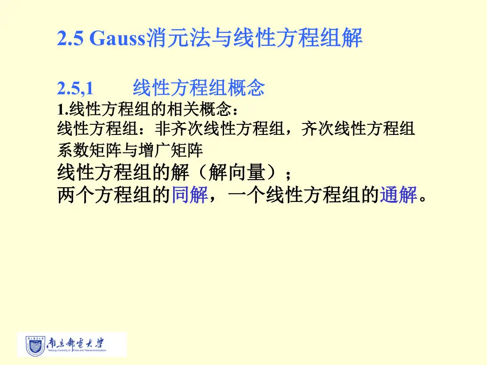

原文：

2.5 Gauss消元法与线性方程组解

2.5,1 线性方程组概念

1. 线性方程组的相关概念:

线性方程组：非齐次线性方程组，齐次线性方程组

系数矩阵与增广矩阵

线性方程组的解（解向量）；

两个方程组的同解，一个线性方程组的通解。

南京邮电大学
Nanjing University of Posts and Telecommunications

### 2.5 Gauss消元法

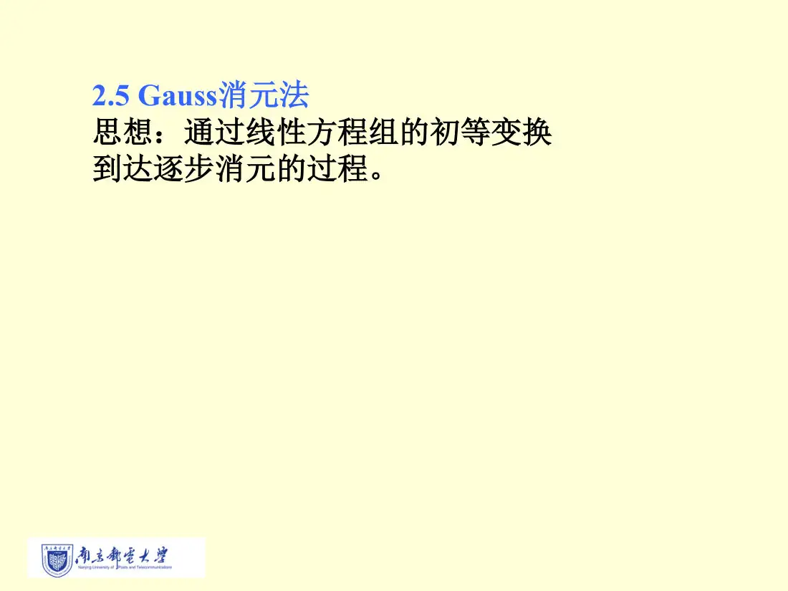

原文：

2.5 Gauss消元法

思想：通过线性方程组的初等变换到达逐步消元的过程。

南京邮电大学
Nanjing University of Posts and Telecommunications

### 例2.21 求解线性方程组

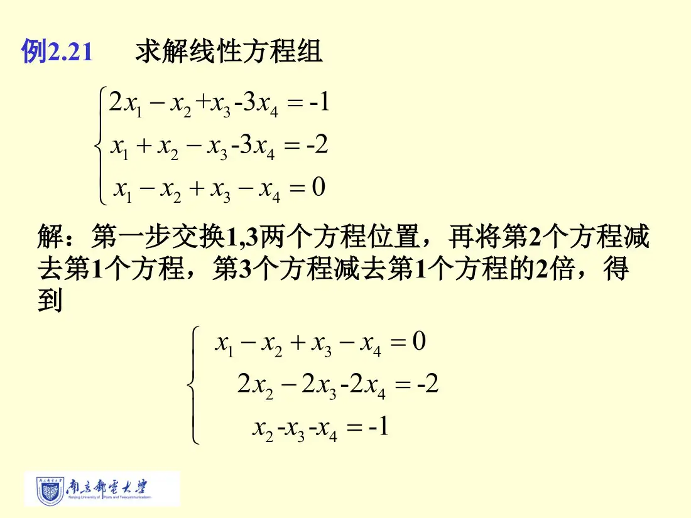

原文：

例2.21 求解线性方程组

$$
\left\{ \begin{array}{l} 2 x _ {1} - x _ {2} + x _ {3} - 3 x _ {4} = - 1 \\ x _ {1} + x _ {2} - x _ {3} - 3 x _ {4} = - 2 \\ x _ {1} - x _ {2} + x _ {3} - x _ {4} = 0 \end{array} \right.
$$

解：第一步交换1,3两个方程位置，再将第2个方程减去第1个方程，第3个方程减去第1个方程的2倍，得到

$$
\left\{ \begin{array}{c} x _ {1} - x _ {2} + x _ {3} - x _ {4} = 0 \\ 2 x _ {2} - 2 x _ {3} - 2 x _ {4} = - 2 \\ x _ {2} - x _ {3} - x _ {4} = - 1 \end{array} \right.
$$

南京邮电大学
Nanjing University of Posts and Telecommunications

### 第2步：第2个方程两边同乘以1/2，再将第3个方程减去第2个方程得到：

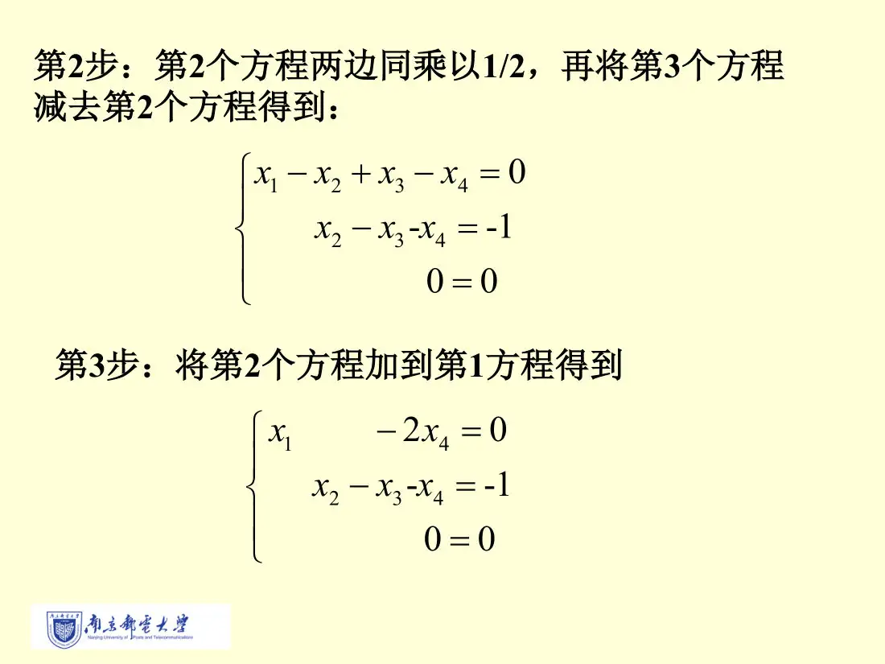

原文：

第2步：第2个方程两边同乘以1/2，再将第3个方程减去第2个方程得到：

$$
\left\{ \begin{array}{c} x _ {1} - x _ {2} + x _ {3} - x _ {4} = 0 \\ x _ {2} - x _ {3} - x _ {4} = - 1 \\ 0 = 0 \end{array} \right.
$$

第3步：将第2个方程加到第1方程得到

$$
\left\{ \begin{array}{c c} x _ {1} & - 2 x _ {4} = 0 \\ & x _ {2} - x _ {3} - x _ {4} = - 1 \\ & 0 = 0 \end{array} \right.
$$

南京邮电大学
Nanjing University of Posts and Telecommunications

### 南京邮电大学

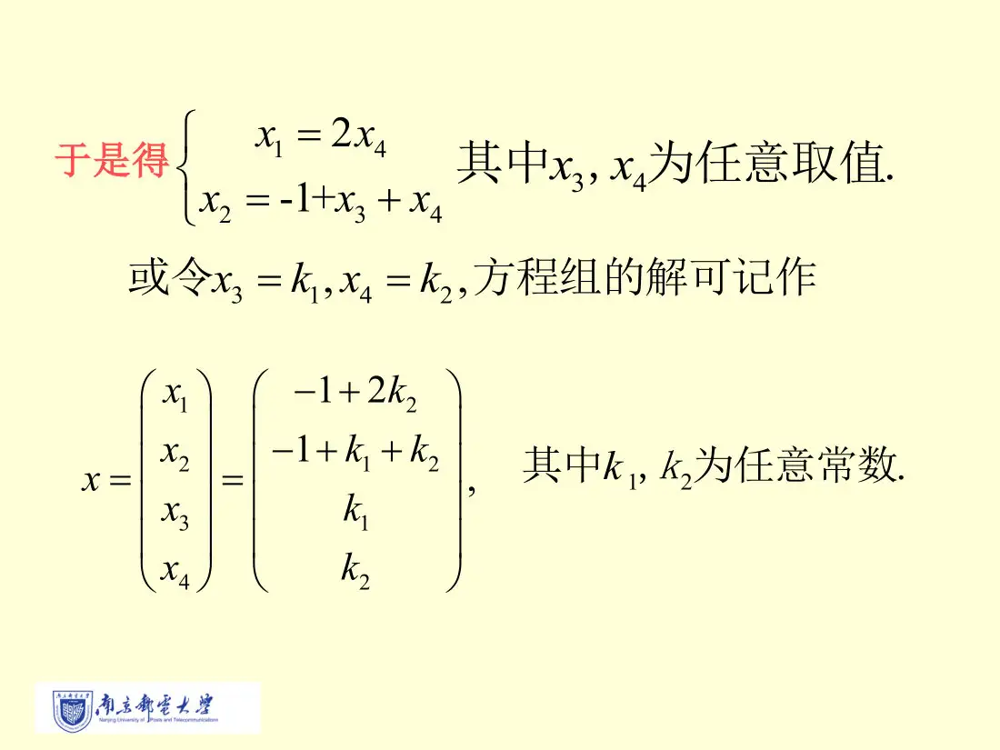

原文：

于是得 $\left\{ \begin{array}{l} x_{1} = 2x_{4} \\ x_{2} = -1 + x_{3} + x_{4} \end{array} \right.$ 其中 $x_{3}, x_{4}$ 为任意取值. 或令 $x_{3} = k_{1}, x_{4} = k_{2}$ , 方程组的解可记作

$x = \begin{pmatrix} x_1 \\ x_2 \\ x_3 \\ x_4 \end{pmatrix} = \begin{pmatrix} -1 + 2k_2 \\ -1 + k_1 + k_2 \\ k_1 \\ k_2 \end{pmatrix},$ 其中 $k_{1}, k_{2}$ 为任意常数.

南京邮电大学
Nanjing University of Posts and Telecommunications

### 1. 上述解方程组的方法称为Gauss消元法.

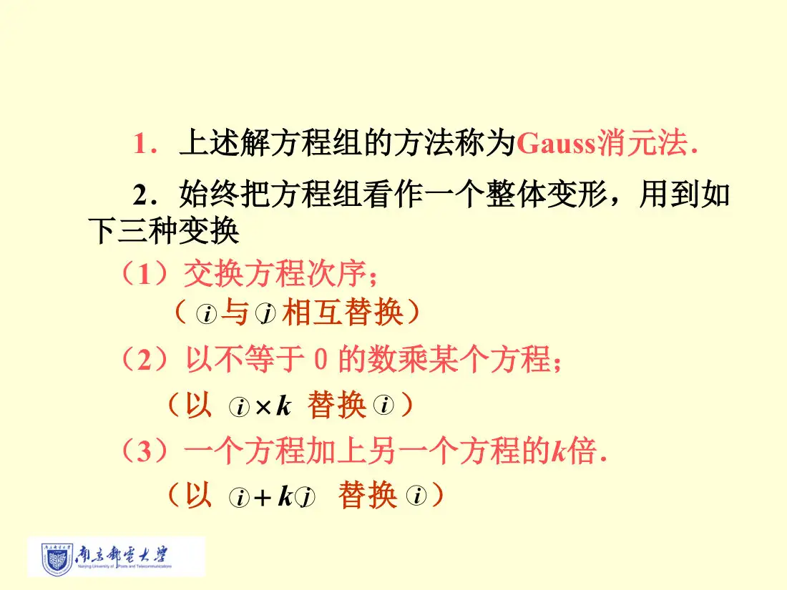

原文：

1. 上述解方程组的方法称为Gauss消元法.

2. 始终把方程组看作一个整体变形，用到如下三种变换

(1) 交换方程次序;

( i 与 j 相互替换)

(2) 以不等于 0 的数乘某个方程;

(以 $i \times k$ 替换 $i$ )

(3) 一个方程加上另一个方程的 $k$ 倍.

(以 $i + kj$ 替换 $i$ )

南京邮电大学
Nanjing University of Posts and Telecommunications

### 因为在上述变换过程中，仅仅只对方程组的系数和常数进行运算，未知量并未参与运算。

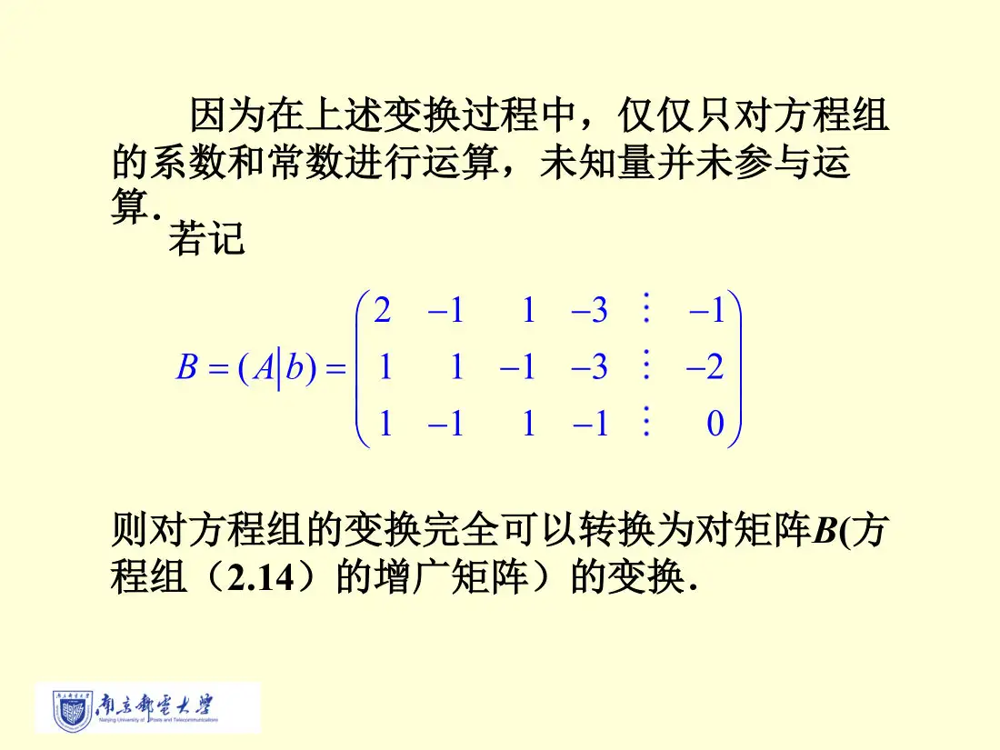

原文：

因为在上述变换过程中，仅仅只对方程组的系数和常数进行运算，未知量并未参与运算。

若记

$$
B = (A \mid b) = \left( \begin{array}{c c c c c c} 2 & - 1 & 1 & - 3 & \vdots & - 1 \\ 1 & 1 & - 1 & - 3 & \vdots & - 2 \\ 1 & - 1 & 1 & - 1 & \vdots & 0 \end{array} \right)
$$

则对方程组的变换完全可以转换为对矩阵B(方程组（2.14）的增广矩阵）的变换.

南京邮电大学
Nanjing University of Posts and Telecommunications

### 变换如下

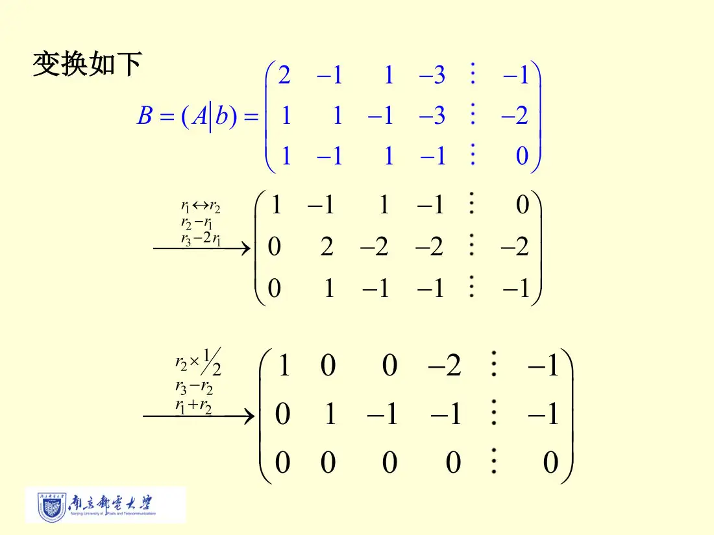

原文：

变换如下

$$
B = (A \mid b) = \left( \begin{array}{c c c c c c} 2 & - 1 & 1 & - 3 & \vdots & - 1 \\ 1 & 1 & - 1 & - 3 & \vdots & - 2 \\ 1 & - 1 & 1 & - 1 & \vdots & 0 \end{array} \right)
$$

$$
\xrightarrow { \begin{array}{c} r _ {1} \leftrightarrow r _ {2} \\ r _ {2} - r _ {1} \\ r _ {3} - 2 r _ {1} \end{array} } \left( \begin{array}{c c c c c c} 1 & - 1 & 1 & - 1 & \vdots & 0 \\ 0 & 2 & - 2 & - 2 & \vdots & - 2 \\ 0 & 1 & - 1 & - 1 & \vdots & - 1 \end{array} \right)
$$

$$
\xrightarrow { \begin{array}{c} r _ {2} \times 1 / _ {2} \\ r _ {3} - r _ {2} \\ r _ {1} + r _ {2} \end{array} } \left( \begin{array}{c c c c c c} 1 & 0 & 0 & - 2 & \vdots & - 1 \\ 0 & 1 & - 1 & - 1 & \vdots & - 1 \\ 0 & 0 & 0 & 0 & \vdots & 0 \end{array} \right)
$$

南京邮电大学
Nanjing University of Posts and Telecommunications

### 最后一个矩阵对应的线性方程组为

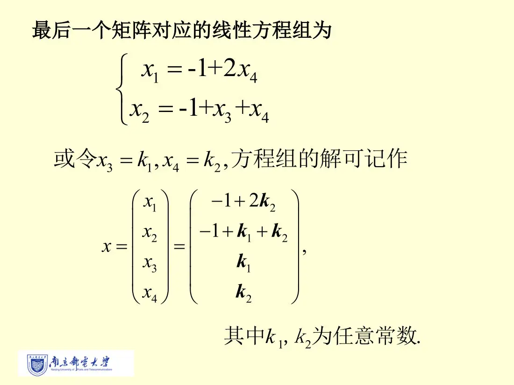

原文：

最后一个矩阵对应的线性方程组为

$$
\left\{ \begin{array}{l} x _ {1} = - 1 + 2 x _ {4} \\ x _ {2} = - 1 + x _ {3} + x _ {4} \end{array} \right.
$$

或令 $x_{3} = k_{1}, x_{4} = k_{2}$ , 方程组的解可记作

$$
x = \left( \begin{array}{c} x _ {1} \\ x _ {2} \\ x _ {3} \\ x _ {4} \end{array} \right) = \left( \begin{array}{c} - 1 + 2 \boldsymbol {k} _ {2} \\ - 1 + \boldsymbol {k} _ {1} + \boldsymbol {k} _ {2} \\ \boldsymbol {k} _ {1} \\ \boldsymbol {k} _ {2} \end{array} \right),
$$

其中 $k_{1}, k_{2}$ 为任意常数.

南京邮电大学
Nanjing University of Posts and Telecommunications

### 最后一个矩阵是行阶梯形矩阵

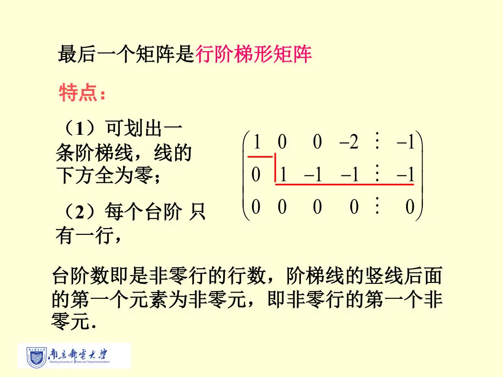

原文：

最后一个矩阵是行阶梯形矩阵

特点：

(1) 可划出一条阶梯线，线的下方全为零；

(2) 每个台阶只有一行，

$$
\left( \begin{array}{c c c c c c} 1 & 0 & 0 & - 2 & \vdots & - 1 \\ \hline 0 & 1 & - 1 & - 1 & \vdots & - 1 \\ 0 & 0 & 0 & 0 & \vdots & 0 \end{array} \right)
$$

台阶数即是非零行的行数，阶梯线的竖线后面的第一个元素为非零元，即非零行的第一个非零元。

南京邮电大学
Nanjing University of Posts and Telecommunications

### 例2.22 解线性方程组

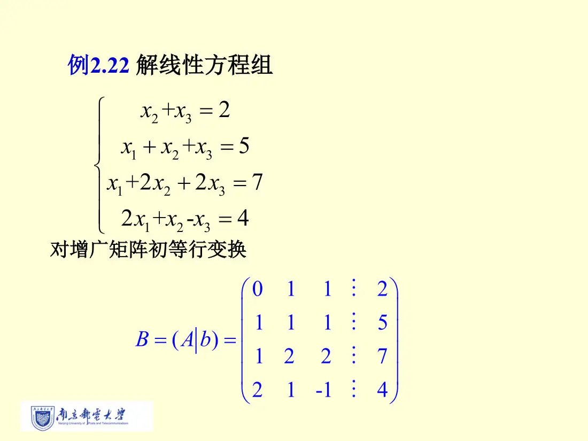

原文：

例2.22 解线性方程组

$$
\left\{ \begin{array}{c} x _ {2} + x _ {3} = 2 \\ x _ {1} + x _ {2} + x _ {3} = 5 \\ x _ {1} + 2 x _ {2} + 2 x _ {3} = 7 \\ 2 x _ {1} + x _ {2} - x _ {3} = 4 \end{array} \right.
$$

对增广矩阵初等行变换

$$
B = (A \mid b) = \left( \begin{array}{c c c c c} 0 & 1 & 1 & \vdots & 2 \\ 1 & 1 & 1 & \vdots & 5 \\ 1 & 2 & 2 & \vdots & 7 \\ 2 & 1 & - 1 & \vdots & 4 \end{array} \right)
$$

南京邮电大学
Nanjing University of Posts and Telecommunications

### 线性方程组有解判别法

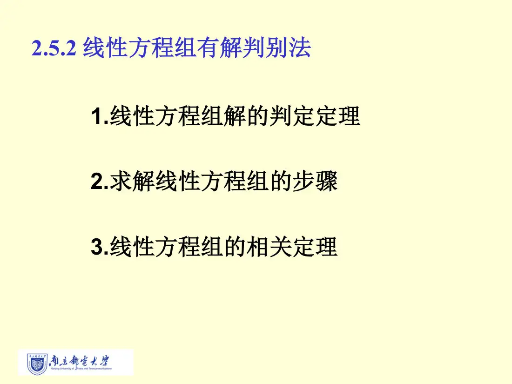

原文：

线性方程组有解判别法
1. 线性方程组解的判定定理
2. 求解线性方程组的步骤
3. 线性方程组的相关定理

南京邮电大学
Nanjing University of Posts and Telecommunications

### 设有n个未知数m个方程的线性方程组

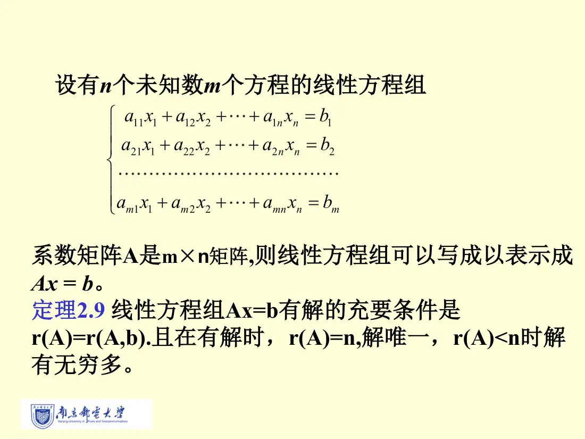

原文：

设有n个未知数m个方程的线性方程组

$$
\left\{ \begin{array}{l} a _ {1 1} x _ {1} + a _ {1 2} x _ {2} + \dots + a _ {1 n} x _ {n} = b _ {1} \\ a _ {2 1} x _ {1} + a _ {2 2} x _ {2} + \dots + a _ {2 n} x _ {n} = b _ {2} \\ \dots\dots\\ a _ {m 1} x _ {1} + a _ {m 2} x _ {2} + \dots + a _ {m n} x _ {n} = b _ {m} \end{array} \right.
$$

系数矩阵A是 $m \times n$ 矩阵,则线性方程组可以写成以表示成Ax = b。

定理2.9 线性方程组Ax=b有解的充要条件是

$r(A)=r(A,b)$ .且在有解时， $r(A)=n$ ,解唯一， $r(A)<n$ 时解有无穷多。

南京邮电大学
Nanjing University of Posts and Telecommunications

### 设有 $n$ 个未知数 $m$ 个方程的齐次线性方程组

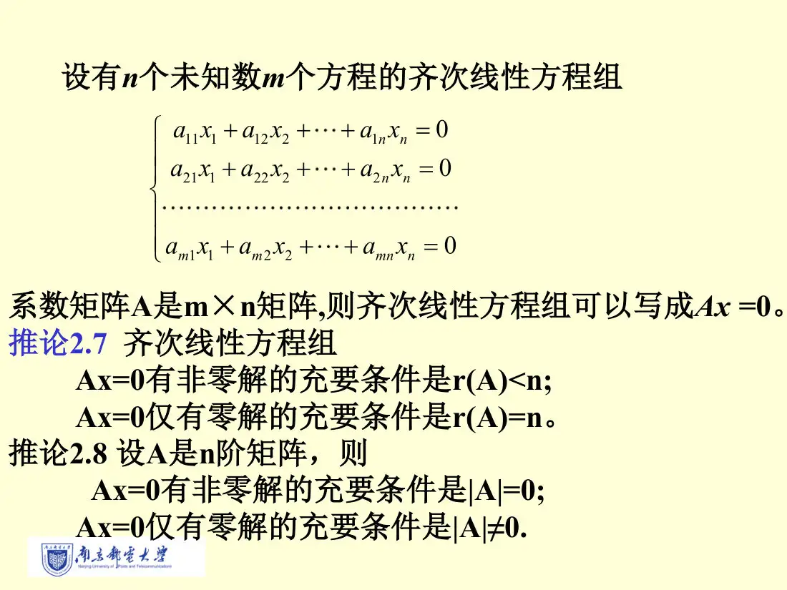

原文：

设有 $n$ 个未知数 $m$ 个方程的齐次线性方程组

$$
\left\{ \begin{array}{l} a _ {1 1} x _ {1} + a _ {1 2} x _ {2} + \dots + a _ {1 n} x _ {n} = 0 \\ a _ {2 1} x _ {1} + a _ {2 2} x _ {2} + \dots + a _ {2 n} x _ {n} = 0 \\ \dots \dots \\ a _ {m 1} x _ {1} + a _ {m 2} x _ {2} + \dots + a _ {m n} x _ {n} = 0 \end{array} \right.
$$

系数矩阵A是m×n矩阵,则齐次线性方程组可以写成Ax=0。
推论2.7 齐次线性方程组

Ax=0有非零解的充要条件是r(A)<n;

Ax=0仅有零解的充要条件是r(A)=n。

推论2.8 设A是n阶矩阵，则

Ax=0有非零解的充要条件是 $|A|=0;$

Ax=0仅有零解的充要条件是|A|≠0.

南京邮电大学
Nanjing University of Posts and Telecommunications

### 例2.24 解齐次线性方程组

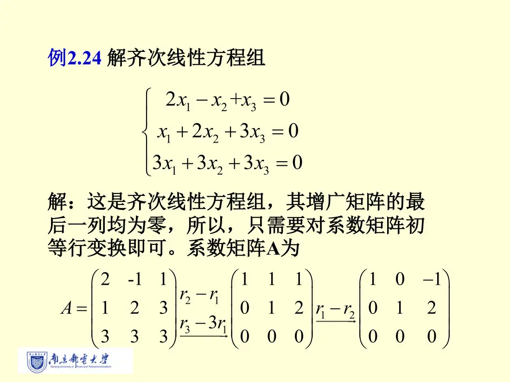

原文：

例2.24 解齐次线性方程组

$$
\left\{ \begin{array}{c} 2 x _ {1} - x _ {2} + x _ {3} = 0 \\ x _ {1} + 2 x _ {2} + 3 x _ {3} = 0 \\ 3 x _ {1} + 3 x _ {2} + 3 x _ {3} = 0 \end{array} \right.
$$

解：这是齐次线性方程组，其增广矩阵的最后一列均为零，所以，只需要对系数矩阵初等行变换即可。系数矩阵A为

$$
A = \left( \begin{array}{c c c} 2 & - 1 & 1 \\ 1 & 2 & 3 \\ 3 & 3 & 3 \end{array} \right) \xrightarrow {r _ {2} - r _ {1}} \left( \begin{array}{c c c} 1 & 1 & 1 \\ 0 & 1 & 2 \\ 0 & 0 & 0 \end{array} \right) \xrightarrow {r _ {1} - r _ {2}} \left( \begin{array}{c c c} 1 & 0 & - 1 \\ 0 & 1 & 2 \\ 0 & 0 & 0 \end{array} \right)
$$

南京邮电大学
Nanjing University of Posts and Telecommunications

### 令 $x_{3}=t$ ，则得到方程组的一般解为

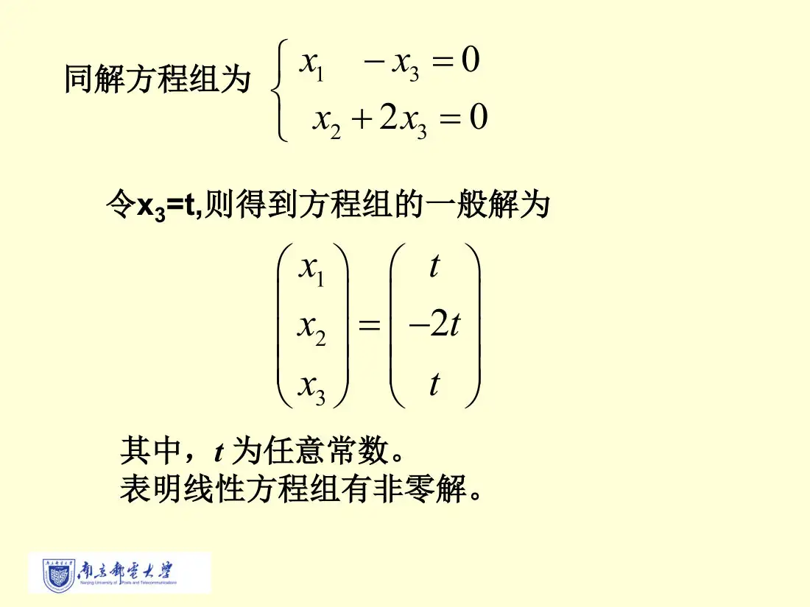

原文：

同解方程组为 $\left\{\begin{aligned}x_{1}&-x_{3}=0\\ x_{2}&+2x_{3}=0\end{aligned}\right.$

令 $x_{3}=t$ ，则得到方程组的一般解为

$$
\left( \begin{array}{c} x _ {1} \\ x _ {2} \\ x _ {3} \end{array} \right) = \left( \begin{array}{c} t \\ - 2 t \\ t \end{array} \right)
$$

其中，t 为任意常数。

表明线性方程组有非零解。

南京邮电大学
Nanjing University of Posts and Telecommunications

### 例2.27 讨论 $\lambda$ 为何值时，线性方程组

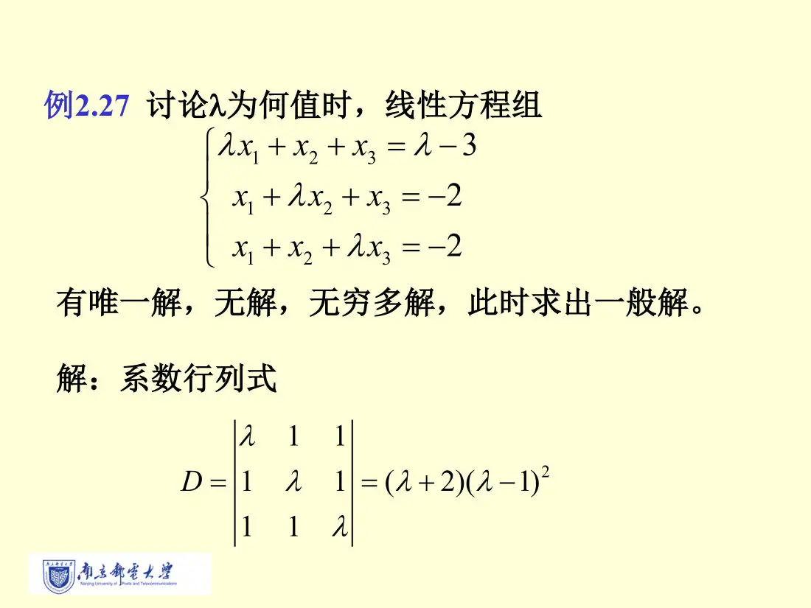

原文：

例2.27 讨论 $\lambda$ 为何值时，线性方程组

$$
\left\{ \begin{array}{l} \lambda x _ {1} + x _ {2} + x _ {3} = \lambda - 3 \\ x _ {1} + \lambda x _ {2} + x _ {3} = - 2 \\ x _ {1} + x _ {2} + \lambda x _ {3} = - 2 \end{array} \right.
$$

有唯一解，无解，无穷多解，此时求出一般解。

解：系数行列式

$$
D = \left| \begin{array}{c c c} \lambda & 1 & 1 \\ 1 & \lambda & 1 \\ 1 & 1 & \lambda \end{array} \right| = (\lambda + 2) (\lambda - 1) ^ {2}
$$

南京邮电大学
Nanjing University of Posts and Telecommunications

### (2) 当 $\lambda = -2$ 时，增广矩阵为

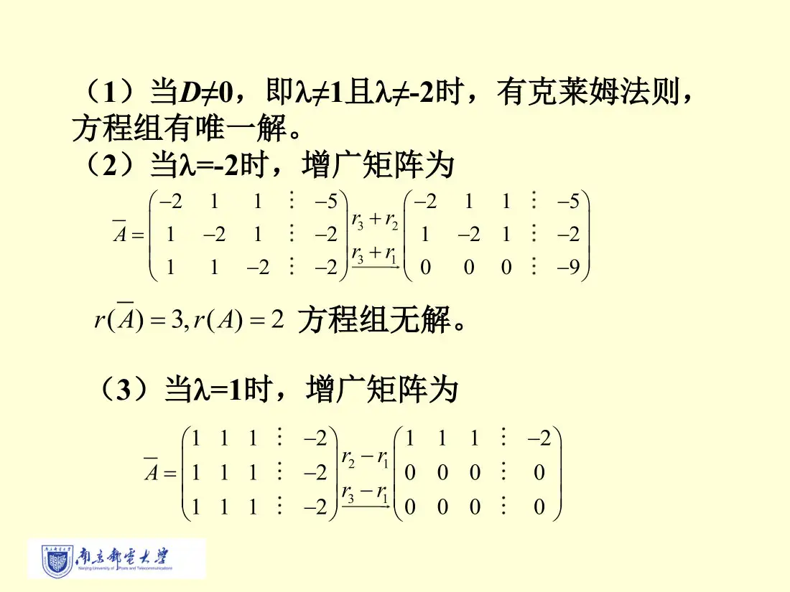

原文：

(1) 当 $D \neq 0$ , 即 $\lambda \neq 1$ 且 $\lambda \neq -2$ 时, 有克莱姆法则, 方程组有唯一解。

(2) 当 $\lambda = -2$ 时，增广矩阵为

$$
\overline {{A}} = \left( \begin{array}{c c c c c} - 2 & 1 & 1 & \vdots & - 5 \\ 1 & - 2 & 1 & \vdots & - 2 \\ 1 & 1 & - 2 & \vdots & - 2 \end{array} \right) \xrightarrow {r _ {3} + r _ {2}} \left( \begin{array}{c c c c c} - 2 & 1 & 1 & \vdots & - 5 \\ 1 & - 2 & 1 & \vdots & - 2 \\ 0 & 0 & 0 & \vdots & - 9 \end{array} \right)
$$

$r(\overline{A})=3,r(A)=2$ 方程组无解。

(3) 当 $\lambda = 1$ 时，增广矩阵为

$$
\overline {{A}} = \left( \begin{array}{c c c c c} 1 & 1 & 1 & \vdots & - 2 \\ 1 & 1 & 1 & \vdots & - 2 \\ 1 & 1 & 1 & \vdots & - 2 \end{array} \right) \xrightarrow {r _ {2} - r _ {1}} \left( \begin{array}{c c c c c} 1 & 1 & 1 & \vdots & - 2 \\ 0 & 0 & 0 & \vdots & 0 \\ 0 & 0 & 0 & \vdots & 0 \end{array} \right)
$$

南京邮电大学
Nanjing University of Posts and Telecommunications

### $$

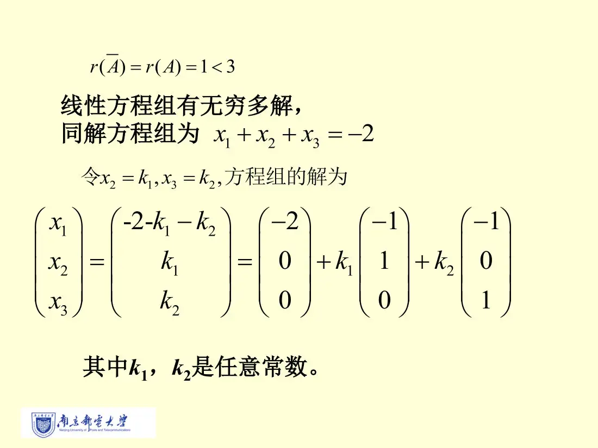

原文：

$$
r (\overline {{A}}) = r (A) = 1 <   3
$$

线性方程组有无穷多解，

同解方程组为 $x_{1} + x_{2} + x_{3} = -2$

令 $x_{2}=k_{1},x_{3}=k_{2}$ ，方程组的解为

$$
\left( \begin{array}{c} x _ {1} \\ x _ {2} \\ x _ {3} \end{array} \right) = \left( \begin{array}{c} - 2 - k _ {1} - k _ {2} \\ k _ {1} \\ k _ {2} \end{array} \right) = \left( \begin{array}{c} - 2 \\ 0 \\ 0 \end{array} \right) + k _ {1} \left( \begin{array}{c} - 1 \\ 1 \\ 0 \end{array} \right) + k _ {2} \left( \begin{array}{c} - 1 \\ 0 \\ 1 \end{array} \right)
$$

其中 $k_{1}$ ， $k_{2}$ 是任意常数。

南京邮电大学
Nanjing University of Posts and Telecommunications
