# 《线性代数与解析几何》2.5 消元法及有解判别法（课件）

原件的每一页，下面附识别出的文字。

### 2.5 线性方程组及高斯消元法

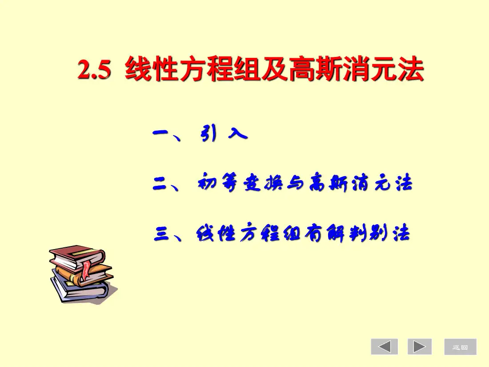

原文：

2.5 线性方程组及高斯消元法

一、引入

二、初等变换与高斯消元法

三、线性方程组有解判别法

◀ ▶

返回

### 一、引入

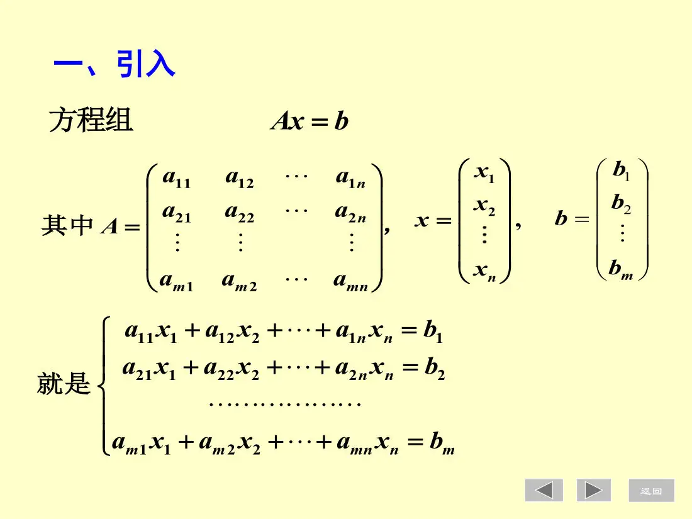

原文：

一、引入

方程组

$$
A x = b
$$

其中

$$
A = \left( \begin{array}{c c c c} a _ {1 1} & a _ {1 2} & \dots & a _ {1 n} \\ a _ {2 1} & a _ {2 2} & \dots & a _ {2 n} \\ \vdots & \vdots & & \vdots \\ a _ {m 1} & a _ {m 2} & \dots & a _ {m n} \end{array} \right), \quad x = \left( \begin{array}{c} x _ {1} \\ x _ {2} \\ \vdots \\ x _ {n} \end{array} \right), \quad b = \left( \begin{array}{c} b _ {1} \\ b _ {2} \\ \vdots \\ b _ {m} \end{array} \right)
$$

就是

$$
\left\{ \begin{array}{l} a _ {1 1} x _ {1} + a _ {1 2} x _ {2} + \dots + a _ {1 n} x _ {n} = b _ {1} \\ a _ {2 1} x _ {1} + a _ {2 2} x _ {2} + \dots + a _ {2 n} x _ {n} = b _ {2} \\ \dots\dots\\ a _ {m 1} x _ {1} + a _ {m 2} x _ {2} + \dots + a _ {m n} x _ {n} = b _ {m} \end{array} \right.
$$

◀ ▶

返回

### 齐次方程组：Ax = 0;

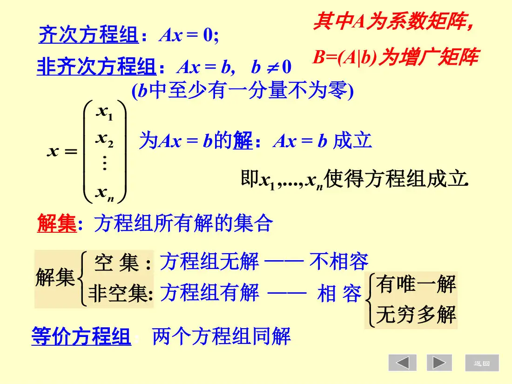

原文：

齐次方程组：Ax = 0;

其中A为系数矩阵，

非齐次方程组：Ax = b, $b \neq 0$

$B=(A|b)$ 为增广矩阵

(b中至少有一分量不为零)

$x = \begin{pmatrix} x_1 \\ x_2 \\ \vdots \\ x_n \end{pmatrix}$ 为 $Ax = b$ 的解： $Ax = b$ 成立即 $x_{1},\ldots ,x_{n}$ 使得方程组成立

解集: 方程组所有解的集合

解集

空集：方程组无解——不相容

等价方程组：两个方程组同解

有唯一解
无穷多解

◀ ▶

返回

### 问题

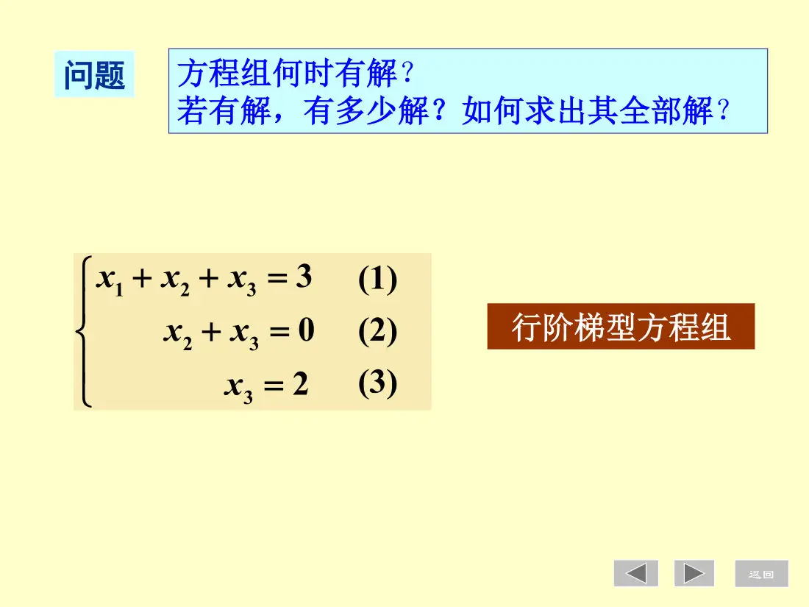

原文：

问题

方程组何时有解？
若有解，有多少解？如何求出其全部解？

$$
x _ {1} + x _ {2} + x _ {3} = 3
$$

$$
x _ {2} + x _ {3} = 0\tag{1}
$$

(2)

$$
x _ {3} = 2\tag{3}
$$

行阶梯型方程组

◀ ▶

返回

### 二、初等变换与高斯消元法

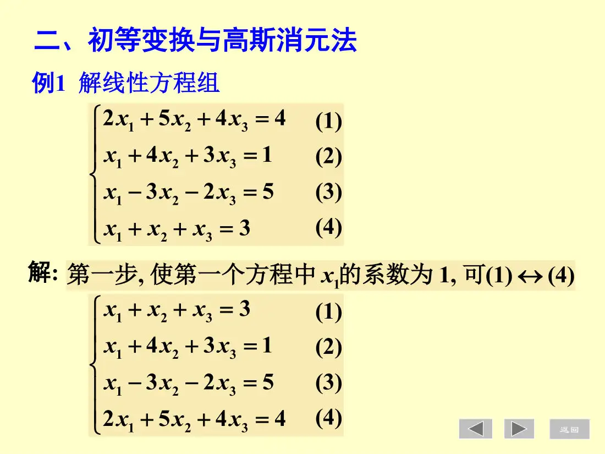

原文：

二、初等变换与高斯消元法

例1 解线性方程组

$$
2 x _ {1} + 5 x _ {2} + 4 x _ {3} = 4\tag{1}
$$

$$
x _ {1} + 4 x _ {2} + 3 x _ {3} = 1\tag{2}
$$

$$
x _ {1} - 3 x _ {2} - 2 x _ {3} = 5\tag{3}
$$

$$
x _ {1} + x _ {2} + x _ {3} = 3\tag{4}
$$

解: 第一步, 使第一个方程中 $x_{1}$ 的系数为 1, 可(1) $\leftrightarrow$ (4)

$$
x _ {1} + x _ {2} + x _ {3} = 3\tag{1}
$$

$$
x _ {1} + 4 x _ {2} + 3 x _ {3} = 1\tag{2}
$$

$$
x _ {1} - 3 x _ {2} - 2 x _ {3} = 5\tag{3}
$$

$$
2 x _ {1} + 5 x _ {2} + 4 x _ {3} = 4\tag{4}
$$

◀ ▶

返回

### $$

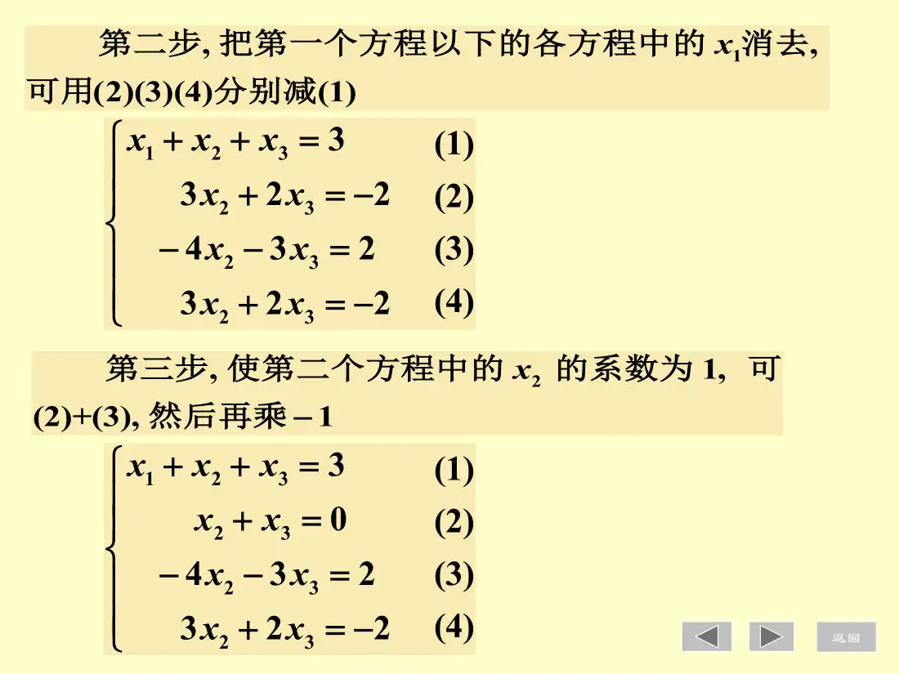

原文：

第二步, 把第一个方程以下的各方程中的 $x_{1}$ 消去, 可用(2)(3)(4)分别减(1)

$$
x _ {1} + x _ {2} + x _ {3} = 3\tag{1}
$$

$$
3 x _ {2} + 2 x _ {3} = - 2\tag{2}
$$

$$
- 4 x _ {2} - 3 x _ {3} = 2\tag{3}
$$

$$
3 x _ {2} + 2 x _ {3} = - 2\tag{4}
$$

第三步, 使第二个方程中的 $x_{2}$ 的系数为 1, 可 (2)+(3), 然后再乘 -1

$$
x _ {1} + x _ {2} + x _ {3} = 3\tag{1}
$$

$$
x _ {2} + x _ {3} = 0\tag{2}
$$

$$
- 4 x _ {2} - 3 x _ {3} = 2\tag{3}
$$

$$
3 x _ {2} + 2 x _ {3} = - 2\tag{4}
$$

◀ ▶

返回

### $$

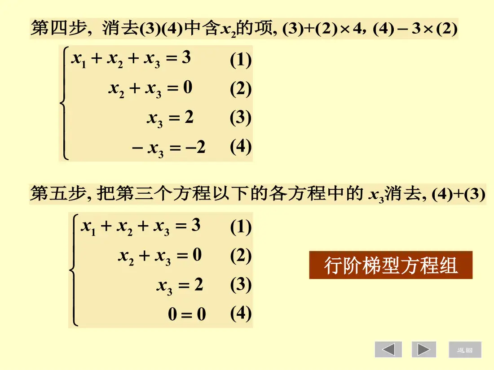

原文：

第四步, 消去(3)(4)中含 $x_{2}$ 的项, (3)+(2)×4, (4)-3×(2)

$$
x _ {1} + x _ {2} + x _ {3} = 3\tag{1}
$$

$$
x _ {2} + x _ {3} = 0\tag{2}
$$

$$
x _ {3} = 2\tag{3}
$$

$$
- x _ {3} = - 2\tag{4}
$$

第五步, 把第三个方程以下的各方程中的 $x_{3}$ 消去, $(4)+(3)$

$$
x _ {1} + x _ {2} + x _ {3} = 3\tag{1}
$$

$$
x _ {2} + x _ {3} = 0\tag{2}
$$

行阶梯型方程组

$$
x _ {3} = 2\tag{3}
$$

$$
\mathbf {0} = \mathbf {0}\tag{4}
$$

◀ ▶

返回

### 第六步, 用回代的方法求解, 即(2)-(3), (1)-(3)

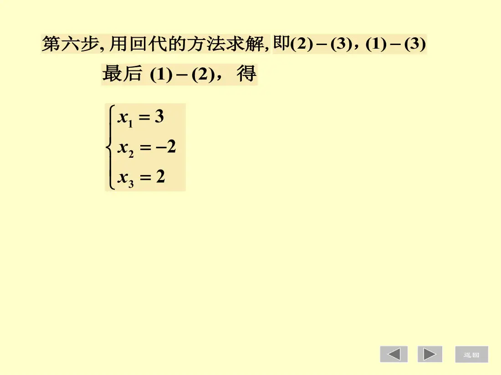

原文：

第六步, 用回代的方法求解, 即(2)-(3), (1)-(3)

最后 (1)-(2)，得

$$
\left\{ \begin{array}{l} x _ {1} = 3 \\ x _ {2} = - 2 \\ x _ {3} = 2 \end{array} \right.
$$

◀ ▶

返回

### 上述消元过程中, 我们对方程组施行了以下三种变换

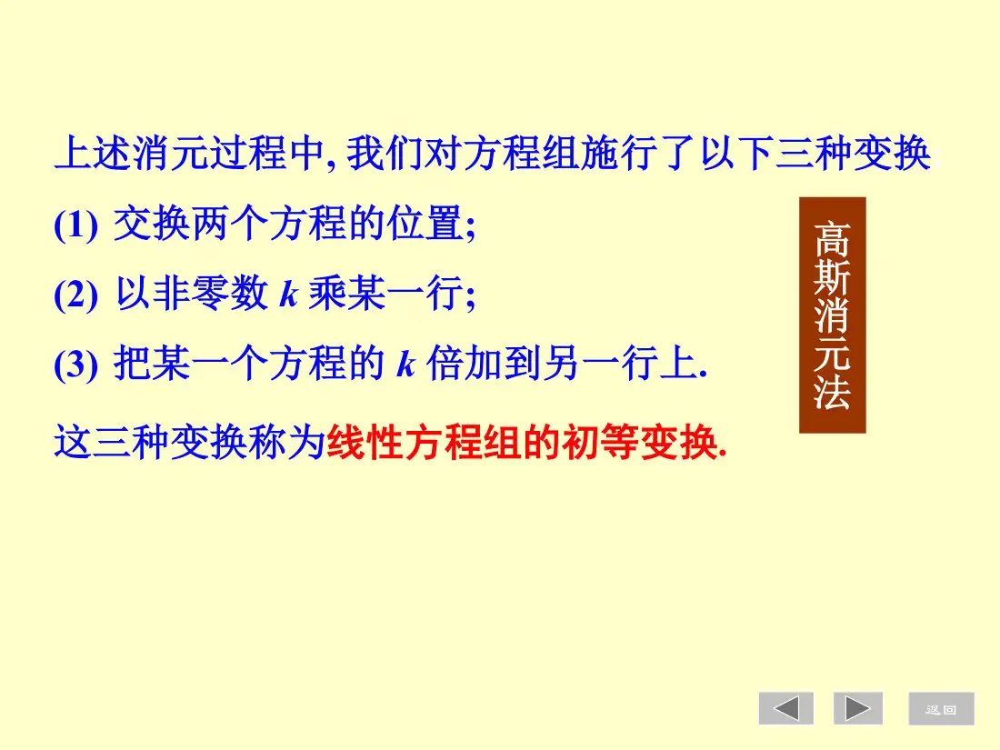

原文：

上述消元过程中, 我们对方程组施行了以下三种变换

(1) 交换两个方程的位置;

高斯消元法

(2) 以非零数 k 乘某一行;

(3) 把某一个方程的 k 倍加到另一行上.

这三种变换称为线性方程组的初等变换.

◀ ▶

返回

### 对方程组施行的初等变换可以用增广矩阵的变换来表示.

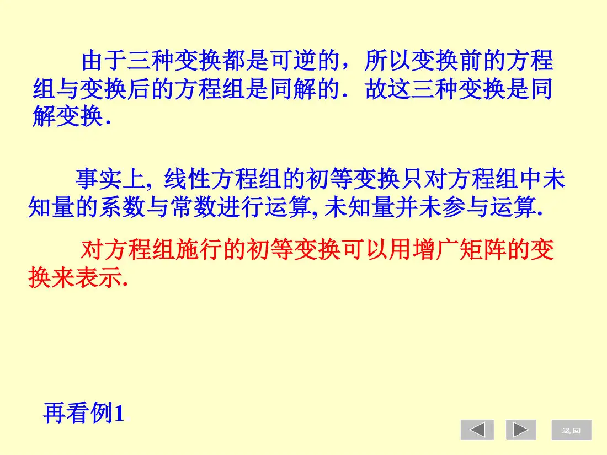

原文：

由于三种变换都是可逆的，所以变换前的方程组与变换后的方程组是同解的。故这三种变换是同解变换。

事实上, 线性方程组的初等变换只对方程组中未知量的系数与常数进行运算, 未知量并未参与运算.

对方程组施行的初等变换可以用增广矩阵的变换来表示.

再看例1

◀ ▶

返回

### 例1 解线性方程组

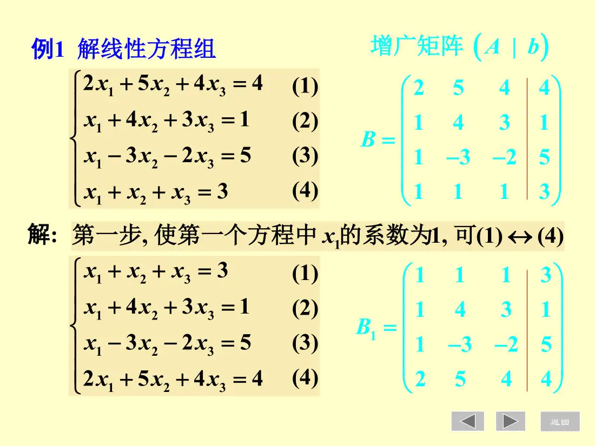

原文：

例1 解线性方程组

$$
2 x _ {1} + 5 x _ {2} + 4 x _ {3} = 4\tag{1}
$$

$$
x _ {1} + 4 x _ {2} + 3 x _ {3} = 1\tag{2}
$$

$$
x _ {1} - 3 x _ {2} - 2 x _ {3} = 5\tag{3}
$$

$$
x _ {1} + x _ {2} + x _ {3} = 3\tag{4}
$$

增广矩阵 $(A\mid b)$

$$
B = \left( \begin{array}{c c c c} 2 & 5 & 4 & 4 \\ 1 & 4 & 3 & 1 \\ 1 & - 3 & - 2 & 5 \\ 1 & 1 & 1 & 3 \end{array} \right)
$$

解: 第一步, 使第一个方程中 $x_{1}$ 的系数为 1 , 可 (1) $\leftrightarrow$ (4)

$$
x _ {1} + x _ {2} + x _ {3} = 3\tag{1}
$$

$$
x _ {1} + 4 x _ {2} + 3 x _ {3} = 1\tag{2}
$$

$$
x _ {1} - 3 x _ {2} - 2 x _ {3} = 5\tag{3}
$$

$$
2 x _ {1} + 5 x _ {2} + 4 x _ {3} = 4\tag{4}
$$

$$
B _ {1} = \left( \begin{array}{c c c c} 1 & 1 & 1 & 3 \\ 1 & 4 & 3 & 1 \\ 1 & - 3 & - 2 & 5 \\ 2 & 5 & 4 & 4 \end{array} \right)
$$

◀ ▶

返回

### (1)

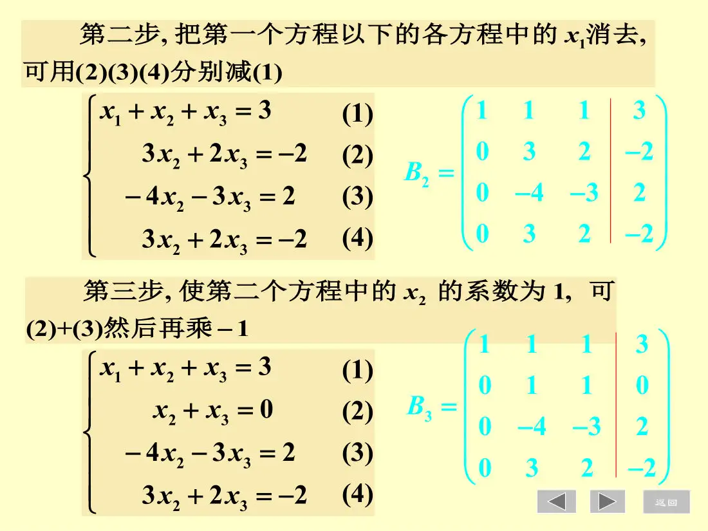

原文：

第二步, 把第一个方程以下的各方程中的 $x_{1}$ 消去, 可用(2)(3)(4)分别减(1)

(1)

$$
\left\{ \begin{array}{r} x _ {1} + x _ {2} + x _ {3} = 3 \\ 3 x _ {2} + 2 x _ {3} = - 2 \\ - 4 x _ {2} - 3 x _ {3} = 2 \\ 3 x _ {2} + 2 x _ {3} = - 2 \end{array} \right.\tag{2}
$$

(3)

$$
B _ {2} = \left( \begin{array}{c c c c} 1 & 1 & 1 & 3 \\ 0 & 3 & 2 & - 2 \\ 0 & - 4 & - 3 & 2 \\ 0 & 3 & 2 & - 2 \end{array} \right)\tag{4}
$$

第三步, 使第二个方程中的 $x_{2}$ 的系数为 1, 可 (2)+(3)然后再乘 -1

$$
x _ {1} + x _ {2} + x _ {3} = 3\tag{1}
$$

$$
x _ {2} + x _ {3} = 0
$$

$$
- 4 x _ {2} - 3 x _ {3} = 2\tag{2}
$$

(3)

$$
3 x _ {2} + 2 x _ {3} = - 2\tag{4}
$$

$$
B _ {3} = \left( \begin{array}{c c c c} 1 & 1 & 1 & 3 \\ 0 & 1 & 1 & 0 \\ 0 & - 4 & - 3 & 2 \\ 0 & 3 & 2 & - 2 \end{array} \right)
$$

返回

### $$

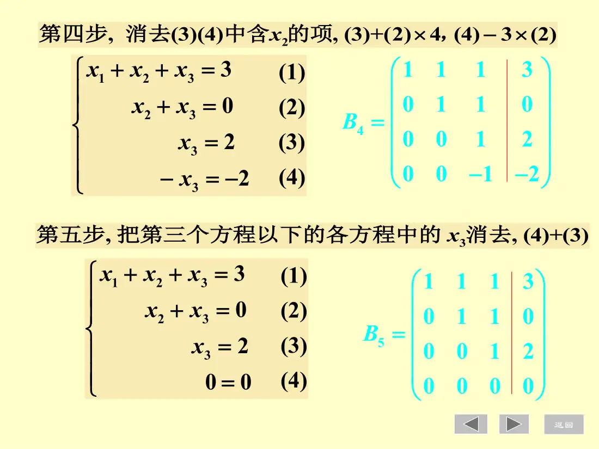

原文：

第四步, 消去(3)(4)中含 $x_{2}$ 的项, (3)+(2)×4, (4)-3×(2)

$$
x _ {1} + x _ {2} + x _ {3} = 3\tag{1}
$$

$$
x _ {2} + x _ {3} = 0\tag{2}
$$

$$
x _ {3} = 2
$$

(3)

$$
- x _ {3} = - 2
$$

(4)

$$
B _ {4} = \left( \begin{array}{c c c c} 1 & 1 & 1 & 3 \\ 0 & 1 & 1 & 0 \\ 0 & 0 & 1 & 2 \\ 0 & 0 & - 1 & - 2 \end{array} \right)
$$

第五步, 把第三个方程以下的各方程中的 $x_{3}$ 消去, $(4)+(3)$

$$
x _ {1} + x _ {2} + x _ {3} = 3\tag{1}
$$

$$
x _ {2} + x _ {3} = 0\tag{2}
$$

$$
x _ {3} = 2\tag{3}
$$

$$
\mathbf {0} = \mathbf {0}\tag{4}
$$

$$
B _ {5} = \left( \begin{array}{c c c c} 1 & 1 & 1 & 3 \\ 0 & 1 & 1 & 0 \\ 0 & 0 & 1 & 2 \\ 0 & 0 & 0 & 0 \end{array} \right)
$$

◀ ▶

返回

### 第六步, 用回代的方法求解, 即(2)-(3), (1)-(3)

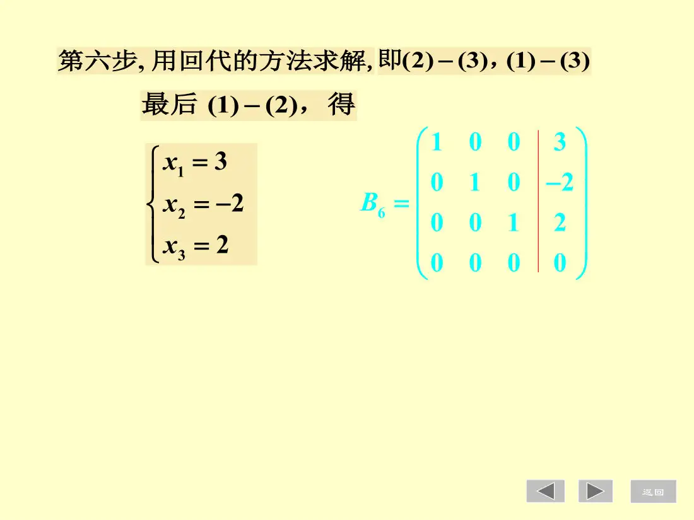

原文：

第六步, 用回代的方法求解, 即(2)-(3), (1)-(3)

最后 (1)-(2)，得

$$
\left\{ \begin{array}{l} x _ {1} = 3 \\ x _ {2} = - 2 \\ x _ {3} = 2 \end{array} \right.
$$

$$
B _ {6} = \left( \begin{array}{c c c c} 1 & 0 & 0 & 3 \\ 0 & 1 & 0 & - 2 \\ 0 & 0 & 1 & 2 \\ 0 & 0 & 0 & 0 \end{array} \right)
$$

◀ ▶

返回

### 二、线性方程组的解法

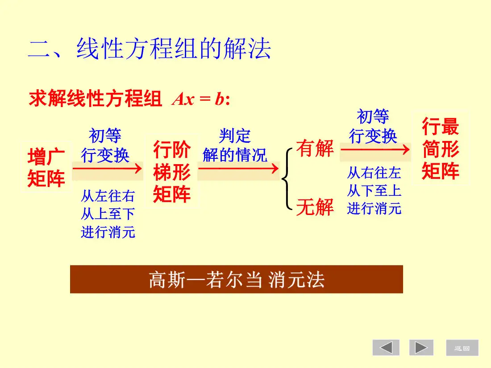

原文：

二、线性方程组的解法

求解线性方程组 Ax = b:

增广矩阵 初等
行变换

从左往右行阶梯形矩阵

从上至下

进行消元

判定
解的情况有解

无解初等
行变换

从右往左
从下至上
进行消元行最
简形
矩阵

高斯一若尔当 消元法

◀ ▶

返回

### 求解线性方程组：

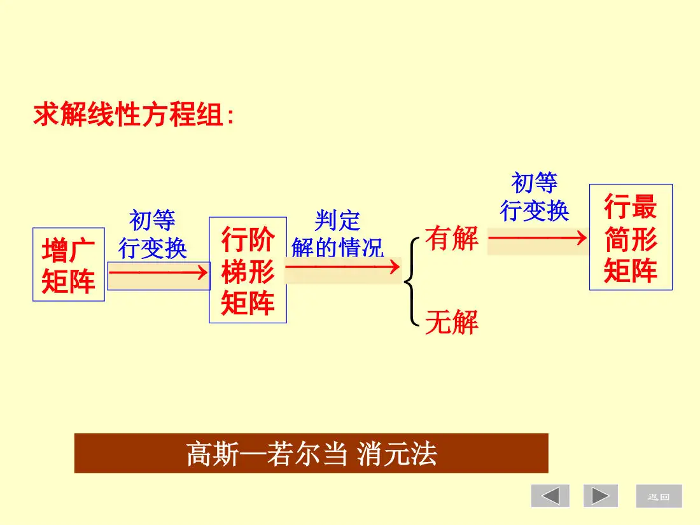

原文：

求解线性方程组：

高斯一若尔当 消元法

◀ ▶

返回

### 例 解方程组

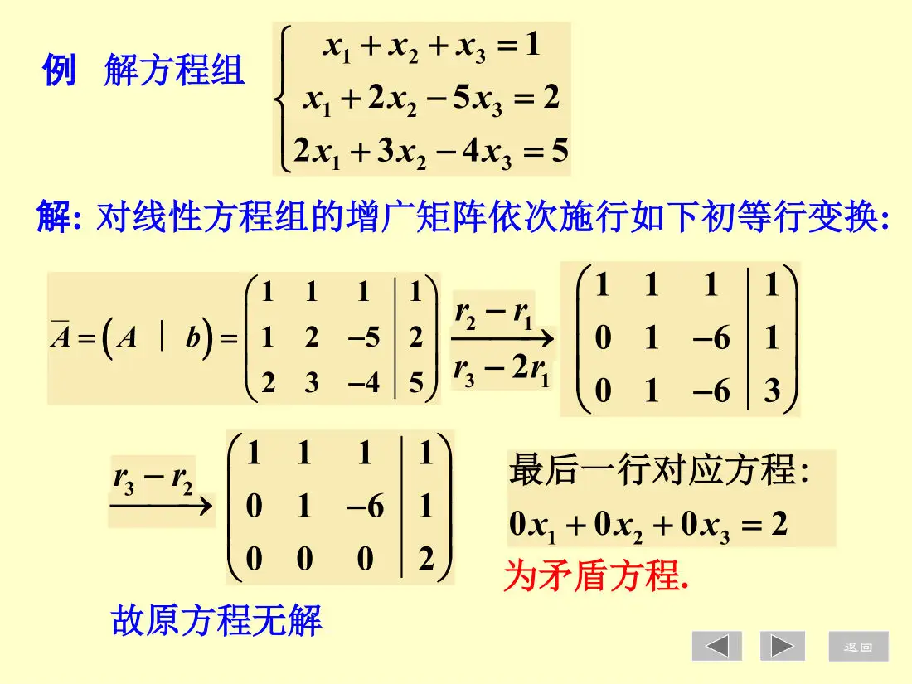

原文：

例 解方程组

$$
\left\{ \begin{array}{c} x _ {1} + x _ {2} + x _ {3} = 1 \\ x _ {1} + 2 x _ {2} - 5 x _ {3} = 2 \\ 2 x _ {1} + 3 x _ {2} - 4 x _ {3} = 5 \end{array} \right.
$$

解: 对线性方程组的增广矩阵依次施行如下初等行变换:

$$
\overline {{A}} = \left( \begin{array}{c c c} A & b \end{array} \right) = \left( \begin{array}{c c c c} 1 & 1 & 1 & 1 \\ 1 & 2 & - 5 & 2 \\ 2 & 3 & - 4 & 5 \end{array} \right) \xrightarrow {r _ {2} - r _ {1}} \left( \begin{array}{c c c c} 1 & 1 & 1 & 1 \\ 0 & 1 & - 6 & 1 \\ 0 & 1 & - 6 & 3 \end{array} \right)
$$

$$
\xrightarrow {r _ {3} - r _ {2}} \left( \begin{array}{c c c c} 1 & 1 & 1 & 1 \\ 0 & 1 & - 6 & 1 \\ 0 & 0 & 0 & 2 \end{array} \right)
$$

最后一行对应方程:

$$
\mathbf {0} x _ {1} + \mathbf {0} x _ {2} + \mathbf {0} x _ {3} = 2
$$

为矛盾方程.

故原方程无解

◀ ▶

返回

### 例 解方程组

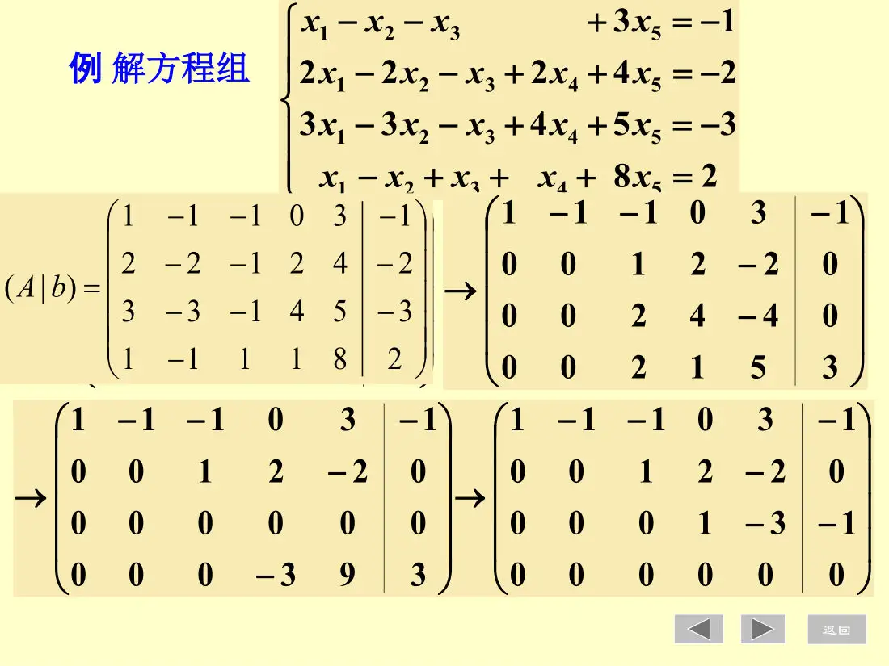

原文：

例 解方程组

$$
\left\{ \begin{array}{l} x _ {1} - x _ {2} - x _ {3} + 3 x _ {5} = - 1 \\ 2 x _ {1} - 2 x _ {2} - x _ {3} + 2 x _ {4} + 4 x _ {5} = - 2 \\ 3 x _ {1} - 3 x _ {2} - x _ {3} + 4 x _ {4} + 5 x _ {5} = - 3 \\ x _ {1} - x _ {2} + x _ {3} + x _ {4} + 8 x _ {5} = 2 \end{array} \right.
$$

$$
(A \mid b) = \left(\begin{array}{r r r r r r}1&- 1&- 1&0&3&- 1\\2&- 2&- 1&2&4&- 2\\3&- 3&- 1&4&5&- 3\\1&- 1&1&1&8&2\end{array}\right)\rightarrow \left(\begin{array}{r r r r r r}1&- 1&- 1&0&3&- 1\\0&0&1&2&- 2&0\\0&0&2&4&- 4&0\\0&0&2&1&5&3\end{array}\right)
$$

$$
\rightarrow \left(\begin{array}{c c c c c c}1&- 1&- 1&0&3&- 1\\0&0&1&2&- 2&0\\0&0&0&0&0&0\\0&0&0&- 3&9&3\end{array}\right)\rightarrow \left(\begin{array}{c c c c c c}1&- 1&- 1&0&3&- 1\\0&0&1&2&- 2&0\\0&0&0&1&- 3&- 1\\0&0&0&0&0&0\end{array}\right)
$$

◀ ▶

返回

### $$

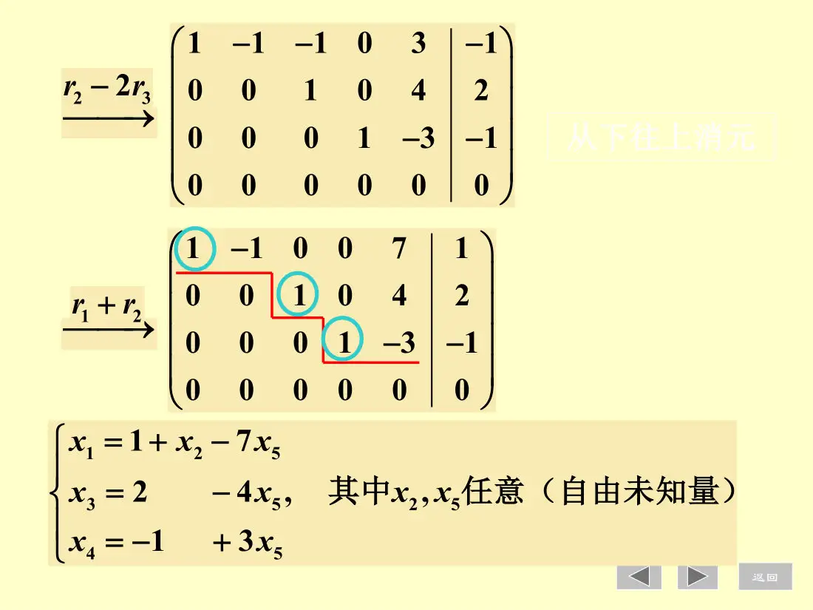

原文：

$$
\xrightarrow {r _ {2} - 2 r _ {3}} \left( \begin{array}{c c c c c c} 1 & - 1 & - 1 & 0 & 3 & - 1 \\ 0 & 0 & 1 & 0 & 4 & 2 \\ 0 & 0 & 0 & 1 & - 3 & - 1 \\ 0 & 0 & 0 & 0 & 0 & 0 \end{array} \right)
$$

从下往上消元

$$
\xrightarrow {r _ {1} + r _ {2}} \left( \begin{array}{c c c c c c} 1 & - 1 & 0 & 0 & 7 & 1 \\ \hline 0 & 0 & 1 & 0 & 4 & 2 \\ 0 & 0 & 0 & 1 & - 3 & - 1 \\ 0 & 0 & 0 & 0 & 0 & 0 \end{array} \right)
$$

$\left\{ \begin{array}{l} x_{1} = 1 + x_{2} - 7x_{5} \\ x_{3} = 2 - 4x_{5}, \\ x_{4} = -1 + 3x_{5} \end{array} \right.$ 其中 $x_{2}, x_{5}$ 任意（自由未知量）

返回

### 或写成向量形式即为:

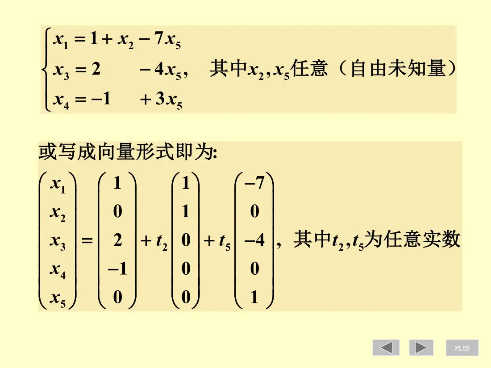

原文：

$\left\{ \begin{array}{l} x_{1} = 1 + x_{2} - 7x_{5} \\ x_{3} = 2 - 4x_{5}, \\ x_{4} = -1 + 3x_{5} \end{array} \right.$ 其中 $x_{2}, x_{5}$ 任意（自由未知量）

或写成向量形式即为:

$\left( \begin{array}{c}x_{1}\\ x_{2}\\ x_{3}\\ x_{4}\\ x_{5} \end{array} \right) = \left( \begin{array}{c}1\\ 0\\ 2\\ -1\\ 0 \end{array} \right) + t_{2}\left( \begin{array}{c}1\\ 1\\ 0\\ 0\\ 0 \end{array} \right) + t_{5}\left( \begin{array}{c} - 7\\ 0\\ -4\\ 0\\ 1 \end{array} \right),$ 其中 $t_2,t_5$ 为任意实数

◀ ▶

返回

### 例1

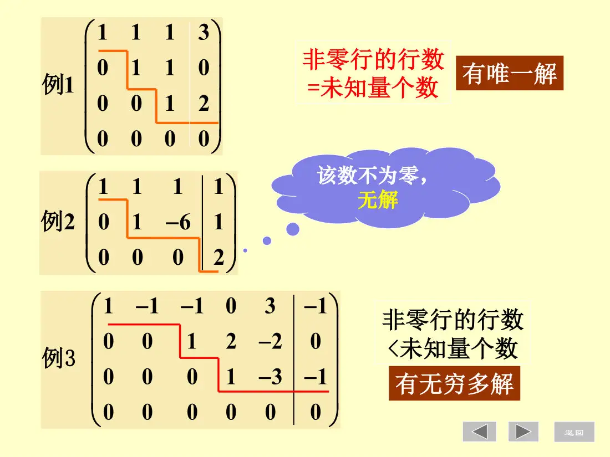

原文：

例1

$$
\left( \begin{array}{c c c c} 1 & 1 & 1 & 3 \\ 0 & 1 & 1 & 0 \\ 0 & 0 & 1 & 2 \\ 0 & 0 & 0 & 0 \end{array} \right)
$$

例2

$$
\left( \begin{array}{c c c c} 1 & 1 & 1 & 1 \\ 0 & 1 & - 6 & 1 \\ 0 & 0 & 0 & 2 \end{array} \right)
$$

例3

非零行的行数
=未知量个数

$$
\left( \begin{array}{c c c c c c} 1 & - 1 & - 1 & 0 & 3 & - 1 \\ \hline 0 & 0 & 1 & 2 & - 2 & 0 \\ 0 & 0 & 0 & 1 & - 3 & - 1 \\ 0 & 0 & 0 & 0 & 0 & 0 \end{array} \right)
$$

该数不为零，无解

有唯一解

非零行的行数
<未知量个数>

有无穷多解

◀ ▶

返回

### 一般地，设线性方程 $Ax = b$ 的增广矩阵为：

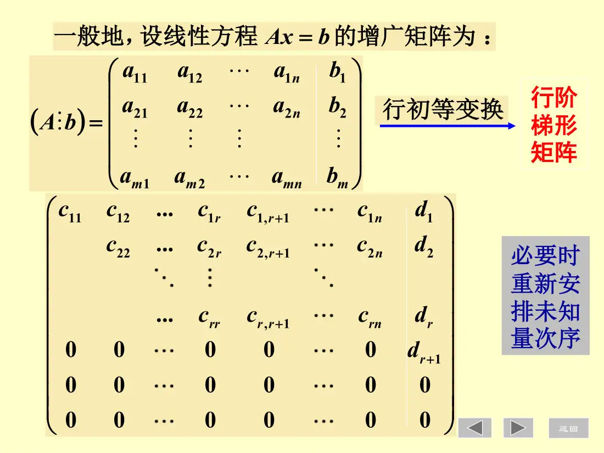

原文：

一般地，设线性方程 $Ax = b$ 的增广矩阵为：

$$
(A \vdots b) = \left( \begin{array}{c c c c c} a _ {1 1} & a _ {1 2} & \dots & a _ {1 n} & b _ {1} \\ a _ {2 1} & a _ {2 2} & \dots & a _ {2 n} & b _ {2} \\ \vdots & \vdots & \vdots & & \vdots \\ a _ {m 1} & a _ {m 2} & \dots & a _ {m n} & b _ {m} \end{array} \right)
$$

行初等变换

$$
\left( \begin{array}{c c c c c c c} c _ {1 1} & c _ {1 2} & \dots & c _ {1 r} & c _ {1, r + 1} & \dots & c _ {1 n} & d _ {1} \\ & c _ {2 2} & \dots & c _ {2 r} & c _ {2, r + 1} & \dots & c _ {2 n} & d _ {2} \\ & & \ddots & \vdots & & \ddots & \\ & & \dots & c _ {r r} & c _ {r, r + 1} & \dots & c _ {r n} & d _ {r} \\ \mathbf {0} & \mathbf {0} & \dots & \mathbf {0} & \mathbf {0} & \dots & \mathbf {0} & d _ {r + 1} \\ \mathbf {0} & \mathbf {0} & \dots & \mathbf {0} & \mathbf {0} & \dots & \mathbf {0} & \mathbf {0} \\ \mathbf {0} & \mathbf {0} & \dots & \mathbf {0} & \mathbf {0} & \dots & \mathbf {0} & \mathbf {0} \end{array} \right)
$$

行阶梯形矩阵

必要时
重新安
排未知
量次序 初等
行变换

◀ ▶

返回

### $$

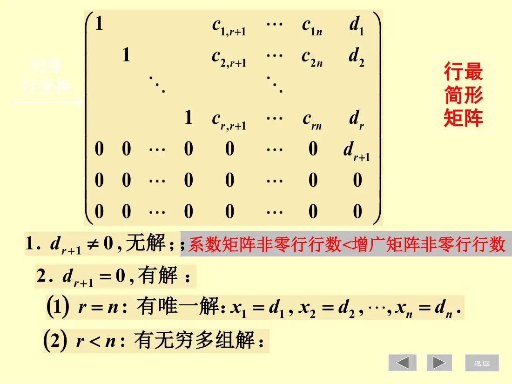

原文：

$$
\left( \begin{array}{c c c c c c c} 1 & & & c _ {1, r + 1} & \dots & c _ {1 n} & d _ {1} \\ & 1 & & c _ {2, r + 1} & \dots & c _ {2 n} & d _ {2} \\ & & \ddots & & \ddots & \\ & & & 1 & c _ {r, r + 1} & \dots & c _ {r n} & d _ {r} \\ \mathbf {0} & \mathbf {0} & \dots & \mathbf {0} & \mathbf {0} & \dots & \mathbf {0} & d _ {r + 1} \\ \mathbf {0} & \mathbf {0} & \dots & \mathbf {0} & \mathbf {0} & \dots & \mathbf {0} & \mathbf {0} \\ \mathbf {0} & \mathbf {0} & \dots & \mathbf {0} & \mathbf {0} & \dots & \mathbf {0} & \mathbf {0} \end{array} \right)
$$

行最
简形
矩阵

1. $d_{r+1} \neq 0$ , 无解; 系数矩阵非零行行数<增广矩阵非零行行数

2. $d_{r + 1} = 0$ ，有解：

(1) r=n: 有唯一解: $x_{1}=d_{1}, x_{2}=d_{2}, \cdots, x_{n}=d_{n}$ .

(2) $r < n$ : 有无穷多组解:

◀ ▶

返回

### $$

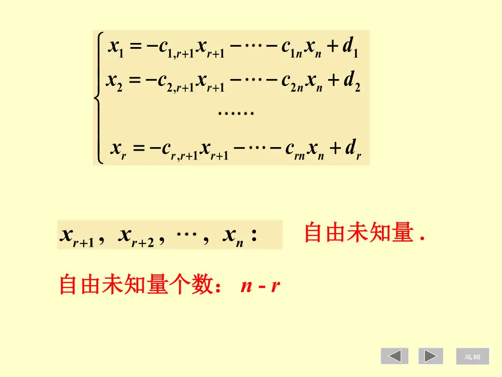

原文：

$$
\left\{ \begin{array}{l} x _ {1} = - c _ {1, r + 1} x _ {r + 1} - \dots - c _ {1 n} x _ {n} + d _ {1} \\ x _ {2} = - c _ {2, r + 1} x _ {r + 1} - \dots - c _ {2 n} x _ {n} + d _ {2} \\ \qquad \dots \dots \\ x _ {r} = - c _ {r, r + 1} x _ {r + 1} - \dots - c _ {r n} x _ {n} + d _ {r} \end{array} \right.
$$

$$
x _ {r + 1}, x _ {r + 2}, \dots , x _ {n}:
$$

自由未知量.

自由未知量个数: $n - r$

◀ ▶

返回

### 5. 线性方程组有解的条件

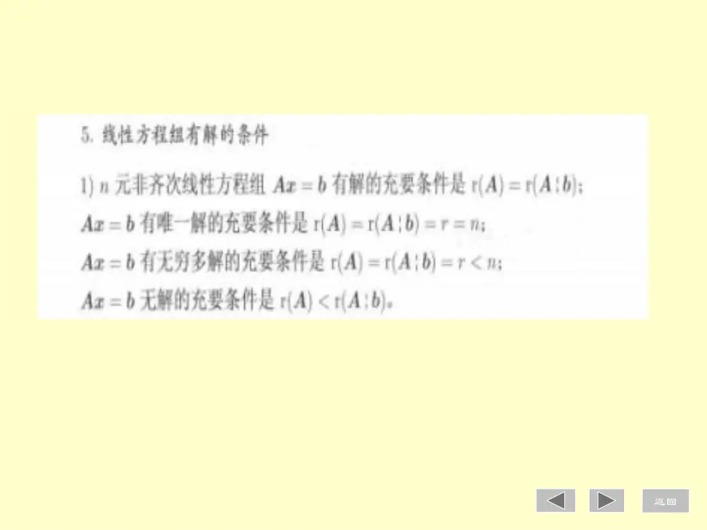

原文：

5. 线性方程组有解的条件

1) n 元非齐次线性方程组 Ax=b 有解的充要条件是 r(A)=r(A:b);

Ax=b 有唯一解的充要条件是 $r(A)=r(A;b)=r=n;$

Ax=b 有无穷多解的充要条件是 $\mathrm{r}(A)=\mathrm{r}(A;b)=r<n;$

Ax=b 无解的充要条件是 r(A)<r(A:b)。

◀ ▶

返回

### 问题: 对于齐次方程组 Ax = 0 ?

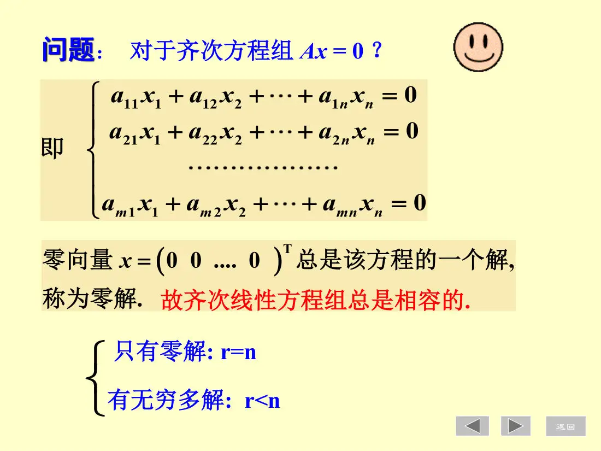

原文：

问题: 对于齐次方程组 Ax = 0 ?

即

$$
\left\{ \begin{array}{l} a _ {1 1} x _ {1} + a _ {1 2} x _ {2} + \dots + a _ {1 n} x _ {n} = 0 \\ a _ {2 1} x _ {1} + a _ {2 2} x _ {2} + \dots + a _ {2 n} x _ {n} = 0 \\ \dots\dots\\ a _ {m 1} x _ {1} + a _ {m 2} x _ {2} + \dots + a _ {m n} x _ {n} = 0 \end{array} \right.
$$

零向量 $x=(0\ 0\ \ldots\ 0)^{\mathrm{T}}$ 总是该方程的一个解, 称为零解. 故齐次线性方程组总是相容的.

只有零解: r=n

有无穷多解: r<n

◀ ▶

返回

### 齐次方程组只有零解 $\Leftrightarrow r = n$

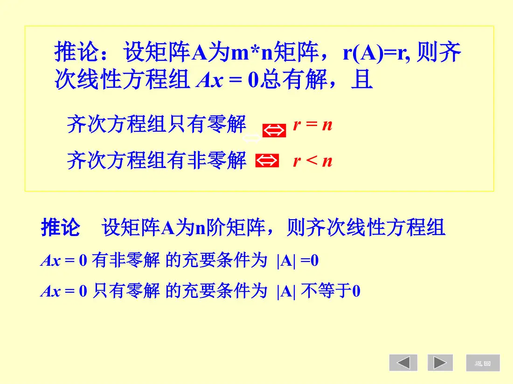

原文：

推论：设矩阵A为m\*n矩阵，r(A)=r, 则齐次线性方程组 Ax=0总有解，且

齐次方程组只有零解 $\Leftrightarrow r = n$

齐次方程组有非零解 $\Leftrightarrow r < n$

推论 设矩阵A为n阶矩阵，则齐次线性方程组

Ax = 0 有非零解的充要条件为 $|A| = 0$

Ax = 0 只有零解的充要条件为 |A| 不等于0

◀ ▶

返回

### 5. 线性方程组有解的条件

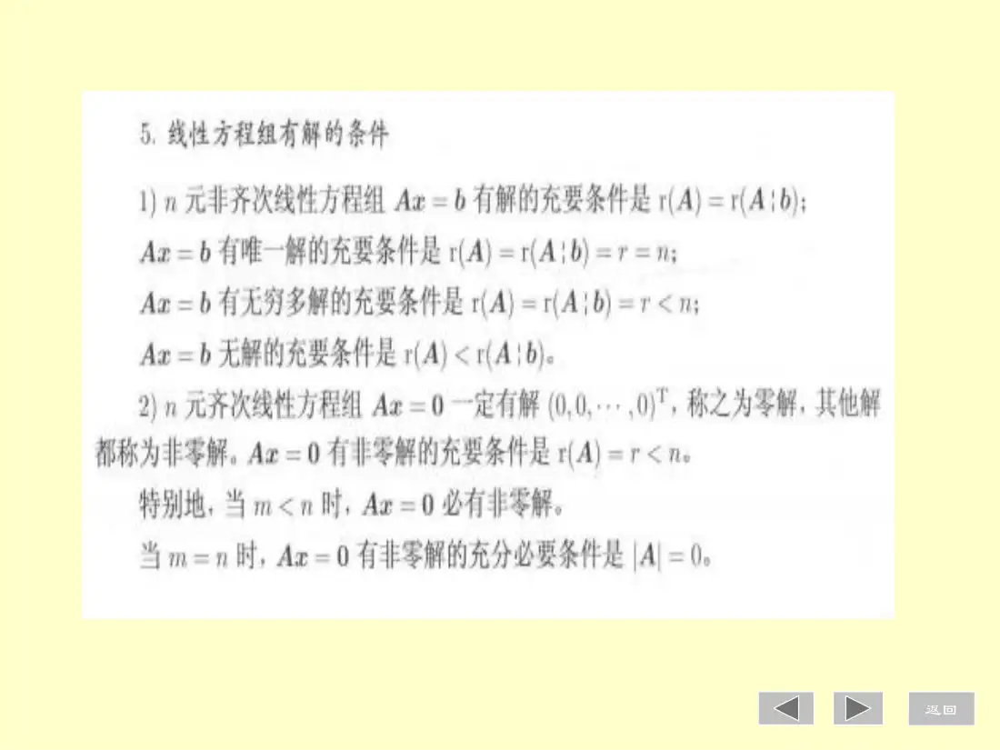

原文：

5. 线性方程组有解的条件

1) n 元非齐次线性方程组 Ax=b 有解的充要条件是 r(A)=r(A:b);

Ax=b 有唯一解的充要条件是 $\mathrm{r}(A)=\mathrm{r}(A;b)=r=n;$

Ax=b 有无穷多解的充要条件是 $\mathrm{r}(A)=\mathrm{r}(A;b)=r<n;$

Ax=b 无解的充要条件是 r(A) < r(A; b)。

2) n 元齐次线性方程组 Ax = 0 一定有解 $(0, 0, \cdots, 0)^{\mathrm{T}}$ ，称之为零解，其他解都称为非零解。Ax = 0 有非零解的充要条件是 $r(A) = r < n$ 。

特别地，当 $m < n$ 时， $Ax = 0$ 必有非零解。

当 m=n 时，Ax=0 有非零解的充分必要条件是 $|A|=0$ 。

◀ ▶

返回

### 以下均是方程个数等于变量个数的情况：

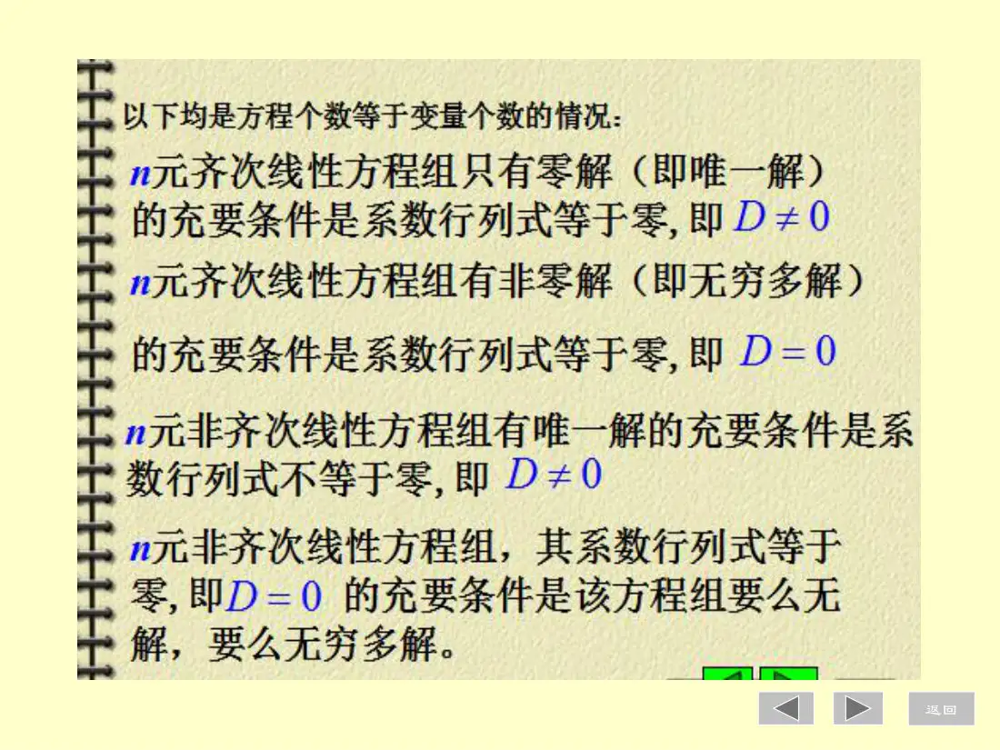

原文：

以下均是方程个数等于变量个数的情况：

n元齐次线性方程组只有零解（即唯一解）的充要条件是系数行列式等于零, 即 $D \neq 0$ n元齐次线性方程组有非零解（即无穷多解）

的充要条件是系数行列式等于零, 即 $D = 0$

n元非齐次线性方程组有唯一解的充要条件是系数行列式不等于零, 即 $D \neq 0$

n元非齐次线性方程组，其系数行列式等于零, 即D=0 的充要条件是该方程组要么无解，要么无穷多解。

◀ ▶

返回

### 例6 求解方程组

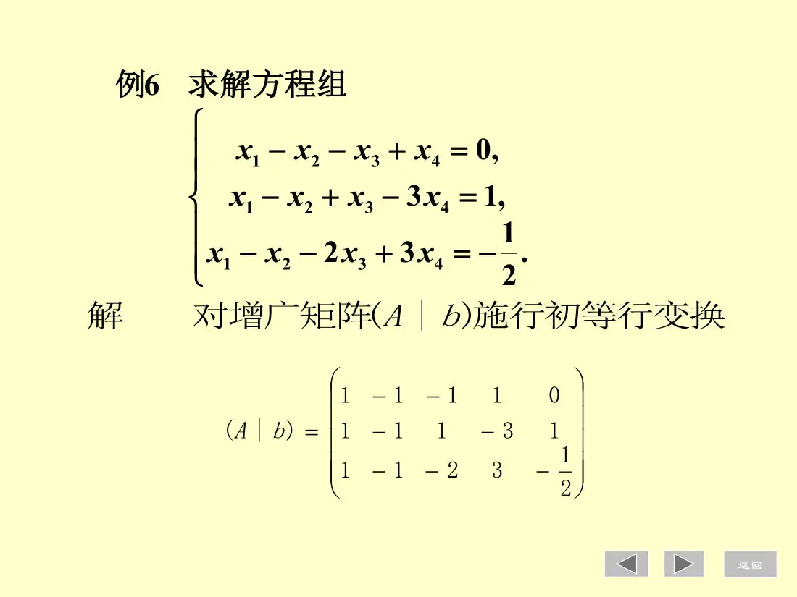

原文：

例6 求解方程组

$$
\left\{ \begin{array}{c} x _ {1} - x _ {2} - x _ {3} + x _ {4} = 0, \\ x _ {1} - x _ {2} + x _ {3} - 3 x _ {4} = 1, \\ x _ {1} - x _ {2} - 2 x _ {3} + 3 x _ {4} = - \frac {1}{2}. \end{array} \right.
$$

解 对增广矩阵(A | b)施行初等行变换

$$
(A \mid b) = \left( \begin{array}{r r r r r} 1 & - 1 & - 1 & 1 & 0 \\ 1 & - 1 & 1 & - 3 & 1 \\ 1 & - 1 & - 2 & 3 & - \frac {1}{2} \end{array} \right)
$$

◀ ▶

返回

### $$

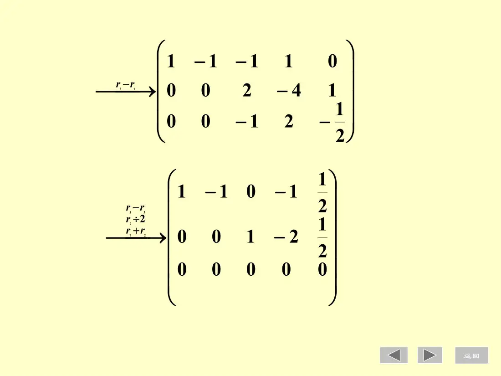

原文：

$$
\xrightarrow {r _ {2} - r _ {1}} \left( \begin{array}{c c c c c} 1 & - 1 & - 1 & 1 & 0 \\ 0 & 0 & 2 & - 4 & 1 \\ 0 & 0 & - 1 & 2 & - \frac {1}{2} \end{array} \right)
$$

$$
\xrightarrow { \begin{array}{l} r _ {1} - r _ {3} \\ r _ {2} \div 2 \\ r _ {3} + r _ {2} \end{array} } \left( \begin{array}{c c c c c} 1 & - 1 & 0 & - 1 & \frac {1}{2} \\ 0 & 0 & 1 & - 2 & \frac {1}{2} \\ 0 & 0 & 0 & 0 & 0 \end{array} \right)
$$

◀ ▶

返回

### 因 $r(A) = r(A \mid b) = 2$ ，故方程组有解，并有

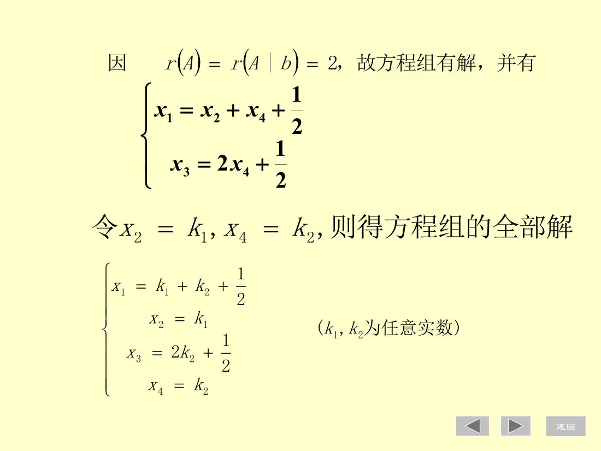

原文：

因 $r(A) = r(A \mid b) = 2$ ，故方程组有解，并有

$$
\left\{ \begin{array}{c} x _ {1} = x _ {2} + x _ {4} + \frac {1}{2} \\ x _ {3} = 2 x _ {4} + \frac {1}{2} \end{array} \right.
$$

令 $x_{2} = k_{1}, x_{4} = k_{2}$ ，则得方程组的全部解

$$
\left\{ \begin{array}{c} x _ {1} = k _ {1} + k _ {2} + \frac {1}{2} \\ x _ {2} = k _ {1} \\ x _ {3} = 2 k _ {2} + \frac {1}{2} \\ x _ {4} = k _ {2} \end{array} \right.
$$

$(k_{1}, k_{2}$ 为任意实数）

◀ ▶

返回

### 例7 $\lambda, \mu$ 取何值时，方程组

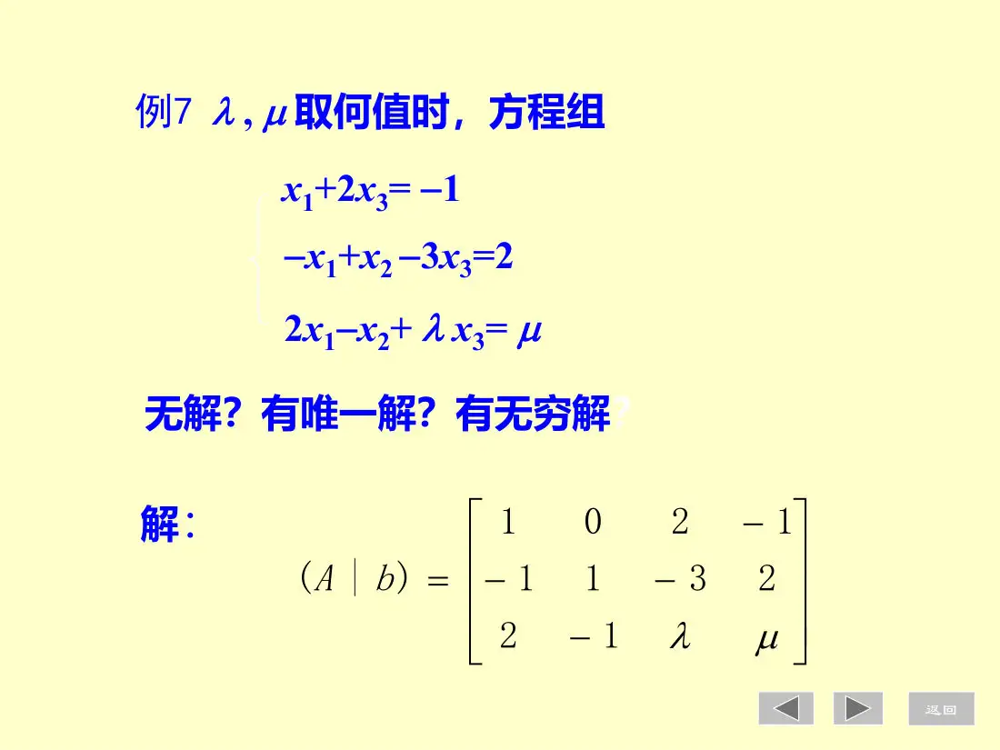

原文：

例7 $\lambda, \mu$ 取何值时，方程组

$$
\begin{array}{l} x _ {1} + 2 x _ {3} = - 1 \\ - x _ {1} + x _ {2} - 3 x _ {3} = 2 \end{array}
$$

$$
2 x _ {1} - x _ {2} + \lambda x _ {3} = \mu
$$

无解？有唯一解？有无穷解

解：

$$
(A \mid b) = \left[ \begin{array}{r r r r} 1 & 0 & 2 & - 1 \\ - 1 & 1 & - 3 & 2 \\ 2 & - 1 & \lambda & \mu \end{array} \right]
$$

◀ ▶

返回

### $$

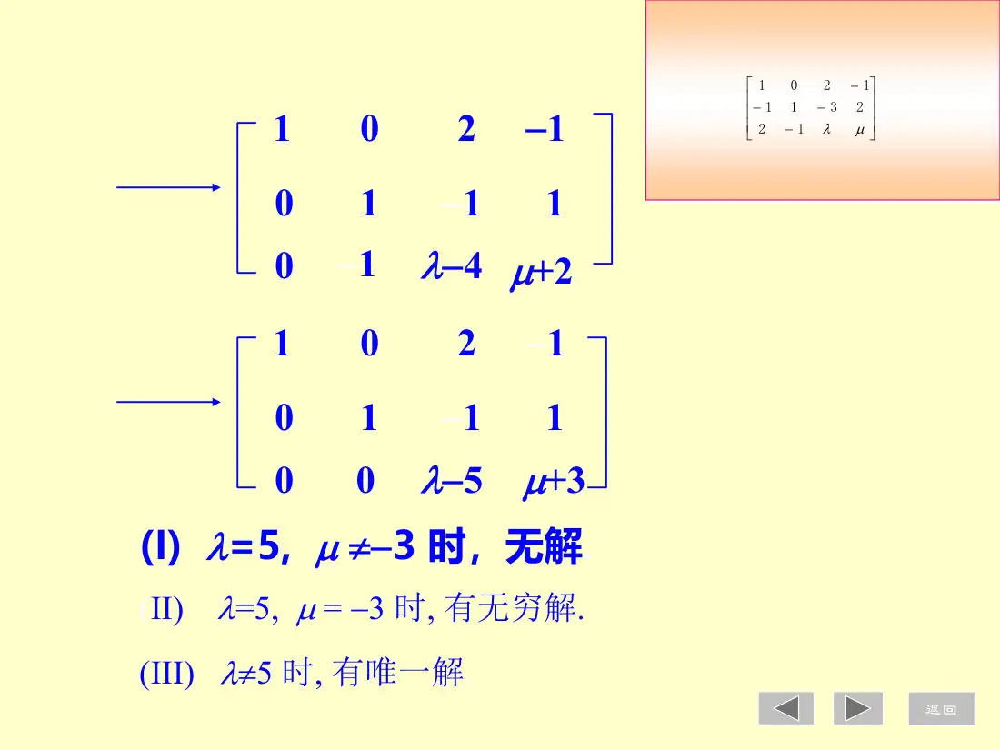

原文：

$$
\longrightarrow \left[ \begin{array}{c c c c} 1 & 0 & 2 & - 1 \\ 0 & 1 & - 1 & 1 \\ 0 & - 1 & \lambda - 4 & \mu + 2 \end{array} \right]
$$

$$
\left[ \begin{array}{c c c c} 1 & 0 & 2 & - 1 \\ - 1 & 1 & - 3 & 2 \\ 2 & - 1 & \lambda & \mu \end{array} \right]
$$

$$
\longrightarrow \left[ \begin{array}{c c c c} 1 & 0 & 2 & - 1 \\ 0 & 1 & - 1 & 1 \\ 0 & 0 & \lambda - 5 & \mu + 3 \end{array} \right]
$$

(I) $\lambda=5,\quad\mu\neq-3$ 时，无解

(II) $\lambda=5,\mu=-3$ 时,有无穷解.

(III) $\lambda\neq5$ 时,有唯一解

◀ ▶

返回

### $$

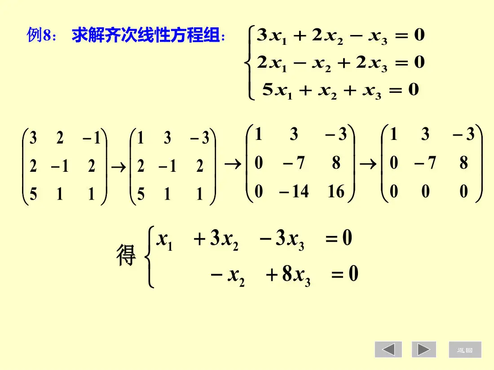

原文：

例8: 求解齐次线性方程组: $\left\{ \begin{array}{l} 3x_{1} + 2x_{2} - x_{3} = 0 \\ 2x_{1} - x_{2} + 2x_{3} = 0 \\ 5x_{1} + x_{2} + x_{3} = 0 \end{array} \right.$

$$
\left(\begin{array}{c c c}3&2&- 1\\2&- 1&2\\5&1&1\end{array}\right)\rightarrow \left(\begin{array}{c c c}1&3&- 3\\2&- 1&2\\5&1&1\end{array}\right)\rightarrow \left(\begin{array}{c c c}1&3&- 3\\0&- 7&8\\0&- 1 4&1 6\end{array}\right)\rightarrow \left(\begin{array}{c c c}1&3&- 3\\0&- 7&8\\0&0&0\end{array}\right)
$$

得 $\left\{ \begin{array}{ccc}x_{1} & +3x_{2} & -3x_{3} = 0\\ -x_{2} & +8x_{3} & = 0 \end{array} \right.$

◀ ▶

返回

### $$

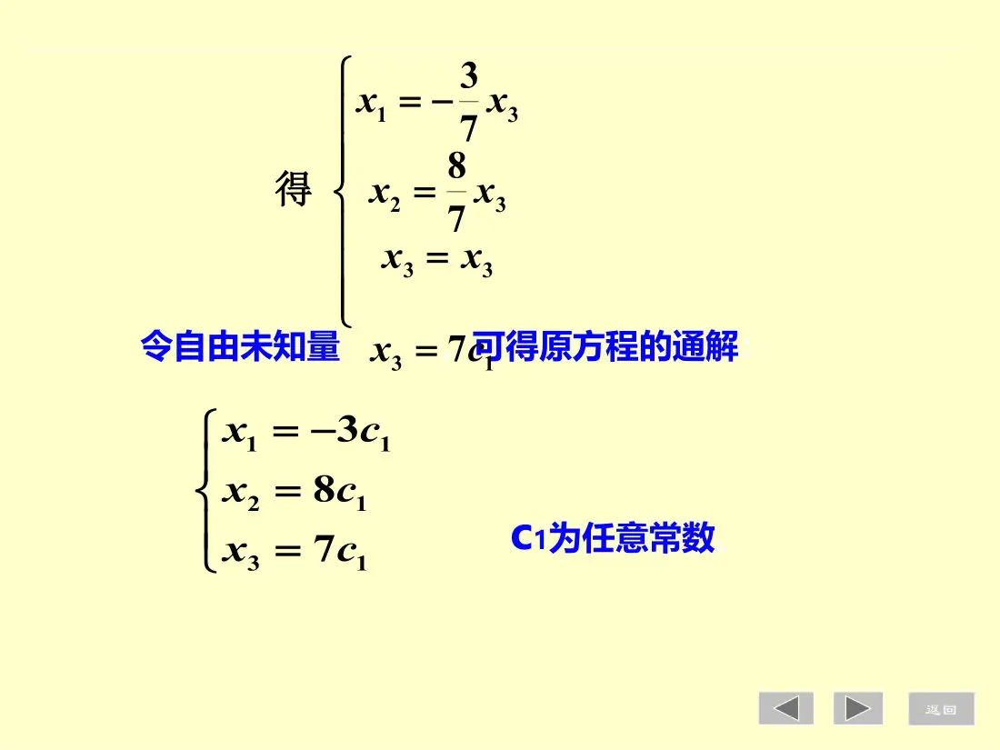

原文：

得

$$
\left\{ \begin{array}{c} x _ {1} = - \frac {3}{7} x _ {3} \\ x _ {2} = \frac {8}{7} x _ {3} \\ x _ {3} = x _ {3} \end{array} \right.
$$

令自由未知量 $x_{3} = 7c_{1}$ 可得原方程的通解

$$
\left\{ \begin{array}{l} x _ {1} = - 3 c _ {1} \\ x _ {2} = 8 c _ {1} \\ x _ {3} = 7 c _ {1} \end{array} \right.
$$

C1为任意常数

◀ ▶

返回

### 解证 对增广矩阵B进行初等变换，

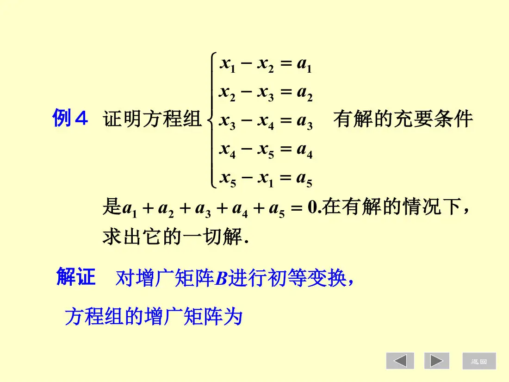

原文：

例4 证明方程组 $\left\{ \begin{array}{l} x_{1} - x_{2} = a_{1} \\ x_{2} - x_{3} = a_{2} \\ x_{3} - x_{4} = a_{3} \\ x_{4} - x_{5} = a_{4} \\ x_{5} - x_{1} = a_{5} \end{array} \right.$ 有解的充要条件是 $a_{1} + a_{2} + a_{3} + a_{4} + a_{5} = 0$ . 在有解的情况下，求出它的一切解.

解证 对增广矩阵B进行初等变换，
方程组的增广矩阵为

◀ ▶

返回

### $$

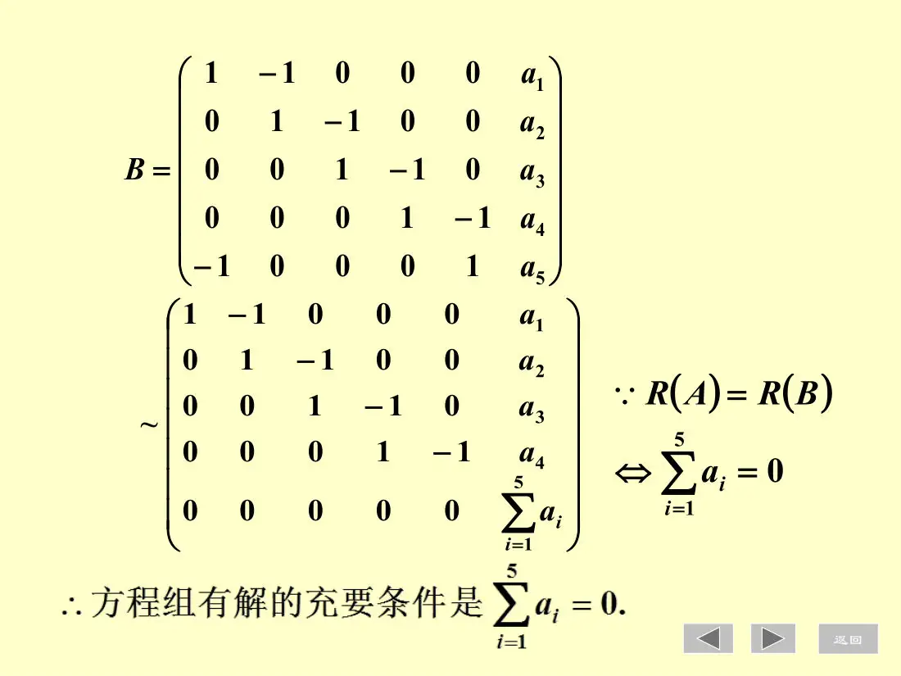

原文：

$$
B = \left( \begin{array}{c c c c c c} 1 & - 1 & 0 & 0 & 0 & a _ {1} \\ 0 & 1 & - 1 & 0 & 0 & a _ {2} \\ 0 & 0 & 1 & - 1 & 0 & a _ {3} \\ 0 & 0 & 0 & 1 & - 1 & a _ {4} \\ - 1 & 0 & 0 & 0 & 1 & a _ {5} \end{array} \right)
$$

$$
\sim \left( \begin{array}{c c c c c c} 1 & - 1 & 0 & 0 & 0 & a _ {1} \\ 0 & 1 & - 1 & 0 & 0 & a _ {2} \\ 0 & 0 & 1 & - 1 & 0 & a _ {3} \\ 0 & 0 & 0 & 1 & - 1 & a _ {4} \\ 0 & 0 & 0 & 0 & 0 & \sum_ {i = 1} ^ {5} a _ {i} \end{array} \right) \quad \because R (A) = R (B) \Leftrightarrow \sum_ {i = 1} ^ {5} a _ {i} = 0
$$

∴方程组有解的充要条件是 $\sum_{i=1}^{5}a_{i}=0$ .

◀ ▶

返回

### 由于原方程组等价于方程组

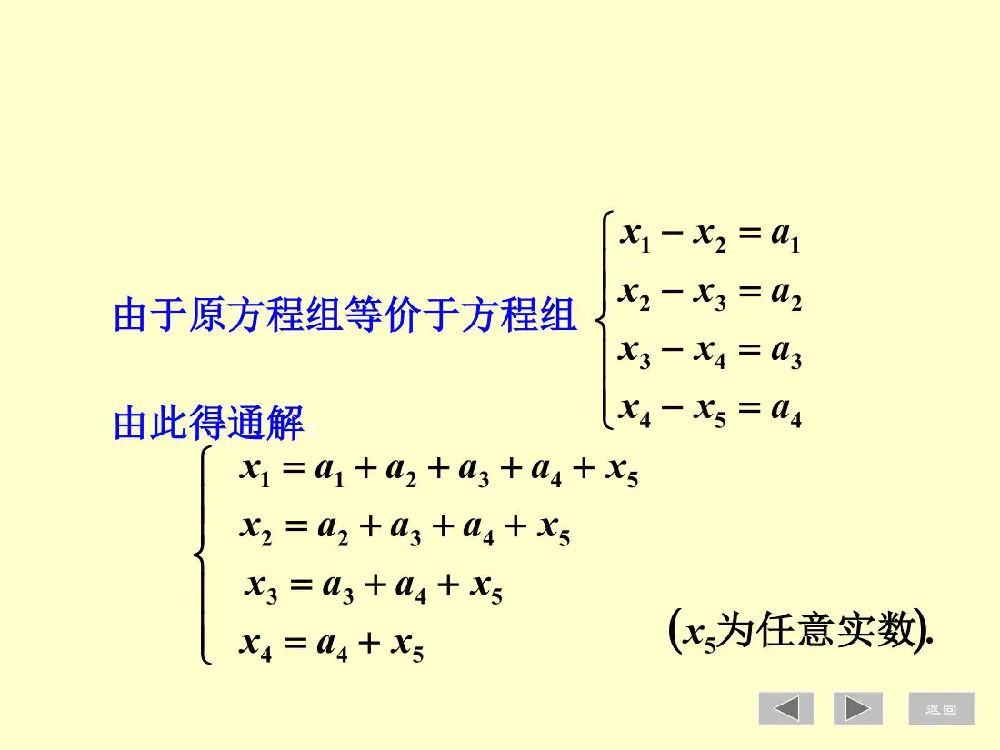

原文：

由于原方程组等价于方程组

由此得通解

$$
\left\{ \begin{array}{l l} x _ {1} = a _ {1} + a _ {2} + a _ {3} + a _ {4} + x _ {5} \\ x _ {2} = a _ {2} + a _ {3} + a _ {4} + x _ {5} \\ x _ {3} = a _ {3} + a _ {4} + x _ {5} \\ x _ {4} = a _ {4} + x _ {5} \end{array} \right.
$$

$$
\left\{ \begin{array}{l} x _ {1} - x _ {2} = a _ {1} \\ x _ {2} - x _ {3} = a _ {2} \\ x _ {3} - x _ {4} = a _ {3} \\ x _ {4} - x _ {5} = a _ {4} \end{array} \right.
$$

$(x_{5}$ 为任意实数).

◀ ▶

返回

### 例4 解齐次方程组

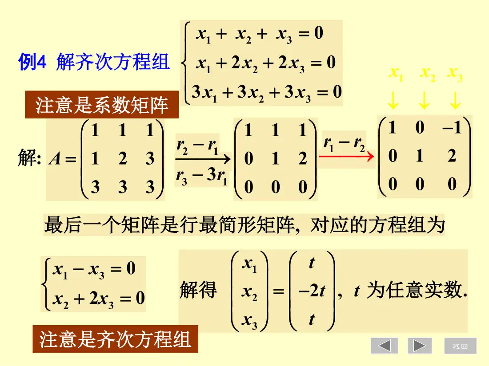

原文：

例4 解齐次方程组

注意是系数矩阵

$$
\left\{ \begin{array}{l} x _ {1} + x _ {2} + x _ {3} = 0 \\ x _ {1} + 2 x _ {2} + 2 x _ {3} = 0 \\ 3 x _ {1} + 3 x _ {2} + 3 x _ {3} = 0 \end{array} \right.
$$

$$
\begin{array}{c c c} x _ {1} & x _ {2} & x _ {3} \\ \downarrow & \downarrow & \downarrow \end{array}
$$

解:

$$
A = \left( \begin{array}{c c c} 1 & 1 & 1 \\ 1 & 2 & 3 \\ 3 & 3 & 3 \end{array} \right) \xrightarrow {r _ {2} - r _ {1}} \left( \begin{array}{c c c} 1 & 1 & 1 \\ 0 & 1 & 2 \\ 0 & 0 & 0 \end{array} \right) \xrightarrow {r _ {1} - r _ {2}} \left( \begin{array}{c c c} 1 & 0 & - 1 \\ 0 & 1 & 2 \\ 0 & 0 & 0 \end{array} \right)
$$

最后一个矩阵是行最简形矩阵，对应的方程组为

$$
\left\{ \begin{array}{l} x _ {1} - x _ {3} = 0 \\ x _ {2} + 2 x _ {3} = 0 \end{array} \right.
$$

解得 $\begin{pmatrix} x_{1} \\ x_{2} \\ x_{3} \end{pmatrix} = \begin{pmatrix} t \\ -2t \\ t \end{pmatrix}$ ，t 为任意实数.

注意是齐次方程组

◀ ▶

返回

### 例5 利用矩阵初等行变换确定 $\lambda$ 取何值时,线性方程组

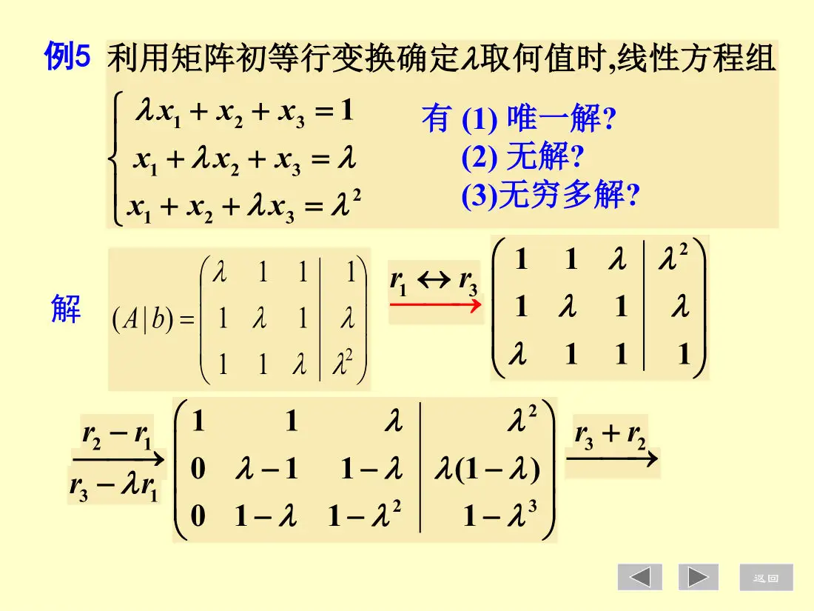

原文：

例5 利用矩阵初等行变换确定 $\lambda$ 取何值时,线性方程组

$$
\left\{ \begin{array}{l} \lambda x _ {1} + x _ {2} + x _ {3} = 1 \\ x _ {1} + \lambda x _ {2} + x _ {3} = \lambda \\ x _ {1} + x _ {2} + \lambda x _ {3} = \lambda^ {2} \end{array} \right.
$$

有 (1) 唯一解?

(2) 无解?

(3)无穷多解?

解

$$
(A \mid b) = \left( \begin{array}{c c c c} \lambda & 1 & 1 & 1 \\ 1 & \lambda & 1 & \lambda \\ 1 & 1 & \lambda & \lambda^ {2} \end{array} \right) \xrightarrow {r _ {1} \leftrightarrow r _ {3}} \left( \begin{array}{c c c c} \mathbf {1} & \mathbf {1} & \boldsymbol {\lambda} & \boldsymbol {\lambda} ^ {2} \\ \mathbf {1} & \boldsymbol {\lambda} & \mathbf {1} & \boldsymbol {\lambda} \\ \boldsymbol {\lambda} & \mathbf {1} & \mathbf {1} & \mathbf {1} \end{array} \right)
$$

$$
\xrightarrow [ r _ {3} - \lambda r _ {1} ]{r _ {2} - r _ {1}} \left( \begin{array}{c c c c} 1 & 1 & \lambda & \lambda^ {2} \\ 0 & \lambda - 1 & 1 - \lambda & \lambda (1 - \lambda) \\ 0 & 1 - \lambda & 1 - \lambda^ {2} & 1 - \lambda^ {3} \end{array} \right) \xrightarrow {r _ {3} + r _ {2}}
$$

◀ ▶

返回

### $$

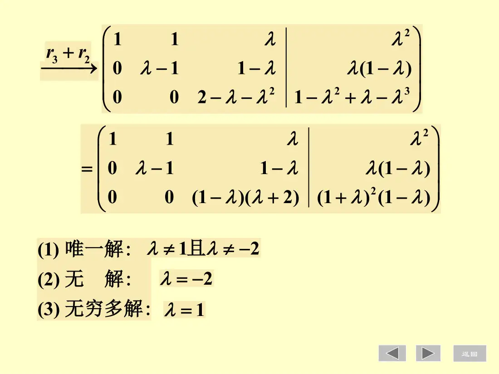

原文：

$$
\xrightarrow {r _ {3} + r _ {2}} \left( \begin{array}{c c c c c} 1 & 1 & \lambda & & \lambda^ {2} \\ 0 & \lambda - 1 & 1 - \lambda & & \lambda (1 - \lambda) \\ 0 & 0 & 2 - \lambda - \lambda^ {2} & 1 - \lambda^ {2} + \lambda - \lambda^ {3} \end{array} \right)
$$

$$
= \left( \begin{array}{c c c c} 1 & 1 & \lambda & \lambda^ {2} \\ 0 & \lambda - 1 & 1 - \lambda & \lambda (1 - \lambda) \\ 0 & 0 & (1 - \lambda) (\lambda + 2) & (1 + \lambda) ^ {2} (1 - \lambda) \end{array} \right)
$$

(1) 唯一解: $\lambda \neq 1$ 且 $\lambda \neq -2$

(2) 无解: $\lambda = -2$

(3)无穷多解: $\lambda = 1$

◀ ▶

返回

### 例 解

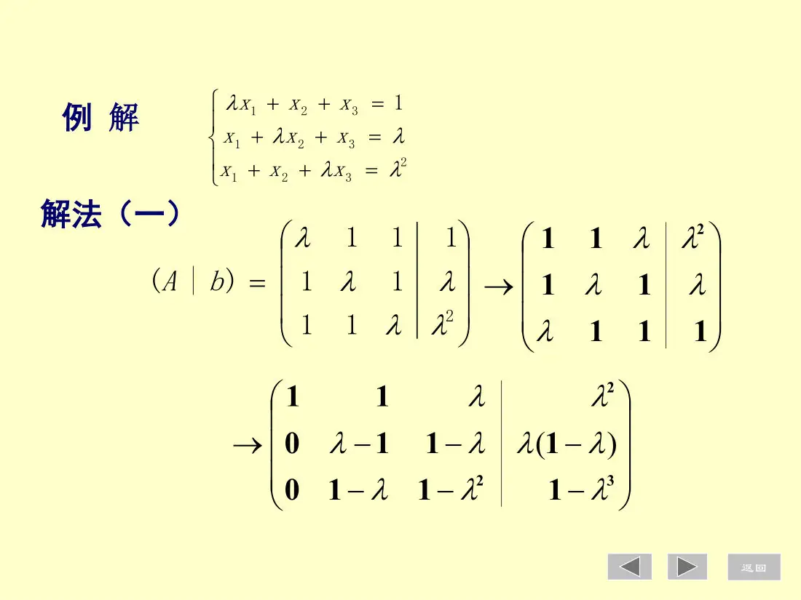

原文：

例 解

解法（一）

$$
\left\{ \begin{array}{l} \lambda x _ {1} + x _ {2} + x _ {3} = 1 \\ x _ {1} + \lambda x _ {2} + x _ {3} = \lambda \\ x _ {1} + x _ {2} + \lambda x _ {3} = \lambda^ {2} \end{array} \right.
$$

$$
b) = \left(\begin{array}{c c c c}\lambda&1&1&1\\1&\lambda&1&\lambda\\1&1&\lambda&\lambda^ {2}\end{array}\right)\rightarrow \left(\begin{array}{c c c c}\mathbf {1}&\mathbf {1}&\lambda&\lambda^ {2}\\\mathbf {1}&\lambda&\mathbf {1}&\lambda\\\lambda&\mathbf {1}&\mathbf {1}&\mathbf {1}\end{array}\right)
$$

$$
\rightarrow \left(\begin{array}{c c c c}\mathbf {1}&\mathbf {1}&\lambda&\lambda^ {2}\\\mathbf {0}&\lambda - \mathbf {1}&\mathbf {1} - \lambda&\lambda (\mathbf {1} - \lambda)\\\mathbf {0}&\mathbf {1} - \lambda&\mathbf {1} - \lambda^ {2}&\mathbf {1} - \lambda^ {3}\end{array}\right)
$$

◀ ▶

返回

### $$

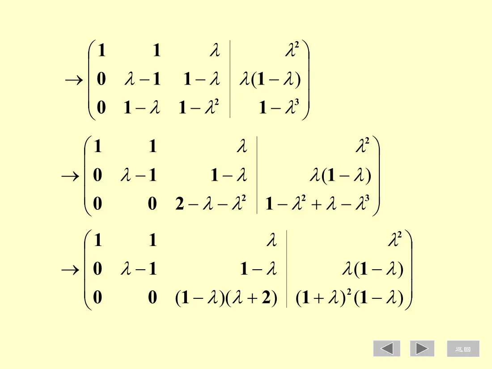

原文：

$$
\rightarrow \left(\begin{array}{c c c c}\mathbf {1}&\mathbf {1}&\lambda&\lambda^ {2}\\\mathbf {0}&\lambda - \mathbf {1}&\mathbf {1} - \lambda&\lambda (\mathbf {1} - \lambda)\\\mathbf {0}&\mathbf {1} - \lambda&\mathbf {1} - \lambda^ {2}&\mathbf {1} - \lambda^ {3}\end{array}\right)
$$

$$
\rightarrow \left(\begin{array}{c c c c}\mathbf {1}&\mathbf {1}&\lambda&\lambda^ {2}\\\mathbf {0}&\lambda - \mathbf {1}&\mathbf {1} - \lambda&\lambda (\mathbf {1} - \lambda)\\\mathbf {0}&\mathbf {0}&\mathbf {2} - \lambda - \lambda^ {2}&\mathbf {1} - \lambda^ {2} + \lambda - \lambda^ {3}\end{array}\right)
$$

$$
\rightarrow \left(\begin{array}{c c c c}\mathbf {1}&\mathbf {1}&\lambda&\lambda^ {2}\\\mathbf {0}&\lambda - \mathbf {1}&\mathbf {1} - \lambda&\lambda (\mathbf {1} - \lambda)\\\mathbf {0}&\mathbf {0}&(\mathbf {1} - \lambda) (\lambda + \mathbf {2})&(\mathbf {1} + \lambda) ^ {2} (\mathbf {1} - \lambda)\end{array}\right)
$$

◀ ▶

返回

### 原方程组的解为:

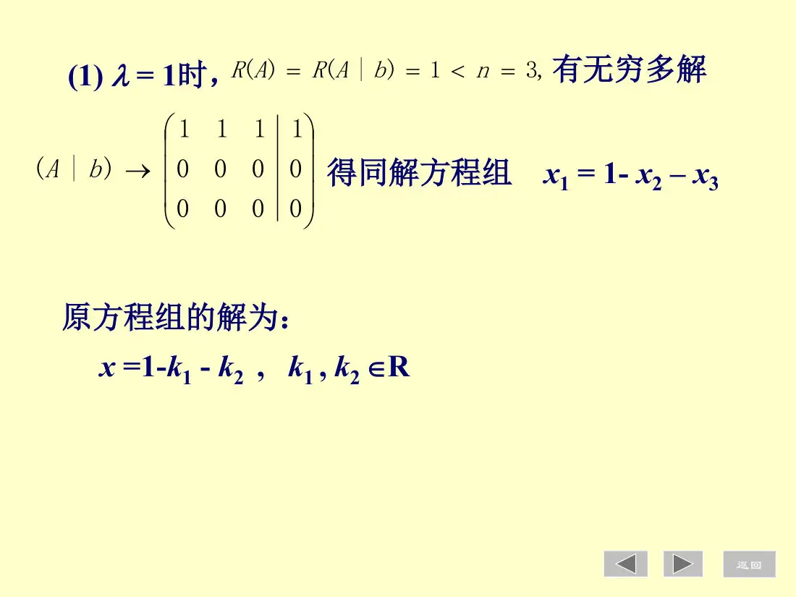

原文：

(1) $\lambda = 1$ 时， $R(A) = R(A \mid b) = 1 < n = 3$ , 有无穷多解 $(A \mid b) \to \begin{pmatrix} 1 & 1 & 1 & 1 \\ 0 & 0 & 0 & 0 \\ 0 & 0 & 0 & 0 \end{pmatrix}$ 得同解方程组 $x_1 = 1 - x_2 - x_3$

原方程组的解为:

$$
x = 1 - k _ {1} - k _ {2}, \quad k _ {1}, k _ {2} \in \mathbf {R}
$$

◀ ▶

返回

### $$

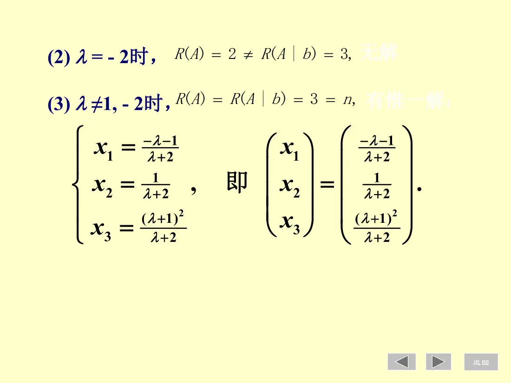

原文：

(2) $\lambda = -2$ 时， $R(A) = 2 \neq R(A \mid b) = 3,$ 无解

(3) $\lambda \neq 1, -2$ 时， $R(A) = R(A \mid b) = 3 = n$ ，有惟一解：

$$
\left\{ \begin{array}{l} x _ {1} = \frac {- \lambda - 1}{\lambda + 2} \\ x _ {2} = \frac {1}{\lambda + 2} \\ x _ {3} = \frac {(\lambda + 1) ^ {2}}{\lambda + 2} \end{array} \right.,
$$

即

$$
\left( \begin{array}{c} x _ {1} \\ x _ {2} \\ x _ {3} \end{array} \right) = \left( \begin{array}{c} \frac {- \lambda - 1}{\lambda + 2} \\ \frac {1}{\lambda + 2} \\ \frac {(\lambda + 1) ^ {2}}{\lambda + 2} \end{array} \right).
$$

◀ ▶

返回

### 例解

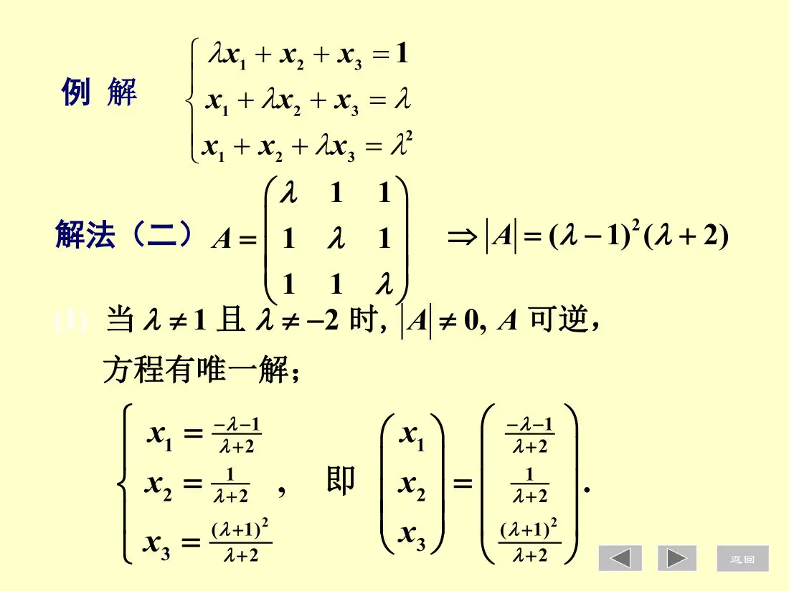

原文：

例解

$$
\left\{ \begin{array}{l} \lambda \boldsymbol {x} _ {1} + \boldsymbol {x} _ {2} + \boldsymbol {x} _ {3} = \mathbf {1} \\ \boldsymbol {x} _ {1} + \lambda \boldsymbol {x} _ {2} + \boldsymbol {x} _ {3} = \lambda \\ \boldsymbol {x} _ {1} + \boldsymbol {x} _ {2} + \lambda \boldsymbol {x} _ {3} = \lambda^ {2} \end{array} \right.
$$

解法（二） $A = \begin{pmatrix} \lambda & 1 & 1\\ 1 & \lambda & 1\\ 1 & 1 & \lambda \end{pmatrix}\Rightarrow |A| = (\lambda -1)^2 (\lambda +2)$

(1) 当 $\lambda \neq 1$ 且 $\lambda \neq -2$ 时, $|A| \neq 0$ , A 可逆, 方程有唯一解;

$$
\left\{ \begin{array}{l} x _ {1} = \frac {- \lambda - 1}{\lambda + 2} \\ x _ {2} = \frac {1}{\lambda + 2} \\ x _ {3} = \frac {(\lambda + 1) ^ {2}}{\lambda + 2} \end{array} \right.,
$$

即

$$
\left( \begin{array}{c} x _ {1} \\ x _ {2} \\ x _ {3} \end{array} \right) = \left( \begin{array}{c} \frac {- \lambda - 1}{\lambda + 2} \\ \frac {1}{\lambda + 2} \\ \frac {(\lambda + 1) ^ {2}}{\lambda + 2} \end{array} \right).
$$

返回

### 得同解方程组： $x_{1} = 1 - x_{2} - x_{3}$

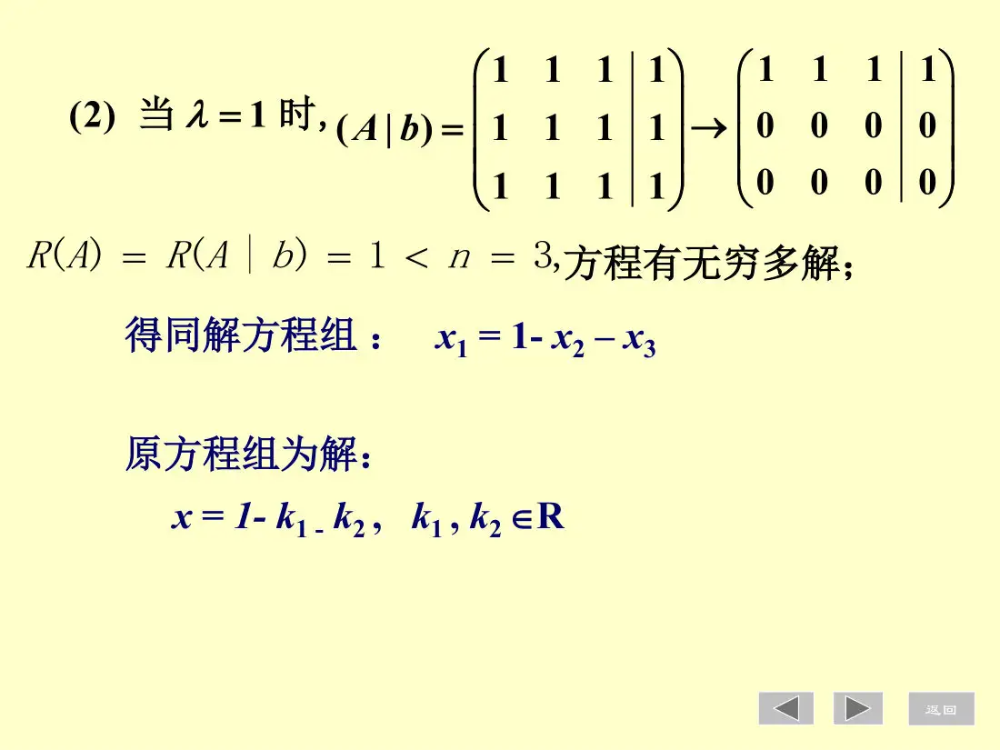

原文：

(2) 当 $\lambda = 1$ 时, $(A \mid b) = \begin{pmatrix} 1 & 1 & 1 & 1 \\ 1 & 1 & 1 & 1 \\ 1 & 1 & 1 & 1 \end{pmatrix} \to \begin{pmatrix} 1 & 1 & 1 & 1 \\ 0 & 0 & 0 & 0 \\ 0 & 0 & 0 & 0 \end{pmatrix}$

$R(A) = R(A \mid b) = 1 < n = 3$ , 方程有无穷多解;

得同解方程组： $x_{1} = 1 - x_{2} - x_{3}$

原方程组为解:

$$
x = 1 - k _ {1} - k _ {2}, \quad k _ {1}, k _ {2} \in \mathbf {R}
$$

◀ ▶

返回

### (3) 当 $\lambda = -2$ 时,

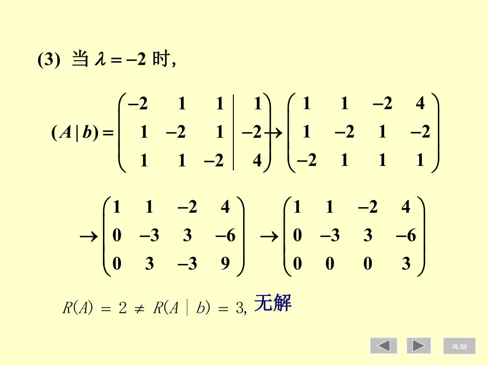

原文：

(3) 当 $\lambda = -2$ 时,

$$
(A \mid b) = \left(\begin{array}{c c c c}- 2&1&1&1\\1&- 2&1&- 2\\1&1&- 2&4\end{array}\right)\rightarrow \left(\begin{array}{c c c c}1&1&- 2&4\\1&- 2&1&- 2\\- 2&1&1&1\end{array}\right)
$$

$$
\rightarrow \left(\begin{array}{c c c c}1&1&- 2&4\\0&- 3&3&- 6\\0&3&- 3&9\end{array}\right)\rightarrow \left(\begin{array}{c c c c}1&1&- 2&4\\0&- 3&3&- 6\\0&0&0&3\end{array}\right)
$$

$R(A) = 2 \neq R(A \mid b) = 3,$ 无解

◀ ▶

返回

### 例 求解非齐次方程组的通解

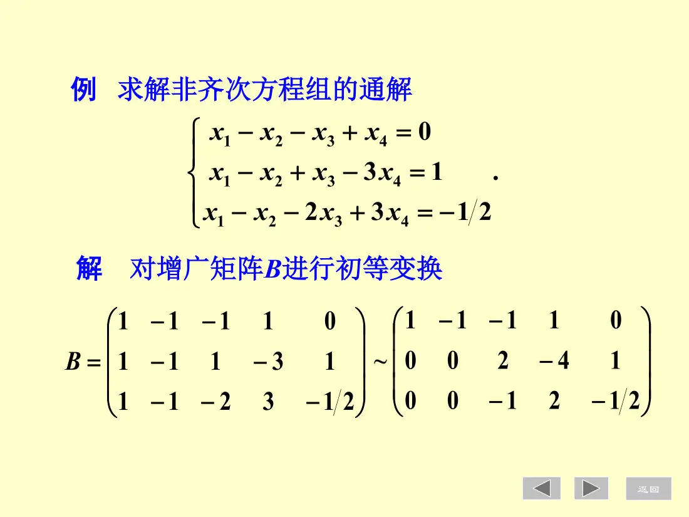

原文：

例 求解非齐次方程组的通解

$$
\left\{ \begin{array}{l} x _ {1} - x _ {2} - x _ {3} + x _ {4} = 0 \\ x _ {1} - x _ {2} + x _ {3} - 3 x _ {4} = 1 \\ x _ {1} - x _ {2} - 2 x _ {3} + 3 x _ {4} = - 1 / 2 \end{array} . \right.
$$

解 对增广矩阵B进行初等变换

$$
B = \left( \begin{array}{c c c c c} 1 & - 1 & - 1 & 1 & 0 \\ 1 & - 1 & 1 & - 3 & 1 \\ 1 & - 1 & - 2 & 3 & - 1 / 2 \end{array} \right) \sim \left( \begin{array}{c c c c c} 1 & - 1 & - 1 & 1 & 0 \\ 0 & 0 & 2 & - 4 & 1 \\ 0 & 0 & - 1 & 2 & - 1 / 2 \end{array} \right)
$$

返回

◀ ▶

### $$

原文：

$$
\sim \left( \begin{array}{c c c c c} 1 & - 1 & 0 & - 1 & 1 / 2 \\ 0 & 0 & 1 & - 2 & 1 / 2 \\ 0 & 0 & 0 & 0 & 0 \end{array} \right).
$$

由于 $R(A)=R(B)=2$ ，故方程组有解，且有

$$
\left\{ \begin{array}{l} x _ {1} = x _ {2} + x _ {4} + 1 / 2 \\ x _ {3} = 2 x _ {4} + 1 / 2 \end{array} \right. \Leftrightarrow \left\{ \begin{array}{l} x _ {1} = x _ {2} + x _ {4} + 1 / 2 \\ x _ {2} = x _ {2} + 0 x _ {4} \\ x _ {3} = 0 x _ {2} + 2 x _ {4} + 1 / 2 \\ x _ {4} = 0 x _ {2} + x _ {4} \end{array} \right.
$$

◀ ▶

返回

### 所以方程组的通解为

原文：

所以方程组的通解为

$$
\left( \begin{array}{c} x _ {1} \\ x _ {2} \\ x _ {3} \\ x _ {4} \end{array} \right) = x _ {2} \left( \begin{array}{c} 1 \\ 1 \\ 0 \\ 0 \end{array} \right) + x _ {4} \left( \begin{array}{c} 0 \\ 0 \\ 2 \\ 1 \end{array} \right) + \left( \begin{array}{c} 1 / 2 \\ 0 \\ 1 / 2 \\ 0 \end{array} \right).
$$

其中 $x_{2},x_{4}$ 任意.

◀ ▶

返回

### 二、线性方程组的解法

原文：

二、线性方程组的解法

求解线性方程组 Ax = b:

增广矩阵

初等
行变换
从左往右
从上至下
进行消元行阶梯形矩阵

判定
解的情况初等
行变换
从右往左
从下至上
进行消元行最
简形
矩阵

◀ ▶

返回

### 线性方程组的解法

原文：

线性方程组的解法

例1 求解齐次线性方程组

$$
\left\{ \begin{array}{l} x _ {1} + 2 x _ {2} + x _ {3} + x _ {4} = 0 \\ 2 x _ {1} + x _ {2} - 2 x _ {3} - 2 x _ {4} = 0 \\ x _ {1} - x _ {2} - 4 x _ {3} - 3 x _ {4} = 0 \end{array} \right.
$$

解 对系数矩阵 A 施行初等行变换:

$$
A = \left( \begin{array}{c c c c} 1 & 2 & 2 & 1 \\ 2 & 1 & - 2 & - 2 \\ 1 & - 1 & - 4 & - 3 \end{array} \right) \frac {r _ {2} - 2 r _ {1}}{r _ {3} - r _ {1}} \left( \begin{array}{c c c c} 1 & 2 & 2 & 1 \\ 0 & - 3 & - 6 & - 4 \\ 0 & - 3 & - 6 & - 4 \end{array} \right)
$$

上页 下页 返回

### $$

原文：

$$
\underbrace {r _ {3} - r _ {2}} _ {r _ {2} \div (- 3)} \left( \begin{array}{c c c c} 1 & 2 & 2 & 1 \\ 0 & 1 & 2 & \frac {4}{3} \\ 0 & 0 & 0 & 0 \end{array} \right) \quad \underbrace {r _ {1} - 2 r _ {2}} _ {} \left( \begin{array}{c c c c} 1 & 0 & - 2 & - \frac {5}{3} \\ 0 & 1 & 2 & \frac {4}{3} \\ 0 & 0 & 0 & 0 \end{array} \right)
$$

即得与原方程组同解的方程组

$$
\left\{ \begin{array}{l} x _ {1} - 2 x _ {3} - \frac {5}{3} x _ {4} = 0, \\ x _ {2} + 2 x _ {3} + \frac {4}{3} x _ {4} = 0, \end{array} \right.
$$

上页 下页 返回

### 由此即得

原文：

由此即得

$$
\left\{ \begin{array}{l} x _ {1} = 2 x _ {3} + \frac {5}{3} x _ {4}, \\ x _ {2} = - 2 x _ {3} - \frac {4}{3} x _ {4}, \end{array} \right.
$$

$(x_{3},x_{4}$ 可任意取值).

令 $x_{3} = c_{1}, x_{4} = c_{2}$ , 把它写成通常的参数形式

$$
\left\{ \begin{array}{l} x _ {1} = 2 c _ {2} + \frac {5}{3} c _ {2}, \\ x _ {2} = - 2 c _ {2} - \frac {4}{3} c _ {2}, \\ x _ {3} = c _ {1}, \\ x _ {4} = c _ {2}, \end{array} \right. \quad \therefore \quad \left( \begin{array}{c} x _ {1} \\ x _ {2} \\ x _ {3} \\ x _ {4} \end{array} \right) = c _ {1} \left( \begin{array}{c} 2 \\ - 2 \\ 1 \\ 0 \end{array} \right) + c _ {2} \left( \begin{array}{c} \frac {5}{3} \\ - \frac {4}{3} \\ 0 \\ 1 \end{array} \right).
$$

上页 下页 返回

### 例 2 求解非齐次线性方程组

原文：

例 2 求解非齐次线性方程组

$$
\left\{ \begin{array}{l} x _ {1} - 2 x _ {2} + 3 x _ {3} - x _ {4} = 1, \\ 3 x _ {1} - x _ {2} + 5 x _ {3} - 3 x _ {4} = 2, \\ 2 x _ {1} + x _ {2} + 2 x _ {3} - 2 x _ {4} = 3. \end{array} \right.
$$

解 对增广矩阵B进行初等变换，

$$
B = \left( \begin{array}{r r r r r} 1 & - 2 & 3 & - 1 & 1 \\ 3 & - 1 & 5 & - 3 & 2 \\ 2 & 1 & 2 & - 2 & 3 \end{array} \right) \underbrace {r _ {2} - 2 r _ {1}} _ {r _ {3} - r _ {1}} \left( \begin{array}{r r r r r} 1 & - 2 & 3 & - 1 & 1 \\ 0 & 5 & - 4 & 0 & - 1 \\ 0 & \theta & - 0 4 & 0 & \mathbf {2} \end{array} \right)
$$

显然， $R(A)=2, R(B)=3$ ，故方程组无解.

上页 下页 返回

### 例 3 求解非齐次方程组的通解

原文：

例 3 求解非齐次方程组的通解

$$
\left\{ \begin{array}{l} x _ {1} - x _ {2} - x _ {3} + x _ {4} = 0 \\ x _ {1} - x _ {2} + x _ {3} - 3 x _ {4} = 1 \\ x _ {1} - x _ {2} - 2 x _ {3} + 3 x _ {4} = - 1 / 2 \end{array} . \right.
$$

解 对增广矩阵B进行初等变换

$$
B = \left( \begin{array}{r r r r r} 1 & - 1 & - 1 & 1 & 0 \\ 1 & - 1 & 1 & - 3 & 1 \\ 1 & - 1 & - 2 & 3 & - 1 / 2 \end{array} \right) \sim \left( \begin{array}{r r r r r} 1 & - 1 & - 1 & 1 & 0 \\ 0 & 0 & 2 & - 4 & 1 \\ 0 & 0 & - 1 & 2 & - 1 / 2 \end{array} \right)
$$

上页 下页 返回

### $$

原文：

$$
\sim \left( \begin{array}{c c c c c} 1 & - 1 & 0 & - 1 & 1 / 2 \\ 0 & 0 & 1 & - 2 & 1 / 2 \\ 0 & 0 & 0 & 0 & 0 \end{array} \right).
$$

由于 $R(A)=R(B)=2$ ，故方程组有解，且有

$$
\left\{ \begin{array}{l} x _ {1} = x _ {2} + x _ {4} + 1 / 2 \\ x _ {3} = 2 x _ {4} + 1 / 2 \end{array} \right. \Longleftrightarrow \left\{ \begin{array}{l} x _ {1} = x _ {2} + x _ {4} + 1 / 2 \\ x _ {2} = x _ {2} + 0 x _ {4} \\ x _ {3} = 0 x _ {2} + 2 x _ {4} + 1 / 2 \\ x _ {4} = 0 x _ {2} + x _ {4} \end{array} \right.
$$

上页 下页 返回

### 所以方程组的通解为

原文：

所以方程组的通解为

$$
\left( \begin{array}{c} x _ {1} \\ x _ {2} \\ x _ {3} \\ x _ {4} \end{array} \right) = x _ {2} \left( \begin{array}{c} 1 \\ 1 \\ 0 \\ 0 \end{array} \right) + x _ {4} \left( \begin{array}{c} 0 \\ 0 \\ 2 \\ 1 \end{array} \right) + \left( \begin{array}{c} 1 / 2 \\ 0 \\ 1 / 2 \\ 0 \end{array} \right).
$$

其中 $x_{2},x_{4}$ 任意.

上页 下页 返回
