# 《线性代数与解析几何》3.3 平面（课件）

原件的每一页，下面附识别出的文字。

### 3.3 平面

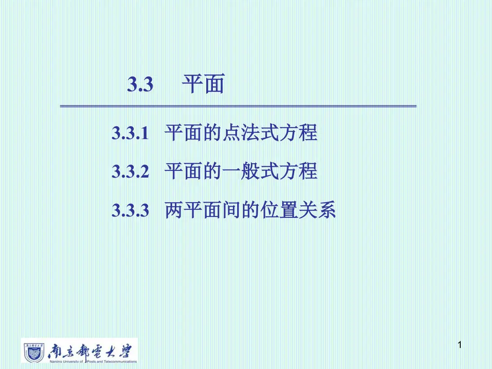

原文：

3.3 平面

3.3.1 平面的点法式方程

3.3.2 平面的一般式方程

3.3.3 两平面间的位置关系

南京郵電大学 Nanjing University of Posts and Telecommunication

1

### 3.3 平面

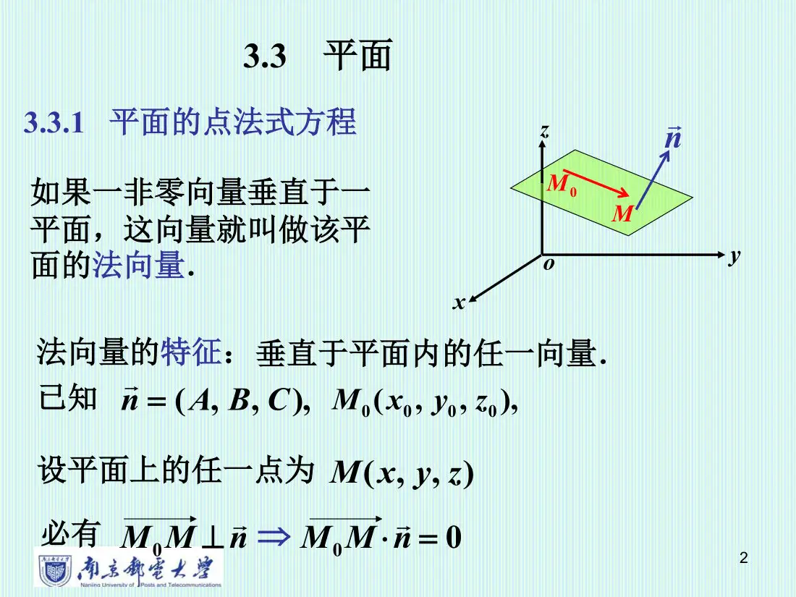

原文：

3.3 平面

3.3.1 平面的点法式方程

如果一非零向量垂直于一平面，这向量就叫做该平面的法向量

法向量的特征：垂直于平面内的任一向量

已知 $\vec { n } = ( A , B , C ) , M _ { 0 } ( x _ { 0 } , y _ { 0 } , z _ { 0 } ) ,$

设平面上的任一点为 $M ( x , y , z )$

必有 $M _ { 0 } \overrightarrow { M } \perp \overrightarrow { n } \implies \overrightarrow { M _ { 0 } M } \cdot \overrightarrow { n } = 0$

南京郵电大学 Nanjing University of Posts and Telecommunications

2

### $$

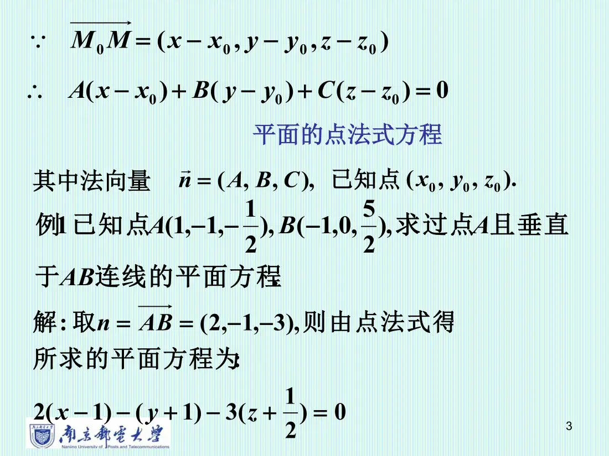

原文：

$$
\because \overrightarrow {M _ {0} M} = (x - x _ {0}, y - y _ {0}, z - z _ {0})
$$

$$
\therefore A (x - x _ {0}) + B (y - y _ {0}) + C (z - z _ {0}) = 0
$$

平面的点法式方程

其中法向量 $\vec { \pmb { n } } = ( A , B , C )$ 已知点 $( x _ { 0 } , y _ { 0 } , z _ { 0 } )$ 例已知点 $A ( 1 , - 1 , - \frac { 1 } { 2 } ) , B ( - 1 , 0 , \frac { 5 } { 2 } )$ 求过点4且垂直于AB连线的平面方程

解：取 $\pmb { n } = \overrightarrow { A B } = ( 2 , - 1 , - 3 )$ 则由点法式得 所求的平面方程为

$$
2 (x - 1) - (y + 1) - 3 (z + \frac {1}{2}) = 0
$$

3

### 例2求过三点A(2,—1,4)、B(—1,3,—2)和

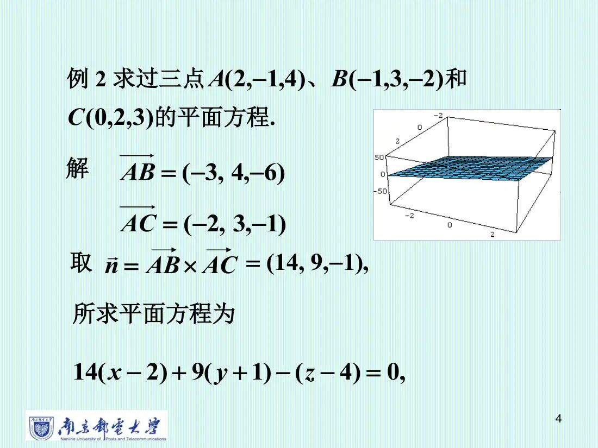

原文：

例2求过三点A(2,—1,4)、B(—1,3,—2)和

C(0,2,3)的平面方程.

解 AB = (—3, 4,—6)

$$
\overrightarrow {A C} = (- 2, 3, - 1)
$$

取 $\overrightarrow { n } = \overrightarrow { A B } \times \overrightarrow { A C } = ( 1 4 , 9 , - 1 ) .$

所求平面方程为

$$
1 4 (x - 2) + 9 (y + 1) - (z - 4) = 0,
$$

南京郵電大学 Nanjing University of Posts and Telecommunications

4

### 3.3.2 平面的一般式方程

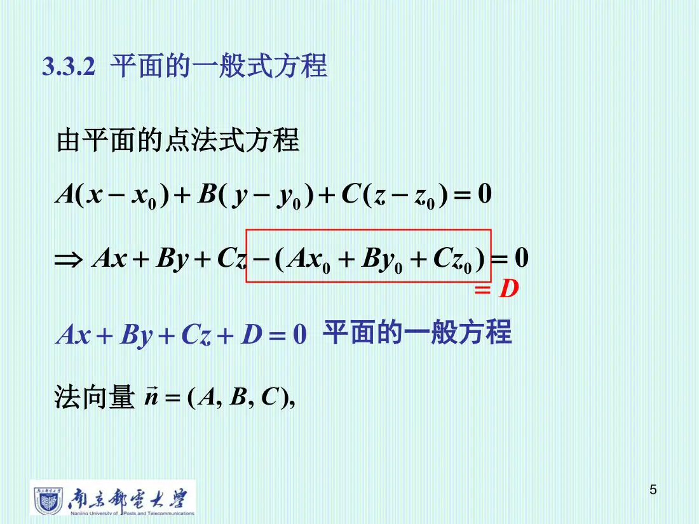

原文：

3.3.2 平面的一般式方程

由平面的点法式方程

$$
\begin{array}{l} A (x - x _ {0}) + B (y - y _ {0}) + C (z - z _ {0}) = 0 \\ \Rightarrow A x + B y + C z - (A x _ {0} + B y _ {0} + C z _ {0}) = 0 \\ \qquad \qquad \qquad \qquad \qquad \qquad \qquad \qquad \qquad \qquad \qquad \qquad \qquad \qquad \qquad \qquad \qquad \qquad \qquad \qquad \qquad \qquad \qquad \qquad \qquad \qquad \qquad \qquad \end{array}
$$

$A x + B y + C z + D = 0$ 平面的一般方程

法向量 $\vec { \pmb { n } } = ( A , B , C )$

南京郵電大学 Nanjing University of Posts and Telecommunications

5

### 平面一般方程的几种特殊情况：

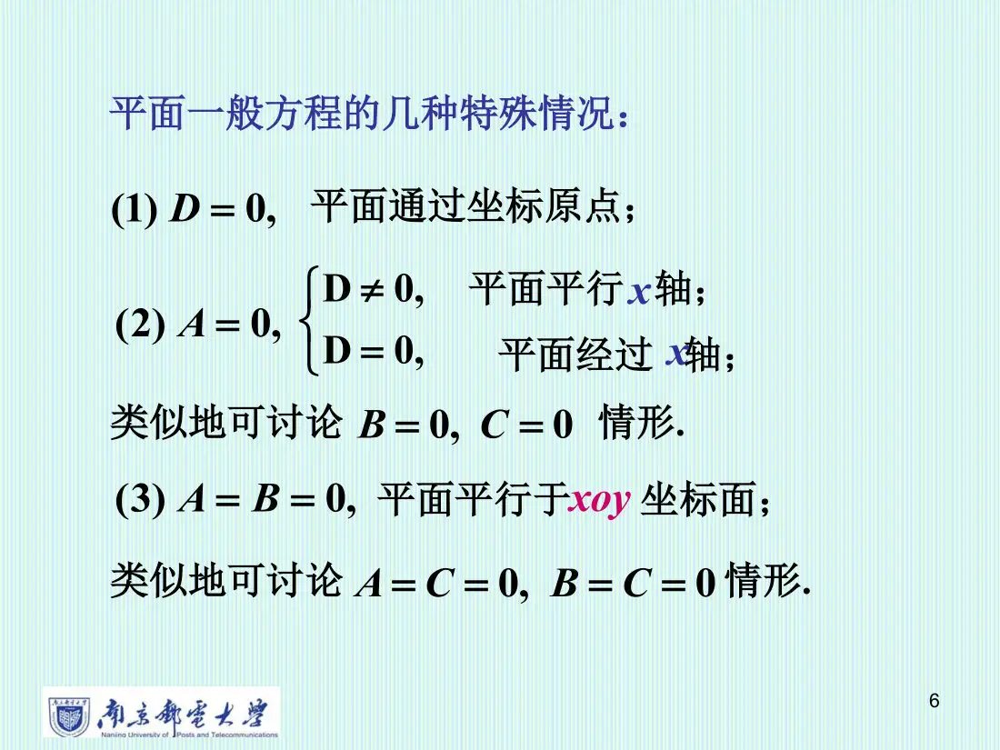

原文：

平面一般方程的几种特殊情况：

平面通过坐标原点；

$A = 0 , \left\{ \begin{array} { l l } { \mathbf { D } \neq \mathbf { 0 } , } \\ { \mathbf { D } = \mathbf { 0 } , } \end{array} \right.$ 平面平行 x轴；(2)平面经过 x轴；

类似地可讨论 $\pmb { { \cal B } } = \mathbf { 0 } , \ \pmb { { \cal C } } = \mathbf { 0 }$ 情形.

(3) $A = B = \mathbf { 0 }$ 平面平行于xoy 坐标面； 类似地可讨论 $\scriptstyle A = C = 0 , \ B = C = 0$ 情形.

南京郵電大学 Nanjing University of Posts and Telecommunications

6

### 第 7 页

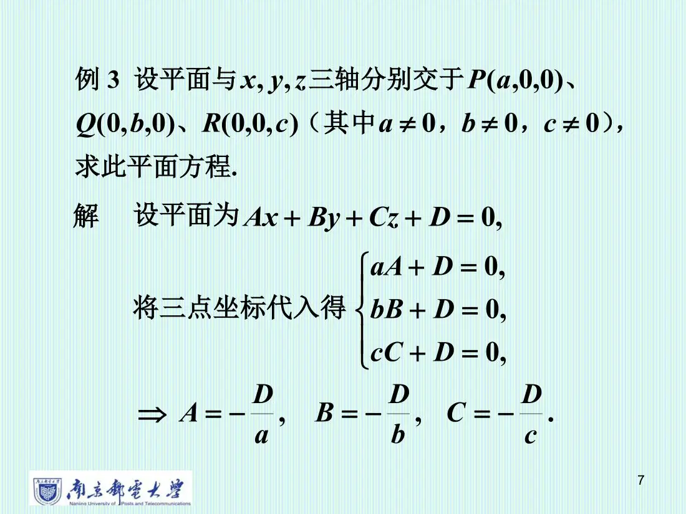

原文：

例3 设平面与x,y,z三轴分别交于 $P ( a , \mathbf { 0 } , \mathbf { 0 } )$ Q(0,b,0)、R(0,0,c)（其中 $a \neq \mathbf { 0 } , b \neq \mathbf { 0 } , c \neq \mathbf { 0 } )$ 求此平面方程.

设平面为解 $\scriptstyle A x + B y + C z + D = 0 ,$

将三点坐标代入得 $\left\{ \begin{array} { l l } { a \mathbf { 1 } + D = \mathbf { 0 } , } \\ { b B + D = \mathbf { 0 } , } \\ { c C + D = \mathbf { 0 } , } \end{array} \right.$ D D D 1 A B = C a 9 b C 将 $A = - { \frac { D } { a } }$ 9 $B = - { \frac { D } { b } }$ 9 $C = - { \frac { D } { c } } ,$ 代入所设方程得

南京郵電大学 Nanjing University of Posts and Telecommunications

7

### 第 8 页

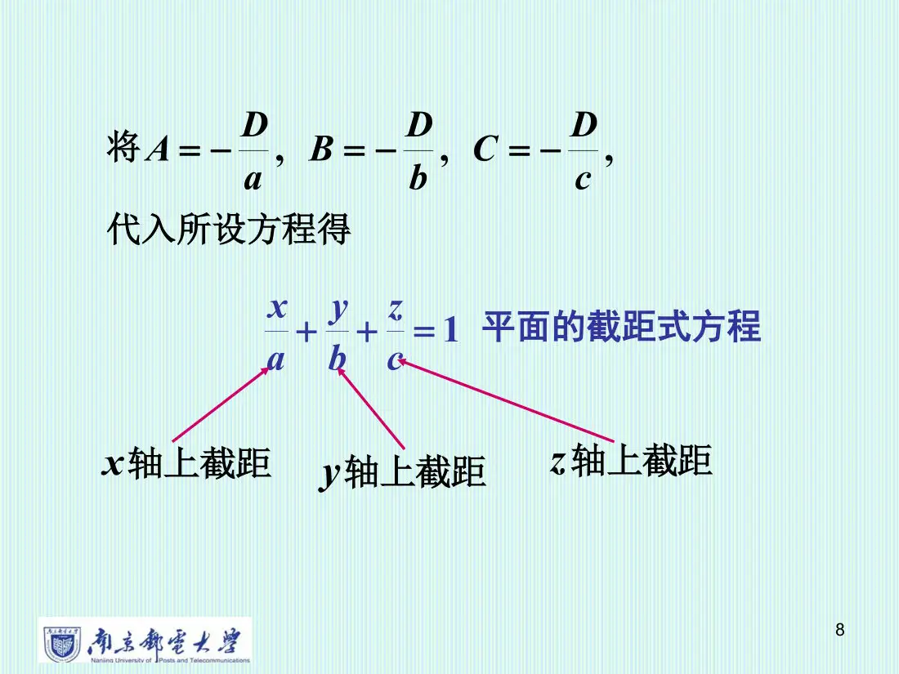

原文：

$\frac { x } { a } + \frac { y } { b } + \frac { z } { c } = 1$ 平面的截距式方程x轴上截距 ν轴上截距 z轴上截距例4.求平行于xoz面且经过点A(2,-5,3)的平面.

南京郵電大学 Nanjing University of Posts and Telecommunications

8

### 解：设平面的方程为： $B y + D = 0$

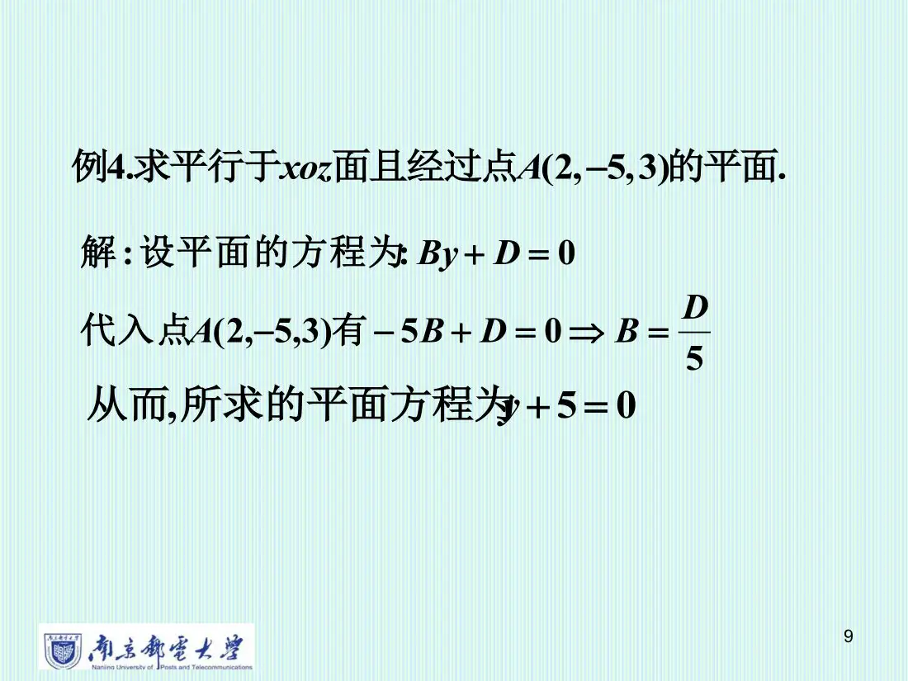

原文：

解：设平面的方程为： $B y + D = 0$

代入点A(2,—5,3)有 $- 5 B + D = 0 \Rightarrow B = \frac { D } { 5 }$

从而,所求的平面方程为 ${ \bf + 5 = 0 }$

南京郵電大学 Nanjing University of Posts and Telecommunications

9

### 3.3.3 两平面间的位置关系

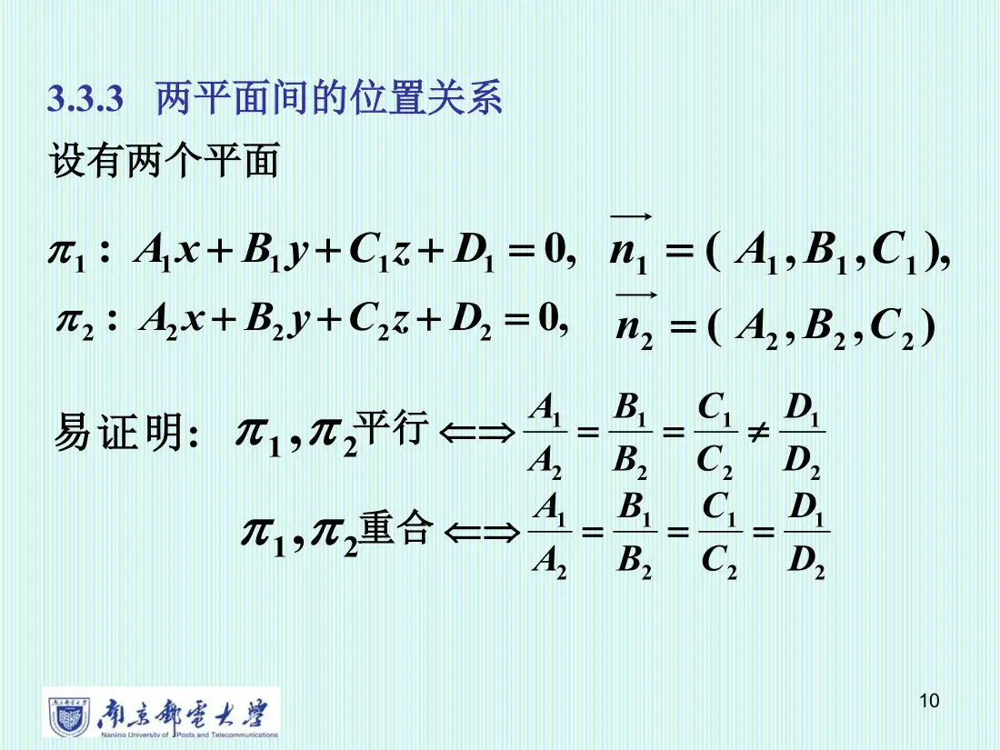

原文：

3.3.3 两平面间的位置关系

设有两个平面

$$
\begin{array}{l} \pi_ {1}: A _ {1} x + B _ {1} y + C _ {1} z + D _ {1} = 0, \quad \overrightarrow {n _ {1}} = (A _ {1}, B _ {1}, C _ {1}), \\ \pi_ {2}: A _ {2} x + B _ {2} y + C _ {2} z + D _ {2} = 0, \quad \overrightarrow {n _ {2}} = (A _ {2}, B _ {2}, C _ {2}) \end{array}
$$

易证明： $\pi _ { 1 } , \pi _ { 2 }$ 平行 $\Longleftrightarrow \frac { A _ { 1 } } { A _ { 2 } } = \frac { B _ { 1 } } { B _ { 2 } } = \frac { C _ { 1 } } { C _ { 2 } } \neq \frac { D _ { 1 } } { D _ { 2 } }$

$\pi _ { 1 } , \pi _ { 2 }$ 重合 $\Longleftrightarrow \frac { A _ { 1 } } { A _ { 2 } } = \frac { B _ { 1 } } { B _ { 2 } } = \frac { C _ { 1 } } { C _ { 2 } } = \frac { D _ { 1 } } { D _ { 2 } }$ 两平面法向量之间的夹角称为两平面的夹角.（通常取锐角）

南京郵電大学 Nanjing University of Posts and Telecommunications

10

### 按照两向量夹角余弦公式有

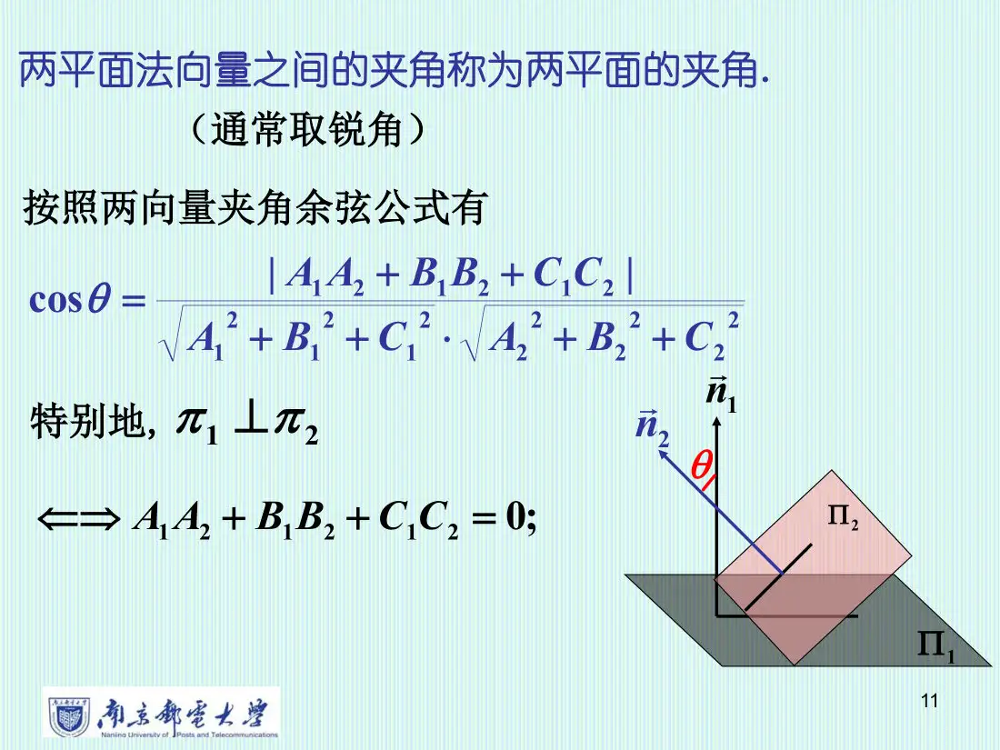

原文：

按照两向量夹角余弦公式有

$$
\cos \theta = \frac {\left| A _ {1} A _ {2} + B _ {1} B _ {2} + C _ {1} C _ {2} \right|}{\sqrt {A _ {1} ^ {2} + B _ {1} ^ {2} + C _ {1} ^ {2}} \cdot \sqrt {A _ {2} ^ {2} + B _ {2} ^ {2} + C _ {2} ^ {2}}}
$$

特别地, $\pi _ { 1 } \perp \pi _ { 2 }$

$$
\Longleftrightarrow A _ {1} A _ {2} + B _ {1} B _ {2} + C _ {1} C _ {2} = 0;
$$

南京郵電大学 Nanjing University of Posts and Telecommunications

11

### 例5 求下面两个平面的夹角

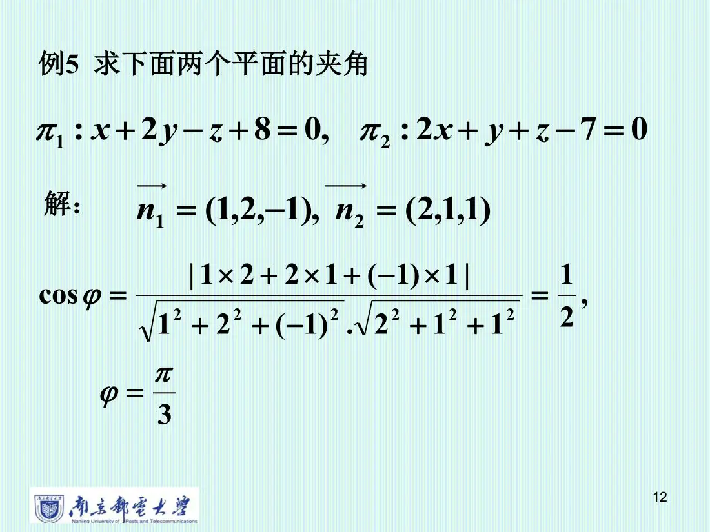

原文：

例5 求下面两个平面的夹角

$$
\pi_ {1}: x + 2 y - z + 8 = 0, \quad \pi_ {2}: 2 x + y + z - 7 = 0
$$

解： $\overrightarrow { n _ { 1 } } = ( 1 , 2 , - 1 ) , \overrightarrow { n _ { 2 } } = ( 2 , 1 , 1 )$

$$
\begin{array}{c} \cos \varphi = \frac {| 1 \times 2 + 2 \times 1 + (- 1) \times 1 |}{\sqrt {1 ^ {2} + 2 ^ {2} + (- 1) ^ {2}} . \sqrt {2 ^ {2} + 1 ^ {2} + 1 ^ {2}}} = \frac {1}{2}, \\ \varphi = \frac {\pi}{3} \end{array}
$$

南京郵電大学 Nanjing University of Posts and Telecommunications

12

### 13

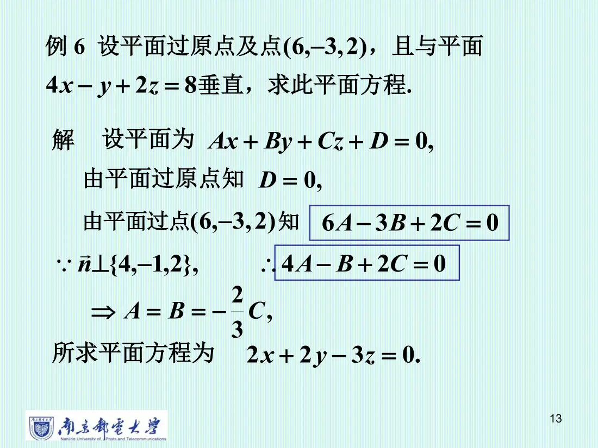

原文：

例6 设平面过原点及点(6,-3,2)，且与平面$4 x - y + 2 z = 8$ 垂直，求此平面方程.

解 设平面为 $\scriptstyle A x + B y + C z + D = 0 ,$ 由平面过原点知 ${ \pmb { D } } = { \bf 0 } .$ 由平面过点(6,-3,2)知 $6 A - 3 B + 2 C = bf { 0 }$ $\because n \bot \{ 4 , - 1 , 2 \}$ $\cdot \vert 4 A - B + 2 C = 0$ $\Rightarrow A = B = - \frac { 2 } { 3 } C$ 所求平面方程为 $2 x + 2 y - 3 z = 0 .$

南京郵電大学 Nanjing University of Posts and Telecommunications

13

### $$

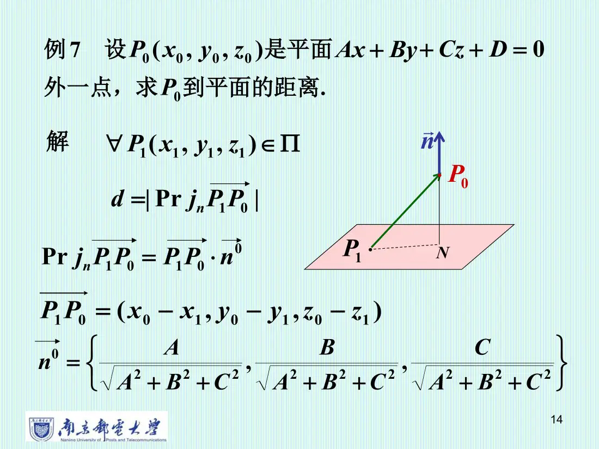

原文：

例7设 $P _ { 0 } ( x _ { 0 } , y _ { 0 } , z _ { 0 } )$ 是平面 $A x + B y + C z + D = 0$ 外一点，求 $P _ { 0 }$ 到平面的距离.

解 $\forall P _ { 1 } ( x _ { 1 } , y _ { 1 } , z _ { 1 } ) \in \Pi$

$$
d = | \operatorname * {P r} j _ {n} \overrightarrow {P _ {1} P _ {0}} |
$$

$$
\operatorname * {P r} j _ {n} \overrightarrow {P _ {1} P _ {0}} = \overrightarrow {P _ {1} P _ {0}} \cdot \overrightarrow {n ^ {0}}
$$

$$
\overrightarrow {P _ {1} P _ {0}} = (x _ {0} - x _ {1}, y _ {0} - y _ {1}, z _ {0} - z _ {1})
$$

$$
\overrightarrow {n ^ {0}} = \left\{\frac {A}{\sqrt {A ^ {2} + B ^ {2} + C ^ {2}}}, \frac {B}{\sqrt {A ^ {2} + B ^ {2} + C ^ {2}}}, \frac {C}{\sqrt {A ^ {2} + B ^ {2} + C ^ {2}}} \right\}
$$

南京郵電大学 Nanjing University of Posts and Telecommunications

14

### $$

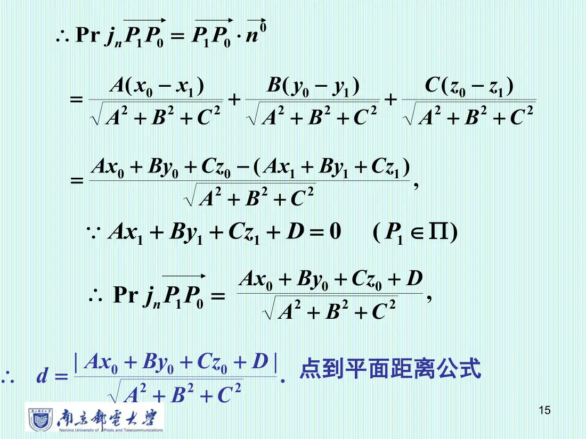

原文：

$$
\begin{array}{r l} & {\therefore \operatorname * {P r} j _ {n} \overrightarrow {P _ {1} P _ {0}} = \overrightarrow {P _ {1} P _ {0}} \cdot \overrightarrow {n ^ {0}}} \\ & {\qquad = \frac {A (x _ {0} - x _ {1})}{\sqrt {A ^ {2} + B ^ {2} + C ^ {2}}} + \frac {B (y _ {0} - y _ {1})}{\sqrt {A ^ {2} + B ^ {2} + C ^ {2}}} + \frac {C (z _ {0} - z _ {1})}{\sqrt {A ^ {2} + B ^ {2} + C ^ {2}}}} \\ & {\qquad = \frac {A x _ {0} + B y _ {0} + C z _ {0} - (A x _ {1} + B y _ {1} + C z _ {1})}{\sqrt {A ^ {2} + B ^ {2} + C ^ {2}}},} \\ & {\qquad \because A x _ {1} + B y _ {1} + C z _ {1} + D = 0 \qquad (P _ {1} \in \Pi)} \\ & {\qquad \therefore \operatorname * {P r} j _ {n} \overrightarrow {P _ {1} P _ {0}} = \frac {A x _ {0} + B y _ {0} + C z _ {0} + D}{\sqrt {A ^ {2} + B ^ {2} + C ^ {2}}},} \end{array}
$$

$d = { \frac { \left| \mathbf { \nabla } { \boldsymbol { A } } { \boldsymbol { x _ { 0 } } } + { \boldsymbol { B } } { \boldsymbol { y _ { 0 } } } + { \boldsymbol { C } } { \boldsymbol { z _ { 0 } } } + { \boldsymbol { D } } \right| } { \sqrt { \mathbf { \nabla } { \boldsymbol { A } } ^ { 2 } + { \boldsymbol { B } } ^ { 2 } + { \boldsymbol { C } } ^ { 2 } } } }$ 点到平面距离公式

南京郵電大学 Nanjing University of Posts and Telecommunications

15
