# 《线性代数与解析几何》3.5 曲面与空间曲线（课件）

原件的每一页，下面附识别出的文字。

### $$

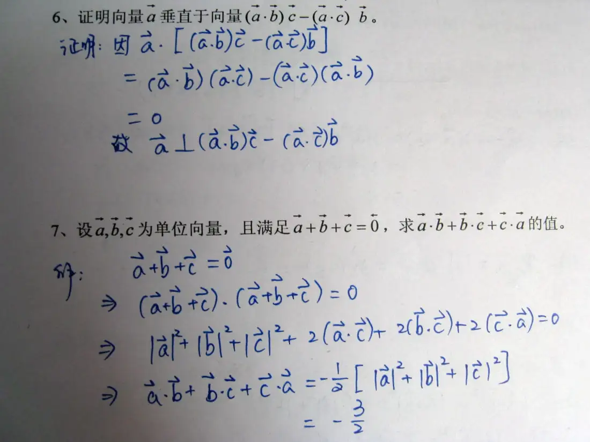

原文：

6、证明向量 $\vec{a}$ 垂直于向量 $(\vec{a}\cdot\vec{b})\vec{c}-(\vec{a}\cdot\vec{c})\vec{b}$ 。

$$
\begin{array}{r l} {\mathrm{证明:因} \vec {a} \cdot [ (\vec {a} \cdot \vec {b}) \vec {c} - (\vec {a} \cdot \vec {c}) \vec {b} ]} \\ & {= (\vec {a} \cdot \vec {b}) (\vec {a} \cdot \vec {c}) - (\vec {a} \cdot \vec {c}) (\vec {a} \cdot \vec {b})} \\ & {= 0} \\ {\mathrm{故} \vec {a} \perp (\vec {a} \cdot \vec {b}) \vec {c} - (\vec {a} \cdot \vec {c}) \vec {b}} \end{array}
$$

7、设 $\vec{a},\vec{b},\vec{c}$ 为单位向量，且满足 $\vec{a}+\vec{b}+\vec{c}=\vec{0}$ ，求 $\vec{a}\cdot\vec{b}+\vec{b}\cdot\vec{c}+\vec{c}\cdot\vec{a}$ 的值。

$$
\begin{array}{r l} {\mathrm{解:}} & {\vec {a} + \vec {b} + \vec {c} = \vec {0}} \\ & {\Rightarrow (\vec {a} + \vec {b} + \vec {c}) \cdot (\vec {a} + \vec {b} + \vec {c}) = 0} \\ & {\Rightarrow | \vec {a} | ^ {2} + | \vec {b} | ^ {2} + | \vec {c} | ^ {2} + 2 (\vec {a} \cdot \vec {c}) + 2 (\vec {b} \cdot \vec {c}) + 2 (\vec {c} \cdot \vec {a}) = 0} \\ & {\Rightarrow \vec {a} \cdot \vec {b} + \vec {b} \cdot \vec {c} + \vec {c} \cdot \vec {a} = - \frac {1}{2} [ | \vec {a} | ^ {2} + | \vec {b} | ^ {2} + | \vec {c} | ^ {2} ]} \\ & {\qquad = - \frac {3}{2}} \end{array}
$$

### 第 2 页

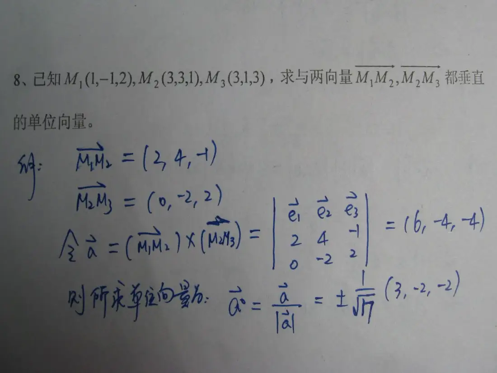

原文：

8、已知 $M_{1}(1, - 1,2),M_{2}(3,3,1),M_{3}(3,1,3)$ ，求与两向量 $\overrightarrow{M_1M_2},\overrightarrow{M_2M_3}$ 都垂直的单位向量。

$\text{设}:\quad \begin{array}{r}\overrightarrow{M_{1}M_{2}}=(2,4,-1)\\\overrightarrow{M_{2}M_{3}}=(0,-2,2)\\\text{令}\overrightarrow{a}=(\overrightarrow{M_{1}M_{2}})\times(\overrightarrow{M_{2}M_{3})}=\begin{vmatrix}\overrightarrow{e_{1}}&\overrightarrow{e_{2}}&\overrightarrow{e_{3}}\\2&4&-1\\0&-2&2\end{vmatrix}=(6,-4,-4)\\\text{则所求单位向量为:}\quad\overrightarrow{a^{0}}=\frac{\overrightarrow{a}}{|\overrightarrow{a}|}=\pm\frac{1}{\sqrt{17}}(3,-2,-2)\end{array}$

### (1) $\triangle ABC$ 的面积

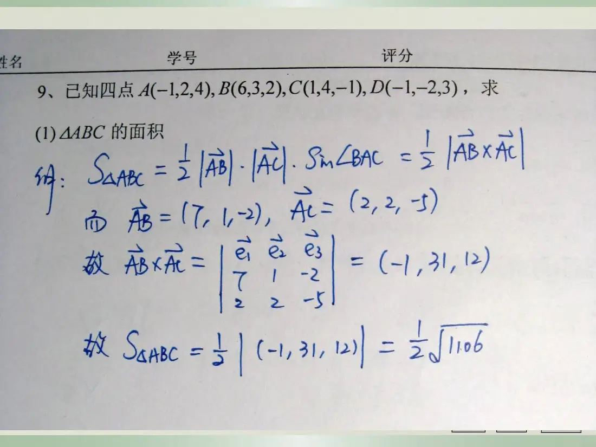

原文：

9、已知四点 $A(-1,2,4), B(6,3,2), C(1,4,-1), D(-1,-2,3)$ ，求

(1) $\triangle ABC$ 的面积
设: $S_{\triangle ABC} = \frac{1}{2} |\overrightarrow{AB}| \cdot |\overrightarrow{AC}| \cdot \sin \angle BAC = \frac{1}{2} |\overrightarrow{AB} \times \overrightarrow{AC}|$ 而 $\overrightarrow{AB} = (7, 1, -2)$ , $\overrightarrow{AC} = (2, 2, -5)$ 故 $\overrightarrow{AB} \times \overrightarrow{AC} = \begin{vmatrix} \overrightarrow{e_1} & \overrightarrow{e_2} & \overrightarrow{e_3} \\ 7 & 1 & -2 \\ 2 & 2 & -5 \end{vmatrix} = (-1, 31, 12)$ 故 $S_{\triangle ABC} = \frac{1}{2} |(-1, 31, 12)| = \frac{1}{2} \sqrt{1106}$

学号

评分

### (2) 四面体 $ABCD$ 的体积。

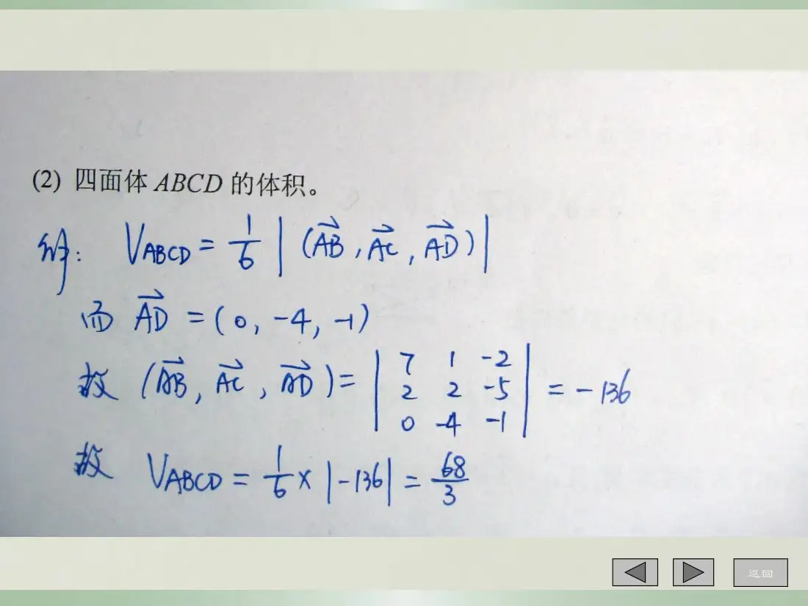

原文：

(2) 四面体 $ABCD$ 的体积。

设 $A$ : $\begin{array} { l } { V _ { A B C D } = \frac { 1 } { 6 } | ( \overrightarrow { A B } , \overrightarrow { A C } , \overrightarrow { A D } ) | } \\ { \text { 而 } \overrightarrow { A D } = ( 0 , - 4 , - 1 ) } \\ { \text { 故 } ( \overrightarrow { A B } , \overrightarrow { A C } , \overrightarrow { A D } ) = \left| \begin{array} { r r r } 7 & 1 & - 2 \\ 2 & 2 & - 5 \\ 0 & - 4 & - 1 \end{array} \right| = - 136 } \\ { \text { 故 } V _ { A B C D } = \frac { 1 } { 6 } \times | - 136 | = \frac { 6 8 } { 3 } } \end{array}$ 第四章 空间解析几何与向量运算  
4.1 空间直角坐标系与向量  
4.2 向量的乘法  
4.3 平面  
4.4 空间直线  
4.5 曲面与空间曲线

◀ ▶

返回

### ◀ ▶

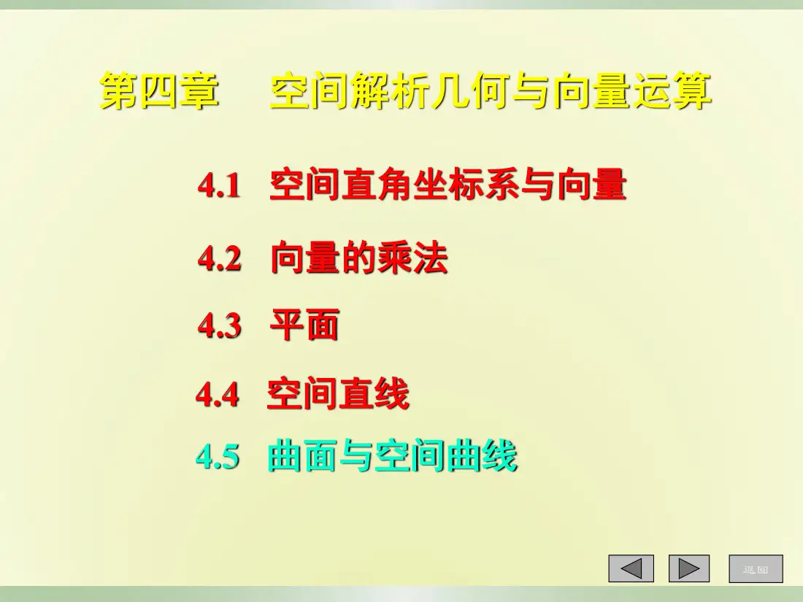

原文：

◀ ▶

返回

### 4.5 曲面与空间曲线

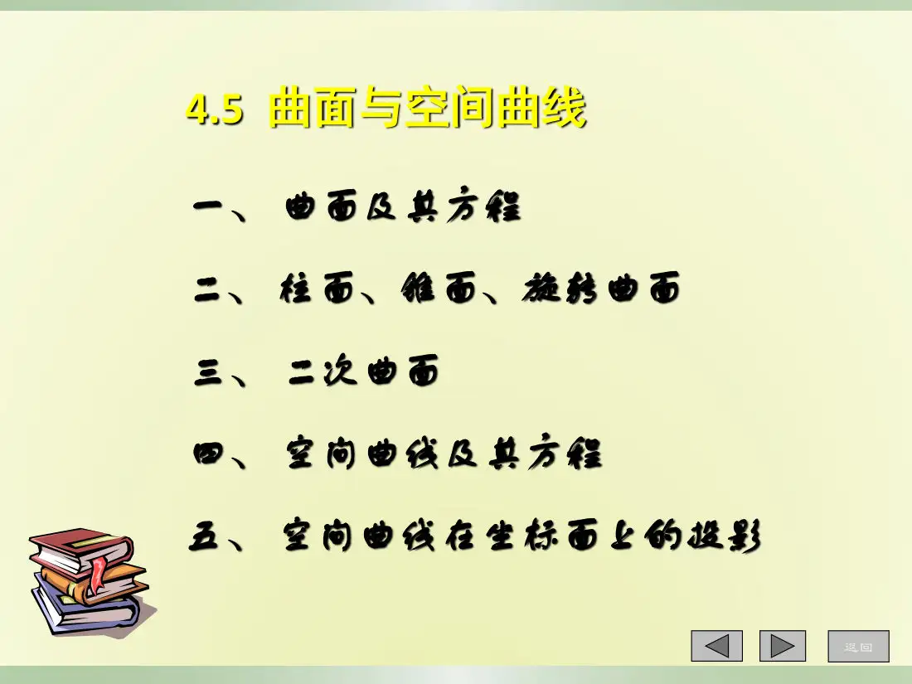

原文：

4.5 曲面与空间曲线
一、曲面及其方程
二、柱面、锥面、旋转曲面
三、二次曲面
四、空间曲线及其方程
五、空间曲线在坐标面上的投影

### 一、曲面及其方程

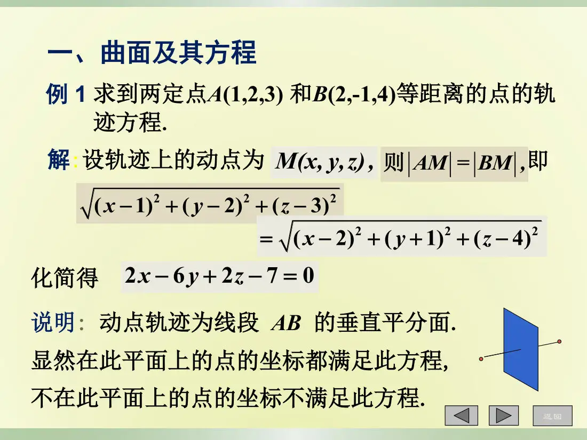

原文：

一、曲面及其方程

例 1 求到两定点 $A(1,2,3)$ 和 $B(2,-1,4)$ 等距离的点的轨迹方程.

解: 设轨迹上的动点为 $M(x, y, z)$ ，则 $|AM| = |BM|$ ，即

$$
\begin{array}{r l} \sqrt {(x - 1) ^ {2} + (y - 2) ^ {2} + (z - 3) ^ {2}} & = \sqrt {(x - 2) ^ {2} + (y + 1) ^ {2} + (z - 4) ^ {2}} \end{array}
$$

化简得 $2x - 6y + 2z - 7 = 0$

说明: 动点轨迹为线段 $AB$ 的垂直平分面. 显然在此平面上的点的坐标都满足此方程, 不在此平面上的点的坐标不满足此方程.

返回

### 定义 如果曲面 S 与方程 $F(x, y, z) = 0$ 有下述关系:

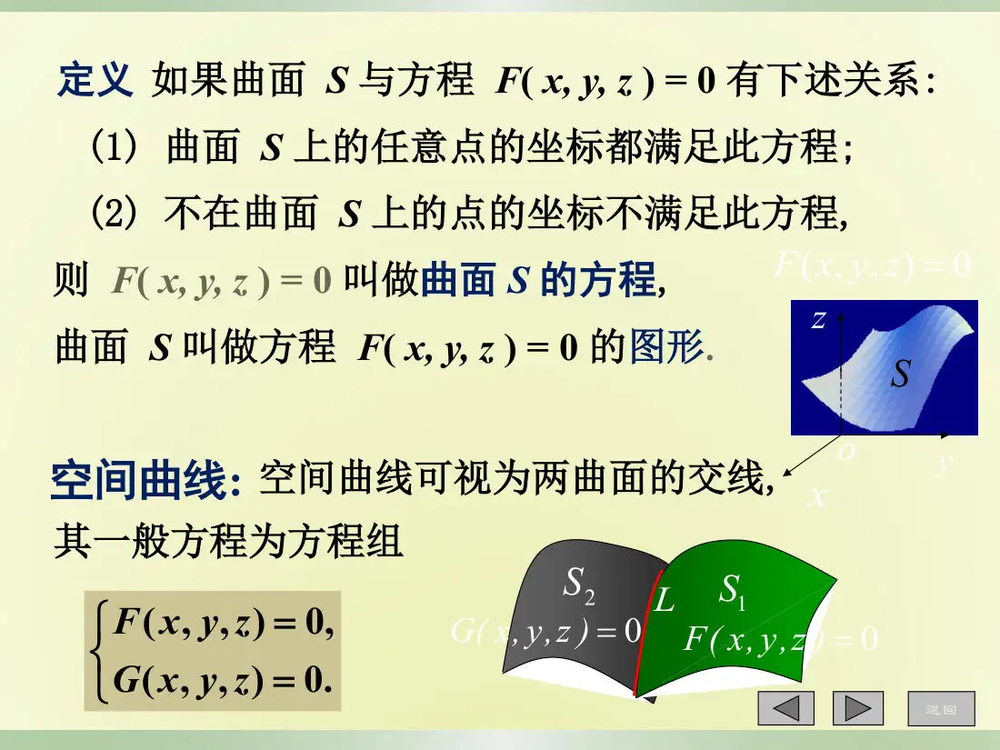

原文：

定义 如果曲面 S 与方程 $F(x, y, z) = 0$ 有下述关系:

(1) 曲面 $S$ 上的任意点的坐标都满足此方程;

(2) 不在曲面 S 上的点的坐标不满足此方程,

则 $F(x,y,z)=0$ 叫做曲面 S 的方程,

曲面 S 叫做方程 $F(x, y, z) = 0$ 的图形.

$F(x,y,z) = 0$

空间曲线: 空间曲线可视为两曲面的交线,

其一般方程为方程组

$$
\left\{ \begin{array}{l} F (x, y, z) = 0, \\ G (x, y, z) = 0. \end{array} \right.
$$

$$
\begin{array}{c} S _ {2} \\ (x, y, z) = 0 \end{array} \begin{array}{c} L \quad S _ {1} \\ F (x, y, z) = 0 \end{array}
$$

◀ ▶

返回

### 定义 如果曲面 S 与方程 $F(x, y, z) = 0$ 有下述关系:

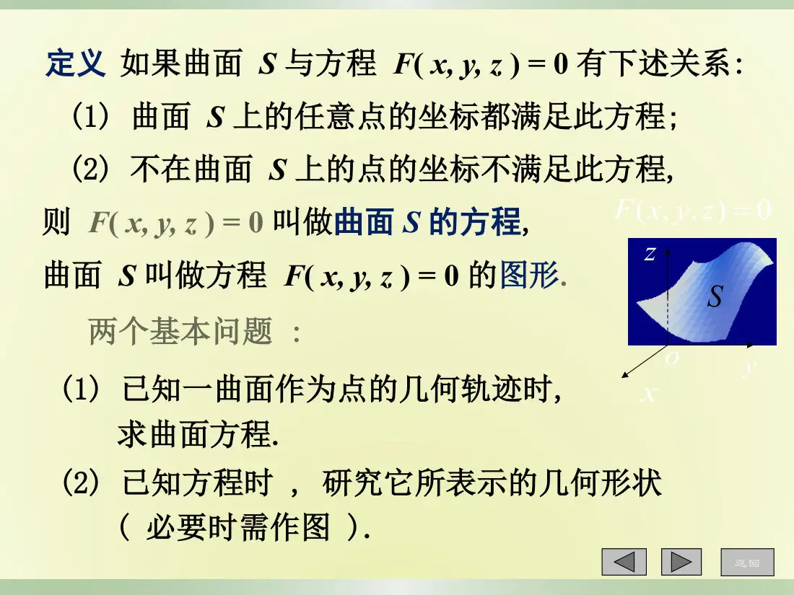

原文：

定义 如果曲面 S 与方程 $F(x, y, z) = 0$ 有下述关系:

(1) 曲面 $S$ 上的任意点的坐标都满足此方程;

(2) 不在曲面 S 上的点的坐标不满足此方程,

$$
F (x, y, z) = 0
$$

$$
F (x, y, z) = 0
$$

$F(x,y,z) = 0$

两个基本问题：

(1) 已知一曲面作为点的几何轨迹时, 求曲面方程.

(2) 已知方程时，研究它所表示的几何形状（必要时需作图）。

返回

### $$

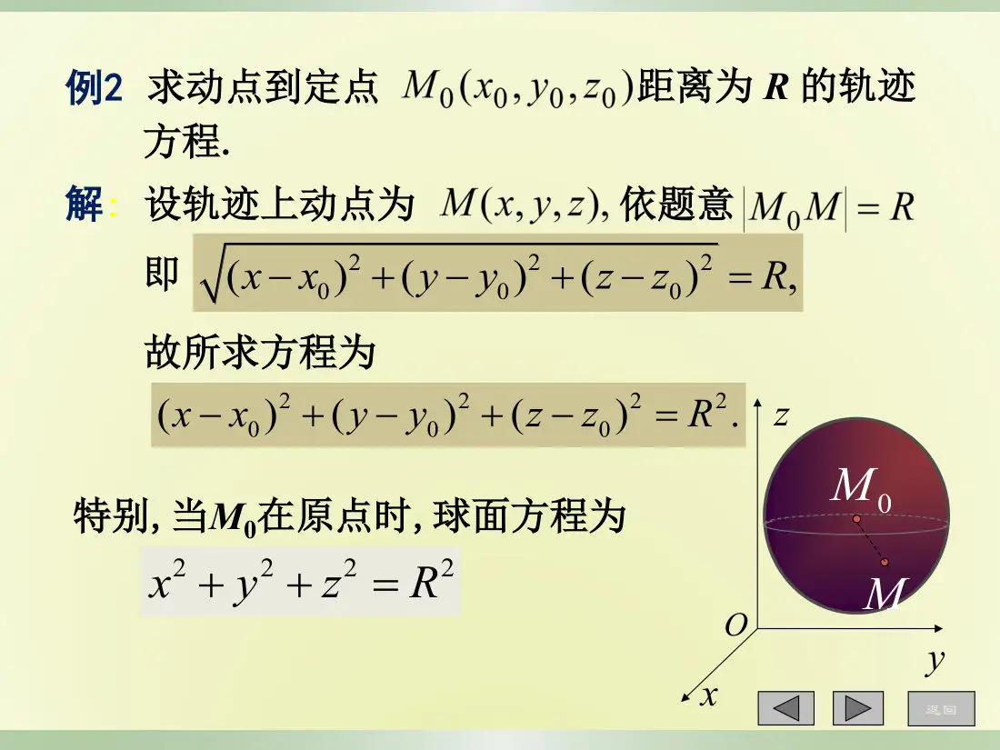

原文：

例2 求动点到定点 $M_{0}(x_{0}, y_{0}, z_{0})$ 距离为 R 的轨迹方程.

$$
M (x, y, z)
$$

$$
\left| M _ {0} M \right| = R
$$

$$
\sqrt {(x - x _ {0}) ^ {2} + (y - y _ {0}) ^ {2} + (z - z _ {0}) ^ {2}} = R,
$$

$$
(x - x _ {0}) ^ {2} + (y - y _ {0}) ^ {2} + (z - z _ {0}) ^ {2} = R ^ {2}.
$$

特别, 当 $M_{0}$ 在原点时, 球面方程为

$$
x ^ {2} + y ^ {2} + z ^ {2} = R ^ {2}
$$

### 半径为 $\sqrt{5}$ 的球面.

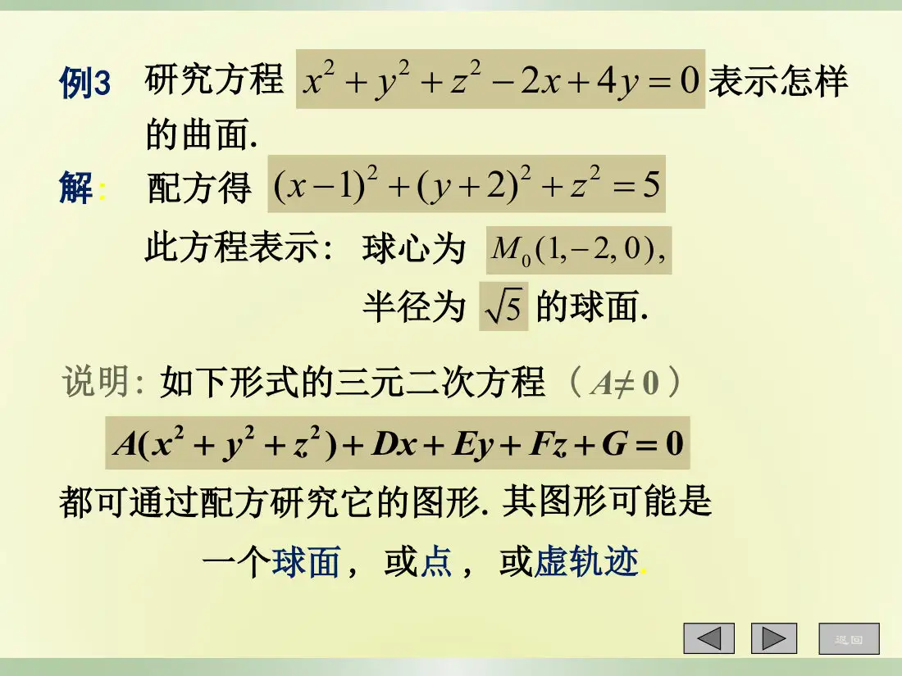

原文：

例3 研究方程 $x^{2} + y^{2} + z^{2} - 2x + 4y = 0$ 表示怎样的曲面.

解: 配方得 $(x-1)^{2}+(y+2)^{2}+z^{2}=5$ 此方程表示：球心为 $M_{0}(1,-2,0)$ ,
半径为 $\sqrt{5}$ 的球面.

说明: 如下形式的三元二次方程 (A≠0)

$$
A (x ^ {2} + y ^ {2} + z ^ {2}) + D x + E y + F z + G = 0
$$

都可通过配方研究它的图形. 其图形可能是

一个球面，或点，或虚轨迹.

◀ ▶

返回

### 二、柱面、锥面、旋转曲面

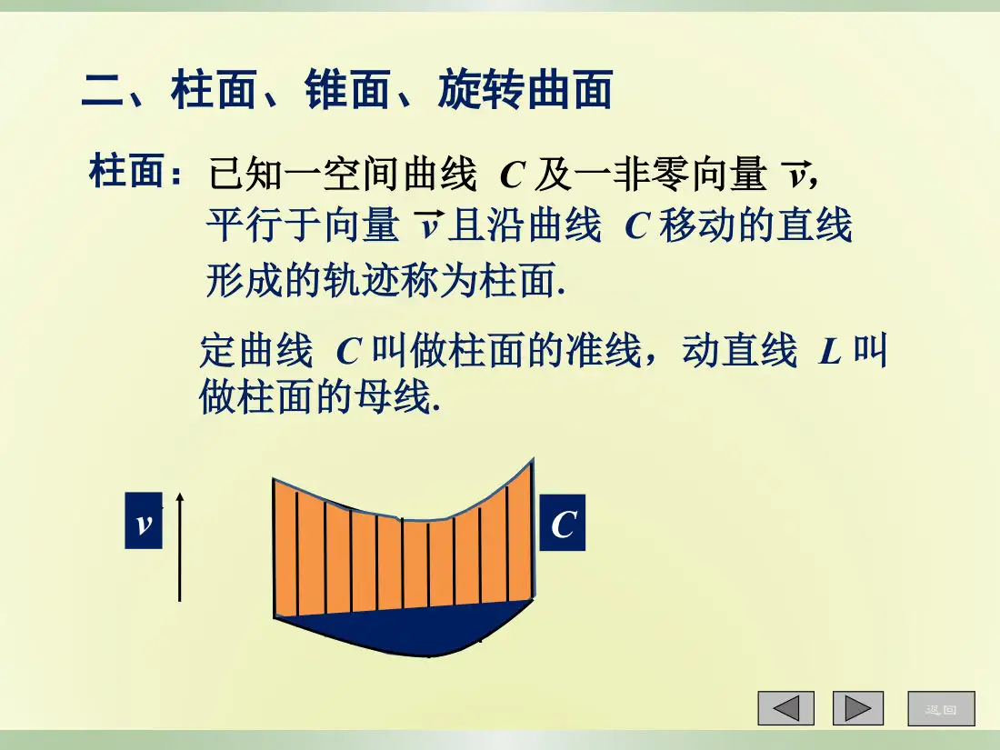

原文：

二、柱面、锥面、旋转曲面

柱面: 已知一空间曲线 $C$ 及一非零向量 $\vec{v}$ , 平行于向量 $\vec{v}$ 且沿曲线 $C$ 移动的直线形成的轨迹称为柱面.

定曲线 C 叫做柱面的准线，动直线 L 叫做柱面的母线.

◀ ▶

### 返回

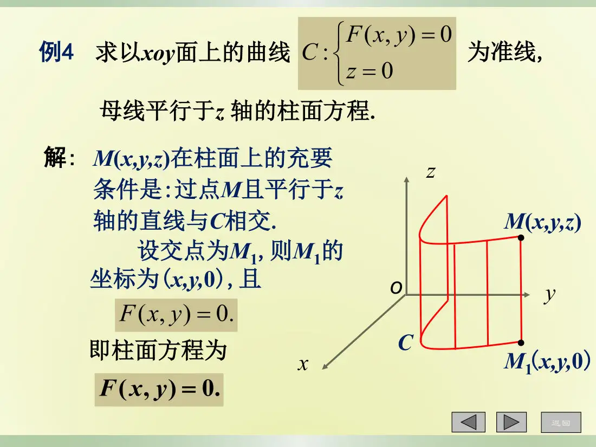

原文：

例4 求以xoy面上的曲线 $C:\left\{\begin{aligned}F(x,y)&=0\\ z&=0\end{aligned}\right.$ 为准线，母线平行于z轴的柱面方程.

解: $M(x, y, z)$ 在柱面上的充要条件是: 过点 $M$ 且平行于 $z$ 轴的直线与 $C$ 相交. 设交点为 $M_{1}$ , 则 $M_{1}$ 的坐标为 $(x, y, 0)$ , 且 $F(x, y) = 0$ . 即柱面方程为 $F(x, y) = 0$ .

返回

### 一般地, 在三维空间

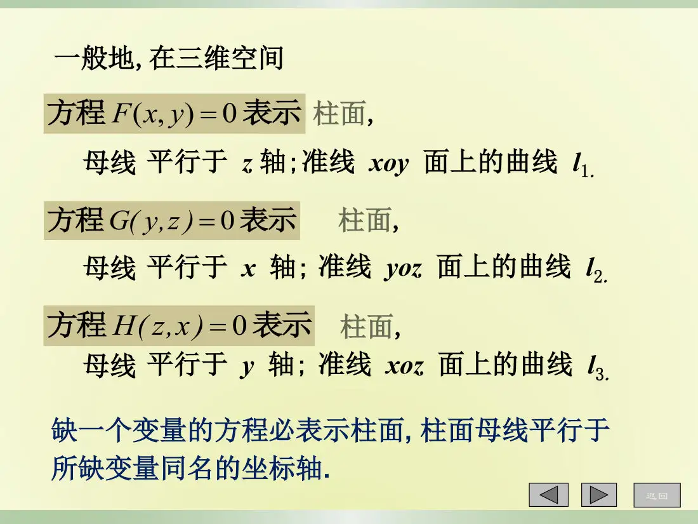

原文：

一般地, 在三维空间

方程 $F(x,y)=0$ 表示 柱面,

母线 平行于 z 轴; 准线 xoy 面上的曲线 $l_{1}$ .

方程 $G(y,z)=0$ 表示 柱面,

母线 平行于 x 轴; 准线 yoz 面上的曲线 $l_{2}$ .

方程 $H(z,x)=0$ 表示 柱面,

母线 平行于 y 轴；准线 xoz 面上的曲线 $l_{3}$ .

缺一个变量的方程必表示柱面, 柱面母线平行于所缺变量同名的坐标轴.

返回

### 例5

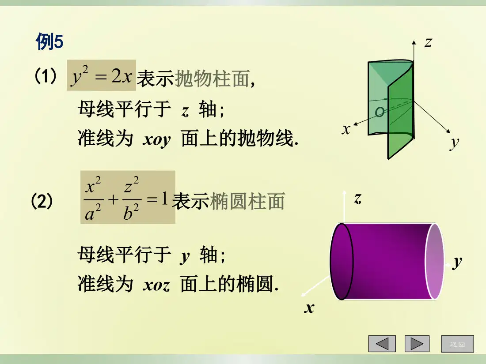

原文：

例5

(1) $y^{2}=2x$ 表示抛物柱面，
母线平行于 z 轴；
准线为 xoy 面上的抛物线.

(2) $\frac{x^{2}}{a^{2}} + \frac{z^{2}}{b^{2}} = 1$ 表示椭圆柱面母线平行于 $y$ 轴；准线为 $xoz$ 面上的椭圆.

返回

### 例6 求母线平行于 $y$ 轴且通过曲线

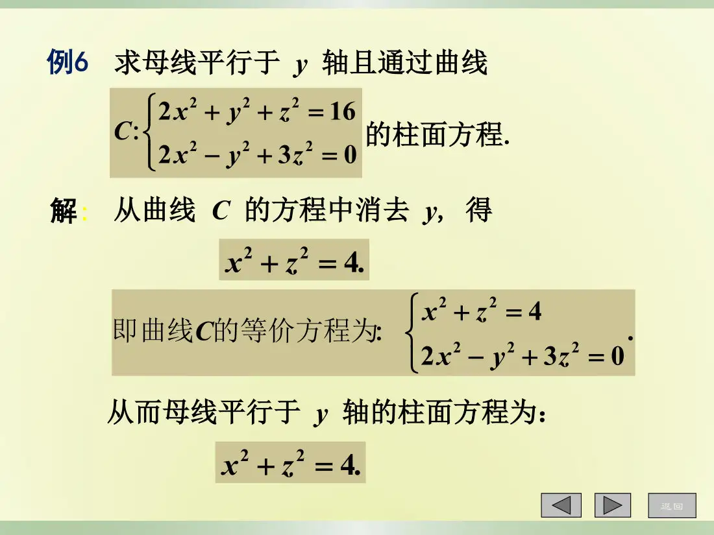

原文：

例6 求母线平行于 $y$ 轴且通过曲线

C: $\left\{\begin{aligned}2x^{2}+y^{2}+z^{2}&=16\\ 2x^{2}-y^{2}+3z^{2}&=0\end{aligned}\right.$ 的柱面方程.

解：从曲线 C 的方程中消去 y，得

$$
x ^ {2} + z ^ {2} = 4.
$$

即曲线C的等价方程为: $\left\{\begin{aligned}x^{2}+z^{2}&=4\\ 2x^{2}-y^{2}+3z^{2}&=0\end{aligned}\right.$

从而母线平行于 y 轴的柱面方程为:

$$
x ^ {2} + z ^ {2} = 4.
$$

◀ ▶

返回

### 例6 求母线平行于 $y$ 轴且通过曲线

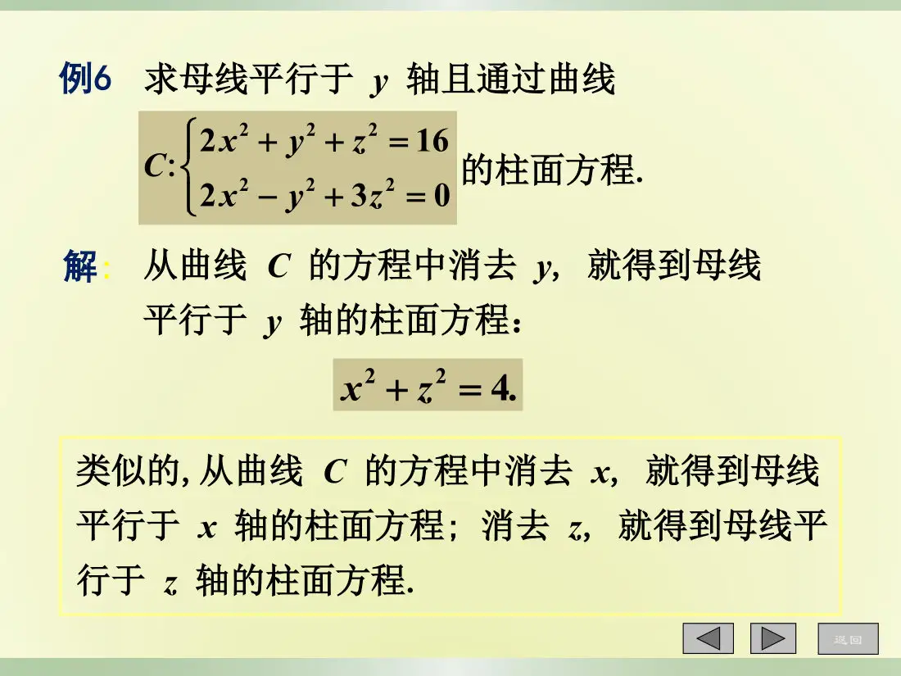

原文：

例6 求母线平行于 $y$ 轴且通过曲线

C: $\left\{\begin{aligned}2x^{2}+y^{2}+z^{2}&=16\\ 2x^{2}-y^{2}+3z^{2}&=0\end{aligned}\right.$ 的柱面方程.

解: 从曲线 $C$ 的方程中消去 $y$ , 就得到母线平行于 $y$ 轴的柱面方程:

$$
x ^ {2} + z ^ {2} = 4.
$$

类似的, 从曲线 C 的方程中消去 x, 就得到母线平行于 x 轴的柱面方程; 消去 z, 就得到母线平行于 z 轴的柱面方程.

◀ ▶

返回

### ◀ ▶

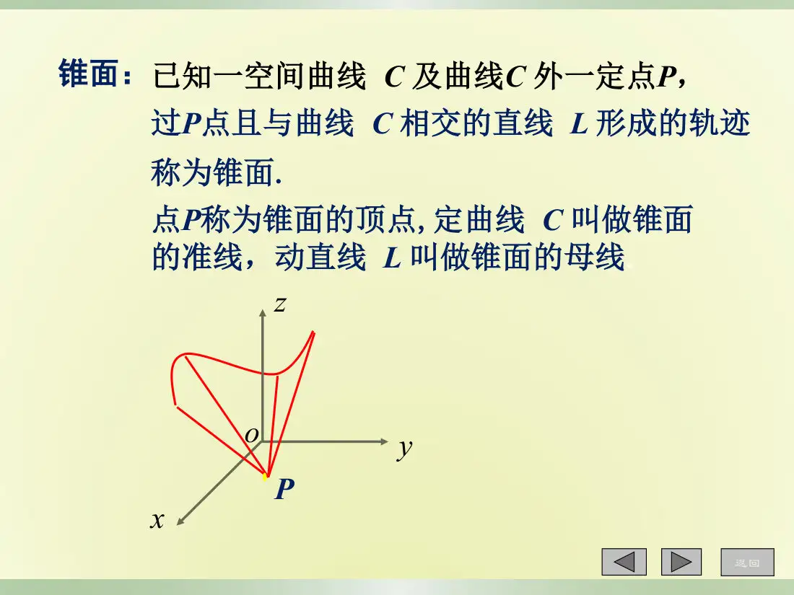

原文：

锥面: 已知一空间曲线 $C$ 及曲线 $C$ 外一定点 $P$ , 过 $P$ 点且与曲线 $C$ 相交的直线 $L$ 形成的轨迹称为锥面. 点 $P$ 称为锥面的顶点, 定曲线 $C$ 叫做锥面的准线, 动直线 $L$ 叫做锥面的母线.

◀ ▶

### 坐标原点在曲面上;

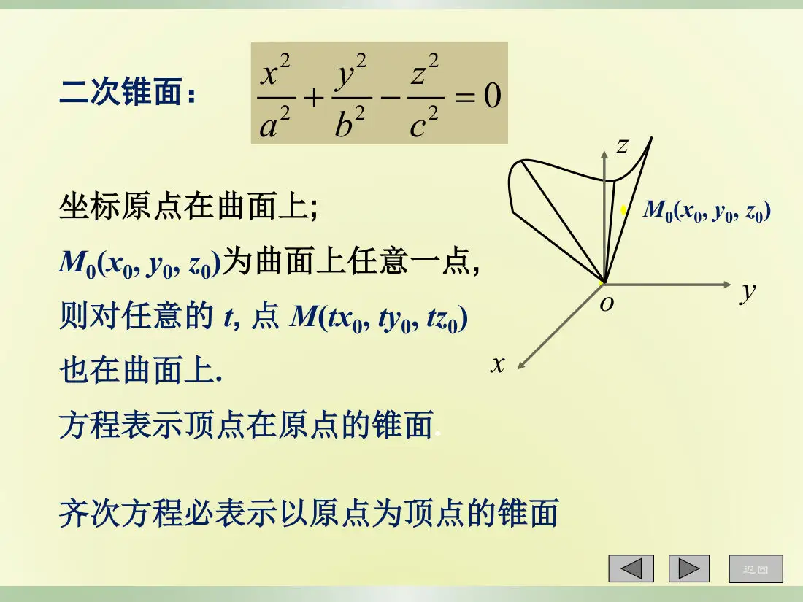

原文：

二次锥面： $\frac{x^2}{a^2} +\frac{y^2}{b^2} -\frac{z^2}{c^2} = 0$

坐标原点在曲面上;

$M_{0}(x_{0},y_{0},z_{0})$ 为曲面上任意一点,则对任意的t,点 $M(tx_{0},ty_{0},tz_{0})$ 也在曲面上.

方程表示顶点在原点的锥面.

齐次方程必表示以原点为顶点的锥面旋转曲面: 一平面曲线 C 绕平面上一定直线 L 旋转一周所产生的曲面叫做旋转曲面.
曲线 C 叫做旋转曲面的母线，
定直线 L 叫做旋转曲面的旋转轴(轴).

返回

### 第 20 页

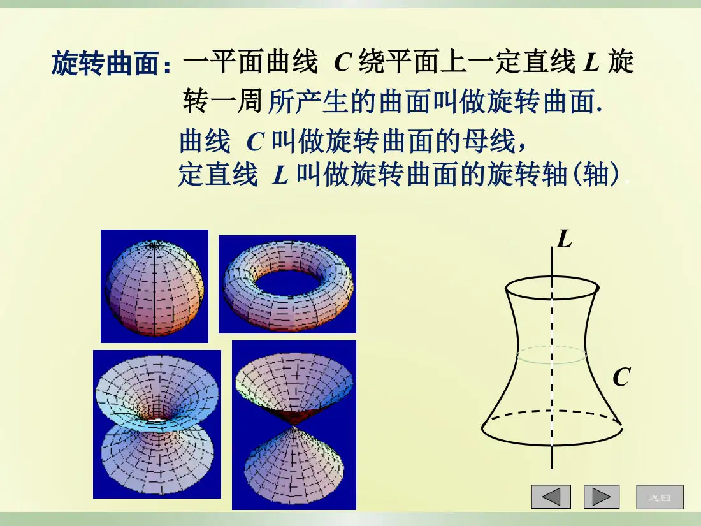

### 解: 给定 yoz 面上曲线 C:

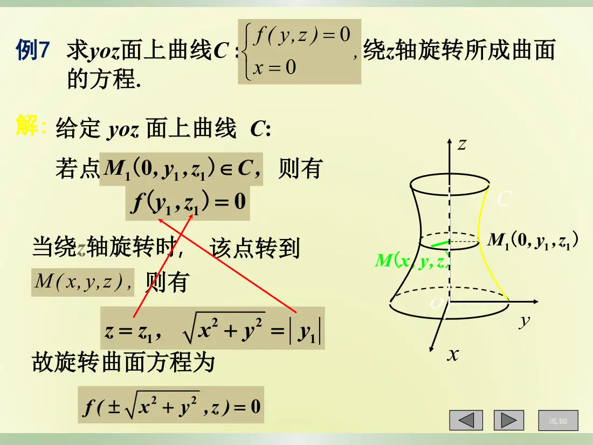

原文：

例7 求yoz面上曲线C: $\left\{\begin{aligned}f(y,z)&=0\\ x&=0\end{aligned}\right.$ ，绕z轴旋转所成曲面的方程.

解: 给定 yoz 面上曲线 C:
若点 $M_{1}(0, y_{1}, z_{1}) \in C$ ，则有 $f(y_{1}, z_{1}) = 0$ 当绕z轴旋转时，该点转到 $M(x, y, z)$ ，则有 $z = z_{1}, \sqrt{x^{2} + y^{2}} = |y_{1}|$ 故旋转曲面方程为

$$
f (\pm \sqrt {x ^ {2} + y ^ {2}}, z) = 0
$$

返回

◀ ▶

### 思考: 当曲线 $C$ 绕 $y$ 轴旋转时, 方程如何?

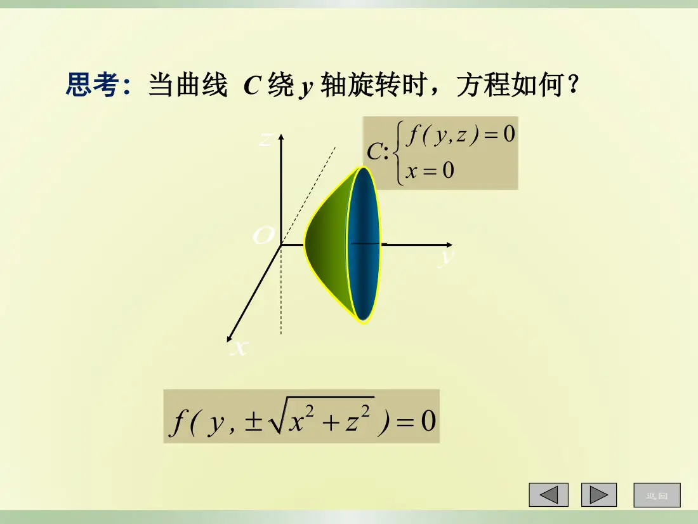

原文：

思考: 当曲线 $C$ 绕 $y$ 轴旋转时, 方程如何?

$$
f (y, \pm \sqrt {x ^ {2} + z ^ {2}}) = 0
$$

◀ ▶

返回

### xoy面上的椭圆：

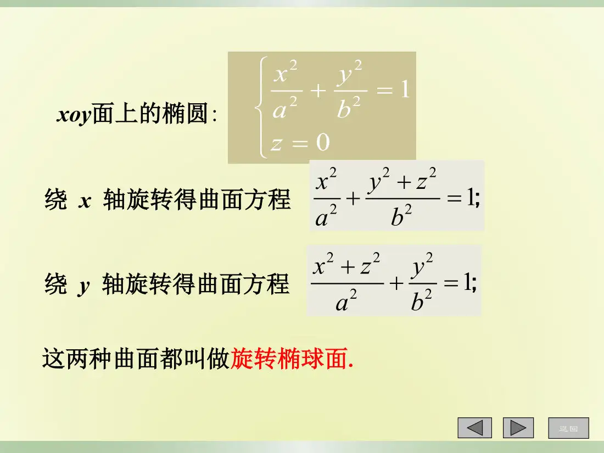

原文：

xoy面上的椭圆：

$$
\left\{ \begin{array}{l} \frac {x ^ {2}}{a ^ {2}} + \frac {y ^ {2}}{b ^ {2}} = 1 \\ z = 0 \end{array} \right.
$$

绕 x 轴旋转得曲面方程 $\frac{x^{2}}{a^{2}}+\frac{y^{2}+z^{2}}{b^{2}}=1;$

绕 y 轴旋转得曲面方程 $\frac{x^{2}+z^{2}}{a^{2}}+\frac{y^{2}}{b^{2}}=1;$

这两种曲面都叫做旋转椭球面.

◀ ▶

返回

### xoz面上的双曲线:

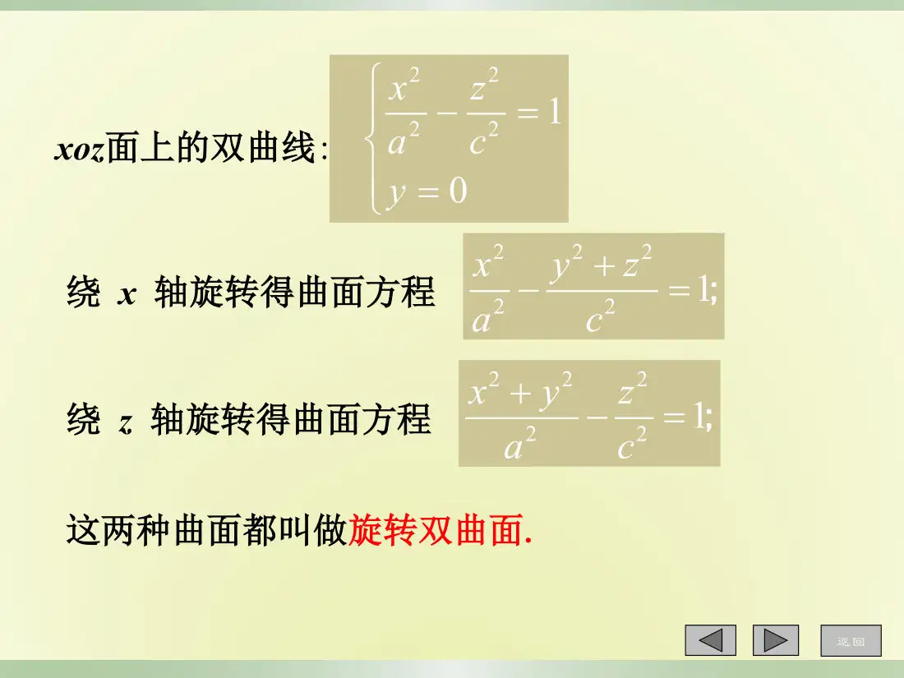

原文：

xoz面上的双曲线:

$$
\left\{ \begin{array}{l} \frac {x ^ {2}}{a ^ {2}} - \frac {z ^ {2}}{c ^ {2}} = 1 \\ y = 0 \end{array} \right.
$$

绕 x 轴旋转得曲面方程

$$
\frac {x ^ {2}}{a ^ {2}} - \frac {y ^ {2} + z ^ {2}}{c ^ {2}} = 1;
$$

绕 z 轴旋转得曲面方程

$$
\frac {x ^ {2} + y ^ {2}}{a ^ {2}} - \frac {z ^ {2}}{c ^ {2}} = 1;
$$

这两种曲面都叫做旋转双曲面.

◀ ▶

返回

### 绕它的对称轴 $z$ 轴旋转得曲面方程

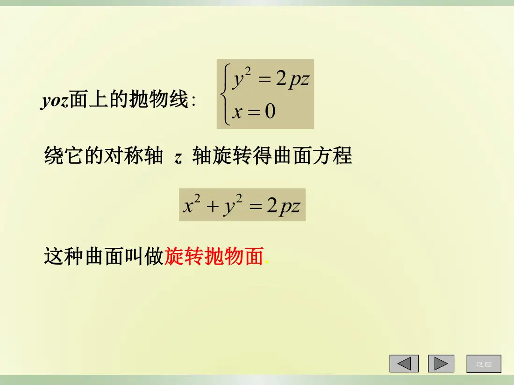

原文：

yoz面上的抛物线： $\left\{\begin{aligned}y^{2}&=2pz\\ x&=0\end{aligned}\right.$

绕它的对称轴 $z$ 轴旋转得曲面方程

$$
x ^ {2} + y ^ {2} = 2 p z
$$

这种曲面叫做旋转抛物面.

◀ ▶

返回

### 三、二次曲面

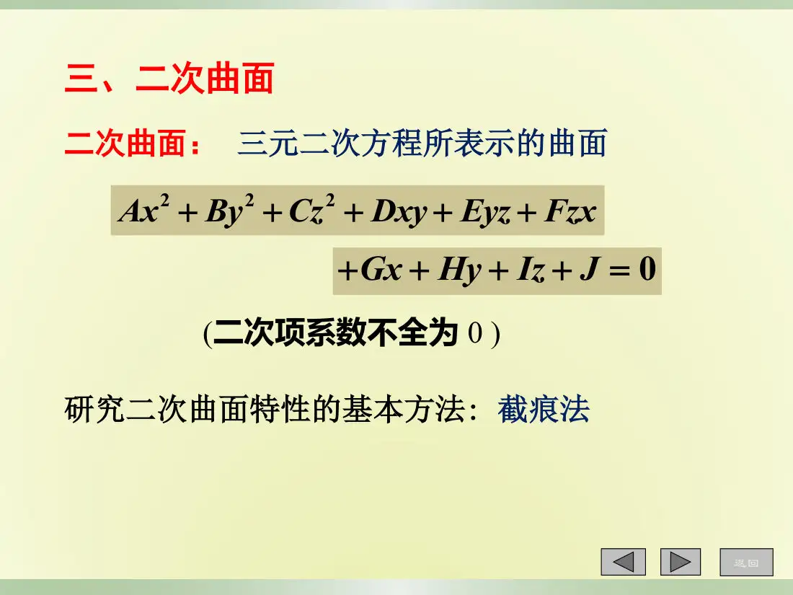

原文：

三、二次曲面

二次曲面：三元二次方程所表示的曲面

$$
\begin{array}{r l} A x ^ {2} + B y ^ {2} + C z ^ {2} + D x y + E y z + F z x & \\ & + G x + H y + I z + J = 0 \end{array}
$$

(二次项系数不全为 0 )

研究二次曲面特性的基本方法：截痕法

◀ ▶

返回

### 1. 椭球面

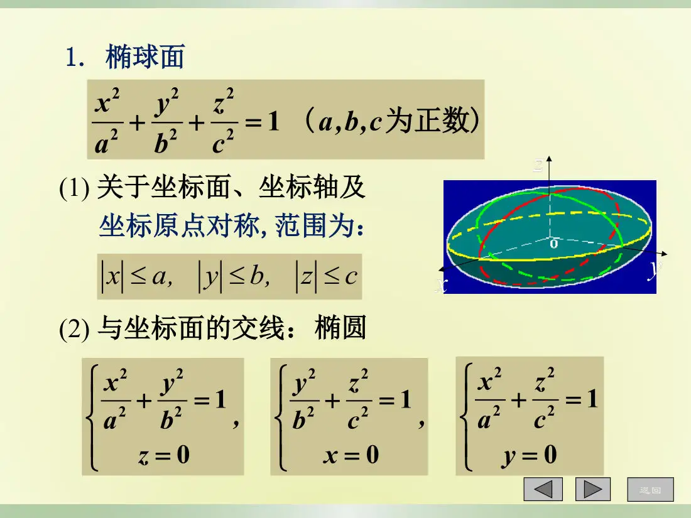

原文：

1. 椭球面

$\frac{x^2}{a^2} + \frac{y^2}{b^2} + \frac{z^2}{c^2} = 1$ ( $a, b, c$ 为正数)

(1) 关于坐标面、坐标轴及坐标原点对称, 范围为:

$$
| x | \leq a, \quad | y | \leq b, \quad | z | \leq c
$$

(2) 与坐标面的交线: 椭圆

$$
\left\{ \begin{array}{c} \frac {x ^ {2}}{a ^ {2}} + \frac {y ^ {2}}{b ^ {2}} = 1 \\ z = 0 \end{array} , \right.
$$

$$
\left\{ \begin{array}{c} \frac {y ^ {2}}{b ^ {2}} + \frac {z ^ {2}}{c ^ {2}} = 1 \\ x = 0 \end{array} , \right.
$$

$$
\left\{ \begin{array}{c} \frac {x ^ {2}}{a ^ {2}} + \frac {z ^ {2}}{c ^ {2}} = 1 \\ y = 0 \end{array} \right.
$$

返回

### $$

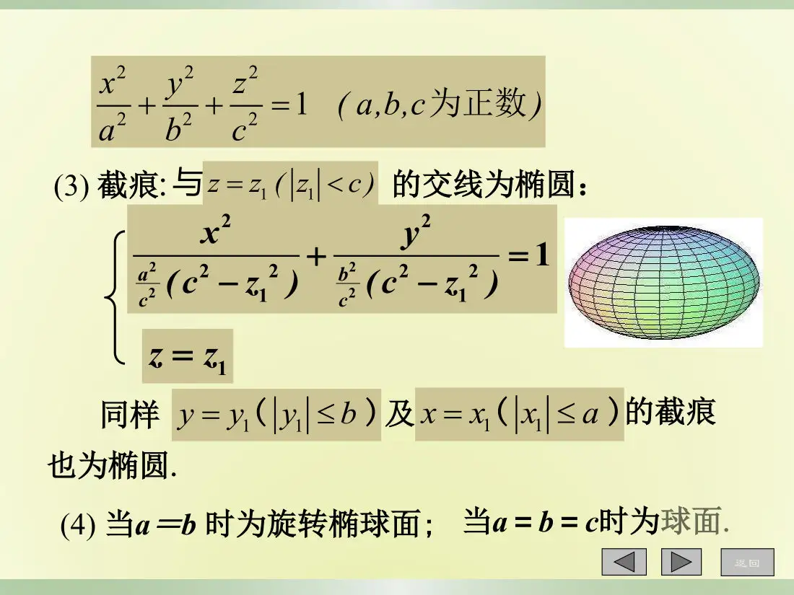

原文：

$$
\frac {x ^ {2}}{a ^ {2}} + \frac {y ^ {2}}{b ^ {2}} + \frac {z ^ {2}}{c ^ {2}} = 1 (a, b, c \text {为正数})
$$

(3) 截痕: 与 $z = z_{1} (|z_{1}| < c)$ 的交线为椭圆:

$$
\left\{ \begin{array}{l} \frac {x ^ {2}}{\frac {a ^ {2}}{c ^ {2}} (c ^ {2} - z _ {1} ^ {2})} + \frac {y ^ {2}}{\frac {b ^ {2}}{c ^ {2}} (c ^ {2} - z _ {1} ^ {2})} = 1 \\ z = z _ {1} \end{array} \right.
$$

同样 $y = y_{1} \left( \left| y_{1} \right| \leq b \right)$ 及 $x = x_{1} \left( \left| x_{1} \right| \leq a \right)$ 的截痕也为椭圆.

(4) 当 $a = b$ 时为旋转椭球面；当 $a = b = c$ 时为球面.

◀ ▶

返回

### 2. 双曲面

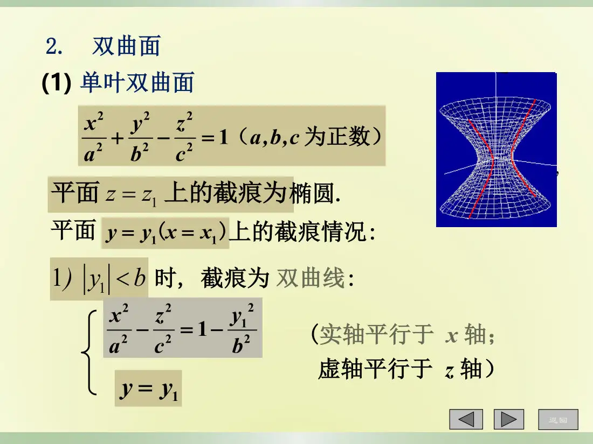

原文：

2. 双曲面

(1) 单叶双曲面

$\frac{x^2}{a^2} + \frac{y^2}{b^2} - \frac{z^2}{c^2} = 1 (a, b, c \text{为正数})$ 平面 $z = z_1$ 上的截痕为椭圆. 平面 $y = y_1(x = x_1)$ 上的截痕情况：

1) $|y_1| < b$ 时，截痕为双曲线：

$$
\left\{ \begin{array}{c} \frac {x ^ {2}}{a ^ {2}} - \frac {z ^ {2}}{c ^ {2}} = 1 - \frac {y _ {1} ^ {2}}{b ^ {2}} \\ y = y _ {1} \end{array} \right.
$$

(实轴平行于 x 轴;
虚轴平行于 z 轴)

◀ ▶

### 3) $|y_{1}| > b$ 时, 截痕为 双曲线:

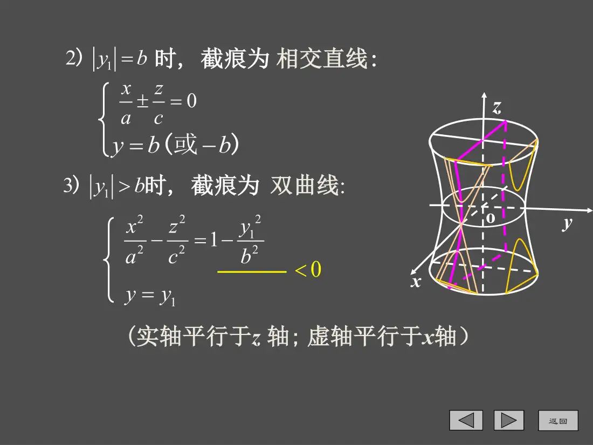

原文：

2) $|y_1| = b$ 时，截痕为相交直线： $\left\{ \begin{array}{l} \frac{x}{a} \pm \frac{z}{c} = 0 \\ y = b (\text{或} -b) \end{array} \right.$

3) $|y_{1}| > b$ 时, 截痕为 双曲线:

$$
\left\{ \begin{array}{l} \frac {x ^ {2}}{a ^ {2}} - \frac {z ^ {2}}{c ^ {2}} = 1 - \frac {y _ {1} ^ {2}}{b ^ {2}} \\ y = y _ {1} \end{array} \right. <   0
$$

(实轴平行于z轴；虚轴平行于x轴)

◀ ▶

返回

### 2) $|y_1| = b$ 时，截痕为相交直线：

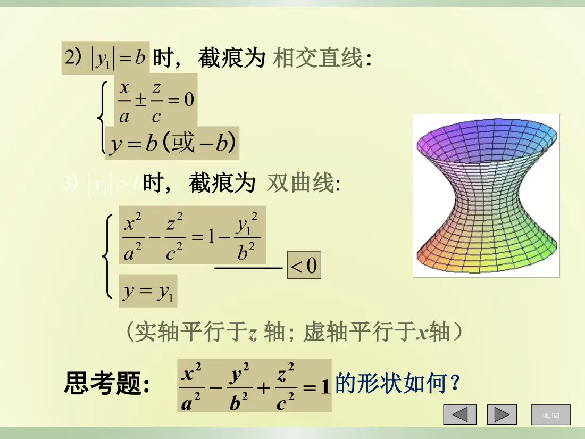

原文：

2) $|y_1| = b$ 时，截痕为相交直线：

$$
\left\{ \begin{array}{l} \frac {x}{a} \pm \frac {z}{c} = 0 \\ y = b (\text {或} - b) \end{array} \right.
$$

3) $|y_{1}| > b$ 时, 截痕为 双曲线:

$$
\left\{ \begin{array}{l} \frac {x ^ {2}}{a ^ {2}} - \frac {z ^ {2}}{c ^ {2}} = 1 - \frac {y _ {1} ^ {2}}{b ^ {2}} \\ y = y _ {1} \end{array} \right. <   0
$$

(实轴平行于 $z$ 轴; 虚轴平行于 $x$ 轴)

思考题: $\frac{x^{2}}{a^{2}} - \frac{y^{2}}{b^{2}} + \frac{z^{2}}{c^{2}} = 1$ 的形状如何?

返回

### (2) 双叶双曲面

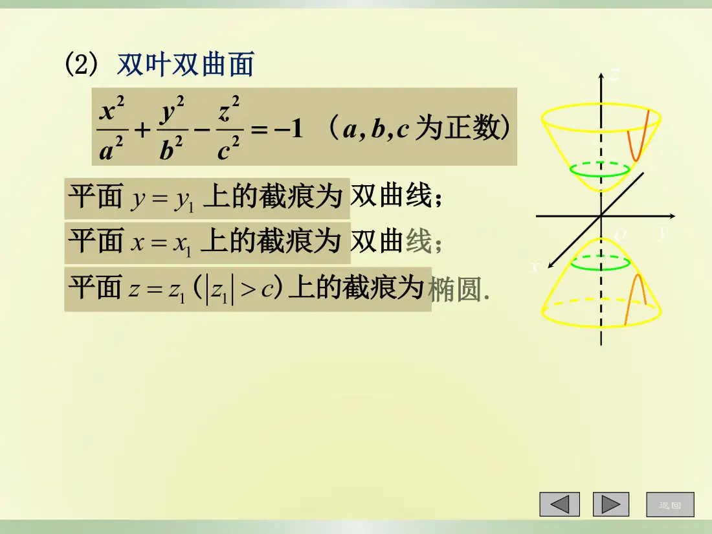

原文：

(2) 双叶双曲面

$\frac{x^{2}}{a^{2}}+\frac{y^{2}}{b^{2}}-\frac{z^{2}}{c^{2}}=-1$ (a,b,c为正数)

平面 $y=y_{1}$ 上的截痕为双曲线;

平面 $x=x_{1}$ 上的截痕为双曲线;

平面 $z=z_{1}(|z_{1}|>c)$ 上的截痕为椭圆.

◀ ▶

返回

### (2) 双叶双曲面

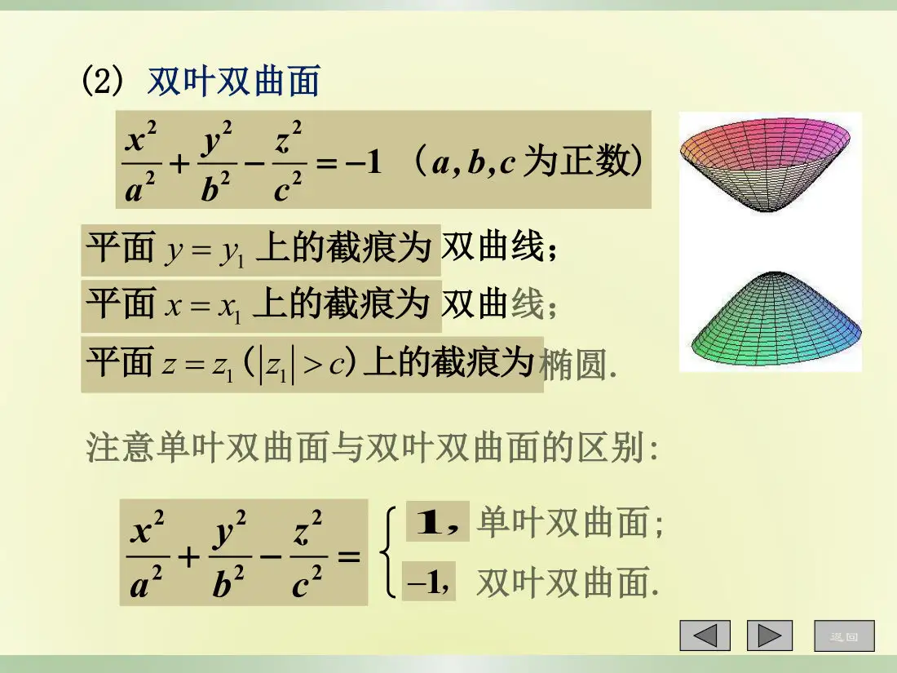

原文：

(2) 双叶双曲面

$\frac{x^2}{a^2} + \frac{y^2}{b^2} - \frac{z^2}{c^2} = -1$ ( $a, b, c$ 为正数)

平面 $y = y_{1}$ 上的截痕为双曲线;

平面 $x = x_{1}$ 上的截痕为双曲线；

平面 $z = z_{1}\left(\left|z_{1}\right| > c\right)$ 上的截痕为椭圆.

注意单叶双曲面与双叶双曲面的区别:

$\frac{x^2}{a^2} + \frac{y^2}{b^2} - \frac{z^2}{c^2} = \begin{cases} 1, & \text{单叶双曲面;} \\ -1, & \text{双叶双曲面.} \end{cases}$ 椭球面和双曲面的标准方程可统一写为:

◀ ▶

返回

### $$

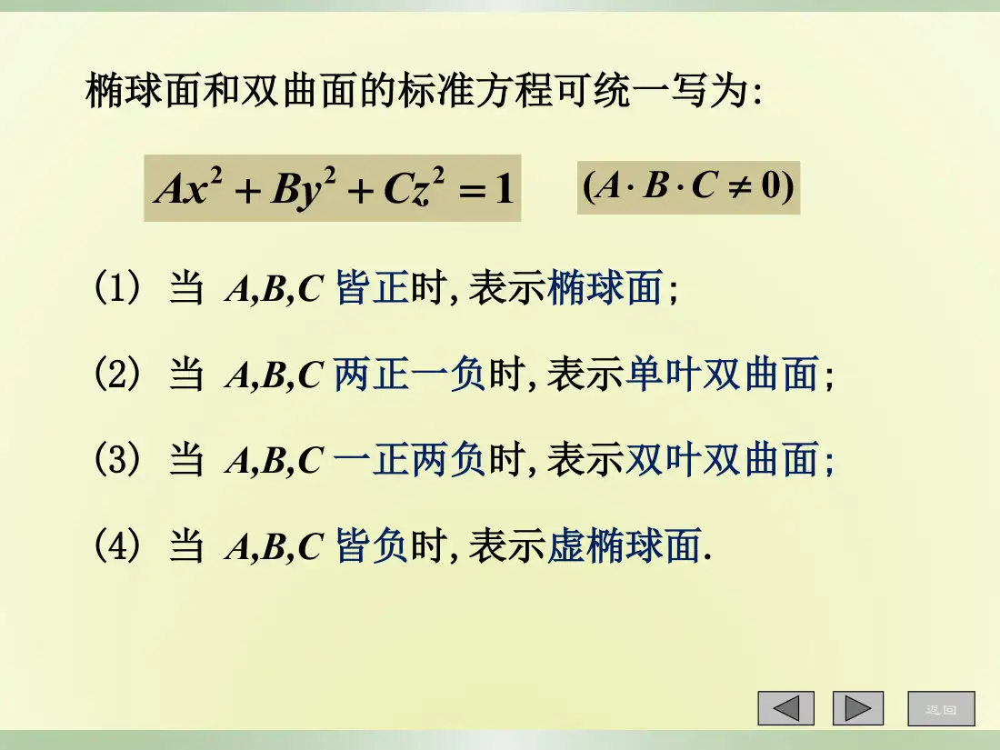

原文：

$$
A x ^ {2} + B y ^ {2} + C z ^ {2} = 1
$$

$$
(A \cdot B \cdot C \neq 0)
$$

(1) 当 A, B, C 皆正时, 表示椭球面;

(2) 当 A, B, C 两正一负时, 表示单叶双曲面;

(3) 当 A, B, C 一正两负时, 表示双叶双曲面;

(4) 当 A,B,C 皆负时, 表示虚椭球面.

◀ ▶

返回

### 3、抛物面

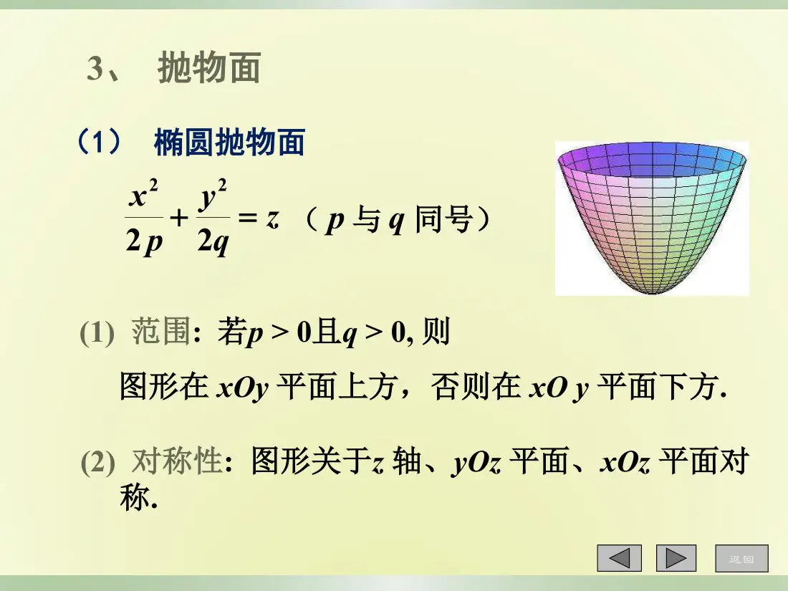

原文：

3、抛物面

(1) 椭圆抛物面

$\frac{x^2}{2p} + \frac{y^2}{2q} = z$ （ $p$ 与 $q$ 同号）

(1) 范围: 若 $p > 0$ 且 $q > 0$ , 则
图形在 $xOy$ 平面上方, 否则在 $xOy$ 平面下方.

(2) 对称性: 图形关于 $z$ 轴、 $yOz$ 平面、 $xOz$ 平面对称.

返回

### (3)截痕

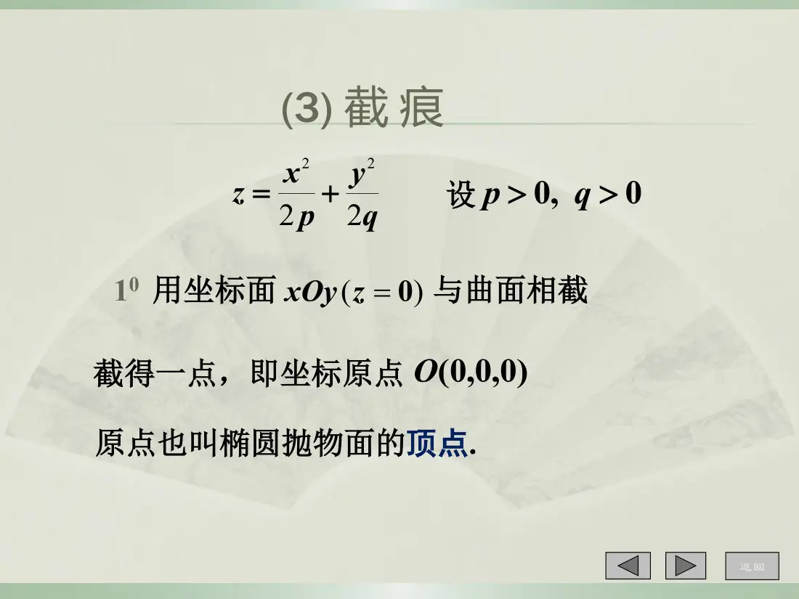

原文：

(3)截痕

$$
z = \frac {x ^ {2}}{2 p} + \frac {y ^ {2}}{2 q} \qquad \text {设} p > 0, q > 0
$$

$1^{0}$ 用坐标面 xOy(z=0) 与曲面相截截得一点，即坐标原点 O(0,0,0) 原点也叫椭圆抛物面的顶点.

◀ ▶

返回

### 与平面 $z = z_{1}$ ( $z_{1} > 0$ ) 的交线为椭圆.

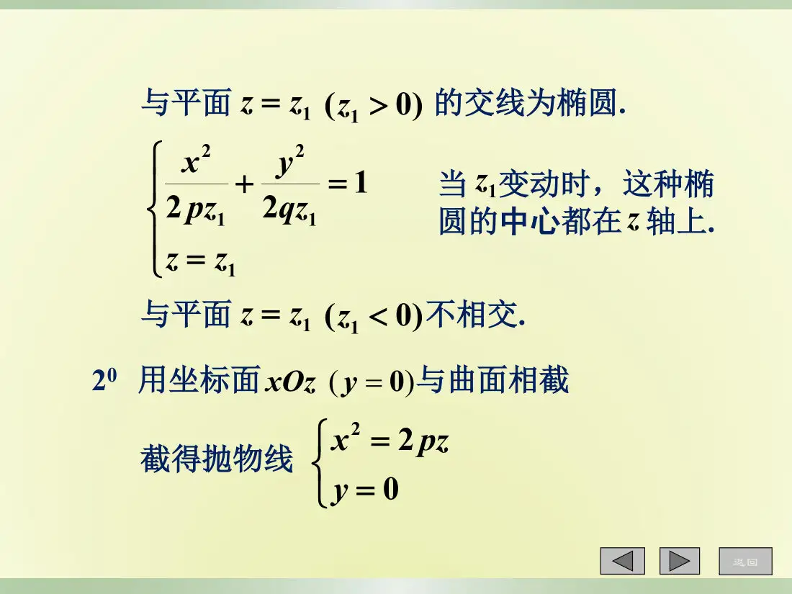

原文：

与平面 $z = z_{1}$ ( $z_{1} > 0$ ) 的交线为椭圆.

$$
\left\{ \begin{array}{l} \frac {x ^ {2}}{2 p z _ {1}} + \frac {y ^ {2}}{2 q z _ {1}} = 1 \\ z = z _ {1} \end{array} \right.
$$

当 $z_{1}$ 变动时，这种椭圆的中心都在 $z$ 轴上.

与平面 $z = z_{1} (z_{1} < 0)$ 不相交.

$2^{0}$ 用坐标面 $xOz$ ( $y = 0$ ) 与曲面相截

截得抛物线 $\left\{\begin{aligned}x^{2}&=2pz\\ y&=0\end{aligned}\right.$

◀ ▶

返回

### 与平面 $y = y_{1}$ 的交线为抛物线.

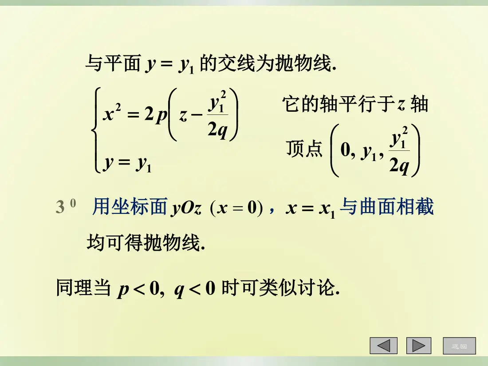

原文：

与平面 $y = y_{1}$ 的交线为抛物线.

$$
\left\{ \begin{array}{l} x ^ {2} = 2 p \left(z - \frac {y _ {1} ^ {2}}{2 q}\right) \\ y = y _ {1} \end{array} \right.
$$

它的轴平行于z轴顶点 $\left(0,y_{1},\frac{y_{1}^{2}}{2q}\right)$

$3^{0}$ 用坐标面 yOz (x = 0)， $x = x_{1}$ 与曲面相截均可得抛物线.

同理当 p<0, q<0 时可类似讨论.

◀ ▶

返回

### p < 0, q < 0

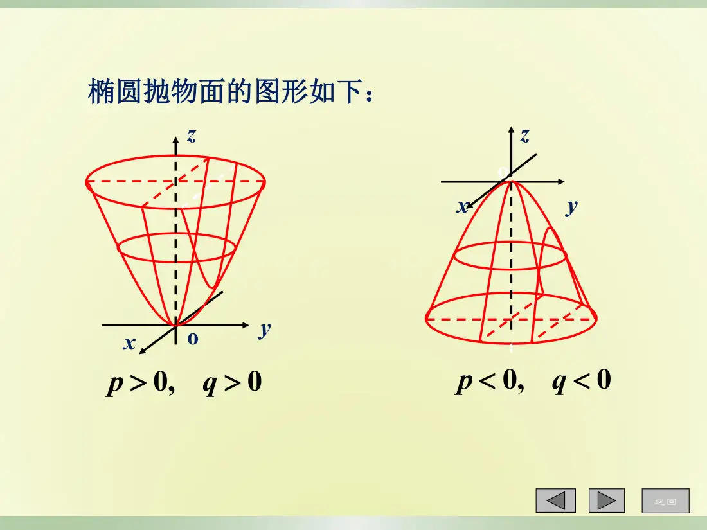

原文：

p < 0, q < 0

椭圆抛物面的图形如下:

返回

### 特殊地：当 $p = q$ 时，方程变为

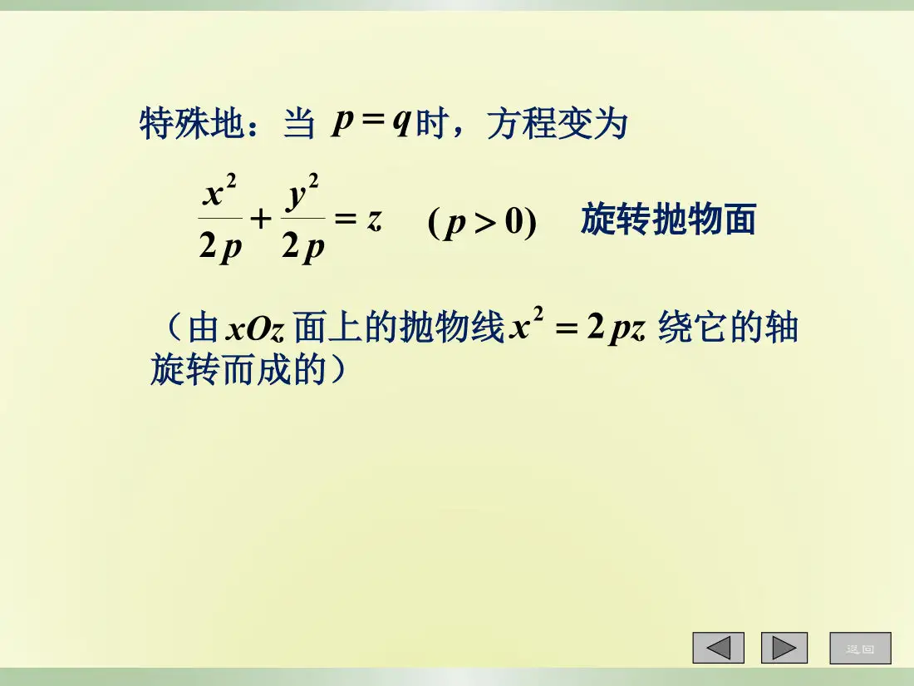

原文：

特殊地：当 $p = q$ 时，方程变为

$$
\frac {x ^ {2}}{2 p} + \frac {y ^ {2}}{2 p} = z \quad (p > 0) \quad \text {旋转抛物面}
$$

(由 xOz 面上的抛物线 $x^{2}=2pz$ 绕它的轴旋转而成的)

◀ ▶

返回

### (2) 双曲

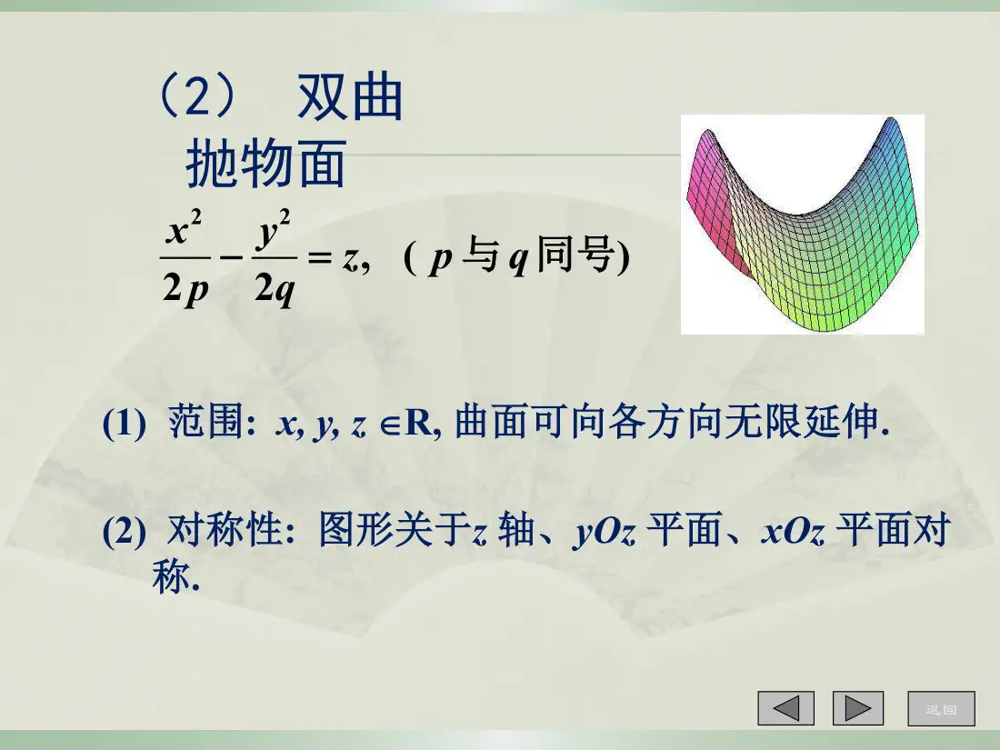

原文：

(2) 双曲

抛物面

$\frac{x^2}{2p} - \frac{y^2}{2q} = z, (p$ 与 $q$ 同号)

(1) 范围: $x, y, z \in \mathbb{R}$ , 曲面可向各方向无限延伸.

(2) 对称性: 图形关于 $z$ 轴、 $yOz$ 平面、 $xOz$ 平面对称.

◀ ▶

返回

### (3) 截痕 (设 $p < 0, q < 0$ )

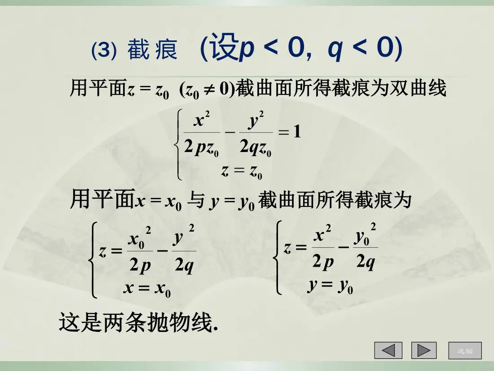

原文：

(3) 截痕 (设 $p < 0, q < 0$ )

用平面 $z = z_{0}$ $(z_{0} \neq 0)$ 截曲面所得截痕为双曲线

$$
\left\{ \begin{array}{c} \frac {x ^ {2}}{2 p z _ {0}} - \frac {y ^ {2}}{2 q z _ {0}} = 1 \\ z = z _ {0} \end{array} \right.
$$

用平面 $x = x_{0}$ 与 $y = y_{0}$ 截曲面所得截痕为

$$
\left\{ \begin{array}{c} z = \frac {x _ {0} ^ {2}}{2 p} - \frac {y ^ {2}}{2 q} \\ x = x _ {0} \end{array} \right.
$$

$$
\left\{ \begin{array}{c} z = \frac {x ^ {2}}{2 p} - \frac {y _ {0} ^ {2}}{2 q} \\ y = y _ {0} \end{array} \right.
$$

这是两条抛物线.

◀ ▶

返回

### 双曲抛物面 (马鞍面)

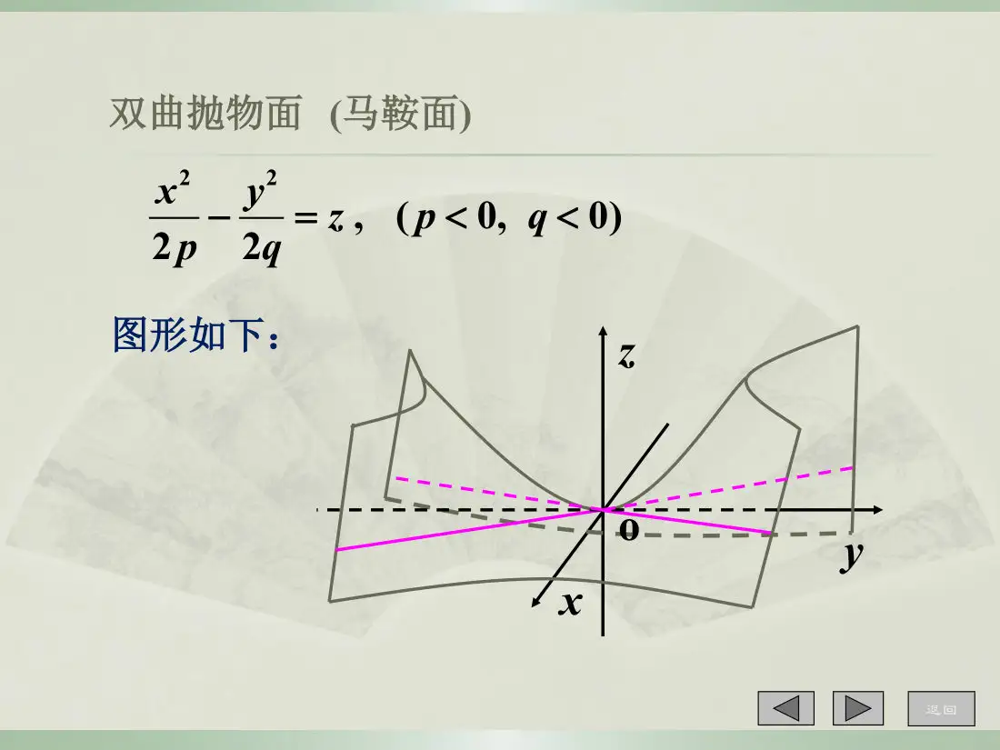

原文：

双曲抛物面 (马鞍面)

$$
\frac {x ^ {2}}{2 p} - \frac {y ^ {2}}{2 q} = z, (p <   0, q <   0)
$$

图形如下:

返回

◀ ▶

### 四、空间曲线及其方程

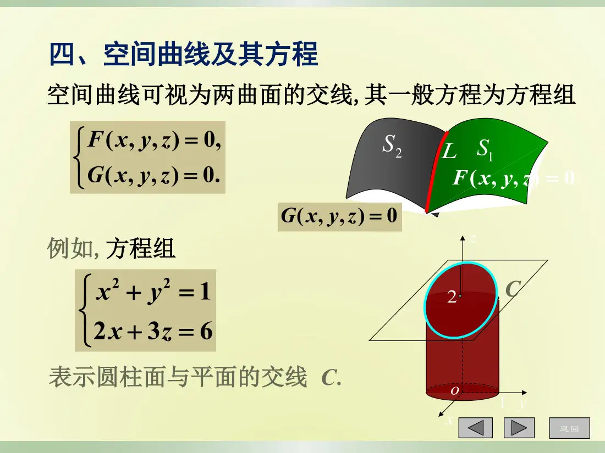

原文：

四、空间曲线及其方程

空间曲线可视为两曲面的交线, 其一般方程为方程组

$$
\left\{ \begin{array}{l} F (x, y, z) = 0, \\ G (x, y, z) = 0. \end{array} \right.
$$

例如, 方程组

$$
\left\{ \begin{array}{l} x ^ {2} + y ^ {2} = 1 \\ 2 x + 3 z = 6 \end{array} \right.
$$

表示圆柱面与平面的交线 C.

返回

### ◀ ▶

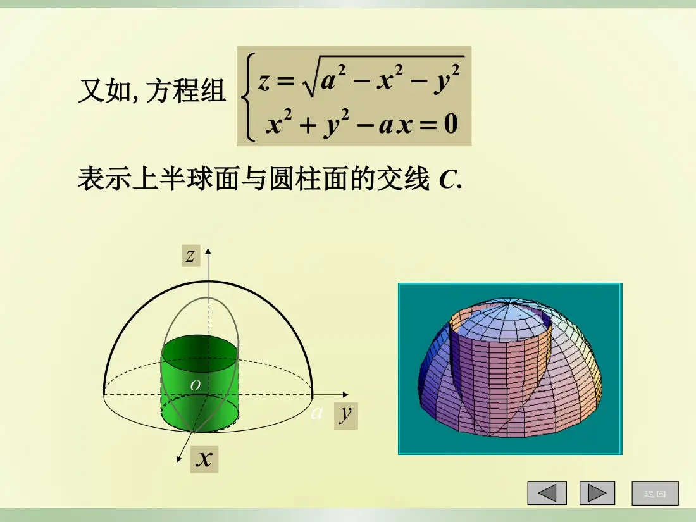

原文：

又如, 方程组 $\left\{\begin{aligned}z&=\sqrt{a^{2}-x^{2}-y^{2}}\\ x^{2}&+y^{2}-ax=0\end{aligned}\right.$ 表示上半球面与圆柱面的交线 C.

◀ ▶

返回

### 曲线的参数方程

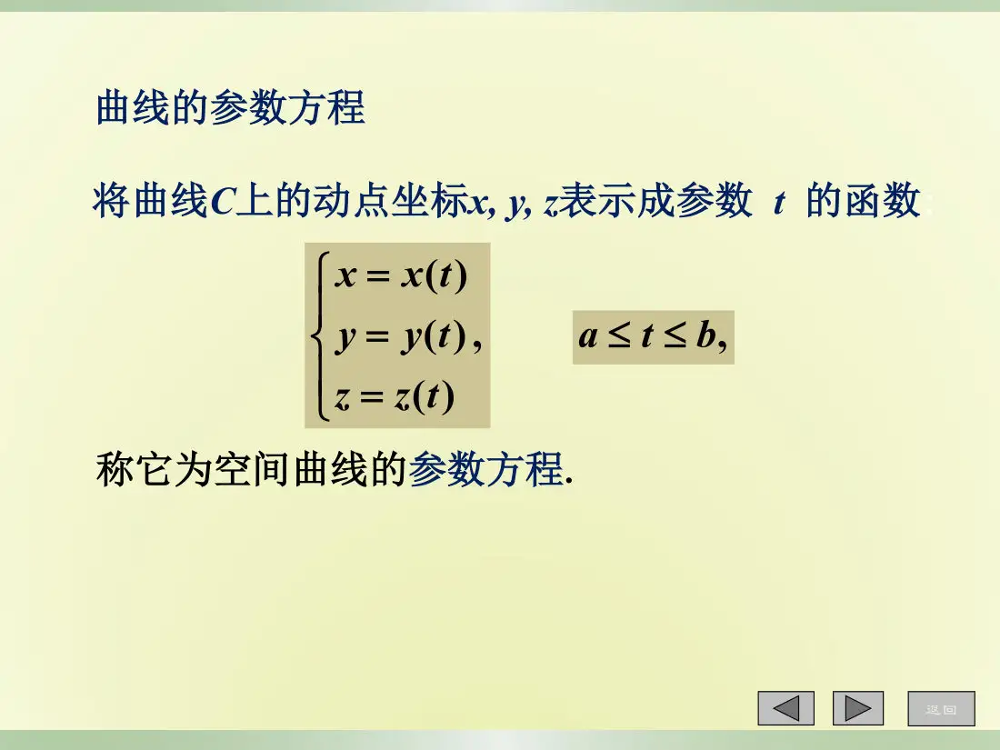

原文：

曲线的参数方程

将曲线C上的动点坐标x, y, z表示成参数 t 的函数

$$
\left\{ \begin{array}{l} x = x (t) \\ y = y (t), \\ z = z (t) \end{array} \right.
$$

$$
a \leq t \leq b,
$$

称它为空间曲线的参数方程.

◀ ▶

返回

### $$

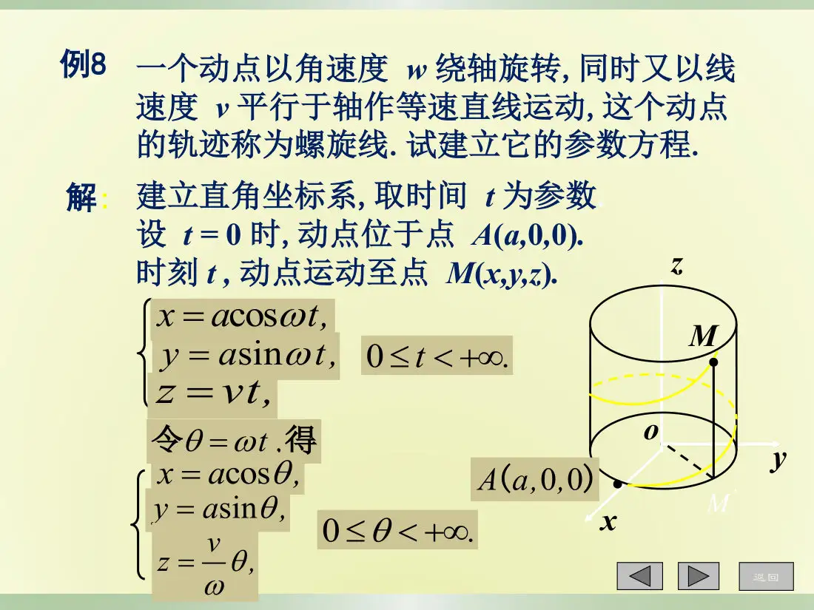

原文：

例8 一个动点以角速度 w 绕轴旋转, 同时又以线速度 v 平行于轴作等速直线运动, 这个动点的轨迹称为螺旋线. 试建立它的参数方程.

解: 建立直角坐标系, 取时间 t 为参数. 设 t = 0 时, 动点位于点 A(a,0,0). 时刻 t, 动点运动至点 M(x,y,z).

$$
\left\{ \begin{array}{l} x = a \cos \omega t, \\ y = a \sin \omega t, \\ z = v t, \end{array} \right.
$$

$$
0 \leq t <   + \infty .
$$

令 $\theta = \omega t$ .得

$$
\left\{ \begin{array}{l} x = a \cos \theta , \\ y = a \sin \theta , \\ z = \frac {v}{\omega} \theta , \end{array} \right.
$$

$$
0 \leq \theta <   + \infty .
$$

x

◀ ▶

### 例9 将下列曲线一般方程化为参数方程

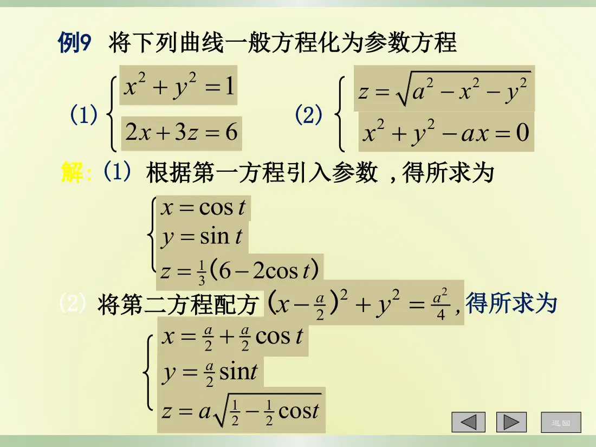

原文：

例9 将下列曲线一般方程化为参数方程

(1) $\left\{ \begin{array}{l} x^{2} + y^{2} = 1 \\ 2x + 3z = 6 \end{array} \right.$

(2)

$$
\left\{ \begin{array}{l} z = \sqrt {a ^ {2} - x ^ {2} - y ^ {2}} \\ x ^ {2} + y ^ {2} - a x = 0 \end{array} \right.
$$

解: (1) 根据第一方程引入参数, 得所求为

$$
\left\{ \begin{array}{l} x = \cos t \\ y = \sin t \\ z = \frac {1}{3} (6 - 2 \cos t) \end{array} \right.
$$

(2) 将第二方程配方 $\left(x-\frac{a}{2}\right)^{2}+y^{2}=\frac{a^{2}}{4}$ ，得所求为

$$
\left\{ \begin{array}{l} x = \frac {a}{2} + \frac {a}{2} \cos t \\ y = \frac {a}{2} \sin t \\ z = a \sqrt {\frac {1}{2} - \frac {1}{2} \cos t} \end{array} \right.
$$

◀ ▶

返回

### 空间曲线在坐标面上的投影

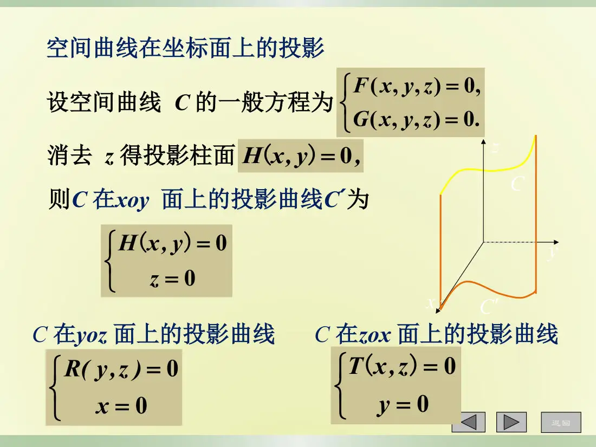

原文：

空间曲线在坐标面上的投影

设空间曲线 C 的一般方程为 $\left\{\begin{aligned}F(x,y,z)&=0,\\ G(x,y,z)&=0.\end{aligned}\right.$

消去 z 得投影柱面 $H(x,y)=0$ ,
则 C 在 xoy 面上的投影曲线 $C'$ 为

$$
\left\{ \begin{array} {c} H (x, y) = 0 \\ z = 0 \end{array} \right.
$$

C 在 yoz 面上的投影曲线 C 在 zox 面上的投影曲线

$$
\left\{ \begin{array}{c} R (y, z) = 0 \\ x = 0 \end{array} \right.
$$

$$
\left\{ \begin{array} {c} T (x, z) = 0 \\ y = 0 \end{array} \right.
$$

返回

### 例10 求如下曲线C在xoy面上的投影曲线方程:

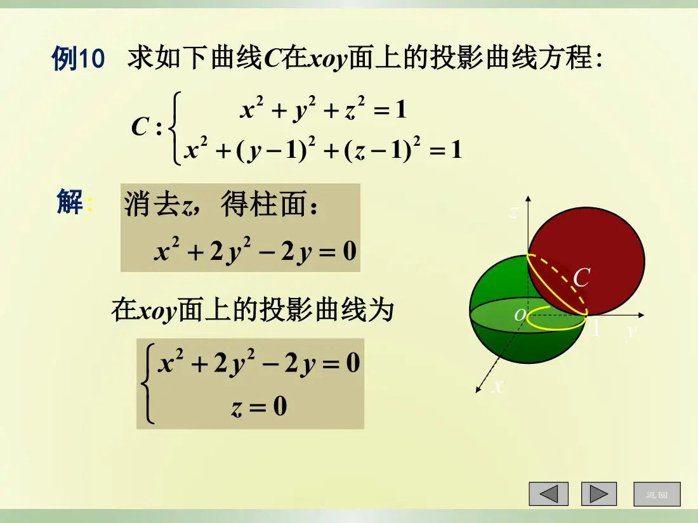

原文：

例10 求如下曲线C在xoy面上的投影曲线方程:

$$
C: \left\{ \begin{array}{c} x ^ {2} + y ^ {2} + z ^ {2} = 1 \\ x ^ {2} + (y - 1) ^ {2} + (z - 1) ^ {2} = 1 \end{array} \right.
$$

解：消去z，得柱面：

$$
x ^ {2} + 2 y ^ {2} - 2 y = 0
$$

在xoy面上的投影曲线为

$$
\left\{ \begin{array}{c} x ^ {2} + 2 y ^ {2} - 2 y = 0 \\ z = 0 \end{array} \right.
$$

◀ ▶

返回

### 从而交线C在xoy面上的投影曲线C':

原文：

例11 设一个立体由上半球面 $z = \sqrt{4 - x^2 - y^2}$ 和锥面 $z = \sqrt{3(x^2 + y^2)}$ 所围成, 求它在 $xoy$ 面上的投影.

解：半球面与锥面交线为 $C: \left\{ \begin{array}{l} z = \sqrt{4 - x^2 - y^2} \\ z = \sqrt{3(x^2 + y^2)} \end{array} \right.$ 消去 $z$ ，得柱面： $x^2 + y^2 = 1$ .

从而交线C在xoy面上的投影曲线C':

$$
\left\{ \begin{array}{c} x ^ {2} + y ^ {2} = 1, \\ z = 0. \end{array} \right.
$$

故所围立体在xoy
面上的投影为： $\left\{\begin{aligned}x^{2}+y^{2}\leq1,\\ z=0.\end{aligned}\right.$
