# 《线性代数与解析几何》4.3 向量组的秩（课件）

原件的每一页，下面附识别出的文字。

### $$

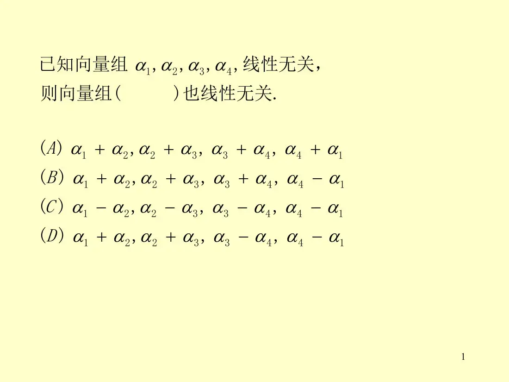

原文：

已知向量组 $\alpha_{1}, \alpha_{2}, \alpha_{3}, \alpha_{4}$ ，线性无关，则向量组（）也线性无关.

$$
(A) \alpha_ {1} + \alpha_ {2}, \alpha_ {2} + \alpha_ {3}, \alpha_ {3} + \alpha_ {4}, \alpha_ {4} + \alpha_ {1}
$$

$$
(B) \alpha_ {1} + \alpha_ {2}, \alpha_ {2} + \alpha_ {3}, \alpha_ {3} + \alpha_ {4}, \alpha_ {4} - \alpha_ {1}
$$

$$
(C) \alpha_ {1} - \alpha_ {2}, \alpha_ {2} - \alpha_ {3}, \alpha_ {3} - \alpha_ {4}, \alpha_ {4} - \alpha_ {1}
$$

$$
(D) \alpha_ {1} + \alpha_ {2}, \alpha_ {2} + \alpha_ {3}, \alpha_ {3} - \alpha_ {4}, \alpha_ {4} - \alpha_ {1}
$$

1

### “部分相关，则整体相关”

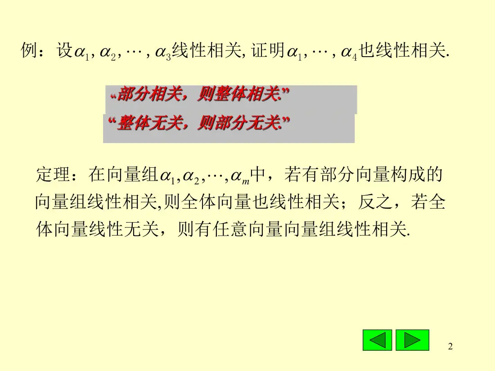

原文：

例：设 $\alpha_{1},\alpha_{2},\cdots,\alpha_{3}$ 线性相关,证明 $\alpha_{1},\cdots,\alpha_{4}$ 也线性相关.

“部分相关，则整体相关”

“整体无关，则部分无关”

定理：在向量组 $\alpha_{1},\alpha_{2},\cdots,\alpha_{m}$ 中，若有部分向量构成的向量组线性相关,则全体向量也线性相关；反之，若全体向量线性无关，则有任意向量向量组线性相关.

◀ ▶

2

### 第 3 页

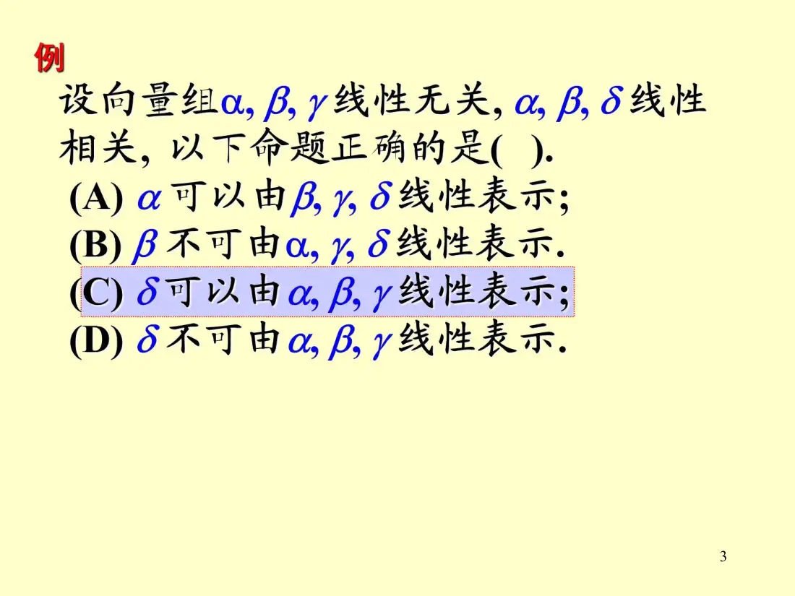

原文：

例

设向量组 $\alpha, \beta, \gamma$ 线性无关, $\alpha, \beta, \delta$ 线性相关, 以下命题正确的是( ).

(A) $\alpha$ 可以由 $\beta, \gamma, \delta$ 线性表示;

(B) $\beta$ 不可由 $\alpha, \gamma, \delta$ 线性表示.

(C) $\delta$ 可以由 $\alpha, \beta, \gamma$ 线性表示;

(D) $\delta$ 不可由 $\alpha, \beta, \gamma$ 线性表示.

3

### 证明:(1)∵ $a_{2}, a_{3}, a_{4}$ 线性无关，

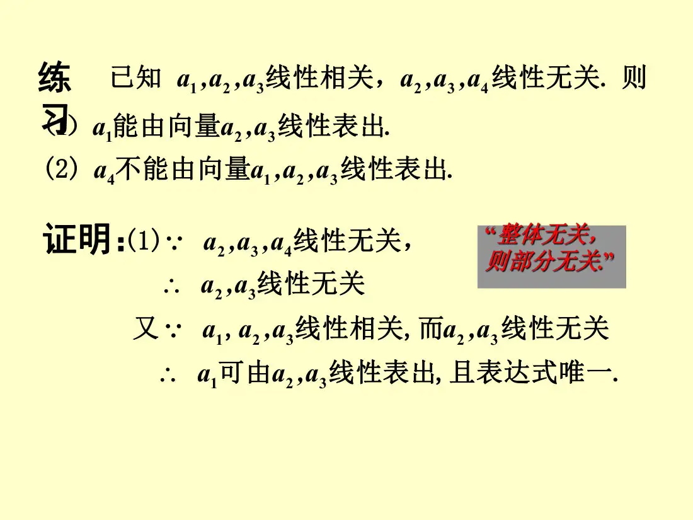

原文：

练 已知 $a_{1}, a_{2}, a_{3}$ 线性相关， $a_{2}, a_{3}, a_{4}$ 线性无关。则习） $a_{1}$ 能由向量 $a_{2}, a_{3}$ 线性表出。

(2) $a_{4}$ 不能由向量 $a_{1}, a_{2}, a_{3}$ 线性表出.

证明:(1)∵ $a_{2}, a_{3}, a_{4}$ 线性无关，
∴ $a_{2}, a_{3}$ 线性无关

“整体无关，则部分无关。”

又∵ $a_{1}, a_{2}, a_{3}$ 线性相关, 而 $a_{2}, a_{3}$ 线性无关
∴ $a_{1}$ 可由 $a_{2}, a_{3}$ 线性表出, 且表达式唯一.

### 证明:(1) 另证:

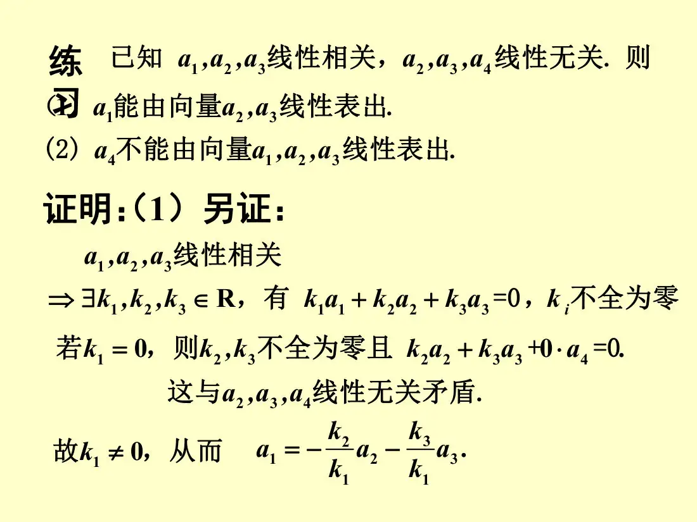

原文：

练 已知 $a_{1}, a_{2}, a_{3}$ 线性相关， $a_{2}, a_{3}, a_{4}$ 线性无关。则 $a_{1}$ 能由向量 $a_{2}, a_{3}$ 线性表出。

(2) $a_{4}$ 不能由向量 $a_{1}, a_{2}, a_{3}$ 线性表出.

证明:(1) 另证:

$a_{1}, a_{2}, a_{3}$ 线性相关 $\Rightarrow \exists k_{1}, k_{2}, k_{3} \in \mathbb{R}$ ，有 $k_{1}a_{1} + k_{2}a_{2} + k_{3}a_{3} = 0$ ， $k_{i}$ 不全为零 若 $k_{1} = 0$ ，则 $k_{2}, k_{3}$ 不全为零且 $k_{2}a_{2} + k_{3}a_{3} + 0 \cdot a_{4} = 0$ .

这与 $a_{2},a_{3},a_{4}$ 线性无关矛盾.

故 $k_{1}\neq0$ ，从而 $a_{1}=-\frac{k_{2}}{k_{1}}a_{2}-\frac{k_{3}}{k_{1}}a_{3}.$

### (1) $a_{1}$ 能由向量 $a_{2}, a_{3}$ 线性表出.

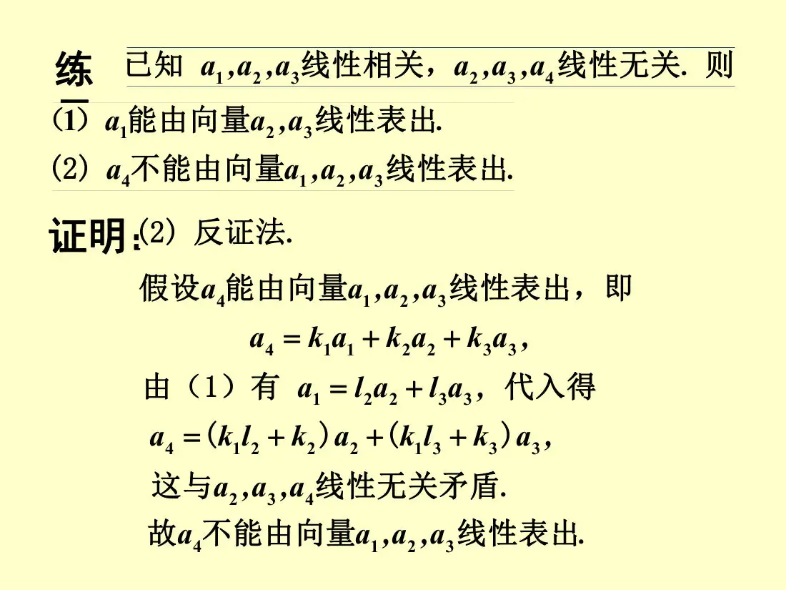

原文：

练 已知 $a_{1}, a_{2}, a_{3}$ 线性相关， $a_{2}, a_{3}, a_{4}$ 线性无关。则
(1) $a_{1}$ 能由向量 $a_{2}, a_{3}$ 线性表出.

(2) $a_{4}$ 不能由向量 $a_{1}, a_{2}, a_{3}$ 线性表出.

证明:(2) 反证法.

假设 $a_{4}$ 能由向量 $a_{1},a_{2},a_{3}$ 线性表出，即

$$
a _ {4} = k _ {1} a _ {1} + k _ {2} a _ {2} + k _ {3} a _ {3},
$$

由（1）有 $a_{1}=l_{2}a_{2}+l_{3}a_{3}$ ，代入得

$$
a _ {4} = \left(k _ {1} l _ {2} + k _ {2}\right) a _ {2} + \left(k _ {1} l _ {3} + k _ {3}\right) a _ {3},
$$

这与 $a_{2},a_{3},a_{4}$ 线性无关矛盾.

故 $a_{4}$ 不能由向量 $a_{1},a_{2},a_{3}$ 线性表出.

### 方阵 $A$ 可逆的充分必要条件

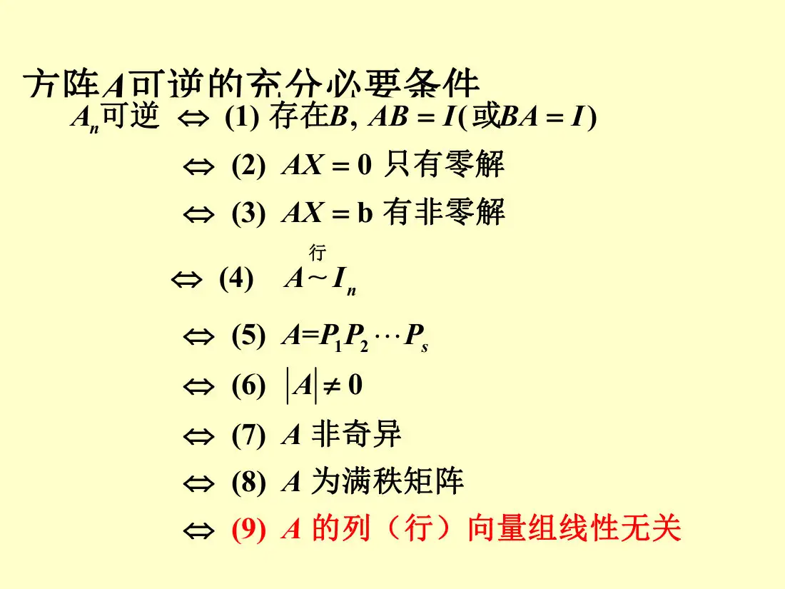

原文：

方阵 $A$ 可逆的充分必要条件

$A_{n}$ 可逆 $\Leftrightarrow$ (1) 存在 B, AB = I (或 BA = I)

$\Leftrightarrow$ (2) $AX = 0$ 只有零解

$\Leftrightarrow$ (3) $AX = \mathbf{b}$ 有非零解

$\Leftrightarrow (4) A \sim I_{n}^{行}$

$\Leftrightarrow$ (5) $A = P_{1}P_{2}\dots P_{s}$

$\Leftrightarrow (6) |A| \neq 0$

$\Leftrightarrow$ (7) $A$ 非奇异

$\Leftrightarrow$ (8) $A$ 为满秩矩阵

$\Leftrightarrow$ (9) $A$ 的列（行）向量组线性无关

### 《线性代数与空间解析几何》

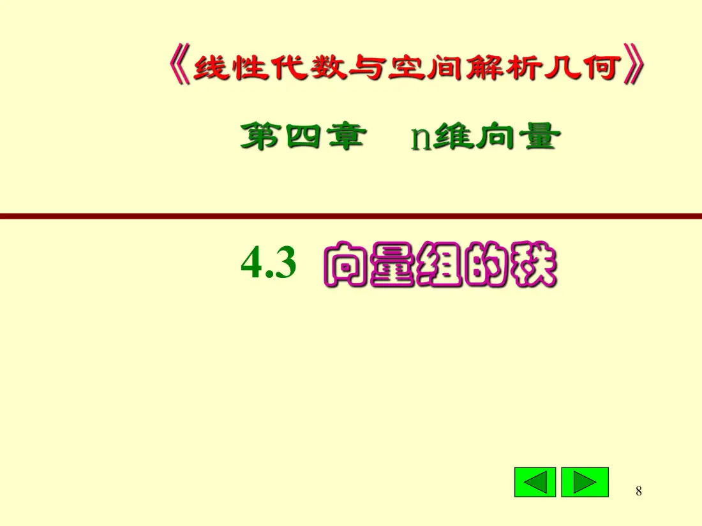

原文：

《线性代数与空间解析几何》

第四章 n维向量

4.3 向量组的秩

◀ ▶

8

### 复习线性相关性的判定理论

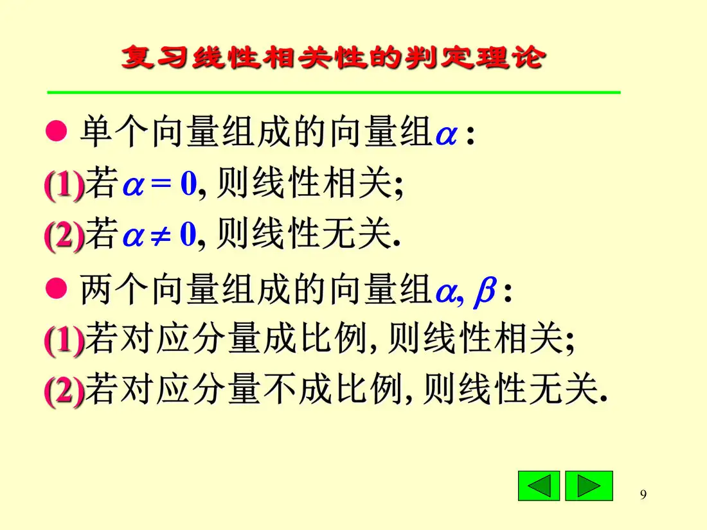

原文：

复习线性相关性的判定理论

\- 单个向量组成的向量组 $\alpha$ :

(1)若 $\alpha = 0$ , 则线性相关;

(2)若 $\alpha \neq 0$ , 则线性无关.

\- 两个向量组成的向量组 $\alpha, \beta$ :

(1)若对应分量成比例, 则线性相关;

(2)若对应分量不成比例, 则线性无关.

◀ ▶

9

### (1)包含0向量⇒线性相关. $(m \geq 2)$

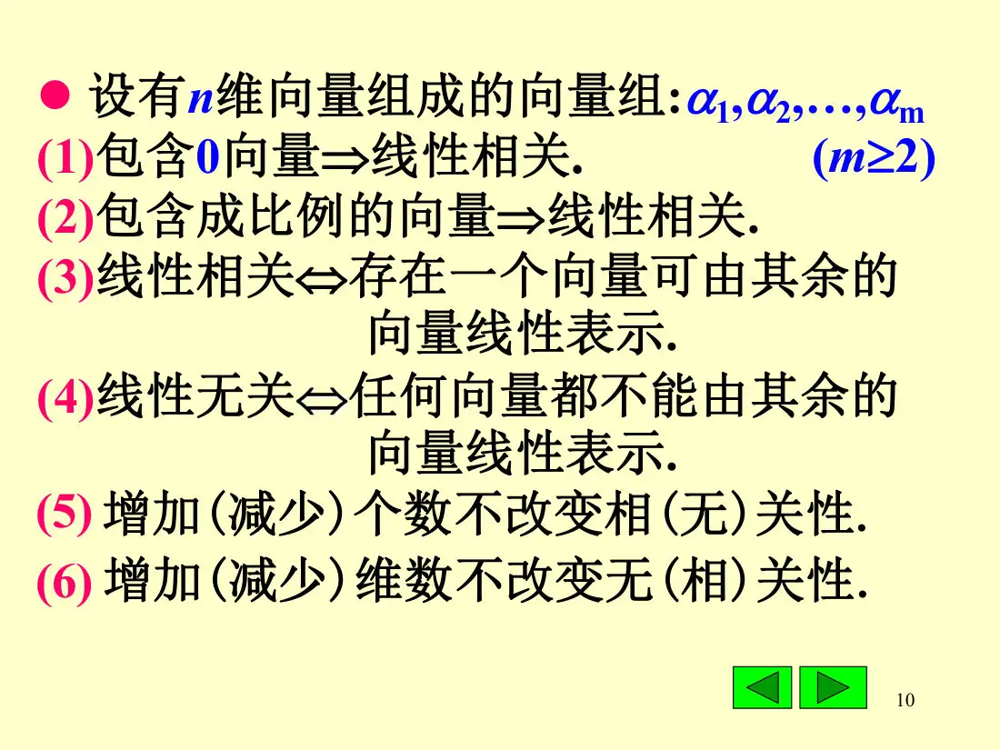

原文：

\- 设有 $n$ 维向量组成的向量组: $\alpha_{1}, \alpha_{2}, \ldots, \alpha_{m}$

(1)包含0向量⇒线性相关. $(m \geq 2)$

(2)包含成比例的向量⇒线性相关.

(3)线性相关 $\Leftrightarrow$ 存在一个向量可由其余的向量线性表示.

(4)线性无关 $\Leftrightarrow$ 任何向量都不能由其余的向量线性表示.

(5) 增加 (减少) 个数不改变相 (无) 关性.

(6) 增加 (减少) 维数不改变无 (相) 关性.

◀ ▶

10

### $\Leftrightarrow$ 齐次线性方程组 $AX = 0$ 有非零解

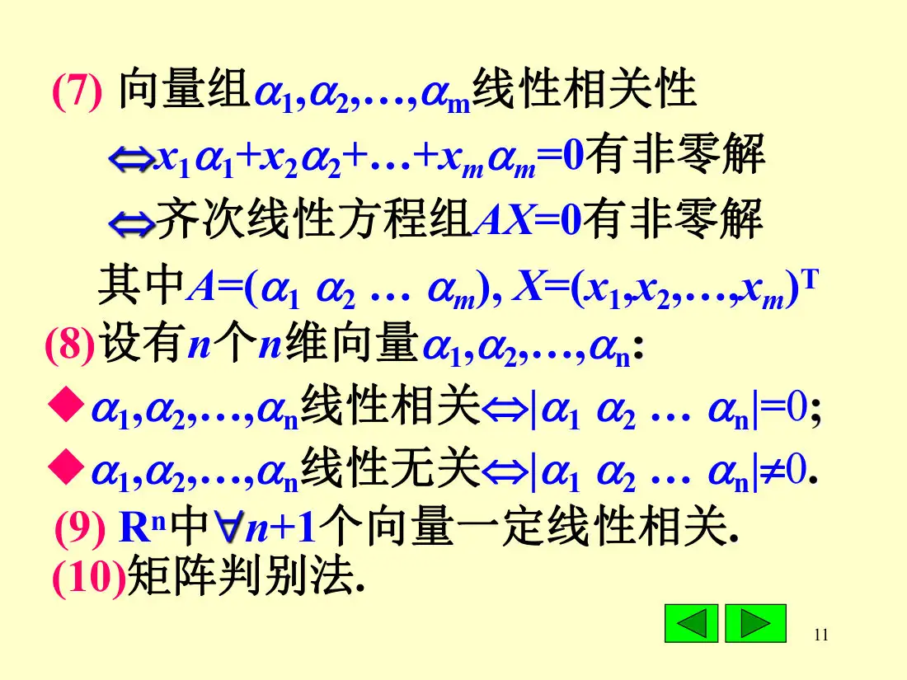

原文：

(7) 向量组 $\alpha_{1}, \alpha_{2}, \ldots, \alpha_{m}$ 线性相关性

$\Leftrightarrow x_{1}\alpha_{1} + x_{2}\alpha_{2} + \ldots +x_{m}\alpha_{m} = 0$ 有非零解

$\Leftrightarrow$ 齐次线性方程组 $AX = 0$ 有非零解

其中 $A = (\alpha_{1}\alpha_{2}\dots \alpha_{m}),X = (x_{1},x_{2},\dots ,x_{m})^{\mathrm{T}}$

(8)设有n个n维向量 $\alpha_{1},\alpha_{2},\ldots,\alpha_{n}$ :

$\alpha_{1},\alpha_{2},\ldots,\alpha_{n}$ 线性相关 $\Leftrightarrow|\alpha_{1}\alpha_{2}\ldots\alpha_{n}|=0;$

$\alpha_{1},\alpha_{2},\ldots,\alpha_{n}$ 线性无关 $\Leftrightarrow|\alpha_{1}\alpha_{2}\ldots\alpha_{n}|\neq0.$

(9) $\mathbf{R}^{\mathrm{n}}$ 中 $\forall n + 1$ 个向量一定线性相关.

(10)矩阵判别法.

◀ ▶

11

### 4.3 向量组的秩

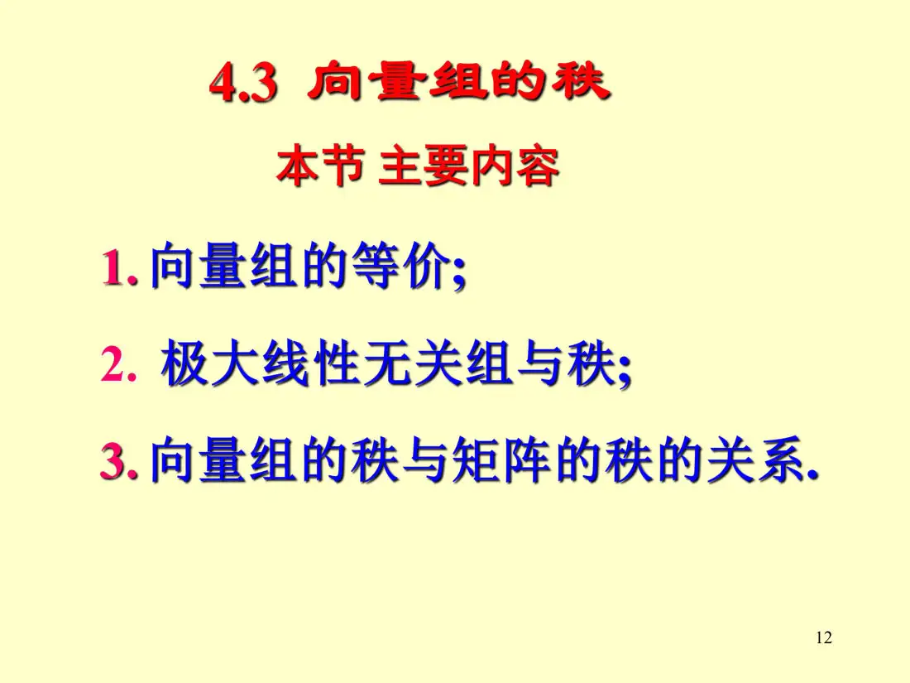

原文：

4.3 向量组的秩

本节 主要内容

1. 向量组的等价;

2. 极大线性无关组与秩;

3. 向量组的秩与矩阵的秩的关系.

12

### 4.3.1 向量组的等价

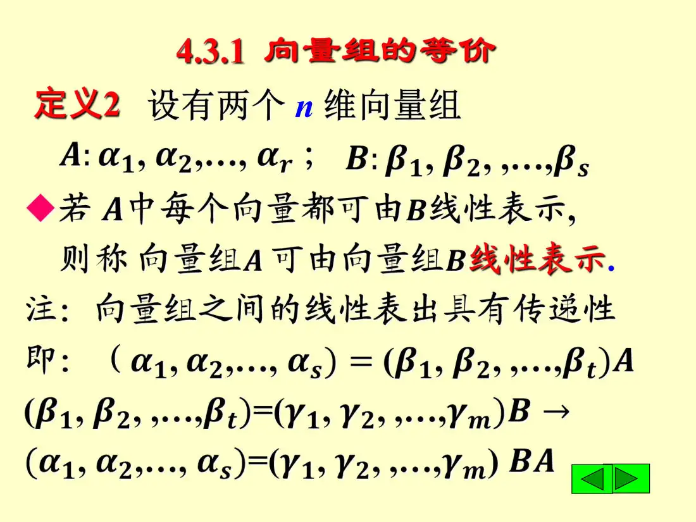

原文：

4.3.1 向量组的等价

定义2 设有两个 n 维向量组

$A: \alpha_{1}, \alpha_{2}, \ldots, \alpha_{r}; B: \beta_{1}, \beta_{2}, \ldots, \beta_{s}$

若 $A$ 中每个向量都可由 $B$ 线性表示,

则称向量组A可由向量组B线性表示.

注：向量组之间的线性表出具有传递性

即： $(\alpha_{1},\alpha_{2},\ldots,\alpha_{s})=(\beta_{1},\beta_{2},\ldots,\beta_{t})A$

$$
(\beta_ {1}, \beta_ {2}, \dots , \beta_ {t}) = (\gamma_ {1}, \gamma_ {2}, \dots , \gamma_ {m}) B \rightarrow
$$

$$
(\alpha_ {1}, \alpha_ {2}, \dots , \alpha_ {s}) = (\gamma_ {1}, \gamma_ {2}, \dots , \gamma_ {m}) B A
$$

◀ △

### 4.3.1 向量组的等价

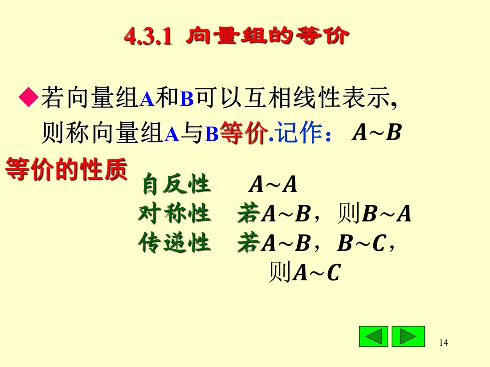

原文：

4.3.1 向量组的等价

◆ 若向量组A和B可以互相线性表示,则称向量组A与B等价.记作: A\~B

自反性 $A \sim A$

对称性 若 $A \sim B$ ，则 $B \sim A$

传递性 若 $A \sim B$ ， $B \sim C$

则 $A \sim C$

◀ ▶

14

### 第 15 页

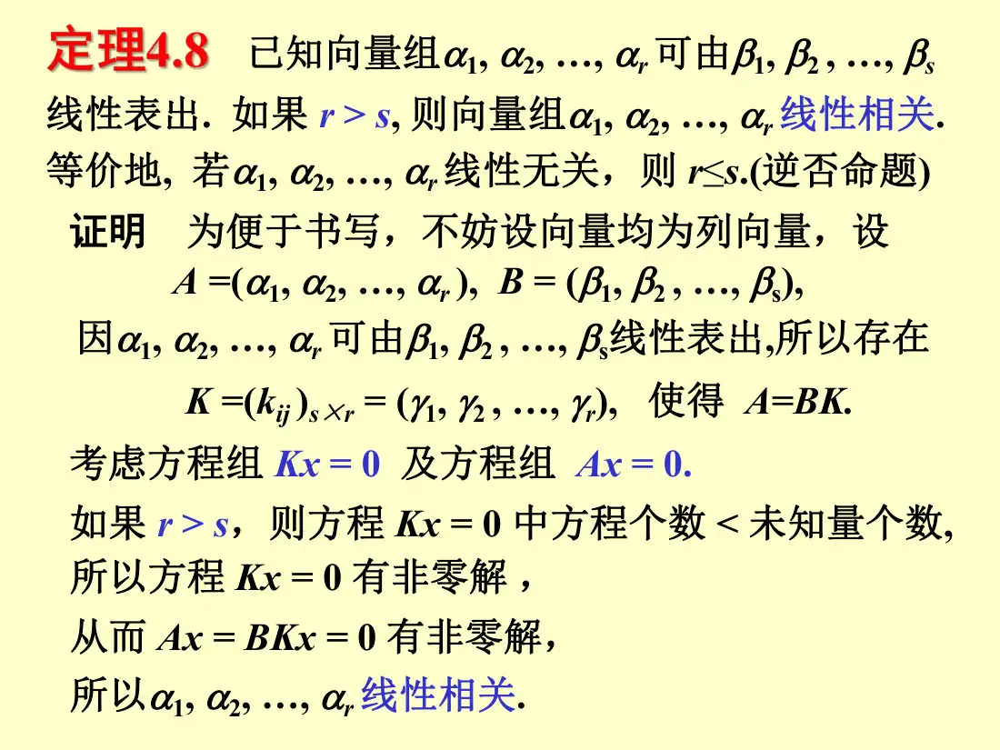

原文：

定理4.8 已知向量组 $\alpha_{1}, \alpha_{2}, \ldots, \alpha_{r}$ 可由 $\beta_{1}, \beta_{2}, \ldots, \beta_{s}$ 线性表出。如果 $r > s$ ，则向量组 $\alpha_{1}, \alpha_{2}, \ldots, \alpha_{r}$ 线性相关。等价地，若 $\alpha_{1}, \alpha_{2}, \ldots, \alpha_{r}$ 线性无关，则 $r \leq s$ 。（逆否命题）证明 为便于书写，不妨设向量均为列向量，设 $A = (\alpha_{1}, \alpha_{2}, \ldots, \alpha_{r}), B = (\beta_{1}, \beta_{2}, \ldots, \beta_{s})$ ，因 $\alpha_{1}, \alpha_{2}, \ldots, \alpha_{r}$ 可由 $\beta_{1}, \beta_{2}, \ldots, \beta_{s}$ 线性表出，所以存在 $K = (k_{ij})_{s \times r} = (\gamma_{1}, \gamma_{2}, \ldots, \gamma_{r})$ ，使得 $A = BK$ 。考虑方程组 $Kx = 0$ 及方程组 $Ax = 0$ 。如果 $r > s$ ，则方程 $Kx = 0$ 中方程个数 < 未知量个数，所以方程 $Kx = 0$ 有非零解，从而 $Ax = BKx = 0$ 有非零解，所以 $\alpha_{1}, \alpha_{2}, \ldots, \alpha_{r}$ 线性相关。

### $$

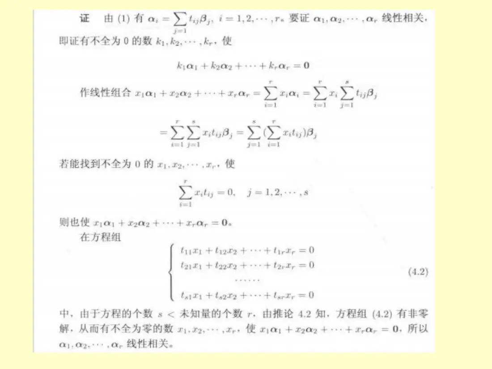

原文：

证 由 (1) 有 $\alpha_{i} = \sum_{j=1}^{n} t_{ij} \beta_{j}, i = 1, 2, \cdots, r$ 。要证 $\alpha_{1}, \alpha_{2}, \cdots, \alpha_{r}$ 线性相关，即证有不全为 0 的数 $k_{1}, k_{2}, \cdots, k_{r}$ ，使

$$
k _ {1} \alpha_ {1} + k _ {2} \alpha_ {2} + \dots + k _ {r} \alpha_ {r} = 0
$$

作线性组合

$$
\begin{array}{r l} x _ {1} \alpha_ {1} + x _ {2} \alpha_ {2} + \dots + x _ {r} \alpha_ {r} & = \sum_ {i = 1} ^ {r} x _ {i} \alpha_ {i} = \sum_ {i = 1} ^ {r} x _ {i} \sum_ {j = 1} ^ {s} t _ {i j} \beta_ {j} \\ & = \sum_ {i = 1} ^ {r} \sum_ {j = 1} ^ {s} x _ {i} t _ {i j} \beta_ {j} = \sum_ {j = 1} ^ {s} (\sum_ {i = 1} ^ {r} x _ {i} t _ {i j}) \beta_ {j} \end{array}
$$

若能找到不全为0的 $x_{1},x_{2},\cdots,x_{r}$ ，使

$$
\sum_ {i = 1} ^ {r} x _ {i} t _ {i j} = 0, \quad j = 1, 2, \dots , s
$$

则也使 $x_{1}\alpha_{1} + x_{2}\alpha_{2} + \cdots + x_{r}\alpha_{r} = 0$ 。

在方程组

$$
\left\{ \begin{array}{l} t _ {1 1} x _ {1} + t _ {1 2} x _ {2} + \dots + t _ {1 r} x _ {r} = 0 \\ t _ {2 1} x _ {1} + t _ {2 2} x _ {2} + \dots + t _ {2 r} x _ {r} = 0 \\ \dots \dots \\ t _ {s 1} x _ {1} + t _ {s 2} x _ {2} + \dots + t _ {s r} x _ {r} = 0 \end{array} \right.\tag{4.2}
$$

中，由于方程的个数 s < 未知量的个数 r，由推论 4.2 知，方程组 (4.2) 有非零解，从而有不全为零的数 $x_{1}, x_{2}, \cdots, x_{r}$ ，使 $x_{1}\alpha_{1} + x_{2}\alpha_{2} + \cdots + x_{r}\alpha_{r} = 0$ ，所以 $\alpha_{1}, \alpha_{2}, \cdots, \alpha_{r}$ 线性相关。

### 推论: 设有 $n$ 维向量组:

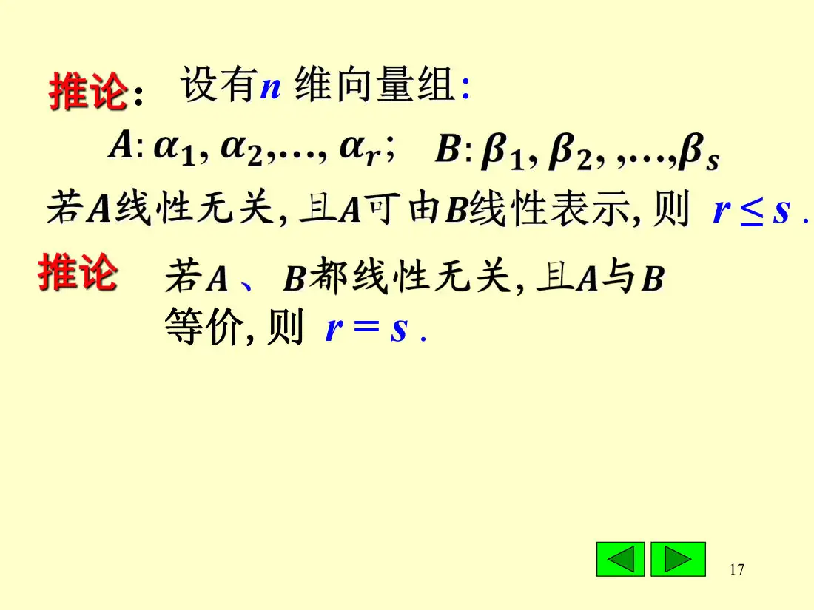

原文：

推论: 设有 $n$ 维向量组:

A: $\alpha_{1}, \alpha_{2}, \ldots, \alpha_{r};$ B: $\beta_{1}, \beta_{2}, \ldots, \beta_{s}$ 若A线性无关,且A可由B线性表示,则 $r \leq s$ .

推论 若A、B都线性无关, 且A与B等价, 则 r = s .

◀ ▶

17

### 4.3.2 向量组的极大无关组与秩

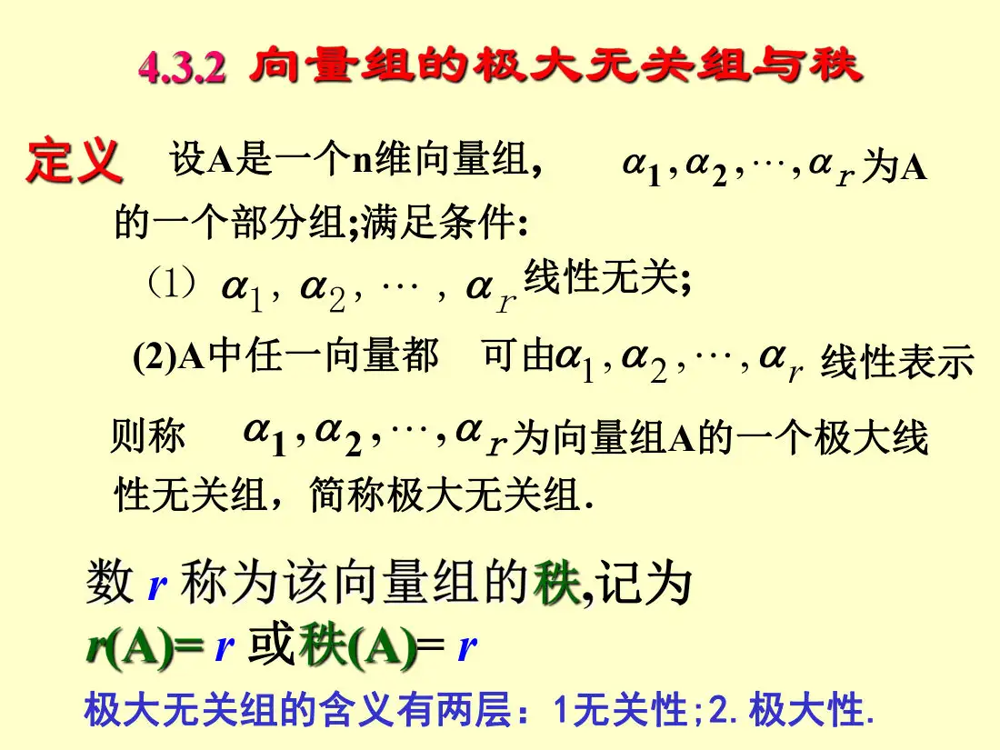

原文：

4.3.2 向量组的极大无关组与秩

定义 设A是一个n维向量组， $\alpha_{1},\alpha_{2},\cdots,\alpha_{r}$ 为A的一个部分组；满足条件：

(1) $\alpha_{1}, \alpha_{2}, \cdots, \alpha_{r}$ 线性无关;

(2)A中任一向量都 可由 $\alpha_{1},\alpha_{2},\cdots,\alpha_{r}$ 线性表示则称 $\alpha_{1},\alpha_{2},\cdots,\alpha_{r}$ 为向量组A的一个极大线性无关组，简称极大无关组.

数 r 称为该向量组的秩,记为

$r(A)=r$ 或秩(A)=r

极大无关组的含义有两层：1无关性；2. 极大性。

### 极大无关组的性质

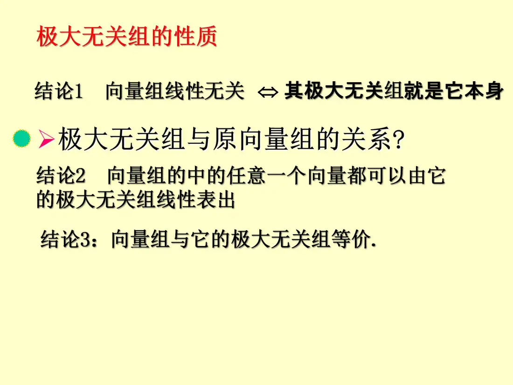

原文：

极大无关组的性质

结论1 向量组线性无关 $\Leftrightarrow$ 其极大无关组就是它本身

极大无关组与原向量组的关系？

结论2 向量组的中的任意一个向量都可以由它的极大无关组线性表出

结论3: 向量组与它的极大无关组等价.

### 解 因 $\beta_{1}, \beta_{2}$ 线性无关,且

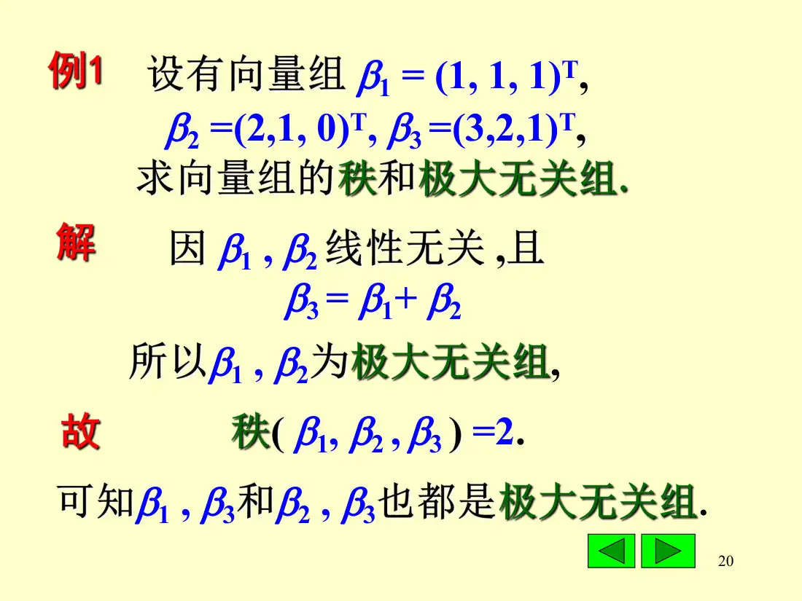

原文：

例1 设有向量组 $\beta_{1}=(1,1,1)^{\mathrm{T}}$ ,

$\beta_{2} = (2,1,0)^{\mathrm{T}}, \beta_{3} = (3,2,1)^{\mathrm{T}}$ 求向量组的秩和极大无关组.

解 因 $\beta_{1}, \beta_{2}$ 线性无关,且

$$
\beta_ {3} = \beta_ {1} + \beta_ {2}
$$

所以 $\beta_{1},\beta_{2}$ 为极大无关组，

故 秩( $\beta_{1},\beta_{2},\beta_{3}$ )=2.

可知 $\beta_{1}, \beta_{3}$ 和 $\beta_{2}, \beta_{3}$ 也都是极大无关组.

◀ ▶

20

### 由例题可知:

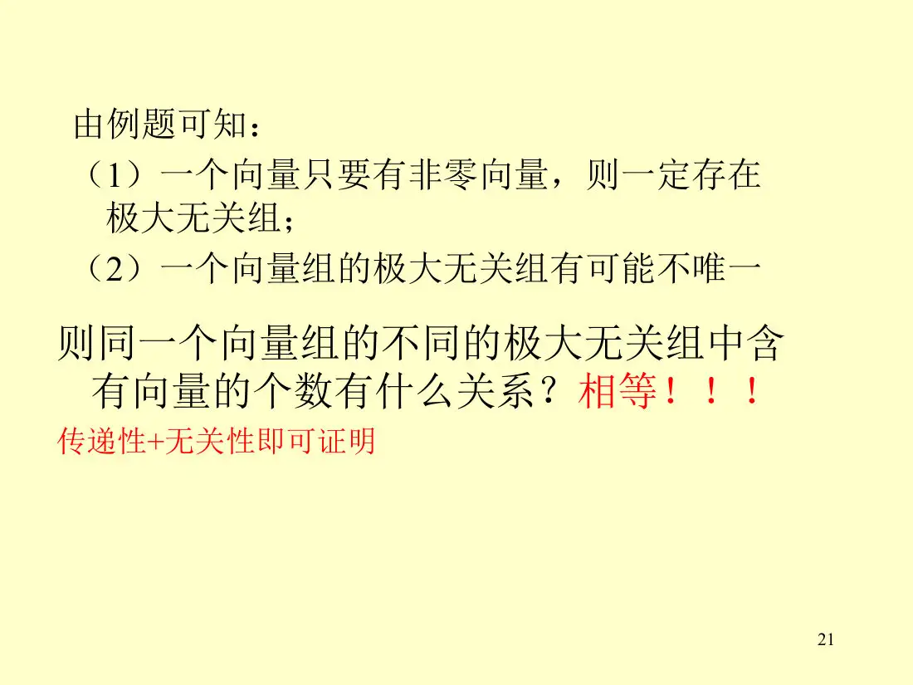

原文：

由例题可知:

(1) 一个向量只要有非零向量, 则一定存在极大无关组;

(2) 一个向量组的极大无关组有可能不唯一则同一个向量组的不同的极大无关组中含有向量的个数有什么关系？相等！！！传递性+无关性即可证明

21

### 极大无关组之间的关系？

原文：

极大无关组之间的关系？

性质 向量组的任意两个极大无关组等价，其个数都等于向量组的秩。

◀ ▶

22

### 定义(向量组的秩)

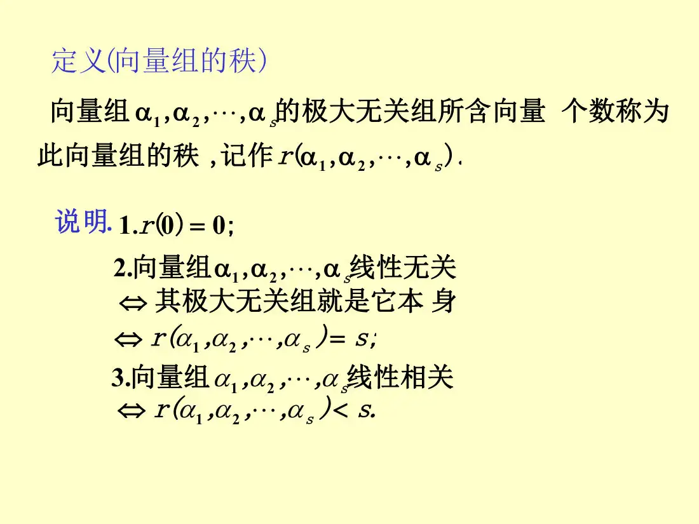

原文：

定义(向量组的秩)

向量组 $\alpha_{1},\alpha_{2},\cdots,\alpha_{s}$ 的极大无关组所含向量个数称为此向量组的秩，记作 $r(\alpha_{1},\alpha_{2},\cdots,\alpha_{s})$ .

说明. $1.r(0)=0;$

2. 向量组 $\alpha_{1}, \alpha_{2}, \cdots, \alpha_{s}$ 线性无关 $\Leftrightarrow$ 其极大无关组就是它本身 $\Leftrightarrow r(\alpha_{1},\alpha_{2},\cdots,\alpha_{s})=s;$

3. 向量组 $\alpha_{1}, \alpha_{2}, \cdots, \alpha_{s}$ 线性相关 $\Leftrightarrow r(\alpha_{1},\alpha_{2},\cdots,\alpha_{s})<s.$

### 两向量组秩的关系:

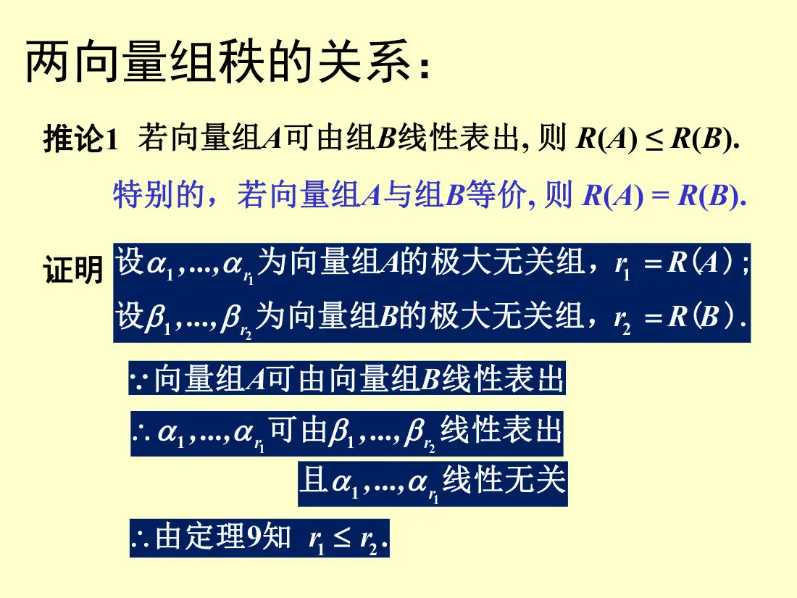

原文：

两向量组秩的关系:

推论1 若向量组A可由组B线性表出, 则 $R(A) \leq R(B)$ .
特别的，若向量组A与组B等价，则 $R(A) = R(B)$ .
证明 设 $\alpha_{1}, \ldots, \alpha_{r_{1}}$ 为向量组A的极大无关组， $r_{1} = R(A)$ ;
设 $\beta_{1}, \ldots, \beta_{r_{2}}$ 为向量组B的极大无关组， $r_{2} = R(B)$ .
∵ 向量组A可由向量组B线性表出
∴ $\alpha_{1}, \ldots, \alpha_{r_{1}}$ 可由 $\beta_{1}, \ldots, \beta_{r_{2}}$ 线性表出
且 $\alpha_{1}, \ldots, \alpha_{r_{1}}$ 线性无关
∴ 由定理9知 $r_{1} \leq r_{2}$ .

### 注：等价的向量组有相同的秩。

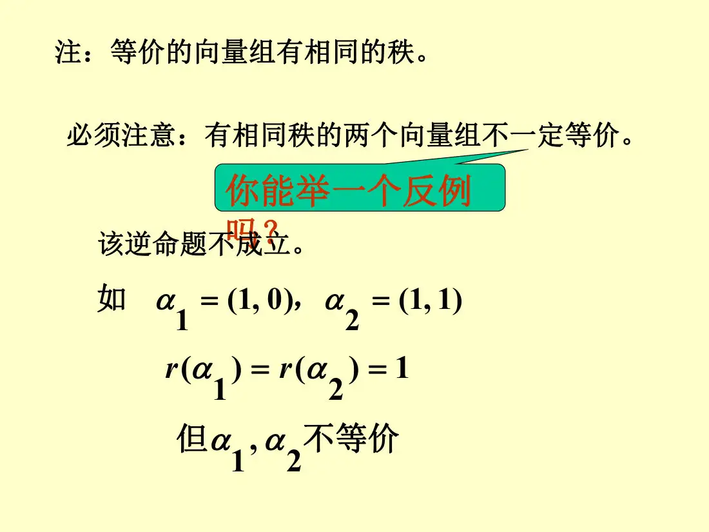

原文：

注：等价的向量组有相同的秩。

必须注意：有相同秩的两个向量组不一定等价。

你能举一个反例

该逆命题不成立。

如 $\alpha_{1} = (1,0),\alpha_{2} = (1,1)$

$$
r (\alpha_ {1}) = r (\alpha_ {2}) = 1
$$

但 $\alpha_{1},\alpha_{2}$ 不等价

### 等价的无关向量组必然等秩

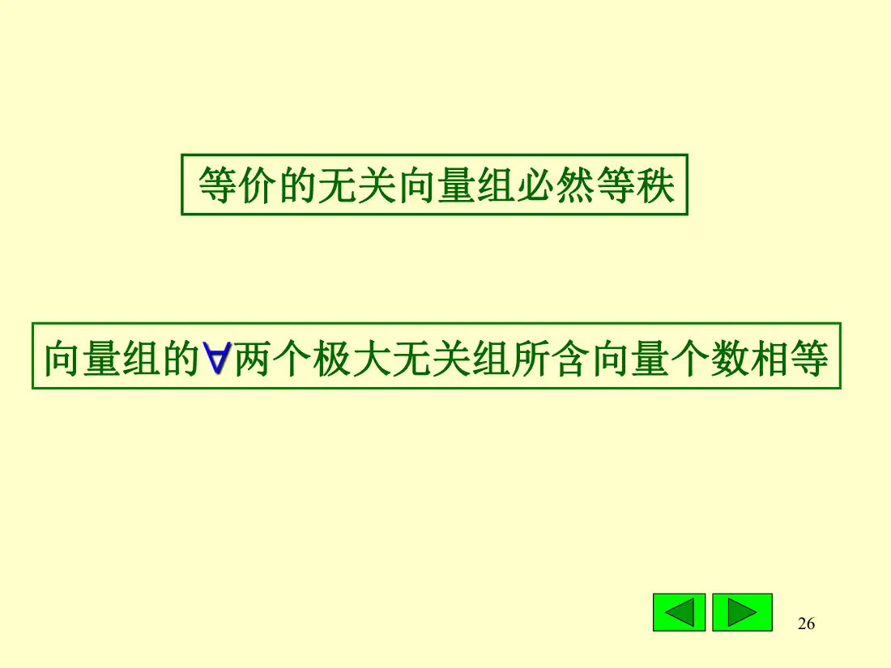

原文：

等价的无关向量组必然等秩

向量组的∀两个极大无关组所含向量个数相等

◀ ▶

26

### 4.3.3 向量组的秩与矩阵的秩的关系

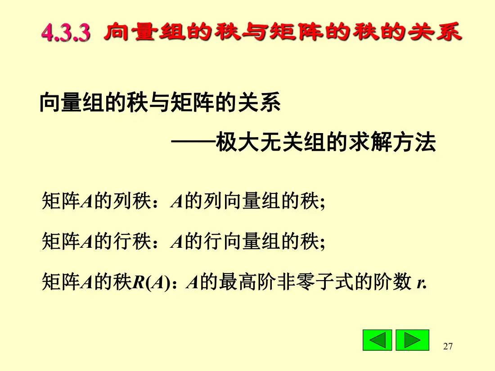

原文：

4.3.3 向量组的秩与矩阵的秩的关系

向量组的秩与矩阵的关系

——极大无关组的求解方法

矩阵A的列秩：A的列向量组的秩；

矩阵A的行秩：A的行向量组的秩；

矩阵A的秩 $R(A)$ ：A的最高阶非零子式的阶数r.

◀ ▶

27

### 定理7 矩阵的 行秩 = 列秩 = 矩阵的秩.

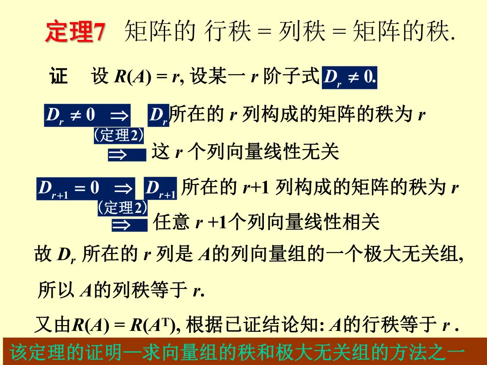

原文：

定理7 矩阵的 行秩 = 列秩 = 矩阵的秩.

证 设 $R(A)=r$ ，设某一 r 阶子式 $D_{r} \neq 0$ .

$D_{r} \neq 0 \Rightarrow D_{r}$ 所在的 $r$ 列构成的矩阵的秩为 $r$

这 r 个列向量线性无关

$D_{r+1}=0 \Rightarrow D_{r+1}$ 所在的 $r+1$ 列构成的矩阵的秩为 r
(定理2) $\Rightarrow$ 任意 $r+1$ 个列向量线性相关

故 $D_{r}$ 所在的 $r$ 列是 $A$ 的列向量组的一个极大无关组，所以 $A$ 的列秩等于 $r$ .

又由 $R(A)=R(A^{\mathrm{T}})$ ，根据已证结论知：A的行秩等于r。

该定理的证明一求向量组的秩和极大无关组的方法之一

### 定理 矩阵的初等行变换不改变（部分或全部）列向量之间的线性关系.

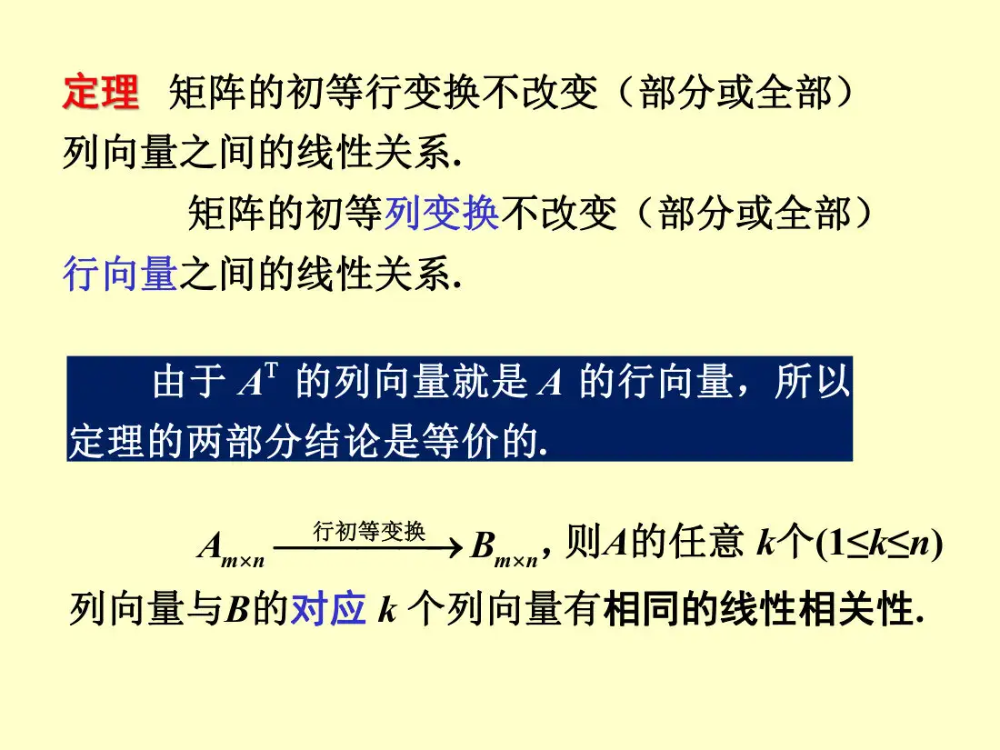

原文：

定理 矩阵的初等行变换不改变（部分或全部）列向量之间的线性关系.

矩阵的初等列变换不改变（部分或全部）行向量之间的线性关系.

由于 $A^{\mathrm{T}}$ 的列向量就是 $A$ 的行向量, 所以定理的两部分结论是等价的.

$A_{m\times n}\xrightarrow{行初等变换}B_{m\times n}$ ，则A的任意k个 $(1\leq k\leq n)$ 列向量与B的对应k个列向量有相同的线性相关性.

### 定理8的证明一求向量组的秩和极大无关组的方法之二

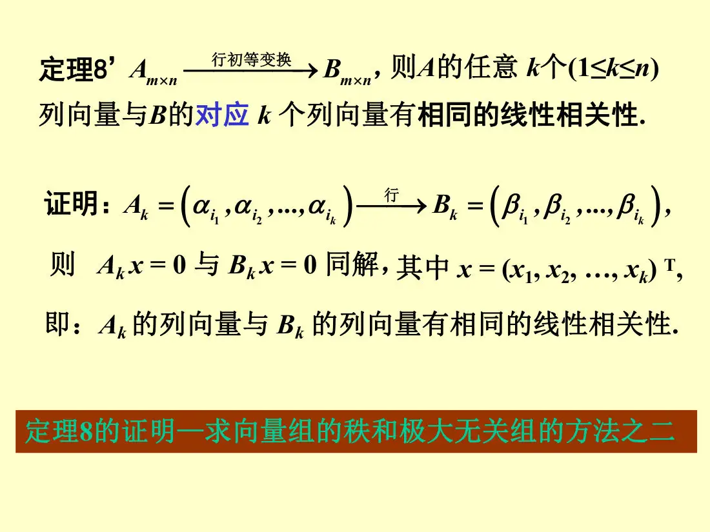

原文：

定理 $8'$ $A_{m \times n} \xrightarrow{\text{行初等变换}} B_{m \times n}$ , 则 $A$ 的任意 $k$ 个 $(1 \leq k \leq n)$ 列向量与 $B$ 的对应 $k$ 个列向量有相同的线性相关性.

证明： $A_{k}=\left(\alpha_{i_{1}},\alpha_{i_{2}},\ldots,\alpha_{i_{k}}\right)\xrightarrow{行}B_{k}=\left(\beta_{i_{1}},\beta_{i_{2}},\ldots,\beta_{i_{k}}\right)$ ，
则 $A_{k}x=0$ 与 $B_{k}x=0$ 同解，其中 $x=(x_{1},x_{2},\ldots,x_{k})^{\mathrm{T}}$ 即： $A_{k}$ 的列向量与 $B_{k}$ 的列向量有相同的线性相关性.

定理8的证明一求向量组的秩和极大无关组的方法之二

### $$

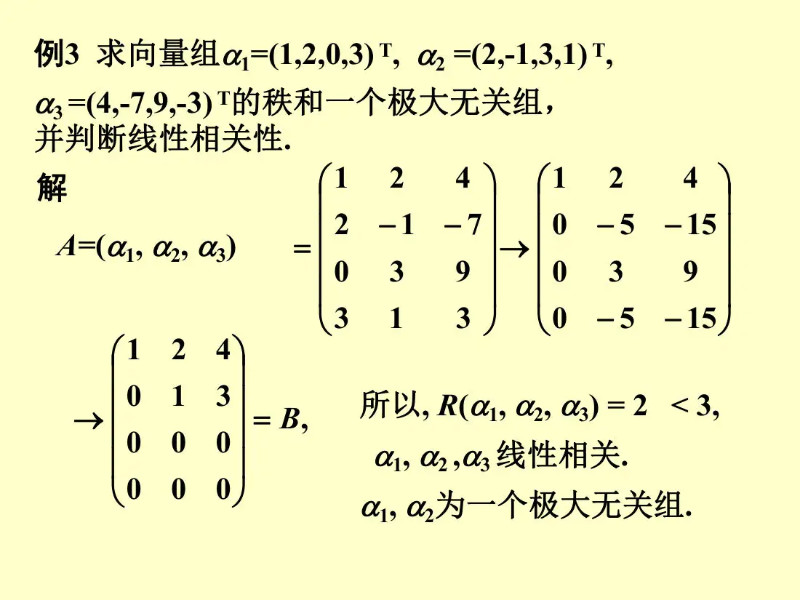

原文：

例3 求向量组 $\alpha_{1}=(1,2,0,3)^{\mathrm{T}}$ , $\alpha_{2}=(2,-1,3,1)^{\mathrm{T}}$ , $\alpha_{3}=(4,-7,9,-3)^{\mathrm{T}}$ 的秩和一个极大无关组，并判断线性相关性.

解

$$
A = \left(\alpha_ {1}, \alpha_ {2}, \alpha_ {3}\right) = \left(\begin{array}{c c c}1&2&4\\2&- 1&- 7\\0&3&9\\3&1&3\end{array}\right)\rightarrow \left(\begin{array}{c c c}1&2&4\\0&- 5&- 1 5\\0&3&9\\0&- 5&- 1 5\end{array}\right)
$$

$\rightarrow \begin{pmatrix} 1 & 2 & 4 \\ 0 & 1 & 3 \\ 0 & 0 & 0 \\ 0 & 0 & 0 \end{pmatrix} = B,$ 所以, $R(\alpha_{1},\alpha_{2},\alpha_{3}) = 2 <   3,$ $\alpha_{1},\alpha_{2},\alpha_{3}$ 线性相关. $\alpha_{1},\alpha_{2}$ 为一个极大无关组.

### $$

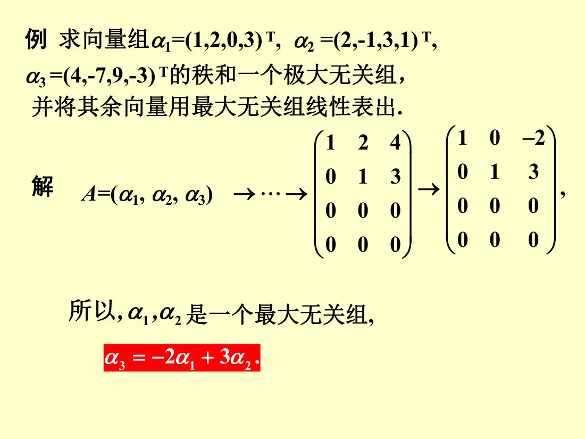

原文：

例 求向量组 $\alpha_{1}=(1,2,0,3)^{\mathrm{T}}$ , $\alpha_{2}=(2,-1,3,1)^{\mathrm{T}}$ , $\alpha_{3}=(4,-7,9,-3)^{\mathrm{T}}$ 的秩和一个极大无关组，并将其余向量用最大无关组线性表出.

解

$$
A = (\alpha_ {1}, \alpha_ {2}, \alpha_ {3}) \quad \rightarrow \dots \rightarrow \left(\begin{array}{c c c}1&2&4\\0&1&3\\0&0&0\\0&0&0\end{array}\right)\rightarrow \left(\begin{array}{c c c}1&0&- 2\\0&1&3\\0&0&0\\0&0&0\end{array}\right),
$$

所以, $\alpha_{1},\alpha_{2}$ 是一个最大无关组,

$\alpha_{3} = -2\alpha_{1} + 3\alpha_{2}$

### 例 设有向量组

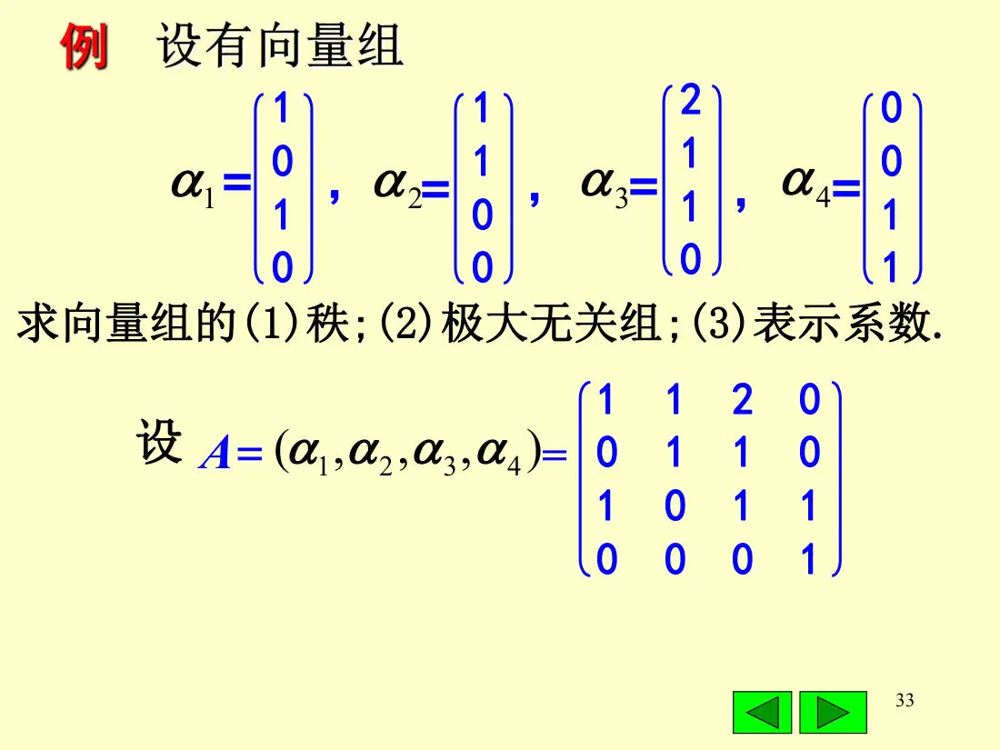

原文：

例 设有向量组

$$
\alpha_ {1} = \left( \begin{array}{c} 1 \\ 0 \\ 1 \\ 0 \end{array} \right), \quad \alpha_ {2} = \left( \begin{array}{c} 1 \\ 1 \\ 0 \\ 0 \end{array} \right), \quad \alpha_ {3} = \left( \begin{array}{c} 2 \\ 1 \\ 1 \\ 0 \end{array} \right), \quad \alpha_ {4} = \left( \begin{array}{c} 0 \\ 0 \\ 1 \\ 1 \end{array} \right)
$$

求向量组的(1)秩;(2)极大无关组;(3)表示系数.

设

$$
A = (\alpha_ {1}, \alpha_ {2}, \alpha_ {3}, \alpha_ {4}) = \left( \begin{array}{c c c c} 1 & 1 & 2 & 0 \\ 0 & 1 & 1 & 0 \\ 1 & 0 & 1 & 1 \\ 0 & 0 & 0 & 1 \end{array} \right)
$$

◀ ▶

33

### $$

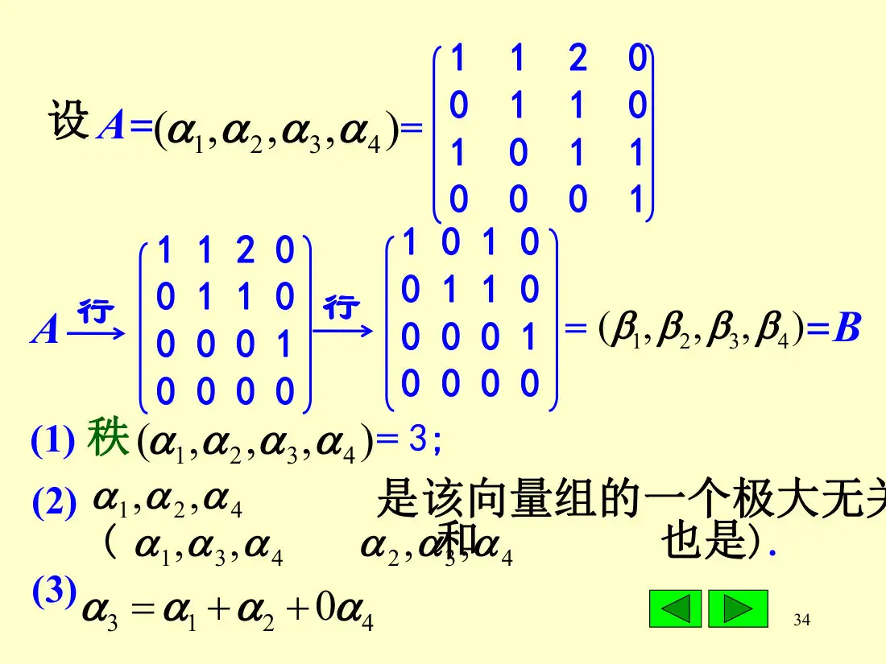

原文：

$$
A = (\alpha_ {1}, \alpha_ {2}, \alpha_ {3}, \alpha_ {4}) = \left( \begin{array}{c c c c} 1 & 1 & 2 & 0 \\ 0 & 1 & 1 & 0 \\ 1 & 0 & 1 & 1 \\ 0 & 0 & 0 & 1 \end{array} \right)
$$

$$
A \xrightarrow {\text {行}} \left( \begin{array}{l l l l} 1 & 1 & 2 & 0 \\ 0 & 1 & 1 & 0 \\ 0 & 0 & 0 & 1 \\ 0 & 0 & 0 & 0 \end{array} \right) \xrightarrow {\text {行}} \left( \begin{array}{l l l l} 1 & 0 & 1 & 0 \\ 0 & 1 & 1 & 0 \\ 0 & 0 & 0 & 1 \\ 0 & 0 & 0 & 0 \end{array} \right) = (\beta_ {1}, \beta_ {2}, \beta_ {3}, \beta_ {4}) = B
$$

(1) 秩 $(\alpha_{1}, \alpha_{2}, \alpha_{3}, \alpha_{4}) = 3$ ;

(2) $\alpha_{1}, \alpha_{2}, \alpha_{4}$ 是该向量组的一个极大无关 ( $\alpha_{1}, \alpha_{3}, \alpha_{4}$ $\alpha_{2}, \alpha_{3}$ 和 $\alpha_{4}$ 也是).

(3) $\alpha_{3}=\alpha_{1}+\alpha_{2}+0\alpha_{4}$

34

### $$

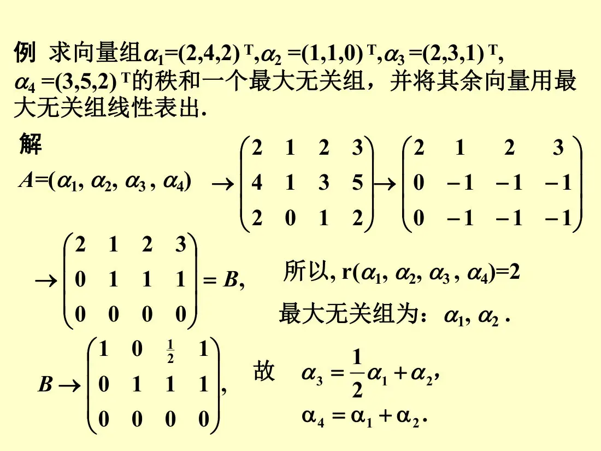

原文：

例 求向量组 $\alpha_{1}=(2,4,2)^{\mathrm{T}},\alpha_{2}=(1,1,0)^{\mathrm{T}},\alpha_{3}=(2,3,1)^{\mathrm{T}}$ $\alpha_{4}=(3,5,2)^{\mathrm{T}}$ 的秩和一个最大无关组，并将其余向量用最大无关组线性表出.

$$
A = (\alpha_ {1}, \alpha_ {2}, \alpha_ {3}, \alpha_ {4}) \rightarrow \left(\begin{array}{c c c c}2&1&2&3\\4&1&3&5\\2&0&1&2\end{array}\right)\rightarrow \left(\begin{array}{c c c c}2&1&2&3\\0&- 1&- 1&- 1\\0&- 1&- 1&- 1\end{array}\right)
$$

$\rightarrow \left( \begin{array}{lll}2 & 1 & 2 & 3\\ 0 & 1 & 1 & 1\\ 0 & 0 & 0 & 0 \end{array} \right) = B,$ 所以， $\mathbf{r}(\alpha_1,\alpha_2,\alpha_3,\alpha_4) = 2$ 最大无关组为： $\alpha_{1},\alpha_{2}$

$$
B \to \left( \begin{array}{c c c c} 1 & 0 & \frac {1}{2} & 1 \\ 0 & 1 & 1 & 1 \\ 0 & 0 & 0 & 0 \end{array} \right),
$$

故

$$
\begin{array}{l} \alpha_ {3} = \frac {1}{2} \alpha_ {1} + \alpha_ {2}, \\ \alpha_ {4} = \alpha_ {1} + \alpha_ {2}. \end{array}
$$

### 例6 设A, B分别为 $m \times r$ , r矩阵,

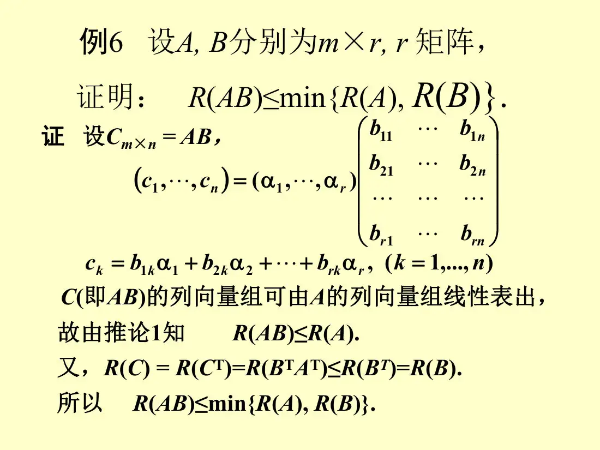

原文：

例6 设A, B分别为 $m \times r$ , r矩阵,

证明： $R(AB)\leq \min \{R(A),R(B)\}$ 证设 $C_{m\times n} = AB$ ， $(c_{1},\dots ,c_{n}) = (\alpha_{1},\dots ,\alpha_{r})$ $\left( \begin{array}{lll}b_{11} & \dots & b_{1n}\\ b_{21} & \dots & b_{2n}\\ \dots & \dots & \dots \\ b_{r1} & \dots & b_{rn} \end{array} \right)$ $c_{k} = b_{1k}\alpha_{1} + b_{2k}\alpha_{2} + \dots +b_{rk}\alpha_{r},(k = 1,\dots ,n)$

C(即AB)的列向量组可由A的列向量组线性表出，
故由推论1知 $R(AB) \leq R(A)$ .
又， $R(C) = R(C^{\mathrm{T}}) = R(B^{\mathrm{T}} A^{\mathrm{T}}) \leq R(B^{\mathrm{T}}) = R(B)$ .
所以 $R(AB) \leq \min\{R(A), R(B)\}$ .

### 关于矩阵秩的结论

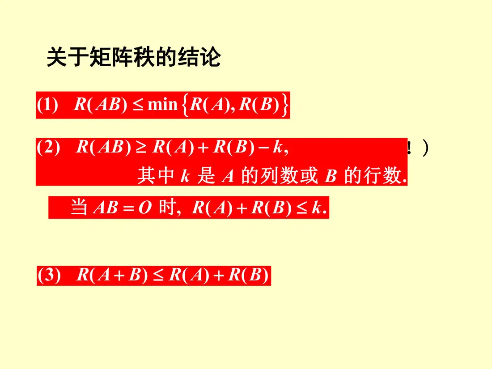

原文：

关于矩阵秩的结论

(1) $R(AB) \leq \min\left\{R(A), R(B)\right\}$

(2) $R(AB) \geq R(A) + R(B) - k,$ 其中 k 是 A 的列数或 B 的行数.
当 AB = O 时， $R(A) + R(B) \leq k.$

(3) $R(A + B) \leq R(A) + R(B)$

### $$

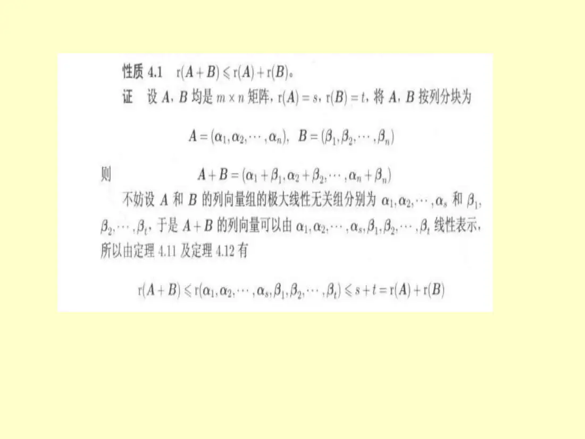

原文：

性质 4.1 $\mathrm{r}(A+B)\leqslant\mathrm{r}(A)+\mathrm{r}(B)$ 。

证 设 A, B 均是 $m \times n$ 矩阵， $\mathrm{r}(A) = s, \mathrm{r}(B) = t$ ，将 A, B 按列分块为

$$
A = \left(\alpha_ {1}, \alpha_ {2}, \dots , \alpha_ {n}\right), B = \left(\beta_ {1}, \beta_ {2}, \dots , \beta_ {n}\right)
$$

则

$$
A + B = \left(\alpha_ {1} + \beta_ {1}, \alpha_ {2} + \beta_ {2}, \dots , \alpha_ {n} + \beta_ {n}\right)
$$

不妨设 A 和 B 的列向量组的极大线性无关组分别为 $\alpha_{1}, \alpha_{2}, \cdots, \alpha_{s}$ 和 $\beta_{1}, \beta_{2}, \cdots, \beta_{t}$ ，于是 $A + B$ 的列向量可以由 $\alpha_{1}, \alpha_{2}, \cdots, \alpha_{s}, \beta_{1}, \beta_{2}, \cdots, \beta_{t}$ 线性表示，所以由定理 4.11 及定理 4.12 有

$$
\mathrm{r} (A + B) \leqslant \mathrm{r} (\alpha_ {1}, \alpha_ {2}, \dots , \alpha_ {s}, \beta_ {1}, \beta_ {2}, \dots , \beta_ {t}) \leqslant s + t = \mathrm{r} (A) + \mathrm{r} (B)
$$

### $$

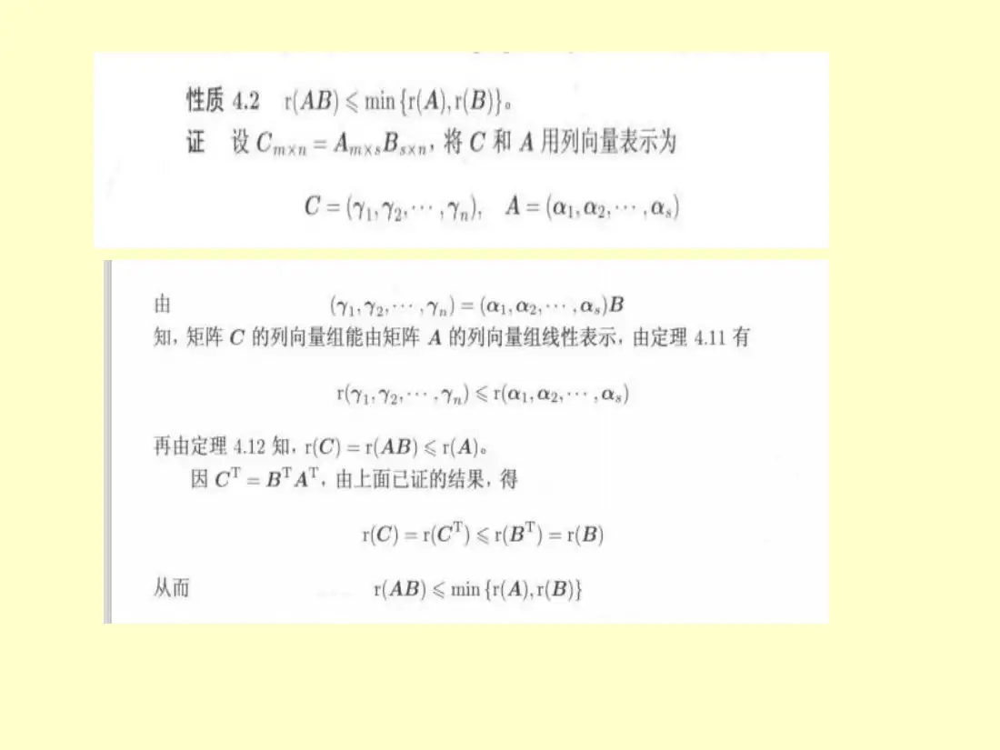

原文：

性质 4.2 $r(AB) \leqslant \min\{r(A), r(B)\}$ 。

证 设 $C_{m \times n} = A_{m \times s} B_{s \times n}$ ，将 C 和 A 用列向量表示为

$$
C = \left(\gamma_ {1}, \gamma_ {2}, \dots , \gamma_ {n}\right), \quad A = \left(\alpha_ {1}, \alpha_ {2}, \dots , \alpha_ {s}\right)
$$

由

$$
(\gamma_ {1}, \gamma_ {2}, \dots , \gamma_ {n}) = (\alpha_ {1}, \alpha_ {2}, \dots , \alpha_ {s}) B
$$

知，矩阵 C 的列向量组能由矩阵 A 的列向量组线性表示，由定理 4.11 有

$$
\mathrm{r} \left(\gamma_ {1}, \gamma_ {2}, \dots , \gamma_ {n}\right) \leqslant \mathrm{r} \left(\alpha_ {1}, \alpha_ {2}, \dots , \alpha_ {s}\right)
$$

再由定理 4.12 知， $r(C)=r(AB)\leqslant r(A)$ 。

因 $C^{\mathrm{T}} = B^{\mathrm{T}}A^{\mathrm{T}}$ ，由上面已证的结果，得

$$
\mathrm{r} (\boldsymbol {C}) = \mathrm{r} (\boldsymbol {C} ^ {\mathrm{T}}) \leqslant \mathrm{r} (\boldsymbol {B} ^ {\mathrm{T}}) = \mathrm{r} (\boldsymbol {B})
$$

从而

$$
\mathrm{r} (A B) \leqslant \min \{\mathrm{r} (A), \mathrm{r} (B) \}
$$

### (C) 向量组中任意含 $r$ 个向量的部分组都线性无关

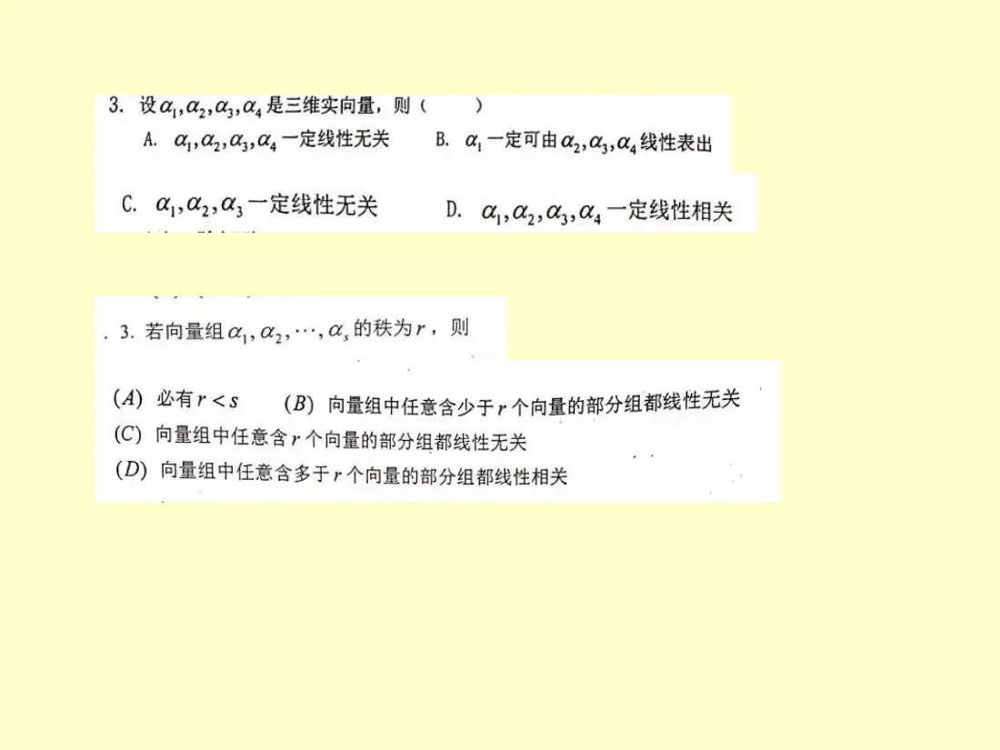

原文：

3. 设 $\alpha_{1}, \alpha_{2}, \alpha_{3}, \alpha_{4}$ 是三维实向量，则（）
A. $\alpha_{1}, \alpha_{2}, \alpha_{3}, \alpha_{4}$ 一定线性无关
B. $\alpha_{1}$ 一定可由 $\alpha_{2}, \alpha_{3}, \alpha_{4}$ 线性表出
C. $\alpha_{1}, \alpha_{2}, \alpha_{3}$ 一定线性无关
D. $\alpha_{1}, \alpha_{2}, \alpha_{3}, \alpha_{4}$ 一定线性相关

3. 若向量组 $\alpha_{1}, \alpha_{2}, \cdots, \alpha_{s}$ 的秩为 r，则

(A) 必有 $r < s$ (B) 向量组中任意含少于 $r$ 个向量的部分组都线性无关  
(C) 向量组中任意含 $r$ 个向量的部分组都线性无关  
(D) 向量组中任意含多于 $r$ 个向量的部分组都线性相关

### 极大无关组和秩的求法

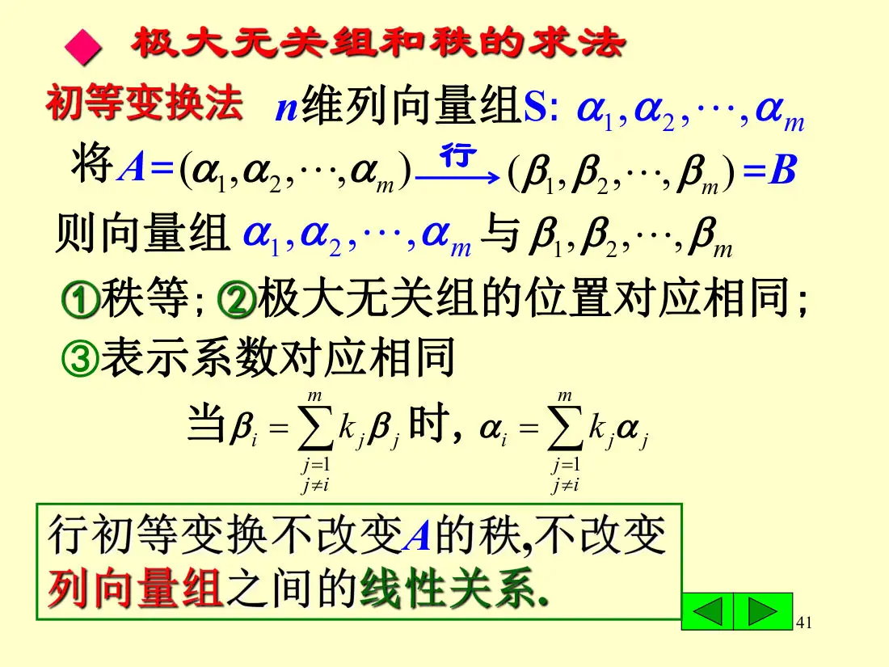

原文：

极大无关组和秩的求法

初等变换法 n 维列向量组 S: $\alpha_{1}, \alpha_{2}, \cdots, \alpha_{m}$ 将 $A=(\alpha_{1},\alpha_{2},\cdots,\alpha_{m})\xrightarrow{\text{行}}(\beta_{1},\beta_{2},\cdots,\beta_{m})=B$ 则向量组 $\alpha_{1},\alpha_{2},\cdots,\alpha_{m}$ 与 $\beta_{1},\beta_{2},\cdots,\beta_{m}$

①秩等；②极大无关组的位置对应相同；

③表示系数对应相同

当 $\beta_{i} = \sum_{\substack{j = 1\\ j\neq i}}^{m}k_{j}\beta_{j}$ 时， $\alpha_{i} = \sum_{\substack{j = 1\\ j\neq i}}^{m}k_{j}\alpha_{j}$

行初等变换不改变A的秩,不改变列向量组之间的线性关系.

◀ △

41

### $$

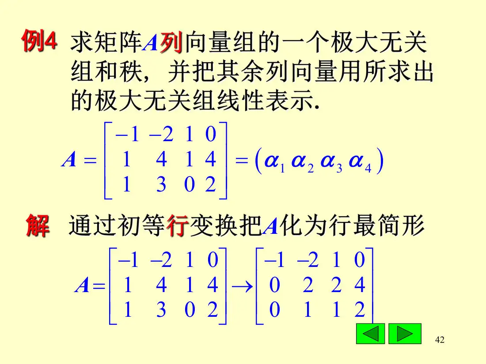

原文：

例4 求矩阵A列向量组的一个极大无关组和秩，并把其余列向量用所求出的极大无关组线性表示.

$$
A = \left[ \begin{array}{r r r r} - 1 & - 2 & 1 & 0 \\ 1 & 4 & 1 & 4 \\ 1 & 3 & 0 & 2 \end{array} \right] = \left(\alpha_ {1} \alpha_ {2} \alpha_ {3} \alpha_ {4}\right)
$$

解 通过初等行变换把A化为行最简形

$$
A = \left[\begin{array}{c c c c}- 1&- 2&1&0\\1&4&1&4\\1&3&0&2\end{array}\right]\rightarrow \left[\begin{array}{c c c c}- 1&- 2&1&0\\0&2&2&4\\0&1&1&2\end{array}\right]
$$

◀ ▶

42

### $$

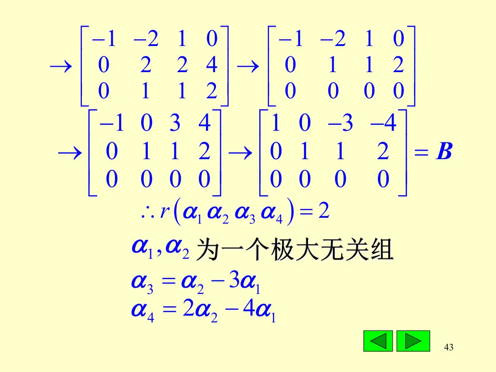

原文：

$$
\begin{array}{r l}&\rightarrow \left[\begin{array}{c c c c}- 1&- 2&1&0\\0&2&2&4\\0&1&1&2\end{array}\right]\rightarrow \left[\begin{array}{c c c c}- 1&- 2&1&0\\0&1&1&2\\0&0&0&0\end{array}\right]\\&\rightarrow \left[\begin{array}{c c c c}- 1&0&3&4\\0&1&1&2\\0&0&0&0\end{array}\right]\rightarrow \left[\begin{array}{c c c c}1&0&- 3&- 4\\0&1&1&2\\0&0&0&0\end{array}\right] = B\\&\therefore r (\alpha_ {1} \alpha_ {2} \alpha_ {3} \alpha_ {4}) = 2\end{array}
$$

$\alpha_{1},\alpha_{2}$ 为一个极大无关组

$$
\begin{array}{l} \alpha_ {3} = \alpha_ {2} - 3 \alpha_ {1} \\ \alpha_ {4} = 2 \alpha_ {2} - 4 \alpha_ {1} \end{array}
$$

◀ ▶

43

### 极大无关组的性质

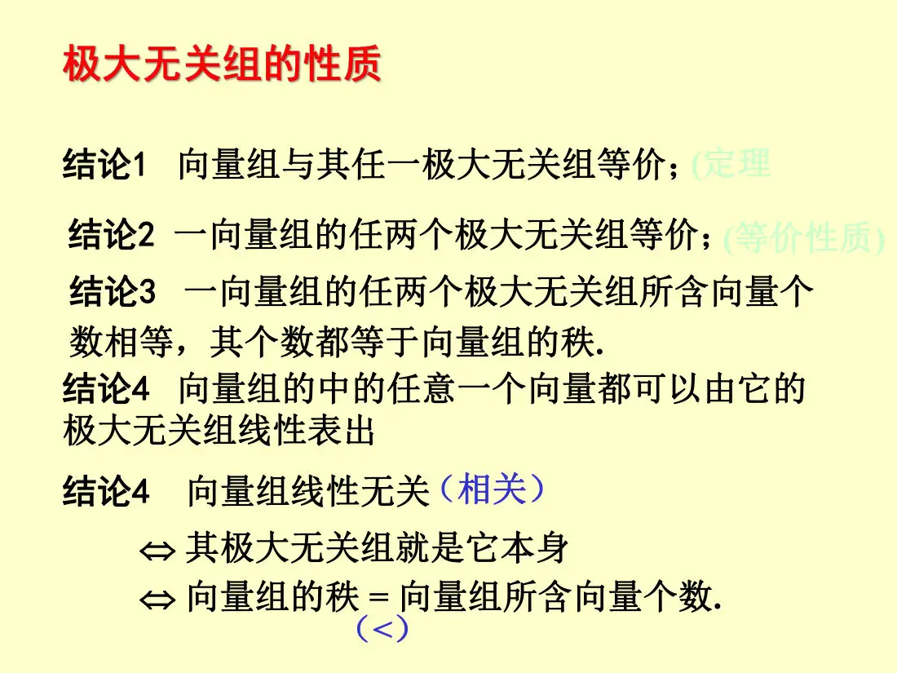

原文：

极大无关组的性质

结论1 向量组与其任一极大无关组等价；(定理

结论2 一向量组的任两个极大无关组等价；(等价性质)

结论3 一向量组的任两个极大无关组所含向量个数相等，其个数都等于向量组的秩.

结论4 向量组的中的任意一个向量都可以由它的极大无关组线性表出

结论4 向量组线性无关（相关）

$\Leftrightarrow$ 其极大无关组就是它本身

$\Leftrightarrow$ 向量组的秩 $=$ 向量组所含向量个数. (<)

### 第 45 页

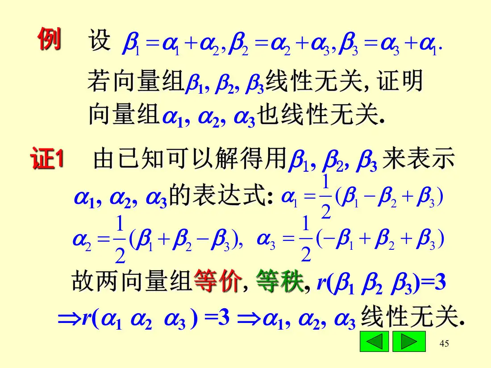

原文：

例 设 $\beta_{1} = \alpha_{1} + \alpha_{2}, \beta_{2} = \alpha_{2} + \alpha_{3}, \beta_{3} = \alpha_{3} + \alpha_{1}$ . 若向量组 $\beta_{1}, \beta_{2}, \beta_{3}$ 线性无关, 证明向量组 $\alpha_{1}, \alpha_{2}, \alpha_{3}$ 也线性无关.

证1 由已知可以解得用 $\beta_{1}, \beta_{2}, \beta_{3}$ 来表示 $\alpha_{1}, \alpha_{2}, \alpha_{3}$ 的表达式: $\alpha_{1} = \frac{1}{2} (\beta_{1} - \beta_{2} + \beta_{3})$ $\alpha_{2} = \frac{1}{2} (\beta_{1} + \beta_{2} - \beta_{3}), \alpha_{3} = \frac{1}{2} (-\beta_{1} + \beta_{2} + \beta_{3})$ 故两向量组等价, 等秩, $r(\beta_{1}, \beta_{2}, \beta_{3}) = 3$ $\Rightarrow r(\alpha_{1}, \alpha_{2}, \alpha_{3}) = 3 \Rightarrow \alpha_{1}, \alpha_{2}, \alpha_{3}$ 线性无关.

### 证2

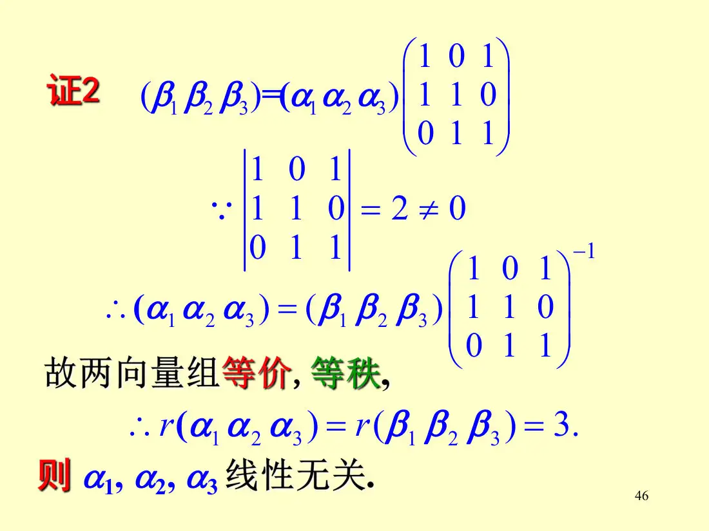

原文：

证2

故两向量组等价, 等秩,

$$
\therefore r \left(\alpha_ {1} \alpha_ {2} \alpha_ {3}\right) = r \left(\beta_ {1} \beta_ {2} \beta_ {3}\right) = 3.
$$

则 $\alpha_{1}, \alpha_{2}, \alpha_{3}$ 线性无关.

46

### 例3 设AB=0.

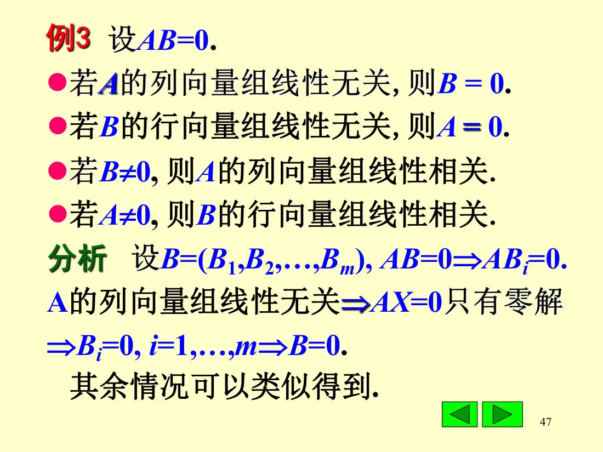

原文：

例3 设AB=0.

若A的列向量组线性无关, 则B = 0.

若B的行向量组线性无关, 则A = 0.

若 $B \neq 0$ , 则 $A$ 的列向量组线性相关.

若 $A \neq 0$ , 则 $B$ 的行向量组线性相关.

分析 设 $B=(B_{1},B_{2},\ldots,B_{m}),AB=0\Rightarrow AB_{i}=0.$

A的列向量组线性无关⇒AX=0只有零解

$$
\Rightarrow B _ {i} = 0, i = 1, \dots , m \Rightarrow B = 0.
$$

其余情况可以类似得到.

◀ ▶

47
