# 《线性代数与解析几何》4.4 向量空间（课件）

原件的每一页，下面附识别出的文字。

### 4.4 向量空间

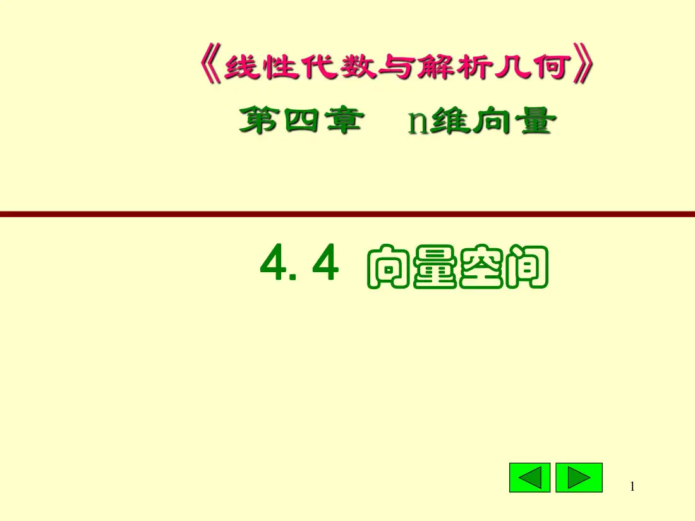

原文：

4.4 向量空间

◀ ▶

1

### 本节主要内容

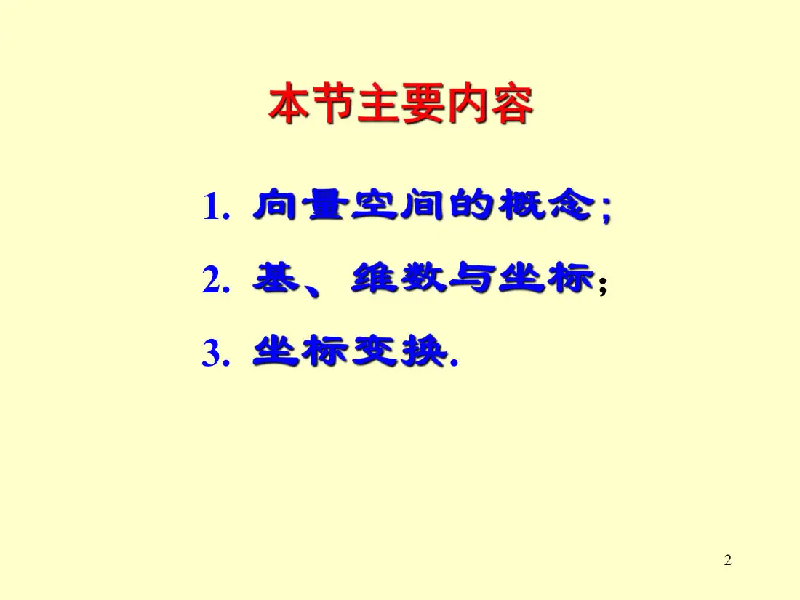

原文：

本节主要内容

1. 向量空间的概念;

2. 基、维数与坐标;

3. 坐标变换.

2

### 4.4.1 n维向量空间的概念

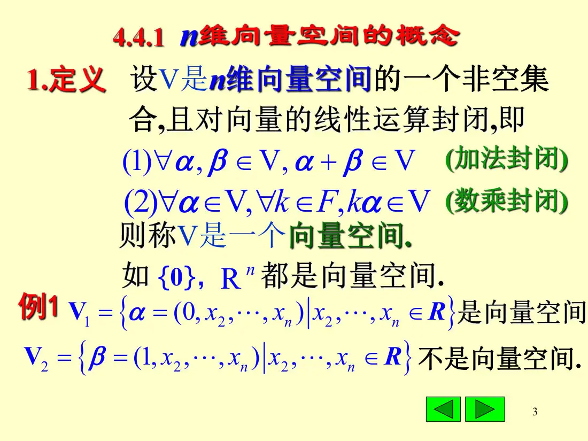

原文：

4.4.1 n维向量空间的概念

1. 定义 设V是n维向量空间的一个非空集合,且对向量的线性运算封闭,即
(1) $\forall\alpha,\beta\in V,\alpha+\beta\in V$ (加法封闭)
(2) $\forall\alpha\in V,\forall k\in F,k\alpha\in V$ (数乘封闭)
则称V是一个向量空间.
如 {0}, R $^{n}$ 都是向量空间.
例1 $V_{1}=\left\{\alpha=(0,x_{2},\cdots,x_{n})|x_{2},\cdots,x_{n}\in R\right\}$ 是向量空间 $V_{2}=\left\{\beta=(1,x_{2},\cdots,x_{n})|x_{2},\cdots,x_{n}\in R\right\}$ 不是向量空间.

◀ ▶

3

### 2. 子空间 $V_{1}$ 、 $V_{2}$ 是向量空间，

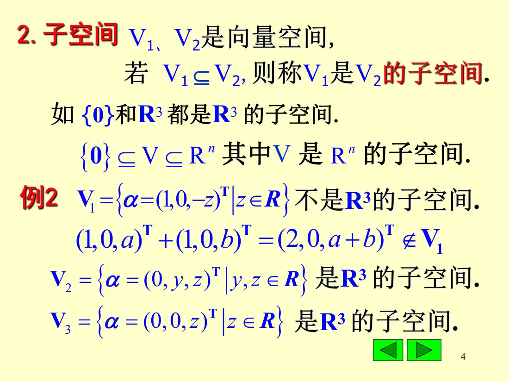

原文：

2. 子空间 $V_{1}$ 、 $V_{2}$ 是向量空间，
若 $V_{1} \subseteq V_{2}$ ，则称 $V_{1}$ 是 $V_{2}$ 的子空间。
如 $\{0\}$ 和 $R^{3}$ 都是 $R^{3}$ 的子空间。 $\{0\} \subseteq V \subseteq R^{n}$ 其中 V 是 $R^{n}$ 的子空间。
例2 $V_{1}=\left\{\alpha=(1,0,-z)^{\mathrm{T}}|z\in R\right\}$ 不是 $R^{3}$ 的子空间。 $(1,0,a)^{\mathrm{T}}+(1,0,b)^{\mathrm{T}}=(2,0,a+b)^{\mathrm{T}}\notin V_{1}$ $V_{2}=\left\{\alpha=(0,y,z)^{\mathrm{T}}|y,z\in R\right\}$ 是 $R^{3}$ 的子空间。 $V_{3}=\left\{\alpha=(0,0,z)^{\mathrm{T}}|z\in R\right\}$ 是 $R^{3}$ 的子空间。

◀

4

### 例设 $\alpha, \beta$ 为两个已知的 n 维向量，则集合

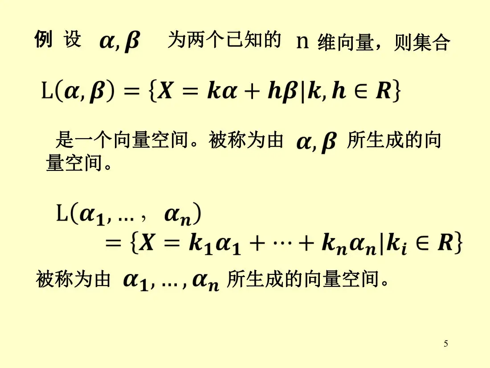

原文：

例设 $\alpha, \beta$ 为两个已知的 n 维向量，则集合

$$
\mathrm{L} (\alpha , \beta) = \{X = k \alpha + h \beta | k, h \in R \}
$$

是一个向量空间。被称为由 $\alpha, \beta$ 所生成的向量空间。

$$
\begin{array}{r l} & {\mathrm{L} (\alpha_ {1}, \ldots , \alpha_ {n})} \\ & {\qquad = \{X = k _ {1} \alpha_ {1} + \dots + k _ {n} \alpha_ {n} | k _ {i} \in R \}} \end{array}
$$

被称为由 $\alpha_{1},\ldots ,\alpha_{n}$ 所生成的向量空间。

5

### 而向量组 A 与向量组 B 等价，

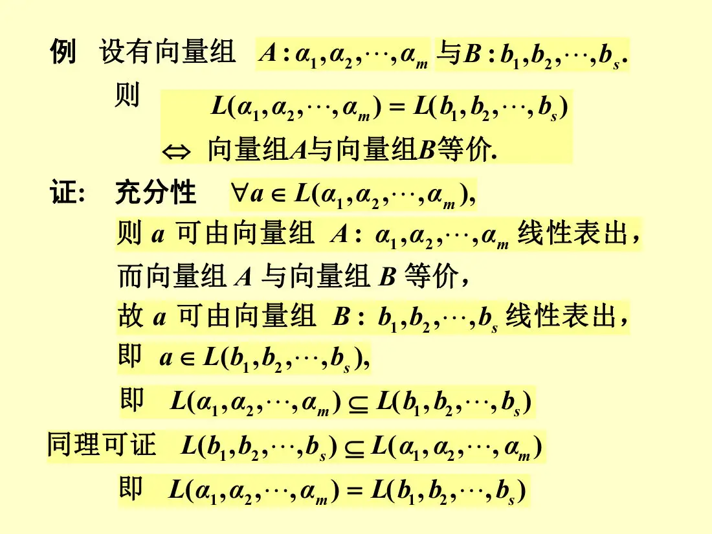

原文：

例 设有向量组 $A:a_{1},a_{2},\cdots,a_{m}$ 与 $B:b_{1},b_{2},\cdots,b_{s}$ .
则 $L(a_{1},a_{2},\cdots,a_{m})=L(b_{1},b_{2},\cdots,b_{s})$ $\Leftrightarrow$ 向量组A与向量组B等价.

证：充分性 $\forall a\in L(\alpha_{1},\alpha_{2},\cdots,\alpha_{m})$ ,
则 a 可由向量组 A: $\alpha_{1},\alpha_{2},\cdots,\alpha_{m}$ 线性表出，
而向量组 A 与向量组 B 等价，
故 a 可由向量组 B: $b_{1},b_{2},\cdots,b_{s}$ 线性表出，
即 $a\in L(b_{1},b_{2},\cdots,b_{s})$ ,
即 $L(\alpha_{1},\alpha_{2},\cdots,\alpha_{m})\subseteq L(b_{1},b_{2},\cdots,b_{s})$ 同理可证 $L(b_{1},b_{2},\cdots,b_{s})\subseteq L(\alpha_{1},\alpha_{2},\cdots,\alpha_{m})$ 即 $L(\alpha_{1},\alpha_{2},\cdots,\alpha_{m})=L(b_{1},b_{2},\cdots,b_{s})$

### 证: 必要性

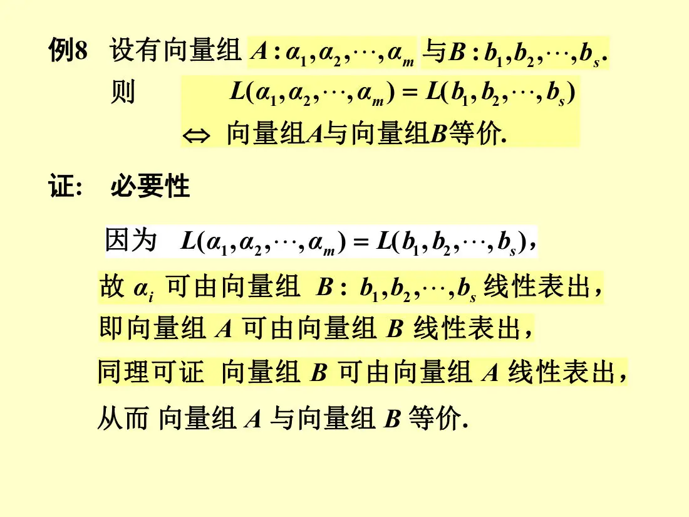

原文：

例8 设有向量组 $A: \alpha_{1}, \alpha_{2}, \cdots, \alpha_{m}$ 与 $B: b_{1}, b_{2}, \cdots, b_{s}$ .
则 $L(\alpha_{1},\alpha_{2},\cdots,\alpha_{m})=L(b_{1},b_{2},\cdots,b_{s})$ $\Leftrightarrow$ 向量组A与向量组B等价.

证: 必要性

因为 $L(\alpha_{1},\alpha_{2},\cdots,\alpha_{m})=L(b_{1},b_{2},\cdots,b_{s})$ ,
故 $\alpha_{i}$ 可由向量组 $B:b_{1},b_{2},\cdots,b_{s}$ 线性表出，
即向量组 A 可由向量组 B 线性表出，
同理可证 向量组 B 可由向量组 A 线性表出，
从而 向量组 A 与向量组 B 等价.

### 三、向量空间的基、维数与向量的坐标

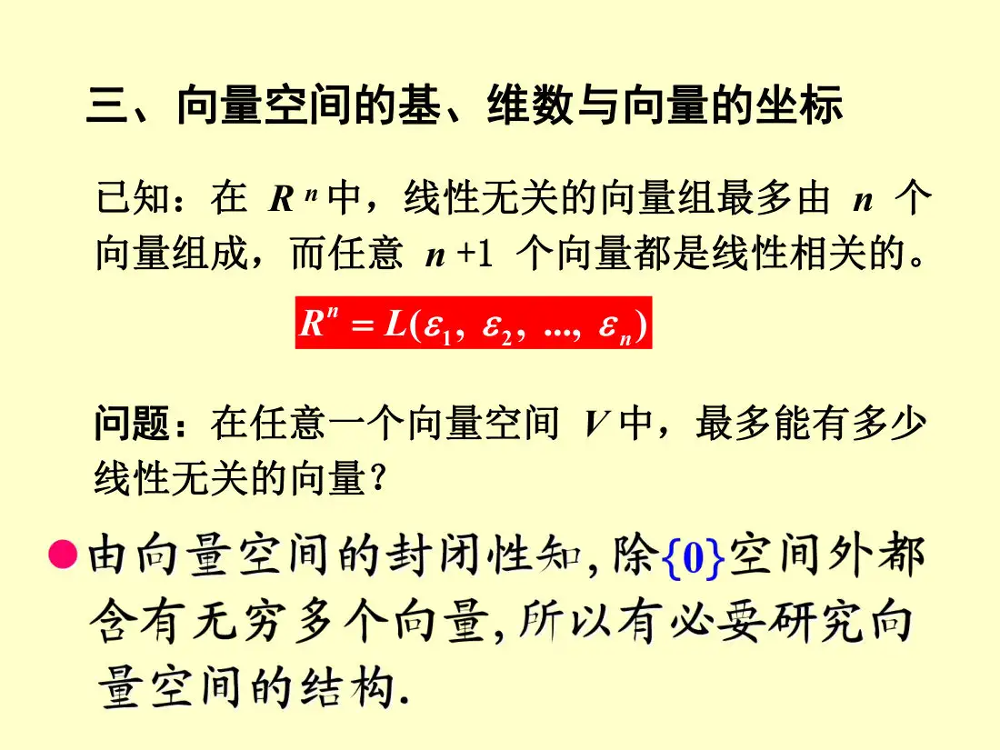

原文：

三、向量空间的基、维数与向量的坐标

已知：在 $R^n$ 中，线性无关的向量组最多由 $n$ 个向量组成，而任意 $n + 1$ 个向量都是线性相关的。

$$
R ^ {n} = L (\varepsilon_ {1}, \varepsilon_ {2}, \dots , \varepsilon_ {n})
$$

问题：在任意一个向量空间 $V$ 中，最多能有多少线性无关的向量？

由向量空间的封闭性知, 除{0}空间外都含有无穷多个向量, 所以有必要研究向量空间的结构.

### 4.4.2 向量空间的基、维数与坐标

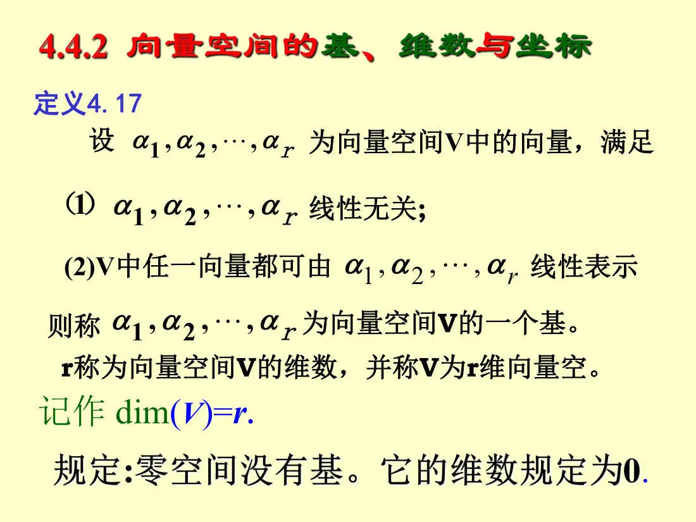

原文：

4.4.2 向量空间的基、维数与坐标

定义4.17

设 $\alpha_{1},\alpha_{2},\cdots,\alpha_{r}$ 为向量空间V中的向量，满足

(1) $\alpha_{1},\alpha_{2},\cdots,\alpha_{r}$ 线性无关;

(2)V中任一向量都可由 $\alpha_{1}, \alpha_{2}, \cdots, \alpha_{r}$ 线性表示则称 $\alpha_{1}, \alpha_{2}, \cdots, \alpha_{r}$ 为向量空间V的一个基。

r称为向量空间V的维数，并称V为r维向量空。

记作 $\dim(V)=r.$

规定:零空间没有基。它的维数规定为0.

### 本书只讨论有限维向量空间.

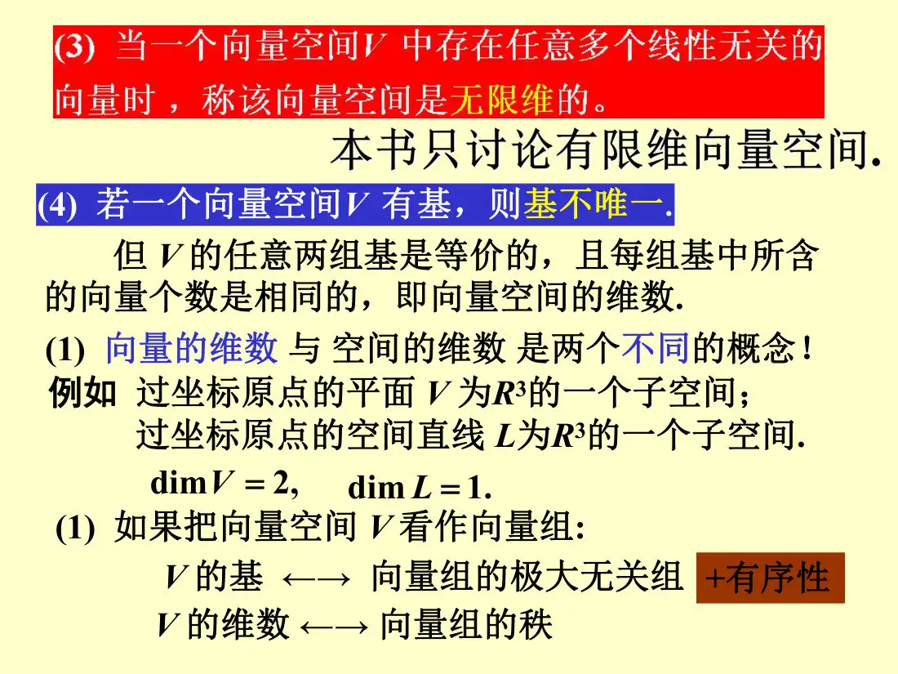

原文：

(3) 当一个向量空间 $V$ 中存在任意多个线性无关的向量时，称该向量空间是无限维的。

本书只讨论有限维向量空间.

(4) 若一个向量空间 $V$ 有基，则基不唯一.

但 V 的任意两组基是等价的，且每组基中所含的向量个数是相同的，即向量空间的维数.

(1) 向量的维数与空间的维数是两个不同的概念！例如 过坐标原点的平面 V 为 $R^{3}$ 的一个子空间；

过坐标原点的空间直线 L 为 $R^{3}$ 的一个子空间.

$$
\dim V = 2, \quad \dim L = 1.
$$

(1) 如果把向量空间 V 看作向量组:

$V$ 的基 $\longleftrightarrow$ 向量组的极大无关组 +有序性

$V$ 的维数 $\longleftrightarrow$ 向量组的秩

### 2.有限维向量空间: 0维与r维的向量空间.

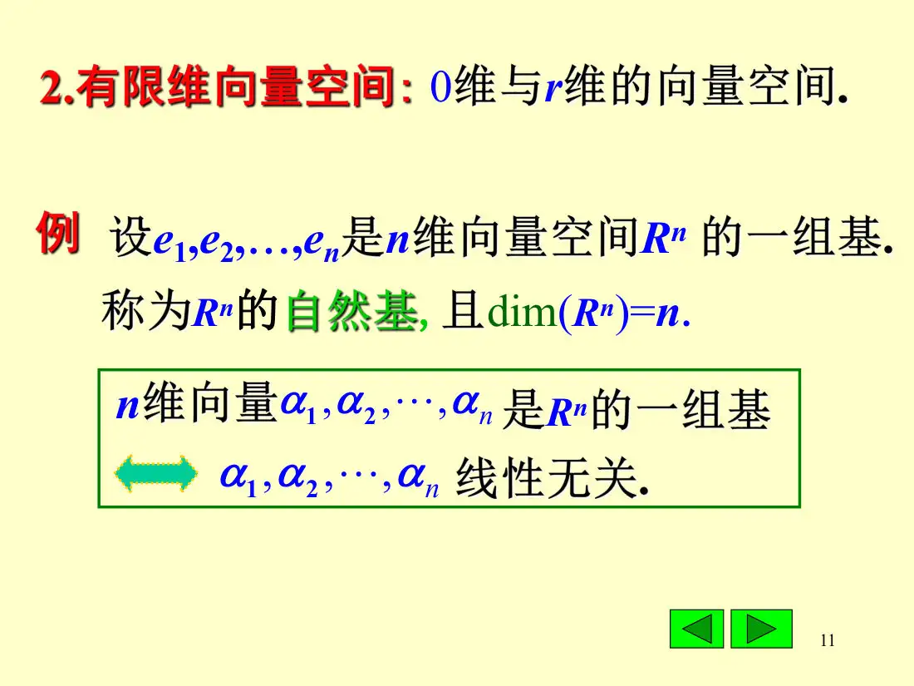

原文：

2.有限维向量空间: 0维与r维的向量空间.

例 设 $e_{1},e_{2},\ldots,e_{n}$ 是n维向量空间 $R^{n}$ 的一组基. 称为 $R^{n}$ 的自然基, 且 $\dim(R^{n})=n$ .

n维向量 $\alpha_{1},\alpha_{2},\cdots,\alpha_{n}$ 是 $R^{n}$ 的一组基 $\leftrightarrow\alpha_{1},\alpha_{2},\cdots,\alpha_{n}$ 线性无关.

◀ ▶

11

### 所以 a 可由 A 的一个极大无关组线性表出.

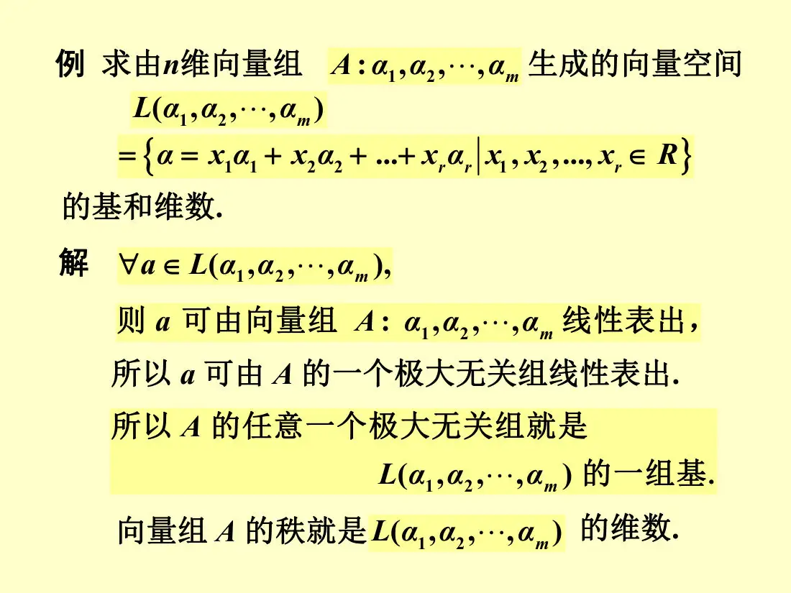

原文：

例 求由n维向量组 $A: \alpha_{1}, \alpha_{2}, \cdots, \alpha_{m}$ 生成的向量空间 $L(\alpha_{1}, \alpha_{2}, \cdots, \alpha_{m})$ $=\left\{\alpha = x_{1}\alpha_{1} + x_{2}\alpha_{2} + \ldots + x_{r}\alpha_{r} \mid x_{1}, x_{2}, \ldots, x_{r} \in R\right\}$ 的基和维数.

解 $\forall a \in L(\alpha_{1}, \alpha_{2}, \cdots, \alpha_{m})$ ,

则 a 可由向量组 $A: \alpha_{1}, \alpha_{2}, \cdots, \alpha_{m}$ 线性表出，

所以 a 可由 A 的一个极大无关组线性表出.

所以 A 的任意一个极大无关组就是 $L(\alpha_{1}, \alpha_{2}, \cdots, \alpha_{m})$ 的一组基.

向量组 A 的秩就是 $L(\alpha_{1}, \alpha_{2}, \cdots, \alpha_{m})$ 的维数.

### $$

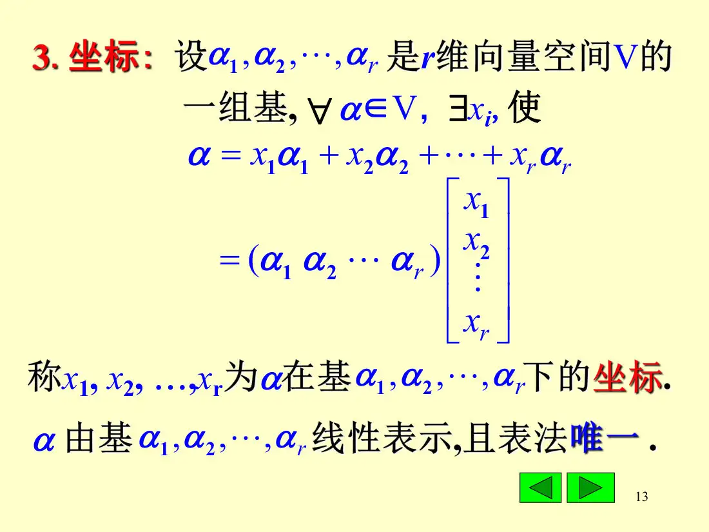

原文：

3. 坐标: 设 $\alpha_{1}, \alpha_{2}, \cdots, \alpha_{r}$ 是 $r$ 维向量空间V的

$$
\forall \alpha \in V
$$

$$
\begin{array}{l} \alpha = x _ {1} \alpha_ {1} + x _ {2} \alpha_ {2} + \dots + x _ {r} \alpha_ {r} \\ = (\alpha_ {1} \alpha_ {2} \dots \alpha_ {r}) \left[ \begin{array}{c} x _ {1} \\ x _ {2} \\ \vdots \\ x _ {r} \end{array} \right] \end{array}
$$

称 $x_{1},x_{2},\ldots,x_{r}$ 为 $\alpha$ 在基 $\alpha_{1},\alpha_{2},\cdots,\alpha_{r}$ 下的坐标.

$\alpha$ 由基 $\alpha_{1},\alpha_{2},\cdots,\alpha_{r}$ 线性表示,且表法唯一.

◀ ▶

13

### 14

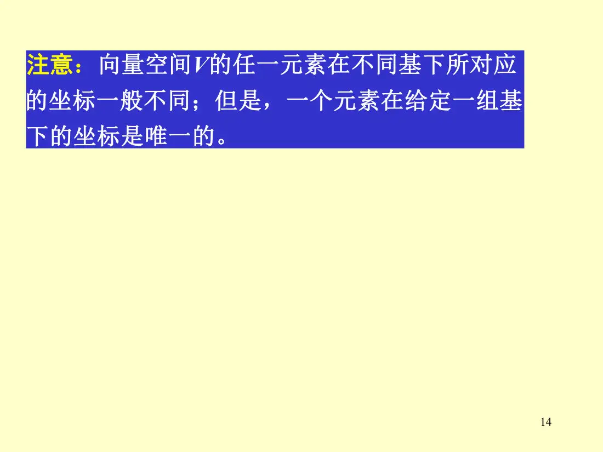

原文：

注意：向量空间 $V$ 的任一元素在不同基下所对应的坐标一般不同；但是，一个元素在给定一组基下的坐标是唯一的。

14

### 4. 向量空间的构成

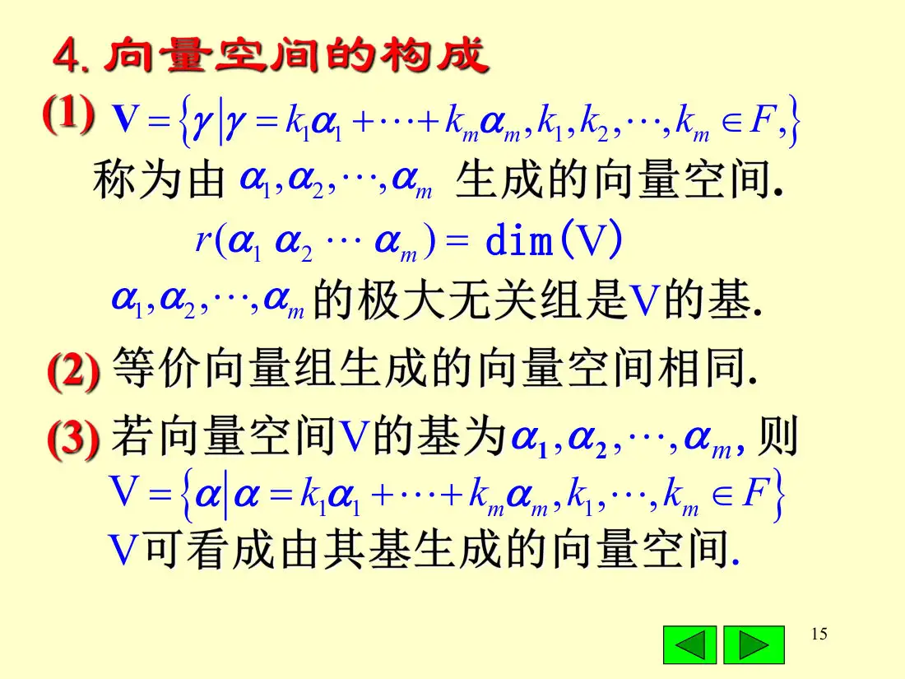

原文：

4. 向量空间的构成

(1) $V = \left\{\gamma \mid \gamma = k_{1} \alpha_{1} + \cdots + k_{m} \alpha_{m}, k_{1}, k_{2}, \cdots, k_{m} \in F,\right\}$ 称为由 $\alpha_{1}, \alpha_{2}, \cdots, \alpha_{m}$ 生成的向量空间.

$$
r \left(\alpha_ {1} \alpha_ {2} \dots \alpha_ {m}\right) = \dim (\mathrm{V})
$$

$$
\alpha_ {1}, \alpha_ {2}, \dots , \alpha_ {m}
$$

(2) 等价向量组生成的向量空间相同.

(3) 若向量空间V的基为 $\alpha_{1}, \alpha_{2}, \cdots, \alpha_{m}$ ，则 $V=\left\{\alpha\mid\alpha=k_{1}\alpha_{1}+\cdots+k_{m}\alpha_{m},k_{1},\cdots,k_{m}\in F\right\}$ V可看成由其基生成的向量空间.

◀

15

### 5. 对应

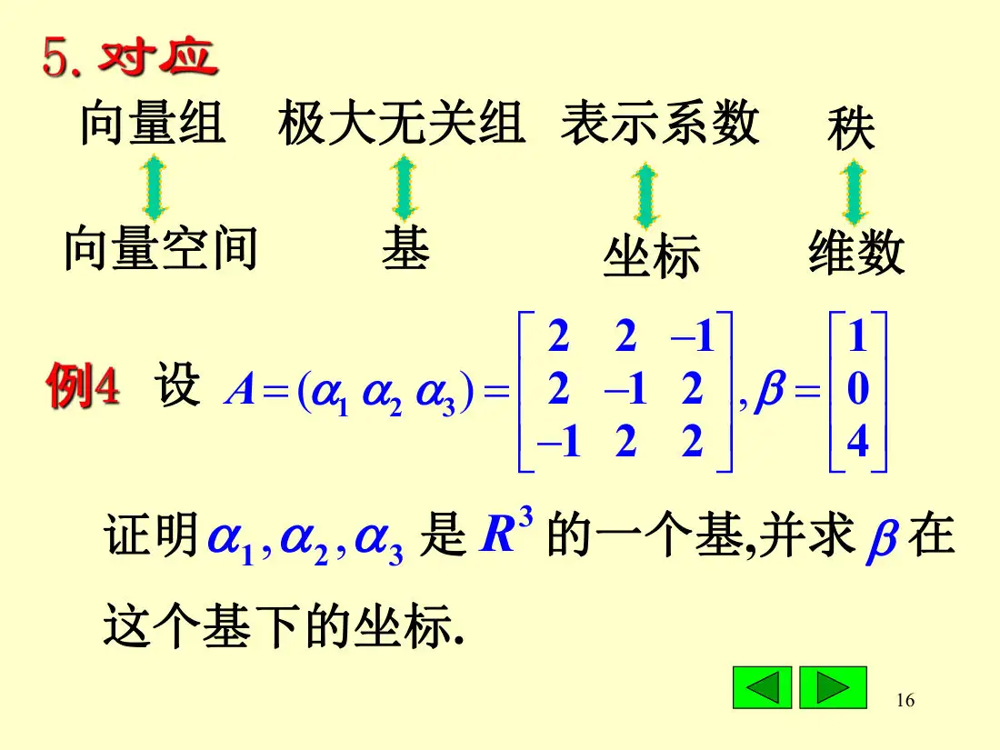

原文：

5. 对应

向量组 极大无关组 表示系数 秩
↑ ↑ ↑ ↑ ↑
向量空间 基 坐标 维数
例4 设 $A=(\alpha_{1}\alpha_{2}\alpha_{3})=\begin{bmatrix}2&2&-1\\ 2&-1&2\\ -1&2&2\end{bmatrix},\beta=\begin{bmatrix}1\\ 0\\ 4\end{bmatrix}$ 证明 $\alpha_{1}, \alpha_{2}, \alpha_{3}$ 是 $R^{3}$ 的一个基, 并求 $\beta$ 在这个基下的坐标.

◀

16

### 第 17 页

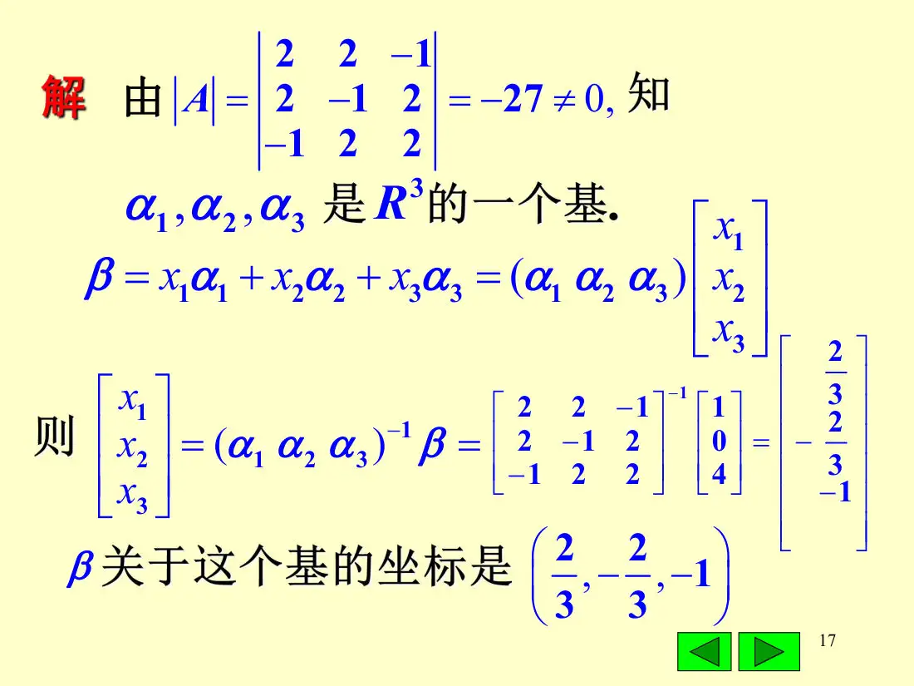

原文：

解 由 $|A| = \begin{vmatrix} 2 & 2 & -1 \\ 2 & -1 & 2 \\ -1 & 2 & 2 \end{vmatrix} = -27 \neq 0$ , 知 $\alpha_{1}, \alpha_{2}, \alpha_{3}$ 是 $R^{3}$ 的一个基. $\beta = x_{1} \alpha_{1} + x_{2} \alpha_{2} + x_{3} \alpha_{3} = (\alpha_{1} \alpha_{2} \alpha_{3}) \begin{bmatrix} x_{1} \\ x_{2} \\ x_{3} \end{bmatrix}$ 则 $\begin{bmatrix} x_{1} \\ x_{2} \\ x_{3} \end{bmatrix} = (\alpha_{1} \alpha_{2} \alpha_{3})^{-1} \beta = \begin{bmatrix} 2 & 2 & -1 \\ 2 & -1 & 2 \\ -1 & 2 & 2 \end{bmatrix}^{-1} \begin{bmatrix} 1 \\ 0 \\ 4 \end{bmatrix} = \begin{bmatrix} \frac{2}{3} \\ -\frac{2}{3} \\ -1 \end{bmatrix}$ $\beta$ 关于这个基的坐标是 $\left( \frac{2}{3}, -\frac{2}{3}, -1 \right)$

### 4.4.3 过渡矩阵、坐标变换

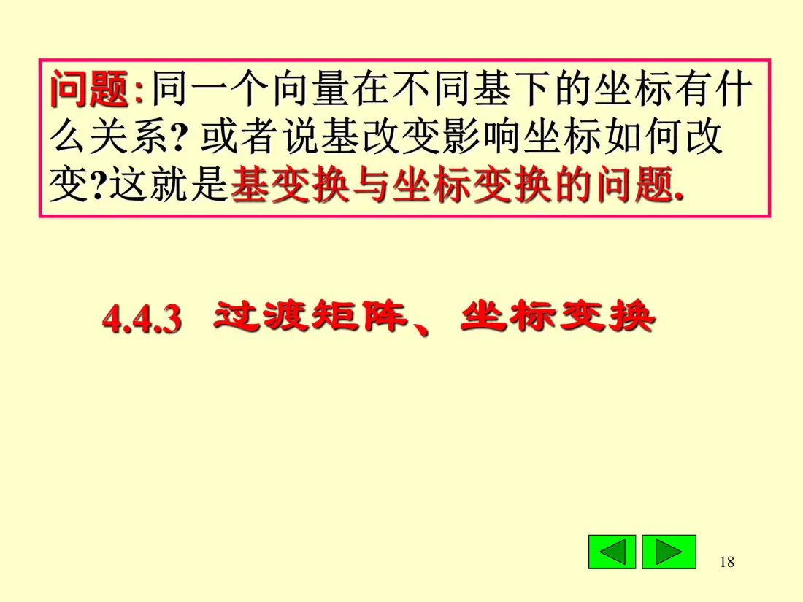

原文：

问题: 同一个向量在不同基下的坐标有什么关系? 或者说基改变影响坐标如何改变? 这就是基变换与坐标变换的问题.

4.4.3 过渡矩阵、坐标变换

◀ ▶

18

### 四、过渡矩阵与坐标变换

原文：

四、过渡矩阵与坐标变换

问题：在 $n$ 维向量空间 $V$ 中，任意 $n$ 个线性无关的向量都可以作为 $V$ 的一组基。对于不同的基，同一个向量的坐标是不同的。

那么，同一个向量在不同的基下的坐标有什么关系呢？换句话说，随着基的改变，向量的坐标如何改变呢？

### $$

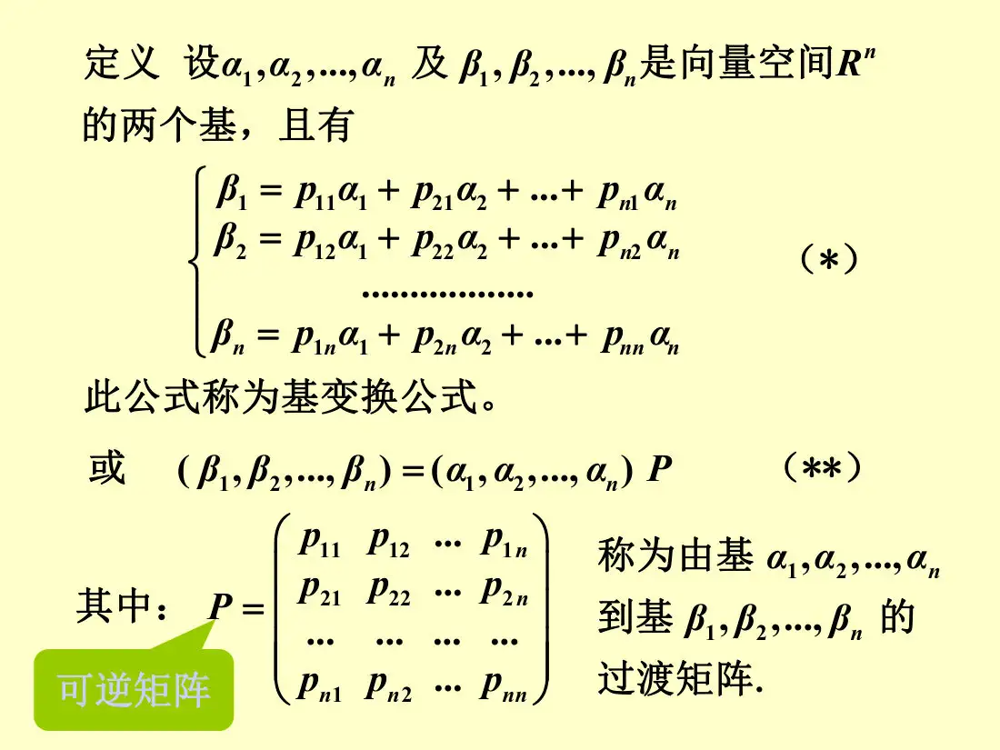

原文：

定义 设 $\alpha_{1},\alpha_{2},\ldots ,\alpha_{n}$ 及 $\beta_{1},\beta_{2},\ldots ,\beta_{n}$ 是向量空间 $R^n$ 的两个基，且有

$$
\left\{ \begin{array}{l} \beta_ {1} = p _ {1 1} \alpha_ {1} + p _ {2 1} \alpha_ {2} + \dots + p _ {n 1} \alpha_ {n} \\ \beta_ {2} = p _ {1 2} \alpha_ {1} + p _ {2 2} \alpha_ {2} + \dots + p _ {n 2} \alpha_ {n} \\ \qquad \qquad \dots\dots\\ \beta_ {n} = p _ {1 n} \alpha_ {1} + p _ {2 n} \alpha_ {2} + \dots + p _ {n n} \alpha_ {n} \end{array} \right.\tag{*}
$$

此公式称为基变换公式。

或 $(\beta_{1},\beta_{2},\dots,\beta_{n}) = (\alpha_{1},\alpha_{2},\dots,\alpha_{n})P$

(\*\*)

其中:

$$
P = \left( \begin{array}{c c c c} p _ {1 1} & p _ {1 2} & \dots & p _ {1 n} \\ p _ {2 1} & p _ {2 2} & \dots & p _ {2 n} \\ \dots & \dots & \dots & \dots \\ p _ {n 1} & p _ {n 2} & \dots & p _ {n n} \end{array} \right)
$$

可逆矩阵

称为由基 $\alpha_{1},\alpha_{2},\ldots,\alpha_{n}$ 到基 $\beta_{1},\beta_{2},\ldots,\beta_{n}$ 的
过渡矩阵.

### $$

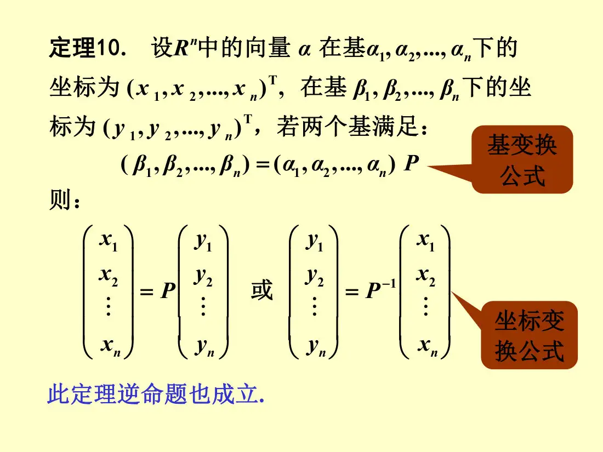

原文：

定理10. 设 $R^n$ 中的向量 $\alpha$ 在基 $\alpha_1, \alpha_2, \ldots, \alpha_n$ 下的坐标为 $(x_1, x_2, \ldots, x_n)^{\mathrm{T}}$ ，在基 $\beta_1, \beta_2, \ldots, \beta_n$ 下的坐标为 $(y_1, y_2, \ldots, y_n)^{\mathrm{T}}$ ，若两个基满足：

$$
(\beta_ {1}, \beta_ {2}, \dots , \beta_ {n}) = (\alpha_ {1}, \alpha_ {2}, \dots , \alpha_ {n}) P
$$

则：

基变换
公式

$$
\left( \begin{array}{c} {x _ {1}} \\ {x _ {2}} \\ {\vdots} \\ {x _ {n}} \end{array} \right) = P \left( \begin{array}{c} {y _ {1}} \\ {y _ {2}} \\ {\vdots} \\ {y _ {n}} \end{array} \right) \quad \text {或} \quad \left( \begin{array}{c} {y _ {1}} \\ {y _ {2}} \\ {\vdots} \\ {y _ {n}} \end{array} \right) = P ^ {- 1} \left( \begin{array}{c} {x _ {1}} \\ {x _ {2}} \\ {\vdots} \\ {x _ {n}} \end{array} \right) \quad \text {坐标变}
$$

此定理逆命题也成立.

### 证明：

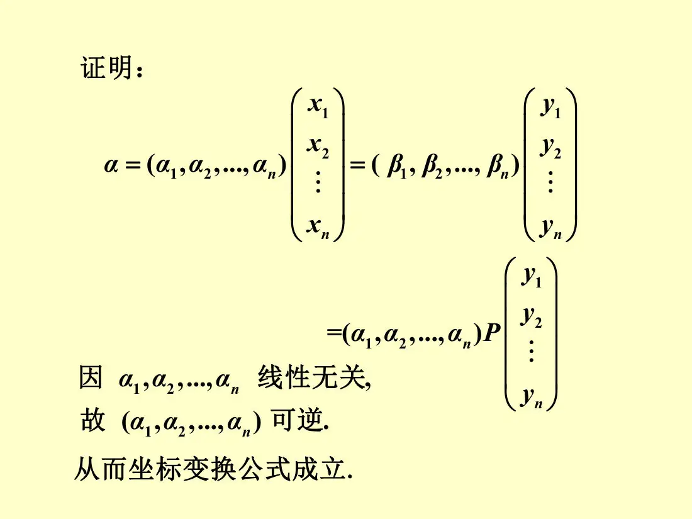

原文：

证明：

$$
\alpha = (\alpha_ {1}, \alpha_ {2},..., \alpha_ {n}) \left( \begin{array}{c} x _ {1} \\ x _ {2} \\ \vdots \\ x _ {n} \end{array} \right) = (\beta_ {1}, \beta_ {2},..., \beta_ {n}) \left( \begin{array}{c} y _ {1} \\ y _ {2} \\ \vdots \\ y _ {n} \end{array} \right)
$$

因 $\alpha_{1},\alpha_{2},\ldots,\alpha_{n}$ 线性无关,

$$
= (a _ {1}, a _ {2},..., a _ {n}) P \left( \begin{array}{c} y _ {1} \\ y _ {2} \\ \vdots \\ y _ {n} \end{array} \right) \text {无关,}
$$

故 $(\alpha_{1},\alpha_{2},\dots,\alpha_{n})$ 可逆.

从而坐标变换公式成立.

### 方法: 求不同基之间的过渡矩阵

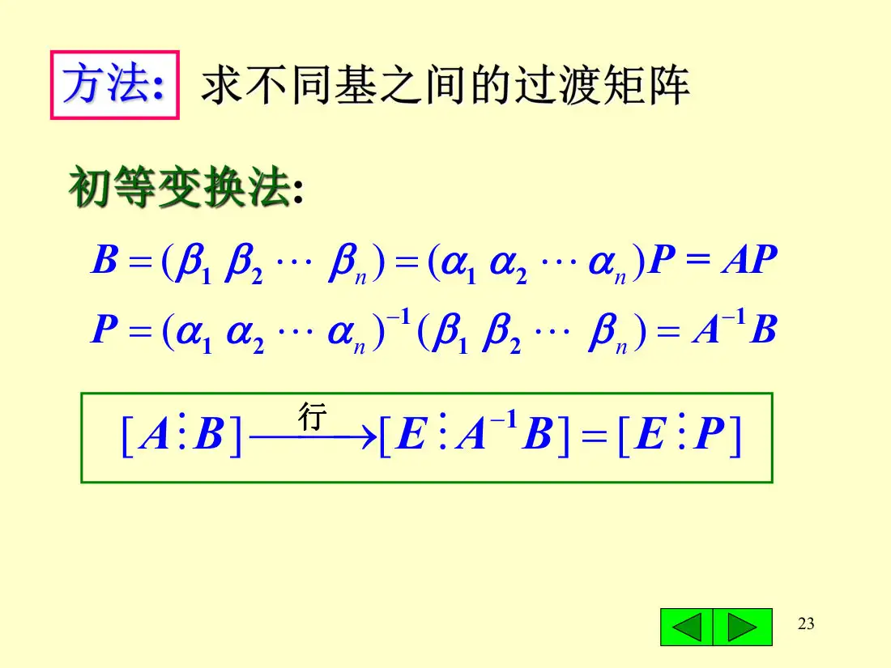

原文：

方法: 求不同基之间的过渡矩阵

初等变换法:

$$
\boldsymbol {B} = \left(\beta_ {1} \beta_ {2} \dots \beta_ {n}\right) = \left(\alpha_ {1} \alpha_ {2} \dots \alpha_ {n}\right) \boldsymbol {P} = A \boldsymbol {P}
$$

$$
\boldsymbol {P} = \left(\alpha_ {1} \alpha_ {2} \dots \alpha_ {n}\right) ^ {- 1} \left(\beta_ {1} \beta_ {2} \dots \beta_ {n}\right) = A ^ {- 1} \boldsymbol {B}
$$

$$
[ A: B ] \xrightarrow {\text {行}} [ E: A ^ {- 1} B ] = [ E: P ]
$$

◀ ▶

23

### 方法: 求向量在指定基下的坐标

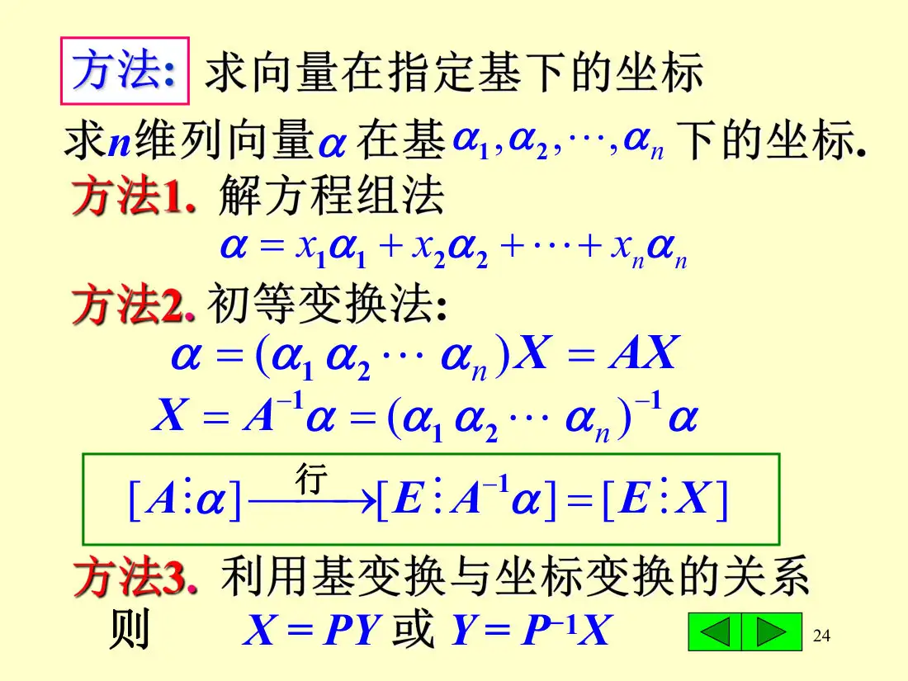

原文：

方法: 求向量在指定基下的坐标

求n维列向量 $\alpha$ 在基 $\alpha_{1},\alpha_{2},\cdots,\alpha_{n}$ 下的坐标.

方法1. 解方程组法

$$
\alpha = x _ {1} \alpha_ {1} + x _ {2} \alpha_ {2} + \dots + x _ {n} \alpha_ {n}
$$

方法2. 初等变换法:

$$
\alpha = \left(\alpha_ {1} \alpha_ {2} \dots \alpha_ {n}\right) X = A X
$$

$$
X = A ^ {- 1} \alpha = (\alpha_ {1} \alpha_ {2} \dots \alpha_ {n}) ^ {- 1} \alpha
$$

$$
[ A: \alpha ] \xrightarrow {\text {行}} [ E: A ^ {- 1} \alpha ] = [ E: X ]
$$

方法3. 利用基变换与坐标变换的关系则 $X = P Y$ 或 $Y = P^{- 1} X$

24

### 例 在 $R^3$ 中有两个基

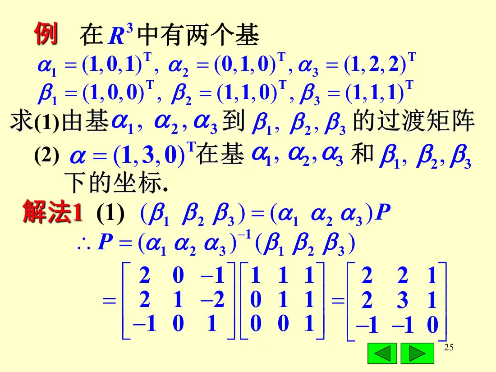

原文：

例 在 $R^3$ 中有两个基

$$
\boldsymbol {\alpha} _ {1} = (\mathbf {1}, \mathbf {0}, \mathbf {1}) ^ {\mathrm{T}}, \boldsymbol {\alpha} _ {2} = (\mathbf {0}, \mathbf {1}, \mathbf {0}) ^ {\mathrm{T}}, \boldsymbol {\alpha} _ {3} = (\mathbf {1}, \mathbf {2}, \mathbf {2}) ^ {\mathrm{T}}
$$

$$
\boldsymbol {\beta} _ {1} = (\mathbf {1}, \mathbf {0}, \mathbf {0}) ^ {\mathrm{T}}, \boldsymbol {\beta} _ {2} = (\mathbf {1}, \mathbf {1}, \mathbf {0}) ^ {\mathrm{T}}, \boldsymbol {\beta} _ {3} = (\mathbf {1}, \mathbf {1}, \mathbf {1}) ^ {\mathrm{T}}
$$

求(1)由基 $\alpha_{1}, \alpha_{2}, \alpha_{3}$ 到 $\beta_{1}, \beta_{2}, \beta_{3}$ 的过渡矩阵

(2) $\alpha = (1, 3, 0)^{\mathrm{T}}$ 在基 $\alpha_{1}, \alpha_{2}, \alpha_{3}$ 和 $\beta_{1}, \beta_{2}, \beta_{3}$ 下的坐标.

解法1 (1) $(\beta_{1} \beta_{2} \beta_{3}) = (\alpha_{1} \alpha_{2} \alpha_{3})P$ $\therefore P = (\alpha_{1} \alpha_{2} \alpha_{3})^{-1}(\beta_{1} \beta_{2} \beta_{3})$ $= \begin{bmatrix} 2 & 0 & -1 \\ 2 & 1 & -2 \\ -1 & 0 & 1 \end{bmatrix} \begin{bmatrix} 1 & 1 & 1 \\ 0 & 1 & 1 \\ 0 & 0 & 1 \end{bmatrix} = \begin{bmatrix} 2 & 2 & 1 \\ 2 & 3 & 1 \\ -1 & -1 & 0 \end{bmatrix}$ 解法2 $B = (\beta_{1}\beta_{2}\beta_{3}) = (\alpha_{1}\alpha_{2}\alpha_{3})P = AP$

### $$

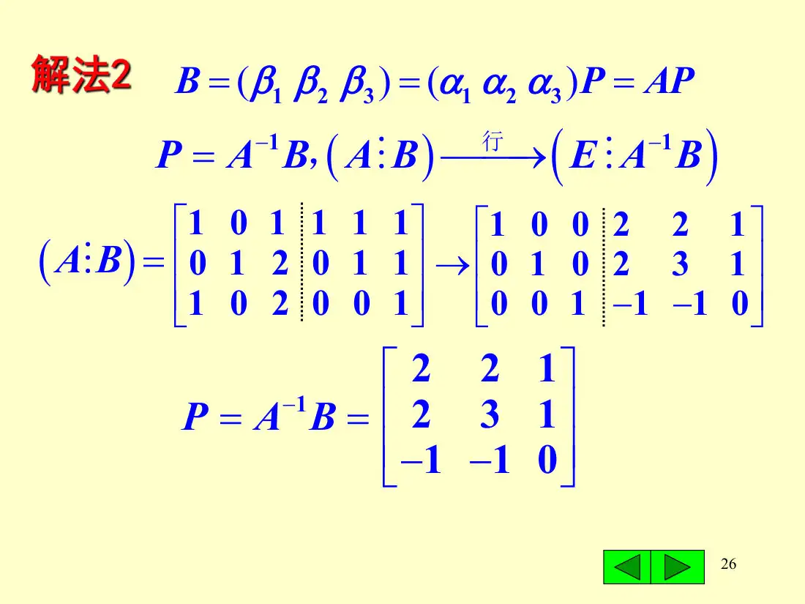

原文：

$$
\boldsymbol {P} = \boldsymbol {A} ^ {- 1} \boldsymbol {B}, (\boldsymbol {A}: \boldsymbol {B}) \xrightarrow {\text {行}} (\boldsymbol {E}: \boldsymbol {A} ^ {- 1} \boldsymbol {B})
$$

$$
(A: B) = \left[\begin{array}{c c c c c c}1&0&1&1&1&1\\0&1&2&0&1&1\\1&0&2&0&0&1\end{array}\right]\rightarrow \left[\begin{array}{c c c c c c}1&0&0&2&2&1\\0&1&0&2&3&1\\0&0&1&- 1&- 1&0\end{array}\right]
$$

$$
\boldsymbol {P} = \boldsymbol {A} ^ {- 1} \boldsymbol {B} = \left[ \begin{array}{l l l} 2 & 2 & 1 \\ 2 & 3 & 1 \\ - 1 & - 1 & 0 \end{array} \right]
$$

◀ △

26

### $$

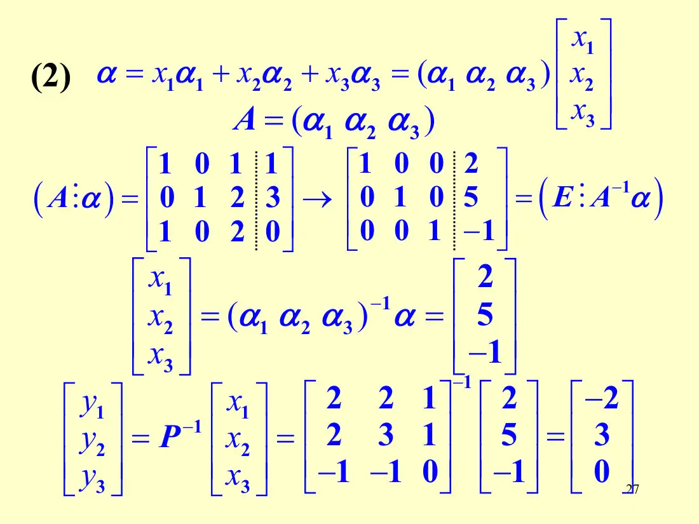

原文：

$$
\begin{array}{r} \alpha = x _ {1} \alpha_ {1} + x _ {2} \alpha_ {2} + x _ {3} \alpha_ {3} = (\alpha_ {1} \alpha_ {2} \alpha_ {3}) \left[ \begin{array}{l} x _ {1} \\ x _ {2} \\ x _ {3} \end{array} \right] \\ A = (\alpha_ {1} \alpha_ {2} \alpha_ {3}) \end{array}\tag{2}
$$

$$
(A \vdots \alpha) = \left[\begin{array}{c c c c}1&0&1&1\\0&1&2&3\\1&0&2&0\end{array}\right]\rightarrow \left[\begin{array}{c c c c}1&0&0&2\\0&1&0&5\\0&0&1&- 1\end{array}\right] = (E \vdots A ^ {- 1} \alpha)
$$

$$
\left[ \begin{array}{l} x _ {1} \\ x _ {2} \\ x _ {3} \end{array} \right] = (\alpha_ {1} \alpha_ {2} \alpha_ {3}) ^ {- 1} \alpha = \left[ \begin{array}{l} 2 \\ 5 \\ - 1 \end{array} \right]
$$

$$
\left[ \begin{array}{l} y _ {1} \\ y _ {2} \\ y _ {3} \end{array} \right] = P ^ {- 1} \left[ \begin{array}{l} x _ {1} \\ x _ {2} \\ x _ {3} \end{array} \right] = \left[ \begin{array}{l l l} 2 & 2 & 1 \\ 2 & 3 & 1 \\ - 1 & - 1 & 0 \end{array} \right] ^ {- 1} \left[ \begin{array}{l} 2 \\ 5 \\ - 1 \end{array} \right] = \left[ \begin{array}{l} - 2 \\ 3 \\ 0 \end{array} \right] _ {2 7}
$$

### 例9 设有向量

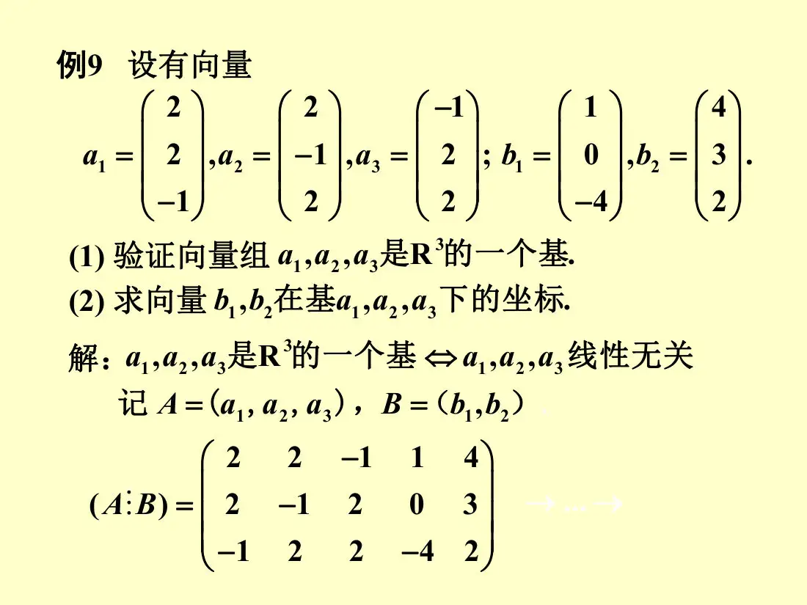

原文：

例9 设有向量

$$
a _ {1} = \left( \begin{array}{c} 2 \\ 2 \\ - 1 \end{array} \right), a _ {2} = \left( \begin{array}{c} 2 \\ - 1 \\ 2 \end{array} \right), a _ {3} = \left( \begin{array}{c} - 1 \\ 2 \\ 2 \end{array} \right); b _ {1} = \left( \begin{array}{c} 1 \\ 0 \\ - 4 \end{array} \right), b _ {2} = \left( \begin{array}{c} 4 \\ 3 \\ 2 \end{array} \right).
$$

(1) 验证向量组 $a_{1}, a_{2}, a_{3}$ 是 $R^{3}$ 的一个基.

(2) 求向量 $b_{1}, b_{2}$ 在基 $a_{1}, a_{2}, a_{3}$ 下的坐标.

解： $a_1, a_2, a_3$ 是 $\mathbf{R}^3$ 的一个基 $\Leftrightarrow a_1, a_2, a_3$ 线性无关

记 $A = (a_{1}, a_{2}, a_{3})$ ， $B = (b_{1}, b_{2})$

$$
(A \vdots B) = \left(\begin{array}{c c c c c}2&2&- 1&1&4\\2&- 1&2&0&3\\- 1&2&2&- 4&2\end{array}\right) \quad \rightarrow \dots \rightarrow
$$

### $$

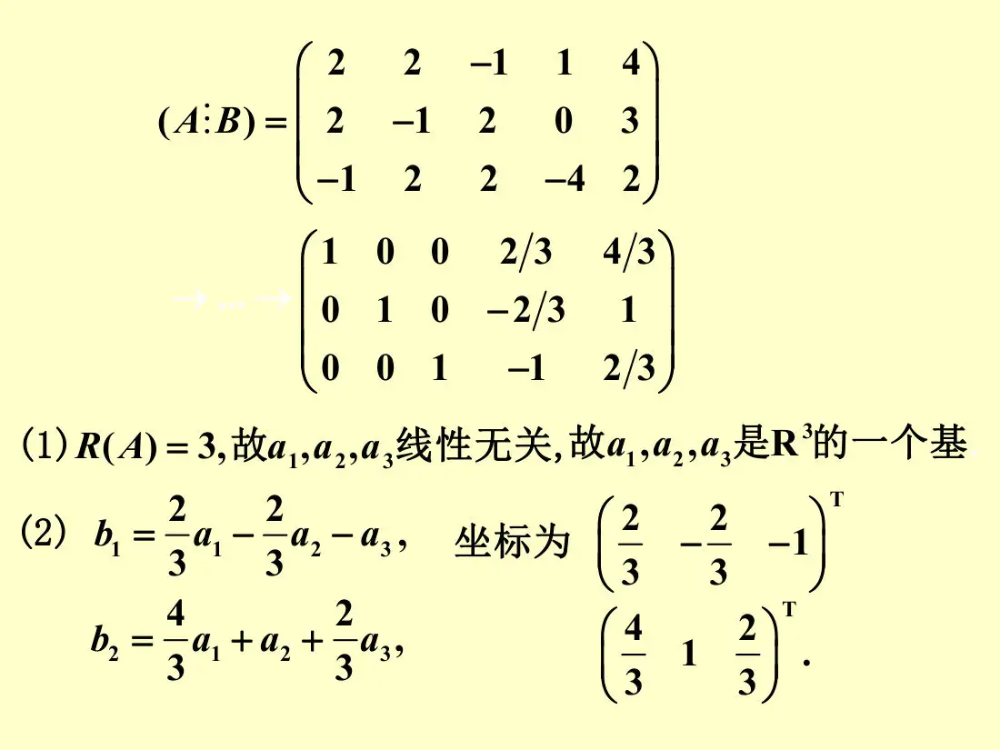

原文：

$$
(A \vdots B) = \left( \begin{array}{r r r r r} 2 & 2 & - 1 & 1 & 4 \\ 2 & - 1 & 2 & 0 & 3 \\ - 1 & 2 & 2 & - 4 & 2 \end{array} \right)
$$

$$
\rightarrow \dots \rightarrow \left(\begin{array}{c c c c c}1&0&0&2 / 3&4 / 3\\0&1&0&- 2 / 3&1\\0&0&1&- 1&2 / 3\end{array}\right)
$$

(1) $R(A) = 3$ , 故 $a_1, a_2, a_3$ 线性无关, 故 $a_1, a_2, a_3$ 是 $\mathbf{R}^3$ 的一个基.  
(2) $b_1 = \frac{2}{3} a_1 - \frac{2}{3} a_2 - a_3$ , 坐标为 $\left(\frac{2}{3}, -\frac{2}{3}, -1\right)^{\mathrm{T}}$ $b_2 = \frac{4}{3} a_1 + a_2 + \frac{2}{3} a_3$ , $\left(\frac{4}{3}, 1, \frac{2}{3}\right)^{\mathrm{T}}$ .

### 例10 设有向量

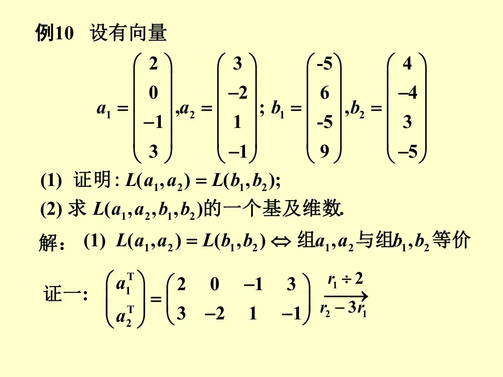

原文：

例10 设有向量

$$
a _ {1} = \left( \begin{array}{r} 2 \\ 0 \\ - 1 \\ 3 \end{array} \right), a _ {2} = \left( \begin{array}{r} 3 \\ - 2 \\ 1 \\ - 1 \end{array} \right); b _ {1} = \left( \begin{array}{r} - 5 \\ 6 \\ - 5 \\ 9 \end{array} \right), b _ {2} = \left( \begin{array}{r} 4 \\ - 4 \\ 3 \\ - 5 \end{array} \right)
$$

(1) 证明: $L(a_{1}, a_{2}) = L(b_{1}, b_{2})$ ;

(2) 求 $L(a_{1}, a_{2}, b_{1}, b_{2})$ 的一个基及维数.

解：(1) $L(a_{1},a_{2}) = L(b_{1},b_{2})\Leftrightarrow$ 组 $a_1,a_2$ 与组 $b_{1},b_{2}$ 等价

$$
\text {证一:} \binom{a _ {1} ^ {\mathrm{T}}}{a _ {2} ^ {\mathrm{T}}} = \left( \begin{array}{c c c c} 2 & 0 & - 1 & 3 \\ 3 & - 2 & 1 & - 1 \end{array} \right) \xrightarrow [ r _ {2} - 3 r _ {1} ]{r _ {1} \div 2}
$$

### $$

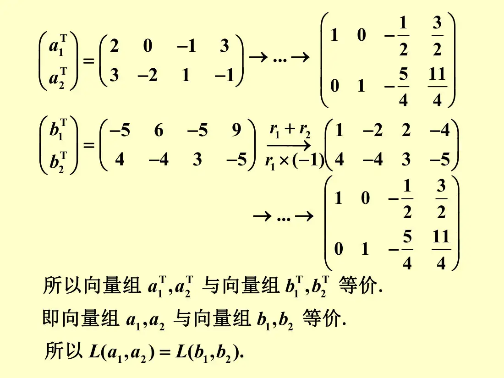

原文：

$$
\left(\begin{array}{l}a _ {1} ^ {\mathrm{T}}\\a _ {2} ^ {\mathrm{T}}\end{array}\right) = \left(\begin{array}{c c c c}2&0&- 1&3\\3&- 2&1&- 1\end{array}\right)\rightarrow \dots \rightarrow \left(\begin{array}{c c c c}1&0&- \frac {1}{2}&\frac {3}{2}\\0&1&- \frac {5}{4}&\frac {1 1}{4}\end{array}\right)
$$

$$
\begin{array}{r l}\binom {b _ {1} ^ {\mathrm{T}}} {b _ {2} ^ {\mathrm{T}}} =&\left(\begin{array}{c c c c}- 5&6&- 5&9\\4&- 4&3&- 5\end{array}\right) \xrightarrow [ r _ {1} \times (- 1) ]{r _ {1} + r _ {2}} \left(\begin{array}{c c c c}1&- 2&2&- 4\\4&- 4&3&- 5\end{array}\right)\\&\rightarrow \dots \rightarrow \left(\begin{array}{c c c c}1&0&- \frac {1}{2}&\frac {3}{2}\\0&1&- \frac {5}{4}&\frac {1 1}{4}\end{array}\right)\end{array}
$$

所以向量组 $a_{1}^{T}, a_{2}^{T}$ 与向量组 $b_{1}^{T}, b_{2}^{T}$ 等价.

即向量组 $a_{1}, a_{2}$ 与向量组 $b_{1}, b_{2}$ 等价.

所以 $L(a_{1},a_{2})=L(b_{1},b_{2})$ .

### 例10 设有向量

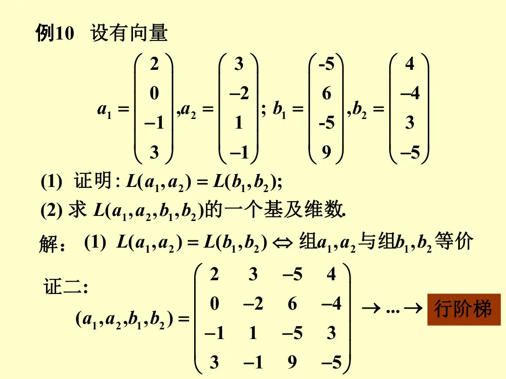

原文：

例10 设有向量

$$
a _ {1} = \left( \begin{array}{r} 2 \\ 0 \\ - 1 \\ 3 \end{array} \right), a _ {2} = \left( \begin{array}{r} 3 \\ - 2 \\ 1 \\ - 1 \end{array} \right); b _ {1} = \left( \begin{array}{r} - 5 \\ 6 \\ - 5 \\ 9 \end{array} \right), b _ {2} = \left( \begin{array}{r} 4 \\ - 4 \\ 3 \\ - 5 \end{array} \right)
$$

(1) 证明: $L(a_{1}, a_{2}) = L(b_{1}, b_{2})$ ;

(2) 求 $L(a_{1}, a_{2}, b_{1}, b_{2})$ 的一个基及维数.

解：(1) $L(a_{1},a_{2}) = L(b_{1},b_{2})\Leftrightarrow$ 组 $a_1,a_2$ 与组 $b_{1},b_{2}$ 等价

证二：

$$
\text {二}: \quad (a _ {1}, a _ {2}, b _ {1}, b _ {2}) = \left(\begin{array}{r r r r}2&3&- 5&4\\0&- 2&6&- 4\\- 1&1&- 5&3\\3&- 1&9&- 5\end{array}\right)\rightarrow \dots \rightarrow
$$

行阶梯

### $$

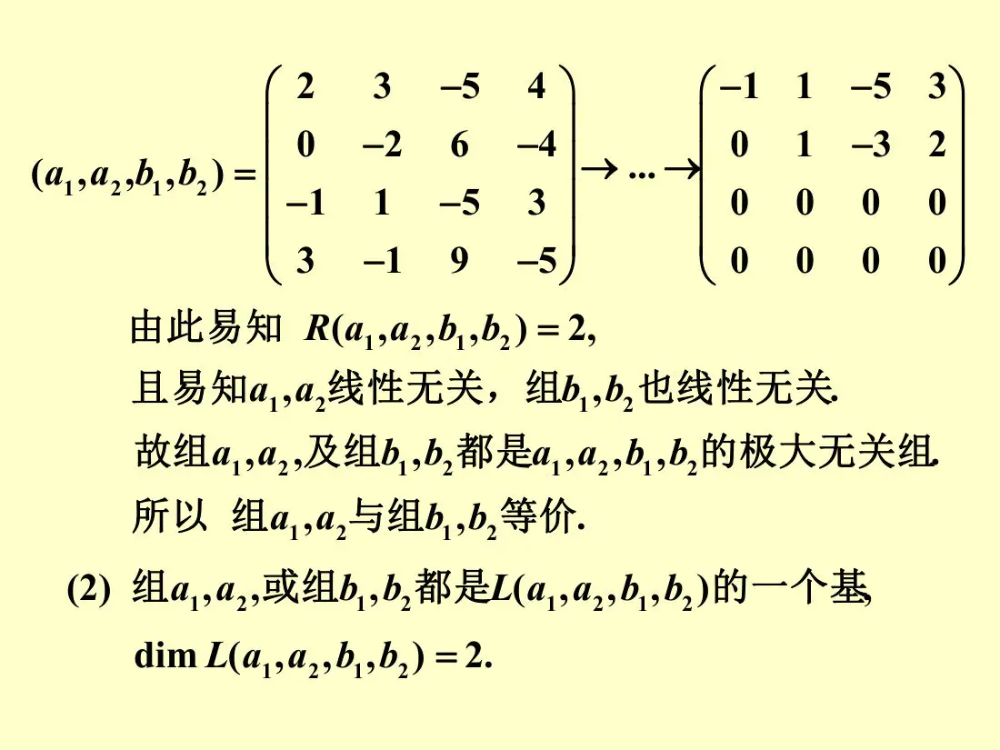

原文：

$$
(a _ {1}, a _ {2}, b _ {1}, b _ {2}) = \left(\begin{array}{r r r r}2&3&- 5&4\\0&- 2&6&- 4\\- 1&1&- 5&3\\3&- 1&9&- 5\end{array}\right)\rightarrow \dots \rightarrow \left(\begin{array}{r r r r}- 1&1&- 5&3\\0&1&- 3&2\\0&0&0&0\\0&0&0&0\end{array}\right)
$$

由此易知 $R(a_{1},a_{2},b_{1},b_{2})=2,$

且易知 $a_{1},a_{2}$ 线性无关，组 $b_{1},b_{2}$ 也线性无关.
故组 $a_{1},a_{2}$ ，及组 $b_{1},b_{2}$ 都是 $a_{1},a_{2},b_{1},b_{2}$ 的极大无关组。
所以 组 $a_{1},a_{2}$ 与组 $b_{1},b_{2}$ 等价.

(2) 组 $a_{1}, a_{2}$ , 或组 $b_{1}, b_{2}$ 都是 $L(a_{1}, a_{2}, b_{1}, b_{2})$ 的一个基, $\dim L(a_{1}, a_{2}, b_{1}, b_{2}) = 2$ .

### 解:

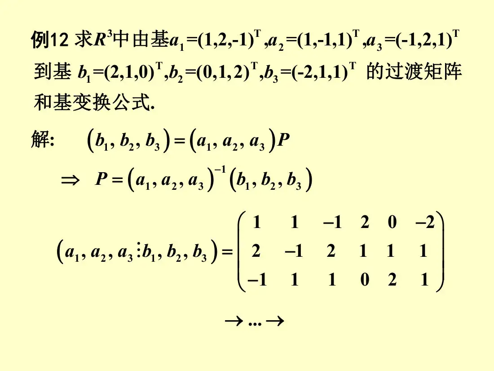

原文：

例12 求 $R^{3}$ 中由基 $a_{1}=(1,2,-1)^{\mathrm{T}},a_{2}=(1,-1,1)^{\mathrm{T}},a_{3}=(-1,2,1)^{\mathrm{T}}$ 到基 $b_{1}=(2,1,0)^{\mathrm{T}},b_{2}=(0,1,2)^{\mathrm{T}},b_{3}=(-2,1,1)^{\mathrm{T}}$ 的过渡矩阵和基变换公式.

解:

$$
\begin{array}{l} \left(b _ {1}, b _ {2}, b _ {3}\right) = \left(a _ {1}, a _ {2}, a _ {3}\right) P \\ \Rightarrow P = \left(a _ {1}, a _ {2}, a _ {3}\right) ^ {- 1} \left(b _ {1}, b _ {2}, b _ {3}\right) \end{array}
$$

$$
\left(a _ {1}, a _ {2}, a _ {3}: b _ {1}, b _ {2}, b _ {3}\right) = \left( \begin{array}{r r r r r r} 1 & 1 & - 1 & 2 & 0 & - 2 \\ 2 & - 1 & 2 & 1 & 1 & 1 \\ - 1 & 1 & 1 & 0 & 2 & 1 \end{array} \right)
$$

### $$

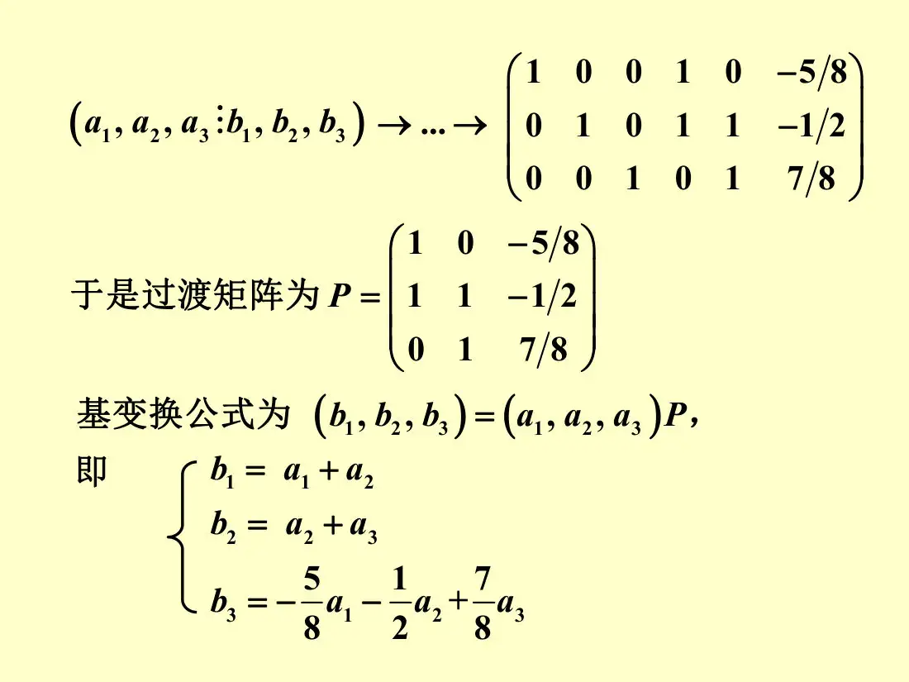

原文：

$$
\left(a _ {1}, a _ {2}, a _ {3}: b _ {1}, b _ {2}, b _ {3}\right)\rightarrow \dots \rightarrow \left(\begin{array}{c c c c c c}1&0&0&1&0&- 5 / 8\\0&1&0&1&1&- 1 / 2\\0&0&1&0&1&7 / 8\end{array}\right)
$$

于是过渡矩阵为 $P = \begin{pmatrix} 1 & 0 & -5 / 8 \\ 1 & 1 & -1 / 2 \\ 0 & 1 & 7 / 8 \end{pmatrix}$

基变换公式为 $\left(b_{1}, b_{2}, b_{3}\right) = \left(a_{1}, a_{2}, a_{3}\right) P,$

即

$$
\left\{ \begin{array}{l} b _ {1} = a _ {1} + a _ {2} \\ b _ {2} = a _ {2} + a _ {3} \\ b _ {3} = - \frac {5}{8} a _ {1} - \frac {1}{2} a _ {2} + \frac {7}{8} a _ {3} \end{array} \right.
$$

### 解:

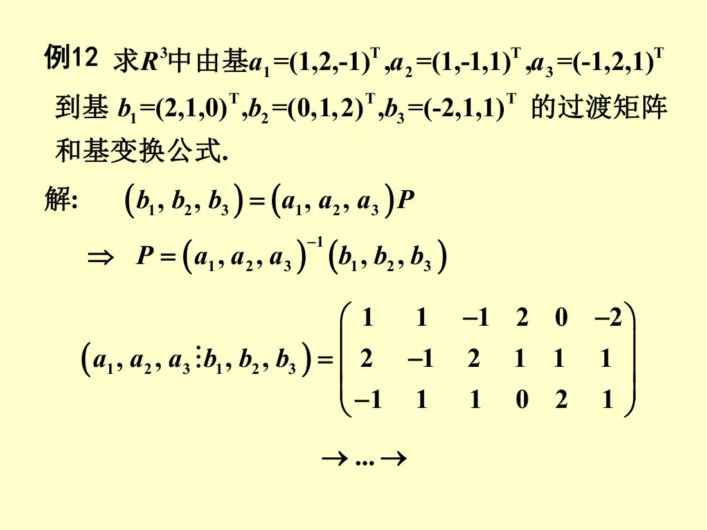

原文：

例12 求 $R^{3}$ 中由基 $a_{1}=(1,2,-1)^{\mathrm{T}},a_{2}=(1,-1,1)^{\mathrm{T}},a_{3}=(-1,2,1)^{\mathrm{T}}$ 到基 $b_{1}=(2,1,0)^{\mathrm{T}},b_{2}=(0,1,2)^{\mathrm{T}},b_{3}=(-2,1,1)^{\mathrm{T}}$ 的过渡矩阵和基变换公式.

解:

$$
\begin{array}{r l} & (b _ {1}, b _ {2}, b _ {3}) = (a _ {1}, a _ {2}, a _ {3}) P \\ \Rightarrow & P = (a _ {1}, a _ {2}, a _ {3}) ^ {- 1} (b _ {1}, b _ {2}, b _ {3}) \end{array}
$$

$$
\left(a _ {1}, a _ {2}, a _ {3}: b _ {1}, b _ {2}, b _ {3}\right) = \left( \begin{array}{r r r r r r} 1 & 1 & - 1 & 2 & 0 & - 2 \\ 2 & - 1 & 2 & 1 & 1 & 1 \\ - 1 & 1 & 1 & 0 & 2 & 1 \end{array} \right)
$$

### $$

原文：

$$
\left(a _ {1}, a _ {2}, a _ {3}: b _ {1}, b _ {2}, b _ {3}\right)\rightarrow \dots \rightarrow \left(\begin{array}{c c c c c c}1&0&0&1&0&- 5 / 8\\0&1&0&1&1&- 1 / 2\\0&0&1&0&1&7 / 8\end{array}\right)
$$

于是过渡矩阵为 $P = \begin{pmatrix} 1 & 0 & -5 / 8 \\ 1 & 1 & -1 / 2 \\ 0 & 1 & 7 / 8 \end{pmatrix}$

基变换公式为 $\left(b_{1}, b_{2}, b_{3}\right) = \left(a_{1}, a_{2}, a_{3}\right) P,$

即

$$
\left\{ \begin{array}{l} b _ {1} = a _ {1} + a _ {2} \\ b _ {2} = a _ {2} + a _ {3} \\ b _ {3} = - \frac {5}{8} a _ {1} - \frac {1}{2} a _ {2} + \frac {7}{8} a _ {3} \end{array} \right.
$$
